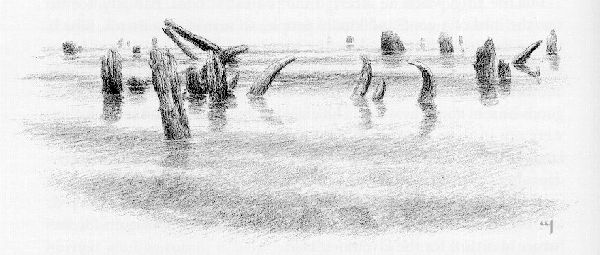
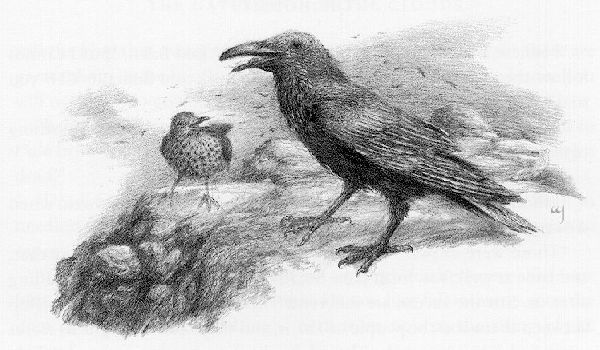
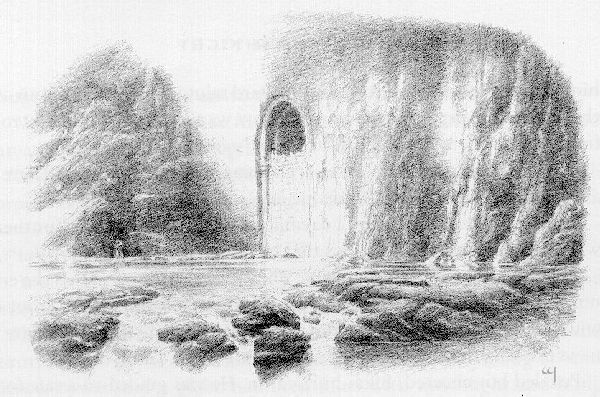
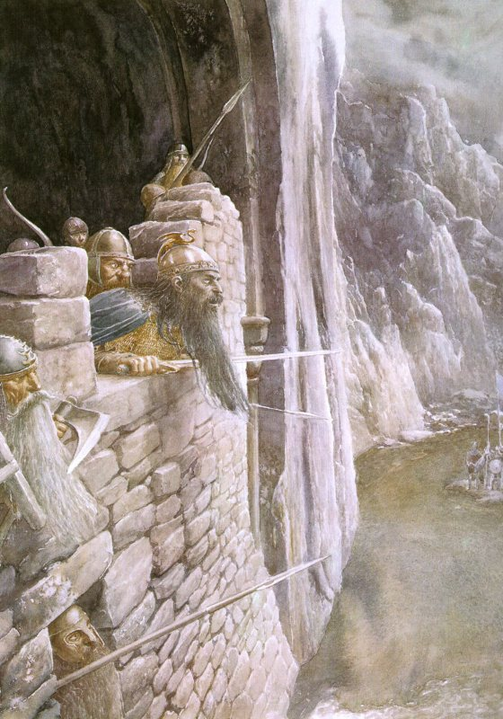

## Kapitel 15: Die Wolken ziehen auf

Nun wollen wir zu Bilbo und den Zwergen zurückkehren. Die ganze Nacht hindurch hatte einer von ihnen <abbr title="die Wache, die Wachen — часовой; стражник">Wache</abbr> gehalten; doch als der Morgen kam, hatten sie kein Anzeichen einer Gefahr gehört oder gesehen. Die Vögel jedoch sammelten sich in immer dichteren Scharen. Aus dem Süden kamen ihre Schwärme herangeflogen, und die <abbr title="die Krähe, die Krähen — ворона">Krähen</abbr>, die noch immer rund um den Berg lebten, kreisten unaufhörlich schreiend über ihnen.

— Etwas Seltsames geschieht, — sagte Thorin. — Die Zeit des herbstlichen Vogelzugs ist vorbei, und diese Vögel leben das ganze Jahr in diesem Land. Da sind Stare und Schwärme von Finken; und weit entfernt sieht man viele <abbr title="der Aasvogel, die Aasvögel — птица-падальщик">Aasvögel</abbr>, als stünde eine Schlacht bevor!

Plötzlich zeigte Bilbo auf etwas.

— Da ist wieder die alte <abbr title="die Drossel, die Drosseln — дрозд">Drossel</abbr>! — rief er. — Offenbar ist sie entkommen, als Smaug den Berghang zertrümmerte. Aber die <abbr title="die Schnecke, die Schnecken — слизень; улитка">Schnecken</abbr> wohl kaum!

Tatsächlich war die alte <abbr title="die Drossel, die Drosseln — дрозд">Drossel</abbr> da. Als Bilbo auf sie zeigte, flog sie zu ihnen herüber und setzte sich auf einen Stein in der Nähe. Dann schlug sie flatternd mit den Flügeln und sang; danach legte sie den Kopf schief, als <abbr title="lauschen — прислушиваться">lauschte</abbr> sie. Wieder sang sie, und wieder <abbr title="lauschen — прислушиваться">lauschte</abbr> sie.

— Ich glaube, sie will uns etwas sagen, — meinte Balin. — Aber ich kann der Sprache solcher Vögel nicht folgen; sie ist sehr schnell und schwierig. Kannst du sie verstehen, Baggins?

— Nicht besonders gut, — sagte Bilbo (in Wahrheit verstand er überhaupt nichts). — Aber der alte Bursche scheint sehr aufgeregt zu sein.

— Wäre sie doch nur ein <abbr title="der Rabe, die Raben — ворон">Rabe</abbr>! — sagte Balin.

— Ich dachte, du magst sie nicht! Als wir früher hier vorbeikamen, schienst du dich sehr vor ihnen zu scheuen.

— Das waren <abbr title="die Krähe, die Krähen — ворона">Krähen</abbr>! Und obendrein hässliche, verdächtig aussehende Geschöpfe, unhöflich noch dazu. Du musst doch die gemeinen Schimpfnamen gehört haben, die sie uns hinterherriefen. Aber <abbr title="der Rabe, die Raben — ворон">Raben</abbr> sind anders. Zwischen ihnen und Thrors Volk bestand früher eine große Freundschaft. Oft brachten sie uns geheime Nachrichten, und zur <abbr title="die Belohnung, die Belohnungen — вознаграждение">Belohnung</abbr> bekamen sie glänzende Dinge, die sie <abbr title="begehren — страстно желать">begehrten</abbr> und in ihren Behausungen verstecken wollten.

— Sie leben viele Jahre, haben ein langes Gedächtnis und geben ihre Weisheit an ihre Kinder weiter. Als ich ein junger <abbr title="der Zwerg, die Zwerge — гном">Zwerg</abbr> war, kannte ich viele der <abbr title="der Rabe, die Raben — ворон">Raben</abbr>, die in den <abbr title="der Felsen, die Felsen — скала; утёс">Felsen</abbr> lebten. Gerade diese Höhe wurde einst Ravenhill genannt, weil ein weises und berühmtes Paar, der alte Carc und seine Frau, hier über der Wachkammer wohnte. Aber ich glaube nicht, dass heute noch welche von diesem alten <abbr title="das Geschlecht, die Geschlechter — род; династия">Geschlecht</abbr> hier verweilen.

Kaum hatte er zu Ende gesprochen, stieß die alte <abbr title="die Drossel, die Drosseln — дрозд">Drossel</abbr> einen lauten Ruf aus und flog sofort davon.

— Vielleicht verstehen wir sie nicht, aber dieser alte Vogel versteht uns, da bin ich sicher, — sagte Balin. — Haltet jetzt die Augen offen und seht, was geschieht!

Bald darauf hörte man Flügel flattern, und die <abbr title="die Drossel, die Drosseln — дрозд">Drossel</abbr> kehrte zurück. Mit ihr kam ein äußerst <abbr title="gebrechlich — дряхлый">gebrechlicher</abbr> alter Vogel. Er wurde schon blind, konnte kaum noch fliegen, und oben auf dem Kopf hatte er keine Federn mehr. Es war ein sehr alter <abbr title="der Rabe, die Raben — ворон">Rabe</abbr> von gewaltiger Größe. Steif landete er vor ihnen auf dem Boden, schlug langsam mit den Flügeln und wippte auf Thorin zu.

— O Thorin, Sohn des Thrain, und Balin, Sohn des Fundin, — <abbr title="krächzen — каркать">krächzte</abbr> er (und Bilbo verstand ihn, denn er sprach die gewöhnliche Sprache und nicht die Vogelsprache). — Ich bin Roäc, Carcs Sohn. Carc ist tot, doch einst war er euch wohlbekannt. Hundertdreiundfünfzig Jahre ist es her, seit ich aus dem Ei kam, aber ich vergesse nicht, was mein Vater mir erzählte. Jetzt bin ich der <abbr title="der Anführer, die Anführer — предводитель">Anführer</abbr> der großen <abbr title="der Rabe, die Raben — ворон">Raben</abbr> des Berges. Wir sind wenige, doch wir erinnern uns noch an den König von einst. Die meisten meines Volkes sind unterwegs, denn im Süden gibt es große Neuigkeiten: Einige werden euch Freude bringen, andere werdet ihr weniger gut finden.

— Seht! Aus Süden, Osten und <abbr title="die Weste, die Westen — жилет">Westen</abbr> sammeln sich die Vögel wieder am Berg und in Dale; denn die Nachricht ist hinausgegangen, dass Smaug tot ist!

— Tot! Tot? — schrien die <abbr title="der Zwerg, die Zwerge — гном">Zwerge</abbr>. — Tot! Dann haben wir uns unnötig gefürchtet, und der <abbr title="der Schatz, die Schätze — клад; сокровище">Schatz</abbr> gehört uns!

Alle sprangen auf und hüpften vor Freude umher.

— Ja, tot, — sagte Roäc. — Die <abbr title="die Drossel, die Drosseln — дрозд">Drossel</abbr>, mögen ihre Federn niemals ausfallen, <abbr title="sehen (sah, hat gesehen) — увидел">sah</abbr> ihn sterben, und wir dürfen ihren Worten vertrauen. Sie <abbr title="sehen (sah, hat gesehen) — увидел">sah</abbr>, wie er im Kampf gegen die Menschen von Esgaroth fiel, vor drei Nächten, als der Mond aufging.

Es dauerte eine Weile, bis Thorin die <abbr title="der Zwerg, die Zwerge — гном">Zwerge</abbr> zum Schweigen bringen konnte, damit sie den Nachrichten des <abbr title="der Rabe, die Raben — ворон">Raben</abbr> zuhörten. Nachdem dieser schließlich die ganze Geschichte der Schlacht erzählt hatte, fuhr er fort:

— So viel zu den Freuden, Thorin Oakenshield. Ihr könnt gefahrlos in eure Hallen zurückkehren; der ganze <abbr title="der Schatz, die Schätze — клад; сокровище">Schatz</abbr> gehört euch — vorläufig. Doch außer den Vögeln kommen noch viele andere hierher. Die Nachricht vom Tod des Wächters hat sich schon weit verbreitet, und die Sage von Thrors Reichtum ist in den vielen Jahren des Weitererzählens nicht kleiner geworden. Viele wollen einen <abbr title="der Anteil, die Anteile — доля">Anteil</abbr> an der <abbr title="die Beute — добыча">Beute</abbr>. Schon ist ein Heer der <abbr title="der Elf, die Elfen — эльф">Elfen</abbr> unterwegs, und <abbr title="der Aasvogel, die Aasvögel — птица-падальщик">Aasvögel</abbr> begleiten es in der Hoffnung auf Kampf und <abbr title="das Gemetzel, die Gemetzel — резня">Gemetzel</abbr>. Am See <abbr title="murren — роптать">murren</abbr> die Menschen, die <abbr title="der Zwerg, die Zwerge — гном">Zwerge</abbr> seien schuld an ihrem Leid; denn sie sind ohne Heimat, viele sind gestorben, und Smaug hat ihre Stadt zerstört. Auch sie hoffen, aus eurem <abbr title="der Schatz, die Schätze — клад; сокровище">Schatz</abbr> Ersatz für ihren Verlust zu erhalten, ob ihr nun lebt oder tot seid.

— Eure eigene Weisheit muss entscheiden, welchen Weg ihr einschlagt. Doch dreizehn sind nur ein kleiner Rest des großen Volkes von Durin, das einst hier wohnte und nun weit verstreut lebt. Wenn ihr auf meinen Rat hören wollt, vertraut nicht dem Herrn der Menschen vom See, sondern dem, der den <abbr title="der Drache, die Drachen — дракон">Drachen</abbr> mit seinem <abbr title="der Bogen, die Bögen — лук">Bogen</abbr> erschoss. Bard heißt er, aus dem Volk von Dale und dem <abbr title="das Geschlecht, die Geschlechter — род; династия">Geschlecht</abbr> Girions; er ist ein finsterer Mann, aber <abbr title="aufrichtig — честный; искренний">aufrichtig</abbr>. Nach der langen <abbr title="die Verwüstung, die Verwüstungen — опустошение">Verwüstung</abbr> möchten wir wieder Frieden zwischen Zwergen, Menschen und <abbr title="der Elf, die Elfen — эльф">Elfen</abbr> <abbr title="sehen (sah, hat gesehen) — увидел">sehen</abbr>; doch das könnte euch viel Gold kosten. Ich habe gesprochen.

Da brach Thorin zornig los:

— Unser Dank sei dir, Roäc, Carcs Sohn. Dich und dein Volk werden wir nicht vergessen. Aber Diebe sollen nichts von unserem Gold nehmen, und niemand soll es mit <abbr title="die Gewalt — сила; насилие">Gewalt</abbr> fortschaffen, solange wir leben. Wenn du dir noch größeren Dank verdienen willst, bring uns Nachricht von jedem, der sich nähert. Auch möchte ich dich bitten: Falls einige von euch noch jung und kräftig im Flügel sind, schickt <abbr title="der Bote, die Boten — гонец; посланник">Boten</abbr> zu unseren <abbr title="der Verwandte, die Verwandten — родственник">Verwandten</abbr> in den Bergen des Nordens, westlich wie östlich von hier, und berichtet ihnen von unserer <abbr title="die Notlage, die Notlagen — бедственное положение">Notlage</abbr>. Fliegt aber besonders zu meinem Vetter Dain in den Iron Hills. Er hat viele gut bewaffnete Leute und wohnt diesem Ort am nächsten. Fordert ihn auf, sich zu beeilen!

— Ich will nicht sagen, ob dieser Rat gut oder schlecht ist, — <abbr title="krächzen — каркать">krächzte</abbr> Roäc, — aber ich werde tun, was getan werden kann.

Dann flog er langsam davon.

— Jetzt zurück zum Berg! — rief Thorin. — Wir haben wenig Zeit zu verlieren.

— Und wenig zu essen! — rief Bilbo, der in solchen Dingen immer praktisch dachte. Jedenfalls fand er, dass das <abbr title="das Abenteuer, die Abenteuer — приключение">Abenteuer</abbr> mit dem Tod des <abbr title="der Drache, die Drachen — дракон">Drachen</abbr> eigentlich vorbei sei — worin er sich sehr täuschte. Für einen friedlichen <abbr title="der Abschluss, die Abschlüsse — завершение">Abschluss</abbr> dieser Angelegenheiten hätte er den größten Teil seines Gewinnanteils hergegeben.

— Zurück zum Berg! — riefen die <abbr title="der Zwerg, die Zwerge — гном">Zwerge</abbr>, als hätten sie ihn nicht gehört; also musste er mit ihnen zurückgehen.

Da ihr einige der Ereignisse schon gehört habt, werdet ihr verstehen, dass den Zwergen noch mehrere Tage blieben. Sie erforschten die <abbr title="die Höhle, die Höhlen — нора; пещера">Höhlen</abbr> ein weiteres Mal und fanden, wie erwartet, nur noch das Front Gate offen. Alle anderen Tore — außer natürlich der kleinen Geheimtür — hatte Smaug längst zerstört und versperrt; von ihnen war keine Spur mehr geblieben. Nun arbeiteten sie hart daran, den Haupteingang zu <abbr title="befestigen — укреплять">befestigen</abbr> und einen neuen Weg von dort aus anzulegen. <abbr title="das Werkzeug, die Werkzeuge — инструмент">Werkzeuge</abbr>, die einst die Bergleute, Steinbrucharbeiter und Baumeister benutzt hatten, gab es in großer Zahl, und in solchen Arbeiten waren die <abbr title="der Zwerg, die Zwerge — гном">Zwerge</abbr> noch immer sehr geschickt.

Während sie arbeiteten, brachten die <abbr title="der Rabe, die Raben — ворон">Raben</abbr> ständig Nachrichten. So erfuhren sie, dass der Elvenking zum See abgebogen war und ihnen noch eine Atempause blieb. Noch besser war die Nachricht, dass drei ihrer Ponys entkommen waren. Sie streiften weit unten an den Ufern des River Running frei umher, nicht weit von der Stelle, wo die übrigen <abbr title="der Vorrat, die Vorräte — запас">Vorräte</abbr> zurückgeblieben waren. Während die anderen weiterarbeiteten, wurden deshalb Fili und Kili ausgeschickt. Ein <abbr title="der Rabe, die Raben — ворон">Rabe</abbr> sollte sie führen, damit sie die Ponys fanden und alles zurückbrachten, was sie tragen konnten.

Vier Tage waren sie fort. Als sie zurückkamen, wussten die <abbr title="der Zwerg, die Zwerge — гном">Zwerge</abbr> bereits, dass die vereinten Heere der Menschen vom See und der <abbr title="der Elf, die Elfen — эльф">Elfen</abbr> zum Berg eilten. Doch ihre Hoffnung war jetzt größer: Wenn sie sparsam damit umgingen, hatten sie Nahrung für einige Wochen — natürlich hauptsächlich <abbr title="das Hartbrot — сухой дорожный хлеб">Hartbrot</abbr>, das ihnen gründlich zuwider war; aber <abbr title="das Hartbrot — сухой дорожный хлеб">Hartbrot</abbr> ist sehr viel besser als gar nichts. Außerdem war das Tor inzwischen versperrt. Eine sehr dicke und hohe Mauer aus rechteckig behauenen, ohne Mörtel aufgeschichteten Steinen <abbr title="standhalten (hielt stand, hat standgehalten) — держаться; не отступать">stand</abbr> quer vor der Öffnung. Die Mauer hatte Löcher, durch die man schauen oder schießen konnte, aber keinen Eingang. Mit Leitern kletterten sie hinein oder hinaus, und Gegenstände zogen sie an Seilen hinauf.

Damit der Bach abfließen konnte, hatten sie unter der neuen Mauer einen kleinen, niedrigen <abbr title="der Bogen, die Bögen — арка; лук">Bogen</abbr> gebaut. Nahe dem Eingang hatten sie jedoch das schmale Bachbett so verändert, dass sich nun ein breites Wasserbecken von der Bergwand bis zum oberen Rand des Wasserfalls erstreckte, über den der Bach nach Dale hinabstürzte. Ohne zu schwimmen konnte man das Tor jetzt nur über einen schmalen <abbr title="der Felsvorsprung, die Felsvorsprünge — скальный выступ">Felsvorsprung</abbr> erreichen, der rechts lag, wenn man von der Mauer nach draußen blickte. Die Ponys hatten sie nur bis zum oberen Ende der Stufen über der alten Brücke gebracht. Dort hatten sie sie abgeladen, ihnen befohlen, zu ihren Herren zurückzukehren, und sie ohne Reiter nach Süden geschickt.

Dann kam eine Nacht, in der vor ihnen weit im Süden in Dale plötzlich viele Lichter erschienen, wie von Feuern und <abbr title="die Fackel, die Fackeln — факел">Fackeln</abbr>.

— Sie sind angekommen! — rief Balin. — Und ihr <abbr title="das Lager, die Lager — лагерь">Lager</abbr> ist riesig. Sie müssen im Schutz der Dämmerung an beiden Flussufern entlang ins Tal gezogen sein.

In dieser Nacht schliefen die <abbr title="der Zwerg, die Zwerge — гном">Zwerge</abbr> wenig. Der Morgen war noch blass, als sie eine Gruppe näher kommen sahen. Hinter ihrer Mauer beobachteten sie, wie die Ankömmlinge bis zum oberen Ende des Tals gingen und langsam hinaufstiegen. Bald erkannten sie sowohl Menschen vom See, die wie für einen Krieg bewaffnet waren, als auch elbische <abbr title="der Bogenschütze, die Bogenschützen — лучник">Bogenschützen</abbr>. Schließlich kletterten die Vordersten über die umgestürzten <abbr title="der Felsen, die Felsen — скала; утёс">Felsen</abbr> und erschienen oben am <abbr title="der Wasserfall, die Wasserfälle — водопад">Wasserfall</abbr>. Ihr Erstaunen war groß, als sie das Wasserbecken vor sich sahen und das Tor, das eine Mauer aus frisch behauenen Steinen versperrte.

Während sie dastanden, auf die Mauer zeigten und miteinander sprachen, rief Thorin sie an:

— Wer seid ihr, — rief er sehr laut, — die ihr wie zum Krieg vor die Tore von Thorin, Sohn des Thrain, dem König unter dem Berg, kommt, und was begehrt ihr?

Doch sie gaben keine Antwort. Einige kehrten rasch um; die anderen betrachteten noch eine Weile das Tor und seine Verteidigungsanlagen und folgten ihnen bald. An diesem Tag wurde das <abbr title="das Lager, die Lager — лагерь">Lager</abbr> an die Ostseite des Flusses verlegt, mitten zwischen die Arme des Berges. Nun hallten die <abbr title="der Felsen, die Felsen — скала; утёс">Felsen</abbr> von Stimmen und Gesang wider, wie schon seit vielen Tagen nicht mehr. Auch Elfenharfen und liebliche Musik erklangen. Als die <abbr title="der Klang, die Klänge — звук; звон">Klänge</abbr> zu den Zwergen hinaufdrangen, schien die Kälte der Luft wärmer zu werden, und sie nahmen schwach den <abbr title="der Duft, die Düfte — аромат">Duft</abbr> von Waldblumen wahr, die im Frühling blühten.

Da sehnte Bilbo sich danach, der dunklen <abbr title="die Festung, die Festungen — крепость">Festung</abbr> zu entkommen, hinabzugehen und an der Fröhlichkeit und den Festen bei den Feuern teilzunehmen. Auch einige der jüngeren <abbr title="der Zwerg, die Zwerge — гном">Zwerge</abbr> waren im Herzen bewegt. Sie <abbr title="murmeln — бормотать">murmelten</abbr>, sie wünschten, die Dinge wären anders gekommen und sie könnten solche Leute als Freunde willkommen heißen. Thorin aber blickte finster.

Nun holten die <abbr title="der Zwerg, die Zwerge — гном">Zwerge</abbr> selbst <abbr title="die Harfe, die Harfen — арфа">Harfen</abbr> und andere Instrumente hervor, die sie aus dem <abbr title="der Hort, die Horte — сокровища; клад">Hort</abbr> zurückgewonnen hatten, und machten Musik, um seine Stimmung zu mildern. Doch ihr Lied war nicht wie ein Elfenlied. Es ähnelte sehr dem, das sie vor langer Zeit in Bilbos kleiner Hobbithöhle gesungen hatten.

> Unter dem Berg, so dunkel und hoch,  
> Ist der König in seine Halle zurückgekehrt!  
> Sein Feind ist tot, der <abbr title="der Wurm, die Würmer — червь">Wurm</abbr> des Schreckens,  
> So sollen stets seine Feinde fallen.  

> Das <abbr title="das Schwert, die Schwerter — меч">Schwert</abbr> ist scharf, der <abbr title="der Speer, die Speere — копьё">Speer</abbr> ist lang,  
> Der <abbr title="der Pfeil, die Pfeile — стрела">Pfeil</abbr> fliegt schnell, das Tor hält <abbr title="standhalten (hielt stand, hat standgehalten) — держаться; не отступать">stand</abbr>;  
> Das Herz ist kühn, sieht Gold es glühn;  
> Den Zwergen wird kein Unrecht mehr getan.  

> Die <abbr title="der Zwerg, die Zwerge — гном">Zwerge</abbr> von einst wirkten mächtige Zauber,  
> Die Hämmer fielen mit Glockenklang,  
> In tiefen Gründen, wo dunkle Dinge <abbr title="schlummern — дремать">schlummern</abbr>,  
> In hohlen Hallen unterm Gebirg.  

> Auf silberne Halsketten reihten sie  
> Das Licht der Sterne; auf Kronen hing  
> Das Drachenfeuer. Gedrehtem <abbr title="der Draht, die Drähte — проволока">Draht</abbr>  
> <abbr title="entlocken — извлекать; выманивать">Entlockten</abbr> sie die Melodie der <abbr title="die Harfe, die Harfen — арфа">Harfen</abbr>.  

> Der Bergesthron ist wieder frei!  
> O wanderndes Volk, hört den Ruf! Eilt herbei!  
> Eilt herbei! Durch ödes Land!  
> Der König braucht Freunde und seine <abbr title="der Verwandte, die Verwandten — родственник">Verwandten</abbr>.  

> Nun rufen wir über die Berge kalt:  
> »Kehrt heim zu den <abbr title="die Höhle, die Höhlen — нора; пещера">Höhlen</abbr>, so tief und alt!«  
> Hier vor den Toren wartet der König,  
> Seine Hände sind reich an Gold und <abbr title="der Edelstein, die Edelsteine — драгоценный камень">Edelsteinen</abbr>.  

> Der König ist in seine Halle zurückgekehrt,  
> Unter dem Berg, so dunkel und hoch.  
> Der <abbr title="der Wurm, die Würmer — червь">Wurm</abbr> des Schreckens ist erschlagen und tot,  
> So sollen stets unsere Feinde fallen!  

Dieses Lied schien Thorin zu gefallen. Er lächelte wieder, wurde fröhlich und begann auszurechnen, wie weit es bis zu den Iron Hills war und wie lange Dain brauchen würde, um den Lonely Mountain zu erreichen, falls er aufgebrochen war, sobald die Nachricht ihn erreicht hatte. Bilbo aber verlor bei dem Lied und den Gesprächen den <abbr title="der Mut — смелость">Mut</abbr>: Beides klang ihm viel zu kriegerisch.

Am nächsten Morgen <abbr title="sehen (sah, hat gesehen) — увидел">sah</abbr> man früh eine Schar von <abbr title="der Speerträger, die Speerträger — копейщик">Speerträgern</abbr> den Fluss überqueren und talaufwärts marschieren. Sie trugen das grüne <abbr title="das Banner, die Banner — знамя">Banner</abbr> des Elvenking und das blaue <abbr title="das Banner, die Banner — знамя">Banner</abbr> des Sees und rückten vor, bis sie unmittelbar vor der Mauer am Tor standen.

Wieder rief Thorin sie mit lauter Stimme an:

— Wer seid ihr, die ihr zum Krieg bewaffnet vor die Tore von Thorin, Sohn des Thrain, dem König unter dem Berg, kommt?

Diesmal erhielt er eine Antwort.

Ein großer Mann mit dunklem Haar und finsterem Gesicht trat vor und rief:

— Sei gegrüßt, Thorin! Warum schließt du dich ein wie ein Räuber in seinem Schlupfwinkel? Noch sind wir keine Feinde, und wir freuen uns, dass du lebst, was wir kaum zu hoffen wagten. Wir kamen in der Erwartung, hier keinen Lebenden zu finden. Doch nun, da wir einander begegnet sind, gibt es Anlass zu <abbr title="die Verhandlung, die Verhandlungen — переговоры">Verhandlungen</abbr> und gemeinsamer Beratung.

— Wer bist du, und worüber willst du verhandeln?

— Ich bin Bard. Durch meine Hand wurde der <abbr title="der Drache, die Drachen — дракон">Drache</abbr> erschlagen und dein <abbr title="der Schatz, die Schätze — клад; сокровище">Schatz</abbr> befreit. Ist das keine Sache, die dich angeht? Außerdem bin ich durch rechtmäßige Abstammung der <abbr title="der Erbe, die Erben — наследник">Erbe</abbr> von Girion aus Dale. In deinem <abbr title="der Hort, die Horte — сокровища; клад">Hort</abbr> findet sich auch vieles vom Reichtum seiner Hallen und Städte, das Smaug einst stahl. Ist das keine Sache, über die wir sprechen dürfen? Ferner hat Smaug in seiner letzten Schlacht die Behausungen der Menschen von Esgaroth zerstört, und ich bin noch immer ein Diener ihres Herrn. Für ihn möchte ich sprechen und fragen, ob du keinen Gedanken an den Kummer und das <abbr title="das Elend — бедствие; нужда">Elend</abbr> seines Volkes verwendest. Sie halfen euch in eurer Not, und zum Dank habt ihr ihnen bisher nur Verderben gebracht, wenn auch gewiss ohne Absicht.

Das waren gerechte und wahre Worte, wenn auch stolz und finster gesprochen, und Bilbo glaubte, Thorin werde sofort anerkennen, wie viel Recht darin lag. Natürlich erwartete er nicht, dass sich jemand daran erinnern würde, dass er ganz allein die schwache Stelle des <abbr title="der Drache, die Drachen — дракон">Drachen</abbr> entdeckt hatte. Das war auch gut so, denn niemand erinnerte sich jemals daran. Doch er rechnete weder mit der <abbr title="die Macht, die Mächte — власть; сила">Macht</abbr> von Gold, auf dem ein <abbr title="der Drache, die Drachen — дракон">Drache</abbr> lange gebrütet hat, noch mit den Herzen der <abbr title="der Zwerg, die Zwerge — гном">Zwerge</abbr>. In den vergangenen Tagen hatte Thorin viele Stunden in der Schatzkammer verbracht, und die <abbr title="die Gier — алчность">Gier</abbr> danach lastete schwer auf ihm. Zwar hatte er hauptsächlich nach dem Arkenstone gesucht, doch er hatte auch ein Auge für viele andere wunderbare Dinge, die dort lagen und mit denen alte Erinnerungen an die Mühen und Leiden seines Volkes verbunden waren.

— Du bringst deinen schwächsten Grund zuletzt vor und stellst ihn an die wichtigste Stelle, — antwortete Thorin. — Kein Mensch hat einen <abbr title="der Anspruch, die Ansprüche — право; притязание">Anspruch</abbr> auf den <abbr title="der Schatz, die Schätze — клад; сокровище">Schatz</abbr> meines Volkes, nur weil Smaug, der ihn uns stahl, auch ihn seines Lebens oder seines Heims beraubt hat. Der <abbr title="der Schatz, die Schätze — клад; сокровище">Schatz</abbr> gehörte Smaug nicht; seine bösen Taten dürfen daher nicht mit einem <abbr title="der Anteil, die Anteile — доля">Anteil</abbr> daran wiedergutgemacht werden. Für die Waren und die Hilfe, die wir von den Menschen am See erhielten, werden wir einen gerechten Preis zahlen — zu gegebener Zeit. Aber unter Androhung von <abbr title="die Gewalt — сила; насилие">Gewalt</abbr> geben wir nichts her, nicht einmal den Wert eines Brotlaibs. Solange ein bewaffnetes Heer vor unseren Türen liegt, betrachten wir euch als Feinde und Diebe.

— Ich möchte wohl fragen, welchen <abbr title="der Anteil, die Anteile — доля">Anteil</abbr> am <abbr title="der Erbe, die Erben — наследник">Erbe</abbr> unserer <abbr title="der Verwandte, die Verwandten — родственник">Verwandten</abbr> ihr ihnen ausgezahlt hättet, wenn ihr den <abbr title="der Hort, die Horte — сокровищница; клад">Hort</abbr> unbewacht und uns erschlagen vorgefunden hättet.

— Eine gerechte Frage, — erwiderte Bard. — Aber ihr seid nicht tot, und wir sind keine Räuber. Außerdem dürfen die Reichen über das hinaus, was das Recht verlangt, <abbr title="das Erbarmen — сострадание; милость">Erbarmen</abbr> mit Bedürftigen haben, die ihnen Freundschaft erwiesen, als die jetzt Reichen noch in Not waren. Und noch immer sind meine anderen <abbr title="der Anspruch, die Ansprüche — право; притязание">Ansprüche</abbr> unbeantwortet.

— Wie ich schon sagte, verhandle ich nicht mit bewaffneten Männern vor meinem Tor. Und überhaupt nicht mit den Leuten des Elvenking, an den ich mich mit wenig Freundlichkeit erinnere. In dieser Beratung haben sie nichts zu suchen. Fort mit euch, ehe unsere <abbr title="der Pfeil, die Pfeile — стрела">Pfeile</abbr> fliegen! Und wenn ihr noch einmal mit mir sprechen wollt, schickt zuerst das Elfenheer in die Wälder zurück, wohin es gehört. Dann kommt wieder und legt eure <abbr title="die Waffe, die Waffen — оружие">Waffen</abbr> nieder, bevor ihr euch der <abbr title="die Schwelle, die Schwellen — порог">Schwelle</abbr> nähert.

— Der Elvenking ist mein Freund, und er hat den Menschen vom See in ihrer Not geholfen, obwohl sie außer ihrer Freundschaft keinen <abbr title="der Anspruch, die Ansprüche — право; притязание">Anspruch</abbr> an ihn hatten, — antwortete Bard. — Wir geben dir Zeit, deine Worte zu <abbr title="bereuen — сожалеть о сделанном">bereuen</abbr>. <abbr title="sich besinnen (besann sich, hat sich besonnen) — одуматься">Besinne dich</abbr> auf deine Weisheit, ehe wir zurückkommen!

Dann <abbr title="gehen (ging, ist gegangen) — шёл">ging</abbr> er fort und kehrte ins <abbr title="das Lager, die Lager — лагерь">Lager</abbr> zurück.

Noch ehe viele Stunden vergangen waren, kehrten die Bannerträger zurück. Trompeter traten vor und bliesen einen lauten Ruf.

— Im Namen Esgaroths und des Waldes, — rief einer, — sprechen wir zu Thorin Oakenshield, Sohn des Thrain, der sich König unter dem Berg nennt. Wir fordern ihn auf, die vorgebrachten <abbr title="der Anspruch, die Ansprüche — право; притязание">Ansprüche</abbr> wohl zu bedenken, andernfalls wird er zu unserem Feind erklärt. Zumindest soll er ein Zwölftel des Schatzes an Bard <abbr title="herausgeben (gab heraus, hat herausgegeben) — выдать; отдать">herausgeben</abbr>: als <abbr title="der Drachentöter, die Drachentöter — убийца дракона">Drachentöter</abbr> und als <abbr title="der Erbe, die Erben — наследник">Erben</abbr> Girions. Aus diesem <abbr title="der Anteil, die Anteile — доля">Anteil</abbr> wird Bard selbst zur Hilfe für Esgaroth beitragen. Wenn Thorin aber die Freundschaft und die Achtung der umliegenden Länder genießen will, wie einst seine <abbr title="der Vorfahre, die Vorfahren — предок">Vorfahren</abbr>, dann wird er auch etwas von seinem eigenen <abbr title="der Anteil, die Anteile — доля">Anteil</abbr> geben, um die Not der Menschen vom See zu lindern.

Da griff Thorin nach einem <abbr title="der Bogen, die Bögen — лук">Bogen</abbr> aus Horn und schoss einen <abbr title="der Pfeil, die Pfeile — стрела">Pfeil</abbr> auf den Sprecher. Der <abbr title="der Pfeil, die Pfeile — стрела">Pfeil</abbr> traf dessen Schild und blieb zitternd darin <abbr title="stecken bleiben — застрять">stecken</abbr>.

— Da dies deine Antwort ist, — rief der Mann zurück, — erkläre ich den Berg für belagert. Ihr werdet ihn nicht verlassen, bis ihr selbst um einen <abbr title="der Waffenstillstand, die Waffenstillstände — перемирие">Waffenstillstand</abbr> und um <abbr title="die Verhandlung, die Verhandlungen — переговоры">Verhandlungen</abbr> bittet. Wir werden keine <abbr title="die Waffe, die Waffen — оружие">Waffen</abbr> gegen euch erheben, sondern euch eurem Gold überlassen. Ihr könnt es essen, wenn ihr wollt!

Damit gingen die <abbr title="der Bote, die Boten — гонец; посланник">Boten</abbr> rasch davon, und die <abbr title="der Zwerg, die Zwerge — гном">Zwerge</abbr> blieben zurück, um ihre Lage zu überdenken. Thorin war so finster geworden, dass die anderen nicht gewagt hätten, ihn zu kritisieren, selbst wenn sie es gewollt hätten. Tatsächlich schienen aber die meisten seine Meinung zu teilen — außer vielleicht dem alten dicken Bombur und Fili und Kili. Bilbo missbilligte natürlich die ganze Wendung der Dinge. Er hatte inzwischen mehr als genug vom Berg, und darin belagert zu werden, war ganz und gar nicht nach seinem Geschmack.

— Hier <abbr title="stinken (stank, hat gestunken) — вонять">stinkt</abbr> noch immer alles nach <abbr title="der Drache, die Drachen — дракон">Drache</abbr>, — <abbr title="brummen — ворчать; бурчать">brummte</abbr> er vor sich hin, — und mir wird übel davon. Und das <abbr title="das Hartbrot — сухой дорожный хлеб">Hartbrot</abbr> bleibt mir allmählich einfach im Hals <abbr title="stecken bleiben — застрять">stecken</abbr>.

---

### Neue und schwierige Wörter

- **die Wache, die Wachen** — часовой; стражник *(Wiederholung)*
- **die Krähe, die Krähen** — ворона *(Wiederholung)*
- **der Aasvogel, die Aasvögel** — птица-падальщик *(neu)*
- **die Drossel, die Drosseln** — дрозд *(Wiederholung)*
- **die Schnecke, die Schnecken** — слизень; улитка *(Wiederholung)*
- **lauschen** — прислушиваться *(Wiederholung)*
- **der Rabe, die Raben** — ворон *(neu)*
- **die Belohnung, die Belohnungen** — вознаграждение *(Wiederholung)*
- **begehren** — страстно желать *(neu)*
- **der Zwerg, die Zwerge** — гном *(Wiederholung)*
- **der Felsen, die Felsen** — скала; утёс *(Wiederholung)*
- **das Geschlecht, die Geschlechter** — род; династия *(Wiederholung)*
- **gebrechlich** — дряхлый *(neu)*
- **krächzen** — каркать *(neu)*
- **der Anführer, die Anführer** — предводитель *(Wiederholung)*
- **die Weste, die Westen** — жилет *(Wiederholung)*
- **der Schatz, die Schätze** — клад; сокровище *(Wiederholung)*
- **sehen (sah, hat gesehen)** — увидел *(Wiederholung)*
- **der Anteil, die Anteile** — доля *(Wiederholung)*
- **die Beute** — добыча *(Wiederholung)*
- **der Elf, die Elfen** — эльф *(Wiederholung)*
- **das Gemetzel, die Gemetzel** — резня *(neu)*
- **murren** — роптать *(Wiederholung)*
- **der Drache, die Drachen** — дракон *(Wiederholung)*
- **der Bogen, die Bögen** — лук *(neu)*
- **aufrichtig** — честный; искренний *(neu)*
- **die Verwüstung, die Verwüstungen** — опустошение *(Wiederholung)*
- **die Gewalt** — сила; насилие *(Wiederholung)*
- **der Bote, die Boten** — гонец; посланник *(Wiederholung)*
- **der Verwandte, die Verwandten** — родственник *(Wiederholung)*
- **die Notlage, die Notlagen** — бедственное положение *(neu)*
- **das Abenteuer, die Abenteuer** — приключение *(Wiederholung)*
- **der Abschluss, die Abschlüsse** — завершение *(neu)*
- **die Höhle, die Höhlen** — нора; пещера *(Wiederholung)*
- **befestigen** — укреплять *(neu)*
- **das Werkzeug, die Werkzeuge** — инструмент *(Wiederholung)*
- **der Vorrat, die Vorräte** — запас *(Wiederholung)*
- **das Hartbrot** — сухой дорожный хлеб *(Wiederholung)*
- **standhalten (hielt stand, hat standgehalten)** — держаться; не отступать *(Wiederholung)*
- **der Felsvorsprung, die Felsvorsprünge** — скальный выступ *(Wiederholung)*
- **die Fackel, die Fackeln** — факел *(Wiederholung)*
- **das Lager, die Lager** — лагерь *(Wiederholung)*
- **der Bogenschütze, die Bogenschützen** — лучник *(Wiederholung)*
- **der Wasserfall, die Wasserfälle** — водопад *(Wiederholung)*
- **der Klang, die Klänge** — звук; звон *(Wiederholung)*
- **der Duft, die Düfte** — аромат *(neu)*
- **die Festung, die Festungen** — крепость *(Wiederholung)*
- **murmeln** — бормотать *(Wiederholung)*
- **die Harfe, die Harfen** — арфа *(Wiederholung)*
- **der Hort, die Horte** — сокровища; клад *(Wiederholung)*
- **der Wurm, die Würmer** — червь *(Wiederholung)*
- **das Schwert, die Schwerter** — меч *(Wiederholung)*
- **der Speer, die Speere** — копьё *(Wiederholung)*
- **der Pfeil, die Pfeile** — стрела *(Wiederholung)*
- **schlummern** — дремать *(neu)*
- **der Draht, die Drähte** — проволока *(neu)*
- **entlocken** — извлекать; выманивать *(neu)*
- **der Edelstein, die Edelsteine** — драгоценный камень *(Wiederholung)*
- **der Mut** — смелость *(Wiederholung)*
- **der Speerträger, die Speerträger** — копейщик *(Wiederholung)*
- **das Banner, die Banner** — знамя *(neu)*
- **die Verhandlung, die Verhandlungen** — переговоры *(neu)*
- **der Erbe, die Erben** — наследник *(Wiederholung)*
- **das Elend** — бедствие; нужда *(neu)*
- **die Macht, die Mächte** — власть; сила *(Wiederholung)*
- **die Gier** — алчность *(Wiederholung)*
- **der Anspruch, die Ansprüche** — право; притязание *(neu)*
- **das Erbarmen** — сострадание; милость *(Wiederholung)*
- **die Waffe, die Waffen** — оружие *(Wiederholung)*
- **die Schwelle, die Schwellen** — порог *(Wiederholung)*
- **bereuen** — сожалеть о сделанном *(Wiederholung)*
- **sich besinnen (besann sich, hat sich besonnen)** — одуматься *(neu)*
- **gehen (ging, ist gegangen)** — шёл *(Wiederholung)*
- **herausgeben (gab heraus, hat herausgegeben)** — выдать; отдать *(neu)*
- **der Drachentöter, die Drachentöter** — убийца дракона *(Wiederholung)*
- **der Vorfahre, die Vorfahren** — предок *(Wiederholung)*
- **stecken bleiben** — застрять *(Wiederholung)*
- **der Waffenstillstand, die Waffenstillstände** — перемирие *(neu)*
- **stinken (stank, hat gestunken)** — вонять *(Wiederholung)*
- **brummen** — ворчать; бурчать *(Wiederholung)*

### Schwierige Sätze

- **„Kaum hatte er zu Ende gesprochen, stieß die alte Drossel einen lauten Ruf aus und flog sofort davon.“**  
  «Едва он закончил говорить, старый дрозд громко крикнул и сразу улетел». `Kaum …, …` обозначает немедленную последовательность; Plusquamperfekt `hatte gesprochen` предшествует событиям в Präteritum.
- **„Wäre sie doch nur ein Rabe!“**  
  «Если бы только она была вороном!» `wäre` — Konjunktiv II; `doch nur` усиливает нереальное желание. Местоимение `sie` согласуется с немецким `die Drossel`.
- **„Aber Diebe sollen nichts von unserem Gold nehmen, und niemand soll es mit Gewalt fortschaffen, solange wir leben.“**  
  «Но воры не возьмут ничего из нашего золота, и никто не унесёт его силой, пока мы живы». `sollen` здесь выражает решительный запрет, а не совет; `solange` — «пока».
- **„Für einen friedlichen Abschluss dieser Angelegenheiten hätte er den größten Teil seines Gewinnanteils hergegeben.“**  
  «Ради мирного завершения этих дел он отдал бы большую часть своей доли прибыли». `hätte … hergegeben` — Konjunktiv II Vergangenheit: воображаемая готовность поступить иначе.
- **„Mit Leitern kletterten sie hinein oder hinaus, und Gegenstände zogen sie an Seilen hinauf.“**  
  «По лестницам они забирались внутрь и выбирались наружу, а вещи поднимали на верёвках». `hinein/hinaus` противопоставляют движение внутрь и наружу; `hinaufziehen` — отделяемый глагол направления.
- **„Sie murmelten, sie wünschten, die Dinge wären anders gekommen und sie könnten solche Leute als Freunde willkommen heißen.“**  
  «Они бормотали, что хотели бы, чтобы всё сложилось иначе и они могли бы приветствовать таких людей как друзей». `wären … gekommen` выражает нереальное прошлое, `könnten` — возможное следствие в настоящем.
- **„Doch nun, da wir einander begegnet sind, gibt es Anlass zu Verhandlungen und gemeinsamer Beratung.“**  
  «Но теперь, когда мы встретились, есть повод для переговоров и совместного обсуждения». `da` здесь вводит ситуацию «теперь, когда»; `einander` — взаимность; `zu` требует Dativ.
- **„Doch er rechnete weder mit der Macht von Gold, auf dem ein Drache lange gebrütet hat, noch mit den Herzen der Zwerge.“**  
  «Но он не учитывал ни власть золота, на котором долго лежал дракон, ни сердца гномов». `rechnen mit` — «учитывать, принимать в расчёт»; `weder … noch` — «ни … ни»; `auf dem` относится к `Gold`.
- **„Ich möchte wohl fragen, welchen Anteil am Erbe unserer Verwandten ihr ihnen ausgezahlt hättet, wenn ihr den Hort unbewacht und uns erschlagen vorgefunden hättet.“**  
  «Хотел бы я спросить, какую долю наследства наших родичей вы выплатили бы им, если бы нашли клад без охраны, а нас убитыми». Два `hättet + Partizip II` образуют нереальное условие в прошлом; `welchen Anteil` вводит косвенный вопрос.
- **„Thorin war so finster geworden, dass die anderen nicht gewagt hätten, ihn zu kritisieren, selbst wenn sie es gewollt hätten.“**  
  «Торин стал настолько мрачен, что остальные не осмелились бы его критиковать, даже если бы захотели». `so …, dass` вводит следствие; `selbst wenn` — усиленная уступка; `hätten` обозначает нереальные действия.

[← Zurück](kapitel-14.md) · [Inhalt](README.md) · [Weiter →](kapitel-16.md)
