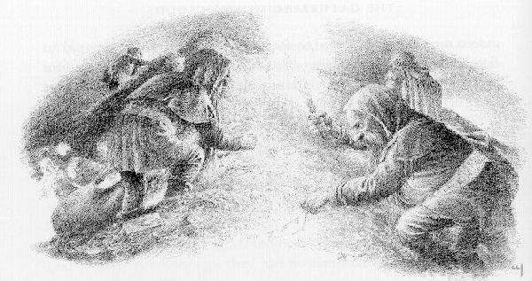

## Kapitel 16: Ein Dieb in der Nacht

Nun vergingen die Tage langsam und <abbr title="mühsam — трудный; утомительный">mühsam</abbr>. Viele der <abbr title="der Zwerg, die Zwerge — гном">Zwerge</abbr> verbrachten ihre Zeit damit, den <abbr title="der Schatz, die Schätze — сокровище">Schatz</abbr> aufzuhäufen und zu ordnen; und jetzt sprach Thorin vom Arkenstone von Thrain und forderte sie voller <abbr title="der Eifer — рвение">Eifer</abbr> auf, in jedem Winkel danach zu suchen.

— Denn der Arkenstone meines Vaters, — sagte er, — ist schon an sich mehr wert als ein Fluss aus Gold, und für mich ist er unbezahlbar. Diesen Stein beanspruche ich von allen Schätzen für mich allein, und ich werde mich an jedem rächen, der ihn findet und mir <abbr title="vorenthalten (enthielt vor, hat vorenthalten) — утаивать; не отдавать положенное">vorenthält</abbr>.

Bilbo hörte diese Worte und bekam Angst. Er fragte sich, was geschehen würde, wenn man den Stein fände — eingewickelt in ein altes <abbr title="das Bündel, die Bündel — свёрток">Bündel</abbr> aus <abbr title="zerfetzt — изодранный в клочья">zerfetzten</abbr> Stoffresten, das ihm als Kopfkissen diente. Trotzdem sagte er nichts davon, denn je schwerer die endlosen Tage auf ihm lasteten, desto deutlicher zeichneten sich in seinem kleinen Kopf die Anfänge eines Plans ab.

So <abbr title="gehen (ging, ist gegangen) — шёл">ging</abbr> es schon eine Weile, als die <abbr title="der Rabe, die Raben — ворон">Raben</abbr> die Nachricht brachten, dass Dain und mehr als fünfhundert <abbr title="der Zwerg, die Zwerge — гном">Zwerge</abbr>, die von den Iron Hills herbeieilten, inzwischen nur noch etwa zwei Tagesmärsche von Dale entfernt waren und aus Nordosten kamen.

— Aber sie können den Berg nicht unbemerkt erreichen, — sagte Roäc, — und ich fürchte, dass es im Tal zu einer Schlacht kommen wird. Ich halte diesen Plan nicht für einen guten Rat. Zwar sind sie ein <abbr title="grimmig — суровый; свирепый">grimmiges</abbr> Volk, doch werden sie das <abbr title="das Heer, die Heere — войско">Heer</abbr>, das euch belagert, wohl kaum <abbr title="besiegen — победить">besiegen</abbr>; und selbst wenn es ihnen gelänge, was wäre damit gewonnen? Winter und Schnee eilen hinter ihnen her. Wie wollt ihr euch ernähren, ohne die Freundschaft und das <abbr title="das Wohlwollen — благосклонность">Wohlwollen</abbr> der Länder ringsum? Der <abbr title="der Schatz, die Schätze — клад; сокровище">Schatz</abbr> wird euch vermutlich den Tod bringen, obwohl es den <abbr title="der Drache, die Drachen — дракон">Drachen</abbr> nicht mehr gibt!

Doch Thorin ließ sich nicht bewegen.

— Winter und Schnee werden Menschen wie <abbr title="der Elf, die Elfen — эльф">Elfen</abbr> beißen, — sagte er, — und vielleicht wird ihnen der Aufenthalt in der <abbr title="die Einöde, die Einöden — безлюдная пустошь">Einöde</abbr> schwer zu ertragen sein. Wenn meine Freunde ihnen im Rücken stehen und der Winter über sie hereinbricht, sind sie bei <abbr title="die Verhandlung, die Verhandlungen — переговоры">Verhandlungen</abbr> womöglich eher zum Nachgeben bereit.

In jener Nacht fasste Bilbo seinen Entschluss. Der Himmel war schwarz und mondlos. Sobald es völlig dunkel geworden war, <abbr title="gehen (ging, ist gegangen) — шёл">ging</abbr> er in die Ecke einer inneren Kammer gleich hinter dem Tor und holte aus seinem <abbr title="das Bündel, die Bündel — свёрток">Bündel</abbr> ein <abbr title="das Seil, die Seile — верёвка">Seil</abbr> sowie den in einen <abbr title="der Lappen, die Lappen — лоскут; тряпка">Lappen</abbr> gewickelten Arkenstone hervor. Dann kletterte er auf die Mauer. Nur Bombur war dort, denn er war mit Wachehalten an der Reihe, und die <abbr title="der Zwerg, die Zwerge — гном">Zwerge</abbr> stellten immer nur einen Wachposten auf.

— Es ist <abbr title="gewaltig — огромный; мощный">gewaltig</abbr> kalt! — sagte Bombur. — Ich wünschte, wir könnten hier oben ein Feuer haben, wie sie es im <abbr title="das Lager, die Lager — лагерь">Lager</abbr> haben!

— Drinnen ist es warm genug, — sagte Bilbo.

— Das glaube ich gern; aber ich muss bis Mitternacht hier <abbr title="ausharren — стойко оставаться; терпеливо ждать">ausharren</abbr>, — <abbr title="brummen — ворчать">brummte</abbr> der dicke <abbr title="der Zwerg, die Zwerge — гном">Zwerg</abbr>. — Eine traurige Angelegenheit, das Ganze. Nicht dass ich es wagen würde, Thorin zu widersprechen — möge sein <abbr title="der Bart, die Bärte — борода">Bart</abbr> immer länger wachsen! Doch er war schon immer ein <abbr title="halsstarrig — упрямый; несговорчивый">halsstarriger</abbr> <abbr title="der Zwerg, die Zwerge — гном">Zwerg</abbr>.

— So starr wie meine Beine ist nicht einmal sein Hals, — sagte Bilbo. — Ich habe genug von Treppen und steinernen Gängen. Ich würde viel darum geben, wieder Gras an meinen Zehen zu spüren.

— Ich würde viel darum geben, einen kräftigen <abbr title="der Trunk, die Trünke — глоток; питьё">Trunk</abbr> in meiner Kehle zu spüren und nach einem guten Abendessen ein weiches Bett zu haben!

— Damit kann ich dir nicht dienen, solange die <abbr title="die Belagerung, die Belagerungen — осада">Belagerung</abbr> dauert.

Aber ich habe schon lange nicht mehr <abbr title="die Wache, die Wachen — часовой; стражник">Wache</abbr> gehalten und übernehme deine Schicht, wenn du möchtest. Heute Nacht kann ich ohnehin nicht schlafen.

— Du bist ein guter Kerl, Herr Baggins, und ich nehme dein Angebot dankbar an. Sollte dir etwas auffallen, dann wecke zuerst mich, hörst du! Ich lege mich in die innere Kammer links, nicht weit von hier.

— Geh nur! — sagte Bilbo. — Ich wecke dich um Mitternacht, und dann kannst du den nächsten Wachposten wecken.

Sobald Bombur fort war, steckte Bilbo seinen Ring an, befestigte das <abbr title="das Seil, die Seile — верёвка">Seil</abbr>, glitt über die Mauer hinab und war verschwunden. Er hatte ungefähr fünf Stunden Zeit. Bombur würde schlafen — das konnte er jederzeit, und seit dem <abbr title="das Abenteuer, die Abenteuer — приключение">Abenteuer</abbr> im Wald versuchte er ständig, jene schönen Träume wiederzufinden, die er damals gehabt hatte. Alle anderen waren bei Thorin beschäftigt. Es war unwahrscheinlich, dass einer von ihnen, selbst Fili oder Kili, auf die Mauer kommen würde, bevor er mit der <abbr title="die Wache, die Wachen — часовой; стражник">Wache</abbr> an der Reihe war.

Es war sehr dunkel, und nachdem er den neu angelegten Weg verlassen hatte und zum unteren Lauf des Baches hinabgestiegen war, kannte er sich bald nicht mehr aus. Endlich erreichte er die Biegung, an der er das Wasser überqueren musste, um, wie beabsichtigt, zum <abbr title="das Lager, die Lager — лагерь">Lager</abbr> zu gelangen. Das Bachbett war dort flach, aber schon breit, und für den kleinen Hobbit war es nicht leicht, im Dunkeln <abbr title="hindurchwaten — переходить вброд">hindurchzuwaten</abbr>. Er hatte die andere Seite beinahe erreicht, als sein Fuß auf einem runden Stein abrutschte und er mit einem Platschen ins kalte Wasser fiel. Kaum war er zitternd, hustend und <abbr title="prusten — фыркать">prustend</abbr> ans gegenüberliegende Ufer geklettert, da kamen <abbr title="der Elf, die Elfen — эльф">Elfen</abbr> mit hellen Laternen aus der Dunkelheit und suchten nach der Ursache des Geräuschs.

— Das war kein Fisch! — sagte einer. — Hier treibt sich ein <abbr title="der Spion, die Spione — шпион">Spion</abbr> herum. Verdeckt eure Lichter! Sie helfen ihm mehr als uns, falls es dieses seltsame kleine Wesen ist, das angeblich ihr Diener sein soll.

— Diener! So weit kommt es noch! — <abbr title="schnauben — фыркать">schnaubte</abbr> Bilbo. Mitten im Schnauben musste er jedoch laut niesen, und sofort kamen die <abbr title="der Elf, die Elfen — эльф">Elfen</abbr> von allen Seiten auf das Geräusch zu.

— <abbr title="die Macht, die Mächte — власть; сила">Macht</abbr> doch Licht! — sagte er. — Hier bin ich, wenn ihr mich sucht! — Er streifte den Ring ab und sprang hinter einem <abbr title="der Felsen, die Felsen — скала; утёс">Felsen</abbr> hervor.

Trotz ihrer Überraschung packten sie ihn rasch.

— Wer bist du? Bist du der Hobbit der <abbr title="der Zwerg, die Zwerge — гном">Zwerge</abbr>? Was machst du hier? Wie bist du so weit an unseren Wachposten vorbeigekommen? — fragten sie einer nach dem anderen.

— Ich bin Herr Bilbo Baggins, — antwortete er, — Thorins <abbr title="der Gefährte, die Gefährten — спутник">Gefährte</abbr>, wenn ihr es wissen wollt. Euren König kenne ich gut vom Sehen, obwohl er mich vielleicht nicht an meinem Aussehen erkennt. Aber Bard wird sich an mich erinnern, und vor allem Bard möchte ich sprechen.

— Tatsächlich! — sagten sie. — Und was mag dein <abbr title="das Anliegen, die Anliegen — дело; просьба">Anliegen</abbr> sein?

— Was immer es ist, es geht nur mich etwas an, meine guten <abbr title="der Elf, die Elfen — эльф">Elfen</abbr>. Aber wenn ihr jemals von diesem kalten, freudlosen Ort in eure eigenen Wälder zurückkehren wollt, — antwortete er zitternd, — dann bringt mich schnell zu einem Feuer, an dem ich trocknen kann. Und anschließend lasst ihr mich so bald wie möglich mit euren Anführern sprechen. Ich habe höchstens ein, zwei Stunden Zeit.

So kam es, dass Bilbo etwa zwei Stunden nach seiner Flucht aus dem Tor neben einem warmen Feuer vor einem großen Zelt saß. Bei ihm saßen der Elvenking und Bard und betrachteten ihn neugierig. Ein Hobbit in einer <abbr title="elfisch — эльфийский">elfischen</abbr> <abbr title="die Rüstung, die Rüstungen — доспехи">Rüstung</abbr>, teilweise in eine alte Decke gewickelt, war für sie etwas Neues.

— Wirklich, wissen Sie, so geht es nicht weiter, — sagte Bilbo in seinem besten Geschäftston. — Mir persönlich hängt die ganze Angelegenheit zum Hals heraus. Ich wünschte, ich wäre wieder im <abbr title="die Weste, die Westen — жилет">Westen</abbr>, in meinem eigenen Zuhause, wo die Leute <abbr title="vernünftig — разумный">vernünftiger</abbr> sind. Aber ich bin an dieser Sache beteiligt — mit einem Vierzehntel, um genau zu sein, laut einem Brief, den ich glücklicherweise wohl aufgehoben habe.

Aus einer Tasche seiner alten Jacke, die er immer noch über dem <abbr title="das Kettenhemd, die Kettenhemden — кольчуга">Kettenhemd</abbr> trug, zog er Thorins <abbr title="zerknittert — измятый">zerknitterten</abbr> und vielfach gefalteten Brief: den Brief, der im Mai unter die Uhr auf seinem <abbr title="der Kaminsims, die Kaminsimse — каминная полка">Kaminsims</abbr> gelegt worden war!

— Einen <abbr title="der Anteil, die Anteile — доля">Anteil</abbr> am Gewinn, <abbr title="wohlgemerkt — заметьте; подчеркну">wohlgemerkt</abbr>, — fuhr er fort. — Das ist mir bewusst. Ich persönlich bin nur zu gern bereit, alle Ihre <abbr title="der Anspruch, die Ansprüche — требование; право на что-либо">Ansprüche</abbr> sorgfältig zu prüfen und das, was Ihnen zusteht, von der Gesamtsumme abzuziehen, bevor ich meinen eigenen <abbr title="der Anspruch, die Ansprüche — право; притязание">Anspruch</abbr> erhebe. Allerdings kennen Sie Thorin Oakenshield nicht so gut wie ich inzwischen. Ich versichere Ihnen, er ist durchaus bereit, auf einem Haufen Gold zu sitzen und zu verhungern, solange Sie hier sitzen bleiben.

— Dann soll er doch! — sagte Bard. — Ein solcher Narr verdient es, zu verhungern.

— Ganz richtig, — sagte Bilbo. — Ich verstehe Ihren Standpunkt. Andererseits kommt der Winter schnell näher. Bald haben Sie Schnee und was weiß ich noch alles, und mit dem <abbr title="der Nachschub — снабжение; пополнение запасов">Nachschub</abbr> wird es schwierig — vermutlich sogar für <abbr title="der Elf, die Elfen — эльф">Elfen</abbr>. Außerdem wird es noch andere Schwierigkeiten geben. Haben Sie nichts von Dain und den Zwergen der Iron Hills gehört?

— Doch, schon vor langer Zeit; aber was hat er mit uns zu tun? — fragte der König.

— Das dachte ich mir. Wie ich sehe, habe ich Informationen, die Ihnen fehlen. Ich darf Ihnen mitteilen, dass Dain jetzt weniger als zwei Tagesmärsche entfernt ist und mindestens fünfhundert grimmige <abbr title="der Zwerg, die Zwerge — гном">Zwerge</abbr> bei sich hat. Ziemlich viele davon haben Erfahrung aus den schrecklichen Kriegen zwischen Zwergen und <abbr title="der Goblin, die Goblins — гоблин">Goblins</abbr>, von denen Sie gewiss gehört haben. Wenn sie eintreffen, könnte es ernsthafte Schwierigkeiten geben.

— Warum erzählst du uns das? Verrätst du deine Freunde, oder drohst du uns? — fragte Bard <abbr title="grimmig — суровый; свирепый">grimmig</abbr>.

— Mein lieber Bard! — piepste Bilbo. — Nicht so voreilig! Solche misstrauischen Leute habe ich noch nie getroffen! Ich versuche lediglich, allen Beteiligten Schwierigkeiten zu ersparen. Jetzt mache ich Ihnen ein Angebot!

— Lass hören! — sagten sie.

— Sie dürfen es <abbr title="sehen (sah, hat gesehen) — увидел">sehen</abbr>! — sagte er. — Hier ist es! — Und er zog den Arkenstone hervor und warf die Hülle weg.

Der Elvenking selbst, dessen Augen an wunderbare und schöne Dinge gewöhnt waren, <abbr title="standhalten (hielt stand, hat standgehalten) — держаться; не отступать">stand</abbr> staunend auf. Selbst Bard betrachtete den Stein schweigend voller Bewunderung. Es war, als hätte man eine Kugel mit Mondlicht gefüllt und sie vor ihren Augen in ein Netz gehängt, das aus dem <abbr title="das Glitzern — мерцание; блеск">Glitzern</abbr> frostiger Sterne gewoben war.

— Dies ist der Arkenstone von Thrain, — sagte Bilbo, — das Herz des Berges; und er ist auch Thorins Herz. Thorin schätzt ihn höher als einen Fluss aus Gold. Ich gebe ihn Ihnen. Bei Ihren <abbr title="die Verhandlung, die Verhandlungen — переговоры">Verhandlungen</abbr> wird er Ihnen helfen.

Dann übergab Bilbo den wundervollen Stein an Bard, nicht ohne ein <abbr title="das Schaudern — дрожь; содрогание">Schaudern</abbr> und nicht ohne einen <abbr title="sehnsüchtig — тоскующий; полный страстного желания">sehnsüchtigen</abbr> Blick. Bard hielt ihn in der Hand, als wäre er <abbr title="benommen — ошеломлённый; одурманенный">benommen</abbr>.

— Aber mit welchem Recht kannst du ihn verschenken? — fragte er schließlich und musste sich dazu sichtlich überwinden.

— Nun ja! — sagte der Hobbit <abbr title="verlegen — смущённый">verlegen</abbr>. — So ganz gehört er mir nicht; aber, nun, ich bin bereit, ihn gegen meinen gesamten <abbr title="der Anteil, die Anteile — доля">Anteil</abbr> <abbr title="verrechnen — зачесть при расчёте">verrechnen</abbr> zu lassen, verstehen Sie. Ich mag ein <abbr title="der Einbrecher, die Einbrecher — взломщик">Einbrecher</abbr> sein — jedenfalls sagt man das; persönlich habe ich mich nie wirklich wie einer gefühlt —, aber ich bin hoffentlich ein ehrlicher, mehr oder weniger. Wie dem auch sei, ich gehe jetzt zurück, und die <abbr title="der Zwerg, die Zwerge — гном">Zwerge</abbr> können mit mir machen, was sie wollen. Ich hoffe, Sie können ihn gut gebrauchen.

Der Elvenking blickte Bilbo mit neuem Staunen an.

— Bilbo Baggins! — sagte er. — Du bist <abbr title="würdig — достойный">würdiger</abbr>, die <abbr title="die Rüstung, die Rüstungen — доспехи">Rüstung</abbr> von Elfenfürsten zu tragen, als viele, die darin <abbr title="stattlich — статный; представительный">stattlicher</abbr> aussahen. Doch ich frage mich, ob Thorin Oakenshield es ebenso <abbr title="sehen (sah, hat gesehen) — увидел">sehen</abbr> wird. Vielleicht weiß ich mehr über die <abbr title="der Zwerg, die Zwerge — гном">Zwerge</abbr> im Allgemeinen als du. Ich rate dir, bei uns zu bleiben; hier sollst du geehrt und dreimal willkommen sein.

— Ich danke Ihnen wirklich sehr, — sagte Bilbo und verbeugte sich. — Aber ich glaube nicht, dass ich meine Freunde einfach so verlassen sollte, nach allem, was wir gemeinsam durchgemacht haben. Außerdem habe ich versprochen, den alten Bombur um Mitternacht zu wecken! Ich muss wirklich <abbr title="gehen (ging, ist gegangen) — шёл">gehen</abbr>, und zwar schnell.

Nichts, was sie sagten, konnte ihn aufhalten. Deshalb stellte man ihm eine <abbr title="die Begleitung, die Begleitungen — сопровождение">Begleitung</abbr> zur Verfügung, und beim Abschied grüßten ihn sowohl der König als auch Bard voller Achtung. Als sie durch das <abbr title="das Lager, die Lager — лагерь">Lager</abbr> gingen, erhob sich ein alter Mann, der, in einen dunklen Mantel gehüllt, vor einem Zelteingang saß, und kam auf sie zu.

— Gut gemacht, Herr Baggins! — sagte er und klopfte Bilbo auf den Rücken. — In Ihnen steckt immer mehr, als irgendjemand erwartet! — Es war Gandalf.

Zum ersten Mal seit vielen Tagen war Bilbo wirklich begeistert. Doch für all die Fragen, die er sofort stellen wollte, blieb keine Zeit.

— Alles zu seiner Zeit! — sagte Gandalf. — Die Dinge nähern sich jetzt ihrem Ende, wenn ich mich nicht irre. Unmittelbar vor Ihnen liegt eine unangenehme Zeit; aber verlieren Sie nicht den <abbr title="der Mut — мужество">Mut</abbr>! Vielleicht kommen Sie heil hindurch. Es <abbr title="sich zusammenbrauen — назревать; надвигаться">brauen sich</abbr> Neuigkeiten zusammen, von denen selbst die <abbr title="der Rabe, die Raben — ворон">Raben</abbr> noch nichts gehört haben. Gute Nacht!

Verwirrt, doch aufgemuntert eilte Bilbo weiter. Man führte ihn zu einer sicheren <abbr title="die Furt, die Furten — брод">Furt</abbr> und brachte ihn trocken hinüber. Dann verabschiedete er sich von den <abbr title="der Elf, die Elfen — эльф">Elfen</abbr> und stieg vorsichtig zum Tor hinauf. Große Müdigkeit begann ihn zu überfallen; doch es war noch lange nicht Mitternacht, als er wieder am <abbr title="das Seil, die Seile — верёвка">Seil</abbr> hochkletterte — es hing noch dort, wo er es gelassen hatte. Er band es los und versteckte es. Dann setzte er sich auf die Mauer und fragte sich ängstlich, was als Nächstes geschehen würde.

Um Mitternacht weckte er Bombur. Danach rollte er sich seinerseits in seiner Ecke zusammen, ohne den Dank des alten Zwergs anzuhören, den er seiner Meinung nach kaum verdient hatte. Bald schlief er fest und vergaß alle seine Sorgen bis zum Morgen. Tatsächlich träumte er von Eiern und Speck.

---

### Neue und schwierige Wörter

- **mühsam** — трудный; утомительный *(Wiederholung)*
- **der Zwerg, die Zwerge** — гном *(Wiederholung)*
- **der Schatz, die Schätze** — сокровище *(Wiederholung)*
- **der Eifer** — рвение *(Wiederholung)*
- **vorenthalten (enthielt vor, hat vorenthalten)** — утаивать; не отдавать положенное *(neu)*
- **das Bündel, die Bündel** — свёрток *(Wiederholung)*
- **zerfetzt** — изодранный в клочья *(neu)*
- **gehen (ging, ist gegangen)** — шёл *(Wiederholung)*
- **der Rabe, die Raben** — ворон *(Wiederholung)*
- **grimmig** — суровый; свирепый *(Wiederholung)*
- **das Heer, die Heere** — войско *(neu)*
- **besiegen** — победить *(Wiederholung)*
- **das Wohlwollen** — благосклонность *(neu)*
- **der Drache, die Drachen** — дракон *(Wiederholung)*
- **der Elf, die Elfen** — эльф *(Wiederholung)*
- **die Einöde, die Einöden** — безлюдная пустошь *(neu)*
- **die Verhandlung, die Verhandlungen** — переговоры *(Wiederholung)*
- **das Seil, die Seile** — верёвка *(Wiederholung)*
- **der Lappen, die Lappen** — лоскут; тряпка *(neu)*
- **gewaltig** — огромный; мощный *(Wiederholung)*
- **das Lager, die Lager** — лагерь *(Wiederholung)*
- **ausharren** — стойко оставаться; терпеливо ждать *(neu)*
- **brummen** — ворчать *(Wiederholung)*
- **der Bart, die Bärte** — борода *(Wiederholung)*
- **halsstarrig** — упрямый; несговорчивый *(neu)*
- **der Trunk, die Trünke** — глоток; питьё *(neu)*
- **die Belagerung, die Belagerungen** — осада *(Wiederholung)*
- **die Wache, die Wachen** — часовой; стражник *(Wiederholung)*
- **das Abenteuer, die Abenteuer** — приключение *(Wiederholung)*
- **hindurchwaten** — переходить вброд *(neu)*
- **prusten** — фыркать *(Wiederholung)*
- **der Spion, die Spione** — шпион *(Wiederholung)*
- **schnauben** — фыркать *(neu)*
- **die Macht, die Mächte** — власть; сила *(Wiederholung)*
- **der Felsen, die Felsen** — скала; утёс *(Wiederholung)*
- **der Gefährte, die Gefährten** — спутник *(Wiederholung)*
- **das Anliegen, die Anliegen** — дело; просьба *(neu)*
- **elfisch** — эльфийский *(neu)*
- **die Rüstung, die Rüstungen** — доспехи *(Wiederholung)*
- **die Weste, die Westen** — жилет *(Wiederholung)*
- **vernünftig** — разумный *(Wiederholung)*
- **das Kettenhemd, die Kettenhemden** — кольчуга *(Wiederholung)*
- **zerknittert** — измятый *(neu)*
- **der Kaminsims, die Kaminsimse** — каминная полка *(neu)*
- **der Anteil, die Anteile** — доля *(Wiederholung)*
- **wohlgemerkt** — заметьте; подчеркну *(neu)*
- **der Anspruch, die Ansprüche** — требование; право на что-либо *(Wiederholung)*
- **der Nachschub** — снабжение; пополнение запасов *(neu)*
- **der Goblin, die Goblins** — гоблин *(Wiederholung)*
- **sehen (sah, hat gesehen)** — увидел *(Wiederholung)*
- **standhalten (hielt stand, hat standgehalten)** — держаться; не отступать *(Wiederholung)*
- **das Glitzern** — мерцание; блеск *(neu)*
- **das Schaudern** — дрожь; содрогание *(neu)*
- **sehnsüchtig** — тоскующий; полный страстного желания *(Wiederholung)*
- **benommen** — ошеломлённый; одурманенный *(Wiederholung)*
- **verlegen** — смущённый *(Wiederholung)*
- **verrechnen** — зачесть при расчёте *(neu)*
- **der Einbrecher, die Einbrecher** — взломщик *(Wiederholung)*
- **würdig** — достойный *(neu)*
- **stattlich** — статный; представительный *(neu)*
- **die Begleitung, die Begleitungen** — сопровождение *(neu)*
- **der Mut** — мужество *(Wiederholung)*
- **sich zusammenbrauen** — назревать; надвигаться *(neu)*
- **die Furt, die Furten** — брод *(neu)*

### Schwierige Sätze

- **„Er fragte sich, was geschehen würde, wenn man den Stein fände — eingewickelt in ein altes Bündel aus zerfetzten Stoffresten, das ihm als Kopfkissen diente.“**  
  «Он спрашивал себя, что случится, если камень найдут — завёрнутым в старый узел из изодранных обрывков ткани, служивший ему подушкой». `würde geschehen` и `fände` — Konjunktiv II: воображаемое развитие событий. Относительное `das` относится к `Bündel`.
- **„Zwar sind sie ein grimmiges Volk, doch werden sie das Heer, das euch belagert, wohl kaum besiegen; und selbst wenn es ihnen gelänge, was wäre damit gewonnen?“**  
  «Хотя они суровый народ, им вряд ли удастся победить войско, осаждающее вас; и даже если бы удалось, что было бы этим достигнуто?» `zwar … doch` выражает уступку; `gelänge` — Konjunktiv II от `gelingen`. `wäre gewonnen` — пассивная конструкция с предположительным результатом.
- **„Wenn meine Freunde ihnen im Rücken stehen und der Winter über sie hereinbricht, sind sie bei Verhandlungen womöglich eher zum Nachgeben bereit.“**  
  «Когда мои друзья окажутся у них за спиной, а зима обрушится на них, они, возможно, будут охотнее идти на уступки в переговорах». `ihnen im Rücken stehen` здесь обозначает военную позицию позади осаждающих, а не поддержку. `zum Nachgeben bereit sein` — быть готовым уступить; инфинитив после `zum` становится существительным. `hereinbrechen über` означает внезапно обрушиться на кого-либо.
- **„Nicht dass ich es wagen würde, Thorin zu widersprechen — möge sein Bart immer länger wachsen!“**  
  «Не то чтобы я осмелился перечить Торину — да растёт его борода всё длиннее!» `Nicht dass …` отводит нежелательное толкование; `möge` — Konjunktiv I, здесь торжественная формула пожелания.
- **„Es war unwahrscheinlich, dass einer von ihnen, selbst Fili oder Kili, auf die Mauer kommen würde, bevor er mit der Wache an der Reihe war.“**  
  «Было маловероятно, что кто-нибудь из них, даже Фили или Кили, придёт на стену раньше своей очереди караулить». `kommen würde` передаёт будущее с точки зрения прошлого. `an der Reihe sein` — быть следующим по очереди.
- **„Ich persönlich bin nur zu gern bereit, alle Ihre Ansprüche sorgfältig zu prüfen und das, was Ihnen zusteht, von der Gesamtsumme abzuziehen, bevor ich meinen eigenen Anspruch erhebe.“**  
  «Я лично более чем готов тщательно рассмотреть все ваши требования и вычесть причитающееся вам из общей суммы, прежде чем предъявить собственные требования». Два инфинитива с `zu` зависят от `bereit`; `das, was …` — «то, что…». `einen Anspruch erheben` — предъявить требование.
- **„Es war, als hätte man eine Kugel mit Mondlicht gefüllt und sie vor ihren Augen in ein Netz gehängt, das aus dem Glitzern frostiger Sterne gewoben war.“**  
  «Казалось, будто шар наполнили лунным светом и подвесили перед ними в сети, сотканной из мерцания морозных звёзд». `als hätte …` вводит нереальное сравнение в Konjunktiv II прошедшего времени. Один вспомогательный глагол относится к обоим причастиям: `gefüllt` и `gehängt`.
- **„Ich mag ein Einbrecher sein — jedenfalls sagt man das; persönlich habe ich mich nie wirklich wie einer gefühlt —, aber ich bin hoffentlich ein ehrlicher, mehr oder weniger.“**  
  «Пусть я и взломщик — во всяком случае, так говорят; сам я никогда по-настоящему им себя не чувствовал, — но, надеюсь, я честный взломщик, более или менее». `mag … sein` выражает уступку, а не симпатию. `einer` и `ein ehrlicher` заменяют повторение существительного `Einbrecher`.
- **„Große Müdigkeit begann ihn zu überfallen; doch es war noch lange nicht Mitternacht, als er wieder am Seil hochkletterte — es hing noch dort, wo er es gelassen hatte.“**  
  «Его начала одолевать сильная усталость; но до полуночи было ещё далеко, когда он снова поднялся по верёвке — она всё ещё висела там, где он её оставил». `begann … zu` обозначает начало действия. `gelassen hatte` — Plusquamperfekt: верёвку оставили раньше описываемого возвращения.

[← Zurück](kapitel-15.md) · [Inhalt](README.md) · [Weiter →](kapitel-17.md)
