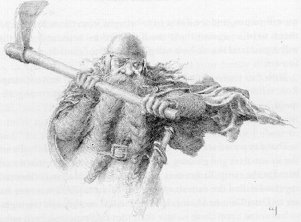
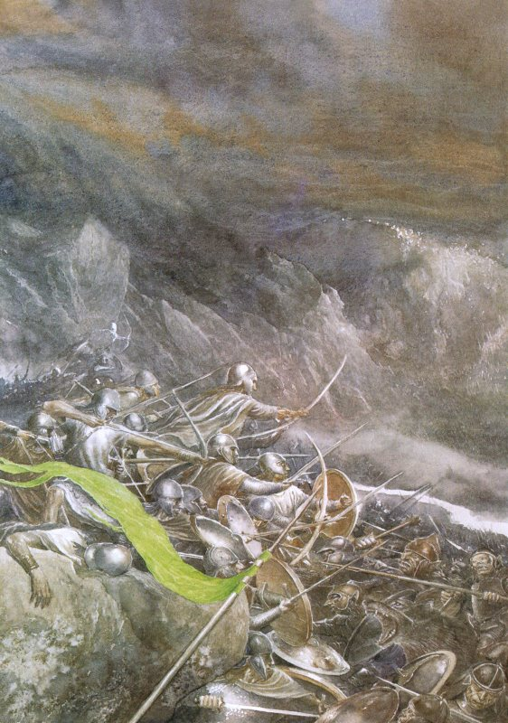

## Kapitel 17: Wolkenbruch

Am nächsten Tag erklangen die <abbr title="die Trompete, die Trompeten — труба (инструмент)">Trompeten</abbr> früh im <abbr title="das Lager, die Lager — лагерь">Lager</abbr>. Bald <abbr title="sehen (sah, hat gesehen) — увидел">sah</abbr> man einen einzelnen Läufer auf dem schmalen Pfad heraneilen. Er blieb in einiger Entfernung stehen und rief ihnen zu. Ob Thorin nun eine weitere Gruppe von Gesandten anhören wolle? Neue Nachrichten seien eingetroffen, und die Lage habe sich verändert.

— Das wird Dain sein! — sagte Thorin, als er davon hörte. — Sie werden <abbr title="Wind von etwas bekommen (bekam, hat bekommen) — пронюхать о чём-либо">Wind von seiner Ankunft bekommen haben</abbr>. Ich dachte mir doch, dass das ihre Stimmung ändern würde! Sagt ihnen, sie sollen mit wenigen Leuten und ohne <abbr title="die Waffe, die Waffen — оружие">Waffen</abbr> kommen, dann werde ich sie anhören! — rief er dem <abbr title="der Bote, die Boten — гонец; посланник">Boten</abbr> zu.

Gegen Mittag <abbr title="sehen (sah, hat gesehen) — увидел">sah</abbr> man wieder die <abbr title="das Banner, die Banner — знамя">Banner</abbr> des Waldes und des Sees aus dem <abbr title="das Lager, die Lager — лагерь">Lager</abbr> kommen. Eine Gruppe von zwanzig näherte sich. Am Anfang des schmalen Weges legten sie <abbr title="das Schwert, die Schwerter — меч">Schwerter</abbr> und <abbr title="der Speer, die Speere — копьё">Speere</abbr> ab und gingen weiter zum Tor. Verwundert sahen die <abbr title="der Zwerg, die Zwerge — гном">Zwerge</abbr>, dass sowohl Bard als auch der Elvenking unter ihnen waren. Vor den beiden trug ein alter Mann, in Mantel und <abbr title="die Kapuze, die Kapuzen — капюшон">Kapuze</abbr> gehüllt, eine feste kleine Truhe aus <abbr title="eisenbeschlagen — окованный железом">eisenbeschlagenem</abbr> Holz.

— Sei gegrüßt, Thorin! — sagte Bard. — Bist du noch immer derselben Meinung?

— Meine Meinung ändert sich nicht, nur weil die Sonne ein paarmal auf- und untergeht, — antwortete Thorin. — Seid ihr gekommen, um mir unnütze Fragen zu stellen? Noch immer ist das <abbr title="das Elfenheer, die Elfenheere — войско эльфов">Elfenheer</abbr> nicht abgezogen, wie ich es verlangt habe! Bis dahin kommt ihr <abbr title="vergeblich — напрасно">vergeblich</abbr>, um mit mir zu verhandeln.

— Gibt es denn nichts, wofür du etwas von deinem Gold hergeben würdest?

— Nichts, was du oder deine Freunde anzubieten habt.

— Und wie steht es mit dem Arkenstone von Thrain? — fragte Bard. Im selben Augenblick öffnete der alte Mann die Truhe und hielt den <abbr title="der Edelstein, die Edelsteine — драгоценный камень">Edelstein</abbr> hoch. Hell und weiß sprang sein Licht in den Morgen hinaus, von der Hand des Mannes ausgehend.

Da war Thorin vor Staunen und Verwirrung <abbr title="wie vom Donner gerührt — словно громом поражён">wie vom Donner gerührt</abbr> und brachte kein Wort heraus. Lange sprach niemand.

Schließlich brach Thorin das Schweigen, und seine Stimme klang schwer vor Zorn.

— Dieser Stein gehörte meinem Vater und gehört mir, — sagte er. — Warum sollte ich mein eigenes Gut kaufen?

Doch sein Staunen überwältigte ihn, und er fügte hinzu:

— Aber wie seid ihr an das <abbr title="das Erbstück, die Erbstücke — семейная реликвия">Erbstück</abbr> meines Hauses gekommen — falls man Dieben eine solche Frage überhaupt stellen muss?

— Wir sind keine Diebe, — antwortete Bard. — Was dir gehört, geben wir dir zurück, wenn wir dafür bekommen, was uns gehört.

— Wie seid ihr daran gekommen? — schrie Thorin, dessen Wut immer größer wurde.

— Ich habe es ihnen gegeben! — <abbr title="piepsen — пискнуть">piepste</abbr> Bilbo, der über die Mauer spähte und inzwischen schreckliche Angst hatte.

— Du! Du! — rief Thorin, wandte sich gegen ihn und packte ihn mit beiden Händen. — Du elender Hobbit! Du untergroßer — <abbr title="der Einbrecher, die Einbrecher — взломщик">Einbrecher</abbr>! — schrie er, weil ihm die Worte fehlten, und schüttelte den armen Bilbo wie ein Kaninchen.

— Bei Durins <abbr title="der Bart, die Bärte — борода">Bart</abbr>! Wäre Gandalf doch hier! Verflucht sei er, weil er dich ausgesucht hat! Möge sein <abbr title="der Bart, die Bärte — борода">Bart</abbr> <abbr title="verdorren — засохнуть">verdorren</abbr>! Und dich werde ich auf die <abbr title="der Felsen, die Felsen — скала; утёс">Felsen</abbr> werfen! — schrie er und hob Bilbo in seinen Armen hoch.

— Halt! Dein Wunsch ist erfüllt! — sagte eine Stimme. Der alte Mann mit der Truhe warf <abbr title="die Kapuze, die Kapuzen — капюшон">Kapuze</abbr> und Mantel ab. — Hier ist Gandalf! Und offenbar keinen Augenblick zu früh. Wenn dir mein <abbr title="der Einbrecher, die Einbrecher — взломщик">Einbrecher</abbr> nicht gefällt, dann beschädige ihn bitte nicht.

— Setz ihn ab und hör erst einmal, was er zu sagen hat!

— Ihr scheint alle <abbr title="unter einer Decke stecken (steckte, hat gesteckt) — быть в сговоре">unter einer Decke zu stecken</abbr>! — sagte Thorin und ließ Bilbo auf die Mauerkrone fallen. — Nie wieder werde ich mit einem <abbr title="der Zauberer, die Zauberer — волшебник">Zauberer</abbr> oder seinen Freunden <abbr title="das Geschäft, die Geschäfte — дело; предприятие">Geschäfte</abbr> machen. Was hast du zu sagen, du <abbr title="der Nachkomme, die Nachkommen — потомок">Nachkomme</abbr> von Ratten?

— Oje! Oje! — sagte Bilbo. — Das ist gewiss alles sehr unangenehm. Du erinnerst dich vielleicht, dass ich mir meinen vierzehnten <abbr title="der Anteil, die Anteile — доля">Anteil</abbr> selbst aussuchen durfte? Vielleicht habe ich das zu wörtlich genommen — man hat mir gesagt, dass <abbr title="der Zwerg, die Zwerge — гном">Zwerge</abbr> manchmal in Worten höflicher sind als in Taten. Trotzdem gab es eine Zeit, da schienst du zu glauben, ich hätte dir einige Dienste geleistet. <abbr title="der Nachkomme, die Nachkommen — потомок">Nachkomme</abbr> von Ratten, tatsächlich! Sind das nun all die Dienste von dir und deiner Familie, die man mir versprochen hat, Thorin? Sieh es so: Ich habe über meinen <abbr title="der Anteil, die Anteile — доля">Anteil</abbr> <abbr title="verfügen über — распорядиться чем-либо">verfügt</abbr>, wie ich wollte, und dabei lassen wir es bewenden!

— Das werde ich, — sagte Thorin <abbr title="grimmig — суровый; мрачный">grimmig</abbr>. — Und dabei werde ich auch dich <abbr title="gehen (ging, ist gegangen) — шёл">gehen</abbr> lassen — mögen wir uns niemals wiedersehen!

Dann wandte er sich um und sprach über die Mauer hinweg.

— Ich bin <abbr title="verraten (verriet, hat verraten) — выдать; раскрыть">verraten</abbr> worden, — sagte er. — Man hat richtig geraten: Ich konnte nicht darauf verzichten, den Arkenstone, den <abbr title="der Schatz, die Schätze — клад; сокровище">Schatz</abbr> meines Hauses, <abbr title="auslösen — выкупить">auszulösen</abbr>. Dafür werde ich einen vierzehnten Teil des Schatzes in Silber und Gold geben, ohne die <abbr title="der Edelstein, die Edelsteine — драгоценный камень">Edelsteine</abbr>. Doch das soll als der versprochene <abbr title="der Anteil, die Anteile — доля">Anteil</abbr> dieses <abbr title="der Verräter, die Verräter — предатель">Verräters</abbr> gelten. Mit dieser <abbr title="die Belohnung, die Belohnungen — вознаграждение">Belohnung</abbr> soll er fortgehen, und ihr könnt sie teilen, wie ihr wollt. Er wird wenig genug bekommen, daran zweifle ich nicht. Nehmt ihn, wenn ihr wollt, dass er lebt; doch meine Freundschaft begleitet ihn nicht.

— Steig jetzt zu deinen Freunden hinunter! — sagte er zu Bilbo. — Sonst werfe ich dich hinab.

— Und was ist mit dem Gold und Silber? — fragte Bilbo.

— Das kommt später nach, sobald wir es vereinbart haben, — sagte Thorin. — Hinunter mit dir!

— Bis dahin behalten wir den Stein! — rief Bard.

— Du gibst als König unter dem Berg keine besonders prächtige Figur ab, — sagte Gandalf. — Aber die Dinge können sich noch ändern.

— Das können sie allerdings, — sagte Thorin. Und schon <abbr title="grübeln — ломать голову; раздумывать">grübelte</abbr> er, ob er nicht mit Dains Hilfe den Arkenstone zurückerobern und den <abbr title="der Anteil, die Anteile — доля">Anteil</abbr> der <abbr title="die Belohnung, die Belohnungen — вознаграждение">Belohnung</abbr> zurückhalten könnte; so stark hatte der <abbr title="der Schatz, die Schätze — клад; сокровище">Schatz</abbr> seinen <abbr title="der Verstand — ум; рассудок">Verstand</abbr> verwirrt.

Und so ließ man Bilbo von der Mauer hinunter. Für all seine Mühen bekam er nichts und <abbr title="gehen (ging, ist gegangen) — шёл">ging</abbr> mit leeren Händen fort, abgesehen von der <abbr title="die Rüstung, die Rüstungen — доспехи">Rüstung</abbr>, die Thorin ihm schon geschenkt hatte. Mehr als einer der <abbr title="der Zwerg, die Zwerge — гном">Zwerge</abbr> empfand im Herzen Scham und <abbr title="das Mitgefühl — сочувствие">Mitgefühl</abbr>, als er <abbr title="gehen (ging, ist gegangen) — шёл">ging</abbr>.

— Lebt wohl! — rief er ihnen zu. — Vielleicht begegnen wir uns wieder als Freunde.

— Fort mit dir! — rief Thorin. — Du trägst ein <abbr title="das Kettenhemd, die Kettenhemden — кольчуга">Kettenhemd</abbr>, das mein Volk gefertigt hat und das zu gut für dich ist. <abbr title="der Pfeil, die Pfeile — стрела">Pfeile</abbr> können es nicht durchdringen. Aber wenn du dich nicht beeilst, werde ich dir in deine elenden Füße stechen. Also mach schnell!

— Nicht so hastig! — sagte Bard. — Wir geben dir bis morgen Zeit. Mittags kommen wir wieder und <abbr title="sehen (sah, hat gesehen) — увидел">sehen</abbr> nach, ob du den Teil des Schatzes herausgebracht hast, den wir für den Stein erhalten sollen. Geschieht das ohne <abbr title="der Betrug — обман">Betrug</abbr>, dann ziehen wir ab, und das <abbr title="das Elfenheer, die Elfenheere — войско эльфов">Elfenheer</abbr> kehrt in den Wald zurück. Bis dahin lebt wohl!

Damit gingen sie zurück ins <abbr title="das Lager, die Lager — лагерь">Lager</abbr>. Thorin aber sandte durch Roäc <abbr title="der Bote, die Boten — гонец; посланник">Boten</abbr> zu Dain, berichtete ihm, was geschehen war, und ließ ihn auffordern, rasch, aber vorsichtig heranzukommen.

Der Tag verging und die Nacht. Am nächsten Tag drehte der Wind nach <abbr title="die Weste, die Westen — жилет">Westen</abbr>, und die Luft war dunkel und trübe. Es war noch früh am Morgen, als man im <abbr title="das Lager, die Lager — лагерь">Lager</abbr> einen Ruf hörte. Läufer kamen und meldeten, ein <abbr title="das Heer, die Heere — войско">Heer</abbr> von Zwergen sei um den östlichen <abbr title="der Ausläufer, die Ausläufer — отрог">Ausläufer</abbr> des Berges herum erschienen und eile nun nach Dale. Dain war gekommen. Er war die ganze Nacht weitergezogen und traf daher früher ein, als man erwartet hatte.

Jeder seiner Leute trug ein langes <abbr title="das Kettenhemd, die Kettenhemden — кольчуга">Kettenhemd</abbr> aus <abbr title="der Stahl — сталь">Stahl</abbr>, das bis zu den Knien hing. Ihre Beine steckten in Hosen aus einem feinen, biegsamen <abbr title="das Metallgeflecht, die Metallgeflechte — металлическая сетка">Metallgeflecht</abbr>. Das <abbr title="das Geheimnis, die Geheimnisse — тайна">Geheimnis</abbr> seiner Herstellung besaß allein Dains Volk. <abbr title="der Zwerg, die Zwerge — гном">Zwerge</abbr> sind für ihre Größe außerordentlich stark, doch die meisten von diesen waren sogar für <abbr title="der Zwerg, die Zwerge — гном">Zwerge</abbr> stark. In der Schlacht schwangen sie schwere <abbr title="zweihändig — для обеих рук; двуручный">zweihändige</abbr> <abbr title="die Spitzhacke, die Spitzhacken — кирка">Spitzhacken</abbr>; außerdem hatte jeder ein kurzes, breites <abbr title="das Schwert, die Schwerter — меч">Schwert</abbr> an der Seite und einen runden Schild auf dem Rücken. Ihre <abbr title="der Bart, die Bärte — борода">Bärte</abbr> waren geteilt, zu Zöpfen <abbr title="flechten (flocht, hat geflochten) — заплетать">geflochten</abbr> und in die Gürtel gesteckt. Sie trugen eiserne Kappen und eisenbeschlagene Schuhe, und ihre Gesichter waren <abbr title="grimmig — суровый; мрачный">grimmig</abbr>.

<abbr title="die Trompete, die Trompeten — труба (инструмент)">Trompeten</abbr> riefen Menschen und <abbr title="der Elf, die Elfen — эльф">Elfen</abbr> zu den <abbr title="die Waffe, die Waffen — оружие">Waffen</abbr>. Bald <abbr title="sehen (sah, hat gesehen) — увидел">sah</abbr> man die <abbr title="der Zwerg, die Zwerge — гном">Zwerge</abbr> in schnellem Tempo das Tal heraufkommen. Sie hielten zwischen dem Fluss und dem östlichen <abbr title="der Ausläufer, die Ausläufer — отрог">Ausläufer</abbr> an. Einige jedoch gingen weiter, überquerten den Fluss und näherten sich dem <abbr title="das Lager, die Lager — лагерь">Lager</abbr>. Dort legten sie ihre <abbr title="die Waffe, die Waffen — оружие">Waffen</abbr> nieder und hoben zum <abbr title="das Zeichen, die Zeichen — знак">Zeichen</abbr> des Friedens die Hände. Bard <abbr title="gehen (ging, ist gegangen) — шёл">ging</abbr> ihnen entgegen, und Bilbo <abbr title="gehen (ging, ist gegangen) — шёл">ging</abbr> mit ihm.

— Dain, der Sohn von Nain, hat uns gesandt, — sagten sie, als man sie befragte. — Wir eilen zu unseren <abbr title="der Verwandte, die Verwandten — родственник">Verwandten</abbr> im Berg, denn wir hören, dass das alte Königreich erneuert ist. Aber wer seid ihr, die ihr hier in der Ebene als Feinde vor verteidigten Mauern sitzt?

Das bedeutete natürlich in der höflichen, etwas altmodischen Sprache, die bei solchen Gelegenheiten üblich war, einfach: „Ihr habt hier nichts zu suchen. Wir ziehen weiter; macht also Platz, oder wir werden gegen euch kämpfen!“ Sie wollten zwischen dem Berg und der Flussschleife <abbr title="vordringen (drang vor, ist vorgedrungen) — продвигаться вперёд">vordringen</abbr>, denn der schmale Landstreifen dort schien nicht stark bewacht zu sein.

Bard weigerte sich natürlich, die <abbr title="der Zwerg, die Zwerge — гном">Zwerge</abbr> geradewegs zum Berg weiterziehen zu lassen. Er war entschlossen zu warten, bis Gold und Silber als Gegenleistung für den Arkenstone herausgebracht worden waren. Denn er glaubte nicht, dass dies noch geschehen würde, sobald eine so große und kriegerische Schar die <abbr title="die Festung, die Festungen — крепость">Festung</abbr> <abbr title="besetzen — занять; разместиться в">besetzt</abbr> hätte. Sie hatten <abbr title="gewaltig — огромный; мощный">gewaltige</abbr> <abbr title="der Vorrat, die Vorräte — запас">Vorräte</abbr> mitgebracht. <abbr title="der Zwerg, die Zwerge — гном">Zwerge</abbr> können sehr schwere Lasten tragen, und fast alle Leute Dains trugen trotz ihres schnellen Marsches neben den <abbr title="die Waffe, die Waffen — оружие">Waffen</abbr> riesige <abbr title="das Bündel, die Bündel — свёрток">Bündel</abbr> auf dem Rücken. Sie konnten wochenlang einer <abbr title="die Belagerung, die Belagerungen — осада">Belagerung</abbr> <abbr title="standhalten (hielt stand, hat standgehalten) — держаться; не отступать">standhalten</abbr>. Bis dahin mochten noch mehr <abbr title="der Zwerg, die Zwerge — гном">Zwerge</abbr> kommen und dann noch mehr, denn Thorin hatte viele Verwandte. Außerdem würden sie ein anderes Tor wieder öffnen und bewachen können. Dann müssten die <abbr title="der Belagerer, die Belagerer — осаждающий">Belagerer</abbr> den ganzen Berg umschließen, und dafür waren sie nicht zahlreich genug.

Genau das waren tatsächlich ihre Pläne, denn die Rabenboten waren zwischen Thorin und Dain sehr geschäftig gewesen. Doch vorerst war der Weg versperrt. Nach zornigen Worten zogen sich die Zwergenboten zurück und <abbr title="murmeln — бормотать">murmelten</abbr> in ihre <abbr title="der Bart, die Bärte — борода">Bärte</abbr>. Bard schickte nun sofort <abbr title="der Bote, die Boten — гонец; посланник">Boten</abbr> zum Tor, doch sie fanden weder Gold noch eine andere Zahlung vor. Sobald sie in <abbr title="die Schussweite, die Schussweiten — дальность выстрела">Schussweite</abbr> waren, flogen ihnen <abbr title="der Pfeil, die Pfeile — стрела">Pfeile</abbr> entgegen, und bestürzt eilten sie zurück. Im <abbr title="das Lager, die Lager — лагерь">Lager</abbr> geriet jetzt alles in Bewegung, als stünde eine Schlacht bevor, denn Dains <abbr title="der Zwerg, die Zwerge — гном">Zwerge</abbr> rückten am östlichen Ufer entlang vor.

— Narren! — lachte Bard. — So unter den Arm des Berges zu kommen! Sie verstehen nichts vom Krieg über der Erde, was sie auch von Kämpfen in den <abbr title="das Bergwerk, die Bergwerke — рудник; шахта">Bergwerken</abbr> wissen mögen. Viele unserer <abbr title="der Bogenschütze, die Bogenschützen — лучник">Bogenschützen</abbr> und <abbr title="der Speerträger, die Speerträger — копейщик">Speerträger</abbr> sind jetzt rechts von ihnen in den <abbr title="der Felsen, die Felsen — скала; утёс">Felsen</abbr> verborgen und bedrohen ihre <abbr title="die Flanke, die Flanken — фланг">Flanke</abbr>. Die <abbr title="das Kettenhemd, die Kettenhemden — кольчуга">Kettenhemden</abbr> der <abbr title="der Zwerg, die Zwerge — гном">Zwerge</abbr> mögen gut sein, aber bald werden sie schwer bedrängt werden. Greifen wir sie jetzt von beiden Seiten an, ehe sie völlig ausgeruht sind!

Doch der Elvenking sagte:

— Lange werde ich warten, ehe ich diesen Krieg um Gold beginne. Die <abbr title="der Zwerg, die Zwerge — гном">Zwerge</abbr> können nicht an uns vorbei, wenn wir es nicht zulassen, und sie können nichts tun, was wir nicht bemerken. Hoffen wir weiter auf etwas, das eine <abbr title="die Versöhnung, die Versöhnungen — примирение">Versöhnung</abbr> bringt. Unsere größere Zahl wird genügen, falls es am Ende doch zu unglücklichen Kämpfen kommen muss.

Doch er hatte die Rechnung ohne die <abbr title="der Zwerg, die Zwerge — гном">Zwerge</abbr> gemacht. Das Wissen, dass der Arkenstone in den Händen der <abbr title="der Belagerer, die Belagerer — осаждающий">Belagerer</abbr> war, brannte in ihren Gedanken. Außerdem errieten sie das <abbr title="das Zögern — нерешительность; колебание">Zögern</abbr> Bards und seiner Freunde und beschlossen zuzuschlagen, während die anderen noch berieten.

Plötzlich sprangen sie ohne ein <abbr title="das Zeichen, die Zeichen — знак">Zeichen</abbr> lautlos zum Angriff vor. <abbr title="die Bogensehne, die Bogensehnen — тетива">Bogensehnen</abbr> schwirrten, und <abbr title="der Pfeil, die Pfeile — стрела">Pfeile</abbr> pfiffen; die Schlacht <abbr title="standhalten (hielt stand, hat standgehalten) — держаться; не отступать">stand</abbr> unmittelbar bevor.

Noch unvermittelter kam mit schrecklicher Geschwindigkeit eine Dunkelheit heran! Eine schwarze Wolke eilte über den Himmel. Winterlicher <abbr title="der Donner — гром">Donner</abbr> rollte auf einem wilden Wind brüllend herauf und grollte im Berg, und <abbr title="der Blitz, die Blitze — молния">Blitze</abbr> erhellten seinen <abbr title="der Gipfel, die Gipfel — горная вершина">Gipfel</abbr>. Unter dem <abbr title="der Donner — гром">Donner</abbr> aber <abbr title="sehen (sah, hat gesehen) — увидел">sah</abbr> man eine andere schwarze Masse heranwirbeln. Sie kam nicht mit dem Wind, sondern aus dem Norden, wie eine <abbr title="gewaltig — огромный; мощный">gewaltige</abbr> Wolke von Vögeln, so dicht, dass zwischen ihren Flügeln kein Licht zu <abbr title="sehen (sah, hat gesehen) — увидел">sehen</abbr> war.

— Halt! — rief Gandalf, der plötzlich erschien und allein mit erhobenen Armen zwischen den vorrückenden Zwergen und den wartenden <abbr title="die Reihe, die Reihen — ряд; строй">Reihen</abbr> <abbr title="standhalten (hielt stand, hat standgehalten) — держаться; не отступать">stand</abbr>. — Halt! — rief er mit einer Stimme wie <abbr title="der Donner — гром">Donner</abbr>, und sein <abbr title="der Stab, die Stäbe — посох">Stab</abbr> flammte in einem Lichtblitz auf, der einem <abbr title="der Blitz, die Blitze — молния">Blitz</abbr> am Himmel glich. — Schrecken ist über euch alle gekommen! Weh uns! Er ist schneller gekommen, als ich vermutete. Die <abbr title="der Goblin, die Goblins — гоблин">Goblins</abbr> sind über euch hergefallen! Bolg aus dem Norden kommt, o Dain! Seinen Vater hast du in Moria erschlagen. Seht! Die <abbr title="die Fledermaus, die Fledermäuse — летучая мышь">Fledermäuse</abbr> sind über seinem <abbr title="das Heer, die Heere — войско">Heer</abbr> wie ein Meer von <abbr title="die Heuschrecke, die Heuschrecken — саранча">Heuschrecken</abbr>. Sie reiten auf Wölfen, und <abbr title="der Warg, die Warge — варг; злобный волк">Warge</abbr> folgen ihnen!

Staunen und Verwirrung erfassten sie alle. Schon während Gandalf sprach, wurde die Dunkelheit dichter. Die <abbr title="der Zwerg, die Zwerge — гном">Zwerge</abbr> hielten an und starrten zum Himmel. Die <abbr title="der Elf, die Elfen — эльф">Elfen</abbr> schrien mit vielen Stimmen auf.

— Kommt! — rief Gandalf. — Noch bleibt Zeit für eine Beratung. Dain, der Sohn von Nain, soll schnell zu uns kommen!

So begann eine Schlacht, die niemand erwartet hatte. Man nannte sie die Battle of Five Armies, und sie war sehr schrecklich. Auf der einen Seite standen die <abbr title="der Goblin, die Goblins — гоблин">Goblins</abbr> und die wilden Wölfe, auf der anderen <abbr title="der Elf, die Elfen — эльф">Elfen</abbr>, Menschen und <abbr title="der Zwerg, die Zwerge — гном">Zwerge</abbr>. So war es dazu gekommen: Seit dem Tod des Great Goblin in den Misty Mountains war der Hass seines Volkes auf die <abbr title="der Zwerg, die Zwerge — гном">Zwerge</abbr> wieder zu rasendem Zorn <abbr title="entfachen — разжечь">entfacht</abbr> worden. <abbr title="der Bote, die Boten — гонец; посланник">Boten</abbr> waren zwischen all ihren Städten, Siedlungen und <abbr title="die Festung, die Festungen — крепость">Festungen</abbr> hin- und hergezogen, denn nun wollten sie die Herrschaft über den Norden gewinnen. Auf geheimen Wegen hatten sie Nachrichten gesammelt, und in allen Bergen wurde <abbr title="schmieden — ковать">geschmiedet</abbr> und gerüstet. Dann marschierten sie und sammelten sich an Hügeln und in Tälern. Stets zogen sie durch Tunnel oder im Schutz der Dunkelheit, bis sich rings um den großen nördlichen Berg Gundabad und unter ihm, wo ihre Hauptstadt lag, ein gewaltiges <abbr title="das Heer, die Heere — войско">Heer</abbr> gesammelt hatte, bereit, bei Sturm überraschend

über den Süden herzufallen. Dann erfuhren sie von Smaugs Tod, und ihre Herzen freuten sich. Nacht für Nacht eilten sie durch die Berge und kamen so schließlich ganz plötzlich aus dem Norden, Dain dicht auf den <abbr title="die Ferse, die Fersen — пятка">Fersen</abbr>. Nicht einmal die <abbr title="der Rabe, die Raben — ворон">Raben</abbr> wussten von ihrem Kommen, ehe sie in dem zerklüfteten Land erschienen, das den Lonely Mountain von den dahinterliegenden Hügeln trennte. Wie viel Gandalf wusste, lässt sich nicht sagen; doch offensichtlich hatte er diesen plötzlichen Angriff nicht erwartet.

Dies war der Plan, den er gemeinsam mit dem Elvenking, Bard und Dain entwarf, denn der Zwergenfürst hatte sich ihnen nun angeschlossen: Die <abbr title="der Goblin, die Goblins — гоблин">Goblins</abbr> waren die Feinde aller, und bei ihrem Erscheinen waren alle anderen Streitigkeiten vergessen. Ihre einzige Hoffnung war, die <abbr title="der Goblin, die Goblins — гоблин">Goblins</abbr> in das Tal zwischen den Armen des Berges zu <abbr title="locken — заманить">locken</abbr>, während sie selbst die großen, nach Süden und Osten ragenden <abbr title="der Ausläufer, die Ausläufer — отрог">Ausläufer</abbr> besetzten. Allerdings wäre das gefährlich, falls die <abbr title="der Goblin, die Goblins — гоблин">Goblins</abbr> zahlreich genug waren, den Berg selbst zu überrennen und sie auch von hinten und oben anzugreifen. Doch es blieb keine Zeit, einen anderen Plan zu machen oder Hilfe herbeizurufen.

Bald zog der <abbr title="der Donner — гром">Donner</abbr> vorüber und rollte nach Südosten davon. Die Fledermauswolke aber kam tiefer über die Schulter des Berges geflogen und wirbelte über ihnen, versperrte das Licht und erfüllte sie mit <abbr title="das Grauen — ужас">Grauen</abbr>.

— Zum Berg! — rief Bard. — Zum Berg! Nehmen wir unsere Plätze ein, solange noch Zeit bleibt!

Die <abbr title="der Elf, die Elfen — эльф">Elfen</abbr> wurden auf dem südlichen <abbr title="der Ausläufer, die Ausläufer — отрог">Ausläufer</abbr> aufgestellt, an seinen unteren Hängen und in den <abbr title="der Felsen, die Felsen — скала; утёс">Felsen</abbr> an seinem Fuß. Auf dem östlichen <abbr title="der Ausläufer, die Ausläufer — отрог">Ausläufer</abbr> standen Menschen und <abbr title="der Zwerg, die Zwerge — гном">Zwerge</abbr>. Bard aber und einige der flinksten Menschen und <abbr title="der Elf, die Elfen — эльф">Elfen</abbr> stiegen auf die Höhe der östlichen Bergschulter, um nach Norden <abbr title="sehen (sah, hat gesehen) — увидел">sehen</abbr> zu können. Bald sahen sie das Land vor dem Fuß des Berges, schwarz von einer heraneilenden Menge. Kurz darauf wirbelte die <abbr title="die Vorhut — авангард">Vorhut</abbr> um das Ende des Ausläufers und stürmte nach Dale hinein. Es waren die schnellsten Wolfsreiter, und schon zerrissen ihre Schreie und ihr Heulen weithin die Luft. Vor ihnen standen einige tapfere Männer in einer lockeren <abbr title="die Reihe, die Reihen — ряд; строй">Reihe</abbr>, um Widerstand <abbr title="vortäuschen — изображать; притворно показывать">vorzutäuschen</abbr>. Viele von ihnen fielen, ehe die übrigen zurückwichen und nach beiden Seiten flohen. Wie Gandalf gehofft hatte, hatte sich das Goblinheer hinter der aufgehaltenen <abbr title="die Vorhut — авангард">Vorhut</abbr> gesammelt. Nun strömte es zornig ins Tal und drängte wild zwischen den Armen des Berges hinauf, auf der <abbr title="die Suche, die Suchen — поиск">Suche</abbr> nach dem Feind. Seine schwarzen und roten <abbr title="das Banner, die Banner — знамя">Banner</abbr> waren unzählbar, und es kam voller Wut und <abbr title="die Unordnung — беспорядок">Unordnung</abbr> wie eine Flut heran.

Es war eine schreckliche Schlacht. Von all Bilbos Erlebnissen war sie das furchtbarste und dasjenige, das er damals am meisten hasste — das heißt, es war das Erlebnis, auf das er lange danach am stolzesten war und an das er sich am liebsten erinnerte, obwohl er dabei völlig unbedeutend gewesen war. Tatsächlich darf ich wohl sagen, dass er schon früh bei der Sache seinen Ring aufsteckte und aus dem Blick verschwand, wenn auch nicht aus aller Gefahr. Ein Zauberring dieser Art schützt bei einem Goblinangriff nicht vollkommen, und er hält weder fliegende <abbr title="der Pfeil, die Pfeile — стрела">Pfeile</abbr> noch wild geworfene <abbr title="der Speer, die Speere — копьё">Speere</abbr> auf. Aber er hilft einem, aus dem Weg zu kommen, und verhindert, dass ein <abbr title="der Goblin, die Goblins — гоблин">Goblin</abbr> mit einem <abbr title="das Schwert, die Schwerter — меч">Schwert</abbr> gerade deinen Kopf für einen <abbr title="ausholend — размашистый">ausholenden</abbr> Hieb auswählt.

Die <abbr title="der Elf, die Elfen — эльф">Elfen</abbr> griffen als Erste an. Ihr Hass auf die <abbr title="der Goblin, die Goblins — гоблин">Goblins</abbr> ist kalt und bitter. Ihre <abbr title="der Speer, die Speere — копьё">Speere</abbr> und <abbr title="das Schwert, die Schwerter — меч">Schwerter</abbr> schimmerten im Dunkel wie kalte Flammen, so tödlich war der Zorn der Hände, die sie hielten. Sobald sich das feindliche <abbr title="das Heer, die Heere — войско">Heer</abbr> dicht im Tal drängte, schickten sie ihm einen <abbr title="der Pfeilhagel, die Pfeilhagel — град стрел">Pfeilhagel</abbr> entgegen. Jeder <abbr title="der Pfeil, die Pfeile — стрела">Pfeil</abbr> flackerte im Flug, als trüge er stechendes Feuer. Hinter den Pfeilen sprangen tausend ihrer <abbr title="der Speerträger, die Speerträger — копейщик">Speerträger</abbr> hinab und stürmten vor. Das Geschrei war <abbr title="ohrenbetäubend — оглушительный">ohrenbetäubend</abbr>. Die <abbr title="der Felsen, die Felsen — скала; утёс">Felsen</abbr> färbten sich schwarz vom Goblinblut.

Gerade als die <abbr title="der Goblin, die Goblins — гоблин">Goblins</abbr> sich von dem <abbr title="der Ansturm, die Anstürme — натиск">Ansturm</abbr> erholten und der Angriff der <abbr title="der Elf, die Elfen — эльф">Elfen</abbr> zum Stehen kam, erhob sich von der anderen Talseite ein tiefes Brüllen. Mit den Rufen „Moria!“ und „Dain, Dain!“ stürzten sich die <abbr title="der Zwerg, die Zwerge — гном">Zwerge</abbr> aus den Iron Hills von der anderen Seite in den Kampf und schwangen ihre <abbr title="die Spitzhacke, die Spitzhacken — кирка">Spitzhacken</abbr>. Neben ihnen kamen die Menschen vom See mit langen <abbr title="das Schwert, die Schwerter — меч">Schwertern</abbr>.

Panik erfasste die <abbr title="der Goblin, die Goblins — гоблин">Goblins</abbr>. Noch während sie sich umwandten, um dem neuen Angriff zu begegnen, stürmten die <abbr title="der Elf, die Elfen — эльф">Elfen</abbr> mit frischen Kräften erneut vor. Schon flohen viele <abbr title="der Goblin, die Goblins — гоблин">Goblins</abbr> den Fluss hinunter, um der <abbr title="die Falle, die Fallen — ловушка">Falle</abbr> zu entkommen. Viele ihrer eigenen Wölfe wandten sich gegen sie und <abbr title="zerfleischen — разрывать на части">zerfleischten</abbr> die Toten und Verwundeten. Der Sieg schien nahe, als auf den Höhen über ihnen ein Ruf ertönte.

<abbr title="der Goblin, die Goblins — гоблин">Goblins</abbr> hatten den Berg von der anderen Seite erklommen. Schon standen viele auf den Hängen über dem Tor, und weitere strömten rücksichtslos hinab, um die <abbr title="der Ausläufer, die Ausläufer — отрог">Ausläufer</abbr> von oben anzugreifen. Sie achteten nicht auf diejenigen, die schreiend von Felswänden und Abgründen stürzten. Beide <abbr title="der Ausläufer, die Ausläufer — отрог">Ausläufer</abbr> ließen sich über Pfade erreichen, die von der Hauptmasse des Berges in der Mitte hinabführten. Die Verteidiger hatten zu wenige Leute, um den Weg lange zu <abbr title="sperren — перекрыть">sperren</abbr>. Nun schwand jede Hoffnung auf einen Sieg. Sie hatten nur den ersten <abbr title="der Ansturm, die Anstürme — натиск">Ansturm</abbr> der schwarzen Flut aufgehalten.

Der Tag schritt voran. Die <abbr title="der Goblin, die Goblins — гоблин">Goblins</abbr> sammelten sich wieder im Tal. Dort kam eine Schar <abbr title="der Warg, die Warge — варг; злобный волк">Warge</abbr> <abbr title="gierig — жадный">gierig</abbr> heran, und mit ihnen Bolgs <abbr title="die Leibwache, die Leibwachen — личная охрана">Leibwache</abbr>: riesige <abbr title="der Goblin, die Goblins — гоблин">Goblins</abbr> mit stählernen <abbr title="der Krummsäbel, die Krummsäbel — кривая сабля">Krummsäbeln</abbr>. Bald wurde es am stürmischen Himmel wirklich dunkel. Noch immer wirbelten die großen <abbr title="die Fledermaus, die Fledermäuse — летучая мышь">Fledermäuse</abbr> um Köpfe und Ohren der <abbr title="der Elf, die Elfen — эльф">Elfen</abbr> und Menschen oder bissen sich wie Vampire an den Getroffenen fest. Bard kämpfte nun um die Verteidigung des östlichen Ausläufers und wich doch langsam zurück. Auf dem südlichen Arm, nahe dem Wachposten auf Ravenhill, waren die Elfenfürsten um ihren König in die Enge getrieben.

Plötzlich erhob sich ein lauter Ruf, und vom Tor erklang eine <abbr title="die Trompete, die Trompeten — труба (инструмент)">Trompete</abbr>. Sie hatten Thorin vergessen! Ein Teil der Mauer wurde mit <abbr title="der Hebel, die Hebel — рычаг">Hebeln</abbr> bewegt und stürzte krachend nach außen in das Wasserbecken. Heraus sprang der König unter dem Berg, und seine <abbr title="der Gefährte, die Gefährten — спутник; соратник">Gefährten</abbr> folgten ihm. <abbr title="die Kapuze, die Kapuzen — капюшон">Kapuzen</abbr> und Mäntel waren verschwunden; sie trugen glänzende <abbr title="die Rüstung, die Rüstungen — доспехи">Rüstungen</abbr>, und rotes Licht sprang aus ihren Augen. Im Dunkel schimmerte der große <abbr title="der Zwerg, die Zwerge — гном">Zwerg</abbr> wie Gold in einem erlöschenden Feuer.

Die <abbr title="der Goblin, die Goblins — гоблин">Goblins</abbr> hoch über ihnen schleuderten <abbr title="der Felsbrocken, die Felsbrocken — валун; обломок скалы">Felsbrocken</abbr> herab. Doch sie hielten nicht an, sprangen zum Fuß des Wasserfalls hinunter und stürmten in die Schlacht. Wölfe und Reiter fielen vor ihnen oder flohen. Thorin schwang seine Axt mit gewaltigen Hieben, und nichts schien ihm etwas anhaben zu können.

— Zu mir! Zu mir! <abbr title="der Elf, die Elfen — эльф">Elfen</abbr> und Menschen! Zu mir! O meine <abbr title="der Verwandte, die Verwandten — родственник">Verwandten</abbr>! — rief er, und seine Stimme dröhnte wie ein Horn durch das Tal.

Alle <abbr title="der Zwerg, die Zwerge — гном">Zwerge</abbr> Dains stürmten hinab, ohne auf die Ordnung ihrer <abbr title="die Reihe, die Reihen — ряд; строй">Reihen</abbr> zu achten, um ihm zu helfen. Auch viele Menschen vom See kamen hinunter, denn Bard konnte sie nicht zurückhalten. Auf der anderen Seite rückten viele <abbr title="der Speerträger, die Speerträger — копейщик">Speerträger</abbr> der <abbr title="der Elf, die Elfen — эльф">Elfen</abbr> aus. Wieder wurden die <abbr title="der Goblin, die Goblins — гоблин">Goblins</abbr> im Tal niedergeschlagen. Sie häuften sich in Bergen, bis Dale dunkel und <abbr title="grauenhaft — ужасающий">grauenhaft</abbr> von ihren Leichen war. Die <abbr title="der Warg, die Warge — варг; злобный волк">Warge</abbr> wurden auseinandergetrieben, und Thorin stieß geradewegs gegen Bolgs <abbr title="die Leibwache, die Leibwachen — личная охрана">Leibwache</abbr> vor. Doch ihre <abbr title="die Reihe, die Reihen — ряд; строй">Reihen</abbr> konnte er nicht durchbrechen.

Schon lagen hinter ihm zwischen den toten <abbr title="der Goblin, die Goblins — гоблин">Goblins</abbr> viele Menschen und viele <abbr title="der Zwerg, die Zwerge — гном">Zwerge</abbr>, und mancher schöne <abbr title="der Elf, die Elfen — эльф">Elf</abbr>, der noch lange Zeitalter fröhlich im Wald hätte leben sollen. Je breiter das Tal wurde, desto langsamer wurde sein <abbr title="der Ansturm, die Anstürme — натиск">Ansturm</abbr>. Seine Leute waren zu wenige. Seine <abbr title="die Flanke, die Flanken — фланг">Flanken</abbr> waren ungeschützt. Bald wurden die Angreifer selbst angegriffen und zu einem großen Ring zusammengedrängt, nach allen Seiten gewandt, ringsum eingeschlossen von <abbr title="der Goblin, die Goblins — гоблин">Goblins</abbr> und Wölfen, die erneut zum Angriff kamen. Bolgs <abbr title="die Leibwache, die Leibwachen — личная охрана">Leibwache</abbr> heulte ihnen entgegen und drang in ihre <abbr title="die Reihe, die Reihen — ряд; строй">Reihen</abbr> ein wie Wellen in <abbr title="die Klippe, die Klippen — обрыв; утёс">Klippen</abbr> aus Sand. Ihre Freunde konnten ihnen nicht helfen. Denn der Angriff vom Berg wurde mit doppelter Kraft erneuert, und auf beiden Seiten wurden Menschen und <abbr title="der Elf, die Elfen — эльф">Elfen</abbr> langsam <abbr title="niederringen (rang nieder, hat niedergerungen) — одолеть в борьбе">niedergerungen</abbr>.

Bilbo <abbr title="sehen (sah, hat gesehen) — увидел">sah</abbr> all dies voller Kummer. Er hatte seinen Platz auf Ravenhill unter den <abbr title="der Elf, die Elfen — эльф">Elfen</abbr> eingenommen — teils, weil man von dort eher entkommen konnte, und teils, weil er mit dem mehr Took-artigen Teil seines Geistes dachte: Wenn er schon bei einem letzten verzweifelten Widerstand dabei sein sollte, dann wollte er im Ganzen lieber den Elvenking verteidigen. Auch Gandalf war dort, darf ich sagen. Er saß auf dem Boden, als wäre er tief in Gedanken, und bereitete vermutlich vor dem Ende noch einen letzten <abbr title="der Zauberschlag, die Zauberschläge — магический удар">Zauberschlag</abbr> vor.

Das Ende schien nicht mehr fern.

„Nun dauert es nicht mehr lange“, dachte Bilbo, „bis die <abbr title="der Goblin, die Goblins — гоблин">Goblins</abbr> das Tor erobern und wir alle <abbr title="niedermetzeln — перебить; вырезать">niedergemetzelt</abbr> oder hinabgetrieben und gefangen werden. Wahrhaftig, da könnte man weinen, nach allem, was man durchgemacht hat. Lieber wäre der alte Smaug mit dem ganzen elenden <abbr title="der Schatz, die Schätze — клад; сокровище">Schatz</abbr> in Ruhe gelassen worden, als dass diese <abbr title="widerlich — отвратительный">widerlichen</abbr> Geschöpfe ihn bekommen und der arme alte Bombur, Balin und Fili und Kili und alle anderen ein schlimmes Ende nehmen; und Bard ebenso, die Menschen vom See und die fröhlichen <abbr title="der Elf, die Elfen — эльф">Elfen</abbr>. Ich Unglücklicher! Ich habe Lieder über viele Schlachten gehört und immer verstanden, dass eine Niederlage <abbr title="ruhmreich — славный; покрытый славой">ruhmreich</abbr> sein kann. Sie scheint mir sehr unangenehm, um nicht zu sagen beklemmend. Wäre ich doch nur heil aus all dem heraus!“

Der Wind zerriss die Wolken, und ein roter Sonnenuntergang schnitt durch den <abbr title="die Weste, die Westen — жилет">Westen</abbr>. Als Bilbo den plötzlichen Schein im Dunkel <abbr title="sehen (sah, hat gesehen) — увидел">sah</abbr>, blickte er sich um. Er stieß einen lauten Schrei aus: Er hatte etwas gesehen, das sein Herz aufspringen ließ — dunkle <abbr title="die Gestalt, die Gestalten — фигура; облик">Gestalten</abbr>, klein und doch <abbr title="majestätisch — величественный">majestätisch</abbr> vor dem fernen Glühen.

— Die <abbr title="der Adler, die Adler — орёл">Adler</abbr>! Die <abbr title="der Adler, die Adler — орёл">Adler</abbr>! — schrie er. — Die <abbr title="der Adler, die Adler — орёл">Adler</abbr> kommen!

Bilbos Augen täuschten ihn selten. Die <abbr title="der Adler, die Adler — орёл">Adler</abbr> kamen mit dem Wind herab, <abbr title="die Reihe, die Reihen — ряд; строй">Reihe</abbr> um <abbr title="die Reihe, die Reihen — ряд; строй">Reihe</abbr>, in einer so großen Schar, dass sie sich aus allen <abbr title="der Horst, die Horste — гнездо хищной птицы">Horsten</abbr> des Nordens gesammelt haben mussten.

— Die <abbr title="der Adler, die Adler — орёл">Adler</abbr>! Die <abbr title="der Adler, die Adler — орёл">Adler</abbr>! — rief Bilbo, tanzte und schwenkte die Arme. Wenn die <abbr title="der Elf, die Elfen — эльф">Elfen</abbr> ihn auch nicht <abbr title="sehen (sah, hat gesehen) — увидел">sehen</abbr> konnten, so konnten sie ihn doch hören. Bald nahmen auch sie den Ruf auf, und er hallte durch das Tal. Viele staunende Augen blickten empor, obwohl man bisher nur von den südlichen Schultern des Berges aus etwas <abbr title="sehen (sah, hat gesehen) — увидел">sehen</abbr> konnte.

— Die <abbr title="der Adler, die Adler — орёл">Adler</abbr>! — schrie Bilbo noch einmal. Doch in diesem Augenblick traf ihn ein von oben herabsausender Stein schwer am Helm. Er stürzte krachend zu Boden und wusste nichts mehr.

---

### Neue und schwierige Wörter

- **die Trompete, die Trompeten** — труба (инструмент) *(Wiederholung)*
- **das Lager, die Lager** — лагерь *(Wiederholung)*
- **sehen (sah, hat gesehen)** — увидел *(Wiederholung)*
- **Wind von etwas bekommen (bekam, hat bekommen)** — пронюхать о чём-либо *(neu)*
- **die Waffe, die Waffen** — оружие *(Wiederholung)*
- **der Bote, die Boten** — гонец; посланник *(Wiederholung)*
- **das Banner, die Banner** — знамя *(Wiederholung)*
- **das Schwert, die Schwerter** — меч *(Wiederholung)*
- **der Speer, die Speere** — копьё *(Wiederholung)*
- **der Zwerg, die Zwerge** — гном *(Wiederholung)*
- **die Kapuze, die Kapuzen** — капюшон *(Wiederholung)*
- **eisenbeschlagen** — окованный железом *(neu)*
- **das Elfenheer, die Elfenheere** — войско эльфов *(neu)*
- **vergeblich** — напрасно *(Wiederholung)*
- **der Edelstein, die Edelsteine** — драгоценный камень *(Wiederholung)*
- **wie vom Donner gerührt** — словно громом поражён *(neu)*
- **das Erbstück, die Erbstücke** — семейная реликвия *(neu)*
- **piepsen** — пискнуть *(neu)*
- **der Einbrecher, die Einbrecher** — взломщик *(Wiederholung)*
- **der Bart, die Bärte** — борода *(Wiederholung)*
- **verdorren** — засохнуть *(neu)*
- **der Felsen, die Felsen** — скала; утёс *(Wiederholung)*
- **unter einer Decke stecken (steckte, hat gesteckt)** — быть в сговоре *(neu)*
- **der Zauberer, die Zauberer** — волшебник *(Wiederholung)*
- **das Geschäft, die Geschäfte** — дело; предприятие *(Wiederholung)*
- **der Nachkomme, die Nachkommen** — потомок *(Wiederholung)*
- **der Anteil, die Anteile** — доля *(Wiederholung)*
- **verfügen über** — распорядиться чем-либо *(neu)*
- **grimmig** — суровый; мрачный *(Wiederholung)*
- **gehen (ging, ist gegangen)** — шёл *(Wiederholung)*
- **verraten (verriet, hat verraten)** — выдать; раскрыть *(Wiederholung)*
- **der Schatz, die Schätze** — клад; сокровище *(Wiederholung)*
- **auslösen** — выкупить *(neu)*
- **der Verräter, die Verräter** — предатель *(neu)*
- **die Belohnung, die Belohnungen** — вознаграждение *(Wiederholung)*
- **grübeln** — ломать голову; раздумывать *(neu)*
- **der Verstand** — ум; рассудок *(Wiederholung)*
- **die Rüstung, die Rüstungen** — доспехи *(Wiederholung)*
- **das Mitgefühl** — сочувствие *(Wiederholung)*
- **das Kettenhemd, die Kettenhemden** — кольчуга *(Wiederholung)*
- **der Pfeil, die Pfeile** — стрела *(Wiederholung)*
- **der Betrug** — обман *(neu)*
- **die Weste, die Westen** — жилет *(Wiederholung)*
- **das Heer, die Heere** — войско *(Wiederholung)*
- **der Ausläufer, die Ausläufer** — отрог *(Wiederholung)*
- **der Stahl** — сталь *(Wiederholung)*
- **das Metallgeflecht, die Metallgeflechte** — металлическая сетка *(neu)*
- **das Geheimnis, die Geheimnisse** — тайна *(Wiederholung)*
- **zweihändig** — для обеих рук; двуручный *(neu)*
- **die Spitzhacke, die Spitzhacken** — кирка *(Wiederholung)*
- **flechten (flocht, hat geflochten)** — заплетать *(neu)*
- **der Elf, die Elfen** — эльф *(Wiederholung)*
- **das Zeichen, die Zeichen** — знак *(Wiederholung)*
- **der Verwandte, die Verwandten** — родственник *(Wiederholung)*
- **vordringen (drang vor, ist vorgedrungen)** — продвигаться вперёд *(neu)*
- **die Festung, die Festungen** — крепость *(Wiederholung)*
- **besetzen** — занять; разместиться в *(neu)*
- **gewaltig** — огромный; мощный *(Wiederholung)*
- **der Vorrat, die Vorräte** — запас *(Wiederholung)*
- **das Bündel, die Bündel** — свёрток *(Wiederholung)*
- **die Belagerung, die Belagerungen** — осада *(Wiederholung)*
- **standhalten (hielt stand, hat standgehalten)** — держаться; не отступать *(Wiederholung)*
- **der Belagerer, die Belagerer** — осаждающий *(neu)*
- **murmeln** — бормотать *(Wiederholung)*
- **die Schussweite, die Schussweiten** — дальность выстрела *(neu)*
- **das Bergwerk, die Bergwerke** — рудник; шахта *(Wiederholung)*
- **der Bogenschütze, die Bogenschützen** — лучник *(Wiederholung)*
- **der Speerträger, die Speerträger** — копейщик *(Wiederholung)*
- **die Flanke, die Flanken** — фланг *(neu)*
- **die Versöhnung, die Versöhnungen** — примирение *(neu)*
- **das Zögern** — нерешительность; колебание *(Wiederholung)*
- **die Bogensehne, die Bogensehnen** — тетива *(neu)*
- **der Donner** — гром *(Wiederholung)*
- **der Blitz, die Blitze** — молния *(Wiederholung)*
- **der Gipfel, die Gipfel** — горная вершина *(Wiederholung)*
- **die Reihe, die Reihen** — ряд; строй *(neu)*
- **der Stab, die Stäbe** — посох *(Wiederholung)*
- **der Goblin, die Goblins** — гоблин *(Wiederholung)*
- **die Fledermaus, die Fledermäuse** — летучая мышь *(Wiederholung)*
- **die Heuschrecke, die Heuschrecken** — саранча *(neu)*
- **der Warg, die Warge** — варг; злобный волк *(Wiederholung)*
- **entfachen** — разжечь *(neu)*
- **schmieden** — ковать *(Wiederholung)*
- **die Ferse, die Fersen** — пятка *(neu)*
- **der Rabe, die Raben** — ворон *(Wiederholung)*
- **locken** — заманить *(neu)*
- **das Grauen** — ужас *(neu)*
- **die Vorhut** — авангард *(neu)*
- **vortäuschen** — изображать; притворно показывать *(neu)*
- **die Suche, die Suchen** — поиск *(Wiederholung)*
- **die Unordnung** — беспорядок *(Wiederholung)*
- **ausholend** — размашистый *(neu)*
- **der Pfeilhagel, die Pfeilhagel** — град стрел *(neu)*
- **ohrenbetäubend** — оглушительный *(neu)*
- **der Ansturm, die Anstürme** — натиск *(neu)*
- **die Falle, die Fallen** — ловушка *(Wiederholung)*
- **zerfleischen** — разрывать на части *(neu)*
- **sperren** — перекрыть *(neu)*
- **gierig** — жадный *(Wiederholung)*
- **die Leibwache, die Leibwachen** — личная охрана *(neu)*
- **der Krummsäbel, die Krummsäbel** — кривая сабля *(neu)*
- **der Hebel, die Hebel** — рычаг *(neu)*
- **der Gefährte, die Gefährten** — спутник; соратник *(Wiederholung)*
- **der Felsbrocken, die Felsbrocken** — валун; обломок скалы *(Wiederholung)*
- **grauenhaft** — ужасающий *(neu)*
- **die Klippe, die Klippen** — обрыв; утёс *(Wiederholung)*
- **niederringen (rang nieder, hat niedergerungen)** — одолеть в борьбе *(neu)*
- **der Zauberschlag, die Zauberschläge** — магический удар *(neu)*
- **niedermetzeln** — перебить; вырезать *(neu)*
- **widerlich** — отвратительный *(Wiederholung)*
- **ruhmreich** — славный; покрытый славой *(neu)*
- **die Gestalt, die Gestalten** — фигура; облик *(Wiederholung)*
- **majestätisch** — величественный *(neu)*
- **der Adler, die Adler** — орёл *(Wiederholung)*
- **der Horst, die Horste** — гнездо хищной птицы *(neu)*

### Schwierige Sätze

- **„Neue Nachrichten seien eingetroffen, und die Lage habe sich verändert.“**  
  «Поступили новые известия, и положение изменилось». `seien eingetroffen` и `habe sich verändert` — Konjunktiv I прошедшего времени: рассказчик передаёт слова посланца, а не произносит их от себя.
- **„Vielleicht habe ich das zu wörtlich genommen — man hat mir gesagt, dass Zwerge manchmal in Worten höflicher sind als in Taten.“**  
  «Возможно, я понял это слишком буквально — мне говорили, что гномы порой в словах вежливее, чем в поступках». `etwas wörtlich nehmen` — понимать буквально; `höflicher … als …` выражает сравнение. Бильбо иронически противопоставляет обещания действиям.
- **„Und schon grübelte er, ob er nicht mit Dains Hilfe den Arkenstone zurückerobern und den Anteil der Belohnung zurückhalten könnte; so stark hatte der Schatz seinen Verstand verwirrt.“**  
  «И он уже размышлял, не удастся ли ему с помощью Дайна вернуть Аркенстон и удержать долю награды; настолько сильно сокровище помутило его разум». `ob … könnte` передаёт обдумываемую возможность. Два инфинитива зависят от одного модального глагола; `hatte … verwirrt` — Plusquamperfekt.
- **„Denn er glaubte nicht, dass dies noch geschehen würde, sobald eine so große und kriegerische Schar die Festung besetzt hätte.“**  
  «Он не верил, что это ещё произойдёт, как только крепость займёт столь большой и воинственный отряд». `würde geschehen` передаёт будущее из прошлой точки зрения. `besetzt hätte` обозначает предполагаемое уже завершённое условие; `sobald` — «как только».
- **„Doch es blieb keine Zeit, einen anderen Plan zu machen oder Hilfe herbeizurufen.“**  
  «Но времени составить другой план или призвать помощь не оставалось». Обороты с `zu` уточняют, на что не осталось времени; у отделяемого `herbeirufen` частица вставляется внутрь: `herbeizurufen`.
- **„Von all Bilbos Erlebnissen war sie das furchtbarste und dasjenige, das er damals am meisten hasste — das heißt, es war das Erlebnis, auf das er lange danach am stolzesten war und an das er sich am liebsten erinnerte, obwohl er dabei völlig unbedeutend gewesen war.“**  
  «Из всех приключений Бильбо это было самым страшным и тогда самым ненавистным — то есть тем, которым много позже он больше всего гордился и которое любил вспоминать, хотя его роль была совершенно незначительной». `stolz auf` и `sich erinnern an` требуют разных предлогов в относительных придаточных. `obwohl` вводит уступку; рассказчик сохраняет ироническое противоречие.
- **„Schon lagen hinter ihm zwischen den toten Goblins viele Menschen und viele Zwerge, und mancher schöne Elf, der noch lange Zeitalter fröhlich im Wald hätte leben sollen.“**  
  «Уже позади него среди мёртвых гоблинов лежали многие люди и гномы и не один прекрасный эльф, которому следовало ещё долгие эпохи радостно жить в лесу». `hätte leben sollen` — Konjunktiv II прошедшего с двойным инфинитивом: жизнь, которая должна была продолжиться, оборвалась.
- **„Wenn die Elfen ihn auch nicht sehen konnten, so konnten sie ihn doch hören.“**  
  «Пусть эльфы и не могли его видеть, зато могли слышать». `wenn … auch …, so … doch …` здесь выражает уступку, а не обычное условие.
- **„Die Adler kamen mit dem Wind herab, Reihe um Reihe, in einer so großen Schar, dass sie sich aus allen Horsten des Nordens gesammelt haben mussten.“**  
  «Орлы спускались по ветру, ряд за рядом, такой огромной стаей, что они, должно быть, собрались со всех гнездовий севера». `so …, dass …` связывает степень с выводом; `gesammelt haben mussten` — предположение о прошлом с модальным `müssen`.

[← Zurück](kapitel-16.md) · [Inhalt](README.md) · [Weiter →](kapitel-18.md)
