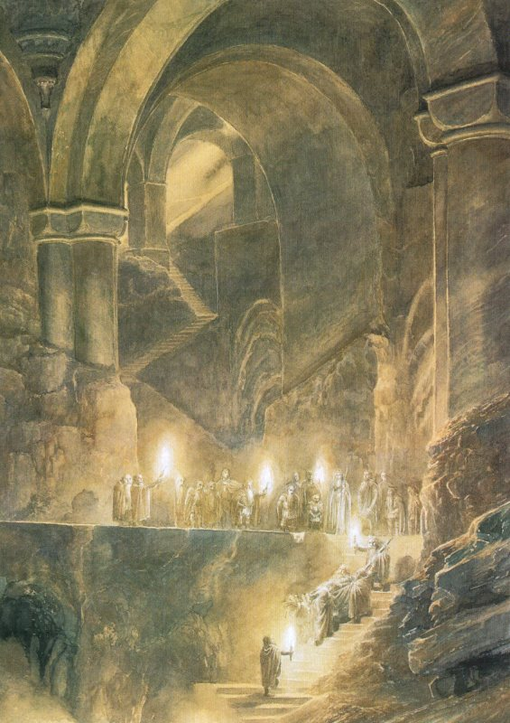
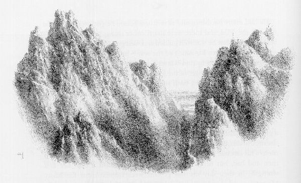

## Kapitel 18: Die Heimreise

Als Bilbo wieder zu sich kam, war er tatsächlich ganz für sich allein. Er lag auf den flachen Steinen von Ravenhill, und niemand war in seiner Nähe. Über ihm spannte sich ein wolkenloser, aber kalter Tag. Er zitterte und war so kalt wie Stein, doch sein Kopf brannte wie Feuer.

— Was ist wohl geschehen? — fragte er sich. — Jedenfalls gehöre ich noch nicht zu den <abbr title="fallen (fiel, ist gefallen) — пасть; погибнуть в бою">gefallenen</abbr> <abbr title="der Held, die Helden — герой">Helden</abbr>; aber dafür bleibt vermutlich noch genug Zeit!

Unter Schmerzen setzte er sich auf. Als er ins Tal blickte, <abbr title="sehen (sah, hat gesehen) — увидел">sah</abbr> er keine lebenden <abbr title="der Goblin, die Goblins — гоблин">Goblins</abbr>. Nach einer Weile wurde sein Kopf etwas klarer, und er glaubte, unten zwischen den <abbr title="der Felsen, die Felsen — скала; утёс">Felsen</abbr> <abbr title="der Elf, die Elfen — эльф">Elfen</abbr> zu erkennen. Er rieb sich die Augen. Dort draußen in der Ebene <abbr title="standhalten (hielt stand, hat standgehalten) — держаться; не отступать">stand</abbr> doch noch ein <abbr title="das Lager, die Lager — лагерь">Lager</abbr>, in einiger Entfernung; und am Tor gingen Leute ein und aus? <abbr title="der Zwerg, die Zwerge — гном">Zwerge</abbr> schienen damit beschäftigt zu sein, die Mauer abzutragen. Aber überall herrschte <abbr title="die Totenstille — мёртвая тишина">Totenstille</abbr>. Kein Ruf ertönte, kein Lied hallte wider. Trauer schien in der Luft zu liegen.

— Also doch ein Sieg, nehme ich an! — sagte er und tastete nach seinem schmerzenden Kopf. — Nun, es scheint eine ziemlich düstere Angelegenheit zu sein.

Plötzlich bemerkte er einen Mann, der den Hang heraufstieg und auf ihn zukam.

— Hallo, dort! — rief er mit zitternder Stimme. — Hallo! Was gibt es Neues?

— Was für eine Stimme spricht da zwischen den Steinen? — fragte der Mann. Nicht weit von Bilbos Sitzplatz blieb er stehen und <abbr title="sehen (sah, hat gesehen) — увидел">sah</abbr> <abbr title="spähen — внимательно вглядываться">spähend</abbr> um sich.

Da fiel Bilbo sein Ring wieder ein!

— Na, so etwas! — sagte er. — Diese Unsichtbarkeit hat also doch ihre Nachteile. Sonst hätte ich die Nacht vermutlich warm und <abbr title="gemütlich — уютный">gemütlich</abbr> im Bett verbringen können!

— Ich bin es, Bilbo Baggins, Thorins <abbr title="der Gefährte, die Gefährten — соратник">Gefährte</abbr>! — rief er und zog hastig den Ring ab.

— Gut, dass ich Euch gefunden habe! — sagte der Mann und kam mit großen Schritten näher. — Man braucht Euch, und wir haben lange nach Euch gesucht. Man hätte Euch zu den Toten gezählt, und davon gibt es viele, wenn Gandalf der <abbr title="der Zauberer, die Zauberer — волшебник">Zauberer</abbr> nicht gesagt hätte, Eure Stimme sei zuletzt hier gehört worden. Ich wurde hergeschickt, um ein letztes Mal hier zu suchen. Seid Ihr schwer verletzt?

— Ein übler Schlag auf den Kopf, glaube ich, — sagte Bilbo. — Aber ich habe einen Helm und einen harten <abbr title="der Schädel, die Schädel — череп">Schädel</abbr>. Trotzdem ist mir schlecht, und meine Beine sind wie Strohhalme.

— Ich werde Euch hinunter ins <abbr title="das Lager, die Lager — лагерь">Lager</abbr> im Tal tragen, — sagte der Mann und hob ihn mühelos hoch.

Der Mann war schnell und <abbr title="trittsicher — уверенно ступающий">trittsicher</abbr>. Schon bald setzte er Bilbo vor einem Zelt in Dale ab. Dort <abbr title="standhalten (hielt stand, hat standgehalten) — держаться; не отступать">stand</abbr> Gandalf, den Arm in einer <abbr title="die Schlinge, die Schlingen — перевязь; петля">Schlinge</abbr>. Selbst der <abbr title="der Zauberer, die Zauberer — волшебник">Zauberer</abbr> war nicht ohne Wunde davongekommen, und im ganzen <abbr title="das Heer, die Heere — войско">Heer</abbr> gab es nur wenige Unverletzte.

Als Gandalf Bilbo <abbr title="sehen (sah, hat gesehen) — увидел">sah</abbr>, freute er sich sehr.

— Baggins! — rief er. — Das gibt es doch nicht! Also doch am Leben — wie froh ich bin! Ich begann mich zu fragen, ob selbst dein Glück dich noch durchbringen würde! Eine schreckliche Angelegenheit, und beinahe wäre sie zur <abbr title="die Katastrophe, die Katastrophen — катастрофа">Katastrophe</abbr> geworden. Aber die anderen Neuigkeiten können warten. Komm! — sagte er ernster. — Man hat nach dir verlangt.

Er führte den Hobbit ins Zelt.

— Sei gegrüßt, Thorin! — sagte er beim Eintreten. — Ich habe ihn gebracht.

Dort lag tatsächlich Thorin Oakenshield, von vielen Wunden gezeichnet. Seine <abbr title="zerreißen (zerriss, hat zerrissen) — разорвать">zerrissene</abbr> <abbr title="die Rüstung, die Rüstungen — доспехи">Rüstung</abbr> und seine <abbr title="die Axt, die Äxte — топор">Axt</abbr> mit den <abbr title="die Kerbe, die Kerben — зазубрина; зарубка">Kerben</abbr> in der Schneide lagen auf dem Boden. Er blickte auf, als Bilbo neben ihn trat.

— Leb wohl, guter Dieb, — sagte er. — Ich gehe jetzt in die Hallen des Wartens, um neben meinen Vätern zu sitzen, bis die Welt erneuert wird. Da ich nun alles Gold und Silber zurücklasse und dorthin gehe, wo es wenig wert ist, möchte ich in Freundschaft von dir scheiden. Ich möchte meine Worte und Taten am Tor zurücknehmen.

Voller Trauer sank Bilbo auf ein Knie.

— Leb wohl, König unter dem Berg! — sagte er. — Dies ist ein bitteres <abbr title="das Abenteuer, die Abenteuer — приключение">Abenteuer</abbr>, wenn es so enden muss, und kein Berg aus Gold kann das <abbr title="wiedergutmachen — загладить; исправить">wiedergutmachen</abbr>. Doch ich bin froh, dass ich deine Gefahren mit dir geteilt habe — das war mehr, als irgendein Baggins verdient.

— Nein! — sagte Thorin. — In dir steckt mehr Gutes, als du weißt, Kind des freundlichen Westens. Etwas <abbr title="der Mut — смелость">Mut</abbr> und etwas <abbr title="die Weisheit — мудрость">Weisheit</abbr>, im rechten Maß verbunden. Wenn mehr von uns Essen, Fröhlichkeit und Gesang höher schätzten als <abbr title="horten — копить; накапливать">gehortetes</abbr> Gold, wäre die Welt heiterer. Doch ob traurig oder heiter, ich muss sie jetzt verlassen. Leb wohl!

Da wandte Bilbo sich ab, <abbr title="gehen (ging, ist gegangen) — шёл">ging</abbr> allein hinaus und setzte sich, in eine Decke gehüllt, ganz für sich hin. Und ob ihr es glaubt oder nicht: Er weinte, bis seine Augen rot waren und seine Stimme <abbr title="heiser — хриплый; хрипло">heiser</abbr>. Er war eine kleine, gutherzige Seele. Es dauerte wirklich lange, bis ihm wieder nach einem Scherz zumute war.

— Ein Glück ist es, — sagte er schließlich zu sich, — dass ich gerade zu dieser Zeit aufgewacht bin. Ich wünschte, Thorin lebte noch, aber ich bin froh, dass wir uns in Freundschaft getrennt haben. Du bist ein Narr, Bilbo Baggins, und hast mit der Sache um den Stein ein großes <abbr title="das Durcheinander — неразбериха">Durcheinander</abbr> angerichtet. Und es gab eine Schlacht, trotz all deiner <abbr title="der Versuch, die Versuche — попытка">Versuche</abbr>, Frieden und Ruhe zu erkaufen; aber dafür kann man dir wohl kaum die Schuld geben.

Was alles geschehen war, nachdem der Schlag ihn <abbr title="bewusstlos — без сознания">bewusstlos</abbr> gemacht hatte, erfuhr Bilbo später. Doch es brachte ihm mehr Trauer als Freude, und er war seines Abenteuers nun müde. Bis in die <abbr title="der Knochen, die Knochen — кость">Knochen</abbr> sehnte er sich nach der Heimreise. Die verzögerte sich allerdings noch etwas; deshalb werde ich inzwischen ein wenig von den Ereignissen erzählen. Die <abbr title="der Adler, die Adler — орёл">Adler</abbr> hatten schon lange den <abbr title="der Verdacht — подозрение">Verdacht</abbr> gehabt, dass die <abbr title="der Goblin, die Goblins — гоблин">Goblins</abbr> ihre Truppen sammelten. Ihren wachsamen Augen konnten die Bewegungen in den Bergen nicht völlig verborgen bleiben. Daher hatten auch sie sich in großer Zahl unter dem großen <abbr title="der Adler, die Adler — орёл">Adler</abbr> der Misty Mountains versammelt. Schließlich hatten sie von fern die Schlacht gewittert und waren mit dem Sturm herabgeflogen, gerade noch rechtzeitig. Sie waren es, die die <abbr title="der Goblin, die Goblins — гоблин">Goblins</abbr> von den Berghängen vertrieben, sie über <abbr title="der Abgrund, die Abgründe — пропасть">Abgründe</abbr> hinabwarfen oder schreiend und verwirrt zu ihren Feinden hinunterjagten. Bald hatten sie den Lonely Mountain befreit. Endlich konnten die <abbr title="der Elf, die Elfen — эльф">Elfen</abbr> und Menschen auf beiden Seiten des Tals den Kämpfenden unten zu Hilfe kommen.

Aber selbst mit den Adlern waren ihre Feinde noch immer in der Überzahl. In dieser letzten Stunde war Beorn selbst erschienen — niemand wusste, wie oder woher. Er kam allein und in Bärengestalt; in seinem <abbr title="der Zorn — ярость; гнев">Zorn</abbr> schien er beinahe zur Größe eines <abbr title="der Riese, die Riesen — великан">Riesen</abbr> angewachsen zu sein.

Seine Stimme dröhnte wie <abbr title="die Trommel, die Trommeln — барабан">Trommeln</abbr> und Kanonen. Wölfe und <abbr title="der Goblin, die Goblins — гоблин">Goblins</abbr> schleuderte er aus seinem Weg wie Strohhalme und Federn. Er griff sie von hinten an und brach wie ein Donnerschlag durch ihren Ring. Die <abbr title="der Zwerg, die Zwerge — гном">Zwerge</abbr> hielten noch immer auf einem niedrigen, rundlichen Hügel um ihre Herren <abbr title="standhalten (hielt stand, hat standgehalten) — держаться; не отступать">stand</abbr>. Da beugte Beorn sich hinunter, hob Thorin auf, der von <abbr title="der Speer, die Speere — копьё">Speeren</abbr> <abbr title="durchbohren — пронзить насквозь">durchbohrt</abbr> gefallen war, und trug ihn aus dem <abbr title="das Kampfgetümmel — сумятица боя">Kampfgetümmel</abbr> hinaus.

Rasch kehrte er zurück, und sein <abbr title="der Zorn — ярость; гнев">Zorn</abbr> war doppelt so groß. Nichts konnte ihm <abbr title="widerstehen (widerstand, hat widerstanden) — противостоять">widerstehen</abbr>, und keine <abbr title="die Waffe, die Waffen — оружие">Waffe</abbr> schien ihn verletzen zu können. Er trieb die <abbr title="die Leibwache, die Leibwachen — личная охрана">Leibwache</abbr> auseinander, riss Bolg selbst zu Boden und <abbr title="zermalmen — раздавить; размозжить">zermalmte</abbr> ihn. Da packte die <abbr title="der Goblin, die Goblins — гоблин">Goblins</abbr> das Entsetzen, und sie flohen in alle Richtungen. Doch mit der neuen Hoffnung wich die Müdigkeit von ihren Feinden. Sie verfolgten die Flüchtenden dicht und verhinderten, wo sie konnten, dass die meisten entkamen. Viele trieben sie in den River Running. Diejenigen, die nach Süden oder <abbr title="die Weste, die Westen — жилет">Westen</abbr> flohen, jagten sie in die <abbr title="der Sumpf, die Sümpfe — болото">Sümpfe</abbr> am Forest River. Dort kam der größte Teil der letzten <abbr title="der Flüchtling, die Flüchtlinge — беглец">Flüchtlinge</abbr> um. Wer mit Mühe das Reich der <abbr title="der Waldelf, die Waldelfen — лесной эльф">Waldelfen</abbr> erreichte, wurde dort erschlagen oder tief in die <abbr title="weglos — без дорог и троп">weglose</abbr> Finsternis von Mirkwood gelockt, um darin zu sterben. Die Lieder berichten, dass an diesem Tag drei Viertel der Goblinkrieger des Nordens umkamen. In den Bergen herrschte danach viele Jahre lang Frieden.

Der Sieg hatte schon vor <abbr title="der Einbruch, die Einbrüche — взлом; кража со взломом">Einbruch</abbr> der Nacht festgestanden. Doch als Bilbo ins <abbr title="das Lager, die Lager — лагерь">Lager</abbr> zurückkehrte, dauerte die Verfolgung noch an. Außer den besonders schwer Verwundeten waren nur wenige im Tal geblieben.

— Wo sind die <abbr title="der Adler, die Adler — орёл">Adler</abbr>? — fragte er Gandalf an jenem Abend, während er in viele warme Decken gehüllt dalag.

— Einige sind bei der Jagd, — sagte der <abbr title="der Zauberer, die Zauberer — волшебник">Zauberer</abbr>, — doch die meisten sind zu ihren <abbr title="der Horst, die Horste — гнездо хищной птицы">Horsten</abbr> zurückgekehrt. Sie wollten nicht hierbleiben und sind beim ersten Morgenlicht aufgebrochen. Dain hat ihren <abbr title="der Anführer, die Anführer — предводитель">Anführer</abbr> mit Gold gekrönt und ihnen ewige Freundschaft geschworen.

— Das tut mir leid. Ich meine, ich hätte sie gern wiedergesehen, — sagte Bilbo schläfrig. — Vielleicht sehe ich sie auf dem Heimweg. Ich werde wohl bald nach Hause <abbr title="gehen (ging, ist gegangen) — шёл">gehen</abbr>?

— Sobald du möchtest, — sagte der <abbr title="der Zauberer, die Zauberer — волшебник">Zauberer</abbr>.

Tatsächlich vergingen noch einige Tage, ehe Bilbo wirklich aufbrach. Sie begruben Thorin tief unter dem Berg, und Bard legte ihm den Arkenstone auf die Brust.

— Dort soll er liegen, bis der Berg zerfällt! — sagte er. — Möge er allen aus seinem Volk Glück bringen, die nach ihm hier wohnen!

Auf sein Grab legte der Elvenking dann Orcrist, das Elfenschwert, das man Thorin während seiner <abbr title="die Gefangenschaft — плен">Gefangenschaft</abbr> abgenommen hatte. Die Lieder erzählen, dass es im Dunkeln stets aufleuchtete, wenn Feinde sich näherten, sodass die <abbr title="die Festung, die Festungen — крепость">Festung</abbr> der <abbr title="der Zwerg, die Zwerge — гном">Zwerge</abbr> nicht <abbr title="überrascht — удивлённый">überrascht</abbr> werden konnte. Dort ließ sich nun Dain, Nains Sohn, nieder und wurde König unter dem Berg. Mit der Zeit versammelten sich viele weitere <abbr title="der Zwerg, die Zwerge — гном">Zwerge</abbr> in den alten Hallen um seinen <abbr title="der Thron, die Throne — трон">Thron</abbr>. Von Thorins zwölf <abbr title="der Gefährte, die Gefährten — спутник; соратник">Gefährten</abbr> blieben zehn übrig. Fili und Kili waren gefallen, als sie ihn mit Schild und Leib verteidigten, denn er war der ältere Bruder ihrer Mutter. Die anderen blieben bei Dain, denn Dain verteilte seinen <abbr title="der Schatz, die Schätze — клад; сокровище">Schatz</abbr> gut.

Natürlich war keine Rede mehr davon, den <abbr title="der Schatz, die Schätze — клад; сокровище">Schatz</abbr> so aufzuteilen, wie man es geplant hatte: in <abbr title="der Anteil, die Anteile — доля">Anteile</abbr> für Balin und Dwalin, Dori und Nori und Ori, Oin und Gloin, Bifur und Bofur und Bombur — oder für Bilbo. Dennoch erhielt Bard ein Vierzehntel des gesamten Goldes und Silbers, des <abbr title="verarbeiten — обработать">verarbeiteten</abbr> wie des unbearbeiteten. Denn Dain sagte:

— Wir werden die Vereinbarung des Toten ehren, und nun befindet sich der Arkenstone in seiner <abbr title="die Obhut — попечение; защита">Obhut</abbr>.

Selbst ein Vierzehntel war ein ungeheurer Reichtum, größer als der vieler <abbr title="sterblich — смертный">sterblicher</abbr> Könige. Von diesem <abbr title="der Schatz, die Schätze — клад; сокровище">Schatz</abbr> schickte Bard viel Gold an den Bürgermeister von Lake-town. Seine Anhänger und Freunde belohnte er großzügig. Dem Elvenking gab er Girions <abbr title="der Smaragd, die Smaragde — изумруд">Smaragde</abbr>, jene <abbr title="der Edelstein, die Edelsteine — драгоценный камень">Edelsteine</abbr>, die der Elvenking am meisten liebte und die Dain Bard zurückgegeben hatte.

Zu Bilbo sagte er:

— Dieser <abbr title="der Schatz, die Schätze — клад; сокровище">Schatz</abbr> gehört ebenso dir wie mir. Zwar können die alten Vereinbarungen nicht bestehen bleiben, da so viele durch seine Gewinnung und Verteidigung einen <abbr title="der Anspruch, die Ansprüche — право; притязание">Anspruch</abbr> darauf haben. Doch selbst wenn du bereit warst, auf deinen ganzen <abbr title="der Anspruch, die Ansprüche — право; притязание">Anspruch</abbr> zu verzichten, möchte ich nicht, dass Thorins Worte, die er bereute, wahr werden: dass wir dir wenig geben würden. Dich möchte ich von allen am reichsten belohnen.

— Sehr freundlich von Euch, — sagte Bilbo. — Aber eigentlich ist es eine Erleichterung für mich. Wie ich um alles in der Welt diesen ganzen <abbr title="der Schatz, die Schätze — клад; сокровище">Schatz</abbr> hätte nach Hause schaffen sollen, ohne unterwegs ständig Krieg und Mord zu erleben, weiß ich nicht. Und ich weiß auch nicht, was ich zu Hause damit hätte anfangen sollen. In Euren Händen ist er gewiss besser aufgehoben.

Am Ende wollte er nur zwei kleine <abbr title="die Truhe, die Truhen — сундук">Truhen</abbr> nehmen, die eine mit Silber, die andere mit Gold gefüllt: gerade so viel, wie ein kräftiges Pony tragen konnte.

— Das wird so viel sein, wie ich überhaupt bewältigen kann, — sagte er.

Endlich kam die Zeit, sich von seinen Freunden zu verabschieden.

— Leb wohl, Balin! — sagte er. — Und leb wohl, Dwalin! Und lebt wohl, Dori, Nori, Ori, Oin, Gloin, Bifur, Bofur und Bombur! Mögen eure <abbr title="der Bart, die Bärte — борода">Bärte</abbr> niemals dünn werden!

Dann wandte er sich zum Berg und fügte hinzu:

— Leb wohl, Thorin Oakenshield! Und Fili und Kili! Möge die Erinnerung an euch niemals <abbr title="verblassen — поблекнуть; угаснуть">verblassen</abbr>!

Da verbeugten sich die <abbr title="der Zwerg, die Zwerge — гном">Zwerge</abbr> tief vor ihrem Tor, doch die Worte blieben ihnen im Hals <abbr title="stecken bleiben — застрять">stecken</abbr>.

— Leb wohl und viel Glück, wohin du auch ziehst! — sagte Balin schließlich. — Wenn du uns je wieder besuchst, wenn unsere Hallen wieder schön hergerichtet sind, dann wird das Fest wahrhaft prächtig sein!

— Wenn ihr je in meine Gegend kommt, — sagte Bilbo, — haltet euch nicht mit Anklopfen auf! Tee gibt es um vier, aber jeder von euch ist jederzeit willkommen!

Dann wandte er sich ab.

Das <abbr title="das Elfenheer, die Elfenheere — войско эльфов">Elfenheer</abbr> war auf dem Marsch. Auch wenn es traurig zusammengeschrumpft war, waren doch viele froh: Nun würde die Welt des Nordens für lange Zeit heiterer sein. Der <abbr title="der Drache, die Drachen — дракон">Drache</abbr> war tot, die <abbr title="der Goblin, die Goblins — гоблин">Goblins</abbr> besiegt, und ihre Herzen freuten sich auf einen Frühling voller Freude nach dem Winter.

Gandalf und Bilbo ritten hinter dem Elvenking. Neben ihnen schritt Beorn, wieder in Menschengestalt, und unterwegs lachte und sang er mit lauter Stimme. So zogen sie weiter, bis sie sich den Grenzen von Mirkwood näherten, nördlich der Stelle, wo der Forest River aus dem Wald floss. Dort hielten sie an. Der <abbr title="der Zauberer, die Zauberer — волшебник">Zauberer</abbr> und Bilbo wollten den Wald nicht betreten, obwohl der König sie einlud, eine Weile in seinen Hallen zu bleiben. Sie wollten am Waldrand entlang und um sein Nordende herumziehen, durch das <abbr title="das Ödland — пустошь">Ödland</abbr>, das zwischen dem Wald und den ersten Höhen der Grey Mountains lag. Es war ein langer, freudloser Weg. Doch nun, da die <abbr title="der Goblin, die Goblins — гоблин">Goblins</abbr> vernichtet waren, schien er ihnen sicherer als die schrecklichen Pfade unter den Bäumen. Außerdem wollte auch Beorn diesen Weg nehmen.

— Leb wohl, o Elvenking! — sagte Gandalf. — Heiter sei der grüne Wald, solange die Welt noch jung ist! Und heiter sei dein ganzes Volk!

— Leb wohl, o Gandalf! — sagte der König. — Mögest du immer dort erscheinen, wo du am dringendsten gebraucht und am wenigsten erwartet wirst! Je öfter du in meinen Hallen erscheinst, desto mehr werde ich mich freuen!

— Ich bitte Euch, — sagte Bilbo <abbr title="stammeln — заикаться; запинаться">stammelnd</abbr> und <abbr title="standhalten (hielt stand, hat standgehalten) — держаться; не отступать">stand</abbr> dabei auf einem Fuß, — nehmt dieses Geschenk an!

Er zog eine <abbr title="die Halskette, die Halsketten — ожерелье">Halskette</abbr> aus Silber und Perlen hervor, die Dain ihm zum Abschied gegeben hatte.

— Womit habe ich ein solches Geschenk verdient, o Hobbit? — fragte der König.

— Nun, äh, ich dachte, Ihr wisst schon, — sagte Bilbo ziemlich <abbr title="verlegen — смущённый">verlegen</abbr>, — dass, äh, Eure, äh, <abbr title="die Gastfreundschaft — гостеприимство">Gastfreundschaft</abbr> eine kleine Gegengabe verdient. Ich meine, selbst ein <abbr title="der Einbrecher, die Einbrecher — взломщик">Einbrecher</abbr> hat seine Gefühle. Ich habe viel von Eurem Wein getrunken und viel von Eurem Brot gegessen.

— Ich werde dein Geschenk annehmen, o Bilbo der Prächtige! — sagte der König ernst. — Und ich nenne dich Elfenfreund und <abbr title="gesegnet — благословенный">gesegnet</abbr>. Möge dein <abbr title="der Schatten, die Schatten — тень">Schatten</abbr> niemals kleiner werden (sonst wäre das Stehlen zu leicht)! Leb wohl!

Dann wandten sich die <abbr title="der Elf, die Elfen — эльф">Elfen</abbr> dem Wald zu, und Bilbo begann seinen langen Heimweg.

Bis zu seiner Rückkehr musste er noch viele Schwierigkeiten und <abbr title="das Abenteuer, die Abenteuer — приключение">Abenteuer</abbr> bestehen. Die <abbr title="die Wildnis — дикая местность">Wildnis</abbr> war immer noch die <abbr title="die Wildnis — дикая местность">Wildnis</abbr>, und damals gab es dort außer <abbr title="der Goblin, die Goblins — гоблин">Goblins</abbr> noch viele andere Dinge. Doch er wurde gut geführt und gut beschützt — der <abbr title="der Zauberer, die Zauberer — волшебник">Zauberer</abbr> war bei ihm und Beorn auf einem großen Teil des Weges — und geriet nie wieder in große Gefahr. Jedenfalls hatten Gandalf und Bilbo bis zur Wintermitte den ganzen Weg an beiden Rändern des Waldes entlang bis vor Beorns Haustür zurückgelegt. Dort blieben sie beide eine Weile. Das <abbr title="das Julfest, die Julfeste — праздник середины зимы; Йоль">Julfest</abbr> war dort warm und fröhlich, und auf Beorns Einladung kamen Menschen von nah und fern zum Feiern und Schmausen.

Die <abbr title="der Goblin, die Goblins — гоблин">Goblins</abbr> der Misty Mountains waren nun wenige und voller Angst. Sie verbargen sich in den tiefsten Löchern, die sie finden konnten. Die <abbr title="der Warg, die Warge — варг; злобный волк">Warge</abbr> waren aus den Wäldern verschwunden, sodass die Menschen ohne Furcht hinausziehen konnten. Beorn wurde später tatsächlich ein großer <abbr title="der Anführer, die Anführer — предводитель">Anführer</abbr> in jenen Gegenden und herrschte über ein weites Land zwischen den Bergen und dem Wald. Man sagt, dass die Menschen aus seiner Familie über viele Generationen hinweg die <abbr title="die Macht, die Mächte — сила; способность">Macht</abbr> besaßen, Bärengestalt anzunehmen. Einige von ihnen waren finstere, böse Männer; doch die meisten glichen Beorn im Herzen, wenn auch nicht an Größe und Kraft. In ihrer Zeit wurden die letzten <abbr title="der Goblin, die Goblins — гоблин">Goblins</abbr> aus den Misty Mountains vertrieben, und ein neuer Frieden legte sich über den Rand der <abbr title="die Wildnis — дикая местность">Wildnis</abbr>.

Es war schon Frühling, ein schöner Frühling mit mildem Wetter und heller Sonne, als Bilbo und Gandalf sich endlich von Beorn verabschiedeten. Obwohl Bilbo sich nach Hause sehnte, schied er mit <abbr title="das Bedauern — сожаление">Bedauern</abbr>. Denn die Blumen in Beorns Gärten waren im Frühling nicht weniger wunderbar als im Hochsommer.

Endlich stiegen sie die lange Straße hinauf und erreichten genau den <abbr title="der Pass, die Pässe — горный перевал">Pass</abbr>, an dem die <abbr title="der Goblin, die Goblins — гоблин">Goblins</abbr> sie zuvor gefangen genommen hatten. Doch diesmal kamen sie am Morgen an dieser hohen Stelle an. Als sie zurückblickten, sahen sie eine weiße Sonne über den weit ausgestreckten Ländern leuchten. Hinter ihnen lag Mirkwood, in der Ferne blau, am näheren Rand selbst im Frühling dunkelgrün. Ganz weit weg, gerade noch sichtbar, <abbr title="standhalten (hielt stand, hat standgehalten) — держаться; не отступать">stand</abbr> der Lonely Mountain. Auf seinem höchsten <abbr title="der Gipfel, die Gipfel — горная вершина">Gipfel</abbr> schimmerte blass der noch nicht geschmolzene Schnee.

— So folgt Schnee auf Feuer, und selbst <abbr title="der Drache, die Drachen — дракон">Drachen</abbr> finden ihr Ende! — sagte Bilbo und kehrte seinem <abbr title="das Abenteuer, die Abenteuer — приключение">Abenteuer</abbr> den Rücken zu. Der Took in ihm wurde sehr müde, und der Baggins wurde von Tag zu Tag stärker.

— Jetzt wünsche ich mir nur noch, in meinem eigenen Sessel zu sitzen! — sagte er.

---

### Neue und schwierige Wörter

- **fallen (fiel, ist gefallen)** — пасть; погибнуть в бою *(neu)*
- **der Held, die Helden** — герой *(Wiederholung)*
- **sehen (sah, hat gesehen)** — увидел *(Wiederholung)*
- **der Goblin, die Goblins** — гоблин *(Wiederholung)*
- **der Felsen, die Felsen** — скала; утёс *(Wiederholung)*
- **der Elf, die Elfen** — эльф *(Wiederholung)*
- **standhalten (hielt stand, hat standgehalten)** — держаться; не отступать *(Wiederholung)*
- **das Lager, die Lager** — лагерь *(Wiederholung)*
- **der Zwerg, die Zwerge** — гном *(Wiederholung)*
- **die Totenstille** — мёртвая тишина *(neu)*
- **spähen** — внимательно вглядываться *(neu)*
- **gemütlich** — уютный *(Wiederholung)*
- **der Gefährte, die Gefährten** — соратник *(Wiederholung)*
- **der Zauberer, die Zauberer** — волшебник *(Wiederholung)*
- **der Schädel, die Schädel** — череп *(Wiederholung)*
- **trittsicher** — уверенно ступающий *(neu)*
- **die Schlinge, die Schlingen** — перевязь; петля *(Wiederholung)*
- **das Heer, die Heere** — войско *(Wiederholung)*
- **die Katastrophe, die Katastrophen** — катастрофа *(neu)*
- **zerreißen (zerriss, hat zerrissen)** — разорвать *(neu)*
- **die Rüstung, die Rüstungen** — доспехи *(Wiederholung)*
- **die Axt, die Äxte** — топор *(Wiederholung)*
- **die Kerbe, die Kerben** — зазубрина; зарубка *(neu)*
- **das Abenteuer, die Abenteuer** — приключение *(Wiederholung)*
- **wiedergutmachen** — загладить; исправить *(neu)*
- **der Mut** — смелость *(Wiederholung)*
- **die Weisheit** — мудрость *(neu)*
- **horten** — копить; накапливать *(neu)*
- **gehen (ging, ist gegangen)** — шёл *(Wiederholung)*
- **heiser** — хриплый; хрипло *(Wiederholung)*
- **das Durcheinander** — неразбериха *(neu)*
- **der Versuch, die Versuche** — попытка *(Wiederholung)*
- **bewusstlos** — без сознания *(Wiederholung)*
- **der Knochen, die Knochen** — кость *(Wiederholung)*
- **der Adler, die Adler** — орёл *(Wiederholung)*
- **der Verdacht** — подозрение *(Wiederholung)*
- **der Abgrund, die Abgründe** — пропасть *(neu)*
- **der Zorn** — ярость; гнев *(neu)*
- **der Riese, die Riesen** — великан *(Wiederholung)*
- **die Trommel, die Trommeln** — барабан *(Wiederholung)*
- **der Speer, die Speere** — копьё *(Wiederholung)*
- **durchbohren** — пронзить насквозь *(neu)*
- **das Kampfgetümmel** — сумятица боя *(neu)*
- **widerstehen (widerstand, hat widerstanden)** — противостоять *(Wiederholung)*
- **die Waffe, die Waffen** — оружие *(Wiederholung)*
- **die Leibwache, die Leibwachen** — личная охрана *(Wiederholung)*
- **zermalmen** — раздавить; размозжить *(neu)*
- **die Weste, die Westen** — жилет *(Wiederholung)*
- **der Sumpf, die Sümpfe** — болото *(Wiederholung)*
- **der Flüchtling, die Flüchtlinge** — беглец *(neu)*
- **der Waldelf, die Waldelfen** — лесной эльф *(Wiederholung)*
- **weglos** — без дорог и троп *(neu)*
- **der Einbruch, die Einbrüche** — взлом; кража со взломом *(Wiederholung)*
- **der Horst, die Horste** — гнездо хищной птицы *(Wiederholung)*
- **der Anführer, die Anführer** — предводитель *(Wiederholung)*
- **die Gefangenschaft** — плен *(neu)*
- **die Festung, die Festungen** — крепость *(Wiederholung)*
- **überrascht** — удивлённый *(Wiederholung)*
- **der Thron, die Throne** — трон *(Wiederholung)*
- **der Schatz, die Schätze** — клад; сокровище *(Wiederholung)*
- **der Anteil, die Anteile** — доля *(Wiederholung)*
- **verarbeiten** — обработать *(neu)*
- **die Obhut** — попечение; защита *(neu)*
- **sterblich** — смертный *(neu)*
- **der Smaragd, die Smaragde** — изумруд *(Wiederholung)*
- **der Edelstein, die Edelsteine** — драгоценный камень *(Wiederholung)*
- **der Anspruch, die Ansprüche** — право; притязание *(Wiederholung)*
- **die Truhe, die Truhen** — сундук *(neu)*
- **der Bart, die Bärte** — борода *(Wiederholung)*
- **verblassen** — поблекнуть; угаснуть *(neu)*
- **stecken bleiben** — застрять *(Wiederholung)*
- **das Elfenheer, die Elfenheere** — войско эльфов *(Wiederholung)*
- **der Drache, die Drachen** — дракон *(Wiederholung)*
- **das Ödland** — пустошь *(neu)*
- **stammeln** — заикаться; запинаться *(neu)*
- **die Halskette, die Halsketten** — ожерелье *(Wiederholung)*
- **verlegen** — смущённый *(Wiederholung)*
- **die Gastfreundschaft** — гостеприимство *(Wiederholung)*
- **der Einbrecher, die Einbrecher** — взломщик *(Wiederholung)*
- **gesegnet** — благословенный *(neu)*
- **der Schatten, die Schatten** — тень *(Wiederholung)*
- **die Wildnis** — дикая местность *(neu)*
- **das Julfest, die Julfeste** — праздник середины зимы; Йоль *(neu)*
- **der Warg, die Warge** — варг; злобный волк *(Wiederholung)*
- **die Macht, die Mächte** — сила; способность *(Wiederholung)*
- **das Bedauern** — сожаление *(neu)*
- **der Pass, die Pässe** — горный перевал *(Wiederholung)*
- **der Gipfel, die Gipfel** — горная вершина *(Wiederholung)*

### Schwierige Sätze

- **„Sonst hätte ich die Nacht vermutlich warm und gemütlich im Bett verbringen können!“**  
  «Иначе я, наверное, мог бы провести ночь в тёплой уютной постели!» `hätte … verbringen können` — Konjunktiv II Vergangenheit с модальным глаголом: неосуществлённая возможность в прошлом и двойной инфинитив.
- **„Man hätte Euch zu den Toten gezählt, und davon gibt es viele, wenn Gandalf der Zauberer nicht gesagt hätte, Eure Stimme sei zuletzt hier gehört worden.“**  
  «Вас причислили бы к погибшим, а их много, если бы Гэндальф-волшебник не сказал, что ваш голос в последний раз слышали здесь». `hätte … gezählt / gesagt hätte` выражают нереальное прошлое условие. `sei … gehört worden` — Konjunktiv I прошедшего пассива в косвенной речи.
- **„Ich gehe jetzt in die Hallen des Wartens, um neben meinen Vätern zu sitzen, bis die Welt erneuert wird.“**  
  «Я ухожу в залы ожидания, чтобы сидеть рядом с моими отцами, пока мир не обновится». `um … zu` обозначает цель; `bis` — временной предел. `erneuert wird` — пассив.
- **„Wenn mehr von uns Essen, Fröhlichkeit und Gesang höher schätzten als gehortetes Gold, wäre die Welt heiterer.“**  
  «Если бы больше людей среди нас ценили еду, веселье и песни выше накопленного золота, мир был бы радостнее». `schätzten` и `wäre` образуют нереальное условие настоящего времени; `höher … als` — сравнение ценности.
- **„Was alles geschehen war, nachdem der Schlag ihn bewusstlos gemacht hatte, erfuhr Bilbo später.“**  
  «Обо всём, что случилось после того, как удар лишил его сознания, Бильбо узнал позже». Придаточное с `was` стоит перед главным предложением. Две формы Plusquamperfekt обозначают события, предшествовавшие `erfuhr`.
- **„Fili und Kili waren gefallen, als sie ihn mit Schild und Leib verteidigten, denn er war der ältere Bruder ihrer Mutter.“**  
  «Фили и Кили погибли, защищая его щитом и собственным телом, ведь он был старшим братом их матери». `waren gefallen` — Plusquamperfekt; `fallen` здесь значит погибнуть в бою. `denn` вводит объяснение с обычным порядком слов.
- **„Wie ich um alles in der Welt diesen ganzen Schatz hätte nach Hause schaffen sollen, ohne unterwegs ständig Krieg und Mord zu erleben, weiß ich nicht.“**  
  «Как, ради всего на свете, я должен был бы доставить всё это сокровище домой, не столкнувшись по дороге с постоянными войнами и убийствами, я не знаю». Косвенный вопрос вынесен вперёд. `hätte … schaffen sollen` — нереальная задача в прошлом; `ohne … zu` — отсутствие сопутствующего действия.
- **„Je öfter du in meinen Hallen erscheinst, desto mehr werde ich mich freuen!“**  
  «Чем чаще ты будешь появляться в моих залах, тем больше я буду рад!» Парная конструкция `je … desto …` связывает две степени сравнения. В первой части личный глагол стоит в конце.
- **„Obwohl Bilbo sich nach Hause sehnte, schied er mit Bedauern.“**  
  «Хотя Бильбо тосковал по дому, он уходил с сожалением». `obwohl` вводит уступку; `sich sehnen nach` — тосковать по чему-либо. `schied` — Präteritum от `scheiden`.
- **„Der Took in ihm wurde sehr müde, und der Baggins wurde von Tag zu Tag stärker.“**  
  «Туковская сторона его натуры сильно устала, а сторона Бэггинса день ото дня крепла». Фамилии обозначают два семейных начала в характере Бильбо. `von Tag zu Tag` — устойчивое выражение «день ото дня»; `stärker` — сравнительная степень.

[← Zurück](kapitel-17.md) · [Inhalt](README.md) · [Weiter →](kapitel-19.md)
