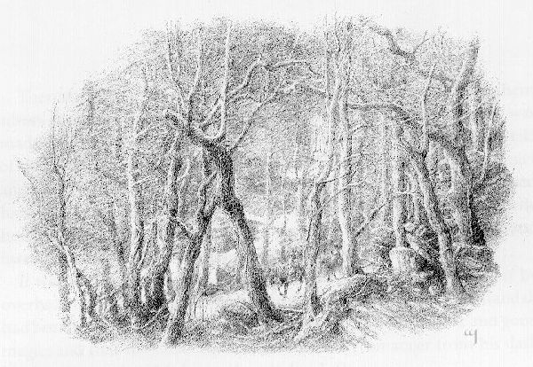
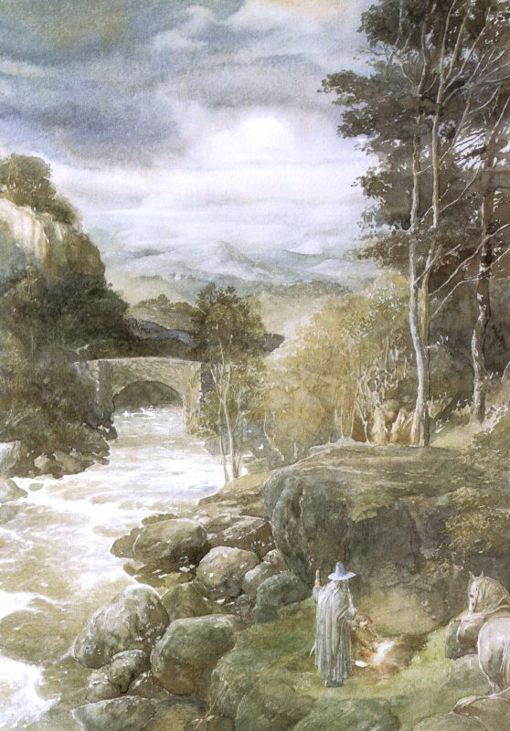
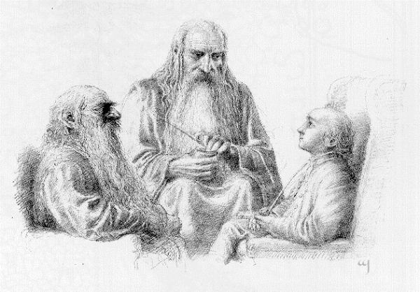

## Kapitel 19: Die letzte Etappe

Am ersten Mai kamen die beiden endlich wieder an den Rand des Tals von Rivendell, wo das Last Homely House <abbr title="standhalten (hielt stand, hat standgehalten) — держаться; не отступать">stand</abbr> – oder, von dieser Seite aus gesehen, das First Homely House. Wieder war es Abend. Ihre Ponys waren müde, besonders dasjenige, das das Gepäck trug, und sie alle brauchten Ruhe. Als sie den steilen Pfad hinabritten, hörte Bilbo die <abbr title="der Elf, die Elfen — эльф">Elfen</abbr> noch immer in den Bäumen singen, als hätten sie seit seiner Abreise nicht aufgehört. Sobald die Reiter die tiefer gelegenen <abbr title="die Lichtung, die Lichtungen — лесная поляна">Lichtungen</abbr> des Waldes erreichten, begannen die <abbr title="der Elf, die Elfen — эльф">Elfen</abbr> ein Lied ganz ähnlicher Art wie damals. Ungefähr so klang es:

> Der <abbr title="der Drache, die Drachen — дракон">Drache</abbr> ist <abbr title="verdorren — иссохнуть">verdorrt</abbr>,  
> Seine <abbr title="der Knochen, die Knochen — кость">Knochen</abbr> sind zerfallen;  
> Sein <abbr title="der Panzer, die Panzer — панцирь">Panzer</abbr> ist <abbr title="zersplittern — расколоться на осколки">zersplittert</abbr>,  
> Seine <abbr title="die Pracht — великолепие">Pracht</abbr> ist nun gebrochen!  
> Mag auch das <abbr title="das Schwert, die Schwerter — меч">Schwert</abbr> verrosten,  
> Mag <abbr title="der Thron, die Throne — трон">Thron</abbr> und Krone vergehen,  
> Mit der Kraft, der Menschen vertrauten,  
> Und dem Reichtum, den sie lieben:  
> Hier wächst noch immer das Gras,  
> Hier wiegen sich noch die Blätter,  
> Hier fließt das schäumende Wasser,  
> Hier singen noch immer die <abbr title="der Elf, die Elfen — эльф">Elfen</abbr>.  
> Kommt! Tra-la-la-lally!  
> Kommt wieder ins Tal!  

> Die Sterne sind viel heller  
> Als <abbr title="der Edelstein, die Edelsteine — драгоценный камень">Edelsteine</abbr> ohne Zahl,  
> Der Mond ist um so vieles weißer  
> Als Silber in einem <abbr title="der Schatz, die Schätze — клад; сокровище">Schatz</abbr>;  
> Das Feuer am Herd leuchtet heller  
> In der <abbr title="die Dämmerung — сумерки">Dämmerung</abbr>  
> Als Gold, das man aus Bergen holt.  
> Warum also zieht ihr umher?  
> O! Tra-la-la-lally!  
> Kommt wieder ins Tal.  

> O! Wohin wollt ihr <abbr title="gehen (ging, ist gegangen) — шёл">gehen</abbr>,  
> So spät erst zurück?  
> Der Fluss ist am Fließen,  
> Die Sterne, sie brennen!  
> O! Wohin mit so viel Last,  
> So traurig und so trüb?  
> Hier heißen <abbr title="der Elf, die Elfen — эльф">Elf</abbr> und Elfenmädchen  
> Die Müden nun willkommen,  
> Mit Tra-la-la-lally!  
> Kommt wieder ins Tal!  
> Tra-la-la-lally!  
> Fa-la-la-lally!  
> Fa-la!  

Dann kamen die <abbr title="der Elf, die Elfen — эльф">Elfen</abbr> des Tals hervor, begrüßten sie und führten sie über das Wasser zu Elronds Haus. Dort wurden sie herzlich empfangen, und an diesem Abend wollten viele voller <abbr title="die Neugier — любопытство">Neugier</abbr> von ihren <abbr title="das Abenteuer, die Abenteuer — приключение">Abenteuern</abbr> hören. Gandalf erzählte, denn Bilbo war still und <abbr title="schläfrig — сонный">schläfrig</abbr> geworden. Den größten Teil der Geschichte kannte er: Er war ja selbst dabei gewesen und hatte dem <abbr title="der Zauberer, die Zauberer — волшебник">Zauberer</abbr> auf dem Heimweg oder in Beorns Haus vieles davon erzählt. Doch hin und wieder öffnete er ein Auge und hörte zu, wenn ein Teil der Geschichte kam, den er noch nicht kannte.

So erfuhr er, wo Gandalf gewesen war, denn er hörte dessen Worte an Elrond mit. Offenbar hatte Gandalf an einer großen <abbr title="die Ratssitzung, die Ratssitzungen — заседание совета">Ratssitzung</abbr> der weißen <abbr title="der Zauberer, die Zauberer — волшебник">Zauberer</abbr> teilgenommen, die Meister alten Wissens und guter Magie waren. Endlich hatten sie den Necromancer aus seiner dunklen <abbr title="die Festung, die Festungen — крепость">Festung</abbr> im Süden von Mirkwood vertrieben.

— Bald wird der Wald wieder etwas gesünder werden, — sagte Gandalf gerade. — Der Norden wird hoffentlich für viele lange Jahre von diesem Schrecken befreit sein. Und doch wünschte ich, er wäre ganz aus der Welt <abbr title="verbannen — изгнать">verbannt</abbr>!

— Das wäre wirklich gut, — sagte Elrond. — Doch ich fürchte, das wird in diesem Zeitalter der Welt nicht geschehen, und auch in vielen späteren nicht.

Als die Geschichte ihrer Reisen zu Ende erzählt war, folgten andere Geschichten und noch mehr Geschichten: Geschichten aus längst vergangenen Zeiten, Geschichten von neuen Dingen und Geschichten, die in gar keiner Zeit spielten. Schließlich sank Bilbos Kopf auf die Brust, und in einer Ecke <abbr title="schnarchen — храпеть">schnarchte</abbr> er <abbr title="gemütlich — уютно">gemütlich</abbr> vor sich hin.

Als er aufwachte, lag er in einem weißen Bett, und der Mond schien durch ein offenes Fenster. Unten am Bach sangen viele <abbr title="der Elf, die Elfen — эльф">Elfen</abbr> laut und klar.

> Singt, ihr Fröhlichen, singt nun zusammen!  
> Der Wind ist im <abbr title="der Baumwipfel, die Baumwipfel — верхушка дерева">Baumwipfel</abbr>, der Wind ist im <abbr title="das Heidekraut — вереск">Heidekraut</abbr>;  
> Die Sterne stehen in Blüte, der Mond ist eine Blume,  
> Hell sind die Fenster der Nacht in ihrem Turm.  

> Tanzt, ihr Fröhlichen, tanzt nun zusammen!  
> Weich ist das Gras, wie eine Feder sei der Fuß!  
> Silbern der Fluss, <abbr title="flüchtig — мимолётный">flüchtig</abbr> die <abbr title="der Schatten, die Schatten — тень">Schatten</abbr>;  
> Fröhlich die Maienzeit, fröhlich unser Treffen.  

> Nun singen wir leise und weben ihm Träume,  
> Hüllen ihn in <abbr title="der Schlummer — дремота; сон">Schlummer</abbr> und lassen ihn dort.  
> Der Wanderer schläft. Nun sei weich sein Kissen! Schlaf ein!  
> Schlaf ein! <abbr title="die Erle, die Erlen — ольха">Erle</abbr> und <abbr title="die Weide, die Weiden — ива">Weide</abbr>!  

> Seufze nicht, <abbr title="die Kiefer, die Kiefern — сосна">Kiefer</abbr>, bis der Morgenwind kommt!  
> Sinke, Mond! Dunkel sei das Land!  
> Still! Still! <abbr title="die Eiche, die Eichen — дуб">Eiche</abbr>, <abbr title="die Esche, die Eschen — ясень">Esche</abbr> und Dorn!  
> Still sei alles Wasser, bis der Morgen naht!  

— Na, ihr fröhlichen Leute! — sagte Bilbo und <abbr title="sehen (sah, hat gesehen) — увидел">sah</abbr> hinaus. — Wie spät ist es denn, nach dem Mond zu urteilen? Euer Schlaflied würde einen betrunkenen <abbr title="der Goblin, die Goblins — гоблин">Goblin</abbr> wecken! Trotzdem danke ich euch.

— Und dein Schnarchen würde einen steinernen <abbr title="der Drache, die Drachen — дракон">Drachen</abbr> wecken, und trotzdem danken wir dir, — antworteten sie lachend. — Es geht auf den Morgen zu, und du schläfst schon seit Beginn der Nacht. Morgen bist du vielleicht von deiner Müdigkeit geheilt.

— Ein wenig Schlaf wirkt in Elronds Haus wahre Wunder, — sagte er. — Aber ich nehme so viel Heilung mit, wie ich bekommen kann. Noch einmal gute Nacht, ihr schönen Freunde!

Damit <abbr title="gehen (ging, ist gegangen) — шёл">ging</abbr> er wieder ins Bett und schlief bis weit in den Vormittag hinein.

In diesem Haus fiel die Müdigkeit bald von ihm ab. Früh und spät scherzte und tanzte er oft mit den <abbr title="der Elf, die Elfen — эльф">Elfen</abbr> des Tals. Doch selbst dieser Ort konnte ihn nun nicht lange <abbr title="aufhalten (hielt auf, hat aufgehalten) — задержать">aufhalten</abbr>; immer dachte er an sein eigenes Zuhause. Deshalb verabschiedete er sich nach einer Woche von Elrond, gab ihm die kleinen Geschenke, die dieser annehmen wollte, und ritt mit Gandalf davon.

Schon als sie das Tal verließen, verdunkelte sich vor ihnen der Himmel im <abbr title="die Weste, die Westen — жилет">Westen</abbr>, und Wind und Regen kamen ihnen entgegen.

— Fröhlich die Maienzeit! — sagte Bilbo, als ihm der Regen ins Gesicht schlug. — Aber die <abbr title="die Sage, die Sagen — сказание">Sagen</abbr> liegen hinter uns, und wir kommen nach Hause. Das ist wohl ein erster Vorgeschmack darauf.

— Es liegt noch ein langer Weg vor uns, — sagte Gandalf.

— Aber es ist der letzte Weg, — sagte Bilbo.

Sie kamen zu dem Fluss, der den äußersten Rand des Grenzgebiets von Wilderland bildete, und zu der <abbr title="die Furt, die Furten — брод">Furt</abbr> unter dem steilen Ufer, an die ihr euch vielleicht erinnert. Weil zum nahenden Sommer der Schnee schmolz und es den ganzen Tag geregnet hatte, war das Wasser stark gestiegen. Mit einiger Mühe kamen sie jedoch hinüber und zogen weiter, während es Abend wurde: auf die letzte Etappe ihrer Reise.

Alles war ähnlich wie beim letzten Mal, nur war die Reisegruppe kleiner und stiller; außerdem gab es diesmal keine <abbr title="der Troll, die Trolle — тролль">Trolle</abbr>. An jedem Punkt des Weges erinnerte sich Bilbo an die Ereignisse und Worte von vor einem Jahr – ihm kam es eher wie zehn Jahre vor. So erkannte er natürlich rasch die Stelle, wo das Pony in den Fluss gefallen war und sie den Weg verlassen hatten, um ihr unangenehmes <abbr title="das Abenteuer, die Abenteuer — приключение">Abenteuer</abbr> mit Tom, Bert und Bill zu erleben.

Nicht weit vom Weg fanden sie das Gold der <abbr title="der Troll, die Trolle — тролль">Trolle</abbr>, das sie vergraben hatten: Es lag noch immer verborgen und <abbr title="unberührt — нетронутый">unberührt</abbr> dort.

— Ich habe genug für den Rest meines Lebens, — sagte Bilbo, nachdem sie es ausgegraben hatten. — Nimm du das lieber, Gandalf. Ich bin sicher, du kannst etwas damit anfangen.

— Das kann ich allerdings! — sagte der <abbr title="der Zauberer, die Zauberer — волшебник">Zauberer</abbr>. — Aber wir teilen gerecht, jeder bekommt gleich viel! Vielleicht brauchst du doch mehr, als du erwartest.

Also steckten sie das Gold in <abbr title="der Sack, die Säcke — мешок">Säcke</abbr> und hängten sie den Ponys über den Rücken, was diesen überhaupt nicht gefiel. Danach kamen sie langsamer voran, denn meistens gingen sie zu Fuß. Doch das Land war grün, und es gab viel Gras, durch das der Hobbit zufrieden <abbr title="dahinschlendern — неторопливо прогуливаться">dahinschlenderte</abbr>. Er wischte sich das Gesicht mit einem roten seidenen <abbr title="das Taschentuch, die Taschentücher — носовой платок">Taschentuch</abbr> ab – nein! Von seinen eigenen war nicht ein einziges übrig geblieben; dieses hatte er sich bei Elrond geliehen. Denn inzwischen hatte der Juni den Sommer gebracht, und das Wetter war wieder hell und heiß.

Da alles einmal endet, sogar diese Geschichte, kam schließlich ein Tag, an dem sie das Land erblickten, in dem Bilbo geboren und aufgewachsen war. Die Formen der Landschaft und der Bäume waren ihm so vertraut wie seine Hände und Zehen. Als er eine <abbr title="die Anhöhe, die Anhöhen — возвышенность">Anhöhe</abbr> erreichte, <abbr title="sehen (sah, hat gesehen) — увидел">sah</abbr> er in der Ferne The Hill, den Hügel seiner Heimat, blieb plötzlich stehen und sagte:

> Wege führen immer, immer weiter,  
> Über Fels und unter Bäumen,  
> An <abbr title="die Höhle, die Höhlen — нора; пещера">Höhlen</abbr> vorbei, wo nie die Sonne schien,  
> An Bächen, die nie zum Meer gelangen;  
> Über Schnee, vom Winter ausgesät,  
> Und durch die fröhlichen Blumen des Juni,  
> Über Gras und über Stein,  
> Und unter Bergen im Mondlicht.  

> Wege führen immer, immer weiter,  
> Unter Wolken, unter Sternen,  
> Doch Füße, die auf Wanderschaft gingen,  
> Kehren zuletzt zur fernen Heimat um.  
> Augen, die Feuer und <abbr title="das Schwert, die Schwerter — меч">Schwert</abbr> gesehen  
> Und Schrecken in den Hallen aus Stein,  
> Schauen zuletzt auf grüne Wiesen  
> Und Bäume und Hügel, die sie lange schon kennen.  

Gandalf <abbr title="sehen (sah, hat gesehen) — увидел">sah</abbr> ihn an.

— Mein lieber Bilbo! — sagte er. — Mit dir stimmt etwas nicht! Du bist nicht mehr der Hobbit, der du einmal warst.

Und so überquerten sie die Brücke, kamen an der <abbr title="die Mühle, die Mühlen — мельница">Mühle</abbr> am Fluss vorbei und gelangten geradewegs wieder vor Bilbos eigene Tür.

— Du meine Güte! Was ist denn hier los? — rief er.

Es herrschte ein großes <abbr title="das Durcheinander — суматоха">Durcheinander</abbr>. Leute aller Art, anständige und weniger anständige, drängten sich dicht um die Tür, und viele gingen ein und aus. Nicht einmal die Füße wischten sie sich auf der Matte ab, wie Bilbo ärgerlich bemerkte.

Wenn er <abbr title="überrascht — удивлённый">überrascht</abbr> war, so waren sie noch überraschter. Er war mitten in einer <abbr title="die Versteigerung, die Versteigerungen — аукцион">Versteigerung</abbr> nach Hause gekommen! Am Gartentor hing eine große <abbr title="die Bekanntmachung, die Bekanntmachungen — объявление">Bekanntmachung</abbr> in Schwarz und Rot. Darauf <abbr title="standhalten (hielt stand, hat standgehalten) — держаться; не отступать">stand</abbr>, dass die Herren Grubb, Grubb and Burrowes am zweiundzwanzigsten Juni den <abbr title="der Nachlass, die Nachlässe — имущество умершего">Nachlass</abbr> des verstorbenen <abbr title="wohlgeboren — благородный (старинное обращение)">wohlgeborenen</abbr> Herrn Bilbo Baggins, wohnhaft in Bag End, Underhill, Hobbiton, öffentlich versteigern würden. Beginn des Verkaufs: Punkt zehn Uhr. Es war nun fast Zeit zum Mittagessen, und die meisten Dinge waren bereits verkauft, zu allerlei Preisen zwischen „beinahe nichts“ und „<abbr title="für einen Apfel und ein Ei — за бесценок; за гроши">für einen Apfel und ein Ei</abbr>“ – was bei <abbr title="die Versteigerung, die Versteigerungen — аукцион">Versteigerungen</abbr> ja nicht ungewöhnlich ist. Bilbos Vettern, die Sackville-Bagginses, waren tatsächlich gerade damit beschäftigt, seine Zimmer auszumessen, um zu <abbr title="sehen (sah, hat gesehen) — увидел">sehen</abbr>, ob ihre eigenen Möbel hineinpassten. Kurz gesagt: Man hielt Bilbo für tot, und nicht jeder, der das behauptet hatte, war traurig darüber, dass diese Vermutung falsch war.

Die Rückkehr von Herrn Bilbo Baggins sorgte für erhebliche Aufregung, sowohl unter The Hill als auch jenseits von The Hill und auf der anderen Seite von The Water. Sie war weit mehr als ein Wunder, von dem man neun Tage lang sprach. Der <abbr title="der Rechtsstreit, die Rechtsstreite — судебный спор">Rechtsstreit</abbr> dauerte sogar Jahre. Es verging recht viel Zeit, bis man Herrn Baggins tatsächlich wieder als lebendig anerkannte. Die Leute, die bei der <abbr title="die Versteigerung, die Versteigerungen — аукцион">Versteigerung</abbr> besonders gute <abbr title="das Geschäft, die Geschäfte — выгодные покупки; сделки">Geschäfte</abbr> gemacht hatten, ließen sich nur mit großer Mühe überzeugen. Um Zeit zu sparen, musste Bilbo schließlich eine ganze Menge seiner eigenen Möbel zurückkaufen. Viele seiner silbernen Löffel verschwanden auf geheimnisvolle Weise, und ihr Verbleib wurde nie geklärt. Er selbst hatte die Sackville-Bagginses im <abbr title="der Verdacht — подозрение">Verdacht</abbr>. Diese wiederum gaben nie zu, dass der zurückgekehrte Baggins der echte war, und blieben fortan mit Bilbo zerstritten. Sie hatten doch so sehr in seiner hübschen Hobbithöhle wohnen wollen.

Tatsächlich stellte Bilbo fest, dass er mehr als nur Löffel verloren hatte: Er hatte seinen guten <abbr title="der Ruf, die Rufe — репутация">Ruf</abbr> verloren. Zwar blieb er für immer ein Freund der <abbr title="der Elf, die Elfen — эльф">Elfen</abbr> und genoss die Achtung der <abbr title="der Zwerg, die Zwerge — гном">Zwerge</abbr>, <abbr title="der Zauberer, die Zauberer — волшебник">Zauberer</abbr> und aller ähnlichen Leute, die je dort vorbeikamen. Aber er galt nicht mehr als ganz anständig. Tatsächlich hielten ihn alle Hobbits der Nachbarschaft für „sonderbar“, mit Ausnahme seiner Neffen und Nichten auf der Took-Seite der Familie; doch selbst diese wurden von den Älteren in ihrer Freundschaft nicht bestärkt.

Leider muss ich sagen, dass ihn das nicht störte. Er war ganz zufrieden, und das Geräusch des <abbr title="der Kessel, die Kessel — чайник; котелок">Kessels</abbr> auf seinem Herd klang ihm fortan noch musikalischer als selbst in den stillen Tagen vor dem unerwarteten Essen. Sein <abbr title="das Schwert, die Schwerter — меч">Schwert</abbr> hängte er über den <abbr title="der Kamin, die Kamine — камин; очаг">Kamin</abbr>. Sein <abbr title="das Kettenhemd, die Kettenhemden — кольчуга">Kettenhemd</abbr> wurde auf einem Ständer in der Eingangshalle aufgestellt, bis er es einem Museum lieh. Sein Gold und Silber gab er größtenteils für Geschenke aus, nützliche wie <abbr title="verschwenderisch — расточительный">verschwenderische</abbr> – was die <abbr title="die Zuneigung — привязанность">Zuneigung</abbr> seiner Neffen und Nichten bis zu einem gewissen Grad erklärt. Seinen Zauberring hielt er streng geheim, denn er benutzte ihn hauptsächlich, wenn unangenehme Besucher kamen.

Er begann Gedichte zu schreiben und die <abbr title="der Elf, die Elfen — эльф">Elfen</abbr> zu besuchen. Obwohl viele den Kopf schüttelten, sich an die Stirn tippten und „Der arme alte Baggins!“ sagten, und obwohl nur wenige seinen Geschichten glaubten, blieb er bis ans Ende seiner Tage sehr glücklich. Und sein Leben dauerte <abbr title="außerordentlich — необычайно">außerordentlich</abbr> lange.

An einem Herbstabend, einige Jahre später, saß Bilbo in seinem Arbeitszimmer und schrieb seine <abbr title="die Erinnerung, die Erinnerungen — воспоминания">Erinnerungen</abbr> auf. Er dachte daran, sie „Hin und zurück – die Ferien eines Hobbits“ zu nennen. Da klingelte es an der Tür. Draußen standen Gandalf und ein <abbr title="der Zwerg, die Zwerge — гном">Zwerg</abbr>, und der <abbr title="der Zwerg, die Zwerge — гном">Zwerg</abbr> war tatsächlich Balin.

— Kommt herein! Kommt herein! — sagte Bilbo, und bald saßen sie in Sesseln am Feuer. Wenn Balin bemerkte, dass Herrn Baggins' <abbr title="die Weste, die Westen — жилет">Weste</abbr> an Umfang zugenommen hatte und mit echten Goldknöpfen versehen war, so bemerkte Bilbo ebenfalls, dass Balins <abbr title="der Bart, die Bärte — борода">Bart</abbr> mehrere <abbr title="der Zoll, die Zoll — дюйм">Zoll</abbr> länger geworden war und sein mit <abbr title="der Edelstein, die Edelsteine — драгоценный камень">Edelsteinen</abbr> besetzter Gürtel von großer <abbr title="die Pracht — великолепие">Pracht</abbr> war.

Natürlich begannen sie von ihrer gemeinsamen Zeit zu sprechen, und Bilbo fragte, wie es in den Ländern um den Berg <abbr title="gehen (ging, ist gegangen) — шёл">ging</abbr>. Offenbar <abbr title="gehen (ging, ist gegangen) — шёл">ging</abbr> es dort sehr gut. Bard hatte die Stadt in Dale wieder aufgebaut, und vom See, aus dem Süden und dem <abbr title="die Weste, die Westen — жилет">Westen</abbr> waren Menschen zu ihm gekommen. Das ganze Tal wurde wieder <abbr title="bebauen — обрабатывать землю">bebaut</abbr> und war reich geworden. Die einstige <abbr title="die Einöde, die Einöden — пустошь">Einöde</abbr> war nun im Frühling voller Vögel und Blüten, im Herbst voller Früchte und Feste. Auch Lake-town war neu gegründet worden und blühte mehr als je zuvor. Viele Reichtümer wurden auf dem River Running aufwärts und abwärts befördert, und in jenen Gegenden herrschte Freundschaft zwischen <abbr title="der Elf, die Elfen — эльф">Elfen</abbr>, Zwergen und Menschen.

Mit dem alten Bürgermeister hatte es ein schlimmes Ende genommen. Bard hatte ihm viel Gold gegeben, um den Leuten vom See zu helfen. Doch da er zu der Sorte gehörte, die sich leicht mit einer solchen Krankheit ansteckt, war er der <abbr title="die Drachenkrankheit — драконья болезнь; жажда золота">Drachenkrankheit</abbr> verfallen. Er hatte das meiste Gold genommen und war damit geflohen. Von seinen <abbr title="der Gefährte, die Gefährten — спутник; соратник">Gefährten</abbr> verlassen, war er im <abbr title="das Ödland — пустошь">Ödland</abbr> verhungert.

— Der neue Bürgermeister ist von klügerer Art, — sagte Balin. — Und sehr beliebt, denn natürlich schreibt man den heutigen <abbr title="der Wohlstand — благосостояние">Wohlstand</abbr> größtenteils ihm zu. Sie machen Lieder, in denen es heißt, zu seiner Zeit flössen die Flüsse voller Gold.

— Dann sind die <abbr title="die Prophezeiung, die Prophezeiungen — пророчество">Prophezeiungen</abbr> der alten Lieder ja auf gewisse Weise wahr geworden! — sagte Bilbo.

— Natürlich! — sagte Gandalf. — Und warum sollten sie nicht wahr werden? Du zweifelst doch wohl nicht an den <abbr title="die Prophezeiung, die Prophezeiungen — пророчество">Prophezeiungen</abbr>, nur weil du selbst daran mitgewirkt hast, sie zu erfüllen? Du glaubst doch nicht wirklich, dass all deine <abbr title="das Abenteuer, die Abenteuer — приключение">Abenteuer</abbr> und Rettungen aus Gefahren nur durch bloßen Zufall zustande kamen, einzig und allein zu deinem eigenen Vorteil? Du bist ein sehr feiner Mensch, Herr Baggins, und ich habe dich sehr gern. Aber am Ende bist du doch nur ein recht kleines Kerlchen in einer weiten Welt!

— Gott sei Dank! — sagte Bilbo lachend und reichte ihm die Tabakdose.

---

### Neue und schwierige Wörter

- **standhalten (hielt stand, hat standgehalten)** — держаться; не отступать *(Wiederholung)*
- **der Elf, die Elfen** — эльф *(Wiederholung)*
- **die Lichtung, die Lichtungen** — лесная поляна *(Wiederholung)*
- **der Drache, die Drachen** — дракон *(Wiederholung)*
- **verdorren** — иссохнуть *(Wiederholung)*
- **der Knochen, die Knochen** — кость *(Wiederholung)*
- **der Panzer, die Panzer** — панцирь *(Wiederholung)*
- **zersplittern** — расколоться на осколки *(Wiederholung)*
- **die Pracht** — великолепие *(Wiederholung)*
- **das Schwert, die Schwerter** — меч *(Wiederholung)*
- **der Thron, die Throne** — трон *(Wiederholung)*
- **der Edelstein, die Edelsteine** — драгоценный камень *(Wiederholung)*
- **der Schatz, die Schätze** — клад; сокровище *(Wiederholung)*
- **die Dämmerung** — сумерки *(neu)*
- **gehen (ging, ist gegangen)** — шёл *(Wiederholung)*
- **die Neugier** — любопытство *(Wiederholung)*
- **das Abenteuer, die Abenteuer** — приключение *(Wiederholung)*
- **schläfrig** — сонный *(neu)*
- **der Zauberer, die Zauberer** — волшебник *(Wiederholung)*
- **die Ratssitzung, die Ratssitzungen** — заседание совета *(neu)*
- **die Festung, die Festungen** — крепость *(Wiederholung)*
- **verbannen** — изгнать *(neu)*
- **schnarchen** — храпеть *(Wiederholung)*
- **gemütlich** — уютно *(Wiederholung)*
- **der Baumwipfel, die Baumwipfel** — верхушка дерева *(neu)*
- **das Heidekraut** — вереск *(Wiederholung)*
- **flüchtig** — мимолётный *(neu)*
- **der Schatten, die Schatten** — тень *(Wiederholung)*
- **der Schlummer** — дремота; сон *(neu)*
- **die Erle, die Erlen** — ольха *(neu)*
- **die Weide, die Weiden** — ива *(Wiederholung)*
- **die Kiefer, die Kiefern** — сосна *(Wiederholung)*
- **die Eiche, die Eichen** — дуб *(Wiederholung)*
- **die Esche, die Eschen** — ясень *(neu)*
- **sehen (sah, hat gesehen)** — увидел *(Wiederholung)*
- **der Goblin, die Goblins** — гоблин *(Wiederholung)*
- **aufhalten (hielt auf, hat aufgehalten)** — задержать *(neu)*
- **die Weste, die Westen** — жилет *(Wiederholung)*
- **die Sage, die Sagen** — сказание *(neu)*
- **die Furt, die Furten** — брод *(Wiederholung)*
- **der Troll, die Trolle** — тролль *(Wiederholung)*
- **unberührt** — нетронутый *(neu)*
- **der Sack, die Säcke** — мешок *(Wiederholung)*
- **dahinschlendern** — неторопливо прогуливаться *(neu)*
- **das Taschentuch, die Taschentücher** — носовой платок *(Wiederholung)*
- **die Anhöhe, die Anhöhen** — возвышенность *(neu)*
- **die Höhle, die Höhlen** — нора; пещера *(Wiederholung)*
- **die Mühle, die Mühlen** — мельница *(Wiederholung)*
- **das Durcheinander** — суматоха *(Wiederholung)*
- **überrascht** — удивлённый *(Wiederholung)*
- **die Versteigerung, die Versteigerungen** — аукцион *(neu)*
- **die Bekanntmachung, die Bekanntmachungen** — объявление *(neu)*
- **der Nachlass, die Nachlässe** — имущество умершего *(neu)*
- **wohlgeboren** — благородный (старинное обращение) *(neu)*
- **für einen Apfel und ein Ei** — за бесценок; за гроши *(neu)*
- **der Rechtsstreit, die Rechtsstreite** — судебный спор *(neu)*
- **das Geschäft, die Geschäfte** — выгодные покупки; сделки *(Wiederholung)*
- **der Verdacht** — подозрение *(Wiederholung)*
- **der Ruf, die Rufe** — репутация *(neu)*
- **der Zwerg, die Zwerge** — гном *(Wiederholung)*
- **der Kessel, die Kessel** — чайник; котелок *(Wiederholung)*
- **der Kamin, die Kamine** — камин; очаг *(Wiederholung)*
- **das Kettenhemd, die Kettenhemden** — кольчуга *(Wiederholung)*
- **verschwenderisch** — расточительный *(neu)*
- **die Zuneigung** — привязанность *(Wiederholung)*
- **außerordentlich** — необычайно *(neu)*
- **die Erinnerung, die Erinnerungen** — воспоминания *(neu)*
- **der Bart, die Bärte** — борода *(Wiederholung)*
- **der Zoll, die Zoll** — дюйм *(Wiederholung)*
- **bebauen** — обрабатывать землю *(neu)*
- **die Einöde, die Einöden** — пустошь *(Wiederholung)*
- **die Drachenkrankheit** — драконья болезнь; жажда золота *(neu)*
- **der Gefährte, die Gefährten** — спутник; соратник *(Wiederholung)*
- **das Ödland** — пустошь *(Wiederholung)*
- **der Wohlstand** — благосостояние *(Wiederholung)*
- **die Prophezeiung, die Prophezeiungen** — пророчество *(Wiederholung)*

### Schwierige Sätze

- **„Wieder war es Abend.“**  
  «Снова был вечер». `war` — Präteritum от `sein`; повествование возвращает нас к знакомой обстановке первого посещения долины.
- **„Doch hin und wieder öffnete er ein Auge und hörte zu, wenn ein Teil der Geschichte kam, den er noch nicht kannte.“**  
  «Но время от времени он открывал один глаз и слушал, когда рассказ доходил до ещё незнакомой ему части». `hin und wieder` — «время от времени». После `wenn` стоит придаточное времени; `den` вводит относительное придаточное и относится к `Teil`.
- **„Und doch wünschte ich, er wäre ganz aus der Welt verbannt!“**  
  «И всё же я хотел бы, чтобы его совсем изгнали из мира!» `wünschte` и `wäre` выражают нереальное желание в Konjunktiv II. `wäre verbannt` описывает желаемое состояние после изгнания.
- **„Es liegt noch ein langer Weg vor uns“**  
  «Нам предстоит ещё долгий путь». `vor jemandem liegen` — буквально «лежать перед кем-либо», переносно «предстоять». `vor` здесь требует Dativ: `uns`.
- **„Um Zeit zu sparen, musste Bilbo schließlich eine ganze Menge seiner eigenen Möbel zurückkaufen.“**  
  «Чтобы сэкономить время, Бильбо в конце концов пришлось выкупить немало собственных вещей». `um … zu` обозначает цель. После `musste` употребляется инфинитив без `zu`; `seiner eigenen Möbel` — Genitiv после `eine ganze Menge`.
- **„Sie hatten doch so sehr in seiner hübschen Hobbithöhle wohnen wollen.“**  
  «Ведь им так сильно хотелось жить в его красивой хоббитской норе». `hatten … wohnen wollen` — Plusquamperfekt с модальным глаголом: вместо Partizip II употребляется двойной инфинитив. `doch` напоминает о причине их недовольства.
- **„Seinen Zauberring hielt er streng geheim, denn er benutzte ihn hauptsächlich, wenn unangenehme Besucher kamen.“**  
  «Свой волшебный перстень он держал в строгом секрете, поскольку пользовался им главным образом при появлении неприятных посетителей». Вынесенное вперёд дополнение `Seinen Zauberring` подчёркивает предмет. `geheim halten` — «держать в тайне»; `wenn` здесь обозначает повторяющуюся ситуацию.
- **„Von seinen Gefährten verlassen, war er im Ödland verhungert.“**  
  «Брошенный своими спутниками, он умер от голода в пустоши». Причастная группа `Von … verlassen` заменяет придаточное об обстоятельствах. `war verhungert` — Plusquamperfekt; `verhungern` образует прошедшие времена с `sein`.
- **„Sie machen Lieder, in denen es heißt, zu seiner Zeit flössen die Flüsse voller Gold.“**  
  «Они сочиняют песни, в которых говорится, что в его времена реки текут золотом». `in denen` относится к `Lieder`. `flössen` — Konjunktiv II в косвенной речи: он заменяет форму Konjunktiv I, которая здесь совпала бы с Indikativ.
- **„Du zweifelst doch wohl nicht an den Prophezeiungen, nur weil du selbst daran mitgewirkt hast, sie zu erfüllen?“**  
  «Ты ведь не сомневаешься в пророчествах только потому, что сам помог их исполнить?» `zweifeln an` требует Dativ. `daran` связывает `mitwirken an` с инфинитивной группой `sie zu erfüllen`; `doch wohl nicht` выражает удивлённое ожидание отрицательного ответа.

[← Zurück](kapitel-18.md) · [Inhalt](README.md)
