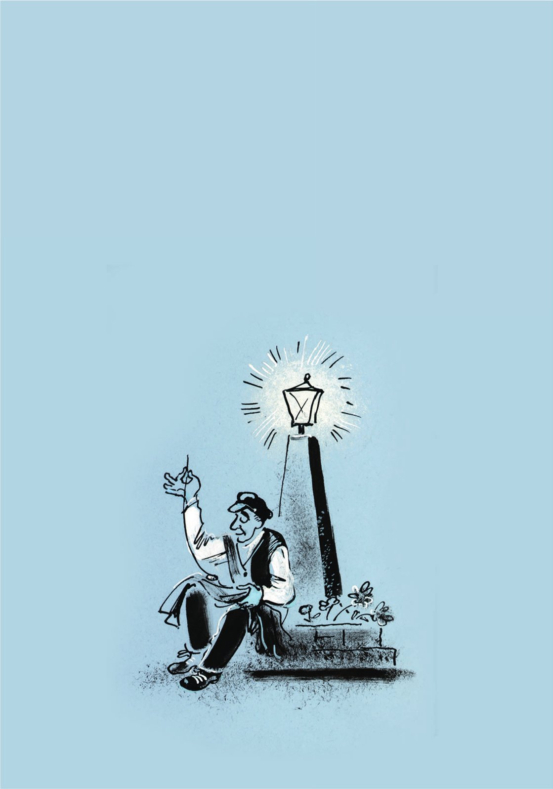
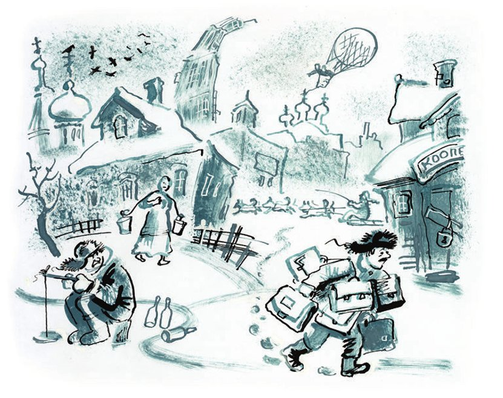

## Der blaue Teufel

Es ist September. Doktor Grom kommt aus Moskau nach Kolokolamsk zurück. Er war dort <abbr title="geschäftlich — по делам, по торговым делам">geschäftlich</abbr>. Jetzt <abbr title="hinken — хромать, прихрамывать">hinkt</abbr> er ein bisschen. Und er fährt vom Bahnhof mit einer <abbr title="die Droschke, die Droschken — извозчик, пролётка">Droschke</abbr> nach Hause. Das ist <abbr title="ungewöhnlich — необычно">ungewöhnlich</abbr>, denn <abbr title="normalerweise — обычно">normalerweise</abbr> geht der Doktor vom Bahnhof <abbr title="zu Fuß — пешком">zu Fuß</abbr>.

Frau Grom ist sehr <abbr title="erstaunt — удивлённый">erstaunt</abbr>. Dann sieht sie am linken Schuh von ihrem Mann eine helle <abbr title="die Spur, die Spuren — след">Spur</abbr> mit <abbr title="die Rille, die Rillen — рубчик, желобок">Rillen</abbr>. Das ist die Spur von einem <abbr title="der Autoreifen, die Autoreifen — автомобильная шина">Autoreifen</abbr>. Jetzt ist sie noch mehr erstaunt.

— Ein Auto hat mich <abbr title="überfahren (überfuhr, hat überfahren) — задавить, переехать">überfahren</abbr>, — sagt Doktor Grom <abbr title="fröhlich — радостно, весело">fröhlich</abbr>. — Dann war ich <abbr title="vor Gericht — в суде">vor Gericht</abbr>.

Doktor Grom ist Arzt, aber auch <abbr title="der Geschäftsmann, die Geschäftsleute — коммерсант">Geschäftsmann</abbr>. Er erzählt seiner Frau die Geschichte von seinem Glück. Er erzählt sie mit vielen <abbr title="überflüssig — ненужный, лишний">überflüssigen</abbr> <abbr title="die Einzelheit, die Einzelheiten — подробность">Einzelheiten</abbr>.

In Moskau, am Twerskaja-Tor, <abbr title="sich drehen — поворачиваться">dreht sich</abbr> das Glück zu Doktor Grom um. Die Göttin Fortuna <abbr title="quietschen — скрипеть, визжать">quietscht</abbr> dabei mit den Autoreifen. Ihr Gesicht <abbr title="strahlen — сиять">strahlt</abbr> so hell, dass der Doktor <abbr title="hinfallen (fiel hin, ist hingefallen) — упасть">hinfällt</abbr>. Erst als er wieder aufsteht, versteht er: Ein Auto hat ihn überfahren. Sofort ist der Doktor ganz ruhig. Er putzt seine schmutzige Hose und schreit:

— <abbr title="der Mord, die Morde — убийство">Mord</abbr>! Man hat mich <abbr title="umbringen (brachte um, hat umgebracht) — убить">umgebracht</abbr>!

Aus einem blauen «Packard» springen zwei Männer: ein Herr mit einer <abbr title="ordentlich — опрятный, аккуратный">ordentlichen</abbr> <abbr title="die Melone, die Melonen — котелок (шляпа)">Melone</abbr> und ein <abbr title="der Chauffeur, die Chauffeure — шофёр">Chauffeur</abbr> mit einem braunen <abbr title="der Schnurrbart, die Schnurrbärte — усы">Schnurrbart</abbr>. Über dem <abbr title="der Kühler, die Kühler — радиатор">Kühler</abbr> <abbr title="flattern — трепетать, развеваться">flattert</abbr> eine bunte kleine <abbr title="die Fahne, die Fahnen — флажок, флаг">Fahne</abbr>. Es ist die Fahne von einem kleinen <abbr title="der Nachbarstaat, die Nachbarstaaten — соседнее государство">Nachbarstaat</abbr>.

— Mord! Man hat mich umgebracht! — <abbr title="wiederholen — повторять">wiederholt</abbr> Doktor Grom <abbr title="fest — твёрдо">fest</abbr>. Er spricht zu den <abbr title="der Gaffer, die Gaffer — зевака">Gaffern</abbr>, die schon um das Auto herumstehen.

— Den kenne ich, — sagt eine <abbr title="kühn — молодецкий, удалой">kühne</abbr> Stimme. — Das ist der <abbr title="der Botschafter, die Botschafter — посол">Botschafter</abbr> von Kljatwien. Der kljatwische Botschafter.

Schon am nächsten Tag ist das <abbr title="das Gericht, die Gerichte — суд">Gericht</abbr>. Das <abbr title="das Urteil, die Urteile — приговор, решение суда">Urteil</abbr>: Die kljatwische <abbr title="die Botschaft, die Botschaften — посольство">Botschaft</abbr> muss dem Doktor für seine <abbr title="die Verletzung, die Verletzungen — увечье, травма">Verletzung</abbr> jeden Monat hundertzwanzig Rubel bezahlen.

Deshalb <abbr title="feiern — праздновать, пировать">feiert</abbr> Doktor Grom mit seinen Freunden in Kolokolamsk drei Tage und drei Nächte lang. Am Ende von dem Fest <abbr title="bemerken — замечать">bemerken</abbr> alle: Alexej Jelissejewitsch ist <abbr title="verschwinden (verschwand, ist verschwunden) — исчезнуть">verschwunden</abbr>. Er ist <abbr title="der Konditor, die Konditoren — кондитер">Konditor</abbr> und hat keine Arbeit.

Die Leute sind noch <abbr title="begeistert — в восторге">begeistert</abbr> vom Glück von Doktor Grom. Da gibt es schon eine neue <abbr title="die Sensation, die Sensationen — сенсация">Sensation</abbr>. Alexej Jelissejewitsch ist zurück! Er war in Moskau. Dort ist er <abbr title="ganz zufällig — по чистой случайности">ganz zufällig</abbr> unter das blaue Auto von der kljatwischen Botschaft gekommen. Und er bringt ein Urteil vom Gericht mit.

Diesmal muss die Botschaft dem Konditor für seine Verletzung jeden Monat hundertvierzig Rubel bezahlen. Er bekommt mehr, denn er hat eine große Familie.

Vor Freude kauft der Konditor für alle Leute ein <abbr title="das Fass, die Fässer — бочка">Fass</abbr> Bier. Ganz Kolokolamsk <abbr title="wischen — смахивать, вытирать">wischt</abbr> sich den Bier<abbr title="der Schaum — пена">schaum</abbr> aus dem Schnurrbart. Und alle <abbr title="loben — хвалить, прославлять">loben</abbr> das <abbr title="das Opfer, die Opfer — жертва">Opfer</abbr> vom <abbr title="der Straßenverkehr — уличное движение">Straßenverkehr</abbr>.

Eine Woche später gibt es das dritte Opfer. Es ist Sindik-Bugajewski, der <abbr title="der Leiter, die Leiter — заведующий, руководитель">Leiter</abbr> von den Kursen für <abbr title="die Deklamation — декламация">Deklamation</abbr> und Gesang. Er ist ein <abbr title="direkt — прямой, прямолинейный">direkter</abbr> Mensch, und er <abbr title="handeln — действовать">handelt</abbr> auch direkt. Er fährt nach Moskau und geht direkt zum <abbr title="das Tor, die Tore — ворота">Tor</abbr> von der kljatwischen Botschaft. Das Auto fährt auf die Straße. Sofort stellt Sindik-Bugajewski seinen Fuß unter das <abbr title="das Rad, die Räder — колесо">Rad</abbr>. Er bekommt ziemlich schwere <abbr title="die Prellung, die Prellungen — ушиб">Prellungen</abbr>. Aber er bekommt auch eine <abbr title="die Rente, die Renten — пенсия">Rente</abbr> von hundert Rubeln im Monat. <abbr title="bis ans Grab — по гроб жизни">Bis ans Grab</abbr>.

Erst jetzt verstehen die Kolokolamsker: Für ihre Stadt beginnt eine neue, sehr glückliche Zeit. Doktor Grom hat eine <abbr title="die Goldader, die Goldadern — золотоносная жила">Goldader</abbr> gefunden. Und die Bürger <abbr title="ausbeuten — разрабатывать, эксплуатировать">beuten</abbr> sie jetzt mit großem <abbr title="der Fleiß — усердие, прилежание">Fleiß</abbr> aus.

Alle fahren auf <abbr title="die Saisonarbeit — отхожий промысел">Saisonarbeit</abbr> nach Moskau: <abbr title="erfahren — опытный, умудрённый опытом">erfahrene</abbr> alte Männer, junge <abbr title="der Privathändler, die Privathändler — частник, частный торговец">Privathändler</abbr>, die Schüler von den Deklamationskursen und <abbr title="angesehen — уважаемый">angesehene</abbr> <abbr title="der/die Angestellte, die Angestellten — служащий">Angestellte</abbr>. Besonders gern machen das die <abbr title="der Kutscher, die Kutscher — извозчик, кучер">Kutscher</abbr> von der Stadt in ihren blauen <abbr title="der Kaftan, die Kaftane — кафтан, жупан">Kaftanen</abbr>. Eine Zeit lang arbeitet in Kolokolamsk kein einziger Kutscher. Alle sind auf Saisonarbeit. Sie haben einen <abbr title="der Sack, die Säcke — мешок, котомка">Sack</abbr> auf dem Rücken. Sie fallen unter das kljatwische Auto. Sie liegen eine Weile im <abbr title="das Krankenhaus, die Krankenhäuser — больница, госпиталь">Krankenhaus</abbr>. Und dann <abbr title="kassieren — получать, взимать (деньги)">kassieren</abbr> sie <abbr title="pünktlich — аккуратно, пунктуально">pünktlich</abbr> ihr Geld von der Botschaft.

In Kljatwien gibt es inzwischen eine <abbr title="unerhört — неслыханный">unerhörte</abbr> <abbr title="die Finanzkrise, die Finanzkrisen — финансовый кризис">Finanzkrise</abbr>. Die Botschaft kostet jetzt so viel Geld, dass der Staat sparen muss. Die <abbr title="der Beamte, die Beamten — чиновник">Beamten</abbr> bekommen weniger <abbr title="das Gehalt, die Gehälter — жалованье, зарплата">Gehalt</abbr>. Die <abbr title="die Armee, die Armeen — армия">Armee</abbr> wird kleiner: Früher hatte sie dreihundert Mann, jetzt hat sie nur noch fünfzehn. Die <abbr title="die Opposition — оппозиция">Opposition</abbr> wird <abbr title="unruhig — беспокойный, неспокойный">unruhig</abbr>. Das ist die Partei von den christlichen <abbr title="der Sozialist, die Sozialisten — социалист">Sozialisten</abbr>. Der <abbr title="der Ministerpräsident, die Ministerpräsidenten — председатель совета министров, премьер">Ministerpräsident</abbr>, Herr Edgar Paviainen, hat keine Ruhe mehr. Denn Herr Suup, der Chef von der Opposition, <abbr title="angreifen (griff an, hat angegriffen) — нападать, атаковать">greift</abbr> ihn <abbr title="ununterbrochen — беспрерывно">ununterbrochen</abbr> an.

Dann kommt der dreißigste Bürger von Kolokolamsk unter das kljatwische Auto. Er heißt Nikita Psow. Für sein Geld muss Kljatwien die <abbr title="die Staatsoper, die Staatsopern — государственная опера">Staatsoper</abbr> schließen. Jetzt ist das ganze Land in großer <abbr title="die Aufregung — волнение">Aufregung</abbr>. Alle warten auf einen <abbr title="der Putsch, die Putsche — путч">Putsch</abbr> von den <abbr title="der General, die Generäle — генерал">Generälen</abbr>.

Im <abbr title="das Parlament, die Parlamente — парламент, палата">Parlament</abbr> gibt es eine <abbr title="die Anfrage, die Anfragen — запрос">Anfrage</abbr>:

— Weiß der Herr Ministerpräsident, dass das Land kurz vor dem <abbr title="der Zusammenbruch, die Zusammenbrüche — крах, крушение">Zusammenbruch</abbr> steht?

Der Herr Ministerpräsident antwortet:

— Nein, das weiß er nicht.

Das ist eine <abbr title="beruhigend — успокоительный">beruhigende</abbr> Antwort. Trotzdem muss Kljatwien im <abbr title="das Ausland — заграница">Ausland</abbr> einen <abbr title="der Kredit, die Kredite — заём, кредит">Kredit</abbr> <abbr title="einen Kredit aufnehmen — сделать заём">aufnehmen</abbr>. Aber auch dieses Geld <abbr title="aufessen (aß auf, hat aufgegessen) — съесть">essen</abbr> die Kolokolamsker in nur zwei Monaten auf.

Der kljatwische Chauffeur ist jetzt die <abbr title="einzig — единственный">einzige</abbr> <abbr title="die Hoffnung, die Hoffnungen — надежда">Hoffnung</abbr> vom ganzen Staat. Er fährt <abbr title="wahnsinnig — безумно, невероятно">wahnsinnig</abbr> <abbr title="vorsichtig — осторожно">vorsichtig</abbr>. Aber die Kolokolamsker sind in ihrem <abbr title="seltsam — странный, удивительный">seltsamen</abbr> <abbr title="das Handwerk — ремесло">Handwerk</abbr> sehr <abbr title="geschickt — ловкий, умелый">geschickt</abbr> geworden. Sie kommen immer unter das Auto, ohne Fehler. Man erzählt: Einmal ist der Chauffeur drei <abbr title="der Straßenblock, die Straßenblöcke — квартал">Straßenblöcke</abbr> lang vor einem <abbr title="der Diakon, die Diakone — дьякон">Diakon</abbr> aus Kolokolamsk <abbr title="fliehen (floh, ist geflohen) — бежать, удирать">geflohen</abbr>. Aber der Diakon war <abbr title="schlau — сметливый, хитрый">schlau</abbr>. Er ist durch einen <abbr title="der Hinterhof, die Hinterhöfe — проходной двор">Hinterhof</abbr> gelaufen und hat sich <abbr title="doch noch — всё-таки">doch noch</abbr> unter das Auto <abbr title="sich werfen (warf, hat geworfen) — бросаться">geworfen</abbr>.

Die Kolokolamsker <abbr title="zerren — таскать, тащить">zerren</abbr> Kljatwien von einem Gericht zum anderen. Das Land geht <abbr title="zugrunde gehen — погибать">zugrunde</abbr>.

Dann kommt der erste <abbr title="der Frost, die Fröste — мороз">Frost</abbr>. Jetzt fährt auch Monsieur Podlinnik nach Moskau. Er ist der <abbr title="der/die Vorsitzende, die Vorsitzenden — председатель">Vorsitzende</abbr> von der <abbr title="die Scheingenossenschaft, die Scheingenossenschaften — лжеартель">Scheingenossenschaft</abbr> «Eigenarbeit». Lange <abbr title="zögern — колебаться">zögert</abbr> er und <abbr title="jammern — хныкать, ныть">jammert</abbr>. Aber seine Frau hat kein <abbr title="das Mitleid — жалость">Mitleid</abbr>. Sie zeigt ihm, wie schnell die anderen Bürger reich werden. Und sie sagt:

— Wenn du nicht auf Saisonarbeit fährst, dann werfe ich mich unter einen Zug!

Die ganze Stadt bringt Podlinnik zum Bahnhof. Er steigt in den <abbr title="der Waggon, die Waggons — вагон">Waggon</abbr>. Die Kolokolamsker, die schon auf Saisonarbeit waren, rufen ihm <abbr title="der Ratschlag, die Ratschläge — совет">Ratschläge</abbr> zu:

— Nicht mit dem Kopf! Das Auto ist schwer! Nur das Bein <abbr title="hinhalten (hielt hin, hat hingehalten) — подставлять">hinhalten</abbr>!

Nach zwei Tagen kommt Podlinnik zurück. Er hat einen <abbr title="der Verband, die Verbände — повязка, бинт">Verband</abbr> um den Kopf. Unter dem Auge hat er einen <abbr title="der blaue Fleck, die blauen Flecken — синяк">blauen Fleck</abbr>. Der Fleck ist so groß wie ein <abbr title="der Tintenfleck, die Tintenflecke — чернильное пятно">Tintenfleck</abbr>. Den linken Arm kann er nicht bewegen.

— Wie viel? — fragen die Bürger. Sie meinen: Wie viel Rente bekommt er aus der Kasse von Kljatwien? Die Kasse ist jetzt schon sehr <abbr title="mager — тощий">mager</abbr>.

Aber der Vorsitzende von der Scheingenossenschaft antwortet nicht. Er weint <abbr title="lautlos — беззвучно">lautlos</abbr>. Er <abbr title="sich schämen — стыдиться">schämt sich</abbr>. Denn er hat sich <abbr title="aus Versehen — по ошибке">aus Versehen</abbr> unter das falsche Auto geworfen. Es war das Auto vom <abbr title="der Trust, die Trusts — трест">Trust</abbr> für <abbr title="das Buntmetall, die Buntmetalle — цветной металл">Buntmetalle</abbr>. Der Chauffeur hat <abbr title="rechtzeitig — вовремя">rechtzeitig</abbr> <abbr title="bremsen — тормозить">gebremst</abbr>. Und dann hat er Podlinnik lange mit einem amerikanischen <abbr title="der Schraubenschlüssel, die Schraubenschlüssel — гаечный ключ">Schraubenschlüssel</abbr> auf den Kopf und auf die Arme <abbr title="schlagen (schlug, hat geschlagen) — бить">geschlagen</abbr>.

Monsieur Podlinnik sieht so <abbr title="schrecklich — ужасный, страшный">schrecklich</abbr> aus, dass kein Kolokolamsker mehr auf Saisonarbeit fährt.

Und nur das <abbr title="retten — спасать">rettet</abbr> Kljatwien vor dem <abbr title="endgültig — окончательный">endgültigen</abbr> <abbr title="der Ruin — разорение">Ruin</abbr>.

Die Stadt <abbr title="sich langweilen — скучать">langweilt sich</abbr> wieder. Ihr ruhiges, <abbr title="provinziell — провинциальный, заштатный">provinzielles</abbr> Leben geht so weiter. Bis eines Tages ein <abbr title="wunderbar — чудный, чудесный">wunderbarer</abbr> <abbr title="der Gentleman, die Gentlemen — джентльмен">Gentleman</abbr> nach Kolokolamsk kommt. Er kommt aus Argentinien und trägt einen <abbr title="der Anzug, die Anzüge — костюм">Anzug</abbr> aus rosa <abbr title="das Tuch — сукно">Tuch</abbr>.

---

### Neue Wörter

- **geschäftlich** — по делам, по торговым делам
- **hinken** — хромать, прихрамывать
- **die Droschke, die Droschken** — извозчик, пролётка
- **ungewöhnlich** — необычно
- **normalerweise** — обычно
- **zu Fuß** — пешком
- **erstaunt** — удивлённый
- **die Spur, die Spuren** — след
- **die Rille, die Rillen** — рубчик, желобок
- **der Autoreifen, die Autoreifen** — автомобильная шина
- **überfahren (überfuhr, hat überfahren)** — задавить, переехать
- **fröhlich** — радостно, весело
- **vor Gericht** — в суде
- **der Geschäftsmann, die Geschäftsleute** — коммерсант
- **überflüssig** — ненужный, лишний
- **die Einzelheit, die Einzelheiten** — подробность
- **sich drehen** — поворачиваться
- **quietschen** — скрипеть, визжать
- **strahlen** — сиять
- **hinfallen (fiel hin, ist hingefallen)** — упасть
- **der Mord, die Morde** — убийство
- **umbringen (brachte um, hat umgebracht)** — убить
- **ordentlich** — опрятный, аккуратный
- **die Melone, die Melonen** — котелок (шляпа)
- **der Chauffeur, die Chauffeure** — шофёр
- **der Schnurrbart, die Schnurrbärte** — усы
- **der Kühler, die Kühler** — радиатор
- **flattern** — трепетать, развеваться
- **die Fahne, die Fahnen** — флажок, флаг
- **der Nachbarstaat, die Nachbarstaaten** — соседнее государство
- **wiederholen** — повторять
- **fest** — твёрдо
- **der Gaffer, die Gaffer** — зевака
- **kühn** — молодецкий, удалой
- **der Botschafter, die Botschafter** — посол
- **das Gericht, die Gerichte** — суд
- **das Urteil, die Urteile** — приговор, решение суда
- **die Botschaft, die Botschaften** — посольство
- **die Verletzung, die Verletzungen** — увечье, травма
- **feiern** — праздновать, пировать
- **bemerken** — замечать
- **verschwinden (verschwand, ist verschwunden)** — исчезнуть
- **der Konditor, die Konditoren** — кондитер
- **begeistert** — в восторге
- **die Sensation, die Sensationen** — сенсация
- **ganz zufällig** — по чистой случайности
- **das Fass, die Fässer** — бочка
- **wischen** — смахивать, вытирать
- **der Schaum** — пена
- **loben** — хвалить, прославлять
- **das Opfer, die Opfer** — жертва
- **der Straßenverkehr** — уличное движение
- **der Leiter, die Leiter** — заведующий, руководитель
- **die Deklamation** — декламация
- **direkt** — прямой, прямолинейный
- **handeln** — действовать
- **das Tor, die Tore** — ворота
- **das Rad, die Räder** — колесо
- **die Prellung, die Prellungen** — ушиб
- **die Rente, die Renten** — пенсия
- **bis ans Grab** — по гроб жизни
- **die Goldader, die Goldadern** — золотоносная жила
- **ausbeuten** — разрабатывать, эксплуатировать
- **der Fleiß** — усердие, прилежание
- **die Saisonarbeit** — отхожий промысел
- **erfahren** — опытный, умудрённый опытом
- **der Privathändler, die Privathändler** — частник, частный торговец
- **angesehen** — уважаемый
- **der/die Angestellte, die Angestellten** — служащий
- **der Kutscher, die Kutscher** — извозчик, кучер
- **der Kaftan, die Kaftane** — кафтан, жупан
- **der Sack, die Säcke** — мешок, котомка
- **das Krankenhaus, die Krankenhäuser** — больница, госпиталь
- **kassieren** — получать, взимать (деньги)
- **pünktlich** — аккуратно, пунктуально
- **unerhört** — неслыханный
- **die Finanzkrise, die Finanzkrisen** — финансовый кризис
- **der Beamte, die Beamten** — чиновник
- **das Gehalt, die Gehälter** — жалованье, зарплата
- **die Armee, die Armeen** — армия
- **die Opposition** — оппозиция
- **unruhig** — беспокойный, неспокойный
- **der Sozialist, die Sozialisten** — социалист
- **der Ministerpräsident, die Ministerpräsidenten** — председатель совета министров, премьер
- **angreifen (griff an, hat angegriffen)** — нападать, атаковать
- **ununterbrochen** — беспрерывно
- **die Staatsoper, die Staatsopern** — государственная опера
- **die Aufregung** — волнение
- **der Putsch, die Putsche** — путч
- **der General, die Generäle** — генерал
- **das Parlament, die Parlamente** — парламент, палата
- **die Anfrage, die Anfragen** — запрос
- **der Zusammenbruch, die Zusammenbrüche** — крах, крушение
- **beruhigend** — успокоительный
- **das Ausland** — заграница
- **der Kredit, die Kredite** — заём, кредит
- **einen Kredit aufnehmen** — сделать заём
- **aufessen (aß auf, hat aufgegessen)** — съесть
- **einzig** — единственный
- **die Hoffnung, die Hoffnungen** — надежда
- **wahnsinnig** — безумно, невероятно
- **vorsichtig** — осторожно
- **seltsam** — странный, удивительный
- **das Handwerk** — ремесло
- **geschickt** — ловкий, умелый
- **der Straßenblock, die Straßenblöcke** — квартал
- **der Diakon, die Diakone** — дьякон
- **fliehen (floh, ist geflohen)** — бежать, удирать
- **schlau** — сметливый, хитрый
- **der Hinterhof, die Hinterhöfe** — проходной двор
- **doch noch** — всё-таки
- **sich werfen (warf, hat geworfen)** — бросаться
- **zerren** — таскать, тащить
- **zugrunde gehen** — погибать
- **der Frost, die Fröste** — мороз
- **der/die Vorsitzende, die Vorsitzenden** — председатель
- **die Scheingenossenschaft, die Scheingenossenschaften** — лжеартель
- **zögern** — колебаться
- **jammern** — хныкать, ныть
- **das Mitleid** — жалость
- **der Waggon, die Waggons** — вагон
- **der Ratschlag, die Ratschläge** — совет
- **hinhalten (hielt hin, hat hingehalten)** — подставлять
- **der Verband, die Verbände** — повязка, бинт
- **der blaue Fleck, die blauen Flecken** — синяк
- **der Tintenfleck, die Tintenflecke** — чернильное пятно
- **mager** — тощий
- **lautlos** — беззвучно
- **sich schämen** — стыдиться
- **aus Versehen** — по ошибке
- **der Trust, die Trusts** — трест
- **das Buntmetall, die Buntmetalle** — цветной металл
- **rechtzeitig** — вовремя
- **bremsen** — тормозить
- **der Schraubenschlüssel, die Schraubenschlüssel** — гаечный ключ
- **schlagen (schlug, hat geschlagen)** — бить
- **schrecklich** — ужасный, страшный
- **retten** — спасать
- **endgültig** — окончательный
- **der Ruin** — разорение
- **sich langweilen** — скучать
- **provinziell** — провинциальный, заштатный
- **wunderbar** — чудный, чудесный
- **der Gentleman, die Gentlemen** — джентльмен
- **der Anzug, die Anzüge** — костюм
- **das Tuch** — сукно

[Inhalt](README.md) · [Weiter →](kapitel-02.md)
