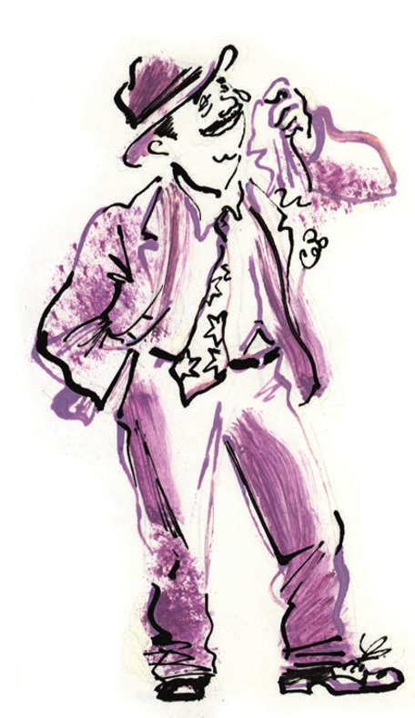
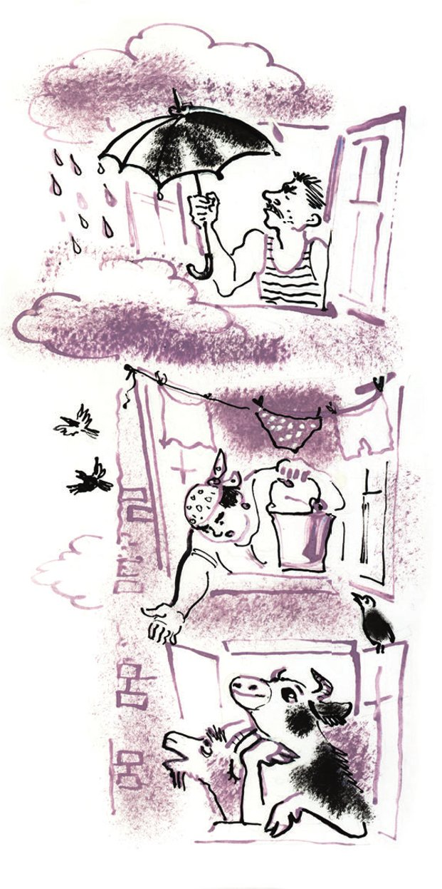

## Ein Gast aus Südamerika

Es ist Sonntagmorgen. Auf der Großen Gewerkschaftsstraße (Bolschaja Mestkomowskaja) <abbr title="erscheinen (erschien, ist erschienen) — появляться">erscheint</abbr> ein Gentleman. So einen Mann hat man in Kolokolamsk noch nie gesehen. Er trägt einen Anzug aus rosa <abbr title="der Wollstoff, die Wollstoffe — шерстяная ткань, шевиот">Wollstoff</abbr> und eine <abbr title="die Krawatte, die Krawatten — галстук">Krawatte</abbr> mit Sternen. Er <abbr title="duften nach + Dat. — пахнуть (приятно)">duftet</abbr> nach den <abbr title="die Blumenwiese, die Blumenwiesen — цветущий луг">Blumenwiesen</abbr> von der <abbr title="die Prärie, die Prärien — прерия">Prärie</abbr>. <abbr title="verwirrt — растерянно">Verwirrt</abbr> dreht er den Kopf nach links und nach rechts. Über sein rundes Gesicht <abbr title="rollen — катиться">rollen</abbr> <abbr title="die Träne, die Tränen — слеза">Tränen</abbr> wie <abbr title="die Perle, die Perlen — жемчужина">Perlen</abbr>. Er ist sehr <abbr title="gerührt — растроганный, умилённый">gerührt</abbr>. Hinter dem seltsamen Bürger fährt eine <abbr title="die Schubkarre, die Schubkarren — тачка">Schubkarre</abbr> mit bunten <abbr title="der Koffer, die Koffer — чемодан">Koffern</abbr>. Ein <abbr title="der Gepäckträger, die Gepäckträger — носильщик">Gepäckträger</abbr> vom Bahnhof <abbr title="schieben (schob, hat geschoben) — толкать, катить">schiebt</abbr> sie.

Auf dem Mitgliederplatz bleibt der kleine Zug stehen. Von hier hat man einen <abbr title="herrlich — восхитительный, великолепный">herrlichen</abbr> Blick auf die Stadt Kolokolamsk und auf den Fluss Sbruja. Der rosa Gentleman weint laut. Der Gepäckträger <abbr title="schluchzen — всхлипывать, рыдать">schluchzt</abbr> <abbr title="aus Höflichkeit — из вежливости">aus Höflichkeit</abbr> auch ein bisschen. Dabei <abbr title="riechen (roch, hat gerochen) — пахнуть">riecht</abbr> er <abbr title="stark — сильно">stark</abbr> nach Wodka.

So stehen die beiden noch eine Stunde später. Da kommt Monsieur Podlinnik über den Mitgliederplatz. Er ist der Vorsitzende von der Scheingenossenschaft «Eigenarbeit» und hat gerade etwas für seine Genossenschaft zu tun.

Zehn Schritte vor dem <abbr title="der/die Fremde, die Fremden — незнакомец, чужой">Fremden</abbr> bleibt Podlinnik stehen. Erstaunt fragt er:

— <abbr title="pardon — пардон, извините">Pardon</abbr>, wo haben Sie so einen Anzug <abbr title="auftreiben (trieb auf, hat aufgetrieben) — достать, раздобыть">aufgetrieben</abbr>?

— In Buenos Aires, — antwortet der weinende Gentleman.

— Und die Krawatte?

— In Montevideo.

— Wer sind Sie denn? — ruft Podlinnik.

— Ich bin ein Kolokolamsker! — antwortet der Gentleman. — Ich bin Horacio Fedorenkos.

Der Vorsitzende von der Scheingenossenschaft ist <abbr title="außer sich vor Freude sein — быть вне себя от радости">außer sich vor Freude</abbr>. Er <abbr title="packen — хватать">packt</abbr> den rosa <abbr title="der/die Dicke, die Dicken — толстяк">Dicken</abbr> an der <abbr title="die Taille, die Taillen — талия">Taille</abbr>, hebt ihn in die Luft und küsst ihn laut. Und laut stellt er Fragen.

Nach zehn Minuten weiß Podlinnik alles. Der Mann heißt eigentlich Gerassim Fedorenko. Vor dreißig Jahren ist er aus Kolokolamsk weggefahren. In Südamerika hat er <abbr title="der Diamant, die Diamanten — алмаз, бриллиант">Diamanten</abbr> gefunden und ist <abbr title="unglaublich — невероятно, неслыханно">unglaublich</abbr> reich geworden. Aber in der <abbr title="die Steppe, die Steppen — степь">Steppe</abbr> von Südamerika hat Horacio immer <abbr title="träumen von + Dat. — мечтать о">geträumt</abbr>: «Ich möchte nur einmal mein liebes Kolokolamsk sehen! Und wenn es nur mit einem Auge ist!» Und jetzt ist er hier und weint vor Glück.

Die Stadt <abbr title="ehren — чествовать, чтить">ehrt</abbr> ihren <abbr title="der Landsmann, die Landsleute — земляк, соотечественник">Landsmann</abbr> mit einem großen Fest. Das Fest ist im <abbr title="der Fragebogensaal — «анкетный зал»">Fragebogensaal</abbr> von den <abbr title="militärisch — военизированный">militärischen</abbr> Kursen für Deklamation und Gesang. Horacio Iwanowitsch füllt einen <abbr title="der Ehrenfragebogen, die Ehrenfragebögen — почётная анкета">Ehrenfragebogen</abbr> aus. Der Fragebogen liegt in einer <abbr title="die Mappe, die Mappen — папка">Mappe</abbr> aus feinem <abbr title="das Leder — кожа">Leder</abbr>. Dann küsst Horacio den Leiter von den Kursen, Sindik-Bugajewski. Später, im <abbr title="inoffiziell — неофициальный">inoffiziellen</abbr> Teil vom Fest, tanzt Fedorenkos russische <abbr title="der Volkstanz, die Volkstänze — народный танец">Volkstänze</abbr>. Er <abbr title="wackeln mit + Dat. — вилять">wackelt</abbr> mit dem Rücken und <abbr title="stampfen — притопывать, топать">stampft</abbr> weich mit seinen <abbr title="die Gummisohle, die Gummisohlen — каучуковая подошва">Gummisohlen</abbr>. Am Morgen ist Horacio sehr gerührt. Er <abbr title="beschließen (beschloss, hat beschlossen) — решать, принимать решение">beschließt</abbr>: «Ich baue für meine <abbr title="der Mitbürger, die Mitbürger — согражданин">Mitbürger</abbr> einen <abbr title="der Wolkenkratzer, die Wolkenkratzer — небоскрёб">Wolkenkratzer</abbr> mit zweiunddreißig <abbr title="das Stockwerk, die Stockwerke — этаж">Stockwerken</abbr>! Dann <abbr title="vergessen (vergaß, hat vergessen) — забывать">vergisst</abbr> niemand, dass ich hier war.»

— Der <abbr title="lügen (log, hat gelogen) — врать, брехать">lügt</abbr>, — sagen die Kolokolamsker. Sie werfen den Gast vor Freude in die Luft. — Alles andere <abbr title="vielleicht — может быть">vielleicht</abbr>, aber das mit dem Haus ist gelogen! So ein Haus gibt es in der <abbr title="die Natur — природа">Natur</abbr> nicht!

Aber nach einer Woche stehen schon <abbr title="der Baukran, die Baukräne — подъёмный кран">Baukräne</abbr> auf dem Mitgliederplatz. Wie erstaunt sind da die Kolokolamsker! Ganze <abbr title="die Gruppe, die Gruppen — группа, партия">Gruppen</abbr> von <abbr title="der Techniker, die Techniker — техник">Technikern</abbr>, <abbr title="der Ingenieur, die Ingenieure — инженер">Ingenieuren</abbr> und Arbeitern kommen aus der <abbr title="die Hauptstadt, die Hauptstädte — столица">Hauptstadt</abbr>. Horacio selbst ist der Chef auf der <abbr title="die Baustelle, die Baustellen — стройка">Baustelle</abbr>. Er trägt einen blauen <abbr title="der Overall, die Overalls — комбинезон">Overall</abbr>. <abbr title="sachlich — деловито">Sachlich</abbr> <abbr title="schimpfen — ругаться">schimpft</abbr> er in einer seltsamen <abbr title="die Mischung, die Mischungen — смесь">Mischung</abbr> aus Russisch und Spanisch.

Die Kolokolamsker sehen sich den <abbr title="der Bau, die Bauten — стройка, постройка">Bau</abbr> <abbr title="spöttisch — насмешливо">spöttisch</abbr> an. Sie gehen um das neue Haus herum. Sie sehen ein bisschen <abbr title="beleidigt — обиженный">beleidigt</abbr> aus, wie Kinder an ihrem Geburtstag. Sie tun nicht viel. Sie <abbr title="stehlen (stahl, hat gestohlen) — воровать, красть">stehlen</abbr> <abbr title="das Baumaterial, die Baumaterialien — строительный материал">Baumaterial</abbr> und <abbr title="heizen mit + Dat. — топить (печь)">heizen</abbr> damit ihre Öfen. Und sie sagen: «Das geht alles viel zu langsam.»

Am Ende vom zweiten Monat ist der Wolkenkratzer fast fertig. Das zweiunddreißigste Stockwerk <abbr title="stoßen an + Akk. (stieß, hat/ist gestoßen) — упираться во">stößt</abbr> schon an die Wolken. Tief unter der Erde bauen die Arbeiter die <abbr title="der Elektromotor, die Elektromotoren — электромотор">Elektromotoren</abbr> <abbr title="zusammenbauen — собирать, монтировать">zusammen</abbr>. Die <abbr title="die Fensterscheibe, die Fensterscheiben — оконное стекло">Fensterscheiben</abbr> unten <abbr title="spiegeln — отражать">spiegeln</abbr> die dichten <abbr title="der Wald, die Wälder — лес">Wälder</abbr> und die <abbr title="der See, die Seen — озеро">Seen</abbr> rund um Kolokolamsk. Und in den Fenstern vom fünfundzwanzigsten Stock sieht man sogar die <abbr title="die Gouvernementsstadt, die Gouvernementsstädte — губернский город">Gouvernementsstadt</abbr>. Sie liegt 180 Kilometer weit weg.

Jetzt fehlen nur noch ein paar Sachen: die <abbr title="die Zentralheizung — центральное (водяное) отопление">Zentralheizung</abbr>, die Toiletten aus <abbr title="das Porzellan — фарфор">Porzellan</abbr> und der Strom für die <abbr title="der Küchenherd, die Küchenherde — кухонная плита">Küchenherde</abbr>. Auch viele kleine <abbr title="das Detail, die Details — деталь">Details</abbr> sind noch nicht fertig. Ohne diese Details kann man in einem großen Haus nicht leben.

Genau da hört man ein <abbr title="das Gerücht, die Gerüchte — слух">Gerücht</abbr>: Nikita Psow ist in der Nacht <abbr title="ohne Erlaubnis — самовольно, без разрешения">ohne Erlaubnis</abbr> in den Wolkenkratzer <abbr title="einziehen (zog ein, ist eingezogen) — въезжать, вселяться">eingezogen</abbr>. Mit allen seinen Sachen und mit seinem <abbr title="der Kettenhund, die Kettenhunde — цепная собака">Kettenhund</abbr>. Man sagt, Nikita hat die beste <abbr title="die Wohnung, die Wohnungen — квартира">Wohnung</abbr> genommen. Und die <abbr title="die Hundehütte, die Hundehütten — будка">Hundehütte</abbr> mit dem Kettenhund hat er ins <abbr title="das Treppenhaus, die Treppenhäuser — лестничная клетка, лестничная площадка">Treppenhaus</abbr> auf seinem Stockwerk gestellt.

Mehr brauchen die Kolokolamsker nicht. Sie <abbr title="brennen vor + Dat. (brannte, hat gebrannt) — гореть от">brennen</abbr> vor <abbr title="die Ungeduld — нетерпение">Ungeduld</abbr>. Wie eine <abbr title="die Lawine, die Lawinen — лавина">Lawine</abbr> <abbr title="stürzen — ринуться, броситься">stürzen</abbr> sie in das <abbr title="unfertig — незаконченный">unfertige</abbr> Haus. Alle wollen eine Wohnung haben. Unterwegs <abbr title="umstoßen (stieß um, hat umgestoßen) — сшибать с ног">stoßen</abbr> sie die <abbr title="der Elektriker, die Elektriker — монтёр">Elektriker</abbr> und die <abbr title="der Vorarbeiter, die Vorarbeiter — десятник, прораб">Vorarbeiter</abbr> um. Horacio Fedorenkos bittet seine Mitbürger um <abbr title="die Vernunft — благоразумие, разум">Vernunft</abbr>. Aber <abbr title="umsonst — напрасно">umsonst</abbr>. Er steht ohne Hut am <abbr title="der Haupteingang, die Haupteingänge — парадный вход">Haupteingang</abbr>. Die Tür ist mit <abbr title="das Kupfer — медь">Kupfer</abbr> <abbr title="beschlagen mit + Dat. — обитый, обшитый">beschlagen</abbr>. Und er schreit:

— Milicios! (= Hilfe, <abbr title="die Miliz — милиция">Miliz</abbr>!)

Die Bürger <abbr title="lachen über + Akk. — смеяться над">lachen</abbr> nur. Sie <abbr title="drängen — протискиваться, напирать">drängen</abbr> ins Haus. Dabei stoßen sie Horacio Iwanowitsch sehr <abbr title="schmerzhaft — больно">schmerzhaft</abbr> mit ihren <abbr title="das Regal, die Regale — этажерка, полка">Regalen</abbr> und <abbr title="die Pritsche, die Pritschen — топчан, нары">Pritschen</abbr>. Fedorenkos fährt weg. <abbr title="niemand — никто">Niemand</abbr> bemerkt es.

Jetzt wohnt ganz Kolokolamsk in dem neuen Haus: alle Einwohner, alle <abbr title="die Bierstube, die Bierstuben — пивная">Bierstuben</abbr>, alle <abbr title="das Amt, die Ämter — учреждение, ведомство">Ämter</abbr>, alle Kühe und das ganze <abbr title="das Federvieh — домашняя птица">Federvieh</abbr>. Die Miliz und viele <abbr title="das Ausnüchterungszimmer, die Ausnüchterungszimmer — вытрезвитель">Ausnüchterungszimmer</abbr> sind in der Mitte vom Haus, im sechzehnten Stock. Die Ausnüchterungszimmer sind sehr elegant, wie ein <abbr title="das Boudoir, die Boudoirs — будуар">Boudoir</abbr>.

Die Kolokolamsker <abbr title="verlangen — требовать">verlangen</abbr>, dass die Bierstuben <abbr title="gleichmäßig — равномерно">gleichmäßig</abbr> im ganzen Haus <abbr title="verteilen — распределять">verteilt</abbr> sind. Und wer schnell in eine Bierstube will, darf ohne zu warten mit dem <abbr title="der Personenaufzug, die Personenaufzüge — пассажирский лифт">Personenaufzug</abbr> fahren. Die <abbr title="der Schnellaufzug, die Schnellaufzüge — скоростной (экспрессный) лифт">Schnellaufzüge</abbr> sind am größten. Deshalb fahren mit ihnen die Kühe. Jeden Morgen <abbr title="treiben (trieb, hat getrieben) — гнать (скот)">treibt</abbr> der <abbr title="der Hirte, die Hirten — пастух">Hirte</abbr> die Kühe in die Aufzüge und fährt mit ihnen nach unten – auf die <abbr title="die Weide, die Weiden — пастбище">Weide</abbr>.

Am Anfang sind die Bürger sehr froh. Sie feiern ohne <abbr title="das Maß — мера">Maß</abbr>. Sie <abbr title="zirkulieren — циркулировать">zirkulieren</abbr> durch den Wolkenkratzer so <abbr title="regelmäßig — регулярно, методично">regelmäßig</abbr> wie das Blut durch den Körper: aus der Wohnung in die Bierstube im nächsten Stock. Von dort ins Ausnüchterungszimmer. Dann zur Miliz für das <abbr title="das Protokoll, die Protokolle — протокол">Protokoll</abbr>. Dann in den ersten Stock – zum Gericht. Und am Ende in den 29. Stock – das <abbr title="das Gefängnisstockwerk — «этаж заключения»">Gefängnisstockwerk</abbr>.

Die <abbr title="der Feiertag, die Feiertage — праздник">Feiertage</abbr> sind vorbei, und der <abbr title="der Alltag — будни">Alltag</abbr> beginnt. Jeden Morgen hört man in allen Stockwerken die <abbr title="die Axt, die Äxte — топор">Äxte</abbr>. Die Kolokolamsker <abbr title="hacken — рубить">hacken</abbr> die <abbr title="die Trennwand, die Trennwände — перегородка">Trennwände</abbr> aus Holz zu <abbr title="das Brennholz — дрова">Brennholz</abbr>. Damit heizen sie ihre kleinen <abbr title="der Eisenofen, die Eisenöfen — буржуйка, железная печка">Eisenöfen</abbr>. Die Öfen haben sie aus den alten Wohnungen mitgebracht.

Aus den <abbr title="das Rohr, die Rohre — труба">Rohren</abbr> von der unfertigen Zentralheizung machen die Kolokolamsker Betten. Aus den <abbr title="der Türgriff, die Türgriffe — дверная ручка">Türgriffen</abbr> aus <abbr title="das Messing — латунь, жёлтая медь">Messing</abbr> machen sie <abbr title="das Feuerzeug, die Feuerzeuge — зажигалка">Feuerzeuge</abbr>. Diese <abbr title="selbst gemacht — кустарный, самодельный">selbst gemachten</abbr> Waren <abbr title="verkaufen — продавать">verkaufen</abbr> sie in der Gouvernementsstadt. Auf dem <abbr title="lackiert — лакированный">lackierten</abbr> <abbr title="das Treppengeländer, die Treppengeländer — лестничные перила">Treppengeländer</abbr> <abbr title="trocknen — сохнуть">trocknet</abbr> die <abbr title="die Wäsche — бельё">Wäsche</abbr>. Und auf den Treppen aus <abbr title="der Marmor — мрамор">Marmor</abbr> stehen jetzt <abbr title="das Plumpsklo, die Plumpsklos — дощатый (дачный) клозет">Plumpsklos</abbr> aus Holz, wie im Garten.

Nikita Psow wohnt im 19. Stock. Er hat <abbr title="Sehnsucht haben nach + Dat. — тосковать по">Sehnsucht</abbr> nach dem freien alten Leben in Kolokolamsk. Einmal geht er in den Aufzug und will dort Holz hacken. Mit der Axt trifft er einen <abbr title="der Knopf, die Knöpfe — кнопка">Knopf</abbr>. Und der Aufzug fährt los! Er fährt ununterbrochen nach oben und nach unten, nach oben und nach unten. Nikita sitzt in seinem <abbr title="der Käfig, die Käfige — клетка">Käfig</abbr>. Die Bürger kommen auf die Marmortreppen. Sie sehen <abbr title="verwundert — в изумлении">verwundert</abbr> auf die <abbr title="verrückt — обезумевший, сумасшедший">verrückte</abbr> Maschine. In ihren Augen sieht man: Der <abbr title="die Technik — техника">Technik</abbr> <abbr title="trauen + Dat. — доверять">trauen</abbr> sie nicht. Frau Psowa ist eine ganz dumme <abbr title="die Frauensperson, die Frauenspersonen — баба">Frauensperson</abbr>. Sie läuft neben dem Aufzug nach unten und nach oben und schreit:

— Nikita Iwanytsch! Gib mir <abbr title="wenigstens — хотя бы">wenigstens</abbr> den <abbr title="der Wohnungsschlüssel, die Wohnungsschlüssel — ключ от квартиры">Wohnungsschlüssel</abbr>! Ich kann ja nich in die Wohnung reinkommen!

Die Tür von der Wohnung von den Psows <abbr title="aufbrechen (brach auf, hat aufgebrochen) — взламывать">brechen</abbr> die Leute auf. Jetzt kann man sie nicht mehr <abbr title="abschließen (schloss ab, hat abgeschlossen) — запирать">abschließen</abbr>. Deshalb <abbr title="ausräumen — очищать, обчищать">räumen</abbr> <abbr title="der Dieb, die Diebe — вор">Diebe</abbr> die Wohnung noch in der gleichen Nacht aus. Der <abbr title="der Verdacht — подозрение">Verdacht</abbr> fällt auf den fünften Stock. Dieser Stock ist sehr <abbr title="verdächtig — подозрительный">verdächtig</abbr>. Die Leute nennen ihn schon «das <abbr title="das Krähenviertel — «Воронья слободка»">Krähenviertel</abbr>».

Erst am Abend vom zweiten Tag kann man den Aufzug <abbr title="anhalten (hielt an, hat angehalten) — останавливать">anhalten</abbr>. Dafür muss man den <abbr title="der Generator, die Generatoren — динамо-машина, генератор">Generator</abbr> kaputt machen. Das ganze Haus ist jetzt dunkel. Man holt Nikita Psow aus dem Aufzug. Er ist halb tot. <abbr title="böse — злобно">Böse</abbr> <abbr title="stöhnen — стонать">stöhnt</abbr> er:

— Solche Häuser brauchen wir nich! Das kommt alles von diesem <abbr title="international — международный">internationalen</abbr> Schentelmann!

Dann sieht er seine leere Wohnung. Sofort zieht er aus dem Wolkenkratzer <abbr title="ausziehen (zog aus, ist ausgezogen) — выезжать, съезжать">aus</abbr> und zurück in seine alte <abbr title="die Hütte, die Hütten — халупа, хижина">Hütte</abbr>. Aber vorher <abbr title="werfen (warf, hat geworfen) — бросать">wirft</abbr> er mit Steinen alle Fenster im Krähenviertel <abbr title="einwerfen (warf ein, hat eingeworfen) — разбить (камнями)">ein</abbr>. Das Krähenviertel <abbr title="hassen — ненавидеть">hasst</abbr> er. Jetzt ist es dort sehr kalt. Deshalb <abbr title="eindringen in + Akk. (drang ein, ist eingedrungen) — вторгаться, врываться">dringen</abbr> die Leute aus dem Krähenviertel mit <abbr title="die Gewalt — сила, насилие">Gewalt</abbr> in den sechsten Stock ein. Dort sind die Deklamationskurse. Die Kurse sind inzwischen sehr groß geworden. Die Schüler von den Deklamationskursen werden jetzt <abbr title="der Rowdy, die Rowdys — хулиган">Rowdys</abbr>. Auf den dunklen Treppen gibt es <abbr title="der Überfall, die Überfälle — налёт, грабёж">Überfälle</abbr>. Wer als Kolokolamsker allein geht, verliert seinen <abbr title="der Pelzmantel, die Pelzmäntel — шуба">Pelzmantel</abbr> und seine <abbr title="der Gummischuh, die Gummischuhe — калоша">Gummischuhe</abbr>.

Die Familie Podlinnik wohnt im 32. Stock. Dort ist es sehr <abbr title="einsam — глухой, уединённый">einsam</abbr>, und die <abbr title="die Kanalisation — канализация">Kanalisation</abbr> ist kaputt. Auch bei den Podlinniks gibt es einen Überfall. Der Vorsitzende von der Scheingenossenschaft bekommt große Angst. Er macht es wie Nikita Psow. In der <abbr title="die Hausverwaltung, die Hausverwaltungen — домоуправление">Hausverwaltung</abbr> sagt er: «So hoch zu wohnen ist sehr <abbr title="gruselig — жутко, страшно">gruselig</abbr>. Und außerdem <abbr title="stören — мешать">stört</abbr> mich die <abbr title="die Feuchtigkeit — сырость">Feuchtigkeit</abbr>. Unter meinen Fenstern fliegen ja die Wolken <abbr title="vorbeifliegen (flog vorbei, ist vorbeigeflogen) — пролетать мимо">vorbei</abbr>!»

Nach drei Tagen ist der Wolkenkratzer ganz leer. Die Kolokolamsker sind zurück in ihren alten Häusern. Eine Zeit lang bleibt noch die Miliz. Aber dann zieht auch sie aus.

<abbr title="nach und nach — постепенно">Nach und nach</abbr> <abbr title="schleppen — тащить">schleppen</abbr> die Leute alles aus dem wunderbaren Wolkenkratzer in ihre Hütten. Vom Haus bleibt nur das <abbr title="das Gerippe, die Gerippe — остов, скелет">Gerippe</abbr>. Die schwarzen <abbr title="das Quadrat, die Quadrate — квадрат">Quadrate</abbr> von den Fenstern sehen <abbr title="traurig — печально">traurig</abbr> auf die Wälder und Seen rund um Kolokolamsk. Und in den Fenstern vom 25. Stock sieht man die Gouvernementsstadt nicht mehr.

---

### Neue Wörter

- **erscheinen (erschien, ist erschienen)** — появляться
- **der Wollstoff, die Wollstoffe** — шерстяная ткань, шевиот
- **die Krawatte, die Krawatten** — галстук
- **duften nach + Dat.** — пахнуть (приятно)
- **die Blumenwiese, die Blumenwiesen** — цветущий луг
- **die Prärie, die Prärien** — прерия
- **verwirrt** — растерянно
- **rollen** — катиться
- **die Träne, die Tränen** — слеза
- **die Perle, die Perlen** — жемчужина
- **gerührt** — растроганный, умилённый
- **die Schubkarre, die Schubkarren** — тачка
- **der Koffer, die Koffer** — чемодан
- **der Gepäckträger, die Gepäckträger** — носильщик
- **schieben (schob, hat geschoben)** — толкать, катить
- **herrlich** — восхитительный, великолепный
- **schluchzen** — всхлипывать, рыдать
- **aus Höflichkeit** — из вежливости
- **riechen (roch, hat gerochen)** — пахнуть
- **stark** — сильно
- **der/die Fremde, die Fremden** — незнакомец, чужой
- **pardon** — пардон, извините
- **auftreiben (trieb auf, hat aufgetrieben)** — достать, раздобыть
- **außer sich vor Freude sein** — быть вне себя от радости
- **packen** — хватать
- **der/die Dicke, die Dicken** — толстяк
- **die Taille, die Taillen** — талия
- **der Diamant, die Diamanten** — алмаз, бриллиант
- **unglaublich** — невероятно, неслыханно
- **die Steppe, die Steppen** — степь
- **träumen von + Dat.** — мечтать о
- **ehren** — чествовать, чтить
- **der Landsmann, die Landsleute** — земляк, соотечественник
- **der Fragebogensaal** — «анкетный зал»
- **militärisch** — военизированный
- **der Ehrenfragebogen, die Ehrenfragebögen** — почётная анкета
- **die Mappe, die Mappen** — папка
- **das Leder** — кожа
- **inoffiziell** — неофициальный
- **der Volkstanz, die Volkstänze** — народный танец
- **wackeln mit + Dat.** — вилять
- **stampfen** — притопывать, топать
- **die Gummisohle, die Gummisohlen** — каучуковая подошва
- **beschließen (beschloss, hat beschlossen)** — решать, принимать решение
- **der Mitbürger, die Mitbürger** — согражданин
- **der Wolkenkratzer, die Wolkenkratzer** — небоскрёб
- **das Stockwerk, die Stockwerke** — этаж
- **vergessen (vergaß, hat vergessen)** — забывать
- **lügen (log, hat gelogen)** — врать, брехать
- **vielleicht** — может быть
- **die Natur** — природа
- **der Baukran, die Baukräne** — подъёмный кран
- **die Gruppe, die Gruppen** — группа, партия
- **der Techniker, die Techniker** — техник
- **der Ingenieur, die Ingenieure** — инженер
- **die Hauptstadt, die Hauptstädte** — столица
- **die Baustelle, die Baustellen** — стройка
- **der Overall, die Overalls** — комбинезон
- **sachlich** — деловито
- **schimpfen** — ругаться
- **die Mischung, die Mischungen** — смесь
- **der Bau, die Bauten** — стройка, постройка
- **spöttisch** — насмешливо
- **beleidigt** — обиженный
- **stehlen (stahl, hat gestohlen)** — воровать, красть
- **das Baumaterial, die Baumaterialien** — строительный материал
- **heizen mit + Dat.** — топить (печь)
- **stoßen an + Akk. (stieß, hat/ist gestoßen)** — упираться во
- **der Elektromotor, die Elektromotoren** — электромотор
- **zusammenbauen** — собирать, монтировать
- **die Fensterscheibe, die Fensterscheiben** — оконное стекло
- **spiegeln** — отражать
- **der Wald, die Wälder** — лес
- **der See, die Seen** — озеро
- **die Gouvernementsstadt, die Gouvernementsstädte** — губернский город
- **die Zentralheizung** — центральное (водяное) отопление
- **das Porzellan** — фарфор
- **der Küchenherd, die Küchenherde** — кухонная плита
- **das Detail, die Details** — деталь
- **das Gerücht, die Gerüchte** — слух
- **ohne Erlaubnis** — самовольно, без разрешения
- **einziehen (zog ein, ist eingezogen)** — въезжать, вселяться
- **der Kettenhund, die Kettenhunde** — цепная собака
- **die Wohnung, die Wohnungen** — квартира
- **die Hundehütte, die Hundehütten** — будка
- **das Treppenhaus, die Treppenhäuser** — лестничная клетка, лестничная площадка
- **brennen vor + Dat. (brannte, hat gebrannt)** — гореть от
- **die Ungeduld** — нетерпение
- **die Lawine, die Lawinen** — лавина
- **stürzen** — ринуться, броситься
- **unfertig** — незаконченный
- **umstoßen (stieß um, hat umgestoßen)** — сшибать с ног
- **der Elektriker, die Elektriker** — монтёр
- **der Vorarbeiter, die Vorarbeiter** — десятник, прораб
- **die Vernunft** — благоразумие, разум
- **umsonst** — напрасно
- **der Haupteingang, die Haupteingänge** — парадный вход
- **das Kupfer** — медь
- **beschlagen mit + Dat.** — обитый, обшитый
- **die Miliz** — милиция
- **lachen über + Akk.** — смеяться над
- **drängen** — протискиваться, напирать
- **schmerzhaft** — больно
- **das Regal, die Regale** — этажерка, полка
- **die Pritsche, die Pritschen** — топчан, нары
- **niemand** — никто
- **die Bierstube, die Bierstuben** — пивная
- **das Amt, die Ämter** — учреждение, ведомство
- **das Federvieh** — домашняя птица
- **das Ausnüchterungszimmer, die Ausnüchterungszimmer** — вытрезвитель
- **das Boudoir, die Boudoirs** — будуар
- **verlangen** — требовать
- **gleichmäßig** — равномерно
- **verteilen** — распределять
- **der Personenaufzug, die Personenaufzüge** — пассажирский лифт
- **der Schnellaufzug, die Schnellaufzüge** — скоростной (экспрессный) лифт
- **treiben (trieb, hat getrieben)** — гнать (скот)
- **der Hirte, die Hirten** — пастух
- **die Weide, die Weiden** — пастбище
- **das Maß** — мера
- **zirkulieren** — циркулировать
- **regelmäßig** — регулярно, методично
- **das Protokoll, die Protokolle** — протокол
- **das Gefängnisstockwerk** — «этаж заключения»
- **der Feiertag, die Feiertage** — праздник
- **der Alltag** — будни
- **die Axt, die Äxte** — топор
- **hacken** — рубить
- **die Trennwand, die Trennwände** — перегородка
- **das Brennholz** — дрова
- **der Eisenofen, die Eisenöfen** — буржуйка, железная печка
- **das Rohr, die Rohre** — труба
- **der Türgriff, die Türgriffe** — дверная ручка
- **das Messing** — латунь, жёлтая медь
- **das Feuerzeug, die Feuerzeuge** — зажигалка
- **selbst gemacht** — кустарный, самодельный
- **verkaufen** — продавать
- **lackiert** — лакированный
- **das Treppengeländer, die Treppengeländer** — лестничные перила
- **trocknen** — сохнуть
- **die Wäsche** — бельё
- **der Marmor** — мрамор
- **das Plumpsklo, die Plumpsklos** — дощатый (дачный) клозет
- **Sehnsucht haben nach + Dat.** — тосковать по
- **der Knopf, die Knöpfe** — кнопка
- **der Käfig, die Käfige** — клетка
- **verwundert** — в изумлении
- **verrückt** — обезумевший, сумасшедший
- **die Technik** — техника
- **trauen + Dat.** — доверять
- **die Frauensperson, die Frauenspersonen** — баба
- **wenigstens** — хотя бы
- **der Wohnungsschlüssel, die Wohnungsschlüssel** — ключ от квартиры
- **aufbrechen (brach auf, hat aufgebrochen)** — взламывать
- **abschließen (schloss ab, hat abgeschlossen)** — запирать
- **ausräumen** — очищать, обчищать
- **der Dieb, die Diebe** — вор
- **der Verdacht** — подозрение
- **verdächtig** — подозрительный
- **das Krähenviertel** — «Воронья слободка»
- **anhalten (hielt an, hat angehalten)** — останавливать
- **der Generator, die Generatoren** — динамо-машина, генератор
- **böse** — злобно
- **stöhnen** — стонать
- **international** — международный
- **ausziehen (zog aus, ist ausgezogen)** — выезжать, съезжать
- **die Hütte, die Hütten** — халупа, хижина
- **werfen (warf, hat geworfen)** — бросать
- **einwerfen (warf ein, hat eingeworfen)** — разбить (камнями)
- **hassen** — ненавидеть
- **eindringen in + Akk. (drang ein, ist eingedrungen)** — вторгаться, врываться
- **die Gewalt** — сила, насилие
- **der Rowdy, die Rowdys** — хулиган
- **der Überfall, die Überfälle** — налёт, грабёж
- **der Pelzmantel, die Pelzmäntel** — шуба
- **der Gummischuh, die Gummischuhe** — калоша
- **einsam** — глухой, уединённый
- **die Kanalisation** — канализация
- **die Hausverwaltung, die Hausverwaltungen** — домоуправление
- **gruselig** — жутко, страшно
- **stören** — мешать
- **die Feuchtigkeit** — сырость
- **vorbeifliegen (flog vorbei, ist vorbeigeflogen)** — пролетать мимо
- **nach und nach** — постепенно
- **schleppen** — тащить
- **das Gerippe, die Gerippe** — остов, скелет
- **das Quadrat, die Quadrate** — квадрат
- **traurig** — печально

[← Zurück](kapitel-01.md) · [Inhalt](README.md) · [Weiter →](kapitel-03.md)
