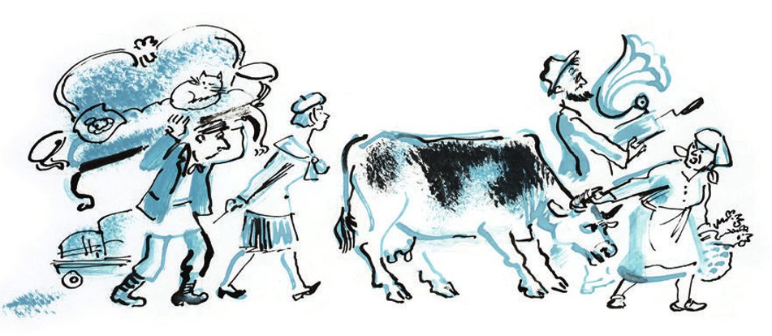
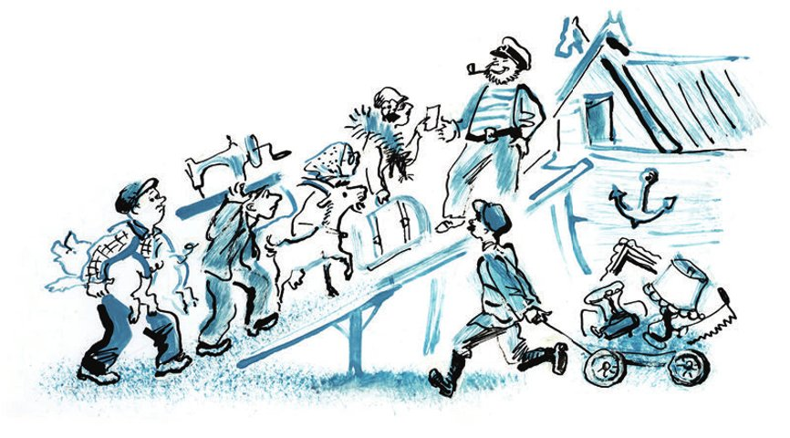

## Wassissuali Lochankin

Schon lange hat Kolokolamsk den <abbr title="der Sargmacher, die Sargmacher — гробовщик">Sargmacher</abbr> Wassissuali Lochankin nicht mehr so <abbr title="aufgeregt — взволнованный, возбуждённый">aufgeregt</abbr> gesehen. Er geht durch die Kleine Ehemalige Straße und <abbr title="schwanken — пошатываться, качаться">schwankt</abbr> sogar ein bisschen. Dabei hat er die letzten zwei Tage <abbr title="überhaupt nicht — вовсе не, совсем не">überhaupt nicht</abbr> getrunken.

Er geht in alle Häuser, eins nach dem anderen. Überall erzählt er seinen Mitbürgern die neueste <abbr title="die Nachricht, die Nachrichten — новость, известие">Nachricht</abbr>:

— Das Ende von der Welt! Die <abbr title="die Sintflut — всемирный потоп">Sintflut</abbr>! Die <abbr title="die Schleuse, die Schleusen — шлюз">Schleusen</abbr> vom Himmel haben sich geöffnet! In der Gouvernementsstadt <abbr title="gießen (goss, hat gegossen) — лить, хлестать">gießt</abbr> es schon sieben Tage und sieben Nächte. Zwei <abbr title="leitend — ответственный, руководящий">leitende</abbr> <abbr title="der Funktionär, die Funktionäre — работник, функционер">Funktionäre</abbr> sind schon <abbr title="ertrinken (ertrank, ist ertrunken) — утонуть">ertrunken</abbr>. Der <abbr title="der Weltuntergang — конец света, светопреставление">Weltuntergang</abbr> fängt an! Das haben uns die <abbr title="der Bolschewik, die Bolschewiken — большевик">Bolschewiken</abbr> <abbr title="jemandem etwas einbrocken — довести до ручки, заварить кашу">eingebrockt</abbr>! Seht doch mal!

Mit <abbr title="zittern — дрожать">zitternder</abbr> Hand zeigt Lochankin zum Himmel. Von allen Seiten kommen <abbr title="violett — фиолетовый">violette</abbr> <abbr title="die Gewitterwolke, die Gewitterwolken — грозовая туча">Gewitterwolken</abbr> auf die Stadt zu. Der <abbr title="der Horizont — горизонт">Horizont</abbr> <abbr title="donnern — греметь, грохотать">donnert</abbr>. Kurze, böse <abbr title="der Blitz, die Blitze — молния">Blitze</abbr> <abbr title="zucken — сверкать, вспыхивать">zucken</abbr>.

Der Bürger Pferd aus dem Haus Nummer 17 ist ein sehr <abbr title="empfindlich — впечатлительный, чувствительный">empfindlicher</abbr> Mensch. Er macht aus der Nachricht von Lochankin noch viel mehr. Er, Pferd, hat <abbr title="die Information, die Informationen — сведения, информация">Informationen</abbr>: Moskau ist schon unter Wasser! Überall sind die Flüsse über die <abbr title="das Ufer, die Ufer — берег">Ufer</abbr> <abbr title="über die Ufer treten (trat, ist getreten) — выйти из берегов">getreten</abbr>! Und darin sieht er, Pferd, eine <abbr title="die Strafe, die Strafen — наказание, кара">Strafe</abbr> vom Himmel. Eine kleine Gruppe von Bürgern steht da und sieht <abbr title="ängstlich — тревожно, боязливо">ängstlich</abbr> zum Himmel. Da kommt Sizilija Petrowna <abbr title="angelaufen kommen — прибежать">angelaufen</abbr>. Sie trägt einen <abbr title="der Morgenmantel, die Morgenmäntel — капот, халат">Morgenmantel</abbr> aus orangefarbenem <abbr title="der Flanell — фланель">Flanell</abbr>. Sie sagt: «Die Sintflut erwartet man schon lange! Das hat mir letzte Woche ein Bekannter erzählt, ein <abbr title="der Kommunist, die Kommunisten — коммунист">Kommunist</abbr> aus dem <abbr title="das Zentrum — центр">Zentrum</abbr>!» Jetzt beginnt in der Stadt eine <abbr title="die Panik — паника">Panik</abbr>.

Die Kolokolamsker <abbr title="das Leben lieben — быть жизнелюбивым">lieben das Leben</abbr>. Sie wollen nicht schon <abbr title="in der Blüte seiner Jahre — во цвете лет">in der Blüte ihrer Jahre</abbr> sterben. Sofort gibt es viele <abbr title="der Vorschlag, die Vorschläge — предложение, проект">Vorschläge</abbr>: Wie kann man die Stadt vor der Sintflut retten?

— Vielleicht <abbr title="umziehen (zog um, ist umgezogen) — переезжать">ziehen</abbr> wir in eine andere Stadt um? — sagt Nikita Psow. Er ist der <abbr title="dumm — глупый">dümmste</abbr> von allen Bürgern.

— Besser schießen wir mit <abbr title="die Kanone, die Kanonen — пушка">Kanonen</abbr> in den Himmel, — <abbr title="vorschlagen (schlug vor, hat vorgeschlagen) — предлагать">schlägt</abbr> Monsieur Podlinnik vor. — So <abbr title="verjagen — разгонять, прогонять">verjagen</abbr> wir die Wolken.

Aber beide Vorschläge <abbr title="ablehnen — отклонять, отвергать">lehnt</abbr> man ab. Den ersten nach einer <abbr title="glänzend — блестящий">glänzenden</abbr> <abbr title="die Rede, die Reden — речь">Rede</abbr> von Lochankin. Lochankin <abbr title="beweisen (bewies, hat bewiesen) — доказывать">beweist</abbr>: Das ganze Land ist schon unter Wasser, man kann <abbr title="nirgendwohin — некуда">nirgendwohin</abbr> umziehen. Der zweite Vorschlag ist eigentlich ziemlich <abbr title="vernünftig — разумный, дельный">vernünftig</abbr>. Aber die Stadt hat keine <abbr title="die Artillerie — артиллерия">Artillerie</abbr>.

Da sehen alle Kolokolamsker voll Hoffnung und <abbr title="die Sehnsucht — страстное желание, вожделение">Sehnsucht</abbr> zu Kapitän Noj Archipowitsch Pochotillo. Der Kapitän steht ein bisschen <abbr title="abseits — поодаль, в стороне">abseits</abbr> von den Leuten. <abbr title="selbstzufrieden — самодовольно">Selbstzufrieden</abbr> <abbr title="zwirbeln — крутить, подкручивать">zwirbelt</abbr> er seinen <abbr title="triumphal — триумфальный">triumphalen</abbr> Schnurrbart. Der Kapitän hat viel <abbr title="die Lebenserfahrung — жизненный опыт">Lebenserfahrung</abbr>. Er weiß sofort eine Lösung.

— Eine <abbr title="die Arche, die Archen — ковчег">Arche</abbr>! — sagt er. — Wir müssen eine Arche bauen!

— Noj Archipowitsch! — stöhnt die <abbr title="die Menge, die Mengen — толпа">Menge</abbr>. Alle <abbr title="ahnen — предчувствовать">ahnen</abbr>: Jetzt passieren große Dinge.

— Jetzt rechnen wir nicht! — sagt Kapitän Pochotillo <abbr title="knapp — коротко, отрывисто">knapp</abbr>. — <abbr title="sich bedanken — благодарить">Bedanken</abbr> könnt ihr euch nach der <abbr title="die Rettung — спасение, избавление">Rettung</abbr>.

Auf die Köpfe von den Bürgern fallen die ersten <abbr title="fliederfarben — сиреневый">fliederfarbenen</abbr> <abbr title="der Regentropfen, die Regentropfen — капля дождя">Regentropfen</abbr>. Jetzt <abbr title="sich beeilen — спешить, торопиться">beeilen sich</abbr> die Kolokolamsker. Sofort beginnen sie mit dem Bau von der Arche. Sie nehmen das ganze Holz, das sie in der Stadt finden können.

Als <abbr title="der Bauplan, die Baupläne — чертёж">Bauplan</abbr> nehmen sie ein Bild von dem Künstler Doré. Das Bild ist in einer <abbr title="die Bibel, die Bibeln — Библия">Bibel</abbr>, die achtzehn <abbr title="das Pfund, die Pfunde — фунт">Pfund</abbr> wiegt. Die Bibel bringt der Diakon von der «Lebendigen Kirche», Vater Ognepoklonnikow. Am Abend regnet es stärker, und die Leute müssen unter <abbr title="der Regenschirm, die Regenschirme — зонтик">Regenschirmen</abbr> arbeiten. Für das Dach von der Arche gibt es nicht mehr genug Holz. Deshalb nehmen sie die <abbr title="der Sarg, die Särge — гроб">Särge</abbr> von Lochankin. Das Dach glänzt jetzt in Silber und Gold, denn die Särge sind mit <abbr title="der Brokat — глазет, парча">Brokat</abbr> <abbr title="beziehen mit + Dat. (bezog, hat bezogen) — обтягивать, обивать">bezogen</abbr>.

— Jetzt rechnen wir nicht! — sagt Kapitän Pochotillo.

Er trägt einen <abbr title="der Sturmmantel, die Sturmmäntel — штормовой плащ">Sturmmantel</abbr> und einen <abbr title="der Südwester, die Südwester — зюйдвестка">Südwester</abbr>. Die ganze Nacht regnet es ein bisschen. Am Morgen kommen die ersten <abbr title="der Passagier, die Passagiere — пассажир">Passagiere</abbr> zur Arche. Erst jetzt verstehen die Bürger, was der seltsame Satz vom Kapitän bedeutet: «Jetzt rechnen wir nicht!» Denn jetzt rechnet der Kapitän die ganze Zeit. Noj Archipowitsch will für alles Geld haben: für den <abbr title="der Eintritt — вход">Eintritt</abbr>, für das <abbr title="das Gepäck — багаж">Gepäck</abbr>, für ein Paar <abbr title="rein — чистый">reine</abbr> oder <abbr title="unrein — нечистый">unreine</abbr> Tiere. Und für einen Platz <abbr title="hinten — сзади, на корме">hinten</abbr> im Schiff. Dort <abbr title="schaukeln — качать, качаться">schaukelt</abbr> es nicht so stark, sagt der Kapitän.

Die ersten Passagiere sind Monsieur Podlinnik, Pferd und Sizilija Petrowna. Sizilija Petrowna trägt jetzt keinen Morgenmantel mehr, sondern ein <abbr title="das Kostüm, die Kostüme — костюм (женский), тальер">Kostüm</abbr> aus <abbr title="das Segeltuch — брезент, парусина">Segeltuch</abbr>. Der <abbr title="flink — расторопный, проворный">flinke</abbr> Kapitän nimmt von jedem 80 Rubel. Aber dann <abbr title="entscheiden (entschied, hat entschieden) — решать">entscheidet</abbr> Noj Archipowitsch: «Sowjetisches Geld nehme ich nicht mehr! Ich nehme nur noch Geld aus der <abbr title="die Zarenzeit — царское время">Zarenzeit</abbr>.» Nikita Psow zieht vor der Arche seine <abbr title="der Stiefel, die Stiefel — сапог">Stiefel</abbr> aus. Aus einem Stiefel holt er einen alten <abbr title="der Hundertrubelschein, die Hundertrubelscheine — сторублёвка («катенька»)">Hundertrubelschein</abbr> mit dem Bild von der <abbr title="die Zarin, die Zarinnen — царица">Zarin</abbr> Katharina. Dafür darf er mit seiner Frau und seinem <abbr title="immergrün — вечнозелёный">immergrünen</abbr> <abbr title="der Gummibaum, die Gummibäume — фикус">Gummibaum</abbr> in die Arche.

Vor der Arche gibt es einen großen <abbr title="der Stau, die Staus — пробка, затор">Stau</abbr>. Der Kapitän hat Wodka getrunken. Jetzt sagt er: «Nach der Sintflut <abbr title="zusammenbrechen (brach zusammen, ist zusammengebrochen) — рухнуть">bricht</abbr> das ganze <abbr title="das Geldsystem — денежное обращение">Geldsystem</abbr> zusammen. Deshalb brauche ich kein Geld. Aber umsonst rette ich die Kolokolamsker nicht!» Nur <abbr title="mit Mühe — с трудом">mit Mühe</abbr> kann man Noj Archipowitsch <abbr title="überreden — уговаривать, убеждать">überreden</abbr>: Die Leute dürfen mit Sachen bezahlen. Er steht am <abbr title="der Eingang, die Eingänge — вход">Eingang</abbr> von seinem Schiff. <abbr title="verächtlich — презрительно">Verächtlich</abbr> hält er eine fremde Hose aus <abbr title="der Diagonalstoff — диагональ (ткань)">Diagonalstoff</abbr> gegen das Licht. Er wirft goldene <abbr title="das Armband, die Armbänder — браслет">Armbänder</abbr> in die Luft und <abbr title="fangen (fing, hat gefangen) — ловить">fängt</abbr> sie wieder. Die Armbänder sind innen <abbr title="hohl — полый, дутый">hohl</abbr>. Auch <abbr title="die Nähmaschine, die Nähmaschinen — швейная машинка">Nähmaschinen</abbr> nimmt er gern. Am liebsten die mit <abbr title="der Fußantrieb — ножной привод">Fußantrieb</abbr>.

Beim <abbr title="das Einsteigen — посадка">Einsteigen</abbr> gibt es viel <abbr title="der Lärm — шум">Lärm</abbr> und viel Geschrei. Es regnet noch ein bisschen stärker. Die Bürger drängen <abbr title="energisch — энергично">energisch</abbr>. Aber in die Arche <abbr title="passen in + Akk. — помещаться, вмещаться">passen</abbr> nur zweiundzwanzig Personen. Dazu gehören auch der <abbr title="der Steuermann, die Steuerleute — кормчий, рулевой">Steuermann</abbr> Pochotillo und sein erster <abbr title="der Gehilfe, die Gehilfen — помощник">Gehilfe</abbr> Lochankin.

— Die Arche ist doch nicht aus Gummi! — schreit Noj Archipowitsch. Er <abbr title="versperren — загораживать, преграждать">versperrt</abbr> den Eingang mit seiner breiten <abbr title="die Brust, die Brüste — грудь">Brust</abbr>.

Die Bürger rufen <abbr title="verzweifelt — отчаянно, с надрывом">verzweifelt</abbr>, wie in der Straßenbahn:

— Bitte <abbr title="durchgehen (ging durch, ist durchgegangen) — проходить (дальше)">durchgehen</abbr>! Vorne ist noch Platz!

— Bürger, lasst den Käfig mit den <abbr title="die Krähe, die Krähen — ворона">Krähen</abbr> durch! — <abbr title="brüllen — вопить, орать">brüllt</abbr> Wassissuali Lochankin.

Man trägt die Krähen in die Arche. Da sieht Kapitän Pochotillo in der Ferne Sindik-Bugajewski, den Leiter von den Kursen für Deklamation und Gesang. Hinter ihm kommen alle seine Schüler.

— Die Arche <abbr title="ablegen — отчаливать, отправляться">legt ab</abbr>! — ruft der Kapitän <abbr title="erschrocken — испуганно">erschrocken</abbr>. — Bürger! Runter von den <abbr title="die Stufe, die Stufen — ступенька">Stufen</abbr>! Jetzt rechnen wir nicht!

Die Türen <abbr title="zuknallen — захлопываться">knallen</abbr> zu. Der Regen <abbr title="trommeln — барабанить, стучать">trommelt</abbr> <abbr title="drohend — грозно">drohend</abbr> auf das Dach aus Brokat. Von draußen hört man <abbr title="dumpf — глухо">dumpf</abbr> das Geschrei von den Kolokolamskern, die jetzt sterben müssen. Die große <abbr title="die Reise, die Reisen — путешествие, плавание">Reise</abbr> beginnt.

Drei Tage und drei Nächte sitzen die <abbr title="auserwählt — отборный, избранный">auserwählten</abbr> Kolokolamsker in der Arche. Sie essen wenig, sie <abbr title="schweigen (schwieg, hat geschwiegen) — молчать">schweigen</abbr>, und sie warten <abbr title="voller Sorge — с тревогой">voller Sorge</abbr> auf das, was kommt.

Am vierten Tag lassen sie eine Krähe durch eine <abbr title="die Luke, die Luken — люк">Luke</abbr> im Dach <abbr title="hinauslassen (ließ hinaus, hat hinausgelassen) — выпускать">hinaus</abbr>. Sie fliegt weg und kommt nicht zurück.

— Es ist noch zu früh, — sagt Lochankin.

— Das Wasser ist noch nicht <abbr title="sinken (sank, ist gesunken) — опускаться, спадать">gesunken</abbr>! — <abbr title="erklären — объяснять">erklärt</abbr> der Kapitän.

Am fünften Tag lassen sie die zweite Krähe hinaus. Nach fünf Minuten kommt sie zurück. An ihrem linken Bein ist ein kleiner <abbr title="der Zettel, die Zettel — записка">Zettel</abbr> <abbr title="festbinden (band fest, hat festgebunden) — привязывать">festgebunden</abbr>. Auf dem Zettel steht: «Kommt raus, ihr <abbr title="der Idiot, die Idioten — дурак, идиот">Idioten</abbr>.» Und die <abbr title="die Unterschrift, die Unterschriften — подпись">Unterschrift</abbr>: «Sindik-Bugajewski».

Die auserwählten Kolokolamsker stürzen zum <abbr title="der Ausgang, die Ausgänge — выход">Ausgang</abbr>. Die Sonne scheint ihnen in die Augen. Die Arche ist ganz <abbr title="staubig — пыльный">staubig</abbr>. Sie steht noch genau dort, wo man sie gebaut hat: mitten auf der Kleinen Ehemaligen Straße, neben der Bierstube «Magenfreund».

— <abbr title="Erlauben Sie mal! — позвольте!">Erlauben Sie mal</abbr>, wo ist denn die Sintflut? — schreit Pferd beleidigt. — Das hat sich alles Lochankin <abbr title="sich ausdenken (dachte aus, hat ausgedacht) — выдумать">ausgedacht</abbr>!

— Ich? Ich soll mir das ausgedacht haben? — sagt Wassissuali Lochankin <abbr title="empört — возмущённо">empört</abbr>. — Und wer hat gesagt, dass die Flüsse über die Ufer getreten sind? Dass Moskau schon ertrunken ist? War das auch Lochankin?

— Jetzt rechnen wir nicht! — donnert Pochotillo. Und er schlägt dem Sargmacher mit einer Krähe ins <abbr title="rotwangig — румяный">rotwangige</abbr> Gesicht.

Bis spät in die Nacht <abbr title="abrechnen mit + Dat. — сводить счёты с">rechnen</abbr> die Bürger mit dem <abbr title="der Erfinder, die Erfinder — выдумщик, изобретатель">Erfinder</abbr> von der Sintflut ab.

---

### Neue Wörter

- **der Sargmacher, die Sargmacher** — гробовщик
- **aufgeregt** — взволнованный, возбуждённый
- **schwanken** — пошатываться, качаться
- **überhaupt nicht** — вовсе не, совсем не
- **die Nachricht, die Nachrichten** — новость, известие
- **die Sintflut** — всемирный потоп
- **die Schleuse, die Schleusen** — шлюз
- **gießen (goss, hat gegossen)** — лить, хлестать
- **leitend** — ответственный, руководящий
- **der Funktionär, die Funktionäre** — работник, функционер
- **ertrinken (ertrank, ist ertrunken)** — утонуть
- **der Weltuntergang** — конец света, светопреставление
- **der Bolschewik, die Bolschewiken** — большевик
- **jemandem etwas einbrocken** — довести до ручки, заварить кашу
- **zittern** — дрожать
- **violett** — фиолетовый
- **die Gewitterwolke, die Gewitterwolken** — грозовая туча
- **der Horizont** — горизонт
- **donnern** — греметь, грохотать
- **der Blitz, die Blitze** — молния
- **zucken** — сверкать, вспыхивать
- **empfindlich** — впечатлительный, чувствительный
- **die Information, die Informationen** — сведения, информация
- **das Ufer, die Ufer** — берег
- **über die Ufer treten (trat, ist getreten)** — выйти из берегов
- **die Strafe, die Strafen** — наказание, кара
- **ängstlich** — тревожно, боязливо
- **angelaufen kommen** — прибежать
- **der Morgenmantel, die Morgenmäntel** — капот, халат
- **der Flanell** — фланель
- **der Kommunist, die Kommunisten** — коммунист
- **das Zentrum** — центр
- **die Panik** — паника
- **das Leben lieben** — быть жизнелюбивым
- **in der Blüte seiner Jahre** — во цвете лет
- **der Vorschlag, die Vorschläge** — предложение, проект
- **umziehen (zog um, ist umgezogen)** — переезжать
- **dumm** — глупый
- **die Kanone, die Kanonen** — пушка
- **vorschlagen (schlug vor, hat vorgeschlagen)** — предлагать
- **verjagen** — разгонять, прогонять
- **ablehnen** — отклонять, отвергать
- **glänzend** — блестящий
- **die Rede, die Reden** — речь
- **beweisen (bewies, hat bewiesen)** — доказывать
- **nirgendwohin** — некуда
- **vernünftig** — разумный, дельный
- **die Artillerie** — артиллерия
- **die Sehnsucht** — страстное желание, вожделение
- **abseits** — поодаль, в стороне
- **selbstzufrieden** — самодовольно
- **zwirbeln** — крутить, подкручивать
- **triumphal** — триумфальный
- **die Lebenserfahrung** — жизненный опыт
- **die Arche, die Archen** — ковчег
- **die Menge, die Mengen** — толпа
- **ahnen** — предчувствовать
- **knapp** — коротко, отрывисто
- **sich bedanken** — благодарить
- **die Rettung** — спасение, избавление
- **fliederfarben** — сиреневый
- **der Regentropfen, die Regentropfen** — капля дождя
- **sich beeilen** — спешить, торопиться
- **der Bauplan, die Baupläne** — чертёж
- **die Bibel, die Bibeln** — Библия
- **das Pfund, die Pfunde** — фунт
- **der Regenschirm, die Regenschirme** — зонтик
- **der Sarg, die Särge** — гроб
- **der Brokat** — глазет, парча
- **beziehen mit + Dat. (bezog, hat bezogen)** — обтягивать, обивать
- **der Sturmmantel, die Sturmmäntel** — штормовой плащ
- **der Südwester, die Südwester** — зюйдвестка
- **der Passagier, die Passagiere** — пассажир
- **der Eintritt** — вход
- **das Gepäck** — багаж
- **rein** — чистый
- **unrein** — нечистый
- **hinten** — сзади, на корме
- **schaukeln** — качать, качаться
- **das Kostüm, die Kostüme** — костюм (женский), тальер
- **das Segeltuch** — брезент, парусина
- **flink** — расторопный, проворный
- **entscheiden (entschied, hat entschieden)** — решать
- **die Zarenzeit** — царское время
- **der Stiefel, die Stiefel** — сапог
- **der Hundertrubelschein, die Hundertrubelscheine** — сторублёвка («катенька»)
- **die Zarin, die Zarinnen** — царица
- **immergrün** — вечнозелёный
- **der Gummibaum, die Gummibäume** — фикус
- **der Stau, die Staus** — пробка, затор
- **zusammenbrechen (brach zusammen, ist zusammengebrochen)** — рухнуть
- **das Geldsystem** — денежное обращение
- **mit Mühe** — с трудом
- **überreden** — уговаривать, убеждать
- **der Eingang, die Eingänge** — вход
- **verächtlich** — презрительно
- **der Diagonalstoff** — диагональ (ткань)
- **das Armband, die Armbänder** — браслет
- **fangen (fing, hat gefangen)** — ловить
- **hohl** — полый, дутый
- **die Nähmaschine, die Nähmaschinen** — швейная машинка
- **der Fußantrieb** — ножной привод
- **das Einsteigen** — посадка
- **der Lärm** — шум
- **energisch** — энергично
- **passen in + Akk.** — помещаться, вмещаться
- **der Steuermann, die Steuerleute** — кормчий, рулевой
- **der Gehilfe, die Gehilfen** — помощник
- **versperren** — загораживать, преграждать
- **die Brust, die Brüste** — грудь
- **verzweifelt** — отчаянно, с надрывом
- **durchgehen (ging durch, ist durchgegangen)** — проходить (дальше)
- **die Krähe, die Krähen** — ворона
- **brüllen** — вопить, орать
- **ablegen** — отчаливать, отправляться
- **erschrocken** — испуганно
- **die Stufe, die Stufen** — ступенька
- **zuknallen** — захлопываться
- **trommeln** — барабанить, стучать
- **drohend** — грозно
- **dumpf** — глухо
- **die Reise, die Reisen** — путешествие, плавание
- **auserwählt** — отборный, избранный
- **schweigen (schwieg, hat geschwiegen)** — молчать
- **voller Sorge** — с тревогой
- **die Luke, die Luken** — люк
- **hinauslassen (ließ hinaus, hat hinausgelassen)** — выпускать
- **sinken (sank, ist gesunken)** — опускаться, спадать
- **erklären** — объяснять
- **der Zettel, die Zettel** — записка
- **festbinden (band fest, hat festgebunden)** — привязывать
- **der Idiot, die Idioten** — дурак, идиот
- **die Unterschrift, die Unterschriften** — подпись
- **der Ausgang, die Ausgänge** — выход
- **staubig** — пыльный
- **Erlauben Sie mal!** — позвольте!
- **sich ausdenken (dachte aus, hat ausgedacht)** — выдумать
- **empört** — возмущённо
- **rotwangig** — румяный
- **abrechnen mit + Dat.** — сводить счёты с
- **der Erfinder, die Erfinder** — выдумщик, изобретатель

[← Zurück](kapitel-02.md) · [Inhalt](README.md) · [Weiter →](kapitel-04.md)
