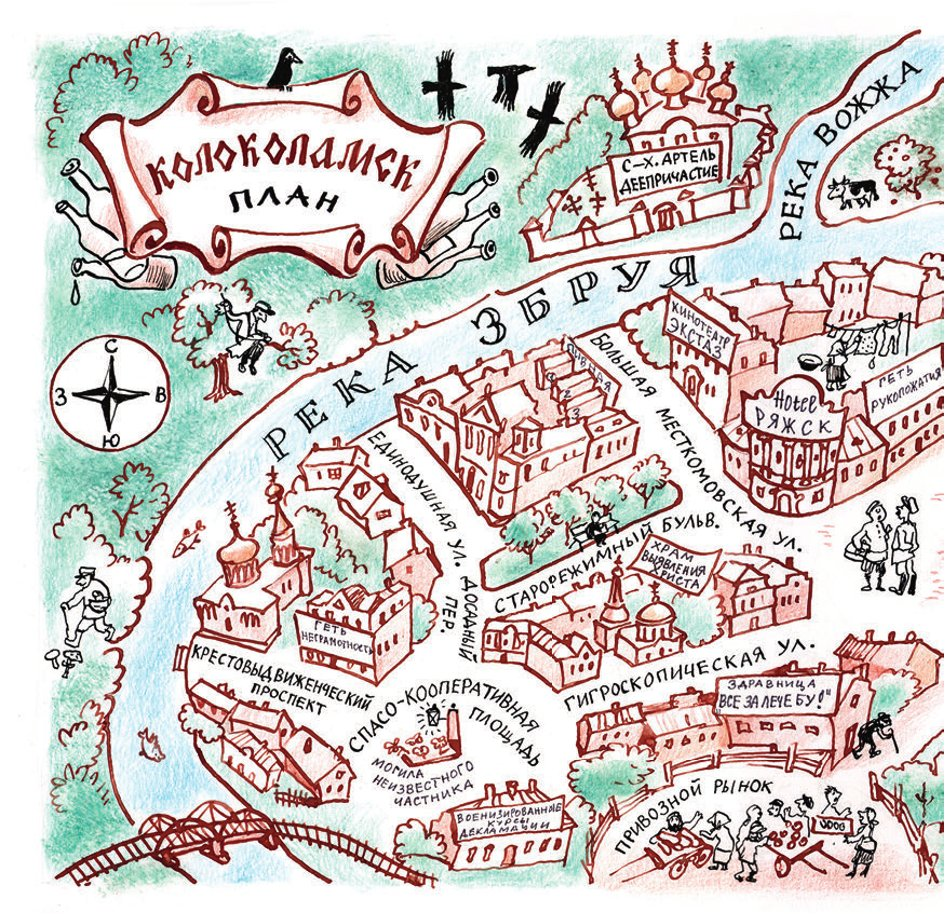
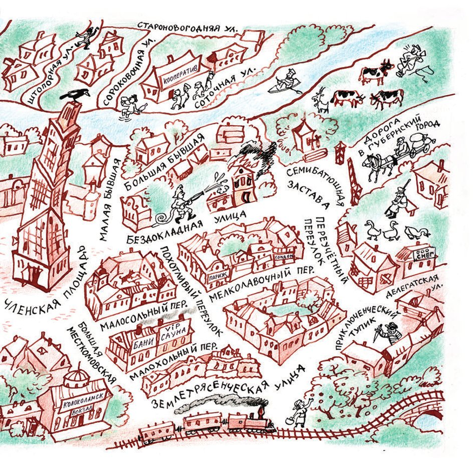

## Die Stadt und ihre Umgebung

Wir finden: Die Geschichte von Kolokolamsk muss kein <abbr title="das Geheimnis, die Geheimnisse — тайна">Geheimnis</abbr> sein. Deshalb <abbr title="mitteilen — сообщать, доводить до сведения">teilen</abbr> wir unseren Lesern mit: a) Kolokolamsk gibt es wirklich; b) es hat nichts mit der Stadt Wolokolamsk zu tun; und c) es liegt genau zwischen der russischen und der ukrainischen <abbr title="die Republik, die Republiken — республика">Republik</abbr>. Deshalb steht es auf keiner <abbr title="die Landkarte, die Landkarten — географическая карта">Landkarte</abbr> von diesen zwei <abbr title="befreundet — дружественный">befreundeten</abbr> Republiken. Daran sind nur unsere <abbr title="der Geograf, die Geografen — географ">Geografen</abbr> <abbr title="schuld sein an + Dat. — быть виноватым в">schuld</abbr>.

Und die <abbr title="der Journalist, die Journalisten — журналист, газетный работник">Journalisten</abbr>? Die Leute, die über das Leben in der <abbr title="die Provinz — провинция">Provinz</abbr> schreiben? Sie wollen nach Kolokolamsk fahren. Aber <abbr title="seltsamerweise — по странной иронии судьбы">seltsamerweise</abbr> kommen sie immer in Jalta oder in Kislowodsk an. Dann <abbr title="beschreiben (beschrieb, hat beschrieben) — описывать">beschreiben</abbr> sie diese <abbr title="der Kurort, die Kurorte — курорт">Kurorte</abbr> sehr <abbr title="fleißig — усердно, прилежно">fleißig</abbr>. Schade um den Fleiß!

Aber der <abbr title="der Autor, die Autoren — автор">Autor</abbr> ist zusammen mit dem <abbr title="der Zeichner, die Zeichner — художник, рисовальщик">Zeichner</abbr> K. Rotow wirklich nach Kolokolamsk gekommen. Sie haben dort im Hotel «Rjaschsk» gewohnt. Sie haben sogar einen <abbr title="der Stadtplan, die Stadtpläne — план города">Stadtplan</abbr> von dieser <abbr title="erstaunlich — удивительный">erstaunlichen</abbr> Stadt gezeichnet.

Auf dem Plan sieht man: Die <abbr title="ruhmreich — славный">ruhmreiche</abbr> Stadt Kolokolamsk liegt frei und <abbr title="malerisch — живописно">malerisch</abbr> am linken Ufer vom <abbr title="flach — мелкий, мелководный">flachen</abbr> Fluss Sbruja. Im 14. <abbr title="das Jahrhundert, die Jahrhunderte — век">Jahrhundert</abbr> gab es in Kolokolamsk einen <abbr title="der Fürst, die Fürsten — князь">Fürsten</abbr>: Andrej den Selbstverliebten. Sein <abbr title="der Stallknecht, die Stallknechte — конюх">Stallknecht</abbr> hat einmal zu viel <abbr title="byzantinisch — византийский">byzantinischen</abbr> Wodka getrunken. Da hat er das <abbr title="das Pferdegeschirr — сбруя, упряжь">Pferdegeschirr</abbr> vom fürstlichen <abbr title="der Wallach, die Wallache — мерин">Wallach</abbr> in den Fluss fallen lassen. Das Geschirr ist <abbr title="untergehen (ging unter, ist untergegangen) — утонуть, пойти ко дну">untergegangen</abbr>. Und seitdem heißt der Fluss «Sbruja» – auf Russisch heißt das «Pferdegeschirr».

Seitdem sind Jahrhunderte vergangen. Der Selbstverliebtenplatz heißt schon lange Mitgliederplatz. Und die <abbr title="die Legende, die Legenden — легенда">Legende</abbr> vom Pferdegeschirr kennt nur noch der Bürger Psow senior. Er hat sie uns bei einer Flasche in der Bierstube «Magenfreund» erzählt.

In die Sbruja <abbr title="münden in + Akk. — впадать в">mündet</abbr> ein ganz kleiner Fluss, die Woschscha (die «<abbr title="der Zügel, die Zügel — вожжи, поводья">Zügel</abbr>»). Über sie wissen wir leider nichts. Denn Psow senior will nur weitererzählen, wenn wir ihn in allen Bierstuben auf der Großen Gewerkschaftsstraße (Bolschaja Mestkomowskaja) <abbr title="einladen (lud ein, hat eingeladen) — угощать, приглашать">einladen</abbr>.

Er lässt sich <abbr title="nacheinander — последовательно, по очереди">nacheinander</abbr> in allen Bierstuben einladen: im «Sanitas», im «Dem Morgenrot entgegen», im «Kleinrussland», in der «<abbr title="die Feuerbestattung — кремация, «огненное погребение»">Feuerbestattung</abbr>», in der «Stimme der <abbr title="die Vergangenheit — прошлое, минувшее">Vergangenheit</abbr>» und in der Bierstube von der Fabrik «Jemeljan Pugatschow». Wir bezahlen alles. Aber Psow senior <abbr title="enttäuschen — разочаровывать">enttäuscht</abbr> unsere Hoffnungen. Denn am Ende kann er nicht mehr sprechen.

Die Große Gewerkschaftsstraße ist die <abbr title="die Hauptschlagader — главная артерия">Hauptschlagader</abbr> von der Stadt. Sie <abbr title="verbinden (verband, hat verbunden) — соединять">verbindet</abbr> den Bahnhof mit dem Mitgliederplatz. Auf dem Mitgliederplatz steht das Gerippe vom Wolkenkratzer. Seine Geschichte kennt der Leser schon. Dann geht die Große Gewerkschaftsstraße hinunter zum Fluss. Mit der <abbr title="die Fähre, die Fähren — паром">Fähre</abbr> von Kapitän N. Pochotillo kann man auf das andere Ufer fahren. Dort ist ein dichter Wald. Er liegt rund um die Stadt. Früher hat dieser Wald die <abbr title="der Tatar, die Tataren — татарин">Tataren</abbr> gestört. Sie wollten Kolokolamsk mit Feuer und <abbr title="das Schwert, die Schwerter — меч">Schwert</abbr> <abbr title="vernichten — уничтожать">vernichten</abbr>, mit Raub und <abbr title="die Plünderung, die Plünderungen — разграбление">Plünderung</abbr>, mit <abbr title="der Hunger — голод">Hunger</abbr> und <abbr title="die Pest — мор, чума">Pest</abbr>. Aber sie sind nicht durch den Wald gekommen.

Geht man tief in den Wald, dann trifft man leicht den Schneider Solowejtschik. Er ist ein <abbr title="der Einzelhandwerker, die Einzelhandwerker — кустарь-одиночка">Einzelhandwerker</abbr>. Hier im <abbr title="der Kiefernwald, die Kiefernwälder — бор, сосновый лес">Kiefernwald</abbr> <abbr title="sich verstecken vor + Dat. — прятаться, спасаться от">versteckt sich</abbr> er vor den <abbr title="die Steuer, die Steuern — налог">Steuern</abbr>. Trotzdem nimmt er für seine Arbeit so viel Geld, dass die Kolokolamsker ihn «Solowejtschik der <abbr title="der Räuber, die Räuber — разбойник">Räuber</abbr>» nennen.

Rechts, auf einem Berg, steht die <abbr title="die Genossenschaft, die Genossenschaften — артель">Genossenschaft</abbr> von den ehemaligen <abbr title="die Nonne, die Nonnen — монахиня">Nonnen</abbr>. Sie heißt «Konjunktion». Ihre Waren verkaufen die Nonnen an den <abbr title="der Konsumverein, die Konsumvereine — кооператив (потребительский)">Konsumverein</abbr> in der <abbr title="die Inventurgasse — Переучётный переулок">Inventurgasse</abbr>, nicht weit vom Sieben-<abbr title="der Pope, die Popen — поп, батюшка">Popen</abbr>-Tor.

Der östliche Teil von der Stadt ist zu Recht <abbr title="stolz sein auf + Akk. — гордиться">stolz</abbr> auf seine zwei «Ehemaligen» Straßen: die Ohne-<abbr title="der Vortrag, die Vorträge — доклад">Vortrag</abbr>-Straße und die <abbr title="das Erdbeben, die Erdbeben — землетрясение">Erdbeben</abbr>straße. Dort, wo sie sich treffen, hat man die Arche gebaut. Die Erdbebenstraße heißt erst seit Kurzem so. Man hat sie nach dem letzten Erdbeben in Japan <abbr title="benennen (benannte, hat benannt) — называть, давать название">benannt</abbr>.

Die größte <abbr title="die Gasse, die Gassen — переулок">Gasse</abbr> hier ist die <abbr title="lüstern — похотливый">Lüsterne</abbr> Gasse. Dort gibt es wunderbare <abbr title="das Einzelbad, die Einzelbäder — индивидуальная баня">Einzelbäder</abbr>.

Die Kleinkramgasse, die <abbr title="die Salzgurkengasse — Малосольный переулок">Salzgurkengasse</abbr> und die <abbr title="die Spinnergasse — Малахольный переулок">Spinnergasse</abbr> sind nichts Besonderes. Über sie schweigen wir. Aber eine Gasse ist der dunkle <abbr title="der Fleck, die Flecken — пятно">Fleck</abbr> von der Stadt: die Abenteuer-<abbr title="die Sackgasse, die Sackgassen — тупик">Sackgasse</abbr>. Den Namen hat sie, weil man hier jeden Abend <abbr title="der Wanderer, die Wanderer — путник">Wanderer</abbr> <abbr title="ausrauben — грабить">ausraubt</abbr>. Die Wanderer kommen spät und <abbr title="betrunken — пьяный">betrunken</abbr> und <abbr title="kriechen (kroch, ist gekrochen) — ползти, заползать">kriechen</abbr> in die Sackgasse.

Was gibt es im östlichen Teil noch zu sehen? Die russisch-ukrainische <abbr title="die Gesellschaft, die Gesellschaften — общество">Gesellschaft</abbr> «Hetj, <abbr title="das Analphabetentum — неграмотность">Analphabetentum</abbr>!» («hetj» ist Ukrainisch und heißt «weg»). Und das brennende Haus am Sieben-Popen-Tor. Dieses Haus brennt schon seit fünf Jahren jeden Tag. Jeden Morgen <abbr title="anzünden — поджигать">zündet</abbr> es der <abbr title="der Hausbesitzer, die Hausbesitzer — домовладелец">Hausbesitzer</abbr> an. Das ist der <abbr title="der Feuerwehrchef, die Feuerwehrchefs — брандмайор, начальник пожарной команды">Feuerwehrchef</abbr> Ogon-Polychajew. So hat seine <abbr title="die Feuerwehr, die Feuerwehren — пожарная команда">Feuerwehr</abbr> immer Arbeit.

Der südliche Teil von Kolokolamsk heißt auch Bahnhofsviertel. Er ist berühmt für den schönen Altes-<abbr title="das Regime, die Regime — режим">Regime</abbr>-<abbr title="der Boulevard, die Boulevards — бульвар">Boulevard</abbr>. Außerdem ist das der <abbr title="vornehm — фешенебельный, аристократичный">vornehmste</abbr> Teil von der Stadt. Hier liegt der <abbr title="der Erlöser — Спаситель, Спас">Erlöser</abbr>-Konsumverein-Platz. Dort ist die Scheingenossenschaft «Eigenarbeit». Ihr Vorsitzender ist Monsieur Podlinnik. Dort sind auch die militärischen Kurse für Deklamation und Gesang von Sindik-Bugajewski. Und die alte Kirche «Christi <abbr title="die Feststellung, die Feststellungen — выявление, установление">Feststellung</abbr>». Dann gibt es noch die <abbr title="lebhaft — оживлённый">lebhafte</abbr> <abbr title="hygroskopisch — гигроскопический">Hygroskopische</abbr> Straße. Dort steht das <abbr title="das Sanatorium, die Sanatorien — санаторий, здравница">Sanatorium</abbr> «Alle zur <abbr title="die Kur, die Kuren — лечение, курорт">Kur</abbr>!». Es ist ein <abbr title="prächtig — великолепный">prächtiges</abbr> Haus, aber leider ist es immer noch nicht fertig.

Besonders <abbr title="beeindruckend — впечатляющий, поразительный">beeindruckend</abbr> auf dem Erlöser-Konsumverein-Platz ist das Grab vom <abbr title="unbekannt — неизвестный">Unbekannten</abbr> Privathändler.

Am Anfang von der <abbr title="die NEP — нэп">NEP</abbr>, der Zeit vom freien Handel, kam ein Privathändler nach Kolokolamsk. Niemand kannte ihn. Er wollte <abbr title="das Rosshaar — конский волос">Rosshaar</abbr> kaufen. Den ganzen Tag ist er durch die Stadt gefahren und hat seine Ware gekauft. Am Abend ist er auf dem Erlöser-Konsumverein-Platz <abbr title="plötzlich — внезапно">plötzlich</abbr> von der Droschke gefallen und sofort gestorben. Er hatte keine <abbr title="die Papiere — документы">Papiere</abbr> dabei.

In Paris, Brüssel und Warschau gibt es das Grab vom Unbekannten <abbr title="der Soldat, die Soldaten — солдат">Soldaten</abbr>. Kolokolamsk will nicht schlechter sein. Aber woher nimmt man einen Soldaten? Kein Kolokolamsker war jemals im <abbr title="der Krieg, die Kriege — война">Krieg</abbr>. Deshalb haben die Bürger den unbekannten Privathändler auf dem Platz <abbr title="begraben (begrub, hat begraben) — хоронить, закапывать">begraben</abbr>. Auf seinem Grab brennt ein <abbr title="ewig — вечный, неугасаемый">ewiges</abbr> Feuer. Jede Woche, am Samstag, setzt Solowejtschik der Räuber mit der Fähre ins Zentrum über. Er trägt dann seine beste <abbr title="die Trauermütze, die Trauermützen — траурная кепка">Trauermütze</abbr>. Am Grab vom Unbekannten Privathändler nimmt er <abbr title="der Auftrag, die Aufträge — заказ">Aufträge</abbr> für neue Kleider an.

Der westliche Teil von der Stadt hat drei Straßen und eine Gasse. Die breite <abbr title="die Beförderung, die Beförderungen — повышение, выдвижение (по службе)">Kreuzbeförderungs</abbr>-Allee ist <abbr title="gerade — прямой">gerade</abbr> wie ein <abbr title="der Pfeil, die Pfeile — стрела">Pfeil</abbr>. Dort steht die neue Kreuzbeförderungskirche. Neben der Kirche ist die russisch-ukrainische Gesellschaft «Hetj, <abbr title="das Händeschütteln — рукопожатие">Händeschütteln</abbr>!».

Die <abbr title="einmütig — единодушный">Einmütige</abbr> Straße und ihre <abbr title="die Fortsetzung, die Fortsetzungen — продолжение">Fortsetzung</abbr>, die <abbr title="einstimmig — единогласный">Einstimmige</abbr> Straße, sind mit dem südlichen Teil durch die <abbr title="die Ärgergasse — Досадный переулок">Ärgergasse</abbr> verbunden. Zwischen der Einmütigen und der Einstimmigen steht ein <abbr title="der Feuerwachturm, die Feuerwachtürme — пожарная каланча">Feuerwachturm</abbr> und das <abbr title="das Revier, die Reviere — участок, часть">Revier</abbr> von der Miliz.

Der jüngste Teil von der Stadt ist Hinter-der-Sbruja. Er liegt auf der <abbr title="die Landspitze, die Landspitzen — стрелка, мыс">Landspitze</abbr> zwischen der Woschscha und der Sbruja. Was die Menschen hier <abbr title="hauptsächlich — главным образом">hauptsächlich</abbr> tun? Das sagen am besten die Namen von den Straßen.

Hierher kommen die Kolokolamsker an großen Feiertagen und kaufen Wodka, wenn der Konsumverein <abbr title="geschlossen — закрытый">geschlossen</abbr> hat.

So ist Kolokolamsk. Jetzt, so hoffen wir, <abbr title="zweifeln an + Dat. — сомневаться в">zweifelt</abbr> niemand mehr daran, dass es diese Stadt gibt.

---

### Neue Wörter

- **das Geheimnis, die Geheimnisse** — тайна
- **mitteilen** — сообщать, доводить до сведения
- **die Republik, die Republiken** — республика
- **die Landkarte, die Landkarten** — географическая карта
- **befreundet** — дружественный
- **der Geograf, die Geografen** — географ
- **schuld sein an + Dat.** — быть виноватым в
- **der Journalist, die Journalisten** — журналист, газетный работник
- **die Provinz** — провинция
- **seltsamerweise** — по странной иронии судьбы
- **beschreiben (beschrieb, hat beschrieben)** — описывать
- **der Kurort, die Kurorte** — курорт
- **fleißig** — усердно, прилежно
- **der Autor, die Autoren** — автор
- **der Zeichner, die Zeichner** — художник, рисовальщик
- **der Stadtplan, die Stadtpläne** — план города
- **erstaunlich** — удивительный
- **ruhmreich** — славный
- **malerisch** — живописно
- **flach** — мелкий, мелководный
- **das Jahrhundert, die Jahrhunderte** — век
- **der Fürst, die Fürsten** — князь
- **der Stallknecht, die Stallknechte** — конюх
- **byzantinisch** — византийский
- **das Pferdegeschirr** — сбруя, упряжь
- **der Wallach, die Wallache** — мерин
- **untergehen (ging unter, ist untergegangen)** — утонуть, пойти ко дну
- **die Legende, die Legenden** — легенда
- **münden in + Akk.** — впадать в
- **der Zügel, die Zügel** — вожжи, поводья
- **einladen (lud ein, hat eingeladen)** — угощать, приглашать
- **nacheinander** — последовательно, по очереди
- **die Feuerbestattung** — кремация, «огненное погребение»
- **die Vergangenheit** — прошлое, минувшее
- **enttäuschen** — разочаровывать
- **die Hauptschlagader** — главная артерия
- **verbinden (verband, hat verbunden)** — соединять
- **die Fähre, die Fähren** — паром
- **der Tatar, die Tataren** — татарин
- **das Schwert, die Schwerter** — меч
- **vernichten** — уничтожать
- **die Plünderung, die Plünderungen** — разграбление
- **der Hunger** — голод
- **die Pest** — мор, чума
- **der Einzelhandwerker, die Einzelhandwerker** — кустарь-одиночка
- **der Kiefernwald, die Kiefernwälder** — бор, сосновый лес
- **sich verstecken vor + Dat.** — прятаться, спасаться от
- **die Steuer, die Steuern** — налог
- **der Räuber, die Räuber** — разбойник
- **die Genossenschaft, die Genossenschaften** — артель
- **die Nonne, die Nonnen** — монахиня
- **der Konsumverein, die Konsumvereine** — кооператив (потребительский)
- **die Inventurgasse** — Переучётный переулок
- **der Pope, die Popen** — поп, батюшка
- **stolz sein auf + Akk.** — гордиться
- **der Vortrag, die Vorträge** — доклад
- **das Erdbeben, die Erdbeben** — землетрясение
- **benennen (benannte, hat benannt)** — называть, давать название
- **die Gasse, die Gassen** — переулок
- **lüstern** — похотливый
- **das Einzelbad, die Einzelbäder** — индивидуальная баня
- **die Salzgurkengasse** — Малосольный переулок
- **die Spinnergasse** — Малахольный переулок
- **der Fleck, die Flecken** — пятно
- **die Sackgasse, die Sackgassen** — тупик
- **der Wanderer, die Wanderer** — путник
- **ausrauben** — грабить
- **betrunken** — пьяный
- **kriechen (kroch, ist gekrochen)** — ползти, заползать
- **die Gesellschaft, die Gesellschaften** — общество
- **das Analphabetentum** — неграмотность
- **anzünden** — поджигать
- **der Hausbesitzer, die Hausbesitzer** — домовладелец
- **der Feuerwehrchef, die Feuerwehrchefs** — брандмайор, начальник пожарной команды
- **die Feuerwehr, die Feuerwehren** — пожарная команда
- **das Regime, die Regime** — режим
- **der Boulevard, die Boulevards** — бульвар
- **vornehm** — фешенебельный, аристократичный
- **der Erlöser** — Спаситель, Спас
- **die Feststellung, die Feststellungen** — выявление, установление
- **lebhaft** — оживлённый
- **hygroskopisch** — гигроскопический
- **das Sanatorium, die Sanatorien** — санаторий, здравница
- **die Kur, die Kuren** — лечение, курорт
- **prächtig** — великолепный
- **beeindruckend** — впечатляющий, поразительный
- **unbekannt** — неизвестный
- **die NEP** — нэп
- **das Rosshaar** — конский волос
- **plötzlich** — внезапно
- **die Papiere** — документы
- **der Soldat, die Soldaten** — солдат
- **der Krieg, die Kriege** — война
- **begraben (begrub, hat begraben)** — хоронить, закапывать
- **ewig** — вечный, неугасаемый
- **die Trauermütze, die Trauermützen** — траурная кепка
- **der Auftrag, die Aufträge** — заказ
- **die Beförderung, die Beförderungen** — повышение, выдвижение (по службе)
- **gerade** — прямой
- **der Pfeil, die Pfeile** — стрела
- **das Händeschütteln** — рукопожатие
- **einmütig** — единодушный
- **die Fortsetzung, die Fortsetzungen** — продолжение
- **einstimmig** — единогласный
- **die Ärgergasse** — Досадный переулок
- **der Feuerwachturm, die Feuerwachtürme** — пожарная каланча
- **das Revier, die Reviere** — участок, часть
- **die Landspitze, die Landspitzen** — стрелка, мыс
- **hauptsächlich** — главным образом
- **geschlossen** — закрытый
- **zweifeln an + Dat.** — сомневаться в

[← Zurück](kapitel-03.md) · [Inhalt](README.md) · [Weiter →](kapitel-05.md)
