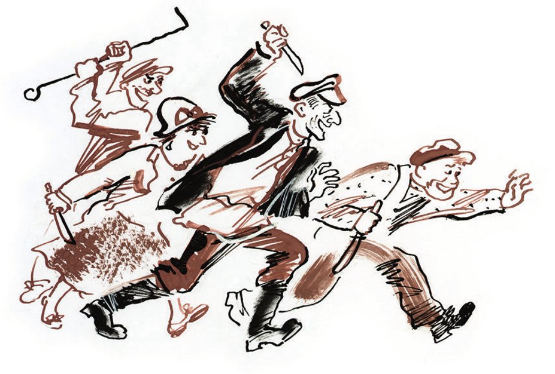
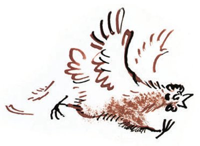

## Die goldene Füllung

Eine ganze Woche lang legte das neue Huhn des Bürgers Jewtuschewski keine Eier. Aber am Mittwoch, um acht Uhr vierzig am Abend, legte es ein goldenes Ei.

Dieses völlig <abbr title="widernatürlich — противоестественный">widernatürliche</abbr> <abbr title="das Ereignis, die Ereignisse — событие">Ereignis</abbr> geschah folgendermaßen.

Am Morgen war Jewtuschewski wie immer beschäftigt. Er verkaufte <abbr title="die Holzflöte, die Holzflöten — дудка">Holzflöten</abbr>, <abbr title="wühlen — копаться">wühlte</abbr> in seinem kleinen <abbr title="der Gemüsegarten, die Gemüsegärten — огород">Gemüsegarten</abbr> und <abbr title="spannen — взводить, натягивать">spannte</abbr> <abbr title="die Mausefalle, die Mausefallen — мышеловка">Mausefallen</abbr>, um sie zu prüfen. Es war eine ganze <abbr title="die Lieferung, die Lieferungen — партия (товара)">Lieferung</abbr>, die Monsieur Podlinnik bestellt hatte, der Vorsitzende der Scheingenossenschaft «Eigenarbeit».

Nach dem Mittagessen kletterte der alte Flötenmacher in den Hof seines Nachbarn. Er wollte <abbr title="der Mist — навоз">Mist</abbr> holen, um daraus <abbr title="der Brennziegel, die Brennziegel — кизяк, «кирпич» из навоза">Brennziegel</abbr> zu machen. Aber man <abbr title="erwischen — застать, поймать">erwischte</abbr> ihn. Jemand warf einen <abbr title="der Stock, die Stöcke — палка">Stock</abbr> nach ihm und traf. Bis zur <abbr title="die Dämmerung — сумерки">Dämmerung</abbr> stand Jewtuschewski am <abbr title="der Flechtzaun, die Flechtzäune — плетень">Flechtzaun</abbr> und <abbr title="beschimpfen — ругать, бранить">beschimpfte</abbr> <abbr title="eintönig — однообразно">eintönig</abbr> die Nachbarn.

Der Tag war völlig <abbr title="verderben (verdarb, hat verdorben) — испортить">verdorben</abbr>. Das Leben schien <abbr title="widerlich — отвратительный">widerlich</abbr>. An diesem Tag kaufte niemand eine Flöte. Den <abbr title="der Vorrat, die Vorräte — запас">Vorrat</abbr> an <abbr title="der Brennstoff, die Brennstoffe — топливо">Brennstoff</abbr> konnte er nicht <abbr title="auffüllen — пополнять">auffüllen</abbr>. Das Huhn legte keine Eier.

In diesen traurigen Gedanken fanden ihn Monsieur und Madame Podlinnik. Sie kamen ihre Mausefallen immer nur an Abenden ohne Mond abholen. Denn <abbr title="offiziell — официально">offiziell</abbr> hieß es, dass das Ehepaar Podlinnik die Mausefallen selbst herstellte und keine fremde Arbeit ausbeutete.

— Bedenken Sie, Monsieur Jewtuschewski, — sagte der Vorsitzende der Scheingenossenschaft, — dass Ihre Mausefallen einen großen <abbr title="der Mangel, die Mängel — дефект, недостаток">Mangel</abbr> haben.

— Mangel und Minus! — bestätigte Madame Podlinnik <abbr title="vorwurfsvoll — укоризненно">vorwurfsvoll</abbr>.

— Jawohl! — fuhr der <abbr title="angeblich — мнимый">angebliche</abbr> Vorsitzende fort. — Ihre Mausefallen sind zu stark. Die Kunden <abbr title="sich beschweren — жаловаться">beschweren sich</abbr>. Bei den Bibins ist jemand <abbr title="versehentlich — нечаянно">versehentlich</abbr> an Ihre Mausefalle gestoßen. Sie ist lange im Zimmer <abbr title="herumspringen (sprang herum, ist herumgesprungen) — прыгать туда-сюда">herumgesprungen</abbr>, hat eine Fensterscheibe <abbr title="zerschlagen (zerschlug, hat zerschlagen) — разбить">zerschlagen</abbr> und ist in den <abbr title="der Brunnen, die Brunnen — колодец">Brunnen</abbr> gefallen.

— Gefallen und ertrunken, — ergänzte die Frau Vorsitzende.

Jewtuschewski wurde noch trauriger.

Plötzlich hörte man in der Ecke, wo das Huhn <abbr title="herumlaufen (lief herum, ist herumgelaufen) — бегать, толкаться">herumlief</abbr>, ein <abbr title="das Gemurmel — бормотание">Gemurmel</abbr>, und Flügel <abbr title="rascheln — шуршать, трещать">raschelten</abbr>.

— <abbr title="bei Gott — ей-богу">Bei Gott</abbr>, gleich legt es ein Ei! — rief der Flötenmacher und sprang auf.

Aber seine Worte gingen in einem <abbr title="das Poltern — грохот, стук">Poltern</abbr> unter, so laut, als wäre ein <abbr title="das Gewicht, die Gewichte — гиря">Gewicht</abbr> auf den Boden gefallen. In die Mitte des Zimmers rollte <abbr title="dröhnen — грохотать">dröhnend</abbr> ein dunkles Ei. Es beschrieb eine <abbr title="parabolisch — параболический">parabolische</abbr> <abbr title="die Kurve, die Kurven — кривая">Kurve</abbr> und blieb vor den Füßen des Hausherrn liegen.

— W-was ist das?

Jewtuschewski nahm die <abbr title="die Petroleumlampe, die Petroleumlampen — керосиновая лампа">Petroleumlampe</abbr> mit dem blauen <abbr title="der Behälter, die Behälter — резервуар, ёмкость">Behälter</abbr> aus <abbr title="das Steingut — фаянс">Steingut</abbr> vom Tisch. Er <abbr title="sich bücken — нагибаться">bückte sich</abbr>, um den seltsamen <abbr title="der Gegenstand, die Gegenstände — предмет">Gegenstand</abbr> zu beleuchten. Zusammen mit ihm beugte sich auch das scheingenossenschaftliche Ehepaar zum Boden.

Das <abbr title="schwach — слабый, жидкий">schwache</abbr> Licht der Lampe machte einen blassen <abbr title="der Kreis, die Kreise — круг">Kreis</abbr> auf dem Boden. In seiner Mitte glänzte matt ein großes goldenes Ei.

Alle <abbr title="der/die Anwesende, die Anwesenden — присутствующий">Anwesenden</abbr> waren wie <abbr title="gelähmt — парализованный, оцепеневший">gelähmt</abbr>. Als Erster kam Monsieur Podlinnik wieder zu sich.

— Das ist eine große <abbr title="die Errungenschaft, die Errungenschaften — достижение">Errungenschaft</abbr>! — sagte er mit <abbr title="hölzern — деревянный">hölzerner</abbr> Stimme.

— Errungenschaft und Plus! — ergänzte seine Frau. Sie <abbr title="wenden (wandte, hat gewandt) — отводить, поворачивать">wandte</abbr> ihre <abbr title="schlafwandlerisch — лунатический">schlafwandlerischen</abbr> Augen nicht von dem <abbr title="kostbar — драгоценный">kostbaren</abbr> Gegenstand <abbr title="abwenden — отводить">ab</abbr>.

Podlinnik streckte die Hand nach dem Ei aus.

— Finger weg! — sagte der Flötenmacher und packte die <abbr title="diebisch — вороватый">diebische</abbr> Hand.

Seine Stimme war sehr leise, sogar schüchtern, aber er hielt Podlinnik mit einem <abbr title="der eiserne Griff — мёртвая хватка">eisernen Griff</abbr> fest. Madame trat er sofort mit dem Fuß, damit sie nicht störte. Das Huhn lief um sie herum, <abbr title="gackern — кудахтать">gackerte</abbr> <abbr title="leidenschaftlich — страстно">leidenschaftlich</abbr> und machte das <abbr title="das Durcheinander — суматоха, неразбериха">Durcheinander</abbr> noch größer.

Eine Minute lang schwiegen alle, dann ging das Gespräch weiter.

— Lassen Sie los, — sagte der Scheinvorsitzende. — Ich wollte es mir nur ansehen. Vielleicht ist das Ei <abbr title="gefälscht — фальшивый, поддельный">gefälscht</abbr>.

Jewtuschewski ließ Podlinnik nicht los. Er stellte die Lampe auf den Tisch und hob das Ei vom Boden auf. Es war schwer und wog <abbr title="mindestens — по меньшей мере">mindestens</abbr> drei Pfund.

— Ein prächtiges Eichen, — sagte Monsieur <abbr title="neidisch — завистливо">neidisch</abbr>. — Aber vielleicht ist es doch gefälscht.

— Was Sie sich wieder <abbr title="sich einbilden — воображать, выдумывать">einbilden</abbr>! — Der Flötenmacher lächelte <abbr title="hochmütig — высокомерно">hochmütig</abbr>. — Warum sollte ein Huhn gefälschte goldene Eier legen? Das ist Ihre <abbr title="die Fantasie, die Fantasien — фантазия">Fantasie</abbr>! Hö-ö-ren Sie mal … Da ist ja ein <abbr title="der Stempel, die Stempel — клеймо, проба">Stempel</abbr>. Bei Gott … wie auf einem <abbr title="der Ehering, die Eheringe — обручальное кольцо">Ehering</abbr>.

Auf dem erstaunlichen Ei war tatsächlich der Stempel des <abbr title="das Probieramt, die Probierämter — пробирная палатка">Probieramts</abbr> <abbr title="einschlagen (schlug ein, hat eingeschlagen) — выбивать (клеймо)">eingeschlagen</abbr>. Er zeigte den <abbr title="der Feingehalt — проба (металла)">Feingehalt</abbr> 56.

— Jetzt werden Sie <abbr title="verhaften — арестовать">verhaftet</abbr>, — sagte Podlinnik.

— Und mit Steuern <abbr title="erdrücken — задавить, раздавить">erdrückt</abbr>! — ergänzte Madame.

— Und das Huhn wird Ihnen <abbr title="wegnehmen (nahm weg, hat weggenommen) — отбирать">weggenommen</abbr>.

— Und die Eier auch.

Jewtuschewski verlor die <abbr title="die Fassung — самообладание">Fassung</abbr>. Sein Gesicht wurde weiß wie <abbr title="der Kalk — известь">Kalk</abbr>.

— Welche Eier? Es gibt doch nur ein Ei.

— Bis jetzt eins. Dann kommen noch mehr. Davon habe ich schon gehört. Das ist doch die bekannte Geschichte von dem Huhn, das goldene Eier legte. Jewtuschewski, Monsieur Jewtuschewski! Bedenken Sie, Monsieur Jewtuschewski, dass ein Dummkopf so ein Huhn schon einmal <abbr title="schlachten — резать, забивать">geschlachtet</abbr> hat. Es gab schon so einen <abbr title="der Präzedenzfall, die Präzedenzfälle — прецедент">Präzedenzfall</abbr>.

— Und was war drin? — fragte der alte Flötenmacher neugierig.

— Nichts war drin. Was soll da schon drin sein? <abbr title="die Innereien — потроха">Innereien</abbr> …

Jewtuschewski seufzte schwer, drehte das Ei in der Hand und begann, es an seiner Hose zu <abbr title="polieren — шлифовать, полировать">polieren</abbr>. Das Ei glänzte noch mehr als vorher. Das Licht der Lampe <abbr title="sich spiegeln — отражаться">spiegelte sich</abbr> auf seiner <abbr title="die Oberfläche, die Oberflächen — поверхность">Oberfläche</abbr> mit einem feierlichen Glanz wie von einer <abbr title="die Ikonenlampe, die Ikonenlampen — лампада">Ikonenlampe</abbr> in der Kirche. Jewtuschewski sagte kein Wort.

Der Vorsitzende der Scheingenossenschaft lief <abbr title="besorgt — озабоченно">besorgt</abbr> um den alten Flötenmacher herum. Er war sehr aufgeregt, <abbr title="zertreten (zertrat, hat zertreten) — раздавить ногами">zertrat</abbr> die Käfige und wäre beinahe auf das still gewordene Hühnchen getreten.

Jewtuschewski schwieg und sah <abbr title="stumpf — тупо">stumpf</abbr> auf das kostbare Ei.

— Monsieur Jewtuschewski! — schrie Podlinnik. — Warum schweigen Sie? Ich habe Ihnen doch erklärt, dass in einem Huhn kein Gold sein kann. Hören Sie, Monsieur Jewtuschewski?

Aber der Besitzer des wunderbaren Huhns schwieg weiter.

— Er wird es schlachten! — schrie Podlinnik.

— Schlachten und nichts finden! — ergänzte Madame.

— Woher kommt denn dann das Gold? — fragte Jewtuschewski. Seine Stimme klang <abbr title="brüchig — надтреснутый">brüchig</abbr> und war voll <abbr title="niedrig — низменный">niedriger</abbr> <abbr title="die Gier — алчность, жадность">Gier</abbr>.

— So ein Dummkopf! — brüllte der <abbr title="wütend — разозлённый">wütende</abbr> Scheinvorsitzende. — Von da kommt es eben.

— Nein, sagen Sie mir, von wo ist «von da»?

Mit <abbr title="das Entsetzen — ужас">Entsetzen</abbr> merkte Monsieur Podlinnik, dass er auf diese Frage keine Antwort wusste. Zwei Minuten lang schnaufte er <abbr title="ratlos — озадаченно, растерянно">ratlos</abbr>, dann sagte er:

— Gut. Mir glauben Sie nicht. Bitte schön. Aber dem Vorsitzenden der Gesellschaft «Hetj, Analphabetentum!» würden Sie doch glauben? Einem <abbr title="gelehrt — учёный">gelehrten</abbr> Menschen vertrauen Sie doch?

Jewtuschewski antwortete nicht.

Das Ehepaar Podlinnik ging und ließ den alten Flötenmacher mit seinen schweren Gedanken allein. Die ganze Nacht war das kleine Fenster des Häuschens hell. Aus dem Haus hörte man das Gackern des Huhns, das Jewtuschewski nicht schlafen ließ. Jede Minute nahm er es auf den Arm und sah es mit wahnsinnigem Blick an.

Am Morgen wusste schon ganz Kolokolamsk von dem wunderbaren Ei. Das Ehepaar Podlinnik hatte den Rest des Abends mit <abbr title="der Besuch, die Besuche — визит, посещение">Besuchen</abbr> verbracht. Überall erzählten sie <abbr title="unter strengster Geheimhaltung — под строжайшим секретом">unter strengster Geheimhaltung</abbr>, dass das Huhn von Jewtuschewski drei Pfund Gold gelegt hatte. Und dass es kein <abbr title="der Schwindel — жульничество, обман">Schwindel</abbr> sein konnte, weil auf dem Gold der Stempel des Probieramts war.

Alle waren der Meinung, dass Kolokolamsk eine glänzende <abbr title="die Zukunft — будущее">Zukunft</abbr> <abbr title="bevorstehen (stand bevor, hat bevorgestanden) — предстоять">bevorstand</abbr>. Eine <abbr title="die Wallfahrt, die Wallfahrten — паломничество">Wallfahrt</abbr> zum Häuschen von Jewtuschewski begann. Aber niemand konnte hineinkommen. Der Flötenmacher antwortete nicht, wenn man an die Tür klopfte.

Schließlich <abbr title="sich drängen — протиснуться">drängten sich</abbr> die Podlinniks bis zur Tür durch. Sie brachten den Genossen Balustradnikow mit, den Vorsitzenden der gemischten russisch-ukrainischen Gesellschaft «Hetj, Analphabetentum!». Er war ein sehr magerer Mensch und so groß, dass man ihn in der Stadt «den <abbr title="der Kilometermann — «человек-верста»">Kilometermann</abbr>» nannte.

Nach langem <abbr title="das Gezänk — препирательство, перебранка">Gezänk</abbr> öffnete Jewtuschewski die Tür. Die <abbr title="die Delegation, die Delegationen — делегация">Delegation</abbr> trat in die Wohnung von Jewtuschewski, die von nun an eine <abbr title="die Sehenswürdigkeit, die Sehenswürdigkeiten — достопримечательность">Sehenswürdigkeit</abbr> war. Die Menge sah ihr neidisch nach.

— Hm, — bemerkte Balustradnikow und nahm sofort das Ei in die Hand.

Er hob es vor die Augen, also fast bis an die Decke. Dabei sah er aus wie ein Mensch, der mehrmals am Tag frisch gelegte, noch warme goldene Eier sieht.

— Nicht wahr, Monsieur Balustradnikow, — begann Podlinnik, — es ist doch dumm, was Monsieur Jewtuschewski tun will? Er will das Huhn schlachten, das goldene Eier legt.

— Ja, das will ich, — flüsterte Jewtuschewski.

In der Nacht hatte er alles verstanden. Er zweifelte nicht mehr daran, dass das Huhn mit Gold <abbr title="füllen — начинять, наполнять">gefüllt</abbr> war. Es hatte keinen <abbr title="der Sinn — смысл">Sinn</abbr>, Geld für sein Futter auszugeben und zu warten, bis es <abbr title="geruhen — соизволить">geruhte</abbr>, ein neues Ei zu legen.

Der Vorsitzende der Gesellschaft «Hetj, Analphabetentum!» <abbr title="versinken in + Akk. (versank, ist versunken) — погрузиться в">versank</abbr> in tiefe Gedanken.

— Man muss es schlachten! — sagte er schließlich.

Jewtuschewski war wie von einem <abbr title="der Zauber — заклятие, чары">Zauber</abbr> befreit. Er begann, das Huhn zu jagen. Auf der <abbr title="die Flucht — бегство">Flucht</abbr> <abbr title="rutschen — скользить">rutschte</abbr> es aus, hinkte auf einem Bein, flog über die Tische und schlug gegen die Fensterscheibe.

Podlinnik war <abbr title="entsetzt — в ужасе">entsetzt</abbr>.

— Warum schlachten? — schrie er und <abbr title="bedrängen — наседать, напирать">bedrängte</abbr> den «Hetj, Analphabetentum!».

Der «Hetj» lächelte <abbr title="ironisch — иронически">ironisch</abbr>. Er setzte sich, <abbr title="die Beine übereinanderschlagen — закинуть ногу на ногу">schlug die Beine übereinander</abbr> und <abbr title="wippen — покачивать">wippte</abbr> mit dem Fuß.

— Wie denn sonst? Das Huhn <abbr title="sich ernähren von + Dat. — питаться">ernährt sich</abbr> doch nicht von Gold. Also ist alles Gold, das es legen kann, schon in ihm. Also muss man es schlachten.

— Aber erlauben Sie mal! … — rief Podlinnik.

— Ich erlaube nichts! — antwortete Balustradnikow.

— Fragen Sie, wen Sie wollen. Alle werden Ihnen sagen, dass man ein Huhn, das goldene Eier legt, nicht schlachten darf.

— Bitte sehr. Unter dem Fenster steht ganz Kolokolamsk. Ich habe nichts gegen eine gesunde <abbr title="die Kritik — критика">Kritik</abbr> an meinen Vorschlägen. Fragen Sie.

Der Vorsitzende der Scheingenossenschaft schlug gegen den <abbr title="der Fensterrahmen, die Fensterrahmen — оконная рама">Fensterrahmen</abbr>, wie Raoul de Nangis im vierten Akt der Oper «Die Hugenotten», und <abbr title="treten vor + Akk. (trat, ist getreten) — предстать перед">trat</abbr> vor die Menge.

— Bürger! — <abbr title="kreischen — вопить, визжать">kreischte</abbr> er. — Was soll man mit dem Huhn machen?

Und in der <abbr title="kristallklar — кристальный">kristallklaren</abbr> Stille hörte man das <abbr title="munter — бодрый">muntere</abbr> Stimmchen eines alten Männchens, das ganz vorne stand. Sein grauer Bart hing ihm bis unter die Knie.

— Was soll man schon mit dem machen, mit dem Huhn?

— Schla-a-achten! — schrien alle.

— In diesem Fall <abbr title="beteiligt sein — быть в доле">bin ich beteiligt</abbr>! — rief Monsieur Podlinnik und stürzte sich auf das Huhn, das sich von dem Flötenmacher einfach nicht fangen ließ.

In dem <abbr title="der Wirrwarr — замешательство, сумятица">Wirrwarr</abbr>, der jetzt entstand, sprang das Huhn aus dem Fenster, flog über die Menge und <abbr title="hüpfen — скакать, прыгать">hüpfte</abbr> die Ohne-Vortrag-Straße entlang. Die <abbr title="der Verfolger, die Verfolger — преследователь">Verfolger</abbr> stießen mit den Köpfen gegen den Fensterrahmen, <abbr title="sich stürzen — бросаться, кидаться">stürzten</abbr> sich auf die Straße und begannen die <abbr title="die Jagd — погоня, охота">Jagd</abbr>.

Nach einer Minute war das <abbr title="das Kräfteverhältnis — соотношение сил">Kräfteverhältnis</abbr> so:

Über die leere, langweilige Straße rollte, <abbr title="der Staub — пыль">Staub</abbr> aufwirbelnd, das Huhn Fräulein. Zehn Meter hinter ihm <abbr title="eilen — спешить">eilte</abbr> auf langen Beinen der Kilometermann. Hinter ihm rasten, Kopf an Kopf, Jewtuschewski und Podlinnik. Und noch weiter hinten lief in einem <abbr title="ungeordnet — нестройный">ungeordneten</abbr> <abbr title="der Haufen, die Haufen — куча">Haufen</abbr> und mit großem Geschrei das Volk von Kolokolamsk. Am Ende der <abbr title="die Kavalkade, die Kavalkaden — кавалькада">Kavalkade</abbr> lief Madame Podlinnik mit einem <abbr title="das Tafelmesser, die Tafelmesser — столовый нож">Tafelmesser</abbr> in der Hand.

Auf dem Platz <abbr title="sich mischen unter + Akk. — смешиваться с">mischte sich</abbr> Fräulein unter die einfachen Hühner von Kolokolamsk. Dort wurde sie gepackt, <abbr title="töten — умерщвлять, убивать">getötet</abbr> und <abbr title="ausnehmen (nahm aus, hat ausgenommen) — потрошить">ausgenommen</abbr>.

In ihr war nicht für einen <abbr title="der Groschen, die Groschen — грош">Groschen</abbr> Gold.

Jemand <abbr title="vermuten — предполагать">vermutete</abbr>, dass man das falsche Huhn geschlachtet hatte. Und wirklich: Fräulein sah genauso aus wie alle anderen Hühner in Kolokolamsk.

Da begann ein <abbr title="das Massaker, die Massaker — избиение, бойня">Massaker</abbr> am ganzen <abbr title="das Geflügel — домашняя птица">Geflügel</abbr>. <abbr title="in der Hitze des Gefechts — сгоряча">In der Hitze des Gefechts</abbr> schlachtete und nahm man sogar Gänse und Enten aus. Besonders <abbr title="wüten — свирепствовать">wütete</abbr> der Vorsitzende der Gesellschaft «Hetj, Analphabetentum!». Im allgemeinen <abbr title="das Getümmel — свалка, сутолока">Getümmel</abbr> schlachtete er einen <abbr title="der Truthahn, die Truthähne — индюк">Truthahn</abbr>, der dem Vorsitzenden der Gesellschaft «Hetj, Händeschütteln!» gehörte.

Eine goldene Füllung fand man nirgends.

Der lachende Jewtuschewski wurde auf einem <abbr title="der Leiterwagen, die Leiterwagen — телега">Leiterwagen</abbr> in die <abbr title="die Irrenanstalt, die Irrenanstalten — психбольница">Irrenanstalt</abbr> gebracht.

Als die Miliz in das Haus von Jewtuschewski kam, um seinen <abbr title="der Besitz — имущество">Besitz</abbr> <abbr title="auflisten — описывать (имущество)">aufzulisten</abbr>, fiel etwas von der <abbr title="morsch — подгнивший, трухлявый">morschen</abbr> Decke aus <abbr title="der Balken, die Balken — бревно, балка">Balken</abbr>. Es fiel schwer wie ein Gewicht und rollte über den Boden. Es war ein runder Gegenstand, in Papier <abbr title="wickeln — заворачивать">gewickelt</abbr>.

In dem Papier war ein goldenes Ei, <abbr title="genau — точь-в-точь">genau</abbr> wie das erste. Auch der Feingehalt 56 war da. Aber außerdem waren auf dem Ei in schöner Schrift die Worte <abbr title="eingravieren — выгравировать">eingraviert</abbr>: «Frohes neues Jahr».

Auf dem Papier stand: «Für S. T. Jewtuschewski. Mein lieber Sohn! Diese zwei Eier sind alles, was mir nach meinem langen, <abbr title="tadellos — беспорочный, безупречный">tadellosen</abbr> Dienst im Probieramt geblieben ist. Eines Tages werden diese Eichen dir Freude machen. Dein Papa Tigri Jewtuschewski.»

---

### Neue Wörter

- **widernatürlich** — противоестественный
- **das Ereignis, die Ereignisse** — событие
- **die Holzflöte, die Holzflöten** — дудка
- **wühlen** — копаться
- **der Gemüsegarten, die Gemüsegärten** — огород
- **spannen** — взводить, натягивать
- **die Mausefalle, die Mausefallen** — мышеловка
- **die Lieferung, die Lieferungen** — партия (товара)
- **der Mist** — навоз
- **der Brennziegel, die Brennziegel** — кизяк, «кирпич» из навоза
- **erwischen** — застать, поймать
- **der Stock, die Stöcke** — палка
- **die Dämmerung** — сумерки
- **der Flechtzaun, die Flechtzäune** — плетень
- **beschimpfen** — ругать, бранить
- **eintönig** — однообразно
- **verderben (verdarb, hat verdorben)** — испортить
- **widerlich** — отвратительный
- **der Vorrat, die Vorräte** — запас
- **der Brennstoff, die Brennstoffe** — топливо
- **auffüllen** — пополнять
- **offiziell** — официально
- **der Mangel, die Mängel** — дефект, недостаток
- **vorwurfsvoll** — укоризненно
- **angeblich** — мнимый
- **sich beschweren** — жаловаться
- **versehentlich** — нечаянно
- **herumspringen (sprang herum, ist herumgesprungen)** — прыгать туда-сюда
- **zerschlagen (zerschlug, hat zerschlagen)** — разбить
- **der Brunnen, die Brunnen** — колодец
- **herumlaufen (lief herum, ist herumgelaufen)** — бегать, толкаться
- **das Gemurmel** — бормотание
- **rascheln** — шуршать, трещать
- **bei Gott** — ей-богу
- **das Poltern** — грохот, стук
- **das Gewicht, die Gewichte** — гиря
- **dröhnen** — грохотать
- **parabolisch** — параболический
- **die Kurve, die Kurven** — кривая
- **die Petroleumlampe, die Petroleumlampen** — керосиновая лампа
- **der Behälter, die Behälter** — резервуар, ёмкость
- **das Steingut** — фаянс
- **sich bücken** — нагибаться
- **der Gegenstand, die Gegenstände** — предмет
- **schwach** — слабый, жидкий
- **der Kreis, die Kreise** — круг
- **der/die Anwesende, die Anwesenden** — присутствующий
- **gelähmt** — парализованный, оцепеневший
- **die Errungenschaft, die Errungenschaften** — достижение
- **hölzern** — деревянный
- **wenden (wandte, hat gewandt)** — отводить, поворачивать
- **schlafwandlerisch** — лунатический
- **kostbar** — драгоценный
- **abwenden** — отводить
- **diebisch** — вороватый
- **der eiserne Griff** — мёртвая хватка
- **gackern** — кудахтать
- **leidenschaftlich** — страстно
- **das Durcheinander** — суматоха, неразбериха
- **gefälscht** — фальшивый, поддельный
- **mindestens** — по меньшей мере
- **neidisch** — завистливо
- **sich einbilden** — воображать, выдумывать
- **hochmütig** — высокомерно
- **die Fantasie, die Fantasien** — фантазия
- **der Stempel, die Stempel** — клеймо, проба
- **der Ehering, die Eheringe** — обручальное кольцо
- **das Probieramt, die Probierämter** — пробирная палатка
- **einschlagen (schlug ein, hat eingeschlagen)** — выбивать (клеймо)
- **der Feingehalt** — проба (металла)
- **verhaften** — арестовать
- **erdrücken** — задавить, раздавить
- **wegnehmen (nahm weg, hat weggenommen)** — отбирать
- **die Fassung** — самообладание
- **der Kalk** — известь
- **schlachten** — резать, забивать
- **der Präzedenzfall, die Präzedenzfälle** — прецедент
- **die Innereien** — потроха
- **polieren** — шлифовать, полировать
- **sich spiegeln** — отражаться
- **die Oberfläche, die Oberflächen** — поверхность
- **die Ikonenlampe, die Ikonenlampen** — лампада
- **besorgt** — озабоченно
- **zertreten (zertrat, hat zertreten)** — раздавить ногами
- **stumpf** — тупо
- **brüchig** — надтреснутый
- **niedrig** — низменный
- **die Gier** — алчность, жадность
- **wütend** — разозлённый
- **das Entsetzen** — ужас
- **ratlos** — озадаченно, растерянно
- **gelehrt** — учёный
- **der Besuch, die Besuche** — визит, посещение
- **unter strengster Geheimhaltung** — под строжайшим секретом
- **der Schwindel** — жульничество, обман
- **die Zukunft** — будущее
- **bevorstehen (stand bevor, hat bevorgestanden)** — предстоять
- **die Wallfahrt, die Wallfahrten** — паломничество
- **sich drängen** — протиснуться
- **der Kilometermann** — «человек-верста»
- **das Gezänk** — препирательство, перебранка
- **die Delegation, die Delegationen** — делегация
- **die Sehenswürdigkeit, die Sehenswürdigkeiten** — достопримечательность
- **füllen** — начинять, наполнять
- **der Sinn** — смысл
- **geruhen** — соизволить
- **versinken in + Akk. (versank, ist versunken)** — погрузиться в
- **der Zauber** — заклятие, чары
- **die Flucht** — бегство
- **rutschen** — скользить
- **entsetzt** — в ужасе
- **bedrängen** — наседать, напирать
- **ironisch** — иронически
- **die Beine übereinanderschlagen** — закинуть ногу на ногу
- **wippen** — покачивать
- **sich ernähren von + Dat.** — питаться
- **die Kritik** — критика
- **der Fensterrahmen, die Fensterrahmen** — оконная рама
- **treten vor + Akk. (trat, ist getreten)** — предстать перед
- **kreischen** — вопить, визжать
- **kristallklar** — кристальный
- **munter** — бодрый
- **beteiligt sein** — быть в доле
- **der Wirrwarr** — замешательство, сумятица
- **hüpfen** — скакать, прыгать
- **der Verfolger, die Verfolger** — преследователь
- **sich stürzen** — бросаться, кидаться
- **die Jagd** — погоня, охота
- **das Kräfteverhältnis** — соотношение сил
- **der Staub** — пыль
- **eilen** — спешить
- **ungeordnet** — нестройный
- **der Haufen, die Haufen** — куча
- **die Kavalkade, die Kavalkaden** — кавалькада
- **das Tafelmesser, die Tafelmesser** — столовый нож
- **sich mischen unter + Akk.** — смешиваться с
- **töten** — умерщвлять, убивать
- **ausnehmen (nahm aus, hat ausgenommen)** — потрошить
- **der Groschen, die Groschen** — грош
- **vermuten** — предполагать
- **das Massaker, die Massaker** — избиение, бойня
- **das Geflügel** — домашняя птица
- **in der Hitze des Gefechts** — сгоряча
- **wüten** — свирепствовать
- **das Getümmel** — свалка, сутолока
- **der Truthahn, die Truthähne** — индюк
- **der Leiterwagen, die Leiterwagen** — телега
- **die Irrenanstalt, die Irrenanstalten** — психбольница
- **der Besitz** — имущество
- **auflisten** — описывать (имущество)
- **morsch** — подгнивший, трухлявый
- **der Balken, die Balken** — бревно, балка
- **wickeln** — заворачивать
- **genau** — точь-в-точь
- **eingravieren** — выгравировать
- **tadellos** — беспорочный, безупречный

[← Zurück](kapitel-06.md) · [Inhalt](README.md) · [Weiter →](kapitel-08.md)
