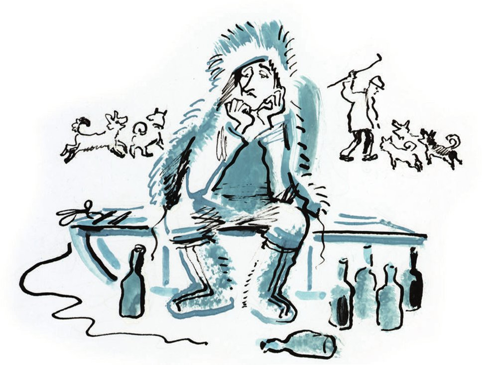

## Der Hundezug

Gewöhnlich gingen die Kolokolamsker und die <abbr title="reizend — прелестный">reizenden</abbr> Kolokolamskerinnen gegen zwölf Uhr mittags auf die Straße, um die reine, frostige Luft zu atmen. Zu tun hatten die Bürger nichts, und so <abbr title="genießen (genoss, hat genossen) — наслаждаться">genossen</abbr> sie die reine Luft täglich und <abbr title="ausgiebig — подолгу, вволю">ausgiebig</abbr>.

An einem Freitag Anfang März, als auf der Großen Gewerkschaftsstraße gerade die angesehensten Familien <abbr title="gemessenen Schrittes — степенно, размеренным шагом">gemessenen Schrittes</abbr> <abbr title="flanieren — прогуливаться, фланировать">flanierten</abbr>, hörte man vom Mitgliederplatz her das Klingeln von <abbr title="die Schelle, die Schellen — бубенец">Schellen</abbr>, und gleich darauf rollte ein erstaunliches <abbr title="das Gefährt, die Gefährte — экипаж, повозка">Gefährt</abbr> in die Straße.

In einem langen <abbr title="der Samojedenschlitten, die Samojedenschlitten — самоедские (ненецкие) сани">Samojedenschlitten</abbr>, der von zwölf hintereinander gespannten Hunden gezogen wurde, saß <abbr title="lässig — вольно, небрежно">lässig</abbr> ein junger Mann mit einem kleinen, <abbr title="hager — тощий, худой">hageren</abbr> Gesicht, <abbr title="hüllen in + Akk. — кутать, закутывать">gehüllt</abbr> in einen <abbr title="der Rentierpelz, die Rentierpelze — оленья доха">Rentierpelz</abbr>.

Beim Anblick eines für das <abbr title="gemäßigt — умеренный">gemäßigte</abbr> Kolokolamsker <abbr title="das Klima — климат">Klima</abbr> so ungewöhnlichen <abbr title="das Gespann, die Gespanne — упряжка">Gespanns</abbr> zeigten die Bürger eine natürliche <abbr title="die Neugier — любопытство">Neugier</abbr> und stellten sich <abbr title="Spalier stehen — стоять шпалерами">Spalier stehend</abbr> entlang der Fahrbahn auf.

Der unbekannte Reisende fuhr schnell die Straße hinunter, <abbr title="knallen mit + Dat. — щёлкать, хлестать">knallte</abbr> immer wieder mit der <abbr title="die Peitsche, die Peitschen — бич, кнут">Peitsche</abbr> über das <abbr title="schweißbedeckt — взмыленный">schweißbedeckte</abbr> linke <abbr title="das Seitentier — пристяжная">Seitentier</abbr> in der dritten Reihe und rief mit <abbr title="dröhnend — зычный">dröhnender</abbr> Stimme:

— Scharik, du <abbr title="schielend — косой">schielender</abbr> Teufel! Hü-ü-ü, Scharik!

Auch die anderen Hündchen bekamen ihr Teil ab.

— Dir werd ich’s z-zeigen, Bobik! … Hü-ü-ü, Schutschka! … Aus dem We-e-eg!!!

Die Kolokolamsker wussten nicht, wen ihnen Gott da geschickt hatte, und riefen <abbr title="vorsichtshalber — на всякий случай">vorsichtshalber</abbr> «Hurra».

Der Fremde nahm seine <abbr title="die Pelzmütze, die Pelzmützen — меховая шапка">Pelzmütze</abbr> mit den langen sibirischen <abbr title="die Ohrenklappe, die Ohrenklappen — ухо (шапки-ушанки)">Ohrenklappen</abbr> ab, schwenkte sie zum Gruß durch die Luft und <abbr title="zügeln — сдерживать, придерживать">zügelte</abbr> vor der Bierstube «Stimme der Vergangenheit» seine <abbr title="unbändig — неукротимый">unbändigen</abbr> <abbr title="der Renner, die Renner — скакун">Renner</abbr>.

Fünf Minuten später, nachdem er den Hundezug an einen Baum gebunden hatte, betrat der Reisende die Bierstube. An der Wand der <abbr title="die Schankstube, die Schankstuben — питейное заведение">Schankstube</abbr> hing ein <abbr title="das Plakat, die Plakate — плакат">Plakat</abbr>: «Es wird gebeten, die Hände nicht am Tischtuch abzuwischen», obwohl auf den Tischen gar keine Tischtücher lagen.

— Womit darf ich <abbr title="aufwarten mit + Dat. — потчевать, угощать">aufwarten</abbr>? — fragte der <abbr title="der Wirt, die Wirte — хозяин (трактира)">Wirt</abbr> mit vor Aufregung zitternder Stimme.

— Schweigen Sie! — schrie der Fremde. Und verlangte sogleich ein halbes Dutzend Bier.

Den Kolokolamskern, die sich in die Bierstube <abbr title="sich zwängen — набиться, протиснуться">gezwängt</abbr> hatten, wurde klar, dass sie es mit einer <abbr title="außergewöhnlich — незаурядный">außergewöhnlichen</abbr> <abbr title="die Persönlichkeit, die Persönlichkeiten — личность">Persönlichkeit</abbr> zu tun hatten. Da trat ein Vertreter der <abbr title="die Exekutivgewalt — исполнительная власть">Exekutivgewalt</abbr> aus der Menge hervor und rief mit <abbr title="grenzenlos — беззаветный, безграничный">grenzenloser</abbr> <abbr title="die Ergebenheit — преданность">Ergebenheit</abbr> in der Stimme, ganz wie bei Gogol:

— Hätten Sie vielleicht irgendwelche <abbr title="der Befehl, die Befehle — приказание, приказ">Befehle</abbr> für den Chef der Miliz, Otmeschujew?

— Habe ich! — antwortete der junge Mann. — Ich bin Professor an der Zentralen Schönen Akademie der <abbr title="die Raumwissenschaft, die Raumwissenschaften — пространственные науки">Raumwissenschaften</abbr>, Emmanuil Starochamski.

— <abbr title="zu Befehl! — слушаюсь!">Zu Befehl</abbr>! — rief Otmeschujew.

— Gibt es hier <abbr title="der Meteorit, die Meteoriten — метеорит">Meteoriten</abbr>?

— Wie <abbr title="belieben — изволить">beliebt</abbr>?

— Meteoriten oder sogenannte <abbr title="der Bolid, die Boliden — болид">Boliden</abbr> – haben Sie welche?

Otmeschujew <abbr title="erschrecken (erschrak, ist erschrocken) — испугаться">erschrak</abbr> sehr. Zuerst sagte er, es gebe welche. Dann sagte er, es gebe keine. Schließlich <abbr title="sich verheddern — запутаться">verhedderte</abbr> er sich vollends und murmelte, es gebe da eine <abbr title="die Eiterbeule, die Eiterbeulen — гнойник">Eiterbeule</abbr>, die aber leider noch nicht genügend <abbr title="aufdecken — выявлять, вскрывать">aufgedeckt</abbr> worden sei.

— Eiterbeulen interessieren mich nicht! — rief der junge, achtzehnjährige Professor, dem die <abbr title="üppig — пышный">üppigen</abbr> <abbr title="der Lorbeer, die Lorbeeren — лавры">Lorbeeren</abbr> des Meteoritenforschers Kulik keine Ruhe ließen. — Nach den Informationen, die der Zentralen Akademie vorliegen, ist hier während der <abbr title="die Regierungszeit — царствование">Regierungszeit</abbr> Alexanders des Ersten, des <abbr title="gesegnet — благословенный">Gesegneten</abbr>, ein Meteorit von der Größe der <abbr title="die Halbinsel, die Halbinseln — полуостров">Halbinsel</abbr> Krim niedergegangen.

Der Vertreter der Exekutivgewalt war völlig <abbr title="aufgeschmissen sein — растеряться, быть в безвыходном положении">aufgeschmissen</abbr>, doch Monsieur Podlinnik, der weiseste aller Kolokolamsker, rettete die Lage.

Er begrüßte den jungen Professor <abbr title="auf orientalische Art — на восточный манер">auf orientalische Art</abbr>, indem er die <abbr title="die Handfläche, die Handflächen — ладонь">Handfläche</abbr> abwechselnd an die Stirn und ans Herz legte. Er glaubte, so müsse man Vertreter der Wissenschaft begrüßen. Als er mit diesem <abbr title="zeremoniell — церемонный">zeremoniellen</abbr> <abbr title="das Ritual, die Rituale — обряд, ритуал">Ritual</abbr> fertig war, erklärte er, von den <abbr title="der Zeitgenosse, die Zeitgenossen — современник">Zeitgenossen</abbr> Alexanders des Ersten, des Gesegneten, sei in der Stadt nur noch ein parteiloser Greis namens Kerossinow übrig, und dieser Greis sei der einzige Mensch, der dem Professor die nötigen <abbr title="die Auskunft, die Auskünfte — сведения, разъяснение">Auskünfte</abbr> geben könne.

Kerossinow war zwar mit irgendwelchen <abbr title="die Wurzel, die Wurzeln — корень">Wurzeln</abbr> <abbr title="überwuchern — зарастать">überwuchert</abbr>, erwies sich aber als <abbr title="rüstig — бодрый">rüstiger</abbr> und fröhlicher Mensch.

— Na, Alter, — fragte der Professor freundlich, — Zeit fürs <abbr title="das Krematorium, die Krematorien — крематорий">Krematorium</abbr>?

— Ja, Väterchen, Zeit ist’s, — antwortete der anderthalb Jahrhunderte alte Greis <abbr title="freudig — радостно">freudig</abbr>, — in unser sowjeeetisches Krematorium. In unser <abbr title="das Kolumbarium, die Kolumbarien — колумбарий">Kolumbarium</abbr>!

Dann dachte er nach und fügte hinzu:

— Und <abbr title="das Planetarium, die Planetarien — планетарий">Planetarium</abbr>.

— Erinnerst du dich an den Meteoriten?

— Aber <abbr title="freilich — конечно, как же">freilich</abbr>, Väterchen, ich erinnere mich. Alle sind gekommen, Alexander der Erste ist gekommen. Und Golenischtschew-Kutusow ist gekommen, mit der Eggert und der Malinowskaja. Und der eine, der immer <abbr title="kurbeln — крутить (ручку кинокамеры)">kurbelt</abbr>, der Kino-Imperator, ist auch gekommen. Und Henri Barbusse ist in einer <abbr title="staatlich — казённый">staatlichen</abbr> Droschke gekommen. Hat nach dem alten Leben gefragt, und ich hab natürlich nichts <abbr title="verheimlichen — утаивать, скрывать">verheimlicht</abbr>. <abbr title="quälen — истязать, мучить">Gequält</abbr> haben sie uns, sag ich. Im Jahre 1801, sag ich.

Hier fing der Alte an, so einen <abbr title="der Unsinn — чушь, вздор">Unsinn</abbr> zu reden, dass man ihn wegführte. Weitere Auskünfte über den Meteoriten konnte Professor Starochamski nicht bekommen.

— Nun denn, — sprach der Professor nachdenklich, — dann werden wir eben <abbr title="bohren — бурить">bohren</abbr> müssen.

Das Bier bezahlte er nicht. Er <abbr title="aufschlagen (schlug auf, hat aufgeschlagen) — разбивать (палатку)">schlug</abbr> auf der Großen Gewerkschaftsstraße ein <abbr title="das Zelt, die Zelte — палатка">Zelt</abbr> auf und lebte darin, in Erwartung, wie er sagte, der <abbr title="die Mittel — средства">Mittel</abbr> aus dem Zentrum für die <abbr title="die Bohrung, die Bohrungen — бурение">Bohrung</abbr>.

Eine Woche später war ihm ein Bärtchen gewachsen, er hatte <abbr title="die Schulden — долги">Schulden</abbr> für sechs <abbr title="das Gros, die Gros — гросс (12 дюжин)">Gros</abbr> Bier gemacht und seine Hunde verloren, die ihm davongelaufen waren und nun an den <abbr title="der Stadtrand, die Stadtränder — окраина">Stadträndern</abbr> <abbr title="umherstreifen — рыскать, бродить">umherstreiften</abbr>, wo sie den Wanderern <abbr title="Angst und Schrecken einjagen — наводить ужас">Angst und Schrecken einjagten</abbr>.

Die Kolokolamsker hatten den jungen Professor <abbr title="jemanden ins Herz schließen — полюбить">ins Herz geschlossen</abbr> und <abbr title="bedauern — жалеть">bedauerten</abbr> ihn sehr.

— Er geht zugrunde, unser Starochamski, ohne die Mittels, — sagten sie zu Hause beim Tee, — und was ist schon eine Bohrung ohne die Mittels!

Abends versammelte sich die <abbr title="erlesen — избранный, изысканный">erlesene</abbr> Gesellschaft in der «Stimme der Vergangenheit» und betrachtete den untergehenden Reisenden.

Der Professor saß hinter einer grünen <abbr title="die Barriere, die Barrieren — барьер">Barriere</abbr> aus Bierflaschen und las mit <abbr title="schrill — пронзительный">schriller</abbr> Stimme laut die Moskauer Zeitungen vor. Über sein kleines Gesicht <abbr title="rinnen (rann, ist geronnen) — струиться, течь">rannen</abbr> betrunkene Tränen.

— Da, bitte schön, was in den Zeitungen steht, — murmelte er. — «Alle auf die Suche nach Professor Starochamski!», «Eine <abbr title="die Expedition, die Expeditionen — экспедиция">Expedition</abbr> zur Rettung von Professor Starochamski». Man sucht mich. Ach! Ob sie mich wohl finden?!

Und der Professor schluchzte mit neuer Kraft.

— Die Wissenschaft! — sagten die Kolokolamsker voller <abbr title="die Hochachtung — уважение">Hochachtung</abbr>. — Das ist nicht so, als ob man einen <abbr title="der Kiosk, die Kioske — ларёк">Kiosk</abbr> aufmacht. Kein Spaß! Ein Meteorit. Den gibt’s einmal in tausend Jahren. Und wo soll man den suchen? Vielleicht liegt er in Tula! Und hier geht ein Mensch umsonst zugrunde!

Endlich, nach einem Monat, stieß die Expedition auf die richtige <abbr title="die Fährte, die Fährten — след">Fährte</abbr>.

Schon am Morgen war Kolokolamsk voll von <abbr title="das Rentier, die Rentiere — северный олень">Rentieren</abbr>, <abbr title="der Propellerschlitten, die Propellerschlitten — аэросани">Propellerschlitten</abbr> und <abbr title="der Korrespondent, die Korrespondenten — корреспондент">Korrespondenten</abbr> in <abbr title="der Fellstiefel, die Fellstiefel — пимы, меховые сапоги">Fellstiefeln</abbr>. Unter Glockengeläut und dem <abbr title="das Jubelgeschrei — радостные клики">Jubelgeschrei</abbr> der Menge wurde der Professor aus der «Stimme der Vergangenheit» <abbr title="herausholen — извлекать, вытаскивать">herausgeholt</abbr>, mit Mühe auf die Beine gestellt und von den Ärzten der Expedition <abbr title="untersuchen — осматривать, обследовать">untersucht</abbr>. Sie fanden ihn bei <abbr title="bestens — отлично">bestens</abbr> erhaltenen Kräften.

Unterdessen streiften die Korrespondenten in Fellstiefeln durch die Straßen, packten die Kolokolamsker an den <abbr title="der Rockschoß, die Rockschöße — пола (одежды)">Rockschößen</abbr> und fragten <abbr title="kläglich — жалобно">kläglich</abbr>:

— Gibt es Eiterbeulen?

— Gibt es <abbr title="das Geschwür, die Geschwüre — нарыв">Geschwüre</abbr>?

Am nächsten Tag <abbr title="entführen — умчать, увозить">entführten</abbr> die Rentiere und Propellerschlitten die <abbr title="der Retter, die Retter — спаситель">Retter</abbr> und den Geretteten.

Die Expedition hatte es eilig. Im Laufe der kommenden Woche musste sie noch etwa zwanzig Forscher retten, die sich in den <abbr title="verschneit — снежный, заснеженный">verschneiten</abbr> <abbr title="die Weite, die Weiten — простор">Weiten</abbr> unseres <abbr title="unermesslich — необъятный">unermesslichen</abbr> Landes verirrt hatten.

---

### Neue Wörter

- **reizend** — прелестный
- **genießen (genoss, hat genossen)** — наслаждаться
- **ausgiebig** — подолгу, вволю
- **gemessenen Schrittes** — степенно, размеренным шагом
- **flanieren** — прогуливаться, фланировать
- **die Schelle, die Schellen** — бубенец
- **das Gefährt, die Gefährte** — экипаж, повозка
- **der Samojedenschlitten, die Samojedenschlitten** — самоедские (ненецкие) сани
- **lässig** — вольно, небрежно
- **hager** — тощий, худой
- **hüllen in + Akk.** — кутать, закутывать
- **der Rentierpelz, die Rentierpelze** — оленья доха
- **gemäßigt** — умеренный
- **das Klima** — климат
- **das Gespann, die Gespanne** — упряжка
- **die Neugier** — любопытство
- **Spalier stehen** — стоять шпалерами
- **knallen mit + Dat.** — щёлкать, хлестать
- **die Peitsche, die Peitschen** — бич, кнут
- **schweißbedeckt** — взмыленный
- **das Seitentier** — пристяжная
- **dröhnend** — зычный
- **schielend** — косой
- **vorsichtshalber** — на всякий случай
- **die Pelzmütze, die Pelzmützen** — меховая шапка
- **die Ohrenklappe, die Ohrenklappen** — ухо (шапки-ушанки)
- **zügeln** — сдерживать, придерживать
- **unbändig** — неукротимый
- **der Renner, die Renner** — скакун
- **die Schankstube, die Schankstuben** — питейное заведение
- **das Plakat, die Plakate** — плакат
- **aufwarten mit + Dat.** — потчевать, угощать
- **der Wirt, die Wirte** — хозяин (трактира)
- **sich zwängen** — набиться, протиснуться
- **außergewöhnlich** — незаурядный
- **die Persönlichkeit, die Persönlichkeiten** — личность
- **die Exekutivgewalt** — исполнительная власть
- **grenzenlos** — беззаветный, безграничный
- **die Ergebenheit** — преданность
- **der Befehl, die Befehle** — приказание, приказ
- **die Raumwissenschaft, die Raumwissenschaften** — пространственные науки
- **zu Befehl!** — слушаюсь!
- **der Meteorit, die Meteoriten** — метеорит
- **belieben** — изволить
- **der Bolid, die Boliden** — болид
- **erschrecken (erschrak, ist erschrocken)** — испугаться
- **sich verheddern** — запутаться
- **die Eiterbeule, die Eiterbeulen** — гнойник
- **aufdecken** — выявлять, вскрывать
- **üppig** — пышный
- **der Lorbeer, die Lorbeeren** — лавры
- **die Regierungszeit** — царствование
- **gesegnet** — благословенный
- **die Halbinsel, die Halbinseln** — полуостров
- **aufgeschmissen sein** — растеряться, быть в безвыходном положении
- **auf orientalische Art** — на восточный манер
- **die Handfläche, die Handflächen** — ладонь
- **zeremoniell** — церемонный
- **das Ritual, die Rituale** — обряд, ритуал
- **der Zeitgenosse, die Zeitgenossen** — современник
- **die Auskunft, die Auskünfte** — сведения, разъяснение
- **die Wurzel, die Wurzeln** — корень
- **überwuchern** — зарастать
- **rüstig** — бодрый
- **das Krematorium, die Krematorien** — крематорий
- **freudig** — радостно
- **das Kolumbarium, die Kolumbarien** — колумбарий
- **das Planetarium, die Planetarien** — планетарий
- **freilich** — конечно, как же
- **kurbeln** — крутить (ручку кинокамеры)
- **staatlich** — казённый
- **verheimlichen** — утаивать, скрывать
- **quälen** — истязать, мучить
- **der Unsinn** — чушь, вздор
- **bohren** — бурить
- **aufschlagen (schlug auf, hat aufgeschlagen)** — разбивать (палатку)
- **das Zelt, die Zelte** — палатка
- **die Mittel** — средства
- **die Bohrung, die Bohrungen** — бурение
- **die Schulden** — долги
- **das Gros, die Gros** — гросс (12 дюжин)
- **der Stadtrand, die Stadtränder** — окраина
- **umherstreifen** — рыскать, бродить
- **Angst und Schrecken einjagen** — наводить ужас
- **jemanden ins Herz schließen** — полюбить
- **bedauern** — жалеть
- **erlesen** — избранный, изысканный
- **die Barriere, die Barrieren** — барьер
- **schrill** — пронзительный
- **rinnen (rann, ist geronnen)** — струиться, течь
- **die Expedition, die Expeditionen** — экспедиция
- **die Hochachtung** — уважение
- **der Kiosk, die Kioske** — ларёк
- **die Fährte, die Fährten** — след
- **das Rentier, die Rentiere** — северный олень
- **der Propellerschlitten, die Propellerschlitten** — аэросани
- **der Korrespondent, die Korrespondenten** — корреспондент
- **der Fellstiefel, die Fellstiefel** — пимы, меховые сапоги
- **das Jubelgeschrei** — радостные клики
- **herausholen** — извлекать, вытаскивать
- **untersuchen** — осматривать, обследовать
- **bestens** — отлично
- **der Rockschoß, die Rockschöße** — пола (одежды)
- **kläglich** — жалобно
- **das Geschwür, die Geschwüre** — нарыв
- **entführen** — умчать, увозить
- **der Retter, die Retter** — спаситель
- **verschneit** — снежный, заснеженный
- **die Weite, die Weiten** — простор
- **unermesslich** — необъятный

[← Zurück](kapitel-08.md) · [Inhalt](README.md) · [Weiter →](kapitel-10.md)
