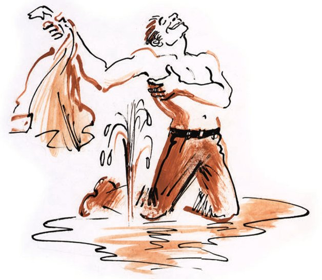

## Die zweite Jugend

Die <abbr title="die Saatkrähe, die Saatkrähen — грач">Saatkrähen</abbr> waren in die Stadt Kolokolamsk zurückgekehrt.

Es war ein heller, eisiger Frühlingstag, und die Vögel <abbr title="kreisen — кружить">kreisten</abbr> über der Stadt und sangen mit schrillen Stimmen ein <abbr title="das Loblied, die Loblieder — хвалебная песнь">Loblied</abbr> auf die städtischen <abbr title="die Behörde, die Behörden — власти, ведомство">Behörden</abbr>. Die Kolokolamsker Vögelchen liebten, ganz wie die Bürger, die <abbr title="der Machthaber, die Machthaber — власть имущий">Machthaber</abbr> von ganzer Seele.

Tagsüber murmelten an den <abbr title="der Hang, die Hänge — склон">Hängen</abbr> des Altes-Regime-Boulevards schon die <abbr title="das Bächlein, die Bächlein — ручеёк">Bächlein</abbr>, und das <abbr title="vorjährig — прошлогодний">vorjährige</abbr> Gras hob den Kopf.

Doch weder der Frühlingswind noch das Geschrei der Saatkrähen noch die Versuche des Flusses Sbruja, <abbr title="vorzeitig — преждевременно">vorzeitig</abbr> aufzubrechen, versetzten die Stadt in <abbr title="fiebrig — лихорадочный">fiebrige</abbr> Stimmung. Ins Fieber, ins Zittern geriet die Stadt durch eine Nachricht von Nikita Psow.

— Eine <abbr title="die Quelle, die Quellen — источник">Quelle</abbr>! Eine Quelle! — brüllte Nikita, während er durch die Straßen raste, die städtischen <abbr title="der/die Verrückte, die Verrückten — сумасшедший">Verrückten</abbr> umrannte, an die Fenster klopfte und in die Wohnungen seiner Mitbürger stürmte. — Mit eigenen Augen!

Auf die Fragen der Bürger antwortete Nikita Psow nicht; er fuchtelte <abbr title="krampfhaft — судорожно">krampfhaft</abbr> mit den Armen und eilte weiter. Hinter ihm lief eine Menge her, die immer größer wurde.

Wer weiß, wie lange die neugierigen Bürger dem <abbr title="übergeschnappt — обезумевший, спятивший">übergeschnappten</abbr> Psow noch nachgejagt wären, hätte ihnen nicht Doktor Grom den Weg versperrt, der in seinem weißen <abbr title="der Kittel, die Kittel — халат">Kittel</abbr> aus seinem Häuschen gesprungen war.

— Brrr! — sagte Doktor Grom. Und alle blieben stehen. Nikita aber begann <abbr title="zusammenhanglos — бессвязно">zusammenhanglos</abbr> zu <abbr title="schwören (schwor, hat geschworen) — божиться, клясться">schwören</abbr> und sich mit beiden Fäusten auf die Brust zu schlagen.

— Nun, — fragte der Doktor streng, — sag mir, du Zweig aus <abbr title="Palästina — Палестина">Palästina</abbr>, worum geht es?

Grom liebte es, seine Rede mit <abbr title="das Gedichtzitat, die Gedichtzitate — стихотворная цитата">Gedichtzitaten</abbr> zu <abbr title="schmücken — украшать, уснащать">schmücken</abbr>.

— In der Abenteuer-Sackgasse ist eine Quelle <abbr title="hervorsprudeln — забить (о источнике)">hervorgesprudelt</abbr>, — rief Nikita mit <abbr title="die Überzeugung — убеждение">Überzeugung</abbr>. — Mit eigenen Augen!

Und der Bürger Psow, immer wieder von <abbr title="der Ausruf, die Ausrufe — возглас">Ausrufen</abbr> des Staunens unterbrochen, berichtete der Gesellschaft, er sei <abbr title="im Suff — спьяну, по пьяному делу">im Suff</abbr> in die Abenteuer-Sackgasse geraten und auf der Erde aufgewacht, weil ihn etwas Heißes <abbr title="berühren — касаться, прикасаться">berührt</abbr> habe. Wie groß sei aber sein, Psows, Erstaunen gewesen, als er <abbr title="feststellen — обнаружить, установить">festgestellt</abbr> habe, dass er in <abbr title="trüb — мутный">trübem</abbr> heißem Wasser liege, das direkt aus der Erde <abbr title="schießen (schoss, ist geschossen) — бить, хлестать">schieße</abbr>.

— Da bin ich natürlich aufgesprungen, — schloss Nikita, — und spüre: Mein ganzes <abbr title="das Rheuma — ревматизм">Rheuma</abbr> ist <abbr title="wie weggeblasen — как рукой сняло">wie weggeblasen</abbr>. Mit eigenen Augen!

Und Psow begann, die <abbr title="fürchterlich — страшный, ужасный">fürchterlichsten</abbr> <abbr title="der Eid, die Eide — клятва">Eide</abbr> zu schwören, um das Wunder zu bestätigen, das ihm <abbr title="widerfahren (widerfuhr, ist widerfahren) — случиться, приключиться">widerfahren</abbr> war.

— Kamen Kinder in die Hütte gelaufen, — erklärte Doktor Grom, — wenn das kein Narsan ist, dann <abbr title="zur Not — худо-бедно, на худой конец">zur Not</abbr> wenigstens Borschomi.

Doktor Grom holte im Nu seine Instrumente, und eine Stunde später hätte nicht einmal eine Maus in die Abenteuer-Sackgasse <abbr title="vordringen (drang vor, ist vorgedrungen) — проникнуть">vordringen</abbr> können, so viele Menschen drängten sich an der Quelle.

Der Doktor saß mit <abbr title="ausbreiten — раскидывать, расстилать">ausgebreiteten</abbr> <abbr title="der Kittelschoß, die Kittelschöße — пола халата">Kittelschößen</abbr> dicht an der Quelle auf der Erde. Die Quelle schoss in einer kleinen <abbr title="die Parabel, die Parabeln — парабола">Parabel</abbr> aus dem Boden und hatte schon eine ordentliche <abbr title="die Pfütze, die Pfützen — лужа">Pfütze</abbr> gebildet. Er führte <abbr title="in aller Eile — на скорую руку">in aller Eile</abbr> eine Untersuchung durch.

— Habt ihr gehört, — sagte er, als er sich endlich erhob, — habt ihr gehört hinter dem <abbr title="der Hain, die Haine — роща">Hain</abbr> die nächtliche Stimme? Habt ihr gehört, dass dies eine Quelle ist, die, zur Not, zehnmal besser ist als Narsan?

Die Menge <abbr title="aufstöhnen — ахнуть">stöhnte auf</abbr>. Und der Doktor begann, die Ergebnisse der <abbr title="die Analyse, die Analysen — анализ">Analyse</abbr> auszurufen.

— Natri chlorati – 2,7899! Natri bicarbonici – 10,0026! Ferri bicarbonati – 3,1267! Kali chlorati – 8, …

— Wie viel chlorati? — fragte Monsieur Podlinnik aufgeregt nach, der schon lange seinen Finger in das <abbr title="brodeln — кипеть, бурлить">brodelnde</abbr> Wasser der Quelle steckte.

— Acht <abbr title="das Komma — запятая">Komma</abbr> fünfundneunzig! — antwortete Grom <abbr title="siegesgewiss — победоносно">siegesgewiss</abbr>. — Sturm hüllt den Himmel ins Dunkel.

— Was heißt hier Himmel! — keuchte Podlinnik. — Das stellt alles <abbr title="in den Schatten stellen — затмевать, превосходить">in den Schatten</abbr>! Das ist ein Vermögen!

— Kislowodsk ist erledigt! — sagte der Doktor. — Bei solchen <abbr title="kohlensauer — углекислый">kohlensauren</abbr> und <abbr title="alkalisch — щелочной">alkalischen</abbr> Werten heilt unsere Quelle <abbr title="restlos — вконец, полностью">restlos</abbr>: <abbr title="die Gicht — подагра">Gicht</abbr>, <abbr title="die Handgicht — хирагра">Handgicht</abbr>, <abbr title="die Fettsucht — ожирение">Fettsucht</abbr>, <abbr title="die Zuckerkrankheit — сахарная болезнь">Zuckerkrankheit</abbr>, <abbr title="die Migräne — мигрень">Migräne</abbr>, <abbr title="die Impotenz — половое бессилие">Impotenz</abbr>, <abbr title="das Trachom — трахома">Trachom</abbr>, <abbr title="der Furunkel, die Furunkel — чирей, фурункул">Furunkel</abbr>, <abbr title="der Magenkatarrh — катар желудка">Magenkatarrh</abbr>, <abbr title="die Krätze — чесотка">Krätze</abbr>, <abbr title="die Angina — ангина">Angina</abbr> und <abbr title="der Milzbrand — сибирская язва">Milzbrand</abbr>.

In der Menge kam heftige Bewegung auf. Kaum hatte der Doktor begonnen, die Krankheiten <abbr title="aufzählen — перечислять">aufzuzählen</abbr>, als Nikita Psow seinen kurzen Pelz abwarf, sich mitsamt der Hose in das gelbliche Wasser stürzte und mit solchem Eifer darin zu <abbr title="planschen — плескаться">planschen</abbr> begann, als wolle er sich auf einen Schlag von der Handgicht, der Impotenz, der Angina und dem Milzbrand befreien. Die Quelle schäumte auf, und alle spürten deutlich ihren scharfen, <abbr title="heilkräftig — целебный">heilkräftigen</abbr> Geruch.

Viele Bürger warfen ihre <abbr title="die Oberbekleidung — верхнее платье">Oberbekleidung</abbr> ab, um, in die Quelle <abbr title="eintauchen — окунаться">eingetaucht</abbr>, ihre <abbr title="jugendlich — юношеский">jugendliche</abbr> Gesundheit zurückzugewinnen. <abbr title="ermuntern — подбадривать">Ermuntert</abbr> wurden sie von Psow, der zitternd aus dem Wasser gestiegen war und sich bereits mit einer <abbr title="die Eisschicht, die Eisschichten — ледяная плёнка">Eisschicht</abbr> zu überziehen begann.

Doch da wurde der <abbr title="unorganisiert — неорганизованный">unorganisierten</abbr> Nutzung der <abbr title="die Segnung, die Segnungen — блага">Segnungen</abbr> der Quelle ein Ende gesetzt. Monsieur Podlinnik, der den Chef der Miliz geholt hatte, kehrte zur Menge zurück, drängte sie mithilfe des <abbr title="tüchtig — расторопный">tüchtigen</abbr> Otmeschujew im Handumdrehen aus der Sackgasse, stellte einen <abbr title="der Schlagbaum, die Schlagbäume — рогатка, шлагбаум">Schlagbaum</abbr> und ein <abbr title="das Drehkreuz, die Drehkreuze — турникет">Drehkreuz</abbr> auf und hängte ein Brettchen mit folgender Aufschrift auf:

KOLOKOLAMSKER Radiaktiver Kurort «DIE ZWEITE JUGEND»

<abbr title="der Generaldirektor, die Generaldirektoren — главный директор">Generaldirektor</abbr> – Gen. Podlinnik. Leiter der <abbr title="die Verwaltungs- und Finanzabteilung — административно-финансовый отдел (АФО)">Verwaltungs- und Finanzabteilung</abbr> – Gen. Otmeschujew. <abbr title="Zutritt verboten — вход воспрещается">ZUTRITT VERBOTEN</abbr>.

Die Menge drängte sich <abbr title="niedergeschlagen — понуро, удручённо">niedergeschlagen</abbr> hinter dem Schlagbaum und versuchte, näher an den Kurort «Die zweite Jugend» heranzukommen. Den Bauch ans Drehkreuz gepresst und den langen Hals vorgereckt, stand Doktor Grom da, völlig <abbr title="fassungslos — ошеломлённый">fassungslos</abbr> über die unerwartete <abbr title="die Wendung, die Wendungen — поворот">Wendung</abbr> der Ereignisse. Otmeschujew schob ihn mit <abbr title="leer — невидящий, пустой">leerem</abbr> Blick zurück.

— Und ich? — fragte der Doktor <abbr title="gequält — в тоске, мучительно">gequält</abbr>.

Nach einem langen Gespräch mit Podlinnik, währenddessen die beiden einander auf die Schultern klopften und verzweifelt <abbr title="aufkreischen — взвизгивать">aufkreischten</abbr>, ließ Podlinnik <abbr title="Gnade walten lassen — смилостивиться">Gnade walten</abbr>, und auf dem Brettchen erschien ein neuer Punkt:

Leiter der medizinisch-rechtlichen und methodologisch-sanitären Abteilung – Dr. GROM.

Die Verwaltung teilte die <abbr title="die Zuständigkeit, die Zuständigkeiten — функции, полномочия">Zuständigkeiten</abbr> sogleich unter sich auf und machte sich begeistert an die <abbr title="die Propagierung — пропаганда">Propagierung</abbr> und <abbr title="die Ausbeutung — эксплуатация">Ausbeutung</abbr> des neuen Kurortes.

Podlinnik <abbr title="glucken — хлопотать как наседка">gluckte</abbr> herum wie eine <abbr title="die Bruthenne, die Bruthennen — наседка">Bruthenne</abbr>. Er kaufte in der Stadt eine Menge Bierflaschen auf und organisierte die <abbr title="die Abfüllung — разлив">Abfüllung</abbr> des Heilwassers, das er für einen halben Rubel die Flasche zu verkaufen begann. Das war zwar teurer als Borschomi, ließ sich aber durch die <abbr title="übernatürlich — сверхъестественный">übernatürlichen</abbr> Eigenschaften des <abbr title="das Mineralgetränk, die Mineralgetränke — минеральный напиток">Mineralgetränks</abbr> <abbr title="rechtfertigen — оправдывать">rechtfertigen</abbr>.

Auf die Frage, wofür die <abbr title="die Einnahme, die Einnahmen — выручка, доход">Einnahmen</abbr> verwendet würden, antwortete der Generaldirektor, 60 % gingen in die Verbesserung der <abbr title="die Lebensverhältnisse — быт, условия жизни">Lebensverhältnisse</abbr> des Kurpersonals; vom Rest werde ein <abbr title="der Kursaal, die Kursäle — курзал">Kursaal</abbr> gebaut, und man werde aus Moskau eine <abbr title="die Operettentruppe, die Operettentruppen — опереточная труппа">Operettentruppe</abbr> einladen sowie den Schriftsteller Pilnjak, damit dieser eine Reihe von Erzählungen aus dem Leben der <abbr title="madagassisch — мадагаскарский">madagassischen</abbr> <abbr title="der Mittelbauer, die Mittelbauern — середняк">Mittelbauern</abbr> vorlese.

Auch der Leiter der medizinisch-rechtlichen und methodologisch-sanitären Abteilung, Doktor Grom, schlief nicht.

Im Fragebogensaal der militärischen Kurse für Deklamation und Gesang hielt er an einem einzigen Abend <abbr title="hintereinander — подряд">hintereinander</abbr> drei Vorträge: «Gestern, heute und morgen des Kolokolamsker Kurortes», «An der Schwelle zu Schönheit und Gesundheit» und «Leben, wozu bist du mir gegeben».

Aus dem letzten Vortrag, ebenso wie aus den ersten beiden, ging hervor, dass den Bürgern das Leben gegeben sei, damit sie das neue Mineralgetränk «Die zweite Jugend» <abbr title="konsumieren — потреблять">konsumierten</abbr>.

Schon <abbr title="besingen (besang, hat besungen) — воспевать">besangen</abbr> blinde <abbr title="der Leierspieler, die Leierspieler — лирник, бандурист">Leierspieler</abbr>, an den Kurbeln ihrer <abbr title="knarren — скрипеть">knarrenden</abbr> Instrumente drehend, die Zukunft von Kolokolamsk; schon hatten die Einnahmen des Generaldirektors eine <abbr title="beträchtlich — изрядный, значительный">beträchtliche</abbr> Summe erreicht, und es begann ein Streit über die <abbr title="der Grundsatz, die Grundsätze — принцип">Grundsätze</abbr>, nach denen sie unter den <abbr title="der Teilhaber, die Teilhaber — участник, совладелец">Teilhabern</abbr> des neuen Unternehmens aufzuteilen sei – als plötzlich das <abbr title="wundersam — дивный, чудесный">wundersame</abbr> heilkundlich-vorbildliche, methodologisch-sanitäre, radiaktive und heilkräftige <abbr title="das Luftschloss, die Luftschlösser — воздушный замок">Luftschloss</abbr> <abbr title="einstürzen — рухнуть">einstürzte</abbr>.

In die Abenteuer-Sackgasse kamen <abbr title="der Klempner, die Klempner — водопроводчик">Klempner</abbr>, von der Abteilung für <abbr title="die Kommunalwirtschaft — коммунальное хозяйство">Kommunalwirtschaft</abbr> geschickt. Sie warfen die Schlagbäume <abbr title="beiseite — в сторону">beiseite</abbr>, kippten das Drehkreuz um und erklärten, sie müssten im Haus Nr. 3 das <abbr title="platzen — лопнуть">geplatzte</abbr> <abbr title="das Abwasserrohr, die Abwasserrohre — фановая (канализационная) труба">Abwasserrohr</abbr> reparieren. Ihre Arbeit erledigten sie in einer halben Stunde, worauf die Heilquelle für immer <abbr title="versiegen — иссякать">versiegte</abbr>.

Ganze Scharen von Bürgern, die vom radiaktiven Wässerchen schon getrunken hatten, jagten nun den Doktor-Geschäftsmann. Er <abbr title="schieben auf + Akk. (schob, hat geschoben) — сваливать на">schob</abbr> alles auf Nikita Psow. Aber Nikita Psow konnten die Bürger keine <abbr title="die Forderung, die Forderungen — претензия, требование">Forderungen</abbr> stellen.

Als Nikita erfahren hatte, in welchem Wasser er gebadet hatte, war er <abbr title="bettlägerig — прикованный к постели">bettlägerig</abbr> geworden; er klagte über rheumatische Schmerzen und <abbr title="ächzen — стонать, кряхтеть">ächzte</abbr> laut.

---

### Neue Wörter

- **die Saatkrähe, die Saatkrähen** — грач
- **kreisen** — кружить
- **das Loblied, die Loblieder** — хвалебная песнь
- **die Behörde, die Behörden** — власти, ведомство
- **der Machthaber, die Machthaber** — власть имущий
- **der Hang, die Hänge** — склон
- **das Bächlein, die Bächlein** — ручеёк
- **vorjährig** — прошлогодний
- **vorzeitig** — преждевременно
- **fiebrig** — лихорадочный
- **die Quelle, die Quellen** — источник
- **der/die Verrückte, die Verrückten** — сумасшедший
- **krampfhaft** — судорожно
- **übergeschnappt** — обезумевший, спятивший
- **der Kittel, die Kittel** — халат
- **zusammenhanglos** — бессвязно
- **schwören (schwor, hat geschworen)** — божиться, клясться
- **Palästina** — Палестина
- **das Gedichtzitat, die Gedichtzitate** — стихотворная цитата
- **schmücken** — украшать, уснащать
- **hervorsprudeln** — забить (о источнике)
- **die Überzeugung** — убеждение
- **der Ausruf, die Ausrufe** — возглас
- **im Suff** — спьяну, по пьяному делу
- **berühren** — касаться, прикасаться
- **feststellen** — обнаружить, установить
- **trüb** — мутный
- **schießen (schoss, ist geschossen)** — бить, хлестать
- **das Rheuma** — ревматизм
- **wie weggeblasen** — как рукой сняло
- **fürchterlich** — страшный, ужасный
- **der Eid, die Eide** — клятва
- **widerfahren (widerfuhr, ist widerfahren)** — случиться, приключиться
- **zur Not** — худо-бедно, на худой конец
- **vordringen (drang vor, ist vorgedrungen)** — проникнуть
- **ausbreiten** — раскидывать, расстилать
- **der Kittelschoß, die Kittelschöße** — пола халата
- **die Parabel, die Parabeln** — парабола
- **die Pfütze, die Pfützen** — лужа
- **in aller Eile** — на скорую руку
- **der Hain, die Haine** — роща
- **aufstöhnen** — ахнуть
- **die Analyse, die Analysen** — анализ
- **brodeln** — кипеть, бурлить
- **das Komma** — запятая
- **siegesgewiss** — победоносно
- **in den Schatten stellen** — затмевать, превосходить
- **kohlensauer** — углекислый
- **alkalisch** — щелочной
- **restlos** — вконец, полностью
- **die Gicht** — подагра
- **die Handgicht** — хирагра
- **die Fettsucht** — ожирение
- **die Zuckerkrankheit** — сахарная болезнь
- **die Migräne** — мигрень
- **die Impotenz** — половое бессилие
- **das Trachom** — трахома
- **der Furunkel, die Furunkel** — чирей, фурункул
- **der Magenkatarrh** — катар желудка
- **die Krätze** — чесотка
- **die Angina** — ангина
- **der Milzbrand** — сибирская язва
- **aufzählen** — перечислять
- **planschen** — плескаться
- **heilkräftig** — целебный
- **die Oberbekleidung** — верхнее платье
- **eintauchen** — окунаться
- **jugendlich** — юношеский
- **ermuntern** — подбадривать
- **die Eisschicht, die Eisschichten** — ледяная плёнка
- **unorganisiert** — неорганизованный
- **die Segnung, die Segnungen** — блага
- **tüchtig** — расторопный
- **der Schlagbaum, die Schlagbäume** — рогатка, шлагбаум
- **das Drehkreuz, die Drehkreuze** — турникет
- **der Generaldirektor, die Generaldirektoren** — главный директор
- **die Verwaltungs- und Finanzabteilung** — административно-финансовый отдел (АФО)
- **Zutritt verboten** — вход воспрещается
- **niedergeschlagen** — понуро, удручённо
- **fassungslos** — ошеломлённый
- **die Wendung, die Wendungen** — поворот
- **leer** — невидящий, пустой
- **gequält** — в тоске, мучительно
- **aufkreischen** — взвизгивать
- **Gnade walten lassen** — смилостивиться
- **die Zuständigkeit, die Zuständigkeiten** — функции, полномочия
- **die Propagierung** — пропаганда
- **die Ausbeutung** — эксплуатация
- **glucken** — хлопотать как наседка
- **die Bruthenne, die Bruthennen** — наседка
- **die Abfüllung** — разлив
- **übernatürlich** — сверхъестественный
- **das Mineralgetränk, die Mineralgetränke** — минеральный напиток
- **rechtfertigen** — оправдывать
- **die Einnahme, die Einnahmen** — выручка, доход
- **die Lebensverhältnisse** — быт, условия жизни
- **der Kursaal, die Kursäle** — курзал
- **die Operettentruppe, die Operettentruppen** — опереточная труппа
- **madagassisch** — мадагаскарский
- **der Mittelbauer, die Mittelbauern** — середняк
- **hintereinander** — подряд
- **konsumieren** — потреблять
- **besingen (besang, hat besungen)** — воспевать
- **der Leierspieler, die Leierspieler** — лирник, бандурист
- **knarren** — скрипеть
- **beträchtlich** — изрядный, значительный
- **der Grundsatz, die Grundsätze** — принцип
- **der Teilhaber, die Teilhaber** — участник, совладелец
- **wundersam** — дивный, чудесный
- **das Luftschloss, die Luftschlösser** — воздушный замок
- **einstürzen** — рухнуть
- **der Klempner, die Klempner** — водопроводчик
- **die Kommunalwirtschaft** — коммунальное хозяйство
- **beiseite** — в сторону
- **platzen** — лопнуть
- **das Abwasserrohr, die Abwasserrohre** — фановая (канализационная) труба
- **versiegen** — иссякать
- **schieben auf + Akk. (schob, hat geschoben)** — сваливать на
- **die Forderung, die Forderungen** — претензия, требование
- **bettlägerig** — прикованный к постели
- **ächzen** — стонать, кряхтеть

[← Zurück](kapitel-09.md) · [Inhalt](README.md) · [Weiter →](kapitel-11.md)
