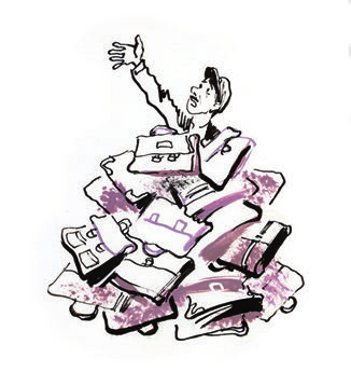

## Seefahrer und Zimmermann

Eine unerhörte Krise fegte wie ein alles Lebendige <abbr title="erstarren lassen — леденить, сковывать">erstarren lassendes</abbr> <abbr title="das Hochdruckgebiet, die Hochdruckgebiete — антициклон">Hochdruckgebiet</abbr> über Kolokolamsk hinweg. Aus den wenigen Lädchen und von den <abbr title="der Marktstand, die Marktstände — базарный лоток">Marktständen</abbr> verschwand das Leder vollständig. Es verschwand das <abbr title="das Chromleder — хром (кожа)">Chromleder</abbr>, es verschwand das <abbr title="das Ziegenleder — шевро">Ziegenleder</abbr>, sogar die Vorräte an <abbr title="das Sohlenleder — подошвенная кожа, подошва">Sohlenleder</abbr> versiegten.

Eine ganze Woche lang standen die Kolokolamsker vor einem <abbr title="das Rätsel, die Rätsel — загадка">Rätsel</abbr>. Als aber, um das Unglück <abbr title="das Unglück vollmachen — в довершение несчастья">vollzumachen</abbr>, auch noch das Segeltuch vom Markt verschwand, <abbr title="den Mut verlieren — приуныть, пасть духом">verloren</abbr> sie endgültig den Mut.

Zum Glück <abbr title="sich aufklären — разъясняться, выясняться">klärten sich</abbr> die Ursachen der Krise bald auf. Sie klärten sich auf bei einem Fest, das zu Ehren des Vorsitzenden der Gesellschaft «Hetj, Händeschütteln!», des Bürgers Doloj-Wyschnewezki, gegeben wurde – anlässlich seines fünfjährigen Dienstes an der <abbr title="die Sache, die Sachen — дело">Sache</abbr> der <abbr title="die Ausmerzung — изживание, искоренение">Ausmerzung</abbr> des Händeschüttelns.

Die <abbr title="die Feierlichkeit, die Feierlichkeiten — торжество">Feierlichkeit</abbr> wurde im besten Raum der Stadt eröffnet, im Fragebogensaal der Kurse für Deklamation und Gesang. Einer nach dem anderen stiegen die Vertreter der städtischen Organisationen über den roten <abbr title="der Läufer, die Läufer — ковровая дорожка">Läufer</abbr> auf das <abbr title="das Podium, die Podien — эстрада, сцена">Podium</abbr>, hielten <abbr title="die Begrüßungsrede, die Begrüßungsreden — приветственная речь">Begrüßungsreden</abbr> und überreichten dem <abbr title="der Jubilar, die Jubilare — юбиляр">Jubilar</abbr> Geschenke.

Sechs Mitarbeiter der Gesellschaft «Hetj, Händeschütteln!» <abbr title="überreichen — вручать, преподносить">überreichten</abbr> ihrem geliebten Chef sechs feuerrote Aktentaschen aus Ziegenleder mit Kofferriemen und <abbr title="der Henkel, die Henkel — ручка">Henkeln</abbr>.

Die befreundete Gesellschaft «Hetj, Analphabetentum!» beschenkte in der Person ihres Vorsitzenden Balustradnikow den gerührten Jubilar mit zwölf Aktentaschen aus Chromleder in <abbr title="die Krokodilprägung — крокодиловая выделка">Krokodilprägung</abbr>.

Der Jubilar verbeugte sich und dankte. Ein <abbr title="das Mandolinenorchester, die Mandolinenorchester — оркестр мандолинистов">Mandolinenorchester</abbr> spielte ununterbrochen einen <abbr title="der Tusch, die Tusche — туш">Tusch</abbr>.

Der Chef der Miliz, Otmeschujew, <abbr title="schnarren — хрипеть, отчеканивать">schnarrte</abbr> <abbr title="forsch — молодецки, бойко">forsch</abbr> eine Grußadresse herunter, als erstatte er <abbr title="die Meldung, die Meldungen — рапорт, донесение">Meldung</abbr>, und übergab dem Helden vier Aktentaschen aus Segeltuch, geschmückt mit Schwertern und <abbr title="die Schleife, die Schleifen — бант">Schleifen</abbr>.

Auch Feuerwehrchef Ogon-Polychajew <abbr title="sich nicht lumpen lassen — не ударить в грязь лицом">ließ sich nicht lumpen</abbr>. Er hatte allerdings Pech gehabt. Er war zu spät <abbr title="zur Besinnung kommen — спохватиться">zur Besinnung gekommen</abbr>, als es schon kein Leder mehr gab. Doch aus dieser <abbr title="die Prüfung, die Prüfungen — испытание">Prüfung</abbr> ging der Bürger Ogon als Sieger hervor: Er zerschnitt einen großen <abbr title="der Schlauch, die Schläuche — шланг">Schlauch</abbr> und fertigte daraus eine <abbr title="unvergleichlich — бесподобный">unvergleichliche</abbr> Aktentasche aus Gummi. Es war die beste aller Aktentaschen. Sie ließ sich so weit <abbr title="dehnen — растягивать">dehnen</abbr>, dass sie sämtliche laufenden <abbr title="der Vorgang, die Vorgänge — текущее дело (в канцелярии)">Vorgänge</abbr> und <abbr title="das Archiv, die Archive — архив">Archive</abbr> einer großen Behörde aufnehmen konnte.

Doloj-Wyschnewezki weinte.

Die Rede des Bürgers Podlinnik, der im Namen von Handel und Industrie der Stadt sprach, wird den Kolokolamskern noch lange im <abbr title="das Gedächtnis — память">Gedächtnis</abbr> bleiben. Noch in tausend Jahren wird Podlinniks Rede, neben den Reden Ciceros und des <abbr title="der Rechtsbeistand, die Rechtsbeistände — правозаступник, адвокат">Rechtsbeistands</abbr> Wakchanalski, als Muster der <abbr title="die Redekunst — ораторское искусство">Redekunst</abbr> <abbr title="verehren — почитать">verehrt</abbr> werden.

— Sie! — rief Podlinnik und stieß mit dem <abbr title="der Zeigefinger, die Zeigefinger — указательный палец">Zeigefinger</abbr> in Richtung des Jubilars. — Sie sind ein <abbr title="der Priester, die Priester — жрец">Priester</abbr> der Wissenschaft, ein <abbr title="der Märtyrer, die Märtyrer — мученик">Märtyrer</abbr> der Idee, der großen Idee der <abbr title="die Abschaffung — отмена">Abschaffung</abbr> des Händeschüttelns in unserer Stadt! Sehen Sie, ich weine vor Ihnen!

Podlinnik versuchte zu weinen, doch es gelang ihm nicht.

— Ich schluchze dumpf! — schrie er.

Und er gab mit der Hand ein Zeichen.

Sofort flog die Tür auf, und durch den Seitengang rollte eine mit <abbr title="der Tannenzweig, die Tannenzweige — хвоя, еловая ветка">Tannenzweigen</abbr> <abbr title="umwinden (umwand, hat umwunden) — увивать, обвивать">umwundene</abbr> Schubkarre in den Saal. Sie war bis obenhin mit <abbr title="die Sammleraktentasche — коллекционный портфель">Sammleraktentaschen</abbr> beladen.

— Ich kann nicht sprechen! — <abbr title="blöken — блеять">blökte</abbr> Podlinnik. Und er nahm einen ganzen Stapel Aktentaschen in die Arme und begann, sie geschickt auf den Jubilar zu <abbr title="schleudern — метать, швырять">schleudern</abbr>, wobei er freundschaftlich rief: — Sie sind ein Akademiker! Sie sind ein Held! Sie sind ein Seefahrer! Sie sind ein Zimmermann! Ich bin kein Redner! Küssen! Küssen!

Er versuchte, den Jubilar zu küssen, doch das war unmöglich. Doloj-Wyschnewezki war bis zum Hals unter Aktentaschen <abbr title="verschütten — засыпать">verschüttet</abbr>, und man konnte nicht an ihn herankommen.

Ein solches <abbr title="das Jubiläum, die Jubiläen — юбилей">Jubiläum</abbr> hatte Kolokolamsk noch nie gesehen.

Am nächsten Morgen ging das Gerücht durch die Stadt, es gebe endlich wieder Leder zu kaufen. Wo, wusste noch niemand, doch die aufgeregten Bürger <abbr title="überschwemmen — наводнять">überschwemmten</abbr> vorsichtshalber die Straßen. Gegen Mittag liefen alle zum Markt.

An den <abbr title="der Fleischstand, die Fleischstände — мясной ряд">Fleischständen</abbr> <abbr title="sich schlängeln — виться, извиваться">schlängelte sich</abbr> eine lange <abbr title="die Schlange, die Schlangen — очередь">Schlange</abbr>. Vor ihr saß friedlich unter einem großen Schirm der Akademiker, Held, Seefahrer und Zimmermann Doloj-Wyschnewezki. Fünf Jahre hatte er der großen Sache der <abbr title="die Vertilgung — истребление">Vertilgung</abbr> des Händeschüttelns innerhalb der Grenzen der Stadt Kolokolamsk gewidmet, und den ersten Tag des sechsten Jahres widmete er dem Handel mit den <abbr title="die Frucht, die Früchte — плод">Früchten</abbr> seiner Arbeit. Er verkaufte Aktentaschen. Sie waren <abbr title="säuberlich — аккуратно">säuberlich</abbr> sortiert, und an jeder war der Preis <abbr title="vermerken — отмечать, указывать">vermerkt</abbr>.

— Wer will schöne Aktentaschen? — <abbr title="anpreisen (pries an, hat angepriesen) — зазывать, расхваливать">pries</abbr> der Jubilar an. — Wer will Leder für <abbr title="die Stiefelette, die Stiefeletten — штиблет, ботинок">Stiefeletten</abbr>, für Stiefel, für Damen-<abbr title="der Pumps, die Pumps — туфли-лодочки">Pumps</abbr>? Riemen fürs <abbr title="das Zaumzeug — упряжь">Zaumzeug</abbr>! Es gibt <abbr title="gepanzert — бронированный">gepanzerte</abbr> Aktentaschen, Krokodil-Aktentaschen, Gummi-Aktentaschen! Das beste originelle Kinder-Scherzgeschenk für die Kinder zu Ostern – Schwerter und Schleifen! Wer will Schwerter und Schleifen für Kinderspielzeug?

Die Kolokolamsker mit <abbr title="abgetreten — стоптанный">abgetretenen</abbr> Schuhen kauften hastig die Aktentaschen auf und brachten sie sofort zu den Schustern.

Der Bürger Podlinnik, bitter lächelnd, <abbr title="feilschen um + Akk. — торговаться за, приторговывать">feilschte</abbr> um eine Aktentasche aus Ziegenleder für die Schuhe seiner Frau.

— Ich bin kein Redner! — sagte er. — Aber zehn Rubel für diese Aktentasche, das ist ja zum <abbr title="das ist zum Verrücktwerden — с ума сойти">Verrücktwerden</abbr>! Auch so ein Seefahrer!

— Bei uns wird nicht gefeilscht! — antwortete der Seefahrer und Zimmermann. — Wer will gepanzerte Aktentaschen, Krokodil-Aktentaschen, Gummi-Aktentaschen! Für Stiefel! Für Damen-Pumps!

Er handelte auch am nächsten Tag.

Am Ende wurde er zu einem Händler für Aktentaschen, <abbr title="die Damenhandtasche, die Damenhandtaschen — дамская сумочка">Damenhandtaschen</abbr>, <abbr title="die Brieftasche, die Brieftaschen — бумажник">Brieftaschen</abbr> und brüchige <abbr title="das Lackgürtelchen, die Lackgürtelchen — лаковый поясок">Lackgürtelchen</abbr>. An seine einstige wissenschaftliche Tätigkeit erinnerte er sich selten und nur mit <abbr title="das Unbehagen — неудовольствие">Unbehagen</abbr>.

So ging der Kolokolamsker <abbr title="die Öffentlichkeit — общественность">Öffentlichkeit</abbr> ihr bester Vertreter <abbr title="verloren gehen — погибнуть, пропасть">verloren</abbr> – das Oberhaupt der Gesellschaft «Hetj, Händeschütteln!».

1928–1929

---

### Neue Wörter

- **erstarren lassen** — леденить, сковывать
- **das Hochdruckgebiet, die Hochdruckgebiete** — антициклон
- **der Marktstand, die Marktstände** — базарный лоток
- **das Chromleder** — хром (кожа)
- **das Ziegenleder** — шевро
- **das Sohlenleder** — подошвенная кожа, подошва
- **das Rätsel, die Rätsel** — загадка
- **das Unglück vollmachen** — в довершение несчастья
- **den Mut verlieren** — приуныть, пасть духом
- **sich aufklären** — разъясняться, выясняться
- **die Sache, die Sachen** — дело
- **die Ausmerzung** — изживание, искоренение
- **die Feierlichkeit, die Feierlichkeiten** — торжество
- **der Läufer, die Läufer** — ковровая дорожка
- **das Podium, die Podien** — эстрада, сцена
- **die Begrüßungsrede, die Begrüßungsreden** — приветственная речь
- **der Jubilar, die Jubilare** — юбиляр
- **überreichen** — вручать, преподносить
- **der Henkel, die Henkel** — ручка
- **die Krokodilprägung** — крокодиловая выделка
- **das Mandolinenorchester, die Mandolinenorchester** — оркестр мандолинистов
- **der Tusch, die Tusche** — туш
- **schnarren** — хрипеть, отчеканивать
- **forsch** — молодецки, бойко
- **die Meldung, die Meldungen** — рапорт, донесение
- **die Schleife, die Schleifen** — бант
- **sich nicht lumpen lassen** — не ударить в грязь лицом
- **zur Besinnung kommen** — спохватиться
- **die Prüfung, die Prüfungen** — испытание
- **der Schlauch, die Schläuche** — шланг
- **unvergleichlich** — бесподобный
- **dehnen** — растягивать
- **der Vorgang, die Vorgänge** — текущее дело (в канцелярии)
- **das Archiv, die Archive** — архив
- **das Gedächtnis** — память
- **der Rechtsbeistand, die Rechtsbeistände** — правозаступник, адвокат
- **die Redekunst** — ораторское искусство
- **verehren** — почитать
- **der Zeigefinger, die Zeigefinger** — указательный палец
- **der Priester, die Priester** — жрец
- **der Märtyrer, die Märtyrer** — мученик
- **die Abschaffung** — отмена
- **der Tannenzweig, die Tannenzweige** — хвоя, еловая ветка
- **umwinden (umwand, hat umwunden)** — увивать, обвивать
- **die Sammleraktentasche** — коллекционный портфель
- **blöken** — блеять
- **schleudern** — метать, швырять
- **verschütten** — засыпать
- **das Jubiläum, die Jubiläen** — юбилей
- **überschwemmen** — наводнять
- **der Fleischstand, die Fleischstände** — мясной ряд
- **sich schlängeln** — виться, извиваться
- **die Schlange, die Schlangen** — очередь
- **die Vertilgung** — истребление
- **die Frucht, die Früchte** — плод
- **säuberlich** — аккуратно
- **vermerken** — отмечать, указывать
- **anpreisen (pries an, hat angepriesen)** — зазывать, расхваливать
- **die Stiefelette, die Stiefeletten** — штиблет, ботинок
- **der Pumps, die Pumps** — туфли-лодочки
- **das Zaumzeug** — упряжь
- **gepanzert** — бронированный
- **abgetreten** — стоптанный
- **feilschen um + Akk.** — торговаться за, приторговывать
- **das ist zum Verrücktwerden** — с ума сойти
- **die Damenhandtasche, die Damenhandtaschen** — дамская сумочка
- **die Brieftasche, die Brieftaschen** — бумажник
- **das Lackgürtelchen, die Lackgürtelchen** — лаковый поясок
- **das Unbehagen** — неудовольствие
- **die Öffentlichkeit** — общественность
- **verloren gehen** — погибнуть, пропасть

[← Zurück](kapitel-10.md) · [Inhalt](README.md)
