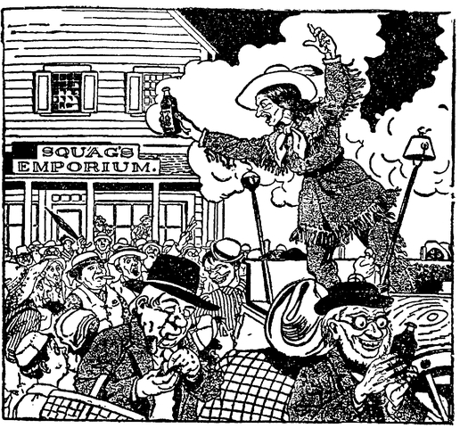

## Jeff Peters als persönlicher Magnet

Jeff Peters hat schon so viele <abbr title="die Methode, die Methoden — метод, способ">Methoden</abbr> ausprobiert, um Geld zu verdienen, wie es in Charleston, South Carolina, Rezepte für Reis gibt.

Am liebsten höre ich ihm zu, wenn er von seinen früheren Tagen erzählt. Damals verkaufte er an den Straßenecken <abbr title="das Einreibemittel, die Einreibemittel — растирка, мазь">Einreibemittel</abbr> und Mittel gegen Husten. Er lebte <abbr title="von der Hand in den Mund leben — жить впроголодь, перебиваться">von der Hand in den Mund</abbr>, Herz an Herz mit dem Volk, und spielte mit dem Schicksal um seine letzte Münze <abbr title="Kopf oder Zahl — орёл или решка">Kopf oder Zahl</abbr>.

— Ich bin in Fisher Hill, Arkansas, <abbr title="aufkreuzen — объявиться, нагрянуть">aufgekreuzt</abbr>, — sagte er, — in einem Anzug aus Wildleder, mit <abbr title="der Mokassin, die Mokassins — мокасин">Mokassins</abbr>, langen Haaren und einem Diamantring mit dreißig <abbr title="das Karat — карат">Karat</abbr>. Den hatte ich in Texarkana von einem Schauspieler bekommen. Ich weiß nicht, was er mit dem Taschenmesser gemacht hat, das ich ihm dafür <abbr title="eintauschen — обменять">eingetauscht</abbr> hab.

Ich war Dr. Wau-Hu, der berühmte indianische <abbr title="der Medizinmann, die Medizinmänner — знахарь, шаман">Medizinmann</abbr>. Ich hatte damals nur ein einziges sicheres Geschäft, und das war der <abbr title="der Auferstehungsbitter — «Воскресительная настойка»">Auferstehungsbitter</abbr>. Er war aus <abbr title="lebensspendend — животворящий">lebensspendenden</abbr> Pflanzen und <abbr title="das Kraut, die Kräuter — трава (лечебная)">Kräutern</abbr> gemacht. Entdeckt hatte sie Ta-qua-la, die schöne Frau vom <abbr title="der Häuptling, die Häuptlinge — вождь">Häuptling</abbr> der Choctaw, ganz zufällig. Sie sammelte gerade <abbr title="das Grünzeug — зелень">Grünzeug</abbr>, um eine <abbr title="die Platte, die Platten — блюдо">Platte</abbr> mit gekochtem Hund für den jährlichen <abbr title="der Maistanz, die Maistänze — праздник кукурузы (танец)">Maistanz</abbr> zu garnieren.

In der letzten Stadt war das Geschäft nicht gut gelaufen, also hatte ich nur fünf Dollar. Ich bin zum Apotheker von Fisher Hill gegangen, und der hat mir ein halbes <abbr title="das Gros — гросс (12 дюжин)">Gros</abbr> Flaschen, also zweiundsiebzig Stück, und die Korken <abbr title="auf Kredit — в кредит">auf Kredit</abbr> gegeben. Die Etiketten und die <abbr title="die Zutat, die Zutaten — ингредиент, составная часть">Zutaten</abbr> hatte ich noch von der letzten Stadt in meinem Koffer. Als ich in meinem Hotelzimmer saß, das Wasser aus dem Wasserhahn lief und der Auferstehungsbitter dutzendweise auf dem Tisch stand, sah das Leben wieder <abbr title="rosig — радужный, розовый">rosig</abbr> aus.

Schwindel? Nein, Sir. In dem halben Gros Bitter war für zwei Dollar <abbr title="der Chinarindenextrakt — экстракт хинной коры">Chinarindenextrakt</abbr> und für zehn Cent <abbr title="das Anilin — анилин (краситель)">Anilin</abbr>. Jahre später bin ich wieder durch diese Städte gekommen, und die Leute haben mich noch danach gefragt.

Am Abend hab ich mir einen Wagen gemietet und auf der Hauptstraße angefangen, den Bitter zu verkaufen. Fisher Hill war eine <abbr title="tief gelegen — низменный, низко расположенный">tief gelegene</abbr> Stadt mit viel <abbr title="die Malaria — малярия">Malaria</abbr>. Und ich hab <abbr title="diagnostizieren — ставить диагноз">diagnostiziert</abbr>, dass die Leute genau so was brauchten: ein <abbr title="zusammengesetzt — составной, сложный">zusammengesetztes</abbr> <abbr title="hypothetisch — гипотетический">hypothetisches</abbr> Lungen-Herz-Anti-<abbr title="der Skorbut — цинга">Skorbut</abbr>-<abbr title="das Stärkungsmittel, die Stärkungsmittel — укрепляющее средство, тоник">Stärkungsmittel</abbr>. Der Bitter ging weg wie <abbr title="das Kalbsbries — телячья зобная железа (деликатес)">Kalbsbries</abbr> auf Toast bei einem <abbr title="vegetarisch — вегетарианский">vegetarischen</abbr> Abendessen. Ich hatte zwei Dutzend für fünfzig Cent das Stück verkauft, da hat mich jemand am <abbr title="der Rockschoß, die Rockschöße — пола сюртука">Rockschoß</abbr> gezogen. Ich wusste, was das bedeutet. Also bin ich vom Wagen gestiegen und hab einem Mann mit einem Stern aus <abbr title="das Neusilber — мельхиор, нейзильбер">Neusilber</abbr> am Revers heimlich einen Fünfdollarschein in die Hand gesteckt.

— Herr Wachtmeister, — sag ich, — was für ein schöner Abend.

— Haben Sie eine <abbr title="die Genehmigung, die Genehmigungen — разрешение, лицензия">Genehmigung</abbr> von der Stadt, — fragt er, — um diese <abbr title="unehelich — внебрачный, незаконнорождённый">uneheliche</abbr> <abbr title="die Essenz, die Essenzen — эссенция">Essenz</abbr> aus <abbr title="das Gesöff — пойло">Gesöff</abbr> zu verkaufen, die Sie <abbr title="schmeichelhaft — лестно">schmeichelhaft</abbr> «Medizin» nennen?

— Nein, — sag ich. — Ich wusste gar nicht, dass Sie eine Stadt haben. Wenn ich sie morgen finde, hole ich mir eine, falls das <abbr title="nötig — нужный, необходимый">nötig</abbr> ist.

— Bis dahin muss ich Ihnen das Geschäft schließen, — sagt der Wachtmeister.

Ich hab mit dem Verkaufen aufgehört und bin zurück ins Hotel gegangen. Dort hab ich mit dem Wirt darüber geredet.

— Oh, in Fisher Hill haben Sie keine Chance, — sagt er. — Dr. Hoskins, der einzige Arzt hier, ist der <abbr title="der Schwager, die Schwäger — шурин, свояк, зять">Schwager</abbr> vom <abbr title="der Bürgermeister, die Bürgermeister — мэр">Bürgermeister</abbr>. Und die erlauben keinem falschen Doktor, in der Stadt zu <abbr title="praktizieren — практиковать (как врач)">praktizieren</abbr>.

— Ich praktiziere keine Medizin, — sag ich. — Ich hab eine <abbr title="die Hausiererlizenz, die Hausiererlizenzen — лицензия разносчика">Hausiererlizenz</abbr> vom Staat, und eine von der Stadt hole ich mir überall, wo man sie verlangt.

Am nächsten Morgen bin ich zum Büro vom Bürgermeister gegangen, und dort hat man mir gesagt, dass er noch nicht da war. Man wusste auch nicht, wann er kommt. Also <abbr title="sich hocken — усесться, примоститься">hockt sich</abbr> Doc Wau-Hu wieder in einen Sessel im Hotel, zündet sich eine Zigarre aus <abbr title="der Stechapfel — дурман (растение)">Stechapfel</abbr> an und wartet.

Nach einer Weile rutscht ein junger Mann mit einer blauen Krawatte auf den Sessel neben mir und fragt, wie spät es ist.

— Halb elf, — sag ich, — und Sie sind Andy Tucker. Ich hab Sie schon <abbr title="bei der Arbeit — за работой">bei der Arbeit</abbr> gesehen. Waren Sie nicht der, der in den Südstaaten das Große Amor-Kombi-Paket verkauft hat? Moment mal, da war ein <abbr title="der Verlobungsring, die Verlobungsringe — обручальное кольцо (при помолвке)">Verlobungsring</abbr> mit einem Diamanten aus Chile, ein <abbr title="der Ehering, die Eheringe — обручальное кольцо">Ehering</abbr>, ein <abbr title="der Kartoffelstampfer, die Kartoffelstampfer — толкушка для картофеля">Kartoffelstampfer</abbr>, eine Flasche <abbr title="der Beruhigungssirup — успокоительный сироп">Beruhigungssirup</abbr> und der Roman «Dorothy Vernon», alles für fünfzig Cent.

Andy hat sich gefreut, dass ich mich an ihn erinnert hab. Er war ein guter <abbr title="der Straßenhändler, die Straßenhändler — уличный торговец">Straßenhändler</abbr>. Und nicht nur das: Er hatte Respekt vor seinem Beruf, und er war mit dreihundert Prozent Gewinn zufrieden. Er hatte viele Angebote, ins <abbr title="illegal — незаконный">illegale</abbr> Geschäft mit <abbr title="die Arznei, die Arzneien — лекарство">Arzneien</abbr> und <abbr title="der Gartensamen, die Gartensamen — семена для огорода">Gartensamen</abbr> einzusteigen. Aber niemand konnte ihn vom <abbr title="der rechte Weg — праведный путь">rechten Weg</abbr> <abbr title="abbringen (brachte ab, hat abgebracht) — отвлечь, сбить">abbringen</abbr>.

Ich wollte einen Partner, also haben Andy und ich beschlossen, zusammen zu arbeiten. Ich hab ihm von der <abbr title="die Lage, die Lagen — положение, ситуация">Lage</abbr> in Fisher Hill erzählt und dass meine Finanzen schlecht standen, wegen der <abbr title="örtlich — местный">örtlichen</abbr> Mischung aus Politik und <abbr title="das Abführmittel, die Abführmittel — слабительное">Abführmittel</abbr>. Andy war erst an diesem Morgen mit dem Zug gekommen. Er hatte auch nicht viel Geld. Er wollte in der Stadt ein paar Dollar sammeln, für ein neues <abbr title="das Kriegsschiff, die Kriegsschiffe — военный корабль">Kriegsschiff</abbr>, das man mit <abbr title="die Spende, die Spenden — пожертвование">Spenden</abbr> aus dem Volk in Eureka Springs bauen wollte. Also haben wir uns auf die Veranda gesetzt und alles <abbr title="besprechen (besprach, hat besprochen) — обсуждать">besprochen</abbr>.

Am nächsten Morgen um elf, als ich allein da saß, schlurft ein alter schwarzer Diener ins Hotel. Er fragt nach dem Doktor. Der Doktor soll kommen und nach Richter Banks sehen. Dieser Banks war, wie sich <abbr title="sich herausstellen — оказываться">herausstellte</abbr>, der Bürgermeister, und er war <abbr title="schwer krank — тяжело больной">schwer krank</abbr>.

— Ich bin kein Doktor, — sag ich. — Warum holst du nicht den Doktor?

— Boss, — sagt er, — Doc Hoskins is’ dreißig Kilometer raus aufs Land, zu ein paar Kranken. Er is’ der einzige Doktor in der Stadt, und dem Massa Banks geht’s mächtig schlecht. Er hat mich geschickt, ich soll Sie bitten, Sir, dass Sie komm’n.

— Von Mensch zu Mensch, — sag ich, — ich geh hin und sehe ihn mir an. — Also stecke ich eine Flasche Auferstehungsbitter ein und gehe auf den Hügel zur Villa vom Bürgermeister. Das war das schönste Haus in der Stadt, mit einem <abbr title="das Mansardendach, die Mansardendächer — мансардная крыша">Mansardendach</abbr> und zwei <abbr title="gusseisern — чугунный">gusseisernen</abbr> Hunden auf dem Rasen.

Dieser Bürgermeister Banks lag im Bett, nur sein Bart und seine Füße guckten heraus. Er machte innere <abbr title="das Geräusch, die Geräusche — шум, звук">Geräusche</abbr>, bei denen in San Francisco alle Leute in die Parks gerannt wären, weil sie an ein <abbr title="das Erdbeben, die Erdbeben — землетрясение">Erdbeben</abbr> gedacht hätten. Neben dem Bett stand ein junger Mann mit einer Tasse Wasser.

— Doc, — sagt der Bürgermeister, — ich bin furchtbar krank. Ich sterbe gleich. Können Sie nichts für mich tun?

— Herr Bürgermeister, — sag ich, — ich bin kein richtiger, <abbr title="vorherbestimmt — предопределённый">vorherbestimmter</abbr> <abbr title="der Jünger, die Jünger — ученик, последователь">Jünger</abbr> von Herrn Äsku Lap. Ich hab nie an einer medizinischen <abbr title="die Hochschule, die Hochschulen — высшая школа, вуз">Hochschule</abbr> studiert, — sag ich. — Ich bin nur als <abbr title="der Mitmensch, die Mitmenschen — ближний">Mitmensch</abbr> gekommen, um zu sehen, ob ich helfen kann.

— Ich bin Ihnen sehr <abbr title="verbunden sein + Dat. — быть признательным">verbunden</abbr>, — sagt er. — Doc Wau-Hu, das ist mein Neffe, Mr. Biddle. Er hat versucht, meine Qualen zu lindern, aber ohne Erfolg. Oh, Herrgott! Au-au-au!! — jault er.

Ich nicke Mr. Biddle zu, setze mich ans Bett und fühle den Puls vom Bürgermeister. — Zeigen Sie mir mal Ihre Leber … ich meine, Ihre <abbr title="die Zunge, die Zungen — язык">Zunge</abbr>, — sag ich. Dann ziehe ich seine Augenlider hoch und sehe mir die <abbr title="die Pupille, die Pupillen — зрачок">Pupillen</abbr> genau an.

— Seit wann sind Sie krank? — hab ich gefragt.

— Es hat mich … au, autsch … gestern Abend erwischt, — sagt der Bürgermeister. — Geben Sie mir was dagegen, Doc, bitte!

— Mr. Fiddel, — sag ich, — ziehen Sie doch mal das Rollo ein bisschen hoch.

— Biddle, — sagt der junge Mann. — Meinst du, du könntest ein bisschen Schinken mit Ei essen, Onkel James?

— Herr Bürgermeister, — sag ich, nachdem ich mein Ohr an sein rechtes Schulterblatt gelegt und gehorcht hab, — Sie haben einen schweren Anfall von Super-<abbr title="die Entzündung, die Entzündungen — воспаление">Entzündung</abbr> vom rechten Schlüsselbein des <abbr title="das Cembalo, die Cembalos — клавесин">Cembalos</abbr>!

— Großer Gott! — sagt er und <abbr title="stöhnen — стонать">stöhnt</abbr>. — Können Sie nicht was draufschmieren oder es <abbr title="einrenken — вправлять (сустав)">einrenken</abbr> oder sonst was?

Ich nehme meinen Hut und gehe zur Tür.

— Sie gehen doch nicht, Doc? — heult der Bürgermeister. — Sie gehen doch nicht weg und lassen mich mit dieser … <abbr title="die Überentzündung — «сверхвоспаление»">Überentzündung</abbr> vom <abbr title="der Klavierdeckel, die Klavierdeckel — крышка рояля">Klavierdeckel</abbr> sterben?

— Die einfache Menschlichkeit, Dr. Hü-Hott, — sagt Mr. Biddle, — verbietet es Ihnen, einen Mitmenschen in Not im Stich zu lassen.

— Dr. Wau-Hu, wenn Sie mit dem Pflügen fertig sind, — sag ich. Dann gehe ich zurück zum Bett und werfe meine langen Haare nach hinten.

— Herr Bürgermeister, — sag ich, — es gibt für Sie nur noch eine Hoffnung. <abbr title="das Arzneimittel, die Arzneimittel — лекарственное средство">Arzneimittel</abbr> helfen Ihnen nicht. Aber es gibt eine andere Kraft, die noch höher steht. Obwohl Arzneimittel ja auch schon hoch genug im Preis stehen, — sag ich.

— Und was ist das? — sagt er.

— Wissenschaftliche <abbr title="die Demonstration, die Demonstrationen — демонстрация">Demonstrationen</abbr>, — sag ich. — Der Sieg des Geistes über die <abbr title="die Sarsaparilla — сарсапарель (сироп)">Sarsaparilla</abbr>. Der Glaube, dass es keinen Schmerz und keine Krankheit gibt, außer denen, die man bekommt, wenn man sich nicht gut fühlt. Erklären Sie sich <abbr title="zahlungsunfähig — неплатёжеспособный">zahlungsunfähig</abbr>. Demonstrieren Sie.

— Was ist das für ein Krimskrams, von dem Sie da reden, Doc? — sagt der Bürgermeister. — Sie sind doch nicht etwa <abbr title="der Sozialist, die Sozialisten — социалист">Sozialist</abbr>?

— Ich rede, — sag ich, — von der großen Lehre der <abbr title="psychisch — психический">psychischen</abbr> <abbr title="die Finanzierung — финансирование">Finanzierung</abbr>. Von der <abbr title="aufgeklärt — просвещённый">aufgeklärten</abbr> Schule der <abbr title="die Fernbehandlung — лечение на расстоянии">Fernbehandlung</abbr> von <abbr title="der Trugschluss, die Trugschlüsse — ложный вывод">Trugschlüssen</abbr> und <abbr title="die Hirnhautentzündung — менингит">Hirnhautentzündung</abbr> durch das Unter-Gewissen. Von dem wunderbaren <abbr title="der Hallensport — комнатный (зальный) спорт">Hallensport</abbr>, den man persönlichen <abbr title="der Magnetismus — магнетизм">Magnetismus</abbr> nennt.

— Können Sie das, Doc? — fragt der Bürgermeister.

— Ich bin einer von den Einzigen <abbr title="der Hohepriester, die Hohepriester — первосвященник">Hohepriestern</abbr> und Angeblichen Hokuspokussen der Inneren <abbr title="die Kanzel, die Kanzeln — кафедра (церковная)">Kanzel</abbr>, — sag ich. — Die Lahmen reden und die Blinden glotzen, wenn ich nur mit der Hand über sie streiche. Ich bin ein <abbr title="das Medium, die Medien — медиум">Medium</abbr>, ein <abbr title="die Koloratur — колоратура">Koloratur</abbr>-<abbr title="der Hypnotiseur, die Hypnotiseure — гипнотизёр">Hypnotiseur</abbr> und eine <abbr title="spirituos — спиртной (Джефф путает со «spirituell» — духовный)">spirituose</abbr> Kontrolle. Bei den <abbr title="die Séance, die Séancen — спиритический сеанс">Séancen</abbr> neulich in Ann Arbor konnte nur durch mich der <abbr title="verstorben — покойный">verstorbene</abbr> <abbr title="der Präsident, die Präsidenten — президент, председатель">Präsident</abbr> der Essigbitter-Gesellschaft auf die Erde zurückkommen und mit seiner Schwester Jane sprechen. Sie sehen mich auf der Straße Medizin an die Armen verkaufen, — sag ich. — Bei denen <abbr title="anwenden (wandte an, hat angewandt) — применять">wende</abbr> ich keinen persönlichen Magnetismus an. Ich <abbr title="streuen — рассыпать, посыпать">streue</abbr> ihn nicht auf den Kies der Straße, — sag ich, — denn die Armen haben ja keinen Kies.

— Werden Sie mich behandeln? — fragt der Bürgermeister.

— Hören Sie, — sag ich. — Ich hatte überall, wo ich war, viel Ärger mit den <abbr title="die Ärztekammer, die Ärztekammern — медицинское общество (палата врачей)">Ärztekammern</abbr>. Ich praktiziere keine Medizin. Aber um Ihr Leben zu retten, gebe ich Ihnen die psychische Behandlung, wenn Sie mir als Bürgermeister versprechen, dass Sie die Sache mit der Genehmigung nicht weiter verfolgen.

— Natürlich, — sagt er. — Und jetzt fangen Sie an, Doc, die Schmerzen kommen wieder.

— Mein <abbr title="das Honorar, die Honorare — гонорар">Honorar</abbr> ist 250 Dollar, <abbr title="die Heilung — исцеление, излечение">Heilung</abbr> garantiert in zwei Behandlungen, — sag ich.

— Gut, — sagt der Bürgermeister. — Ich bezahle. Ich glaube, so viel ist mein Leben wert.

Ich hab mich ans Bett gesetzt und ihm gerade in die Augen gesehen.

— Jetzt, — sag ich, — denken Sie nicht mehr an die Krankheit. Sie sind nicht krank. Sie haben kein Herz und kein Schlüsselbein und keinen <abbr title="der Musikantenknochen — «локтевой нерв» (букв. «косточка музыканта»)">Musikantenknochen</abbr> und kein Gehirn und gar nichts. Sie haben keine Schmerzen. Erklären Sie es zum Irrtum. Jetzt fühlen Sie, wie der Schmerz, den Sie gar nicht hatten, weggeht, oder?

— Mir geht’s wirklich ein kleines bisschen besser, Doc, — sagt der Bürgermeister, — verflixt noch mal. Jetzt erzählen Sie mir noch ein paar Lügen, dass ich diese <abbr title="die Schwellung, die Schwellungen — опухоль, припухлость">Schwellung</abbr> an der linken Seite nicht habe. Dann könnte man mich, glaube ich, mit Kissen <abbr title="aufsetzen — усадить">aufsetzen</abbr>, und ich könnte ein bisschen Wurst und Buchweizenpfannkuchen essen.

Ich hab ein paar magnetische Bewegungen mit den Händen gemacht.

— Jetzt, — sag ich, — ist die Entzündung weg. Der rechte <abbr title="der Lappen, die Lappen — доля (органа); тряпка">Lappen</abbr> vom <abbr title="das Perihel — перигелий (точка орбиты)">Perihel</abbr> ist <abbr title="abschwellen (schwoll ab, ist abgeschwollen) — спадать (об опухоли)">abgeschwollen</abbr>. Sie werden müde. Sie können die Augen nicht mehr offen halten. Die Krankheit ist für den Moment <abbr title="stoppen — остановить">gestoppt</abbr>. Jetzt schlafen Sie.

Der Bürgermeister machte langsam die Augen zu und fing an zu schnarchen.

— Sie sehen, Mr. Tiddel, — sag ich, — die Wunder der modernen Wissenschaft.

— Biddle, — sagt er. — Wann geben Sie meinem Onkel den Rest der Behandlung, Dr. Papperlapapp?

— Wau-Hu, — sag ich. — Ich komme morgen um elf wieder. Wenn er aufwacht, geben Sie ihm acht Tropfen <abbr title="das Terpentin — скипидар">Terpentin</abbr> und anderthalb Kilo <abbr title="das Steak, die Steaks — бифштекс, стейк">Steak</abbr>. Guten Morgen.

Am nächsten Morgen bin ich pünktlich wieder hingegangen. — Na, Mr. Riddel, — sag ich, als er die Tür vom Schlafzimmer aufmacht, — und wie geht es dem Onkel heute Morgen?

— Es scheint ihm viel besser zu gehen, — sagt der junge Mann.

Die Farbe und der Puls vom Bürgermeister waren prima. Ich hab ihm die zweite Behandlung gegeben, und er sagte, dass jetzt auch der letzte Rest vom Schmerz weg war.

— Jetzt, — sag ich, — bleiben Sie lieber noch ein oder zwei Tage im Bett, dann ist alles wieder gut. Was für ein Glück, dass ich zufällig in Fisher Hill war, Herr Bürgermeister, — sag ich. — Denn alle Heilmittel aus dem <abbr title="das Füllhorn — рог изобилия">Füllhorn</abbr> der normalen <abbr title="die Schulmedizin — официальная медицина">Schulmedizin</abbr> hätten Sie nicht retten können. Und jetzt, wo der Irrtum geflohen ist und der Schmerz als <abbr title="der Meineidige, die Meineidigen — лжесвидетель, клятвопреступник">Meineidiger</abbr> entlarvt ist, kommen wir zu einem fröhlicheren Thema, zum Beispiel zum Honorar von 250 Dollar. Bitte keinen Scheck. Ich schreibe meinen Namen nicht gern hinten auf einen Scheck. Fast genauso ungern wie vorne drauf.

— Ich habe das Geld hier, bar, — sagt der Bürgermeister und zieht eine Brieftasche unter dem Kissen hervor.

Er zählt fünf Fünfzigdollarscheine ab und hält sie in der Hand.

— Bring die Quittung, — sagt er zu Biddle.

Ich hab die Quittung unterschrieben, und der Bürgermeister hat mir das Geld gegeben. Ich hab es vorsichtig in meine Innentasche gesteckt.

— Jetzt tun Sie Ihre Pflicht, Herr Beamter, — sagt der Bürgermeister und grinst, ganz und gar nicht wie ein kranker Mann.

Mr. Biddle legt mir die Hand auf den Arm.

— Sie sind verhaftet, Dr. Wau-Hu, <abbr title="alias — он же, по кличке">alias</abbr> Peters, — sagt er, — weil Sie <abbr title="entgegen + Dat. — вопреки">entgegen</abbr> dem Gesetz des Staates ohne <abbr title="die Zulassung, die Zulassungen — допуск, лицензия">Zulassung</abbr> Medizin praktiziert haben.

— Wer sind Sie? — frage ich.

— Ich sage Ihnen, wer er ist, — sagt der Herr Bürgermeister und setzt sich im Bett auf. — Er ist ein Detektiv von der Ärztekammer des Staates. Er ist Ihnen durch fünf Bezirke gefolgt. Gestern ist er zu mir gekommen, und wir haben uns diesen Plan ausgedacht, um Sie zu fangen. Ich glaube, in dieser Gegend werden Sie nicht mehr den Doktor spielen, Herr Quacksalber. Was hatte ich noch mal, Doc? — lacht der Bürgermeister. — Eine zusammengesetzte … na ja, eine <abbr title="die Gehirnerweichung — размягчение мозга">Gehirnerweichung</abbr> war es jedenfalls nicht, glaube ich.

— Ein Detektiv, — sag ich.

— <abbr title="richtig — верно">Richtig</abbr>, — sagt Biddle. — Ich muss Sie dem Sheriff <abbr title="übergeben (übergab, hat übergeben) — передавать">übergeben</abbr>.

— Das will ich sehen, — sag ich, und ich packe Biddle an der Kehle und werfe ihn halb aus dem Fenster. Aber er zieht einen Revolver und drückt ihn mir unter das Kinn, und ich stehe still. Dann legt er mir <abbr title="die Handschelle, die Handschellen — наручники">Handschellen</abbr> an und nimmt das Geld aus meiner Tasche.

— Ich <abbr title="bezeugen — свидетельствовать">bezeuge</abbr>, — sagt er, — dass das dieselben Scheine sind, die Sie und ich <abbr title="markieren — помечать">markiert</abbr> haben, Richter Banks. Ich gebe sie dem Sheriff, wenn wir in seinem Büro sind, und er schickt Ihnen eine Quittung. Sie werden als <abbr title="das Beweismittel, die Beweismittel — улика, доказательство">Beweismittel</abbr> in dem Fall gebraucht.

— In Ordnung, Mr. Biddle, — sagt der Bürgermeister. — Und jetzt, Doc Wau-Hu, — sagt er weiter, — warum demonstrieren Sie nicht? Können Sie nicht den Korken mit den Zähnen aus Ihrem Magnetismus ziehen und die Handschellen mit Hokuspokus <abbr title="wegzaubern — убрать колдовством">wegzaubern</abbr>?

— Gehen wir, Herr Beamter, — sag ich würdevoll. — Ich muss eben das Beste daraus machen. — Dann drehe ich mich zum alten Banks um und <abbr title="rasseln mit + Dat. — греметь (цепями)">rassle</abbr> mit meinen <abbr title="die Kette, die Ketten — цепь">Ketten</abbr>.

— Herr Bürgermeister, — sag ich, — bald kommt die Zeit, da werden Sie glauben, dass der persönliche Magnetismus ein Erfolg ist. Und Sie werden sicher sein, dass er auch in diesem Fall Erfolg hatte.

Und ich glaube, das hatte er auch.

Als wir fast am Gartentor waren, sag ich: «Jetzt könnten wir jemandem begegnen, Andy. Ich glaube, du nimmst sie mir lieber ab, und …» Was? Na, natürlich war es Andy Tucker. Das war sein Plan. Und so sind wir zu dem Kapital gekommen, um zusammen ein Geschäft anzufangen.

---

### Neue Wörter

- **die Methode, die Methoden** — метод, способ
- **das Einreibemittel, die Einreibemittel** — растирка, мазь
- **von der Hand in den Mund leben** — жить впроголодь, перебиваться
- **Kopf oder Zahl** — орёл или решка
- **aufkreuzen** — объявиться, нагрянуть
- **der Mokassin, die Mokassins** — мокасин
- **das Karat** — карат
- **eintauschen** — обменять
- **der Medizinmann, die Medizinmänner** — знахарь, шаман
- **der Auferstehungsbitter** — «Воскресительная настойка»
- **lebensspendend** — животворящий
- **das Kraut, die Kräuter** — трава (лечебная)
- **der Häuptling, die Häuptlinge** — вождь
- **das Grünzeug** — зелень
- **die Platte, die Platten** — блюдо
- **der Maistanz, die Maistänze** — праздник кукурузы (танец)
- **das Gros** — гросс (12 дюжин)
- **auf Kredit** — в кредит
- **die Zutat, die Zutaten** — ингредиент, составная часть
- **rosig** — радужный, розовый
- **der Chinarindenextrakt** — экстракт хинной коры
- **das Anilin** — анилин (краситель)
- **tief gelegen** — низменный, низко расположенный
- **die Malaria** — малярия
- **diagnostizieren** — ставить диагноз
- **zusammengesetzt** — составной, сложный
- **hypothetisch** — гипотетический
- **der Skorbut** — цинга
- **das Stärkungsmittel, die Stärkungsmittel** — укрепляющее средство, тоник
- **das Kalbsbries** — телячья зобная железа (деликатес)
- **vegetarisch** — вегетарианский
- **der Rockschoß, die Rockschöße** — пола сюртука
- **das Neusilber** — мельхиор, нейзильбер
- **die Genehmigung, die Genehmigungen** — разрешение, лицензия
- **unehelich** — внебрачный, незаконнорождённый
- **die Essenz, die Essenzen** — эссенция
- **das Gesöff** — пойло
- **schmeichelhaft** — лестно
- **nötig** — нужный, необходимый
- **der Schwager, die Schwäger** — шурин, свояк, зять
- **der Bürgermeister, die Bürgermeister** — мэр
- **praktizieren** — практиковать (как врач)
- **die Hausiererlizenz, die Hausiererlizenzen** — лицензия разносчика
- **sich hocken** — усесться, примоститься
- **der Stechapfel** — дурман (растение)
- **bei der Arbeit** — за работой
- **der Verlobungsring, die Verlobungsringe** — обручальное кольцо (при помолвке)
- **der Ehering, die Eheringe** — обручальное кольцо
- **der Kartoffelstampfer, die Kartoffelstampfer** — толкушка для картофеля
- **der Beruhigungssirup** — успокоительный сироп
- **der Straßenhändler, die Straßenhändler** — уличный торговец
- **illegal** — незаконный
- **die Arznei, die Arzneien** — лекарство
- **der Gartensamen, die Gartensamen** — семена для огорода
- **der rechte Weg** — праведный путь
- **abbringen (brachte ab, hat abgebracht)** — отвлечь, сбить
- **die Lage, die Lagen** — положение, ситуация
- **örtlich** — местный
- **das Abführmittel, die Abführmittel** — слабительное
- **das Kriegsschiff, die Kriegsschiffe** — военный корабль
- **die Spende, die Spenden** — пожертвование
- **besprechen (besprach, hat besprochen)** — обсуждать
- **sich herausstellen** — оказываться
- **schwer krank** — тяжело больной
- **das Mansardendach, die Mansardendächer** — мансардная крыша
- **gusseisern** — чугунный
- **das Geräusch, die Geräusche** — шум, звук
- **das Erdbeben, die Erdbeben** — землетрясение
- **vorherbestimmt** — предопределённый
- **der Jünger, die Jünger** — ученик, последователь
- **die Hochschule, die Hochschulen** — высшая школа, вуз
- **der Mitmensch, die Mitmenschen** — ближний
- **verbunden sein + Dat.** — быть признательным
- **die Zunge, die Zungen** — язык
- **die Pupille, die Pupillen** — зрачок
- **die Entzündung, die Entzündungen** — воспаление
- **das Cembalo, die Cembalos** — клавесин
- **stöhnen** — стонать
- **einrenken** — вправлять (сустав)
- **die Überentzündung** — «сверхвоспаление»
- **der Klavierdeckel, die Klavierdeckel** — крышка рояля
- **das Arzneimittel, die Arzneimittel** — лекарственное средство
- **die Demonstration, die Demonstrationen** — демонстрация
- **die Sarsaparilla** — сарсапарель (сироп)
- **zahlungsunfähig** — неплатёжеспособный
- **der Sozialist, die Sozialisten** — социалист
- **psychisch** — психический
- **die Finanzierung** — финансирование
- **aufgeklärt** — просвещённый
- **die Fernbehandlung** — лечение на расстоянии
- **der Trugschluss, die Trugschlüsse** — ложный вывод
- **die Hirnhautentzündung** — менингит
- **der Hallensport** — комнатный (зальный) спорт
- **der Magnetismus** — магнетизм
- **der Hohepriester, die Hohepriester** — первосвященник
- **die Kanzel, die Kanzeln** — кафедра (церковная)
- **das Medium, die Medien** — медиум
- **die Koloratur** — колоратура
- **der Hypnotiseur, die Hypnotiseure** — гипнотизёр
- **spirituos** — спиртной (Джефф путает со «spirituell» — духовный)
- **die Séance, die Séancen** — спиритический сеанс
- **verstorben** — покойный
- **der Präsident, die Präsidenten** — президент, председатель
- **anwenden (wandte an, hat angewandt)** — применять
- **streuen** — рассыпать, посыпать
- **die Ärztekammer, die Ärztekammern** — медицинское общество (палата врачей)
- **das Honorar, die Honorare** — гонорар
- **die Heilung** — исцеление, излечение
- **der Musikantenknochen** — «локтевой нерв» (букв. «косточка музыканта»)
- **die Schwellung, die Schwellungen** — опухоль, припухлость
- **aufsetzen** — усадить
- **der Lappen, die Lappen** — доля (органа); тряпка
- **das Perihel** — перигелий (точка орбиты)
- **abschwellen (schwoll ab, ist abgeschwollen)** — спадать (об опухоли)
- **stoppen** — остановить
- **das Terpentin** — скипидар
- **das Steak, die Steaks** — бифштекс, стейк
- **das Füllhorn** — рог изобилия
- **die Schulmedizin** — официальная медицина
- **der Meineidige, die Meineidigen** — лжесвидетель, клятвопреступник
- **alias** — он же, по кличке
- **entgegen + Dat.** — вопреки
- **die Zulassung, die Zulassungen** — допуск, лицензия
- **die Gehirnerweichung** — размягчение мозга
- **richtig** — верно
- **übergeben (übergab, hat übergeben)** — передавать
- **die Handschelle, die Handschellen** — наручники
- **bezeugen** — свидетельствовать
- **markieren** — помечать
- **das Beweismittel, die Beweismittel** — улика, доказательство
- **wegzaubern** — убрать колдовством
- **rasseln mit + Dat.** — греметь (цепями)
- **die Kette, die Ketten** — цепь

[← Zurück](kapitel-33.md) · [Inhalt](README.md) · [Weiter →](kapitel-35.md)
