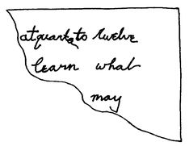
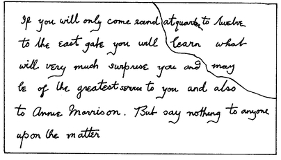

## Das Rätsel von Reigate

Es dauerte einige Zeit, bis sich mein Freund Sherlock Holmes von seiner gewaltigen Anstrengung im Frühling des Jahres 1887 erholt hatte. Die ganze Geschichte mit der Niederländisch-Sumatra-Gesellschaft und den riesigen Plänen des Barons Maupertuis ist dem Publikum noch zu frisch im Gedächtnis. Außerdem hat sie zu viel mit Politik und Geld zu tun, deshalb passt sie nicht in diese Reihe von Skizzen. <abbr title="auf Umwegen — окольным путём, косвенно">Auf Umwegen</abbr> führte sie jedoch zu einem seltsamen und verwickelten Fall. Bei diesem Fall konnte mein Freund zeigen, wie nützlich eine neue Waffe war – eine von den vielen Waffen, mit denen er sein ganzes Leben lang gegen das Verbrechen kämpfte.

In meinen Notizen sehe ich, dass ich am vierzehnten April ein Telegramm aus Lyon bekam. Man teilte mir mit, dass Holmes krank im Hotel Dulong lag. Innerhalb von vierundzwanzig Stunden war ich in seinem <abbr title="das Krankenzimmer, die Krankenzimmer — комната больного">Krankenzimmer</abbr>, und ich war erleichtert: Seine Symptome waren nicht gefährlich. Aber selbst seine eiserne Gesundheit war unter dem Druck zusammengebrochen. Zwei Monate lang hatte er an einer Ermittlung gearbeitet, nie weniger als fünfzehn Stunden am Tag. Mehr als einmal, so versicherte er mir, hatte er fünf Tage <abbr title="ohne Pause — без перерыва">ohne Pause</abbr> gearbeitet. Der Triumph am Ende konnte ihn nicht vor der <abbr title="die Erschöpfung — истощение, изнеможение">Erschöpfung</abbr> retten. Ganz Europa sprach von ihm, und in seinem Zimmer lagen die <abbr title="das Glückwunschtelegramm, die Glückwunschtelegramme — поздравительная телеграмма">Glückwunschtelegramme</abbr> <abbr title="buchstäblich — буквально">buchstäblich</abbr> bis zu den Knöcheln. Trotzdem fand ich ihn in der schwärzesten Schwermut. Er hatte Erfolg gehabt, wo die Polizei von drei Ländern gescheitert war. Er hatte den geschicktesten <abbr title="der Betrüger, die Betrüger — мошенник">Betrüger</abbr> Europas in jedem Punkt überlistet. Aber auch dieses Wissen konnte ihn nicht aus seiner nervösen Schwäche reißen.

Drei Tage später waren wir wieder zusammen in der Baker Street. Aber es war offensichtlich, dass meinem Freund eine Abwechslung sehr gut tun würde. Auch mir gefiel der Gedanke an eine Frühlingswoche auf dem Land. Mein alter Freund, Oberst Hayter, war in Afghanistan mein Patient gewesen. Jetzt hatte er ein Haus in der Nähe von Reigate in der Grafschaft Surrey gemietet und hatte mich oft eingeladen. Beim letzten Mal hatte er gesagt, dass auch mein Freund willkommen wäre, wenn er mitkommen wollte. Es brauchte ein wenig <abbr title="die Diplomatie — дипломатия">Diplomatie</abbr>. Aber als Holmes hörte, dass der Oberst Junggeselle war und dass er dort völlige Freiheit haben würde, war er einverstanden. Eine Woche nach unserer Rückkehr aus Lyon waren wir unter dem Dach des Obersts. Hayter war ein prächtiger alter Soldat, der viel von der Welt gesehen hatte. Wie ich erwartet hatte, merkte er bald, dass er und Holmes viel gemeinsam hatten.

Am Abend unserer Ankunft saßen wir nach dem Essen im Waffenzimmer des Obersts. Holmes lag ausgestreckt auf dem Sofa, während Hayter und ich seine kleine Sammlung orientalischer Waffen betrachteten.

— Übrigens, – sagte er plötzlich, – ich glaube, ich nehme eine von diesen Pistolen mit nach oben. Falls es Alarm gibt.

— Alarm? – fragte ich.

— Ja, wir hatten in letzter Zeit hier in der Gegend einen Schrecken. Bei dem alten Acton, einem von den <abbr title="der reiche Herr — богатый господин">reichen Herren</abbr> unserer Grafschaft, ist am letzten Montag eingebrochen worden. Kein großer Schaden, aber die Kerle sind immer noch frei.

— Keine Spur? – fragte Holmes und blinzelte den Oberst an.

— Bis jetzt nicht. Aber das ist eine Kleinigkeit, eins von unseren kleinen Dorfverbrechen. Nach Ihrem großen internationalen Fall muss es Ihnen zu klein vorkommen, Mr. Holmes.

Holmes <abbr title="ein Kompliment abwehren — отмахнуться от комплимента">wehrte das Kompliment ab</abbr>, aber sein Lächeln zeigte, dass es ihm gefallen hatte.

— Gab es irgendetwas Interessantes dabei?

— Ich glaube nicht. Die Diebe haben die Bibliothek durchwühlt und für ihre Mühe sehr wenig bekommen. Alles war <abbr title="etwas auf den Kopf stellen — перевернуть вверх дном">auf den Kopf gestellt</abbr>, die Schubladen aufgebrochen, die Schränke durchsucht. Und am Ende fehlen nur: ein einzelner Band von Homer in der <abbr title="die Übersetzung, die Übersetzungen — перевод">Übersetzung</abbr> von Pope, zwei <abbr title="versilbert — посеребрённый">versilberte</abbr> <abbr title="der Kerzenleuchter, die Kerzenleuchter — подсвечник">Kerzenleuchter</abbr>, ein <abbr title="der Briefbeschwerer, die Briefbeschwerer — пресс-папье">Briefbeschwerer</abbr> aus Elfenbein, ein kleines Barometer aus Eichenholz und ein Knäuel <abbr title="der Bindfaden — бечёвка, шпагат">Bindfaden</abbr>.

— Was für eine merkwürdige Mischung! – rief ich.

— Ach, die Kerle haben offenbar alles gepackt, was sie kriegen konnten.

Holmes brummte vom Sofa her.

— Die <abbr title="die Grafschaftspolizei — полиция графства">Polizei der Grafschaft</abbr> müsste daraus doch etwas machen können, – sagte er. – Es ist doch ganz klar, dass…

Aber ich hob <abbr title="warnend — предостерегающе">warnend</abbr> den Finger.

— Sie sind hier, um sich <abbr title="sich ausruhen — отдохнуть">auszuruhen</abbr>, mein lieber Freund. Um Himmels willen, fangen Sie kein neues Problem an, wenn Ihre Nerven <abbr title="völlig kaputt — совсем расшатанный">völlig kaputt</abbr> sind!

Holmes zuckte mit den Schultern und warf dem Oberst einen Blick komischer <abbr title="die Ergebung — смирение, покорность">Ergebung</abbr> zu. Das Gespräch ging zu harmloseren Themen über.

Es war aber Schicksal, dass meine ganze ärztliche Vorsicht umsonst war. Am nächsten Morgen <abbr title="sich aufdrängen — навязаться, напроситься">drängte sich</abbr> das Problem uns so auf, dass wir es nicht <abbr title="ignorieren — игнорировать">ignorieren</abbr> konnten. Unser Besuch auf dem Land nahm eine Wendung, die keiner von uns <abbr title="vorhersehen (sah vorher, hat vorhergesehen) — предвидеть">vorhergesehen hätte</abbr>. Wir saßen beim Frühstück, als der Butler des Obersts <abbr title="hereinstürzen (ist hereingestürzt) — ворваться">hereinstürzte</abbr>. Seine ganze Würde war <abbr title="dahin sein — пропасть, исчезнуть">dahin</abbr>.

— Haben Sie die Nachricht schon gehört, Sir? – keuchte er. – Bei den Cunninghams, Sir!

— Einbruch! – rief der Oberst, die Kaffeetasse in der Luft.

— Mord!

Der Oberst pfiff.

— Donnerwetter! – sagte er. – Wer ist denn getötet worden? Der Friedensrichter oder sein Sohn?

— Keiner von beiden, Sir. Es war William, der Kutscher. <abbr title="ins Herz schießen — выстрелить в сердце">Ins Herz geschossen</abbr>, Sir, und er hat kein Wort mehr gesagt.

— Wer hat ihn denn erschossen?

— Der Einbrecher, Sir. Er war weg <abbr title="wie der Blitz — молниеносно">wie der Blitz</abbr> und ist entkommen. Er war gerade durch das Fenster der <abbr title="die Speisekammer, die Speisekammern — кладовая">Speisekammer</abbr> <abbr title="einsteigen (stieg ein, ist eingestiegen) — влезть, забраться">eingestiegen</abbr>, als William ihn <abbr title="erwischen — застать, поймать">erwischte</abbr>. Und William ist gestorben, als er das Eigentum seines Herrn retten wollte.

— Um welche Zeit?

— Heute Nacht, Sir, ungefähr um zwölf.

— Ah, dann gehen wir nachher mal hinüber, – sagte der Oberst und widmete sich ganz gelassen wieder seinem Frühstück. – Eine üble Sache, – fügte er hinzu, als der Butler gegangen war. – Der alte Cunningham ist hier bei uns der wichtigste Mann, und ein sehr anständiger Kerl. Das wird ihn sehr mitnehmen, denn der Mann war seit Jahren bei ihm im Dienst und war ein guter Diener. Es sind offensichtlich dieselben Schurken, die bei Acton eingebrochen sind.

— Und die diese sehr seltsame Sammlung gestohlen haben, – sagte Holmes nachdenklich.

— Genau.

— Hm! Vielleicht ist es die einfachste Sache der Welt. Aber auf den ersten Blick ist es doch ein bisschen sonderbar, nicht wahr? Von einer Bande von Einbrechern auf dem Land würde man erwarten, dass sie den <abbr title="der Ort, die Orte — место">Ort</abbr> ihrer Taten wechselt. Sie würde nicht innerhalb weniger Tage zwei Häuser in derselben Gegend ausrauben. Als Sie gestern Abend von Vorsichtsmaßnahmen sprachen, da dachte ich: Das ist wahrscheinlich die letzte Gemeinde in England, für die sich ein Dieb interessieren würde. Was zeigt, dass ich noch viel lernen muss.

— Ich denke, es ist ein <abbr title="der Einheimische, die Einheimischen — местный житель">Einheimischer</abbr>, – sagte der Oberst. – Dann sind die Häuser von Acton und Cunningham natürlich genau die Ziele, die er sich aussuchen würde. Sie sind bei Weitem die größten hier in der Gegend.

— Und die reichsten?

— Na ja, sie müssten es sein. Aber seit einigen Jahren führen sie einen Prozess gegeneinander, und der hat beiden das Blut <abbr title="aussaugen — высосать">ausgesaugt</abbr>, glaube ich. Der alte Acton <abbr title="Anspruch erheben auf + Akk. — претендовать на">erhebt Anspruch</abbr> auf die Hälfte von Cunninghams Gut, und die Anwälte <abbr title="mit beiden Händen zugreifen — грести обеими руками">greifen mit beiden Händen zu</abbr>.

— Wenn es ein Schurke von hier ist, wird es nicht schwer sein, ihn zu fassen, – sagte Holmes und gähnte. – Schon gut, Watson, ich habe nicht vor, mich einzumischen.

— Inspektor Forrester, Sir, – sagte der Butler und riss die Tür auf.

Der Beamte, ein flotter junger Mann mit einem scharfen Gesicht, trat ins Zimmer.

— Guten Morgen, Herr Oberst, – sagte er. – Ich hoffe, ich störe nicht. Aber wir haben gehört, dass Mr. Holmes aus der Baker Street hier ist.

Der Oberst zeigte mit der Hand auf meinen Freund, und der Inspektor verbeugte sich.

— Wir dachten, Sie würden vielleicht gern mal <abbr title="herüberkommen (kam herüber, ist herübergekommen) — зайти, заглянуть">herüberkommen</abbr>, Mr. Holmes.

— Das Schicksal ist gegen Sie, Watson, – sagte Holmes lachend. – Wir haben gerade über die Sache geplaudert, als Sie hereinkamen, Inspektor. Vielleicht können Sie uns ein paar Einzelheiten geben.

Als er sich in seiner vertrauten Haltung im Stuhl zurücklehnte, wusste ich: Hier war nichts mehr zu machen.

— Im Fall Acton hatten wir keine Spur. Aber hier haben wir reichlich, und es gibt keinen Zweifel, dass es in beiden Fällen dieselben Täter sind. Man hat den Mann gesehen.

— Ah!

— Ja, Sir. Aber nach dem Schuss, der den armen William Kirwan getötet hat, war er weg wie ein <abbr title="der Hirsch, die Hirsche — олень">Hirsch</abbr>. Mr. Cunningham hat ihn vom Fenster seines Schlafzimmers gesehen, und Mr. Alec Cunningham vom hinteren Flur. Es war Viertel vor zwölf, als der Lärm <abbr title="losgehen (ging los, ist losgegangen) — начаться">losging</abbr>. Mr. Cunningham war gerade ins Bett gegangen, und Mr. Alec rauchte im Morgenmantel eine Pfeife. Beide hörten, wie William, der Kutscher, um Hilfe rief, und Mr. Alec lief hinunter, um nachzusehen. Die Hintertür war offen. Als er unten an der Treppe ankam, sah er draußen zwei Männer, die miteinander rangen. Einer von ihnen <abbr title="einen Schuss abfeuern — выстрелить">feuerte einen Schuss ab</abbr>, der andere fiel um, und der Mörder rannte durch den Garten und über die Hecke. Mr. Cunningham sah aus seinem Schlafzimmer, wie der Kerl die Straße erreichte, aber dann verlor er ihn sofort aus den Augen. Mr. Alec blieb stehen, um dem <abbr title="der Sterbende, die Sterbenden — умирающий">Sterbenden</abbr> zu helfen, und so ist der Schurke entkommen. Wir wissen nur, dass er mittelgroß war und dunkle Kleidung trug. Aber wir ermitteln mit aller Kraft, und wenn er ein <abbr title="der Fremde, die Fremden — чужак, незнакомец">Fremder</abbr> ist, finden wir ihn bald.

— Was hat dieser William denn dort gemacht? Hat er vor seinem Tod etwas gesagt?

— Kein Wort. Er wohnt mit seiner Mutter im <abbr title="das Pförtnerhaus, die Pförtnerhäuser — сторожка у ворот">Pförtnerhaus</abbr>. Er war ein sehr treuer Kerl, und wir denken, dass er zum Haus gegangen ist, um zu prüfen, ob alles in Ordnung ist. Seit der Sache bei Acton sind natürlich alle auf der Hut. Der Räuber hatte gerade die Tür aufgebrochen – das Schloss ist <abbr title="gewaltsam — насильственно, силой">gewaltsam</abbr> geöffnet worden –, als William ihn überraschte.

— Hat William seiner Mutter etwas gesagt, bevor er hinausging?

— Sie ist sehr alt und taub, wir können nichts von ihr erfahren. Der Schock hat sie ganz verwirrt, aber ich glaube, sie war nie besonders klug. Es gibt aber einen sehr wichtigen Umstand. Sehen Sie sich das an!

Er nahm ein kleines Stück <abbr title="zerrissen — разорванный">zerrissenes</abbr> Papier aus einem Notizbuch und breitete es auf seinem Knie aus.

— Das hat man zwischen Finger und Daumen des Toten gefunden. Es scheint ein <abbr title="der Fetzen, die Fetzen — клочок, обрывок">Fetzen</abbr> von einem größeren <abbr title="das Blatt, die Blätter — лист">Blatt</abbr> zu sein. Sie werden bemerken, dass die Uhrzeit darauf genau die Zeit ist, zu der der arme Kerl gestorben ist. Entweder hat der Mörder ihm den Rest des Blattes entrissen, oder William hat dieses Stück dem Mörder entrissen. Es klingt fast wie eine Verabredung.

Holmes nahm den <abbr title="der Papierfetzen, die Papierfetzen — клочок бумаги">Papierfetzen</abbr>. Hier ist eine genaue <abbr title="die Nachbildung, die Nachbildungen — копия, факсимиле">Nachbildung</abbr>:

Auf dem Fetzen standen englische Wörter in drei Zeilen: «at quarter to twelve» (um Viertel vor zwölf), darunter «learn what» (erfahren, was) und darunter «maybe» (vielleicht).

— Wenn das eine Verabredung ist, – sprach der Inspektor weiter, – dann ist natürlich eine Theorie denkbar: Dieser William Kirwan galt zwar als ehrlicher Mann, aber vielleicht hat er <abbr title="mit jemandem unter einer Decke stecken — быть в сговоре с кем-то">unter einer Decke gesteckt</abbr> mit dem Dieb. Er hat ihn vielleicht dort getroffen, ihm sogar geholfen, die Tür aufzubrechen, und dann haben sich die beiden gestritten.

— Diese Handschrift ist außerordentlich interessant, – sagte Holmes, der sie mit großer <abbr title="die Konzentration — сосредоточенность">Konzentration</abbr> untersucht hatte. – Das hier ist viel <abbr title="tiefes Wasser — глубокие воды (сложное дело)">tieferes Wasser</abbr>, als ich gedacht hatte.

Er stützte den Kopf in die Hände, und der Inspektor lächelte. Sein Fall hatte offenbar großen Eindruck auf den berühmten Spezialisten aus London gemacht.

— Ihre letzte Bemerkung, – sagte Holmes nach einer Weile, – dass der Einbrecher und der Diener unter einer Decke stecken und dass dies eine Nachricht von einem zum anderen ist, – das ist eine <abbr title="scharfsinnig — остроумный, проницательный">scharfsinnige</abbr> und nicht ganz unmögliche Vermutung. Aber diese Handschrift <abbr title="eröffnen — открывать">eröffnet</abbr>…

Er stützte den Kopf wieder in die Hände und blieb einige Minuten in tiefe Gedanken versunken. Als er das Gesicht wieder hob, sah ich überrascht, dass seine Wangen <abbr title="die Farbe — цвет, румянец">Farbe</abbr> hatten und seine Augen so hell leuchteten wie vor seiner Krankheit. Mit all seiner alten Energie sprang er auf.

— Wissen Sie was, – sagte er, – ich würde mir die Einzelheiten dieses Falles gern in Ruhe ein wenig ansehen. Irgendetwas daran fasziniert mich sehr. Wenn Sie erlauben, Herr Oberst, lasse ich meinen Freund Watson bei Ihnen und gehe mit dem Inspektor hinüber. Ich möchte ein oder zwei kleine <abbr title="der Einfall, die Einfälle — идея, выдумка">Einfälle</abbr> überprüfen. In einer halben Stunde bin ich zurück.

Es vergingen anderthalb Stunden, bis der Inspektor allein zurückkam.

— Mr. Holmes geht draußen auf dem Feld auf und ab, – sagte er. – Er möchte, dass wir alle vier zusammen zum Haus gehen.

— Zu Mr. Cunningham?

— Ja, Sir.

— Wozu?

Der Inspektor zuckte mit den Schultern.

— Ich weiß es nicht genau, Sir. <abbr title="unter uns gesagt — между нами говоря">Unter uns gesagt</abbr>: Ich glaube, Mr. Holmes hat seine Krankheit noch nicht ganz überwunden. Er <abbr title="sich benehmen (benahm sich, hat sich benommen) — вести себя">benimmt sich</abbr> sehr merkwürdig, und er ist sehr aufgeregt.

— Ich glaube, Sie müssen sich keine Sorgen machen, – sagte ich. – Ich habe meistens festgestellt, dass <abbr title="Methode im Wahnsinn — система в безумии">Methode in seinem Wahnsinn</abbr> steckt.

— Manche Leute würden sagen, dass Wahnsinn in seiner Methode steckt, – murmelte der Inspektor. – Aber er <abbr title="darauf brennen, etwas zu tun — гореть желанием">brennt darauf</abbr> loszugehen, Herr Oberst. Wenn Sie fertig sind, gehen wir am besten gleich.

Wir fanden Holmes auf dem Feld. Er ging auf und ab, das Kinn auf der Brust, die Hände tief in den Hosentaschen.

— Die Sache wird immer interessanter, – sagte er. – Watson, Ihre Reise aufs Land ist ein <abbr title="ein voller Erfolg — полный успех">voller Erfolg</abbr>. Ich hatte einen reizenden Morgen.

— Sie waren am Tatort, wie ich höre, – sagte der Oberst.

— Ja, der Inspektor und ich haben zusammen eine kleine <abbr title="die Erkundung, die Erkundungen — разведка">Erkundung</abbr> gemacht.

— Mit Erfolg?

— Nun, wir haben einige sehr interessante Dinge gesehen. Ich erzähle Ihnen unterwegs, was wir gemacht haben. Zuerst haben wir die Leiche des unglücklichen Mannes gesehen. Er ist tatsächlich, wie berichtet, an einer <abbr title="die Schusswunde, die Schusswunden — огнестрельная рана">Schusswunde</abbr> aus einem Revolver gestorben.

— Hatten Sie denn daran gezweifelt?

— Oh, es ist immer gut, alles zu prüfen. Unsere Untersuchung war nicht umsonst. Dann haben wir mit Mr. Cunningham und seinem Sohn gesprochen. Sie konnten uns genau die Stelle zeigen, wo der Mörder auf seiner Flucht durch die Gartenhecke gebrochen ist. Das war von großem Interesse.

— Natürlich.

— Dann haben wir die Mutter des armen Kerls besucht. Wir konnten aber nichts von ihr erfahren, denn sie ist sehr alt und schwach.

— Und was ist das Ergebnis Ihrer Nachforschungen?

— Die Überzeugung, dass das Verbrechen ein sehr eigenartiges ist. Vielleicht macht unser Besuch jetzt es etwas weniger dunkel. Ich glaube, wir sind uns <abbr title="sich einig sein — быть согласными">einig</abbr>, Inspektor: Der Papierfetzen in der Hand des Toten, auf dem genau die Stunde seines Todes steht, ist äußerst wichtig.

— Er sollte uns eine Spur geben, Mr. Holmes.

— Er gibt uns eine Spur. Wer diese Nachricht geschrieben hat, der hat William Kirwan zu dieser Stunde aus dem Bett geholt. Aber wo ist der Rest des Blattes?

— Ich habe den Boden sorgfältig abgesucht, weil ich hoffte, ihn zu finden, – sagte der Inspektor.

— Man hat es dem Toten aus der Hand gerissen. Warum wollte jemand es so dringend haben? Weil es ihn belastete. Und was hat er damit gemacht? Höchstwahrscheinlich hat er es in die Tasche gesteckt und nicht bemerkt, dass eine Ecke in der Hand der Leiche geblieben war. Wenn wir den Rest des Blattes bekämen, wären wir der Lösung des Rätsels schon viel näher.

— Ja, aber wie kommen wir an die Tasche des Verbrechers, bevor wir den Verbrecher fangen?

— Nun, nun, es lohnte sich, darüber nachzudenken. Dann gibt es noch einen offensichtlichen Punkt. Die Nachricht wurde an William geschickt. Der Mann, der sie geschrieben hat, kann sie nicht selbst gebracht haben – sonst hätte er seine Botschaft ja mündlich sagen können. Wer hat die Nachricht also gebracht? Oder kam sie mit der Post?

— Ich habe mich <abbr title="sich erkundigen — навести справки">erkundigt</abbr>, – sagte der Inspektor. – William hat gestern mit der Nachmittagspost einen Brief bekommen. Den Umschlag hat er vernichtet.

— Ausgezeichnet! – rief Holmes und klopfte dem Inspektor auf den Rücken. – Sie haben mit dem Briefträger gesprochen. Es ist ein Vergnügen, mit Ihnen zu arbeiten. Nun, hier ist das Pförtnerhaus. Wenn Sie mitkommen, Herr Oberst, zeige ich Ihnen den Tatort.

Wir gingen an dem hübschen kleinen Haus vorbei, in dem der <abbr title="der Ermordete, die Ermordeten — убитый">Ermordete</abbr> gewohnt hatte, und eine Allee mit Eichen hinauf zu dem schönen alten Haus im Stil der Königin Anne. Über der Tür stand die <abbr title="die Jahreszahl, die Jahreszahlen — дата, год">Jahreszahl</abbr> der Schlacht von Malplaquet, 1709. Holmes und der Inspektor führten uns um das Haus herum bis zum Seitentor. Zwischen diesem Tor und der Hecke an der Straße lag ein Stück Garten. An der Küchentür stand ein Constable.

— Machen Sie die Tür auf, <abbr title="der Wachtmeister, die Wachtmeister — констебль, полицейский">Wachtmeister</abbr>, – sagte Holmes. – Also: Auf dieser Treppe stand der junge Mr. Cunningham und sah die zwei Männer genau hier, wo wir stehen, kämpfen. Der alte Mr. Cunningham war an diesem Fenster – dem zweiten von links – und sah, wie der Kerl gleich links von diesem Busch flüchtete. Der Sohn auch. Wegen des Busches sind sich beide ganz sicher. Dann lief Mr. Alec hinaus und kniete neben dem Verwundeten. Der Boden ist sehr hart, sehen Sie, und es gibt keine Spuren, die uns helfen.

Während er sprach, kamen zwei Männer den Gartenweg herunter, um die Ecke des Hauses. Der eine war ein älterer Mann mit einem kräftigen Gesicht voller tiefer Falten und schweren Lidern. Der andere war ein schneidiger junger Mann. Sein fröhliches, lächelndes Gesicht und seine auffällige Kleidung passten seltsam schlecht zu der Sache, wegen der wir gekommen waren.

— Immer noch dabei? – sagte er zu Holmes. – Ich dachte, ihr Londoner irrt euch nie. Sie scheinen ja doch nicht so <abbr title="schnell — быстрый">schnell</abbr> zu sein.

— Ah, Sie müssen uns ein wenig Zeit geben, – sagte Holmes gutmütig.

— Die werden Sie brauchen, – sagte der junge Alec Cunningham. – Ich sehe überhaupt keine Spur.

— Es gibt nur eine, – antwortete der Inspektor. – Wir dachten, wenn wir nur finden könnten… Großer Gott, Mr. Holmes! Was ist mit Ihnen?

Das Gesicht meines armen Freundes hatte plötzlich einen schrecklichen Ausdruck angenommen. Seine Augen <abbr title="sich verdrehen — закатиться">verdrehten sich</abbr> nach oben, sein Gesicht verzerrte sich vor Qual, und mit einem <abbr title="unterdrückt — сдавленный, подавленный">unterdrückten</abbr> Stöhnen fiel er <abbr title="mit dem Gesicht nach unten — лицом вниз">mit dem Gesicht</abbr> auf den Boden. Wir waren entsetzt, so plötzlich und so heftig war der Anfall. Wir trugen ihn in die Küche. Dort lag er in einem großen Sessel und atmete einige Minuten schwer. Endlich entschuldigte er sich verlegen für seine Schwäche und stand wieder auf.

— Watson kann Ihnen bestätigen, dass ich gerade erst eine schwere Krankheit hinter mir habe, – erklärte er. – Ich <abbr title="neigen zu + Dat. — быть склонным к">neige</abbr> zu solchen plötzlichen <abbr title="der Nervenanfall, die Nervenanfälle — нервный припадок">Nervenanfällen</abbr>.

— Soll ich Sie in meinem Wagen nach Hause bringen lassen? – fragte der alte Cunningham.

— Nun, da ich schon einmal hier bin, möchte ich mir über einen Punkt Gewissheit verschaffen. Wir können das sehr leicht <abbr title="nachprüfen — проверить">nachprüfen</abbr>.

— Was ist es?

— Nun, mir scheint, es ist <abbr title="immerhin — всё-таки, всё же">immerhin</abbr> möglich, dass der arme William nicht vor, sondern nach dem Einbrecher ins Haus kam. Sie <abbr title="etwas für selbstverständlich halten — считать само собой разумеющимся">halten es für selbstverständlich</abbr>, dass der Räuber nicht ins Haus gekommen ist, obwohl die Tür aufgebrochen war.

— Ich denke, das ist ganz klar, – sagte Mr. Cunningham ernst. – Mein Sohn Alec war ja noch nicht ins Bett gegangen. Er hätte bestimmt gehört, wenn sich jemand im Haus bewegt hätte.

— Wo saß er?

— Ich habe in meinem Ankleidezimmer geraucht.

— Welches Fenster ist das?

— Das letzte links, neben dem von meinem Vater.

— In beiden Zimmern brannten natürlich die Lampen?

— Zweifellos.

— Hier gibt es einige sehr seltsame Punkte, – sagte Holmes lächelnd. – Ist es nicht erstaunlich, dass ein Einbrecher – und noch dazu einer mit Erfahrung – absichtlich in ein Haus einbricht, obwohl er an den Lichtern sieht, dass zwei von der Familie noch wach sind?

— Er muss kaltblütig gewesen sein.

— Nun, wenn der Fall nicht so seltsam wäre, hätten wir Sie ja nicht um eine Erklärung bitten müssen, – sagte der junge Mr. Alec. – Aber Ihre Idee, dass der Mann das Haus schon ausgeraubt hatte, bevor William ihn angriff, halte ich für völlig absurd. Hätten wir dann nicht Unordnung im Haus gefunden und die Dinge vermisst, die er mitgenommen hat?

— Das hängt davon ab, was für Dinge es waren, – sagte Holmes. – Sie müssen bedenken, dass wir es mit einem sehr eigenartigen Einbrecher zu tun haben, der offenbar nach seinen eigenen Regeln arbeitet. Sehen Sie sich zum Beispiel die komischen Sachen an, die er bei Acton mitgenommen hat – was war es noch? – ein Knäuel Bindfaden, einen Briefbeschwerer und ich weiß nicht, was für anderen <abbr title="der Kram — хлам, барахло">Kram</abbr>.

— Nun, wir <abbr title="in jemandes Händen sein — быть в чьих-то руках">sind ganz in Ihren Händen</abbr>, Mr. Holmes, – sagte der alte Cunningham. – Alles, was Sie oder der Inspektor vorschlagen, wird ganz bestimmt gemacht.

— Erstens, – sagte Holmes, – möchte ich, dass Sie eine Belohnung <abbr title="eine Belohnung aussetzen — назначить вознаграждение">aussetzen</abbr> – und zwar Sie selbst. Die Behörden brauchen vielleicht eine Weile, bis sie sich über die Summe einig sind, und solche Dinge muss man <abbr title="rasch — быстро">rasch</abbr> tun. Ich habe den Text hier schon aufgeschrieben, wenn Sie so freundlich wären, ihn zu unterschreiben. Fünfzig Pfund, dachte ich, wären genug.

— Ich würde gern fünfhundert geben, – sagte der Friedensrichter und nahm den Zettel und den Bleistift, die Holmes ihm reichte. – Das hier ist aber nicht ganz richtig, – fügte er hinzu, als er das <abbr title="das Schriftstück, die Schriftstücke — документ, бумага">Schriftstück</abbr> überflog.

— Ich habe es ziemlich eilig geschrieben.

— Sehen Sie, Sie beginnen: «Da am Dienstagmorgen gegen Viertel vor eins ein <abbr title="der Versuch, die Versuche — попытка">Versuch</abbr> gemacht wurde…» und so weiter. <abbr title="in Wirklichkeit — на самом деле">In Wirklichkeit</abbr> war es Viertel vor zwölf.

Der Fehler tat mir weh, denn ich wusste, wie sehr Holmes jeder solche <abbr title="der Ausrutscher, die Ausrutscher — промах, оплошность">Ausrutscher</abbr> ärgern würde. Seine <abbr title="die Stärke, die Stärken — сильная сторона">Stärke</abbr> war die Genauigkeit bei Tatsachen. Aber die Krankheit hatte ihn erschüttert, und dieser kleine Vorfall zeigte mir, dass er noch lange nicht wieder der Alte war. Einen Augenblick lang war er sichtlich verlegen. Der Inspektor <abbr title="die Augenbrauen hochziehen — поднять брови">zog die Augenbrauen hoch</abbr>, und Alec Cunningham brach in Gelächter aus. Der alte Herr <abbr title="verbessern — исправить">verbesserte</abbr> aber den Fehler und gab Holmes das Papier zurück.

— Lassen Sie es so schnell wie möglich drucken, – sagte er. – Ich finde Ihre Idee ausgezeichnet.

Holmes legte den Zettel sorgfältig in seine Brieftasche.

— Und jetzt, – sagte er, – wäre es wirklich gut, wenn wir alle zusammen durch das Haus gingen. Wir sollten sichergehen, dass dieser ziemlich launische Einbrecher nicht doch etwas mitgenommen hat.

Bevor wir hineingingen, untersuchte Holmes die aufgebrochene Tür. Man sah deutlich, dass jemand einen Meißel oder ein starkes Messer hineingesteckt und damit das Schloss <abbr title="zurückdrücken — отжать">zurückgedrückt</abbr> hatte. Im Holz waren die Kerben zu sehen.

— Sie haben also keine Riegel? – fragte er.

— Das war nie nötig.

— Sie haben keinen Hund?

— Doch, aber er ist auf der anderen Seite des Hauses <abbr title="anketten — посадить на цепь">angekettet</abbr>.

— Wann gehen die Diener ins Bett?

— Gegen zehn.

— Und William war zu dieser Zeit normalerweise auch im Bett?

— Ja.

— Es ist seltsam, dass er gerade in dieser Nacht noch auf war. Nun würde ich mich sehr freuen, wenn Sie so freundlich wären, uns durch das Haus zu führen, Mr. Cunningham.

Ein <abbr title="gefliest — выложенный плиткой">gefliester</abbr> Gang, von dem die Küchenräume <abbr title="abgehen (ging ab, ist abgegangen) — ответвляться">abgingen</abbr>, führte über eine <abbr title="hölzern — деревянный">hölzerne</abbr> Treppe direkt in den ersten Stock. Oben kam man auf einen Treppenabsatz, gegenüber einer zweiten, prächtigeren Treppe, die von der vorderen <abbr title="die Eingangshalle, die Eingangshallen — вестибюль, холл">Eingangshalle</abbr> heraufkam. Von diesem Treppenabsatz gingen der Salon und mehrere Schlafzimmer ab, auch die von Mr. Cunningham und seinem Sohn. Holmes ging langsam und achtete genau auf die <abbr title="die Bauweise — планировка, устройство">Bauweise</abbr> des Hauses. An seinem Gesicht sah ich, dass er <abbr title="auf einer heißen Spur sein — идти по горячему следу">auf einer heißen Spur</abbr> war. Aber ich konnte mir nicht im Geringsten vorstellen, in welche Richtung seine Schlussfolgerungen ihn führten.

— Mein lieber Herr, – sagte Mr. Cunningham etwas ungeduldig, – das ist doch wirklich <abbr title="überflüssig — излишний, ненужный">überflüssig</abbr>. Das da am Ende der Treppe ist mein Zimmer, und das nächste dahinter ist das meines Sohnes. Ich überlasse es Ihrem Urteil, ob der Dieb hier heraufkommen konnte, ohne uns zu stören.

— Ich glaube, Sie müssen sich eine neue Fährte suchen, – sagte der Sohn mit einem ziemlich boshaften Lächeln.

— Trotzdem muss ich Sie bitten, mir noch ein wenig entgegenzukommen. Ich möchte zum Beispiel sehen, wie weit man aus den Fenstern der Schlafzimmer nach vorn sehen kann. Das hier ist, wie ich verstehe, das Zimmer Ihres Sohnes – er stieß die Tür auf – und das dort ist wohl das Ankleidezimmer, in dem er rauchte, als der Alarm kam. Wohin geht das Fenster dort hinaus?

Er ging durch das Schlafzimmer, stieß die Tür auf und sah sich im anderen Raum um.

— Ich hoffe, Sie sind jetzt zufrieden? – sagte Mr. Cunningham spitz.

— Danke, ich glaube, ich habe alles gesehen, was ich sehen wollte.

— Dann können wir, wenn es wirklich nötig ist, in mein Zimmer gehen.

— Wenn es nicht zu viel Mühe macht.

Der Friedensrichter zuckte mit den Schultern und führte uns in sein eigenes Zimmer. Es war einfach <abbr title="eingerichtet — обставленный">eingerichtet</abbr> und ganz gewöhnlich. Als wir zum Fenster hinübergingen, blieb Holmes zurück, bis er und ich die Letzten in der Gruppe waren. Am Fußende des Bettes stand ein Tischchen mit einer Schale Orangen und einer Karaffe Wasser. Als wir daran vorbeigingen, beugte sich Holmes zu meinem unbeschreiblichen Erstaunen vor mir hinüber und <abbr title="umstoßen (stieß um, hat umgestoßen) — опрокинуть">stieß</abbr> ganz absichtlich alles um. Das Glas <abbr title="zerspringen (zersprang, ist zersprungen) — разбиться вдребезги">zersprang</abbr> in tausend Stücke, und die Früchte rollten in alle Ecken des Zimmers.

— Da haben Sie was angerichtet, Watson, – sagte er kühl. – Schöne <abbr title="die Bescherung — (ирон.) ну и дела!, хорошенькое дело">Bescherung</abbr> auf dem Teppich!

Etwas verwirrt bückte ich mich und begann, die Früchte <abbr title="aufsammeln — собирать (с пола)">aufzusammeln</abbr>. Aus irgendeinem Grund wollte mein Gefährte, dass ich die Schuld <abbr title="etwas auf sich nehmen — взять на себя">auf mich nahm</abbr>, so viel verstand ich. Die anderen halfen mir und stellten das Tischchen wieder auf die Beine.

— <abbr title="nanu! — вот те на!, что такое?">Nanu</abbr>! – rief der Inspektor. – Wo ist er denn hin?

Holmes war verschwunden.

— Warten Sie einen Augenblick hier, – sagte der junge Alec Cunningham. – Der Kerl ist verrückt, wenn Sie mich fragen. Komm mit, Vater, wir sehen nach, wo er hin ist!

Sie stürzten aus dem Zimmer. Der Inspektor, der Oberst und ich blieben zurück und starrten einander an.

— <abbr title="auf mein Wort — честное слово">Auf mein Wort</abbr>, ich bin fast der Meinung von Master Alec, – sagte der Beamte. – Vielleicht kommt es von dieser Krankheit, aber mir scheint, dass…

Ein plötzlicher Schrei unterbrach ihn: «Hilfe! Hilfe! Mord!» Mit einem Schauder erkannte ich die Stimme meines Freundes. Wie wahnsinnig rannte ich aus dem Zimmer auf den Treppenabsatz. Die Schreie waren zu einem heiseren, undeutlichen Rufen geworden. Sie kamen aus dem Zimmer, das wir zuerst besucht hatten. Ich stürmte hinein und weiter ins Ankleidezimmer dahinter. Die beiden Cunninghams beugten sich über Sherlock Holmes, der am Boden lag. Der Jüngere umklammerte mit beiden Händen seine Kehle, während der Ältere ihm das Handgelenk zu verdrehen schien. In einem Augenblick hatten wir drei sie von ihm weggerissen. Holmes kam taumelnd auf die Beine, sehr blass und offensichtlich völlig erschöpft.

— Verhaften Sie diese Männer, Inspektor, – keuchte er.

— Unter welcher Anklage?

— Wegen Mordes an ihrem Kutscher William Kirwan.

Der Inspektor sah sich <abbr title="verständnislos — непонимающе">verständnislos</abbr> um.

— Na hören Sie, Mr. Holmes, – sagte er endlich, – Sie meinen doch sicher nicht wirklich, dass…

— Unsinn, Mann, sehen Sie sich doch ihre Gesichter an! – rief Holmes schroff.

Noch nie habe ich ein deutlicheres Geständnis der Schuld auf menschlichen Gesichtern gesehen. Der ältere Mann schien wie betäubt. Auf seinem markanten Gesicht lag ein schwerer, finsterer Ausdruck. Der Sohn dagegen hatte sein lässiges, schneidiges Auftreten ganz verloren. In seinen dunklen Augen funkelte die <abbr title="die Wildheit — свирепость">Wildheit</abbr> eines gefährlichen <abbr title="das Raubtier, die Raubtiere — хищник, хищный зверь">Raubtiers</abbr>, und sein hübsches Gesicht war verzerrt. Der Inspektor sagte nichts. Er trat an die Tür und <abbr title="in die Pfeife blasen — свистнуть в свисток">blies in seine Pfeife</abbr>. Zwei seiner Constables kamen auf den Ruf.

— Mir bleibt keine andere Wahl, Mr. Cunningham, – sagte er. – Ich hoffe, dass sich das alles als absurder Irrtum <abbr title="sich herausstellen — оказаться, выясниться">herausstellt</abbr>, aber Sie sehen ja, dass… Ah, wollen Sie wohl! Lassen Sie das fallen!

Er schlug mit der Hand zu, und ein Revolver, den der Jüngere gerade <abbr title="den Hahn spannen — взвести курок">spannen</abbr> wollte, fiel klappernd auf den Boden.

— Behalten Sie den, – sagte Holmes und stellte ruhig den Fuß darauf. – Er wird Ihnen beim Prozess nützlich sein. Aber das hier ist es, was wir wirklich wollten.

Er hielt ein kleines, <abbr title="zerknüllt — скомканный">zerknülltes</abbr> Stück Papier hoch.

— Der Rest des Blattes! – rief der Inspektor.

— Genau.

— Und wo war er?

— Dort, wo er sein musste, da war ich sicher. Ich erkläre Ihnen gleich die ganze Sache. Ich denke, Herr Oberst, Sie und Watson könnten jetzt zurückgehen. Ich bin spätestens in einer Stunde wieder bei Ihnen. Der Inspektor und ich müssen noch mit den Gefangenen sprechen. Aber zum <abbr title="das Mittagessen — обед">Mittagessen</abbr> bin ich ganz bestimmt zurück.

* * *

Sherlock Holmes <abbr title="Wort halten — сдержать слово">hielt Wort</abbr>. Gegen ein Uhr kam er zu uns ins <abbr title="das Rauchzimmer, die Rauchzimmer — курительная комната">Rauchzimmer</abbr> des Obersts. Er brachte einen kleinen älteren Herrn mit. Man stellte ihn mir als Mr. Acton vor, in dessen Haus der erste Einbruch stattgefunden hatte.

— Ich wollte, dass Mr. Acton dabei ist, wenn ich Ihnen diese kleine Sache erkläre, – sagte Holmes. – Es ist ja natürlich, dass ihn die Einzelheiten sehr interessieren. Ich fürchte, mein lieber Oberst, Sie bereuen schon die Stunde, in der Sie einen solchen <abbr title="der Sturmvogel, die Sturmvögel — буревестник">Sturmvogel</abbr> wie mich aufgenommen haben.

— Im Gegenteil, – antwortete der Oberst herzlich. – Ich halte es für die größte Ehre, dass ich Ihre Arbeitsmethoden studieren durfte. Ich gestehe, dass sie meine Erwartungen weit übertreffen. Ich kann mir Ihr Ergebnis überhaupt nicht erklären. Ich habe noch nicht die <abbr title="gering — малейший">geringste</abbr> Spur gesehen.

— Ich fürchte, meine Erklärung wird Sie enttäuschen. Aber es war immer meine Gewohnheit, keine meiner Methoden zu verbergen – weder vor meinem Freund Watson noch vor jemand anderem, der sich vernünftig dafür interessiert. Aber zuerst, weil mich die <abbr title="die Prügelei, die Prügeleien — потасовка, драка">Prügelei</abbr> im Ankleidezimmer ziemlich mitgenommen hat, nehme ich mir einen Schluck von Ihrem Brandy, Herr Oberst. Meine Kräfte sind in letzter Zeit ziemlich auf die Probe gestellt worden.

— Ich hoffe, Sie hatten keine weiteren Nervenanfälle.

Sherlock Holmes lachte herzhaft.

— Dazu kommen wir <abbr title="der Reihe nach — по порядку">der Reihe nach</abbr>, – sagte er. – Ich erzähle Ihnen den Fall in der richtigen Reihenfolge und zeige Ihnen die verschiedenen Punkte, die mich zu meiner Entscheidung geführt haben. Bitte unterbrechen Sie mich, wenn Ihnen eine Schlussfolgerung nicht ganz klar ist.

In der <abbr title="die Kunst, die Künste — искусство">Kunst</abbr> des Detektivs ist es am wichtigsten, unter vielen Tatsachen zu erkennen, welche <abbr title="nebensächlich — второстепенный">nebensächlich</abbr> und welche entscheidend sind. Sonst <abbr title="sich verzetteln — распыляться">verzettelt sich</abbr> die Energie und die Aufmerksamkeit, statt sich zu <abbr title="sich konzentrieren — сосредоточиться">konzentrieren</abbr>. In diesem Fall hatte ich nun von Anfang an nicht den geringsten Zweifel: Der Schlüssel zu der ganzen Sache war der Papierfetzen in der Hand des Toten.

Bevor ich darauf eingehe, möchte ich Sie auf Folgendes aufmerksam machen: Wenn Alec Cunninghams Bericht richtig war und der Angreifer nach dem Schuss sofort geflohen ist, dann kann natürlich nicht er dem Toten das Papier aus der Hand gerissen haben. Aber wenn nicht er, dann muss es Alec Cunningham selbst gewesen sein. Denn als der alte Mann herunterkam, waren schon mehrere Diener da. Der Punkt ist einfach, aber der Inspektor hatte ihn übersehen. Er war nämlich von der Annahme <abbr title="ausgehen von + Dat. (ging aus, ist ausgegangen) — исходить из">ausgegangen</abbr>, dass diese reichen Herren der Grafschaft nichts mit der Sache zu tun hatten. Ich aber <abbr title="Wert legen auf + Akk. — придавать значение">lege Wert darauf</abbr>, nie <abbr title="das Vorurteil, die Vorurteile — предубеждение">Vorurteile</abbr> zu haben und den Tatsachen gehorsam zu folgen, wohin sie mich auch führen. Deshalb sah ich schon ganz am Anfang der Ermittlung etwas misstrauisch auf die Rolle, die Mr. Alec Cunningham gespielt hatte.

Dann untersuchte ich sehr sorgfältig die Papierecke, die der Inspektor uns gezeigt hatte. Mir war sofort klar, dass sie zu einem sehr bemerkenswerten Dokument gehörte. Hier ist sie. Fällt Ihnen jetzt nicht etwas sehr Vielsagendes daran auf?

— Sie sieht sehr unregelmäßig aus, – sagte der Oberst.

— Mein lieber Herr, – rief Holmes, – es kann nicht den geringsten Zweifel geben: Das haben zwei Personen geschrieben, und zwar <abbr title="abwechselnd — поочерёдно">abwechselnd</abbr> Wort für Wort. Sehen Sie sich die kräftigen t in «at» und «to» an und vergleichen Sie sie mit den schwachen t in «quarter» und «twelve». Dann erkennen Sie es sofort. Wenn man diese vier Wörter nur kurz analysiert, kann man mit völliger Sicherheit sagen: «learn» und «maybe» sind von der stärkeren Hand geschrieben, und «what» von der schwächeren.

— Donnerwetter, das ist ja sonnenklar! – rief der Oberst. – Aber warum in aller Welt sollten zwei Männer einen Brief auf diese Weise schreiben?

— Offensichtlich war es eine böse Sache. Einer der beiden Männer misstraute dem anderen. Er wollte, dass jeder, was auch geschah, den gleichen Anteil daran hatte. Und von den beiden war ganz klar der, der «at» und «to» schrieb, der Anführer.

— Wie kommen Sie darauf?

— Man könnte es schon aus dem Charakter der einen Handschrift im Vergleich zur anderen schließen. Aber wir haben sicherere Gründe. Wenn Sie diesen Fetzen genau ansehen, kommen Sie zu dem Schluss, dass der Mann mit der stärkeren Hand zuerst alle seine Wörter geschrieben hat. Er ließ Lücken, die der andere <abbr title="ausfüllen — заполнить">ausfüllen</abbr> sollte. Diese Lücken waren nicht immer groß genug. Sie sehen: Der zweite Mann musste sein «quarter» zwischen «at» und «to» <abbr title="quetschen — втиснуть">quetschen</abbr>. Das zeigt, dass diese beiden Wörter schon dastanden. Der Mann, der alle seine Wörter zuerst schrieb, ist zweifellos der, der die Sache geplant hat.

— Ausgezeichnet! – rief Mr. Acton.

— Aber sehr oberflächlich, – sagte Holmes. – Jetzt kommen wir aber zu einem wichtigen Punkt. Vielleicht wissen Sie nicht, dass Experten das Alter eines Menschen inzwischen ziemlich genau aus seiner Handschrift bestimmen können. In normalen Fällen kann man einen Menschen mit ziemlicher Sicherheit in das richtige <abbr title="das Jahrzehnt, die Jahrzehnte — десятилетие">Jahrzehnt</abbr> <abbr title="einordnen — отнести, определить">einordnen</abbr>. Ich sage «in normalen Fällen», denn Krankheit und körperliche Schwäche zeigen dieselben Zeichen wie das Alter, auch wenn der Kranke jung ist. In unserem Fall sehen wir die kühne, kräftige Hand des einen. Die Schrift des anderen sieht dagegen ziemlich gebrechlich aus. Sie ist noch gut lesbar, aber die t haben schon begonnen, ihren <abbr title="der Querstrich, die Querstriche — поперечная черта">Querstrich</abbr> zu verlieren. Daraus können wir sagen: Der eine war ein junger Mann, der andere war <abbr title="in vorgerücktem Alter — в преклонном возрасте">in vorgerücktem Alter</abbr>, aber noch nicht wirklich <abbr title="altersschwach — дряхлый">altersschwach</abbr>.

— Ausgezeichnet! – rief Mr. Acton noch einmal.

— Es gibt aber noch einen weiteren Punkt, der feiner und noch interessanter ist. Diese beiden Handschriften haben etwas gemeinsam. Sie gehören Männern, die <abbr title="blutsverwandt — кровный родственник">blutsverwandt</abbr> sind. Für Sie ist das vielleicht am deutlichsten an den griechischen e, also den e, die wie ein griechisches ε geschrieben sind. Aber ich sehe viele kleine Punkte, die dasselbe zeigen. Ich habe nicht den geringsten Zweifel, dass man in diesen zwei <abbr title="die Schriftprobe, die Schriftproben — образец почерка">Schriftproben</abbr> eine <abbr title="die Familieneigenart, die Familieneigenarten — семейная особенность">Familieneigenart</abbr> erkennen kann. Ich nenne Ihnen jetzt natürlich nur die wichtigsten Ergebnisse meiner Untersuchung. Es gab noch dreiundzwanzig andere Schlussfolgerungen, die mehr für Experten als für Sie interessant wären. Alle <abbr title="verstärken — усиливать">verstärkten</abbr> meinen Eindruck, dass die Cunninghams, Vater und Sohn, diesen Brief geschrieben hatten.

So weit war ich gekommen. Mein nächster Schritt war natürlich, die Einzelheiten des Verbrechens zu untersuchen und zu sehen, wie weit sie uns helfen würden. Ich ging mit dem Inspektor zum Haus und sah mir alles an, was zu sehen war. Die Wunde des Toten stammte, wie ich mit völliger Sicherheit feststellen konnte, von einem Revolverschuss aus einer Entfernung von etwas mehr als vier Yards, also fast vier Metern. An der Kleidung war kein <abbr title="der Pulverschmauch — пороховой нагар">Pulverschmauch</abbr>, keine schwarzen Spuren vom Schießpulver. Also hatte Alec Cunningham offensichtlich gelogen, als er sagte, dass die beiden Männer kämpften, als der Schuss fiel. Weiter: Vater und Sohn waren sich über die Stelle einig, an der der Mann auf die Straße flüchtete. Aber genau an dieser Stelle gibt es einen ziemlich breiten Graben, der unten feucht ist. Da es an diesem Graben keine Fußspuren gab, war ich völlig sicher: Die Cunninghams hatten wieder gelogen, und es war überhaupt nie ein unbekannter Mann am Tatort gewesen.

Und jetzt musste ich über das Motiv dieses seltsamen Verbrechens nachdenken. Dazu versuchte ich zuerst, den Grund für den ersten Einbruch bei Mr. Acton zu finden. Aus etwas, das der Oberst uns erzählt hatte, wusste ich, dass zwischen Ihnen, Mr. Acton, und den Cunninghams ein Prozess lief. Natürlich dachte ich sofort, dass sie in Ihre Bibliothek eingebrochen waren, um ein Dokument zu holen, das für den Prozess wichtig sein konnte.

— Genau so, – sagte Mr. Acton. – An ihrer Absicht kann es keinen Zweifel geben. Ich habe den klarsten Anspruch auf die Hälfte ihres jetzigen Gutes. Wenn sie ein einziges Papier gefunden hätten – das zum Glück im Tresor meiner Anwälte lag –, dann hätten sie unseren Fall bestimmt zunichtegemacht.

— Da haben wir es, – sagte Holmes lächelnd. – Es war ein gefährlicher, leichtsinniger Versuch, und ich glaube, darin den Einfluss des jungen Alec zu erkennen. Sie fanden nichts. Deshalb versuchten sie, den Verdacht abzulenken: Es sollte wie ein gewöhnlicher Einbruch aussehen. Dazu nahmen sie mit, was ihnen gerade <abbr title="jemandem in die Hände fallen — попасться под руку">in die Hände fiel</abbr>. So weit war alles klar, aber vieles war noch dunkel. Vor allem wollte ich den fehlenden Teil der Nachricht haben. Ich war sicher, dass Alec ihn dem Toten aus der Hand gerissen hatte. Und ich war fast sicher, dass er ihn in die Tasche seines Morgenmantels gesteckt hatte. Wohin sonst? Die einzige Frage war, ob er noch dort war. Es lohnte sich, das herauszufinden, und deshalb gingen wir alle zum Haus.

Die Cunninghams kamen zu uns, wie Sie sich sicher erinnern, vor der Küchentür. Es war natürlich äußerst wichtig, dass man sie nicht an dieses Papier erinnerte. Sonst hätten sie es natürlich sofort vernichtet. Der Inspektor wollte ihnen gerade sagen, wie wichtig es für uns war. Da fiel ich – durch den glücklichsten Zufall der Welt – in eine Art Anfall, und das Gespräch nahm eine andere Richtung.

— Großer Gott! – rief der Oberst lachend. – Wollen Sie sagen, dass all unser Mitleid verschwendet war und Ihr Anfall nur Theater?

— <abbr title="fachlich — профессионально">Fachlich</abbr> gesehen war das bewundernswert gemacht! – rief ich und sah verblüfft diesen Mann an, der mich immer wieder mit einer neuen Seite seiner <abbr title="die Schlauheit — хитрость, смекалка">Schlauheit</abbr> verwirrte.

— Diese Kunst ist oft nützlich, – sagte er. – Als ich mich erholt hatte, brachte ich den alten Cunningham durch einen Trick, der vielleicht ein wenig geistreich war, dazu, das Wort «twelve» zu schreiben. So konnte ich es mit dem «twelve» auf dem Papier vergleichen.

Erst jetzt verstand ich den Trick mit der Belohnung: Holmes hatte absichtlich «Viertel vor eins» geschrieben, damit der alte Mann den Fehler verbesserte und dabei mit eigener Hand «quarter to twelve» schrieb – genau die Wörter von dem Fetzen.

— Oh, was für ein <abbr title="der Esel, die Esel — осёл">Esel</abbr> war ich! – rief ich.

— Ich sah, wie Sie mich wegen meiner Schwäche <abbr title="bemitleiden — жалеть, сочувствовать">bemitleideten</abbr>, – sagte Holmes lachend. – Es tat mir leid, dass ich Ihnen diesen mitfühlenden Schmerz gemacht habe, denn ich weiß, dass Sie ihn gespürt haben. Dann gingen wir zusammen nach oben. Ich war in dem Zimmer und sah den Morgenmantel hinter der Tür hängen. Da lenkte ich ihre Aufmerksamkeit für einen Moment ab, indem ich einen Tisch umstieß, und schlich zurück, um die Taschen zu untersuchen. Ich hatte das Papier aber kaum – es war, wie ich erwartet hatte, in einer der Taschen –, da <abbr title="herfallen über + Akk. (fiel her, ist hergefallen) — наброситься на">fielen</abbr> die beiden Cunninghams schon über mich her. Ich glaube wirklich, sie hätten mich auf der Stelle umgebracht, wenn Sie mir nicht so schnell und freundlich geholfen hätten. Ich spüre noch jetzt den Griff des jungen Mannes an meiner Kehle, und der Vater hat mir das Handgelenk verdreht, um mir das Papier aus der Hand zu nehmen. Sie sahen, dass ich alles wissen musste, verstehen Sie. Und der plötzliche Wechsel von völliger Sicherheit zu völliger Verzweiflung machte sie ganz verzweifelt.

Auf dem ganzen Blatt stand auf Englisch, wieder Wort für Wort abwechselnd in zwei Handschriften: «If you will only come round at quarter to twelve to the east gate you will learn what will very much surprise you and maybe be of the greatest service to you and also to Annie Morrison. But say nothing to anyone upon the matter.» Auf Deutsch heißt das: «Wenn Sie nur um Viertel vor zwölf zum Osttor kommen, werden Sie etwas erfahren, was Sie sehr überraschen wird und vielleicht Ihnen und auch Annie Morrison <abbr title="von Nutzen sein — быть полезным">von größtem Nutzen</abbr> sein wird. Aber sagen Sie niemandem etwas davon.»

— Danach habe ich mit dem alten Cunningham ein wenig über das Motiv des Verbrechens gesprochen. Er war ziemlich <abbr title="fügsam — покладистый, послушный">fügsam</abbr>, obwohl sein Sohn ein richtiger Teufel war. Der hätte sich selbst oder jedem anderen eine Kugel in den Kopf gejagt, wenn er an seinen Revolver gekommen wäre. Als Cunningham sah, wie stark die Beweise gegen ihn waren, verlor er allen Mut und <abbr title="ein Geständnis ablegen — признаться во всём">legte ein volles Geständnis ab</abbr>. Es scheint, dass William in der Nacht des <abbr title="der Überfall, die Überfälle — нападение, налёт">Überfalls</abbr> bei Mr. Acton seinen beiden Herren heimlich gefolgt war. So hatte er sie in der Hand, und er begann, sie zu erpressen: Er drohte, alles zu verraten. Aber Mr. Alec war ein gefährlicher Mann für solche Spiele. Es war von ihm ein wirklich genialer Einfall: Die Angst vor Einbrechern, die die ganze Gegend <abbr title="in Aufregung versetzen — взбудоражить">in Aufregung versetzte</abbr>, war eine Gelegenheit, den Mann, den er fürchtete, <abbr title="glaubwürdig — правдоподобно">glaubwürdig</abbr> loszuwerden. William wurde mit dem Brief gelockt und erschossen. Hätten sie die ganze Nachricht erwischt und bei den Einzelheiten etwas besser aufgepasst, dann wäre vielleicht nie ein Verdacht entstanden.

— Und die Nachricht? – fragte ich.

Sherlock Holmes legte uns das Blatt hin, das oben abgebildet ist.

— Es ist ziemlich genau das, was ich erwartet hatte, – sagte er. – Natürlich wissen wir noch nicht, wie die Beziehungen zwischen Alec Cunningham, William Kirwan und Annie Morrison waren. Das Ergebnis zeigt, dass der Köder für die Falle geschickt gewählt war. Die Spuren der <abbr title="die Vererbung — наследственность">Vererbung</abbr> in den p und in den Schwänzen der g werden Ihnen sicher großes Vergnügen machen. Auch die fehlenden i-Punkte in der Schrift des alten Mannes sind sehr typisch. Watson, ich glaube, unsere ruhige Erholung auf dem Land war ein voller Erfolg. Morgen kehre ich bestimmt sehr <abbr title="gestärkt — окрепший">gestärkt</abbr> in die Baker Street zurück.

---

### Neue Wörter

- **auf Umwegen** — окольным путём, косвенно
- **das Krankenzimmer, die Krankenzimmer** — комната больного
- **ohne Pause** — без перерыва
- **die Erschöpfung** — истощение, изнеможение
- **das Glückwunschtelegramm, die Glückwunschtelegramme** — поздравительная телеграмма
- **buchstäblich** — буквально
- **der Betrüger, die Betrüger** — мошенник
- **die Diplomatie** — дипломатия
- **der reiche Herr** — богатый господин
- **ein Kompliment abwehren** — отмахнуться от комплимента
- **etwas auf den Kopf stellen** — перевернуть вверх дном
- **die Übersetzung, die Übersetzungen** — перевод
- **versilbert** — посеребрённый
- **der Kerzenleuchter, die Kerzenleuchter** — подсвечник
- **der Briefbeschwerer, die Briefbeschwerer** — пресс-папье
- **der Bindfaden** — бечёвка, шпагат
- **die Grafschaftspolizei** — полиция графства
- **warnend** — предостерегающе
- **sich ausruhen** — отдохнуть
- **völlig kaputt** — совсем расшатанный
- **die Ergebung** — смирение, покорность
- **sich aufdrängen** — навязаться, напроситься
- **ignorieren** — игнорировать
- **vorhersehen (sah vorher, hat vorhergesehen)** — предвидеть
- **hereinstürzen (ist hereingestürzt)** — ворваться
- **dahin sein** — пропасть, исчезнуть
- **ins Herz schießen** — выстрелить в сердце
- **wie der Blitz** — молниеносно
- **die Speisekammer, die Speisekammern** — кладовая
- **einsteigen (stieg ein, ist eingestiegen)** — влезть, забраться
- **erwischen** — застать, поймать
- **der Ort, die Orte** — место
- **der Einheimische, die Einheimischen** — местный житель
- **aussaugen** — высосать
- **Anspruch erheben auf + Akk.** — претендовать на
- **mit beiden Händen zugreifen** — грести обеими руками
- **herüberkommen (kam herüber, ist herübergekommen)** — зайти, заглянуть
- **der Hirsch, die Hirsche** — олень
- **losgehen (ging los, ist losgegangen)** — начаться
- **einen Schuss abfeuern** — выстрелить
- **der Sterbende, die Sterbenden** — умирающий
- **der Fremde, die Fremden** — чужак, незнакомец
- **das Pförtnerhaus, die Pförtnerhäuser** — сторожка у ворот
- **gewaltsam** — насильственно, силой
- **zerrissen** — разорванный
- **der Fetzen, die Fetzen** — клочок, обрывок
- **das Blatt, die Blätter** — лист
- **der Papierfetzen, die Papierfetzen** — клочок бумаги
- **die Nachbildung, die Nachbildungen** — копия, факсимиле
- **mit jemandem unter einer Decke stecken** — быть в сговоре с кем-то
- **die Konzentration** — сосредоточенность
- **tiefes Wasser** — глубокие воды (сложное дело)
- **scharfsinnig** — остроумный, проницательный
- **eröffnen** — открывать
- **die Farbe** — цвет, румянец
- **der Einfall, die Einfälle** — идея, выдумка
- **unter uns gesagt** — между нами говоря
- **sich benehmen (benahm sich, hat sich benommen)** — вести себя
- **Methode im Wahnsinn** — система в безумии
- **darauf brennen, etwas zu tun** — гореть желанием
- **ein voller Erfolg** — полный успех
- **die Erkundung, die Erkundungen** — разведка
- **die Schusswunde, die Schusswunden** — огнестрельная рана
- **sich einig sein** — быть согласными
- **sich erkundigen** — навести справки
- **der Ermordete, die Ermordeten** — убитый
- **die Jahreszahl, die Jahreszahlen** — дата, год
- **der Wachtmeister, die Wachtmeister** — констебль, полицейский
- **schnell** — быстрый
- **sich verdrehen** — закатиться
- **unterdrückt** — сдавленный, подавленный
- **mit dem Gesicht nach unten** — лицом вниз
- **neigen zu + Dat.** — быть склонным к
- **der Nervenanfall, die Nervenanfälle** — нервный припадок
- **nachprüfen** — проверить
- **immerhin** — всё-таки, всё же
- **etwas für selbstverständlich halten** — считать само собой разумеющимся
- **der Kram** — хлам, барахло
- **in jemandes Händen sein** — быть в чьих-то руках
- **eine Belohnung aussetzen** — назначить вознаграждение
- **rasch** — быстро
- **das Schriftstück, die Schriftstücke** — документ, бумага
- **der Versuch, die Versuche** — попытка
- **in Wirklichkeit** — на самом деле
- **der Ausrutscher, die Ausrutscher** — промах, оплошность
- **die Stärke, die Stärken** — сильная сторона
- **die Augenbrauen hochziehen** — поднять брови
- **verbessern** — исправить
- **zurückdrücken** — отжать
- **anketten** — посадить на цепь
- **gefliest** — выложенный плиткой
- **abgehen (ging ab, ist abgegangen)** — ответвляться
- **hölzern** — деревянный
- **die Eingangshalle, die Eingangshallen** — вестибюль, холл
- **die Bauweise** — планировка, устройство
- **auf einer heißen Spur sein** — идти по горячему следу
- **überflüssig** — излишний, ненужный
- **eingerichtet** — обставленный
- **umstoßen (stieß um, hat umgestoßen)** — опрокинуть
- **zerspringen (zersprang, ist zersprungen)** — разбиться вдребезги
- **die Bescherung** — (ирон.) ну и дела!, хорошенькое дело
- **aufsammeln** — собирать (с пола)
- **etwas auf sich nehmen** — взять на себя
- **nanu!** — вот те на!, что такое?
- **auf mein Wort** — честное слово
- **verständnislos** — непонимающе
- **die Wildheit** — свирепость
- **das Raubtier, die Raubtiere** — хищник, хищный зверь
- **in die Pfeife blasen** — свистнуть в свисток
- **sich herausstellen** — оказаться, выясниться
- **den Hahn spannen** — взвести курок
- **zerknüllt** — скомканный
- **das Mittagessen** — обед
- **Wort halten** — сдержать слово
- **das Rauchzimmer, die Rauchzimmer** — курительная комната
- **der Sturmvogel, die Sturmvögel** — буревестник
- **gering** — малейший
- **die Prügelei, die Prügeleien** — потасовка, драка
- **der Reihe nach** — по порядку
- **die Kunst, die Künste** — искусство
- **nebensächlich** — второстепенный
- **sich verzetteln** — распыляться
- **sich konzentrieren** — сосредоточиться
- **ausgehen von + Dat. (ging aus, ist ausgegangen)** — исходить из
- **Wert legen auf + Akk.** — придавать значение
- **das Vorurteil, die Vorurteile** — предубеждение
- **abwechselnd** — поочерёдно
- **ausfüllen** — заполнить
- **quetschen** — втиснуть
- **das Jahrzehnt, die Jahrzehnte** — десятилетие
- **einordnen** — отнести, определить
- **der Querstrich, die Querstriche** — поперечная черта
- **in vorgerücktem Alter** — в преклонном возрасте
- **altersschwach** — дряхлый
- **blutsverwandt** — кровный родственник
- **die Schriftprobe, die Schriftproben** — образец почерка
- **die Familieneigenart, die Familieneigenarten** — семейная особенность
- **verstärken** — усиливать
- **der Pulverschmauch** — пороховой нагар
- **jemandem in die Hände fallen** — попасться под руку
- **fachlich** — профессионально
- **die Schlauheit** — хитрость, смекалка
- **der Esel, die Esel** — осёл
- **bemitleiden** — жалеть, сочувствовать
- **herfallen über + Akk. (fiel her, ist hergefallen)** — наброситься на
- **von Nutzen sein** — быть полезным
- **fügsam** — покладистый, послушный
- **ein Geständnis ablegen** — признаться во всём
- **der Überfall, die Überfälle** — нападение, налёт
- **in Aufregung versetzen** — взбудоражить
- **glaubwürdig** — правдоподобно
- **die Vererbung** — наследственность
- **gestärkt** — окрепший

[← Zurück](kapitel-43.md) · [Inhalt](README.md) · [Weiter →](kapitel-45.md)
