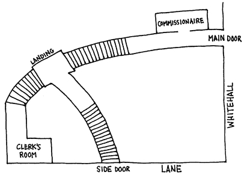

## Der Flottenvertrag

Der Juli direkt nach meiner Hochzeit <abbr title="in Erinnerung bleiben — запомниться">blieb mir in Erinnerung</abbr>, denn in diesem Monat gab es drei interessante Fälle. Ich hatte das <abbr title="das Privileg, die Privilegien — привилегия">Privileg</abbr>, mit Sherlock Holmes daran zu arbeiten und seine Methoden zu studieren. In meinen Notizen stehen sie unter den Titeln «Das Abenteuer des zweiten Flecks», «Das Abenteuer des Flottenvertrags» und «Das Abenteuer des müden Kapitäns». Im ersten Fall geht es aber um so wichtige Interessen, und so viele der ersten Familien des Königreichs sind darin verwickelt, dass man ihn noch viele Jahre lang nicht veröffentlichen kann. Dabei hat kein anderer Fall den Wert seiner analytischen Methoden so klar gezeigt. Und keiner hat alle, die daran beteiligt waren, so tief beeindruckt. Ich habe noch einen fast wörtlichen Bericht von dem Gespräch, in dem er die wahren Fakten erklärte. Seine Zuhörer waren Monsieur Dubugue von der Pariser Polizei und Fritz von Waldbaum, der bekannte Spezialist aus Danzig. Beide hatten ihre Energie an <abbr title="die Nebensache, die Nebensachen — второстепенное дело, мелочь">Nebensachen</abbr> verschwendet. Aber erst im neuen Jahrhundert wird man diese Geschichte ohne Gefahr erzählen können. Deshalb komme ich jetzt zum zweiten Fall auf meiner Liste. Auch er schien eine Zeit lang von nationaler Bedeutung zu sein, und einige Ereignisse machen ihn ganz einzigartig.

In meiner Schulzeit war ich eng mit einem Jungen namens Percy Phelps befreundet. Er war ungefähr so alt wie ich, aber zwei Klassen über mir. Er war ein glänzender Schüler und gewann jeden Preis, den die Schule zu vergeben hatte. Am Ende bekam er sogar ein <abbr title="das Stipendium, die Stipendien — стипендия">Stipendium</abbr> und setzte seine <abbr title="triumphal — триумфальный">triumphale</abbr> Laufbahn in Cambridge fort. Er hatte, soweit ich mich erinnere, sehr gute Beziehungen. Schon als kleine Jungen wussten wir alle, dass der Bruder seiner Mutter Lord Holdhurst war, der große <abbr title="konservativ — консервативный">konservative</abbr> Politiker. In der Schule half ihm diese prächtige Verwandtschaft wenig. Im Gegenteil: Wir fanden es besonders reizvoll, ihn über den <abbr title="der Schulhof, die Schulhöfe — школьный двор">Schulhof</abbr> zu jagen und ihm mit einem <abbr title="der Kricketschläger, die Kricketschläger — бита для крикета">Kricketschläger</abbr> gegen die <abbr title="das Schienbein, die Schienbeine — голень">Schienbeine</abbr> zu schlagen. Aber im <abbr title="das Berufsleben — профессиональная жизнь">Berufsleben</abbr> war das etwas anderes. Ich hörte vage, dass er dank seiner Fähigkeiten und seiner Beziehungen eine gute Stelle im <abbr title="das Außenministerium, die Außenministerien — министерство иностранных дел">Außenministerium</abbr> bekommen hatte. Danach vergaß ich ihn ganz, bis mich der folgende Brief wieder an ihn erinnerte:

*Briarbrae, Woking.*

«Mein lieber Watson!

Sicher erinnerst Du Dich noch an ‹Kaulquappe› Phelps. Ich war in der fünften Klasse, als Du in der dritten warst. Vielleicht hast Du auch gehört, dass ich durch den Einfluss meines Onkels eine gute Stelle im Außenministerium bekommen habe. Ich hatte dort eine Position voller Vertrauen und Ehre, bis plötzlich ein furchtbares Unglück meine Karriere zerstörte.

Es hat keinen Sinn, die Einzelheiten dieses schrecklichen Ereignisses aufzuschreiben. Wenn Du meine Bitte erfüllst, werde ich sie Dir wahrscheinlich erzählen müssen. Ich habe mich gerade erst von neun Wochen Nervenfieber erholt und bin immer noch sehr schwach. Meinst Du, Du könntest Deinen Freund Mr. Holmes zu mir bringen? Ich hätte gern seine Meinung zu dem Fall, obwohl mir die Behörden versichern, dass man nichts mehr tun kann. Bitte versuche, ihn mitzubringen, und zwar so bald wie möglich. Jede Minute kommt mir wie eine Stunde vor, solange ich in dieser furchtbaren Ungewissheit lebe. Sag ihm bitte: Wenn ich ihn nicht früher um Rat gebeten habe, dann nicht, weil ich seine Talente nicht schätze. Ich war nur nicht bei Verstand, seit mich der Schlag getroffen hat. Jetzt bin ich wieder klar. Aber ich wage nicht, zu viel daran zu denken, weil ich <abbr title="der Rückfall, die Rückfälle — рецидив">Angst vor einem Rückfall</abbr> habe. Ich bin immer noch so schwach, dass ich, wie Du siehst, <abbr title="diktieren — диктовать">diktieren</abbr> muss. Bitte bring ihn mit.

Dein alter <abbr title="der Schulkamerad, die Schulkameraden — школьный товарищ">Schulkamerad</abbr>

Percy Phelps»

Der Brief rührte mich. Etwas <abbr title="mitleiderregend — вызывающий жалость">Mitleiderregendes</abbr> lag in diesen wiederholten Bitten, Holmes mitzubringen. Ich war so bewegt, dass ich es auch versucht hätte, wenn es schwierig gewesen wäre. Aber natürlich wusste ich, dass Holmes seine Kunst liebte. Er war immer genauso bereit zu helfen, wie sein Klient bereit war, Hilfe zu bekommen. Meine Frau war mit mir einig, dass wir keinen Moment verlieren durften. So saß ich keine Stunde nach dem Frühstück wieder in unserer alten Wohnung in der Baker Street.

Holmes saß im Morgenmantel an seinem Beistelltisch und arbeitete eifrig an einem chemischen Experiment. Eine große, gebogene Retorte kochte heftig über der bläulichen Flamme eines Bunsenbrenners. Die destillierten Tropfen sammelten sich in einem <abbr title="der Messbecher, die Messbecher — мерный стакан">Messbecher</abbr> für zwei Liter. Als ich hereinkam, sah mein Freund kaum auf. Ich merkte, dass seine Untersuchung wichtig sein musste, setzte mich in einen Sessel und wartete. Er tauchte seine gläserne Pipette mal in diese, mal in jene Flasche und nahm aus jeder ein paar Tropfen. Am Ende brachte er ein Reagenzglas mit einer Lösung an den Tisch. In der rechten Hand hielt er einen Streifen <abbr title="das Lackmuspapier — лакмусовая бумажка">Lackmuspapier</abbr>.

— Sie kommen in einem entscheidenden Moment, Watson, — sagte er. — Wenn dieses Papier blau bleibt, ist alles gut. Wenn es rot wird, kostet es einen Mann das Leben.

Er tauchte es in das Reagenzglas, und es färbte sich sofort trüb und schmutzig <abbr title="purpurrot — багровый">purpurrot</abbr>.

— Hm! Das dachte ich mir! — rief er. — Gleich bin ich für Sie da, Watson. Tabak finden Sie im persischen Pantoffel.

Er ging zu seinem Schreibtisch und schrieb schnell ein paar Telegramme, die er dem Pagen gab. Dann warf er sich in den Sessel mir gegenüber und zog die Knie so hoch, dass seine Finger seine langen, dünnen Schienbeine <abbr title="umfassen — обхватывать">umfassten</abbr>.

— Ein ganz alltäglicher kleiner Mord, — sagte er. — Sie haben sicher etwas Besseres. Sie sind der Sturmvogel des Verbrechens, Watson. Was ist es?

Ich gab ihm den Brief. Er las ihn mit größter Konzentration.

— Er sagt uns nicht sehr viel, nicht wahr? — bemerkte er und gab ihn mir zurück.

— Fast nichts.

— Und doch ist die Handschrift interessant.

— Aber das ist doch nicht seine Handschrift.

— Genau. Es ist die einer Frau.

— Sicher die eines Mannes! — rief ich.

— Nein, die einer Frau, und zwar einer Frau mit seltenem Charakter. Sehen Sie, am Anfang einer Untersuchung ist es schon etwas wert, zu wissen: Der Klient steht in engem Kontakt mit einem Menschen, der – im Guten oder im Bösen – ein außergewöhnliches Wesen hat. Mein Interesse ist schon geweckt. Wenn Sie bereit sind, fahren wir gleich nach Woking. Wir besuchen diesen <abbr title="der Diplomat, die Diplomaten — дипломат">Diplomaten</abbr>, dem es so schlecht geht, und die Dame, der er seine Briefe diktiert.

Wir hatten Glück und erreichten in Waterloo einen frühen Zug. In knapp einer Stunde waren wir zwischen den <abbr title="der Tannenwald, die Tannenwälder — еловый лес">Tannenwäldern</abbr> und dem <abbr title="das Heidekraut — вереск">Heidekraut</abbr> von Woking. Briarbrae war ein großes, <abbr title="freistehend — отдельно стоящий">freistehendes</abbr> Haus mit einem weiten Grundstück, nur ein paar Minuten zu Fuß vom Bahnhof. Wir gaben unsere Visitenkarten ab und wurden in ein elegantes Wohnzimmer geführt. Nach ein paar Minuten kam ein ziemlich dicker Mann und begrüßte uns sehr <abbr title="gastfreundlich — гостеприимно">gastfreundlich</abbr>. Er war wohl eher vierzig als dreißig. Aber seine Wangen waren so rot und seine Augen so fröhlich, dass er noch immer wie ein <abbr title="pausbäckig — пухлощёкий">pausbäckiger</abbr>, frecher Junge wirkte.

— Ich bin so froh, dass Sie gekommen sind, — sagte er und schüttelte uns überschwänglich die Hände. — Percy hat den ganzen Morgen nach Ihnen gefragt. Ach, der arme Kerl <abbr title="sich an einen Strohhalm klammern — хвататься за соломинку">klammert sich an jeden Strohhalm</abbr>! Seine Eltern haben mich gebeten, Sie zu empfangen. Schon wenn man das Thema nur erwähnt, ist es für sie sehr schmerzlich.

— Wir kennen noch keine Einzelheiten, — bemerkte Holmes. — Ich sehe, dass Sie selbst nicht zur Familie gehören.

Unser neuer Bekannter sah überrascht aus. Dann sah er an sich hinunter und begann zu lachen.

— Natürlich, Sie haben das Monogramm J. H. auf meinem Medaillon gesehen, — sagte er. — Einen Moment lang dachte ich, Sie hätten etwas sehr Kluges getan. Ich heiße Joseph Harrison. Percy wird meine Schwester Annie heiraten, also werde ich wenigstens ein <abbr title="angeheiratet — свойственник (по браку)">angeheirateter</abbr> Verwandter. Meine Schwester finden Sie in seinem Zimmer. Sie pflegt ihn seit zwei Monaten Tag und Nacht. Wir gehen besser gleich hinein, denn ich weiß, wie ungeduldig er ist.

Das Zimmer, in das man uns führte, lag im selben Stockwerk wie das Wohnzimmer. Es war halb als Wohnzimmer, halb als Schlafzimmer eingerichtet, und in jeder Ecke standen <abbr title="hübsch — мило, изящно">hübsch</abbr> arrangierte Blumen. Auf einem Sofa neben dem offenen Fenster lag ein junger Mann, sehr blass und erschöpft. Durch das Fenster kamen der Duft des Gartens und die milde Sommerluft herein. Neben ihm saß eine Frau, die aufstand, als wir hereinkamen.

— Soll ich gehen, Percy? — fragte sie.

Er umklammerte ihre Hand, um sie festzuhalten.

— Wie geht es dir, Watson? — sagte er herzlich. — Mit diesem Schnurrbart hätte ich dich nie erkannt. Und du hättest wohl auch nicht schwören können, dass ich es bin. Das ist sicher dein berühmter Freund, Mr. Sherlock Holmes?

Ich stellte ihn mit ein paar Worten vor, und wir setzten uns beide. Der dicke junge Mann war gegangen. Aber seine Schwester blieb und hielt die Hand des Kranken. Sie war eine auffallende Frau, für eine perfekte Figur ein wenig zu klein und zu kräftig. Aber sie hatte eine schöne olivfarbene Haut, große, dunkle, italienische Augen und eine Fülle von tiefschwarzem Haar. Neben ihren satten Farben wirkte das weiße Gesicht ihres Verlobten noch abgezehrter und hagerer.

— Ich will Ihre Zeit nicht verschwenden, — sagte er und richtete sich auf dem Sofa auf. — Ich komme ohne lange <abbr title="die Vorrede, die Vorreden — предисловие">Vorrede</abbr> zur Sache. Ich war ein glücklicher, erfolgreicher Mann, Mr. Holmes, und kurz vor meiner Hochzeit. Da hat ein plötzliches, furchtbares Unglück alle meine Aussichten im Leben zerstört.

Wie Watson Ihnen vielleicht erzählt hat, arbeitete ich im Außenministerium. Durch den Einfluss meines Onkels, Lord Holdhurst, stieg ich schnell zu einer <abbr title="verantwortungsvoll — ответственный">verantwortungsvollen</abbr> Position auf. Als mein Onkel in dieser Regierung Außenminister wurde, gab er mir mehrere vertrauliche Aufträge. Ich habe sie immer erfolgreich erledigt. So hatte er am Ende das größte Vertrauen in meine Fähigkeiten und meinen Takt.

Vor fast zehn Wochen – genauer gesagt am dreiundzwanzigsten Mai – rief er mich in sein privates Büro. Er lobte mich für meine gute Arbeit. Dann sagte er mir, dass er einen neuen vertraulichen Auftrag für mich habe.

«Das hier», sagte er und nahm eine graue Papierrolle aus seinem Sekretär, «ist das Original des geheimen <abbr title="der Vertrag, die Verträge — договор">Vertrags</abbr> zwischen England und Italien. Leider sind schon einige Gerüchte darüber in die Presse gekommen. Es ist von enormer Bedeutung, dass nichts mehr nach draußen <abbr title="dringen (drang, ist gedrungen) — проникать, просачиваться">dringt</abbr>. Die französische oder die russische <abbr title="die Botschaft, die Botschaften — посольство">Botschaft</abbr> würde eine riesige Summe bezahlen, um den Inhalt dieser Papiere zu erfahren. Sie würden meinen Sekretär nie verlassen, wenn man sie nicht unbedingt <abbr title="abschreiben (schrieb ab, hat abgeschrieben) — переписывать, копировать">abschreiben</abbr> müsste. Sie haben einen Schreibtisch in Ihrem Büro?»

«Ja, Sir.»

«Dann nehmen Sie den Vertrag und schließen Sie ihn dort ein. Ich gebe Anweisung, dass Sie bleiben dürfen, wenn die anderen gehen. So können Sie ihn in Ruhe abschreiben, ohne dass Ihnen jemand zusieht. Wenn Sie fertig sind, schließen Sie das Original und die Abschrift wieder in den Schreibtisch ein. Morgen früh geben Sie mir beides persönlich.»

Ich nahm die Papiere und …

— Entschuldigen Sie einen Moment, — sagte Holmes. — Waren Sie bei diesem Gespräch allein?

— Absolut.

— In einem großen Raum?

— Etwa zehn Meter in jede Richtung.

— In der Mitte?

— Ja, ungefähr.

— Und Sie haben leise gesprochen?

— Mein Onkel spricht immer auffallend leise. Ich selbst habe fast gar nichts gesagt.

— Danke, — sagte Holmes und schloss die Augen. — Bitte fahren Sie fort.

— Ich tat genau, was er gesagt hatte, und wartete, bis die anderen Beamten gegangen waren. Einer von ihnen in meinem Zimmer, Charles Gorot, musste noch <abbr title="liegen bleiben — оставаться несделанным">liegen gebliebene</abbr> Arbeit <abbr title="nachholen — наверстать">nachholen</abbr>. Ich ließ ihn dort und ging essen. Als ich zurückkam, war er weg. Ich wollte mich mit der Arbeit beeilen. Ich wusste nämlich, dass Joseph – Mr. Harrison, den Sie gerade gesehen haben – in der Stadt war und mit dem Elf-Uhr-Zug nach Woking fahren wollte. Diesen Zug wollte ich wenn möglich auch erreichen.

Als ich den Vertrag ansah, merkte ich sofort, dass mein Onkel nicht übertrieben hatte. Ohne Einzelheiten zu nennen, kann ich sagen: Er legte die Position Großbritanniens gegenüber dem <abbr title="der Dreibund — Тройственный союз">Dreibund</abbr> fest. Und er zeigte, welche Politik unser Land verfolgen würde, falls die französische <abbr title="die Flotte, die Flotten — флот">Flotte</abbr> im <abbr title="das Mittelmeer — Средиземное море">Mittelmeer</abbr> die italienische völlig beherrschte. Es ging darin nur um Fragen der <abbr title="die Marine — военно-морской флот">Marine</abbr>. Am Ende standen die Unterschriften der hohen <abbr title="der Würdenträger, die Würdenträger — сановник">Würdenträger</abbr>, die ihn unterzeichnet hatten. Ich überflog ihn und machte mich dann an die Abschrift.

Es war ein langes Dokument in französischer Sprache, mit sechsundzwanzig einzelnen Artikeln. Ich schrieb so schnell ich konnte. Aber um neun Uhr hatte ich erst neun Artikel fertig, und meinen Zug konnte ich vergessen. Ich war müde und benommen, zum Teil vom Essen, zum Teil von dem langen Arbeitstag. Eine Tasse Kaffee würde meinen Kopf klar machen. Ein <abbr title="der Amtsdiener, die Amtsdiener — швейцар, служитель">Amtsdiener</abbr> sitzt die ganze Nacht in einer kleinen <abbr title="die Loge, die Logen — будка, швейцарская">Loge</abbr> unten an der Treppe. Er kocht gewöhnlich auf seinem <abbr title="der Spirituskocher, die Spirituskocher — спиртовка">Spirituskocher</abbr> Kaffee für die Beamten, die <abbr title="die Überstunde, die Überstunden — сверхурочная работа">Überstunden</abbr> machen. Also läutete ich, um ihn zu rufen.

Zu meiner Überraschung kam eine Frau: eine große, ältere Frau mit einem groben Gesicht und einer Schürze. Sie erklärte, sie sei die Frau des Amtsdieners und mache hier <abbr title="sauber machen — убирать">sauber</abbr>. Ich bestellte bei ihr den Kaffee.

Ich schrieb noch zwei Artikel. Dann war ich müder als je zuvor. Ich stand auf und ging im Zimmer auf und ab, um mir die Beine zu <abbr title="sich die Beine vertreten — размять ноги">vertreten</abbr>. Mein Kaffee war noch nicht gekommen, und ich fragte mich, warum er so lange dauerte. Ich öffnete die Tür und ging den Korridor hinunter, um nachzusehen. Von meinem Arbeitszimmer führte ein gerader, schwach beleuchteter Gang weg. Das war der einzige Ausgang aus dem Zimmer. Er endete an einer geschwungenen Treppe. Unten, im Gang, ist die Loge des Amtsdieners. Auf halber Höhe hat diese Treppe einen kleinen Treppenabsatz. Dort <abbr title="münden — впадать, выходить (о проходе)">mündet</abbr> im rechten Winkel ein zweiter Gang. Er führt über eine zweite kleine Treppe zu einer Seitentür. Die Dienstboten benutzen sie, und auch die Beamten nehmen sie als Abkürzung, wenn sie aus der Charles Street kommen. Hier ist eine grobe Skizze von dem Ort.

Auf der Skizze stand alles auf Englisch: «Clerk's Room» war das Arbeitszimmer von Phelps, «Landing» der Treppenabsatz, «Commissionaire» die Loge des Amtsdieners, «Main Door» der Haupteingang zur Straße Whitehall, und «Side Door» die Seitentür zur «Lane», also zu der kleinen Gasse, der Charles Street.

— Danke. Ich glaube, ich kann Ihnen gut folgen, — sagte Sherlock Holmes.

— Es ist äußerst wichtig, dass Sie sich diesen Punkt merken. Ich ging die Treppe hinunter in die Halle. Dort fand ich den Amtsdiener tief schlafend in seiner Loge. Der Wasserkessel kochte heftig auf dem Spirituskocher. Ich nahm den Kessel herunter und blies die Flamme aus, denn das Wasser spritzte schon auf den Boden. Dann streckte ich die Hand aus und wollte den Mann <abbr title="wachrütteln — растолкать, разбудить">wachrütteln</abbr>, der immer noch fest schlief. Da läutete eine Glocke über seinem Kopf laut, und er wachte erschrocken auf.

«Mr. Phelps, Sir!», sagte er und sah mich verwirrt an.

«Ich bin heruntergekommen, um zu sehen, ob mein Kaffee fertig ist.»

«Ich habe das Wasser aufgesetzt, und dann bin ich eingeschlafen, Sir.»

Er sah mich an und dann hinauf zu der Glocke, die noch zitterte. Sein Gesicht wurde immer erstaunter.

«Wenn Sie hier sind, Sir, wer hat dann die Glocke geläutet?», fragte er.

«Die Glocke!», rief ich. «Was für eine Glocke ist das?»

«Das ist die Glocke von dem Zimmer, in dem Sie gearbeitet haben.»

Mir war, als ob sich eine kalte Hand um mein Herz <abbr title="sich legen — ложиться">legte</abbr>. Jemand war also in dem Zimmer, in dem mein kostbarer Vertrag auf dem Tisch lag. Ich rannte wie wahnsinnig die Treppe hinauf und den Gang entlang. In den Gängen war niemand, Mr. Holmes. Im Zimmer war niemand. Alles war genau so, wie ich es verlassen hatte. Nur die Papiere, die man mir anvertraut hatte, waren vom Schreibtisch verschwunden. Die Abschrift war da, das Original war weg.

Holmes setzte sich in seinem Sessel auf und rieb sich die Hände. Ich sah, dass das Problem ganz nach seinem Herzen war.

— Und was taten Sie dann, bitte? — murmelte er.

— Ich verstand sofort, dass der Dieb von der Seitentür die Treppe heraufgekommen sein musste. Wenn er den anderen Weg genommen hätte, hätte ich ihn ja treffen müssen.

— Sind Sie sicher, dass er sich nicht die ganze Zeit im Zimmer versteckt hatte? Oder in dem Gang, der, wie Sie sagen, schwach beleuchtet war?

— Das ist absolut unmöglich. Nicht einmal eine Ratte könnte sich im Zimmer oder im Gang verstecken. Es gibt dort keinerlei <abbr title="die Deckung — укрытие">Deckung</abbr>.

— Danke. Bitte weiter.

— Der Amtsdiener hatte an meinem blassen Gesicht gesehen, dass etwas Schlimmes passiert war, und war mir nach oben gefolgt. Jetzt rannten wir beide den Gang entlang und die steile Treppe zur Charles Street hinunter. Die Tür unten war <abbr title="zu sein — быть закрытым">zu</abbr>, aber nicht abgeschlossen. Wir rissen sie auf und stürzten hinaus. Ich erinnere mich genau, dass in diesem Moment eine Uhr in der Nähe dreimal schlug. Es war Viertel vor zehn.

— Das ist von enormer Bedeutung, — sagte Holmes und machte sich eine Notiz auf seiner Manschette.

— Die Nacht war sehr dunkel, und es fiel ein dünner, warmer Regen. In der Charles Street war niemand. Aber am Ende der Straße, in Whitehall, war wie immer viel Verkehr. Wir rannten ohne Hut den Bürgersteig entlang. An der Ecke stand ein Polizist.

«Es gab einen Diebstahl», keuchte ich. «Man hat ein Dokument von riesigem Wert aus dem Außenministerium gestohlen. Ist hier jemand vorbeigekommen?»

«Ich stehe seit einer Viertelstunde hier, Sir», sagte er. «In dieser Zeit ist nur eine einzige Person vorbeigekommen: eine Frau, groß und älter, mit einem <abbr title="der Paisley-Schal, die Paisley-Schals — шаль с узором «пейсли»">Paisley-Schal</abbr>.»

«Ach, das ist nur meine Frau», rief der Amtsdiener. «Ist sonst niemand vorbeigekommen?»

«Niemand.»

«Dann muss der Dieb den anderen Weg genommen haben», rief der Mann und zog mich am Ärmel.

Aber ich war nicht zufrieden. Und weil er so sehr versuchte, mich wegzuziehen, wurde mein Verdacht nur größer.

«In welche Richtung ist die Frau gegangen?», rief ich.

«Das weiß ich nicht, Sir. Ich habe gesehen, dass sie vorbeiging, aber ich hatte keinen besonderen Grund, sie zu beobachten. Sie schien es eilig zu haben.»

«Wie lange ist das her?»

«Oh, nicht sehr viele Minuten.»

«Weniger als fünf?»

«Nun, mehr als fünf können es nicht sein.»

«Sie verschwenden nur Ihre Zeit, Sir, und jetzt ist jede Minute wichtig», rief der Amtsdiener. «Glauben Sie mir, meine Alte hat nichts damit zu tun. Kommen Sie zum anderen Ende der Straße. Na gut, wenn Sie nicht wollen, dann gehe ich allein.» Und damit lief er in die andere Richtung davon.

Aber ich war sofort hinter ihm und packte ihn am Ärmel.

«Wo wohnen Sie?», fragte ich.

«Ivy Lane 16, Brixton», antwortete er. «Aber lassen Sie sich nicht auf eine falsche Fährte locken, Mr. Phelps. Kommen Sie zum anderen Ende der Straße. Vielleicht erfahren wir dort etwas.»

Es schadete nichts, seinem Rat zu folgen. Mit dem Polizisten liefen wir beide hinunter. Aber die Straße war voller Verkehr. Viele Leute kamen und gingen, aber alle wollten in dieser nassen Nacht nur schnell ins Trockene. Da stand kein Herumtreiber, der uns hätte sagen können, wer vorbeigegangen war.

Dann gingen wir zurück ins Amt und durchsuchten die Treppe und den Gang, aber ohne Ergebnis. Der Gang zu meinem Zimmer ist mit einer Art cremefarbenem Linoleum belegt, auf dem man jeden Abdruck sehr leicht sieht. Wir untersuchten ihn sehr genau, fanden aber nicht die Spur eines Fußabdrucks.

— Hatte es den ganzen Abend geregnet?

— Seit etwa sieben Uhr.

— Wie kommt es dann, dass die Frau, die gegen neun ins Zimmer kam, mit ihren schmutzigen Stiefeln keine Spuren hinterließ?

— Ich bin froh, dass Sie das fragen. Daran habe ich damals auch gedacht. Die <abbr title="die Putzfrau, die Putzfrauen — уборщица">Putzfrauen</abbr> ziehen gewöhnlich beim Amtsdiener ihre Stiefel aus und <abbr title="der Filzpantoffel, die Filzpantoffeln — войлочная туфля">Filzpantoffeln</abbr> an.

— Das ist sehr klar. Es gab also keine Spuren, obwohl die Nacht nass war? Diese Kette von Ereignissen ist wirklich außergewöhnlich interessant. Was taten Sie als Nächstes?

— Wir untersuchten auch das Zimmer. Eine <abbr title="die Geheimtür, die Geheimtüren — потайная дверь">Geheimtür</abbr> gibt es dort nicht, und die Fenster sind gut zehn Meter über dem Boden. Beide waren von innen geschlossen. Der Teppich macht eine Falltür unmöglich, und die Decke ist ganz normal und weiß gestrichen. Ich wette mein Leben darauf: Wer meine Papiere gestohlen hat, kann nur durch die Tür gekommen sein.

— Und der Kamin?

— Den benutzt man nicht. Es gibt einen Ofen. Der Klingelzug hängt direkt rechts neben meinem Schreibtisch. Wer ihn gezogen hat, muss also direkt bis an den Schreibtisch gekommen sein. Aber warum sollte ein Verbrecher läuten wollen? Das ist ein völlig unlösbares Rätsel.

— Das war sicher ein ungewöhnlicher Vorfall. Was taten Sie dann? Sie haben das Zimmer sicher untersucht, ob der Eindringling Spuren hinterlassen hatte – einen Zigarrenstummel, einen verlorenen Handschuh, eine <abbr title="die Haarnadel, die Haarnadeln — шпилька">Haarnadel</abbr> oder eine andere Kleinigkeit?

— So etwas gab es nicht.

— Kein Geruch?

— Nun, daran haben wir nicht gedacht.

— Ach, ein Geruch von Tabak wäre für eine solche Untersuchung sehr viel wert gewesen.

— Ich rauche selbst nie. Deshalb glaube ich, dass ich Tabakgeruch bemerkt hätte. Es gab absolut keinen Hinweis. Die einzige greifbare Tatsache war, dass die Frau des Amtsdieners – sie heißt Mrs. Tangey – es sehr eilig gehabt hatte. Er konnte das nur damit erklären, dass sie um diese Zeit immer nach Hause ging. Der Polizist und ich waren uns einig: Am besten mussten wir die Frau festnehmen, bevor sie die Papiere loswerden konnte – falls sie sie hatte.

Inzwischen war die Nachricht bei Scotland Yard angekommen. Mr. Forbes, der Detektiv, kam sofort und übernahm den Fall mit viel Energie. Wir nahmen eine Droschke und waren in einer halben Stunde an der Adresse, die man uns gegeben hatte. Eine junge Frau öffnete die Tür. Es war Mrs. Tangeys älteste Tochter. Ihre Mutter war noch nicht zurück, und man ließ uns im vorderen Zimmer warten.

Etwa zehn Minuten später klopfte es an der Tür. Und hier machten wir den einzigen ernsten Fehler, für den ich mir selbst die Schuld gebe. Statt selbst zu öffnen, ließen wir das Mädchen öffnen. Wir hörten sie sagen: «Mutter, im Haus warten zwei Männer auf dich.» Und gleich danach hörten wir schnelle Schritte den Gang hinunterlaufen. Forbes riss die Tür auf, und wir beide rannten ins hintere Zimmer, in die Küche. Aber die Frau war vor uns dort. Sie starrte uns trotzig an. Dann erkannte sie plötzlich mich, und ihr Gesicht zeigte völliges Erstaunen.

«Ja, ist das nicht Mr. Phelps aus dem Amt!», rief sie.

«Na, na, für wen haben Sie uns denn gehalten, als Sie vor uns weggelaufen sind?», fragte mein Begleiter.

«Ich dachte, Sie wären die <abbr title="der Gerichtsvollzieher, die Gerichtsvollzieher — судебный пристав">Gerichtsvollzieher</abbr>», sagte sie. «Wir haben Ärger mit einem Händler.»

«Das reicht nicht ganz», antwortete Forbes. «Wir haben Grund zu glauben, dass Sie ein wichtiges Papier aus dem Außenministerium genommen haben und hier hereingelaufen sind, um es <abbr title="verschwinden lassen — спрятать, уничтожить">verschwinden</abbr> zu lassen. Sie müssen mit uns zu Scotland Yard kommen. Dort werden Sie durchsucht.»

Sie protestierte und wehrte sich, aber es war vergeblich. Man holte eine Kutsche, und wir fuhren alle drei zurück. Vorher hatten wir die Küche untersucht, besonders das <abbr title="das Herdfeuer — огонь в очаге">Herdfeuer</abbr>. Wir wollten sehen, ob sie die Papiere in dem Moment, in dem sie allein war, beseitigt hatte. Aber es gab keine Spur von Asche oder Fetzen. Bei Scotland Yard wurde sie sofort einer <abbr title="die Polizistin, die Polizistinnen — женщина-полицейский">Polizistin</abbr> übergeben, die sie durchsuchte. Ich wartete voller Qual, bis sie mit ihrem Bericht zurückkam. Von den Papieren keine Spur.

Da erst begriff ich mit voller Kraft, wie furchtbar meine Lage war. Bis dahin hatte ich gehandelt, und das Handeln hatte das Denken betäubt. Ich war so sicher gewesen, den Vertrag sofort zurückzubekommen, dass ich nicht gewagt hatte, an die Folgen zu denken. Aber jetzt gab es nichts mehr zu tun, und ich hatte Zeit, meine Lage zu verstehen. Sie war schrecklich. Watson kann Ihnen sagen, dass ich in der Schule ein nervöser, empfindlicher Junge war. So bin ich eben. Ich dachte an meinen Onkel und an seine Kollegen im <abbr title="das Kabinett, die Kabinette — кабинет министров">Kabinett</abbr>. Ich dachte an die Schande, die ich über ihn, über mich und über alle meine Angehörigen gebracht hatte. Was half es, dass ich das Opfer eines außergewöhnlichen Zufalls war? Wenn es um diplomatische Interessen geht, entschuldigt man keine Zufälle. Ich war ruiniert, schändlich und hoffnungslos ruiniert. Ich weiß nicht, was ich tat. Ich glaube, ich habe eine <abbr title="eine Szene machen — устроить сцену">Szene</abbr> gemacht. Ich erinnere mich dunkel an eine Gruppe von Beamten, die um mich herumstanden und versuchten, mich zu beruhigen. Einer von ihnen fuhr mit mir nach Waterloo und setzte mich in den Zug nach Woking. Ich glaube, er wäre den ganzen Weg mitgekommen. Aber Dr. Ferrier, der in meiner Nähe wohnt, fuhr mit genau diesem Zug. Der Doktor kümmerte sich sehr freundlich um mich. Und das war gut so, denn auf dem Bahnhof bekam ich einen Anfall, und bevor wir zu Hause waren, war ich praktisch ein tobender <abbr title="der Wahnsinnige, die Wahnsinnigen — сумасшедший">Wahnsinniger</abbr>.

Sie können sich vorstellen, wie es hier war, als der Doktor alle aus den Betten läutete und sie mich in diesem Zustand fanden. Die arme Annie hier und meine Mutter waren verzweifelt. Dr. Ferrier hatte auf dem Bahnhof vom Detektiv gerade genug gehört, um zu erklären, was passiert war. Seine Geschichte machte es nicht besser. Allen war klar, dass ich lange krank sein würde. Deshalb musste Joseph schnell aus diesem gemütlichen Schlafzimmer ausziehen, und man machte ein Krankenzimmer für mich daraus. Hier habe ich über neun Wochen gelegen, Mr. Holmes, ohne Bewusstsein und im Fieberwahn. Ohne Miss Harrison hier und ohne die Pflege des Doktors würde ich jetzt nicht mit Ihnen sprechen. Am Tag hat sie mich gepflegt, und in der Nacht eine bezahlte Krankenschwester. Denn in meinen Anfällen war ich zu allem fähig. Langsam ist mein Verstand wieder klar geworden. Aber erst seit drei Tagen ist mein Gedächtnis ganz zurück. Manchmal wünsche ich, es wäre nie zurückgekommen. Als Erstes telegrafierte ich an Mr. Forbes, der den Fall bearbeitete. Er kam her und versicherte mir, dass man alles getan, aber nicht die kleinste Spur gefunden habe. Den Amtsdiener und seine Frau hat man auf jede Weise verhört, ohne dass die Sache klarer wurde. Dann richtete sich der Verdacht der Polizei auf den jungen Gorot. Wie Sie sich erinnern, blieb er an diesem Abend länger im Büro. Aber nur zwei Dinge sprachen gegen ihn: dass er länger geblieben war und dass er einen französischen Namen hat. In Wirklichkeit habe ich mit der Arbeit erst begonnen, als er schon weg war. Und seine Familie stammt von den <abbr title="der Hugenotte, die Hugenotten — гугенот">Hugenotten</abbr> ab, ist aber im Herzen und in ihren Traditionen so englisch wie Sie und ich. Man fand nichts, was ihn belastete, und dabei blieb es. Ich wende mich an Sie, Mr. Holmes, als meine absolut letzte Hoffnung. Wenn Sie mir nicht helfen können, sind meine Ehre und meine Stellung für immer verloren.

Der Kranke sank in seine Kissen zurück, ganz erschöpft von dem langen Bericht. Seine <abbr title="die Pflegerin, die Pflegerinnen — сиделка">Pflegerin</abbr> goss ihm ein Glas mit einer <abbr title="stärkend — укрепляющий">stärkenden</abbr> Medizin ein. Holmes saß schweigend da, den Kopf zurückgelegt und die Augen geschlossen. Einem Fremden wäre diese Haltung vielleicht <abbr title="teilnahmslos — безучастный">teilnahmslos</abbr> erschienen. Aber ich wusste, dass sie höchste Konzentration bedeutete.

— Ihr Bericht war so ausführlich, — sagte er schließlich, — dass Sie mir wirklich nur wenige Fragen übrig gelassen haben. Eine ist allerdings von allergrößter Bedeutung. Haben Sie jemandem erzählt, dass Sie diesen besonderen Auftrag hatten?

— Niemandem.

— Auch nicht Miss Harrison hier, zum Beispiel?

— Nein. Zwischen dem Auftrag und seiner Ausführung war ich nicht in Woking.

— Und niemand von Ihren Leuten hatte Sie zufällig besucht?

— Niemand.

— Kannte sich einer von ihnen im Amt aus?

— Oh ja, man hatte ihnen allen das Amt gezeigt.

— Aber wenn Sie niemandem etwas von dem Vertrag gesagt haben, sind diese Fragen natürlich unwichtig.

— Ich habe nichts gesagt.

— Wissen Sie etwas über den Amtsdiener?

— Nur dass er ein alter Soldat ist.

— Welches Regiment?

— Oh, ich habe gehört … die Coldstream Guards.

— Danke. Die Einzelheiten bekomme ich sicher von Forbes. Die Behörden sind ausgezeichnet darin, Fakten zu sammeln, auch wenn sie sie nicht immer gut nutzen. Was für ein herrliches Ding ist doch eine Rose!

Er ging am Sofa vorbei zum offenen Fenster. Er hob den <abbr title="herabhängen — свисать">herabhängenden</abbr> <abbr title="der Stiel, die Stiele — стебель">Stiel</abbr> einer <abbr title="die Moosrose, die Moosrosen — моховая роза">Moosrose</abbr> hoch und betrachtete die feine Mischung aus <abbr title="das Karminrot — карминный, малиновый цвет">Karminrot</abbr> und Grün. Das war für mich eine neue Seite seines Charakters. Ich hatte ihn noch nie für Dinge der Natur so interessiert gesehen.

— Nirgends ist Deduktion so nötig wie in der Religion, — sagte er und lehnte sich mit dem Rücken an die Fensterläden. — Ein Denker kann sie als exakte Wissenschaft aufbauen. Unsere sicherste Gewissheit, dass die Vorsehung gut ist, liegt für mich in den Blumen. Alles andere – unsere Kräfte, unsere Wünsche, unser Essen – brauchen wir wirklich zum Leben. Aber diese Rose ist eine <abbr title="die Zugabe, die Zugaben — добавка, «сверх программы»">Zugabe</abbr>. Ihr Duft und ihre Farbe sind ein Schmuck des Lebens, keine Bedingung dafür. Nur die Güte gibt Zugaben. Und deshalb sage ich noch einmal: Wir dürfen von den Blumen viel hoffen.

Percy Phelps und seine Pflegerin sahen Holmes während dieser Rede überrascht an, und in ihren Gesichtern stand deutliche Enttäuschung. Mit der Moosrose zwischen den Fingern war er in <abbr title="die Träumerei, die Träumereien — мечтательность, задумчивость">Träumerei</abbr> versunken. Das dauerte einige Minuten, bis die junge Dame ihn unterbrach.

— Sehen Sie eine Chance, dieses Rätsel zu lösen, Mr. Holmes? — fragte sie. In ihrer Stimme lag eine gewisse <abbr title="die Schärfe — резкость">Schärfe</abbr>.

— Oh, das Rätsel! — antwortete er und kam mit einem kleinen Ruck in die Wirklichkeit zurück. — Nun, es wäre absurd zu leugnen, dass der Fall sehr <abbr title="undurchsichtig — туманный, непрозрачный">undurchsichtig</abbr> und kompliziert ist. Aber ich verspreche Ihnen, dass ich die Sache untersuchen und Ihnen alles mitteilen werde, was mir auffällt.

— Sehen Sie einen Hinweis?

— Sie haben mir sieben gegeben. Aber natürlich muss ich sie prüfen, bevor ich über ihren Wert urteilen kann.

— Verdächtigen Sie jemanden?

— Ich verdächtige mich selbst.

— Was?

— Zu schnell Schlüsse zu ziehen.

— Dann fahren Sie nach London und prüfen Sie Ihre Schlüsse.

— Ihr Rat ist ausgezeichnet, Miss Harrison, — sagte Holmes und stand auf. — Ich glaube, Watson, wir können nichts Besseres tun. Machen Sie sich keine falschen Hoffnungen, Mr. Phelps. Die Sache ist sehr verwickelt.

— Ich werde <abbr title="wie im Fieber — как в лихорадке">wie im Fieber</abbr> sein, bis ich Sie wiedersehe, — rief der Diplomat.

— Nun, ich komme morgen mit demselben Zug. Aber sehr wahrscheinlich wird mein Bericht <abbr title="negativ — отрицательный">negativ</abbr> sein.

— Gott segne Sie für Ihr Versprechen! — rief unser Klient. — Es gibt mir neues Leben zu wissen, dass etwas getan wird. Übrigens, ich habe einen Brief von Lord Holdhurst bekommen.

— Ha! Was schreibt er?

— Er war kühl, aber nicht hart. Wahrscheinlich hat ihn meine schwere Krankheit daran gehindert. Er wiederholte, dass die Sache von größter Bedeutung sei. Und er fügte hinzu, dass man über meine Zukunft – damit meint er natürlich meine Entlassung – nichts entscheiden werde, bis ich wieder gesund sei und Gelegenheit hätte, mein Unglück wiedergutzumachen.

— Nun, das war vernünftig und rücksichtsvoll, — sagte Holmes. — Kommen Sie, Watson, in der Stadt wartet ein ordentlicher Tag Arbeit auf uns.

Mr. Joseph Harrison fuhr uns zum Bahnhof, und bald sausten wir in einem Zug aus Portsmouth Richtung London. Holmes war tief in Gedanken versunken und sagte kaum ein Wort, bis wir an Clapham Junction vorbei waren.

— Es ist wirklich erfreulich, auf einer dieser hohen <abbr title="die Bahnstrecke, die Bahnstrecken — железнодорожная линия">Bahnstrecken</abbr> nach London zu fahren, wo man so auf die Häuser hinuntersehen kann.

Ich dachte, er mache einen Witz, denn die Aussicht war ziemlich trostlos. Aber bald erklärte er sich.

— Sehen Sie diese großen, einzelnen Gebäudegruppen, die über die Schieferdächer hinausragen? Wie Inseln aus Backstein in einem bleigrauen Meer.

— Die <abbr title="die Volksschule, die Volksschulen — народная (начальная) школа">Volksschulen</abbr>.

— Leuchttürme, mein Junge! Leuchtfeuer der Zukunft! <abbr title="die Kapsel, die Kapseln — коробочка (семенная), капсула">Kapseln</abbr> mit Hunderten von hellen kleinen <abbr title="der Samen, die Samen — семя">Samen</abbr>, und aus ihnen wird das klügere, bessere England der Zukunft wachsen. Dieser Phelps trinkt wohl nicht, oder?

— Ich glaube nicht.

— Ich auch nicht. Aber wir müssen jede Möglichkeit berücksichtigen. Der arme Teufel steckt wirklich <abbr title="in Schwierigkeiten stecken — быть в беде">in großen Schwierigkeiten</abbr>, und es ist die Frage, ob wir ihn je wieder ans Ufer bringen können. Was halten Sie von Miss Harrison?

— Ein Mädchen mit starkem Charakter.

— Ja, und ein guter Mensch, wenn ich mich nicht irre. Sie und ihr Bruder sind die einzigen Kinder eines <abbr title="der Eisenhüttenbesitzer, die Eisenhüttenbesitzer — владелец металлургического завода">Eisenhüttenbesitzers</abbr> irgendwo oben in Northumberland. Phelps hat sich letzten Winter auf einer Reise mit ihr verlobt. Sie kam her, um seine Familie kennenzulernen, und ihr Bruder kam als Begleitung mit. Dann kam der Zusammenbruch, und sie blieb, um ihren Verlobten zu pflegen. Und Bruder Joseph fand es hier ganz behaglich und blieb auch. Sie sehen, ich habe ein paar eigene Erkundigungen eingezogen. Aber heute muss ein Tag der Erkundigungen werden.

— Meine Praxis … — begann ich.

— Oh, wenn Sie Ihre eigenen Fälle interessanter finden als meine … — sagte Holmes etwas gereizt.

— Ich wollte sagen, dass meine Praxis ein oder zwei Tage gut ohne mich auskommt, weil jetzt die ruhigste Zeit im Jahr ist.

— Ausgezeichnet, — sagte er, und seine gute Laune war wieder da. — Dann untersuchen wir die Sache zusammen. Ich denke, wir sollten mit Forbes anfangen. Er kann uns wahrscheinlich alle Einzelheiten sagen, die wir brauchen, bis wir wissen, von welcher Seite wir den Fall angehen müssen.

— Sie sagten, Sie hätten einen Hinweis?

— Nun, wir haben mehrere. Aber ihren Wert können wir nur durch weitere Untersuchungen prüfen. Am schwersten aufzuspüren ist ein Verbrechen ohne Zweck. Aber dieses hat einen Zweck. Wer hat einen Nutzen davon? Da ist der französische <abbr title="der Botschafter, die Botschafter — посол">Botschafter</abbr>, da ist der russische, da ist jeder, der den Vertrag an einen der beiden verkaufen könnte. Und da ist Lord Holdhurst.

— Lord Holdhurst!

— Nun, es ist immerhin denkbar, dass ein Staatsmann in eine Lage kommt, in der es ihm nicht leidtut, wenn ein solches Dokument zufällig vernichtet wird.

— Doch nicht ein Staatsmann mit dem ehrenhaften Ruf von Lord Holdhurst?

— Es ist eine Möglichkeit, und wir dürfen sie nicht <abbr title="außer Acht lassen — упускать из виду">außer Acht lassen</abbr>. Wir besuchen den edlen Lord heute und finden heraus, ob er uns etwas sagen kann. Inzwischen habe ich schon Nachforschungen <abbr title="in Gang setzen — запустить, привести в движение">in Gang gesetzt</abbr>.

— Schon?

— Ja, ich habe vom Bahnhof in Woking an jede Londoner Abendzeitung telegrafiert. Diese Anzeige wird in jeder von ihnen erscheinen.

Er gab mir ein Blatt, das aus einem Notizbuch <abbr title="herausreißen (riss heraus, hat herausgerissen) — вырывать">herausgerissen</abbr> war. Darauf stand mit Bleistift:

«10 Pfund Belohnung. Gesucht wird die Nummer der Droschke, die am Abend des 23. Mai um Viertel vor zehn einen Fahrgast an oder nahe der Tür des Außenministeriums in der Charles Street absetzte. Meldungen an Baker Street 221B.»

— Sie sind sicher, dass der Dieb mit einer Droschke kam?

— Wenn nicht, schadet es nichts. Aber wenn Mr. Phelps recht hat und es weder im Zimmer noch in den Gängen ein Versteck gibt, dann muss die Person von draußen gekommen sein. Wenn sie in einer so nassen Nacht von draußen kam und trotzdem keine feuchten Spuren auf dem Linoleum hinterließ, das man wenige Minuten später untersuchte, dann ist es äußerst wahrscheinlich, dass sie mit einer Droschke kam. Ja, ich denke, wir können ruhig auf eine Droschke schließen.

— Das klingt einleuchtend.

— Das ist einer der Hinweise, von denen ich sprach. Er kann uns zu etwas führen. Und dann ist da natürlich die Glocke – das auffälligste Merkmal des Falls. Warum hat die Glocke geläutet? War es der Dieb, aus reinem <abbr title="der Übermut — бравада, озорство">Übermut</abbr>? Oder war jemand bei dem Dieb, der das Verbrechen verhindern wollte? Oder war es ein Zufall? Oder war es …?

Er versank wieder in tiefes, schweigendes Nachdenken. Aber ich kannte jede seiner Stimmungen, und mir schien, dass ihm plötzlich eine neue Möglichkeit eingefallen war.

Es war zwanzig nach drei, als wir in der <abbr title="die Endstation, die Endstationen — конечная станция">Endstation</abbr> ankamen. Nach einem schnellen Mittagessen am Büfett fuhren wir sofort zu Scotland Yard. Holmes hatte Forbes schon telegrafiert, und er erwartete uns: ein kleiner Mann mit einem <abbr title="fuchsartig — лисий">fuchsartigen</abbr> Gesicht und einem scharfen, aber keineswegs liebenswürdigen Ausdruck. Er war uns gegenüber deutlich frostig, besonders als er hörte, warum wir gekommen waren.

— Ich habe schon von Ihren Methoden gehört, Mr. Holmes, — sagte er spitz. — Sie nutzen gern alle Informationen, die Ihnen die Polizei geben kann. Und dann versuchen Sie, den Fall selbst zu Ende zu bringen, und die Polizei steht <abbr title="blamieren — осрамить">blamiert</abbr> da.

— Im Gegenteil, — sagte Holmes. — Von meinen letzten dreiundfünfzig Fällen ist mein Name nur in vier genannt worden. In neunundvierzig hat die Polizei den ganzen Ruhm bekommen. Ich mache Ihnen keinen Vorwurf, dass Sie das nicht wissen, denn Sie sind jung und <abbr title="unerfahren — неопытный">unerfahren</abbr>. Aber wenn Sie in Ihrer neuen Stellung vorankommen wollen, dann arbeiten Sie mit mir und nicht gegen mich.

— Ich wäre für einen oder zwei Tipps sehr dankbar, — sagte der Detektiv in ganz anderem Ton. — Bis jetzt habe ich mit diesem Fall wirklich keinen Ruhm geerntet.

— Was haben Sie unternommen?

— Tangey, der Amtsdiener, wurde <abbr title="beschatten — следить, вести слежку">beschattet</abbr>. Er hat die Garde mit einem guten Zeugnis verlassen, und wir finden nichts gegen ihn. Aber seine Frau ist eine üble Person. Ich glaube, sie weiß mehr, als sie zeigt.

— Haben Sie sie beschattet?

— Wir haben eine unserer Frauen auf sie angesetzt. Mrs. Tangey trinkt. Unsere Frau war zweimal bei ihr, als sie schon ordentlich <abbr title="angeheitert — подвыпивший">angeheitert</abbr> war, aber sie konnte nichts aus ihr herausholen.

— Ich habe gehört, dass sie Gerichtsvollzieher im Haus hatten?

— Ja, aber die wurden bezahlt.

— Woher kam das Geld?

— Das war in Ordnung. Seine <abbr title="die Rente, die Renten — пенсия">Rente</abbr> war fällig. Sie zeigen keine Zeichen, dass sie plötzlich Geld haben.

— Wie erklärte sie, dass sie gekommen war, als Mr. Phelps nach dem Kaffee läutete?

— Sie sagte, ihr Mann sei sehr müde gewesen, und sie habe ihn entlasten wollen.

— Nun, das passt sicher dazu, dass man ihn etwas später schlafend auf seinem Stuhl fand. Gegen die beiden spricht also nur der Charakter der Frau. Haben Sie sie gefragt, warum sie in dieser Nacht so eilig wegging? Ihre Eile fiel ja dem Polizisten auf.

— Sie war später dran als sonst und wollte nach Hause.

— Haben Sie ihr gesagt, dass Sie und Mr. Phelps, die mindestens zwanzig Minuten nach ihr losfuhren, vor ihr bei ihr zu Hause waren?

— Das erklärt sie mit dem Unterschied zwischen einem Omnibus und einer Droschke.

— Hat sie erklärt, warum sie zu Hause sofort in die hintere Küche lief?

— Weil sie dort das Geld hatte, mit dem sie die Gerichtsvollzieher bezahlen wollte.

— Sie hat wenigstens auf alles eine Antwort. Haben Sie sie gefragt, ob sie beim Weggehen jemanden getroffen oder in der Charles Street herumlungern gesehen hat?

— Sie hat niemanden gesehen außer dem Polizisten.

— Nun, Sie scheinen sie ziemlich gründlich verhört zu haben. Was haben Sie sonst getan?

— Den Beamten Gorot haben wir die ganzen neun Wochen beschattet, aber ohne Ergebnis. Wir haben nichts gegen ihn in der Hand.

— Sonst noch etwas?

— Nun, wir haben nichts anderes, woran wir uns halten können – keine Beweise irgendeiner Art.

— Haben Sie eine Theorie, wie die Glocke geläutet hat?

— Nun, ich muss zugeben, da bin ich <abbr title="überfragt sein — не знать ответа">überfragt</abbr>. Wer es auch war – es gehört schon <abbr title="die Kaltblütigkeit — хладнокровие">Kaltblütigkeit</abbr> dazu, einfach so Alarm zu schlagen.

— Ja, es war eine seltsame Sache. Vielen Dank für das, was Sie mir erzählt haben. Wenn ich Ihnen den Mann ausliefern kann, hören Sie von mir. Kommen Sie, Watson.

— Wohin gehen wir jetzt? — fragte ich, als wir das Büro verließen.

— Jetzt sprechen wir mit Lord Holdhurst, dem <abbr title="der Kabinettsminister, die Kabinettsminister — министр (член кабинета)">Kabinettsminister</abbr> und künftigen <abbr title="der Premierminister, die Premierminister — премьер-министр">Premierminister</abbr> von England.

Wir hatten Glück: Lord Holdhurst war noch in seinem Amt in der Downing Street. Holmes ließ seine Karte hineinbringen, und man führte uns sofort hinauf. Der Staatsmann empfing uns mit dieser altmodischen Höflichkeit, für die er bekannt ist. Er bot uns die zwei üppigen Sofas an beiden Seiten des Kamins an. Er selbst stand zwischen uns auf dem Teppich: schlank und groß, mit scharfen Zügen, einem nachdenklichen Gesicht und lockigem Haar, das schon früh grau geworden war. Er schien diesen nicht sehr häufigen Typ zu <abbr title="verkörpern — воплощать">verkörpern</abbr>: einen Adligen, der wirklich edel ist.

— Ihr Name ist mir sehr gut bekannt, Mr. Holmes, — sagte er lächelnd. — Und natürlich kann ich nicht so tun, als wüsste ich nicht, warum Sie hier sind. In diesem Haus ist nur eine Sache passiert, die Ihre Aufmerksamkeit verdient. Darf ich fragen, in wessen Interesse Sie handeln?

— In dem von Mr. Percy Phelps, — antwortete Holmes.

— Ah, mein unglücklicher <abbr title="der Neffe, die Neffen — племянник">Neffe</abbr>! Sie verstehen, dass es mir gerade wegen unserer Verwandtschaft noch unmöglicher ist, ihn irgendwie zu schützen. Ich fürchte, dieser Vorfall wird seiner Karriere sehr schaden.

— Aber wenn man das Dokument findet?

— Ah, das wäre natürlich etwas anderes.

— Ich hätte ein oder zwei Fragen an Sie, Lord Holdhurst.

— Ich gebe Ihnen gern jede Auskunft, die ich geben kann.

— Haben Sie Ihre Anweisungen für die Abschrift des Dokuments in diesem Zimmer gegeben?

— Ja.

— Dann konnte Sie kaum jemand belauschen?

— Das ist ausgeschlossen.

— Haben Sie jemals jemandem gesagt, dass Sie den Vertrag abschreiben lassen wollten?

— Niemals.

— Sind Sie da sicher?

— Absolut.

— Nun, da Sie es nicht gesagt haben und Mr. Phelps es nicht gesagt hat und sonst niemand etwas davon wusste, war der Dieb rein zufällig im Zimmer. Er sah seine Chance und nutzte sie.

Der Staatsmann lächelte.

— Da verlassen Sie mein Fachgebiet, — sagte er.

Holmes dachte einen Moment nach.

— Es gibt noch einen sehr wichtigen Punkt, den ich mit Ihnen besprechen möchte, — sagte er. — Soweit ich weiß, fürchteten Sie sehr ernste Folgen, wenn die Einzelheiten dieses Vertrags bekannt würden.

Ein Schatten ging über das ausdrucksvolle Gesicht des Staatsmannes.

— Sehr ernste Folgen, in der Tat.

— Und sind sie eingetreten?

— Noch nicht.

— Wenn der Vertrag zum Beispiel das französische oder das russische Außenministerium erreicht hätte, würden Sie es erfahren?

— Ja, — sagte Lord Holdhurst und <abbr title="das Gesicht verziehen — скривиться, поморщиться">verzog das Gesicht</abbr>.

— Da nun fast zehn Wochen vergangen sind und man nichts gehört hat, darf man wohl annehmen, dass der Vertrag sie aus irgendeinem Grund nicht erreicht hat.

Lord Holdhurst zuckte mit den Schultern.

— Wir können kaum annehmen, Mr. Holmes, dass der Dieb den Vertrag gestohlen hat, um ihn <abbr title="einrahmen — вставлять в рамку">einzurahmen</abbr> und an die Wand zu hängen.

— Vielleicht wartet er auf einen besseren Preis.

— Wenn er noch etwas länger wartet, bekommt er gar keinen Preis mehr. In ein paar Monaten ist der Vertrag kein Geheimnis mehr.

— Das ist sehr wichtig, — sagte Holmes. — Natürlich wäre es auch möglich, dass der Dieb plötzlich krank geworden ist …

— An Nervenfieber zum Beispiel? — fragte der Staatsmann und warf ihm einen schnellen Blick zu.

— Das habe ich nicht gesagt, — antwortete Holmes <abbr title="ungerührt — невозмутимо">ungerührt</abbr>. — Und jetzt, Lord Holdhurst, haben wir schon zu viel von Ihrer wertvollen Zeit in Anspruch genommen. Wir wünschen Ihnen einen guten Tag.

— Viel Erfolg bei Ihrer Untersuchung, wer auch immer der Verbrecher ist, — antwortete der Adlige und begleitete uns mit einer Verbeugung zur Tür.

— Er ist ein feiner Kerl, — sagte Holmes, als wir nach Whitehall hinauskamen. — Aber er muss kämpfen, um seine Stellung zu halten. Er ist alles andere als reich und hat viele <abbr title="die Verpflichtung, die Verpflichtungen — обязательство">Verpflichtungen</abbr>. Sie haben natürlich bemerkt, dass seine Stiefel neue Sohlen hatten. So, Watson, ich will Sie nicht länger von Ihrer rechtmäßigen Arbeit abhalten. Heute tue ich nichts mehr, außer wenn eine Antwort auf meine Droschken-Anzeige kommt. Aber ich wäre Ihnen sehr verbunden, wenn Sie morgen mit mir nach Woking fahren würden, mit demselben Zug wie gestern.

So trafen wir uns am nächsten Morgen und fuhren zusammen nach Woking. Er sagte, er habe keine Antwort auf seine Anzeige bekommen, und es gebe nichts Neues in dem Fall. Wenn er wollte, konnte sein Gesicht so <abbr title="unbeweglich — неподвижный">unbeweglich</abbr> sein wie das eines Indianers. Ich konnte nicht erkennen, ob er mit dem Stand des Falls zufrieden war oder nicht. Er sprach, soweit ich mich erinnere, über das Bertillon-System, mit dem man Verbrecher nach ihren Körpermaßen identifiziert. Und er äußerte seine begeisterte Bewunderung für den französischen Gelehrten.

Unser Klient war noch immer in der Pflege seiner treuen Pflegerin, sah aber viel besser aus als vorher. Als wir hereinkamen, stand er ohne Mühe vom Sofa auf und begrüßte uns.

— Gibt es etwas Neues? — fragte er gespannt.

— Mein Bericht ist, wie erwartet, negativ, — sagte Holmes. — Ich habe Forbes gesprochen und Ihren Onkel. Und ich habe ein oder zwei Spuren verfolgt, die zu etwas führen können.

— Sie haben also nicht den Mut verloren?

— Keineswegs.

— Gott segne Sie für diese Worte! — rief Miss Harrison. — Wenn wir unseren Mut und unsere Geduld behalten, muss die Wahrheit ans Licht kommen.

— Wir haben Ihnen mehr zu erzählen als Sie uns, — sagte Phelps und setzte sich wieder auf das Sofa.

— Das hatte ich gehofft.

— Ja, wir hatten in der Nacht ein Abenteuer, und es hätte ernst werden können.

Während er sprach, wurde sein Gesicht sehr ernst, und in seinen Augen erschien etwas wie Angst.

— Wissen Sie, — sagte er, — ich beginne zu glauben, dass ich ohne es zu wissen im Mittelpunkt einer ungeheuren Verschwörung stehe. Und dass man nicht nur meine Ehre will, sondern auch mein Leben.

— Ah! — rief Holmes.

— Es klingt unglaublich, denn soviel ich weiß, habe ich keinen einzigen Feind auf der Welt. Aber nach der letzten Nacht kann ich keinen anderen Schluss ziehen.

— Bitte erzählen Sie.

— Sie müssen wissen, dass ich letzte Nacht zum allerersten Mal ohne Pflegerin im Zimmer geschlafen habe. Es ging mir so viel besser, dass ich dachte, ich könnte darauf <abbr title="verzichten auf + Akk. — отказываться от">verzichten</abbr>. Aber ich ließ ein <abbr title="das Nachtlicht, die Nachtlichter — ночник">Nachtlicht</abbr> brennen. Nun, gegen zwei Uhr morgens war ich in einen leichten Schlaf gesunken. Plötzlich weckte mich ein leises Geräusch. Es klang wie eine Maus, die an einem Brett <abbr title="nagen — грызть">nagt</abbr>. Ich lag eine Weile da, hörte zu und dachte, es sei wirklich eine Maus. Dann wurde es lauter, und plötzlich kam vom Fenster ein scharfes, metallisches Klicken. Erstaunt setzte ich mich auf. Jetzt gab es keinen Zweifel mehr, was das für Geräusche waren. Die ersten kamen daher, dass jemand ein Werkzeug durch den Spalt zwischen den <abbr title="der Fensterrahmen, die Fensterrahmen — оконная рама">Fensterrahmen</abbr> schob. Das zweite war der Riegel, der zurückgedrückt wurde.

Dann war etwa zehn Minuten Pause, als ob die Person warten wollte, ob mich das Geräusch geweckt hatte. Dann hörte ich ein leises Knarren: Das Fenster wurde ganz langsam geöffnet. Ich hielt es nicht mehr aus, denn meine Nerven sind nicht mehr, was sie einmal waren. Ich sprang aus dem Bett und riss die Fensterläden auf. Am Fenster kauerte ein Mann. Ich sah wenig von ihm, denn er war <abbr title="blitzschnell — молниеносно">blitzschnell</abbr> weg. Er war in eine Art Umhang gehüllt, der den unteren Teil seines Gesichts bedeckte. Nur eines weiß ich sicher: Er hatte eine Waffe in der Hand. Es sah aus wie ein langes Messer. Ich sah deutlich, wie es aufblitzte, als er sich zur Flucht umdrehte.

— Das ist höchst interessant, — sagte Holmes. — Und was taten Sie dann, bitte?

— Wenn ich stärker gewesen wäre, wäre ich ihm durch das offene Fenster gefolgt. So aber läutete ich und weckte das Haus. Das dauerte eine Weile, denn die Glocke läutet in der Küche, und die Dienstboten schlafen alle oben. Aber ich schrie, und das brachte Joseph herunter, und er weckte die anderen. Joseph und der Stallknecht fanden Spuren im <abbr title="das Beet, die Beete — грядка, клумба">Beet</abbr> vor dem Fenster. Aber es war in letzter Zeit so trocken, dass sie die Spur über den Rasen nicht verfolgen konnten. An einer Stelle des Holzzauns an der Straße gibt es aber Zeichen, sagen sie, als ob jemand hinübergeklettert wäre und dabei die obere Latte abgebrochen hätte. Der örtlichen Polizei habe ich noch nichts gesagt. Ich dachte, ich sollte zuerst Ihre Meinung hören.

Diese Geschichte unseres Klienten schien auf Sherlock Holmes eine außergewöhnliche Wirkung zu haben. Er stand von seinem Stuhl auf und lief in <abbr title="unbeherrscht — несдержанный">unbeherrschter</abbr> Aufregung im Zimmer auf und ab.

— Ein Unglück kommt selten allein, — sagte Phelps lächelnd, obwohl man sah, dass ihn sein Abenteuer ziemlich erschüttert hatte.

— Sie haben wirklich Ihren Teil bekommen, — sagte Holmes. — Meinen Sie, Sie könnten mit mir um das Haus gehen?

— Oh ja, ich hätte gern ein bisschen Sonne. Joseph kommt auch mit.

— Und ich auch, — sagte Miss Harrison.

— Leider nicht, — sagte Holmes und schüttelte den Kopf. — Ich muss Sie bitten, genau dort sitzen zu bleiben, wo Sie sind.

Die junge Dame setzte sich <abbr title="missmutig — недовольно, угрюмо">missmutig</abbr> wieder hin. Ihr Bruder kam aber zu uns, und wir gingen alle vier los. Wir gingen über den Rasen bis vor das Fenster des jungen Diplomaten. Wie er gesagt hatte, waren Spuren im Beet, aber sie waren hoffnungslos verwischt und undeutlich. Holmes beugte sich einen Moment darüber, dann richtete er sich auf und zuckte mit den Schultern.

— Ich glaube nicht, dass man damit viel anfangen kann, — sagte er. — Gehen wir um das Haus herum und sehen wir, warum der Einbrecher gerade dieses Zimmer gewählt hat. Ich hätte gedacht, dass ihn die größeren Fenster im Wohnzimmer und im Esszimmer mehr gelockt hätten.

— Die sieht man von der Straße aus besser, — meinte Mr. Joseph Harrison.

— Ah ja, natürlich. Hier ist eine Tür, die er hätte versuchen können. Wofür ist die?

— Das ist der Lieferanteneingang. Nachts ist er natürlich abgeschlossen.

— Hatten Sie schon einmal so einen Alarm?

— Nie, — sagte unser Klient.

— Haben Sie <abbr title="das Silberzeug — столовое серебро">Silberzeug</abbr> im Haus oder sonst etwas, das Einbrecher anlocken könnte?

— Nichts von Wert.

Holmes schlenderte mit den Händen in den Taschen um das Haus, mit einer <abbr title="die Lässigkeit — небрежность">Lässigkeit</abbr>, die sonst nicht seine Art war.

— Übrigens, — sagte er zu Joseph Harrison, — Sie haben eine Stelle gefunden, wo der Kerl über den Zaun geklettert ist, nicht wahr? Sehen wir sie uns an!

Der rundliche junge Mann führte uns zu einer Stelle, wo die Spitze einer der Holzlatten gebrochen war. Ein kleines Stück Holz hing herunter. Holmes riss es ab und untersuchte es kritisch.

— Glauben Sie, dass das letzte Nacht passiert ist? Es sieht ziemlich alt aus, finden Sie nicht?

— Nun, vielleicht.

— Es gibt keine Spuren, dass jemand auf der anderen Seite hinuntergesprungen ist. Nein, ich glaube, hier finden wir keine Hilfe. Gehen wir zurück ins Schlafzimmer und besprechen wir die Sache.

Percy Phelps ging sehr langsam und stützte sich auf den Arm seines künftigen <abbr title="der Schwager, die Schwager — шурин, деверь">Schwagers</abbr>. Holmes ging schnell über den Rasen, und wir waren lange vor den anderen am offenen Schlafzimmerfenster.

— Miss Harrison, — sagte Holmes mit größtem <abbr title="der Nachdruck — настойчивость, выразительность">Nachdruck</abbr>, — Sie müssen den ganzen Tag bleiben, wo Sie sind. Lassen Sie sich durch nichts davon abhalten, den ganzen Tag hier zu bleiben. Es ist von größter Bedeutung.

— Natürlich, wenn Sie es wünschen, Mr. Holmes, — sagte das Mädchen erstaunt.

— Wenn Sie schlafen gehen, schließen Sie die Tür dieses Zimmers von außen ab und behalten Sie den Schlüssel. Versprechen Sie mir das.

— Aber Percy?

— Er fährt mit uns nach London.

— Und ich soll hierbleiben?

— Es ist für ihn. Sie können ihm helfen. Schnell! Versprechen Sie es!

Sie nickte schnell zum Zeichen der Zustimmung, gerade als die beiden anderen kamen.

— Warum sitzt du da drinnen und <abbr title="Trübsal blasen — хандрить">bläst Trübsal</abbr>, Annie? — rief ihr Bruder. — Komm heraus in die Sonne!

— Nein, danke, Joseph. Ich habe leichte Kopfschmerzen, und dieses Zimmer ist so herrlich kühl und ruhig.

— Was schlagen Sie jetzt vor, Mr. Holmes? — fragte unser Klient.

— Nun, über dieser kleinen Sache dürfen wir unsere Hauptuntersuchung nicht aus den Augen verlieren. Es wäre mir eine sehr große Hilfe, wenn Sie mit uns nach London kämen.

— Sofort?

— Nun, sobald es Ihnen passt. Sagen wir, in einer Stunde.

— Ich fühle mich stark genug, wenn ich Ihnen wirklich helfen kann.

— Sehr sogar.

— Vielleicht möchten Sie, dass ich heute Nacht in London bleibe?

— Das wollte ich gerade vorschlagen.

— Dann findet mein nächtlicher Freund, wenn er mich wieder besuchen will, den Vogel ausgeflogen. Wir sind ganz in Ihren Händen, Mr. Holmes. Sie müssen uns genau sagen, was wir tun sollen. Vielleicht wäre es Ihnen lieber, wenn Joseph mitkommt, um auf mich aufzupassen?

— Oh nein, mein Freund Watson ist Arzt, wissen Sie. Er passt auf Sie auf. Wenn Sie erlauben, essen wir hier zu Mittag, und dann fahren wir alle drei zusammen in die Stadt.

So wurde es gemacht, wie er vorgeschlagen hatte. Nur Miss Harrison entschuldigte sich und verließ, wie Holmes es gewünscht hatte, das Schlafzimmer nicht. Was mein Freund mit diesen Manövern bezweckte, konnte ich mir nicht vorstellen. Vielleicht wollte er nur die Dame von Phelps fernhalten. Der freute sich über seine zurückkehrende Gesundheit und darüber, dass endlich etwas geschah, und aß mit uns im Esszimmer. Aber Holmes hatte noch eine größere Überraschung für uns. Er brachte uns zum Bahnhof und half uns in unser Abteil. Dann sagte er ganz ruhig, dass er nicht vorhabe, Woking zu verlassen.

— Es gibt noch ein oder zwei kleine Punkte, die ich klären möchte, bevor ich fahre, — sagte er. — Ihre <abbr title="die Abwesenheit — отсутствие">Abwesenheit</abbr>, Mr. Phelps, hilft mir dabei sogar. Watson, wenn Sie in London ankommen, tun Sie mir bitte einen Gefallen: Fahren Sie sofort mit unserem Freund in die Baker Street und bleiben Sie bei ihm, bis ich Sie wiedersehe. Wie gut, dass Sie alte Schulkameraden sind, da haben Sie sicher viel zu besprechen. Mr. Phelps kann heute Nacht das Gästezimmer haben. Ich bin rechtzeitig zum Frühstück bei Ihnen, denn es gibt einen Zug, der um acht in Waterloo ist.

— Aber was ist mit unserer Untersuchung in London? — fragte Phelps kläglich.

— Die können wir morgen machen. Ich glaube, im Moment bin ich hier nützlicher.

— Sagen Sie ihnen in Briarbrae, dass ich morgen Abend zurück sein möchte! — rief Phelps, als der Zug anfuhr.

— Ich habe kaum vor, nach Briarbrae zurückzugehen, — antwortete Holmes und winkte uns fröhlich zu, als wir aus dem Bahnhof hinausfuhren.

Phelps und ich sprachen auf der Fahrt darüber. Aber keiner von uns konnte einen <abbr title="befriedigend — удовлетворительный">befriedigenden</abbr> Grund für diese neue Wendung finden.

— Ich nehme an, er will Hinweise auf den Einbruch letzte Nacht finden, falls es ein Einbrecher war. Ich selbst glaube nicht, dass es ein gewöhnlicher Dieb war.

— Was glaubst du denn?

— Ehrlich gesagt – du kannst es auf meine schwachen Nerven schieben oder nicht –, ich glaube, um mich herum läuft eine tiefe politische <abbr title="die Intrige, die Intrigen — интрига">Intrige</abbr>. Aus einem Grund, den ich nicht verstehe, wollen die Verschwörer mir ans Leben. Das klingt <abbr title="überspannt — экзальтированный, преувеличенный">überspannt</abbr> und absurd, aber denk an die Fakten! Warum sollte ein Dieb versuchen, in ein Schlafzimmerfenster einzusteigen, wo er keine Beute erwarten kann? Und warum sollte er mit einem langen Messer in der Hand kommen?

— Bist du sicher, dass es nicht das <abbr title="das Brecheisen, die Brecheisen — лом, фомка">Brecheisen</abbr> eines Einbrechers war?

— Oh nein, es war ein Messer. Ich habe die Klinge ganz deutlich blitzen sehen.

— Aber warum um Himmels willen sollte dich jemand mit solchem Hass verfolgen?

— Ah, das ist die Frage.

— Nun, wenn Holmes es genauso sieht, würde das sein Handeln erklären, nicht wahr? Angenommen, deine Theorie stimmt. Wenn er den Mann erwischt, der dich letzte Nacht bedroht hat, ist er schon ein gutes Stück näher an dem, der den Flottenvertrag gestohlen hat. Es wäre absurd anzunehmen, dass du zwei Feinde hast, von denen einer dich bestiehlt und der andere dein Leben bedroht.

— Aber Holmes sagte, er gehe nicht nach Briarbrae.

— Ich kenne ihn schon eine Weile, — sagte ich, — aber ich habe ihn noch nie etwas ohne sehr guten Grund tun sehen.

Und damit wechselte unser Gespräch zu anderen Themen.

Aber es war ein mühsamer Tag für mich. Phelps war nach seiner langen Krankheit noch schwach, und sein Unglück machte ihn weinerlich und nervös. Vergeblich versuchte ich, ihn für Afghanistan, für Indien, für soziale Fragen zu interessieren – für alles, was seine Gedanken aus der gewohnten Spur bringen konnte. Er kam immer wieder auf seinen verlorenen Vertrag zurück. Er fragte sich, rätselte und grübelte, was Holmes wohl tat, was Lord Holdhurst unternahm, welche Nachrichten wir am Morgen bekommen würden. Je später der Abend wurde, desto <abbr title="quälend — мучительный">quälender</abbr> wurde seine Aufregung.

— Du vertraust Holmes blind? — fragte er.

— Ich habe gesehen, wie er bemerkenswerte Dinge getan hat.

— Aber er hat noch nie in etwas so Dunkles Licht gebracht?

— Oh doch. Ich habe gesehen, wie er Fälle gelöst hat, in denen es weniger Hinweise gab als in deinem.

— Aber nicht, wo so große Interessen auf dem Spiel standen?

— Das weiß ich nicht. Ich weiß sicher, dass er für drei der regierenden <abbr title="das Herrscherhaus, die Herrscherhäuser — правящая династия">Herrscherhäuser</abbr> Europas in sehr wichtigen Angelegenheiten gearbeitet hat.

— Aber du kennst ihn gut, Watson. Er ist so <abbr title="undurchschaubar — непроницаемый">undurchschaubar</abbr>, dass ich nie genau weiß, was ich von ihm halten soll. Glaubst du, er hat Hoffnung? Glaubst du, er erwartet Erfolg?

— Er hat nichts gesagt.

— Das ist ein schlechtes Zeichen.

— Im Gegenteil. Mir ist aufgefallen: Wenn er die Spur verloren hat, sagt er es meistens. Wenn er aber auf einer Fährte ist und noch nicht ganz sicher ist, dass es die richtige ist, dann ist er am schweigsamsten. Und jetzt, mein Lieber, wir helfen der Sache nicht, wenn wir uns nervös machen. Ich flehe dich an: Geh ins Bett, damit du morgen frisch bist für alles, was uns erwartet.

Endlich konnte ich meinen Freund überreden, meinen Rat zu befolgen. Aber an seiner Aufregung sah ich, dass er wohl kaum schlafen würde. Seine Stimmung war <abbr title="ansteckend — заразительный">ansteckend</abbr>. Denn auch ich wälzte mich die halbe Nacht im Bett hin und her. Ich grübelte über dieses seltsame Problem und erfand hundert Theorien, eine unmöglicher als die andere. Warum war Holmes in Woking geblieben? Warum hatte er Miss Harrison gebeten, den ganzen Tag im Krankenzimmer zu bleiben? Warum hatte er so darauf geachtet, den Leuten in Briarbrae nicht zu sagen, dass er in ihrer Nähe blieb? Ich zerbrach mir den Kopf, bis ich bei dem Versuch, eine Erklärung für all das zu finden, einschlief.

Um sieben Uhr wachte ich auf und ging sofort in Phelps' Zimmer. Er war nach der schlaflosen Nacht hager und erschöpft. Seine erste Frage war, ob Holmes schon gekommen sei.

— Er wird kommen, wann er es versprochen hat, — sagte ich, — und keinen Augenblick früher oder später.

Und ich hatte recht. Kurz nach acht raste eine Droschke vor die Tür, und unser Freund stieg aus. Vom Fenster aus sahen wir, dass seine linke Hand verbunden war und sein Gesicht sehr finster und blass. Er kam ins Haus, aber es dauerte eine Weile, bis er heraufkam.

— Er sieht aus wie ein <abbr title="geschlagen — побеждённый, разбитый">geschlagener</abbr> Mann, — rief Phelps.

Ich musste zugeben, dass er recht hatte.

— Vielleicht, — sagte ich, — liegt die Lösung des Falls doch hier in der Stadt.

Phelps stöhnte.

— Ich weiß nicht, warum, — sagte er, — aber ich hatte mir so viel von seiner Rückkehr erhofft. Aber gestern war seine Hand doch nicht so verbunden. Was kann passiert sein?

— Sie sind doch nicht verletzt, Holmes? — fragte ich, als mein Freund ins Zimmer kam.

— Ach, nur ein Kratzer, durch meine eigene <abbr title="die Ungeschicklichkeit — неловкость">Ungeschicklichkeit</abbr>, — antwortete er und nickte uns einen guten Morgen zu. — Ihr Fall, Mr. Phelps, ist wirklich einer der dunkelsten, die ich je untersucht habe.

— Ich hatte befürchtet, dass er Ihnen zu schwierig sein würde.

— Es war eine höchst bemerkenswerte Erfahrung.

— Dieser Verband erzählt von Abenteuern, — sagte ich. — Wollen Sie uns nicht sagen, was passiert ist?

— Nach dem Frühstück, mein lieber Watson. Denken Sie daran, dass ich heute Morgen dreißig Meilen Surrey-Luft geatmet habe. Ich nehme an, auf meine Droschken-Anzeige ist keine Antwort gekommen? Nun ja, man kann nicht jedes Mal <abbr title="punkten — набирать очки">punkten</abbr>.

Der Tisch war gedeckt. Gerade als ich läuten wollte, kam Mrs. Hudson mit Tee und Kaffee herein. Ein paar Minuten später brachte sie drei zugedeckte Schüsseln, und wir setzten uns alle an den Tisch: Holmes <abbr title="heißhungrig — очень голодный">heißhungrig</abbr>, ich neugierig und Phelps in tiefster Niedergeschlagenheit.

— Mrs. Hudson hat sich selbst übertroffen, — sagte Holmes und deckte eine Schüssel mit <abbr title="das Curryhuhn — курица карри">Curryhuhn</abbr> auf. — Ihre Küche ist etwas begrenzt, aber vom Frühstück versteht sie so viel wie eine Schottin. Was haben Sie da, Watson?

— Schinken mit Ei, — antwortete ich.

— Gut! Was nehmen Sie, Mr. Phelps – Curryhuhn oder Eier, oder bedienen Sie sich selbst?

— Danke. Ich kann nichts essen, — sagte Phelps.

— Ach, kommen Sie! Probieren Sie die Schüssel vor Ihnen.

— Danke, ich möchte wirklich lieber nicht.

— Nun, — sagte Holmes mit einem schelmischen Augenzwinkern, — dann haben Sie sicher nichts dagegen, mir etwas davon zu geben?

Phelps hob den Deckel. Dabei stieß er einen Schrei aus und saß da, mit einem Gesicht so weiß wie der Teller, auf den er starrte. Quer über dem Teller lag eine kleine Rolle aus blaugrauem Papier. Er packte sie, verschlang sie mit den Augen und tanzte dann wie verrückt durchs Zimmer. Er drückte sie an seine Brust und kreischte vor Freude. Dann fiel er in einen Sessel, so schlaff und erschöpft von seinen Gefühlen, dass wir ihm Brandy einflößen mussten, damit er nicht ohnmächtig wurde.

— Na, na! — sagte Holmes beruhigend und klopfte ihm auf die Schulter. — Es war nicht nett, Sie so zu überraschen. Aber Watson hier kann Ihnen sagen, dass ich einem kleinen dramatischen Effekt nie widerstehen kann.

Phelps ergriff seine Hand und küsste sie.

— Gott segne Sie! — rief er. — Sie haben meine Ehre gerettet.

— Nun, meine eigene stand auch auf dem Spiel, wissen Sie, — sagte Holmes. — Ich versichere Ihnen: Für mich ist es genauso verhasst, in einem Fall zu <abbr title="versagen — потерпеть неудачу">versagen</abbr>, wie es für Sie ist, einen Auftrag zu <abbr title="verpfuschen — испортить, провалить">verpfuschen</abbr>.

Phelps steckte das kostbare Dokument in die innerste Tasche seines Rocks.

— Ich bringe es nicht übers Herz, Ihr Frühstück noch länger zu stören. Und doch sterbe ich vor Neugier, wie Sie es bekommen haben und wo es war.

Sherlock Holmes trank eine Tasse Kaffee und widmete sich dem Schinken mit Ei. Dann stand er auf, zündete seine Pfeife an und setzte sich bequem in seinen Sessel.

— Ich erzähle Ihnen zuerst, was ich getan habe, und dann, wie ich darauf kam, — sagte er. — Nachdem ich Sie am Bahnhof verlassen hatte, machte ich einen reizenden Spaziergang durch die wunderbare Landschaft von Surrey bis zu einem hübschen kleinen Dorf namens Ripley. Dort trank ich in einem Gasthaus Tee. <abbr title="vorsichtshalber — на всякий случай">Vorsichtshalber</abbr> füllte ich meine <abbr title="die Feldflasche, die Feldflaschen — фляжка">Feldflasche</abbr> und steckte ein Päckchen <abbr title="das belegte Brot — бутерброд">belegte Brote</abbr> in die Tasche. Dort blieb ich bis zum Abend. Dann ging ich zurück nach Woking und stand kurz nach Sonnenuntergang auf der Landstraße vor Briarbrae.

Nun, ich wartete, bis die Straße leer war – sie ist wohl nie sehr belebt –, und dann kletterte ich über den Zaun auf das Grundstück.

— Aber das Tor war doch offen! — rief Phelps.

— Ja, aber in solchen Dingen habe ich einen besonderen Geschmack. Ich wählte die Stelle, wo die drei Tannen stehen. Hinter ihnen kam ich hinüber, ohne dass mich jemand im Haus sehen konnte. Auf der anderen Seite duckte ich mich zwischen die Büsche und kroch von einem zum anderen – der schlimme Zustand meiner Hosenknie ist der Beweis dafür –, bis ich die <abbr title="der Rhododendron, die Rhododendren — рододендрон">Rhododendren</abbr> direkt gegenüber Ihrem Schlafzimmerfenster erreicht hatte. Dort hockte ich mich hin und wartete, was passieren würde.

Das Rollo in Ihrem Zimmer war nicht heruntergelassen. Ich sah Miss Harrison am Tisch sitzen und lesen. Um Viertel nach zehn schloss sie ihr Buch, machte die Fensterläden zu und ging.

Ich hörte, wie sie die Tür schloss, und war ganz sicher, dass sie den Schlüssel im Schloss umgedreht hatte.

— Den Schlüssel! — rief Phelps.

— Ja, ich hatte Miss Harrison gesagt, sie solle die Tür von außen abschließen und den Schlüssel mitnehmen, wenn sie schlafen ging. Sie hat jede meiner Anweisungen <abbr title="aufs Wort — в точности, буквально">aufs Wort</abbr> befolgt. Ohne ihre Hilfe hätten Sie das Papier jetzt sicher nicht in Ihrer Rocktasche. Dann ging sie, die Lichter gingen aus, und ich hockte allein im Rhododendronbusch.

Die Nacht war schön, aber es war trotzdem eine sehr lange Wache. Natürlich hat sie etwas von der Spannung, die der Jäger fühlt, wenn er am Wasser liegt und auf großes Wild wartet. Aber sie war sehr lang – fast so lang, Watson, wie damals, als wir beide in diesem tödlichen Zimmer warteten, beim kleinen Problem des gesprenkelten Bandes. Unten in Woking schlug eine Kirchturmuhr jede Viertelstunde, und mehr als einmal dachte ich, sie sei stehen geblieben. Aber endlich, gegen zwei Uhr morgens, hörte ich plötzlich, wie leise ein Riegel zurückgeschoben wurde und ein Schlüssel quietschte. Einen Moment später ging die Dienstbotentür auf, und Mr. Joseph Harrison trat ins Mondlicht.

— Joseph! — rief Phelps.

— Er hatte keinen Hut auf, aber einen schwarzen Umhang über die Schulter geworfen. So konnte er bei einem Alarm sofort sein Gesicht verbergen. Er ging auf Zehenspitzen im Schatten der Mauer. Am Fenster schob er ein Messer mit langer Klinge durch den Rahmen und drückte den Riegel zurück. Dann riss er das Fenster auf, steckte das Messer durch den Spalt zwischen den Fensterläden, hob den <abbr title="der Querbalken, die Querbalken — поперечная задвижка">Querbalken</abbr> an und öffnete sie.

Von meinem Platz aus sah ich das Zimmer und jede seiner Bewegungen perfekt. Er zündete die zwei Kerzen auf dem Kaminsims an. Dann schlug er die Ecke des Teppichs neben der Tür zurück. Gleich darauf bückte er sich und hob ein viereckiges Brett heraus. So ein Brett lässt man gewöhnlich lose, damit die Klempner an die Verbindungen der <abbr title="das Gasrohr, die Gasrohre — газовая труба">Gasrohre</abbr> kommen. Dieses hier lag über der T-förmigen Verbindung, von der das Rohr zur Küche darunter abgeht. Aus diesem Versteck zog er die kleine Papierrolle. Er legte das Brett zurück, ordnete den Teppich, blies die Kerzen aus – und lief mir direkt in die Arme, denn ich wartete vor dem Fenster auf ihn.

Nun, unser Master Joseph ist bösartiger, als ich gedacht hatte. Er ging mit seinem Messer auf mich los. Ich musste ihn zweimal zu Boden werfen und bekam einen Schnitt über die Knöchel, bevor ich ihn im Griff hatte. Als wir fertig waren, sah er mich mit dem einzigen Auge, mit dem er noch sehen konnte, mordlustig an. Aber er nahm Vernunft an und gab die Papiere heraus. Als ich sie hatte, ließ ich meinen Mann laufen. Aber heute Morgen habe ich Forbes alle Einzelheiten telegrafiert. Wenn er schnell genug ist, um seinen Vogel zu fangen – gut. Aber wenn er, wie ich stark vermute, das Nest leer findet, dann ist es umso besser für die Regierung. Ich glaube, Lord Holdhurst zum einen und Mr. Percy Phelps zum anderen wären sehr froh, wenn die Sache nie vor ein Polizeigericht käme.

— Mein Gott! — keuchte unser Klient. — Wollen Sie sagen, dass die gestohlenen Papiere während dieser langen zehn Wochen voller Qualen die ganze Zeit bei mir im Zimmer waren?

— So war es.

— Und Joseph! Joseph ein Schurke und ein Dieb!

— Hm! Ich fürchte, Josephs Charakter ist <abbr title="tiefgründig — глубокий">tiefgründiger</abbr> und gefährlicher, als man nach seinem Äußeren denken würde. Nach dem, was ich heute Morgen von ihm gehört habe, hat er beim <abbr title="spekulieren — спекулировать">Spekulieren</abbr> mit Aktien viel Geld verloren. Und er ist bereit, alles auf der Welt zu tun, um seine Lage zu verbessern. Er ist ein absolut <abbr title="selbstsüchtig — эгоистичный">selbstsüchtiger</abbr> Mensch. Als sich eine Chance bot, hielt ihn weder das Glück seiner Schwester noch Ihr Ruf zurück.

Percy Phelps sank in seinen Sessel zurück.

— Mir dreht sich der Kopf, — sagte er. — Ihre Worte haben mich ganz benommen gemacht.

— Die Hauptschwierigkeit in Ihrem Fall, — bemerkte Holmes in seiner belehrenden Art, — lag darin, dass es zu viele Beweise gab. Das Wichtige war vom Unwichtigen überdeckt und versteckt. Aus allen Fakten, die man uns gab, mussten wir genau die auswählen, die wir für <abbr title="wesentlich — существенный">wesentlich</abbr> hielten. Dann mussten wir sie in der richtigen Reihenfolge zusammensetzen, um diese sehr bemerkenswerte Kette von Ereignissen rekonstruieren zu können. Joseph verdächtigte ich schon, weil Sie an diesem Abend mit ihm nach Hause fahren wollten. Also war es ziemlich wahrscheinlich, dass er Sie auf dem Weg abholte, denn er kannte das Amt gut. Dann hörte ich, dass jemand so dringend in das Schlafzimmer wollte, in dem niemand außer Joseph etwas versteckt haben konnte. Sie haben uns ja erzählt, wie Joseph ausziehen musste, als Sie mit dem Doktor ankamen. Da wurde mein Verdacht zur Gewissheit. Besonders, weil der Versuch in der ersten Nacht ohne Pflegerin stattfand. Das zeigte, dass der Eindringling die Gewohnheiten des Hauses gut kannte.

— Wie blind ich war!

— Die Fakten des Falls sind, soweit ich sie herausgefunden habe, diese: Joseph Harrison kam durch die Tür an der Charles Street ins Amt. Er kannte den Weg und ging direkt in Ihr Zimmer, gerade nachdem Sie es verlassen hatten. Er fand niemanden dort und läutete sofort. Und genau in diesem Moment fiel sein Blick auf das Papier auf dem Tisch. Ein Blick zeigte ihm: Der Zufall hatte ihm ein <abbr title="das Staatsdokument, die Staatsdokumente — государственный документ">Staatsdokument</abbr> von riesigem Wert in die Hände gespielt. Im Nu hatte er es in die Tasche gesteckt und war weg. Wie Sie sich erinnern, vergingen ein paar Minuten, bis der verschlafene Amtsdiener Sie auf die Glocke aufmerksam machte. Das war gerade genug Zeit für den Dieb, um zu fliehen.

Er fuhr mit dem ersten Zug nach Woking. Dort untersuchte er seine Beute und vergewisserte sich, dass sie wirklich enorm wertvoll war. Dann versteckte er sie an einem Ort, den er für sehr sicher hielt. Er wollte sie in ein, zwei Tagen wieder herausholen und zur französischen Botschaft bringen, oder wohin auch immer, wo man einen hohen Preis bezahlte. Dann kamen Sie plötzlich zurück. Ohne jede Warnung musste er aus seinem Zimmer, und von da an waren immer mindestens zwei von Ihnen dort und hinderten ihn daran, seinen Schatz zurückzuholen. Für ihn muss das zum Verrücktwerden gewesen sein. Aber endlich glaubte er, seine Chance zu sehen. Er versuchte, sich hineinzuschleichen, aber Sie waren wach. Sie erinnern sich vielleicht, dass Sie in dieser Nacht Ihren üblichen <abbr title="der Schlaftrunk, die Schlaftrünke — снотворное питьё">Schlaftrunk</abbr> nicht genommen hatten.

— Ich erinnere mich.

— Ich vermute, er hatte dafür gesorgt, dass der Trank gut wirkte, und rechnete fest damit, dass Sie bewusstlos sein würden. Natürlich verstand ich, dass er es wieder versuchen würde, sobald es ohne Gefahr möglich war. Als Sie das Zimmer verließen, hatte er seine Chance. Ich hielt Miss Harrison den ganzen Tag darin, damit er uns nicht <abbr title="zuvorkommen (kam zuvor, ist zuvorgekommen) — опередить">zuvorkam</abbr>. Dann ließ ich ihn glauben, die <abbr title="die Luft ist rein — путь свободен">Luft sei rein</abbr>, und hielt Wache, wie ich es beschrieben habe. Ich wusste schon, dass die Papiere wahrscheinlich im Zimmer waren. Aber ich hatte keine Lust, alle Dielen und Fußleisten herauszureißen, um sie zu suchen. Deshalb ließ ich ihn sie aus dem Versteck holen und sparte mir so unendlich viel Mühe. Gibt es noch einen Punkt, den ich erklären kann?

— Warum versuchte er es beim ersten Mal durchs Fenster, — fragte ich, — wenn er doch durch die Tür hätte hineingehen können?

— Bis zur Tür hätte er an sieben Schlafzimmern vorbeigehen müssen. Auf den Rasen dagegen kam er ganz leicht. Sonst noch etwas?

— Sie glauben doch nicht, — fragte Phelps, — dass er mich ermorden wollte? Das Messer war sicher nur als Werkzeug gedacht.

— Vielleicht, — antwortete Holmes und zuckte mit den Schultern. — Ich kann nur mit Sicherheit sagen: Mr. Joseph Harrison ist ein Herr, auf dessen Gnade ich mich äußerst ungern verlassen würde.

---

### Neue Wörter

- **in Erinnerung bleiben** — запомниться
- **das Privileg, die Privilegien** — привилегия
- **die Nebensache, die Nebensachen** — второстепенное дело, мелочь
- **das Stipendium, die Stipendien** — стипендия
- **triumphal** — триумфальный
- **konservativ** — консервативный
- **der Schulhof, die Schulhöfe** — школьный двор
- **der Kricketschläger, die Kricketschläger** — бита для крикета
- **das Schienbein, die Schienbeine** — голень
- **das Berufsleben** — профессиональная жизнь
- **das Außenministerium, die Außenministerien** — министерство иностранных дел
- **der Rückfall, die Rückfälle** — рецидив
- **diktieren** — диктовать
- **der Schulkamerad, die Schulkameraden** — школьный товарищ
- **mitleiderregend** — вызывающий жалость
- **der Messbecher, die Messbecher** — мерный стакан
- **das Lackmuspapier** — лакмусовая бумажка
- **purpurrot** — багровый
- **umfassen** — обхватывать
- **der Diplomat, die Diplomaten** — дипломат
- **der Tannenwald, die Tannenwälder** — еловый лес
- **das Heidekraut** — вереск
- **freistehend** — отдельно стоящий
- **gastfreundlich** — гостеприимно
- **pausbäckig** — пухлощёкий
- **sich an einen Strohhalm klammern** — хвататься за соломинку
- **angeheiratet** — свойственник (по браку)
- **hübsch** — мило, изящно
- **die Vorrede, die Vorreden** — предисловие
- **verantwortungsvoll** — ответственный
- **der Vertrag, die Verträge** — договор
- **dringen (drang, ist gedrungen)** — проникать, просачиваться
- **die Botschaft, die Botschaften** — посольство
- **abschreiben (schrieb ab, hat abgeschrieben)** — переписывать, копировать
- **liegen bleiben** — оставаться несделанным
- **nachholen** — наверстать
- **der Dreibund** — Тройственный союз
- **die Flotte, die Flotten** — флот
- **das Mittelmeer** — Средиземное море
- **die Marine** — военно-морской флот
- **der Würdenträger, die Würdenträger** — сановник
- **der Amtsdiener, die Amtsdiener** — швейцар, служитель
- **die Loge, die Logen** — будка, швейцарская
- **der Spirituskocher, die Spirituskocher** — спиртовка
- **die Überstunde, die Überstunden** — сверхурочная работа
- **sauber machen** — убирать
- **sich die Beine vertreten** — размять ноги
- **münden** — впадать, выходить (о проходе)
- **wachrütteln** — растолкать, разбудить
- **sich legen** — ложиться
- **die Deckung** — укрытие
- **zu sein** — быть закрытым
- **der Paisley-Schal, die Paisley-Schals** — шаль с узором «пейсли»
- **die Putzfrau, die Putzfrauen** — уборщица
- **der Filzpantoffel, die Filzpantoffeln** — войлочная туфля
- **die Geheimtür, die Geheimtüren** — потайная дверь
- **die Haarnadel, die Haarnadeln** — шпилька
- **der Gerichtsvollzieher, die Gerichtsvollzieher** — судебный пристав
- **verschwinden lassen** — спрятать, уничтожить
- **das Herdfeuer** — огонь в очаге
- **die Polizistin, die Polizistinnen** — женщина-полицейский
- **das Kabinett, die Kabinette** — кабинет министров
- **eine Szene machen** — устроить сцену
- **der Wahnsinnige, die Wahnsinnigen** — сумасшедший
- **der Hugenotte, die Hugenotten** — гугенот
- **die Pflegerin, die Pflegerinnen** — сиделка
- **stärkend** — укрепляющий
- **teilnahmslos** — безучастный
- **herabhängen** — свисать
- **der Stiel, die Stiele** — стебель
- **die Moosrose, die Moosrosen** — моховая роза
- **das Karminrot** — карминный, малиновый цвет
- **die Zugabe, die Zugaben** — добавка, «сверх программы»
- **die Träumerei, die Träumereien** — мечтательность, задумчивость
- **die Schärfe** — резкость
- **undurchsichtig** — туманный, непрозрачный
- **wie im Fieber** — как в лихорадке
- **negativ** — отрицательный
- **die Bahnstrecke, die Bahnstrecken** — железнодорожная линия
- **die Volksschule, die Volksschulen** — народная (начальная) школа
- **die Kapsel, die Kapseln** — коробочка (семенная), капсула
- **der Samen, die Samen** — семя
- **in Schwierigkeiten stecken** — быть в беде
- **der Eisenhüttenbesitzer, die Eisenhüttenbesitzer** — владелец металлургического завода
- **der Botschafter, die Botschafter** — посол
- **außer Acht lassen** — упускать из виду
- **in Gang setzen** — запустить, привести в движение
- **herausreißen (riss heraus, hat herausgerissen)** — вырывать
- **der Übermut** — бравада, озорство
- **die Endstation, die Endstationen** — конечная станция
- **fuchsartig** — лисий
- **blamieren** — осрамить
- **unerfahren** — неопытный
- **beschatten** — следить, вести слежку
- **angeheitert** — подвыпивший
- **die Rente, die Renten** — пенсия
- **überfragt sein** — не знать ответа
- **die Kaltblütigkeit** — хладнокровие
- **der Kabinettsminister, die Kabinettsminister** — министр (член кабинета)
- **der Premierminister, die Premierminister** — премьер-министр
- **verkörpern** — воплощать
- **der Neffe, die Neffen** — племянник
- **das Gesicht verziehen** — скривиться, поморщиться
- **einrahmen** — вставлять в рамку
- **ungerührt** — невозмутимо
- **die Verpflichtung, die Verpflichtungen** — обязательство
- **unbeweglich** — неподвижный
- **verzichten auf + Akk.** — отказываться от
- **das Nachtlicht, die Nachtlichter** — ночник
- **nagen** — грызть
- **der Fensterrahmen, die Fensterrahmen** — оконная рама
- **blitzschnell** — молниеносно
- **das Beet, die Beete** — грядка, клумба
- **unbeherrscht** — несдержанный
- **missmutig** — недовольно, угрюмо
- **das Silberzeug** — столовое серебро
- **die Lässigkeit** — небрежность
- **der Schwager, die Schwager** — шурин, деверь
- **der Nachdruck** — настойчивость, выразительность
- **Trübsal blasen** — хандрить
- **die Abwesenheit** — отсутствие
- **befriedigend** — удовлетворительный
- **die Intrige, die Intrigen** — интрига
- **überspannt** — экзальтированный, преувеличенный
- **das Brecheisen, die Brecheisen** — лом, фомка
- **quälend** — мучительный
- **das Herrscherhaus, die Herrscherhäuser** — правящая династия
- **undurchschaubar** — непроницаемый
- **ansteckend** — заразительный
- **geschlagen** — побеждённый, разбитый
- **die Ungeschicklichkeit** — неловкость
- **punkten** — набирать очки
- **heißhungrig** — очень голодный
- **das Curryhuhn** — курица карри
- **versagen** — потерпеть неудачу
- **verpfuschen** — испортить, провалить
- **vorsichtshalber** — на всякий случай
- **die Feldflasche, die Feldflaschen** — фляжка
- **das belegte Brot** — бутерброд
- **der Rhododendron, die Rhododendren** — рододендрон
- **aufs Wort** — в точности, буквально
- **der Querbalken, die Querbalken** — поперечная задвижка
- **das Gasrohr, die Gasrohre** — газовая труба
- **tiefgründig** — глубокий
- **spekulieren** — спекулировать
- **selbstsüchtig** — эгоистичный
- **wesentlich** — существенный
- **das Staatsdokument, die Staatsdokumente** — государственный документ
- **der Schlaftrunk, die Schlaftrünke** — снотворное питьё
- **zuvorkommen (kam zuvor, ist zuvorgekommen)** — опередить
- **die Luft ist rein** — путь свободен

[← Zurück](kapitel-47.md) · [Inhalt](README.md) · [Weiter →](kapitel-49.md)
