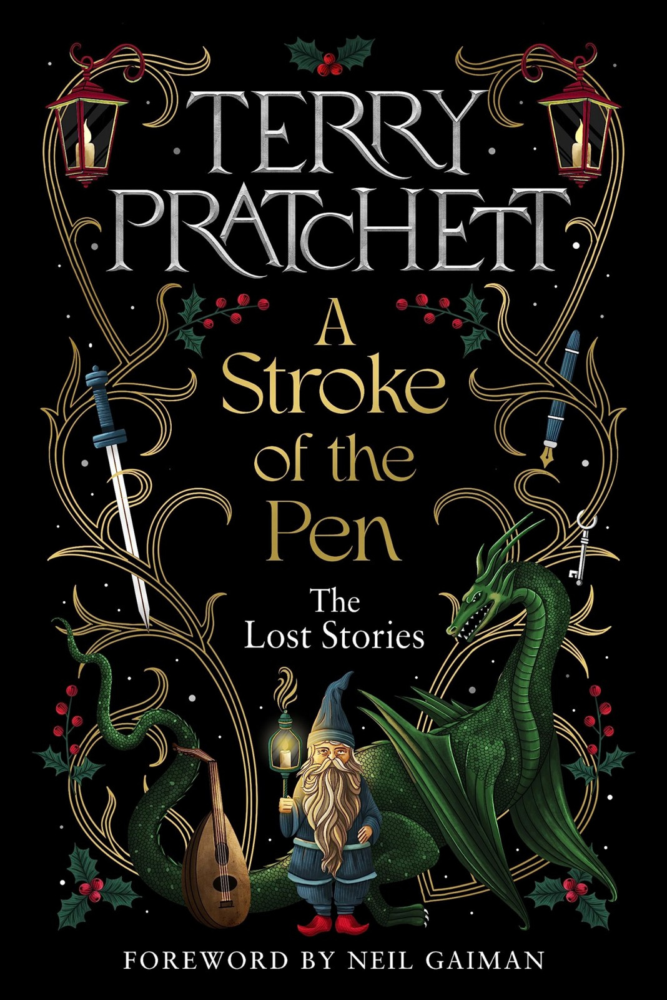

# A Stroke of the Pen — German learning reader

Twenty Terry Pratchett stories retold directly from your supplied English EPUB. English word and construction tooltips; appearance-ordered chapter vocabulary; exact-sentence English notes.

Chapters 1–13: A2. Chapters 14–20: gradual progression from upper A2 to full B1. Necessary story words are explained, not claimed as universal CEFR core vocabulary.

- [Chapter 1: Wie alles anfängt …](kapitel-01.md) — **A2**
- [Chapter 2: Der Strand aus einer anderen Zeit](kapitel-02.md) — **A2**
- [Chapter 3: Der wirklich wilde Westen](kapitel-03.md) — **A2**
- [Chapter 4: Wie Scrooge einen Geist sah und lieber wieder Weihnachten hasste](kapitel-04.md) — **A2**
- [Chapter 5: Gesucht: Ein dicker, fröhlicher Mann mit einer roten Wollmütze](kapitel-05.md) — **A2**
- [Chapter 6: Ein Rebhuhn im Briefkasten](kapitel-06.md) — **A2**
- [Chapter 7: Der neue Weihnachtsmann](kapitel-07.md) — **A2**
- [Chapter 8: Der große Kuchen von Blackbury](kapitel-08.md) — **A2**
- [Chapter 9: Wie Good King Wenceslas beim DJ auftrat](kapitel-09.md) — **A2**
- [Chapter 10: Die Suche nach dem Drachen](kapitel-10.md) — **A2**
- [Chapter 11: Die Gnome von zu Hause](kapitel-11.md) — **A2**
- [Chapter 12: Aus dem Mund des Pferdes](kapitel-12.md) — **A2**
- [Chapter 13: Das Wetter von Blackbury](kapitel-13.md) — **A2**
- [Chapter 14: Der Dschungel von Blackbury](kapitel-14.md) — **A2 upper**
- [Chapter 15: Die Dampfwalze, bei der es spukt](kapitel-15.md) — **A2 upper**
- [Chapter 16: Der Geldbaum](kapitel-16.md) — **A2–B1 bridge**
- [Chapter 17: Das Ding von Blackbury](kapitel-17.md) — **A2–B1 bridge**
- [Chapter 18: Mr Browns Unfall im Urlaub](kapitel-18.md) — **B1.1**
- [Chapter 19: Pilgarlic Towers](kapitel-19.md) — **B1.1**
- [Chapter 20: Die Suche nach den Schlüsseln](kapitel-20.md) — **B1.2**

These are supported reading adaptations, not exam-certified whitelists. The source-positioned illustrations are unchanged. Editorial material is excluded.

[Adaptation and review notes](../work/reader-review.md) · [Earlier A2/B1 comparison](../comparison/README.md)
