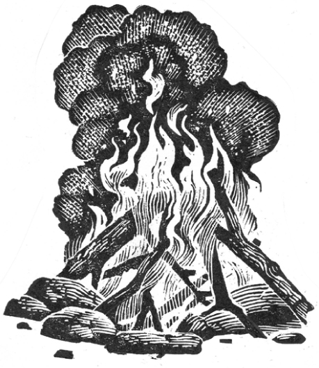

## Kapitel 1: Wie alles anfängt …

Vor sehr langer Zeit leben die Menschen in einer <abbr class="word" title="die Höhle, die Höhlen — cave">Höhle</abbr>. Og bringt etwas Neues mit. Er nennt es Feuer. Einige ältere Menschen sind dagegen.

— Das ist nicht natürlich! Wo soll das enden?

— Das ist etwas Neues, Opa! Gib uns noch etwas Holz!, sagen die Jungen.

Og erklärt:

— Ich habe das Feuer draußen gefunden. Es hat einen Baum gegessen! Jetzt müssen wir Steine um das Feuer legen. <abbr class="construction" title="Modal verb: kann is conjugated; the infinitive weglaufen goes at the end.">So kann es nicht weglaufen.</abbr> Und es macht uns warm. Das ist besser als kalter Regen in der Nacht.

Hal ist der Chef von der Gruppe. Er macht sich Sorgen.

— Geht jetzt wirklich alles gut? Mit einem deiner Stöcke hast du mich schon verletzt!

— <abbr class="word" title="der Speer, die Speere — spear">Speere</abbr>, sagt Og. — Das war ein Fehler. Mit dem Feuer kann nichts passieren. Ohne Holz stirbt es.

— Interessant, sagt Hal.

Am Abend sitzen alle um das Feuer. Sie essen kaltes Fleisch von einem <abbr class="word" title="das Mammut, die Mammuts — mammoth">Mammut</abbr>. Draußen laufen riesige Tiere herum. Man hört sogar ein lautes „Hatschi!“.

Og erzählt lange von seinen neuen Ideen. Hal isst und schaut ins Feuer. Dann hält er seinen Finger hinein.

Das Feuer <abbr class="word" title="beißen (biss, hat gebissen) — bite">beißt</abbr> ihn.

— Au!

— Nicht den Finger ins Feuer halten! Es beißt!, sagt Og schnell.

Hal geht böse ins Bett. Er hält den Finger im Mund.

Eine Frau bleibt beim Feuer, wenn die Männer Tiere für das Essen suchen. Sie gibt ihm Holz. Bald gehört das Feuer zum Alltag.

Einmal fällt Og ein Stück Fleisch ins Feuer. Es ist Fleisch von einem <abbr class="word" title="das Schwein, die Schweine — pig; here a wild pig">Schwein</abbr>. So erfindet er das Kochen.

Sogar Hal findet das gut. Für Fleisch vom Mammut gibt es schon siebenundzwanzig verschiedene Rezepte!

Og macht auch Eier von <abbr class="word" title="der Dodo, die Dodos — dodo: an extinct bird">Dodos</abbr> mit einer <abbr class="word" title="die Soße, die Soßen — sauce">Soße</abbr> aus Schlangen. Dazu gibt es Fleisch vom Schwein mit Honig. Leider macht er auch Kuchen mit <abbr class="word" title="giftig — poisonous">giftigen</abbr> <abbr class="word" title="der Pilz, die Pilze — mushroom; here a poisonous one">Pilzen</abbr> und Suppe mit giftigen Pflanzen. Das ist keine gute Idee.

Og bleibt fröhlich.

— Für ein Essen mit Eiern muss man die Eier zuerst kaputt machen. Fehler macht jeder!

Jetzt hat Og immer neue Ideen. Mit schwarzem Holz aus dem Feuer zeichnet er Bilder an die Wand. So erfindet er die Kunst.

Er nimmt einen jungen <abbr class="word" title="der Wolf, die Wölfe — wolf">Wolf</abbr> zu sich. Bald lebt das Tier bei den Menschen. So erfindet Og den Hund.

Die großen Probleme kommen aber erst später.

Og lässt einige <abbr class="word" title="die Traube, die Trauben — grape">Trauben</abbr> in einer Schüssel mit Wasser liegen. Dann vergisst er sie. Später findet er sie wieder. Aus dem Wasser mit den Trauben ist Wein geworden.

Er schmeckt sehr gut. Die anderen kommen zurück und trinken auch. Nur Hal ist nicht dabei. Er läuft noch hinter einer besonders schnellen <abbr class="word" title="die Giraffe, die Giraffen — giraffe">Giraffe</abbr> her.

Dann riecht er Rauch. Er kommt von der Höhle.

— !, denkt Hal. — Das Feuer ist weggelaufen!

Hal lässt die Giraffe in Ruhe und läuft schnell zur Höhle. Überall ist Feuer. Die Pflanzen und Bäume <abbr class="word" title="brennen (brannte, hat gebrannt) — burn">brennen</abbr>. Hal läuft durch die heißen Reste vom Feuer und schimpft.

In der Höhle schlafen die anderen ganz ruhig. <abbr class="construction" title="Perfekt: haben + getrunken explains an earlier event.">Sie haben zu viel Wein getrunken.</abbr>

— <abbr class="word" title="aufwachen (wachte auf, ist aufgewacht) — wake up">Wacht auf</abbr>! Ihr habt das Feuer weglaufen lassen!, ruft Hal laut.

Das Feuer wird immer größer. Die Tiere laufen weg. Die Vögel fliegen aus dem Rauch und rufen laut.

Die Menschen sehen fast nichts. Die Luft ist heiß. Sie bekommen fast keine Luft. Hal führt sie zu einem Fluss. Dort setzen sie sich zwischen die hohen Pflanzen und weinen.

Hal ist sehr böse. Og fühlt sich schlecht.

— Jetzt reicht es!, sagt Hal. — Du machst nur Probleme! Ich habe lange gewartet. Aber jetzt ist Schluss. Geh weg! Du gehörst nicht mehr zu unserer Gruppe!

Og geht weg. Er schaut nicht zurück.

Ug gehört zu den ältesten Menschen.

— Ist das wirklich eine gute Idee?, fragt er. — Allein kann Og nicht lange leben.

Hal sagt nur: „Hm!“

— Und wir? Die Tiere sind alle weg! Hier gibt es nichts mehr zu essen. Weiter unten am Fluss ist weniger Feuer. Wir müssen dorthin. Sonst sterben wir vor Hunger.

Am nächsten Tag laufen sie durch die nasse Erde. Einige Stellen brennen noch. Alles andere ist grau und heiß.

Abends regnet es. Sie schlafen oben in einem schwarzen Baum, aber nicht besonders gut. Unten laufen große Katzen mit sehr langen Zähnen herum.

Auch am nächsten Tag regnet es. Die Menschen sitzen dicht zusammen zwischen großen Steinen.

— Beim Feuer war es warm, sagt jemand.

— Und das warme Fleisch vom <abbr class="word" title="das Zebra, die Zebras — zebra">Zebra</abbr> war wirklich gut!, sagt ein anderer.

Die Sonne ist jetzt hinter schwarzen Wolken. Sogar Ug sagt:

— Og war eigentlich ganz nett.

Hal ist kalt.

— Ja, und am Ende brennt noch die ganze Welt!

Weit weg hört man einen Wolf. Ein anderer antwortet. Er ist viel näher.

Hal sieht ein dunkles Tier. Es kommt langsam näher. Er hat große Angst und nimmt einen Stein.

— Frauen und Kinder in die Mitte!, ruft er laut.

Mit Holz tun die Menschen den Wölfen weh. Dann werfen sie Steine. Aber die Wölfe haben großen Hunger. Nach dem Feuer gibt es nichts mehr zu essen. Immer mehr kommen.

Plötzlich ist Og da. Er hat ein Stück Holz in der Hand. Es brennt. Er wirft es nach den Wölfen.

Dann nimmt er ein seltsames Stück Holz. Es ist ein <abbr class="word" title="der Bogen, die Bögen — bow: a weapon, not a sheet of paper">Bogen</abbr>. Og schickt damit <abbr class="word" title="der Pfeil, die Pfeile — arrow">Pfeile</abbr> auf die Wölfe. Bald laufen alle weg.

Og sagt nichts. Er zeigt der Gruppe: Kommt mit!

Er führt sie zu einem kleinen Platz zwischen den Bäumen. Dort kocht er mehrere Zebras über einem Feuer. Unter den Bäumen hat er ein Haus aus Holz und Pflanzen gebaut. Es sieht warm und gemütlich aus.

<abbr class="construction" title="Modal verb darf + infinitive gehören. The fire and inventions do not change the basic sentence pattern.">Natürlich darf Og wieder zur Gruppe gehören.</abbr> Die meisten essen schon sein Fleisch vom Zebra.

— Ich bin hinter euch hergegangen, sagt Og nur. — Ich habe gedacht: Vielleicht braucht ihr mich noch.

Bald gibt es ein kleines Dorf. Og findet heraus: Aus <abbr class="word" title="der Samen, die Samen — seed">Samen</abbr> wachsen neue Pflanzen. Man kann also sein Essen selbst wachsen lassen.

Er baut auch etwas, das Tiere fängt. So bekommt man leichter Fleisch. Man muss den Tieren nicht mehr hinterherlaufen.

Dann erfindet Og <abbr class="word" title="der Flügel, die Flügel — wing">Flügel</abbr>. Leider will er sie von einem hohen <abbr class="word" title="der Felsen, die Felsen — rock; cliff">Felsen</abbr> aus ausprobieren.

Einige junge Menschen haben seine Idee aber verstanden. Auch sie erfinden neue Dinge. So gibt es nach und nach immer mehr Dörfer, Felder und neue Ideen.

Das Dorf wächst. Früher waren dort Tiere. Jetzt gibt es dort Felder. Menschen wie Hal laufen immer noch hinter Tieren her. Das sieht jetzt ein bisschen komisch aus.

So fängt alles an.

Hal sitzt vor seinem kleinen Haus. Er denkt nach und macht sich Sorgen.

— <abbr class="construction" title="Question with a modal: soll before the subject; enden at the end.">Wo soll das nur alles enden?</abbr>

### Words in this chapter

- **die Höhle, die Höhlen** — cave
- **der Speer, die Speere** — spear
- **das Mammut, die Mammuts** — mammoth
- **beißen (biss, hat gebissen)** — bite
- **das Schwein, die Schweine** — pig; here a wild pig
- **der Dodo, die Dodos** — dodo: an extinct bird
- **die Soße, die Soßen** — sauce
- **giftig** — poisonous
- **der Pilz, die Pilze** — mushroom; here a poisonous one
- **der Wolf, die Wölfe** — wolf
- **die Traube, die Trauben** — grape
- **die Giraffe, die Giraffen** — giraffe
- **brennen (brannte, hat gebrannt)** — burn
- **aufwachen (wachte auf, ist aufgewacht)** — wake up
- **das Zebra, die Zebras** — zebra
- **der Bogen, die Bögen** — bow: a weapon, not a sheet of paper
- **der Pfeil, die Pfeile** — arrow
- **der Samen, die Samen** — seed
- **der Flügel, die Flügel** — wing
- **der Felsen, die Felsen** — rock; cliff

### Constructions and sentences
- **“So kann es nicht weglaufen.”**
  That way it cannot run away. Modal verb: kann is conjugated; the infinitive weglaufen goes at the end.

- **“Sie haben zu viel Wein getrunken.”**
  They have drunk too much wine. Perfekt: haben + getrunken explains an earlier event.

- **“Natürlich darf Og wieder zur Gruppe gehören.”**
  Of course Og is allowed to belong to the group again. Modal verb darf + infinitive gehören. The fire and inventions do not change the basic sentence pattern.

- **“Wo soll das nur alles enden?”**
  Where is all this going to end? Question with a modal: soll before the subject; enden at the end.

---

[Contents](README.md) · [Next →](kapitel-02.md)
