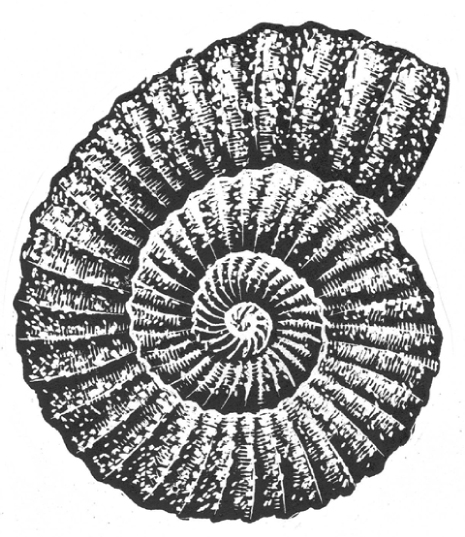

## Kapitel 2: Der Strand aus einer anderen Zeit

Weißt du das? <abbr class="construction" title="Wenn introduces a condition; the verb in the wenn clause comes last.">Wenn du eine Muschel ans Ohr hältst, hörst du das Meer.</abbr> Der Klang bleibt in den vielen runden Gängen in der <abbr class="word" title="die Muschel, -n — seashell">Muschel</abbr>. Dort klingt er immer wieder, sehr lange. Aber was hörst du in einer Muschel aus Stein? Sie ist ein <abbr class="word" title="das Fossil, -ien — fossil: the remains of an ancient living thing in stone">Fossil</abbr>. Ich erzähle es dir.

In Gritshire liegt die kleine Stadt Shingle Regis am Meer. Ganz am Ende von der <abbr class="word" title="die Seebrücke, -n — pier">Seebrücke</abbr> steht ein sehr kleines Museum. Es ist vor allem für Urlauber da. Hier gibt es echte Ohrringe von <abbr class="word" title="die Meerjungfrau, -en — mermaids">Meerjungfrauen</abbr>, berühmte Ringe zur Rettung von Menschen aus dem Wasser und Schiffe in Flaschen. Die Schiffe haben sogar alle ihre <abbr class="word" title="das Segel, - — sail">Segel</abbr>. Dazu kommen andere seltene, seltsame Dinge aus dem Meer.

Eine kleine Bemerkung dazu: Sehr, sehr kleine Schiffbauer haben die Schiffe in Flaschen gebaut. Aber das ist eine andere Geschichte.

Ein junger Mann führt das Museum. Er heißt Horace Breezeforth. Einmal zählt er die Luftblasen an einer ungewöhnlichen Meerespflanze. Da kommt eine junge Frau herein. Sie legt ein großes Fossil mit einem lauten Klopfen auf seinen Tisch.

„Na, na, na“, sagt Horace. „Eine echte Rotundus-<abbr class="word" title="die Schnecke, -n — snail">Schnecke</abbr>! Diese Schnecken gibt es heute nicht mehr. So ein Stück fehlt uns noch.“

Die Frau heißt Jane Throckmorton. Sie studiert an der Universität von Blackbury <abbr class="word" title="die Geologie — geology: the study of rocks and the earth">Geologie</abbr>.

Jane sagt: „<abbr class="construction" title="The Perfekt, habe ... gefunden, describes an earlier discovery.">Ich habe sie in den Felsen an der Küste gefunden.</abbr> Weiter unten an der <abbr class="word" title="die Küste, -n — coast">Küste</abbr>. Sie ist wirklich interessant. Halten Sie sie ans Ohr. Dann hören Sie das Meer!“

Horace hört es tatsächlich. Aber es klingt nicht wie das Meer von heute. Vielleicht hat das Meer vor Millionen Jahren so geklungen. Etwas daran ist sehr seltsam. Er hört auch laute, raue Rufe und ein tiefes Grunzen. Vielleicht machen <abbr class="word" title="der Dinosaurier, - — dinosaur">Dinosaurier</abbr> solche Geräusche, wenn sie im Wasser spielen. Horace holt überrascht Luft.

„Warten Sie“, sagt Jane ernst. „Hören Sie nur weiter zu!“

Jetzt hört Horace jemanden singen. Eine fröhliche Stimme klingt über dem Rauschen der Wellen. Er kann sie gerade noch hören. Und er kennt diese Stimme irgendwie.

> „Ooooooh, iiiiiich bin so gern am Meeresstrand,
> oh, ich bin so gern am Meer!“

„Das ist unmöglich!“, ruft Horace. Fast lässt er die Muschel fallen. „Damals hat doch noch kein Mensch gelebt! Zeigen Sie mir den Ort? Wo haben Sie die Muschel gefunden?“

Eine halbe Stunde später steigen Horace und Jane über die Felsen. Sie kommen zu einer stillen kleinen <abbr class="word" title="die Bucht, -en — bay; small inlet">Bucht</abbr> nördlich von der Stadt. Jane zeigt ihm ein Loch im Felsen. Dort hat sie die Muschel mit ihrem besonderen Hammer herausgeholt. In den Felsen liegen noch viele andere Fossilien.

„Ich finde heraus, was hier los ist“, sagt Horace leise. Er nimmt einen zweiten Hammer und geht zu den Felsen.

Sie arbeiten ungefähr zwanzig Minuten. Dann findet Horace etwas unter dem Stein. Sind das die Knochen von einem ganz seltsamen Tier? Nach einiger Zeit versteht er es. Es ist ein <abbr class="word" title="der Liegestuhl, Liegestühle — deckchair">Liegestuhl</abbr>. Ein Liegestuhl als Fossil!

Jane findet die Reste von einer kleinen <abbr class="word" title="die Eidechse, -n — lizard">Eidechse</abbr>. Sie lässt ihren Hammer fallen.

„Ach, solche Fossilien findet man hier oft“, sagt Horace ganz locker.

„Nur hat diese hier eine Zeitung im Mund“, sagt Jane leise. Sie hält das Stück vor ihn.

Natürlich ist die Zeitung völlig flach. Sie ist jetzt eine dünne Platte aus Stein. Aber man kann die Schrift noch gerade lesen.

Horace liest laut: „The Blackbury Chronicle and West Gritshire Times. Das Datum erkenne ich nicht richtig. Doch, jetzt … oh. Oje. Es ist die Zeitung von heute.“

Bald ist der Strand voller Menschen. Polizisten stellen große Wände um die Felsen. Dahinter untersuchen Horace und Jane die Fossilien. Einige wichtige Männer von der Universität Blackbury helfen ihnen.

Die Männer glauben noch nicht richtig an die Sache. Dann schlägt einer ein Stück Stein weg. Darunter findet er … ein Radio als Fossil. Millionen Jahre lang haben schwere Felsen darauf gelegen. Das Radio ist deshalb ganz flach. Aber es ist eindeutig ein Radio.

„Also“, sagt Horace. „Entweder waren Dinosaurier viel klüger, als wir denken. Oder hier ist etwas sehr Seltsames passiert.“

„Wissen Sie, was ich glaube?“, fragt Jane. „Hier wohnt jemand mit einer <abbr class="word" title="die Zeitmaschine, -n — time machine">Zeitmaschine</abbr>. Er macht Urlaub in der Vergangenheit. Und er passt nicht gut auf seine Sachen auf.“

Sie lassen die <abbr class="word" title="der Professor, -en — professor">Professoren</abbr> bei den seltsamen Fossilien. Ein Weg führt sie die Felsen hinauf zu den Feldern. Kleine violette Pflanzen wachsen dort. Es ist sehr heiß, aber vom Meer kommt ein schöner kühler Wind.

Sie sehen nur ein Haus. Es ist ein altes Fischerhaus hinter zwei Bäumen. Der Wind hat die Bäume fast bis zum Boden gebogen. Im kleinen Garten wachsen Blumen und Kohl. Daneben steht eine Ziege an einem Pfahl. Ein Seil hält sie dort fest. Sie hat einen großen Kreis ins Gras gefressen. Auch zwei Häuser für Bienen stehen im Garten.

„Wer wohnt dort?“, fragt Jane.

„Ein alter Herr namens Dr Golightly“, sagt Horace. „Er ist der größte Lepip … Lepida … Also, er ist sehr gut im Sammeln von <abbr class="word" title="der Schmetterling, -e — butterfly">Schmetterlingen</abbr>.“

„Uah“, sagt Jane. „Das mag ich nicht. Die armen Tiere tun mir immer leid.“

„Er lässt sie wohl am Leben“, sagt Horace. „Er hält sie in großen <abbr class="word" title="der Käfig, -e — cage">Käfigen</abbr>. Dort bekommen sie auch Junge.“

Beim Vorbeigehen sehen sie mehrere riesige Käfige hinter dem Haus. Ihre Wände sind aus Draht.

Plötzlich fliegt ein Schmetterling an ihnen vorbei. Er ist blau und grün mit wunderschönen gelben Punkten.

Und er ist etwas größer als ein <abbr class="word" title="der Adler, - — eagle">Adler</abbr>.

Gleich darauf kommt ein kleiner dicker Mann durch die Büsche gerannt. Er schwenkt ein riesiges <abbr class="word" title="das Netz, -e — net for catching butterflies">Netz</abbr> für Schmetterlinge. Er trägt einen großen Sonnenhut und alte, helle Shorts. Sein weißer Bart ist lang.

„Sagen Sie mal“, fragt er außer Atem. „Haben Sie einen Golightlius giganti gesehen?“

„Er ist aufs Meer hinausgeflogen“, sagt Horace. „Sie meinen doch den großen Schmetterling?“

„Den nennen Sie groß?“, fragt der alte Mann. „Meine Güte, das ist doch nur ein Baby! Äh, entschuldigen Sie. Ich muss lieber zurück.“ Er verschwindet wieder in den Büschen.

Eine lange Zeit sagt niemand etwas.

„Das war Dr Golightly“, sagt Horace schließlich.

„Aber solche Schmetterlinge gibt es nicht!“, ruft Jane.

„Früher schon“, sagt Horace und denkt nach. „Vor Millionen Jahren waren manche <abbr class="word" title="das Insekt, -en — insect">Insekten</abbr> sehr groß.“

Beide denken an die seltsamen Fossilien. Und an die Muschel mit dem Lied „I Do Like to be Beside the Seaside“.

Fünf Minuten später klopfen sie an die Tür vom Fischerhaus. Niemand antwortet. Horace schaut in die Käfige hinter dem Haus. Darin sitzen mehrere gewaltige Schmetterlinge. Ein oder zwei sind so groß, dass sie Stangen zum Sitzen brauchen. Genau wie Vögel.

Am nächsten Tag kommen Horace und Jane wieder. Unten am Strand arbeiten die Männer immer noch. Ein Professor hat offenbar ein altes Fischernetz als Fossil gefunden.

Horace klopft wieder an die Haustür. Dann merkt er: Sie ist offen. Er und Jane gehen hinein. Dabei fühlen sie sich ein bisschen wie <abbr class="word" title="der Einbrecher, - — burglar">Einbrecher</abbr>.

Drinnen ist es recht dunkel. In einer Ecke tickt langsam eine alte Uhr. Die Möbel sehen alt und etwas kaputt aus, aber bequem.

Außerdem hören sie ein seltsames <abbr class="word" title="das Summen — buzzing sound">Summen</abbr>. Es kommt wohl aus einem kleinen Schrank unter der Treppe. Horace öffnet ihn.

Er schaut auf einen Strand hinaus. Hier und da wachsen große <abbr class="word" title="der Farn, -e — fern: a leafy plant common in this prehistoric landscape">Farne</abbr>. In der Ferne stehen hohe Felsen. Die Sonne sieht groß und gelb aus.

Schnell macht er die Tür zu. Jetzt sieht alles wie ein gewöhnlicher Schrank aus. Er macht sie wieder auf. Da ist der Strand wieder.

„Also gut“, sagt Horace mutig und geht durch die Öffnung. Jane wartet kurz, dann folgt sie ihm. Sie stehen nebeneinander im Sand. Hinter ihnen hängt ein Bild in der Luft, knapp über dem Boden. Darauf sieht man den Raum im Fischerhaus.

„Ich glaube, wir sind gerade Millionen Jahre in die Vergangenheit gegangen“, sagt Horace. Er zeigt nach oben. Mehrere große Schmetterlinge fliegen über die Farne.

„Wie macht er das bloß?“, fragt Jane. „Das Haus hat ja nicht einmal Strom.“

Horace rollt einen großen Stein über den Sand. Er schiebt ihn fest in die Öffnung.

„Hoffentlich reicht das“, sagt er. „<abbr class="construction" title="Two infinitives follow müssen: können expresses ability, and zurückkommen is the action.">Wir müssen wieder zurückkommen können.</abbr> Ich möchte nicht selbst ein Fossil werden.“

Sie gehen am Strand entlang. Manchmal fliegen riesige Eidechsen über ihre Köpfe. Ihre Flügel sehen wie Leder aus. Einmal sehen sie ein Tier, das Jane einen Brontosaurus nennt. Es frisst Farne. Mit jedem Bissen verschwindet ein ganzer Berg davon in seinem Mund.

Dann hört das Tier auf zu fressen und schaut auf sie hinunter. Es ist ungefähr so groß wie ein Haus.

„Die sind ganz <abbr class="word" title="harmlos — harmless">harmlos</abbr>“, sagt Jane. Sie klopft ihm freundlich auf die Nase. „Sie sind <abbr class="word" title="der Vegetarier, - — vegetarian; plant-eater">Vegetarier</abbr>. Und sie sind riesig. Stell dir vor, du trittst ihm auf den Fuß. Erst zwei Tage später merkt er es!“

„Äh, nein, das wusste ich nicht“, sagt Horace.

Sie gehen durch dichtes Grün und fallen fast über Dr Golightly. Er sitzt in einem Liegestuhl und schüttelt sein kleines Radio.

„Das verdammte Ding geht nicht“, sagt er. „Es empfängt immer nur gar nichts.“

„Hier gibt es wohl noch keine BBC“, sagt Horace. „<abbr class="construction" title="BBC is the British broadcaster. Horace reuses B–B–C for an imaginary brontosaurus bellowing competition; heißt asks what the name means here.">Oder heißt BBC hier ‚Brontosaurus Bellowing Contest‘?</abbr>“

„Oh, guten Tag“, sagt der Doktor und schaut sie genau an. „Seltsam. Habe ich Sie nicht neulich gesehen? Was machen Sie hier in der <abbr class="word" title="die Jurazeit — Jurassic period: an age of dinosaurs">Jurazeit</abbr>? Möchten Sie eine Tasse Tee?“

Der Doktor kocht Tee auf einem kleinen Campingkocher. Alle haben großen Durst. Sie setzen sich zwischen die Farne. Horace erzählt ihm vom seltsamen Schrank unter der Treppe.

„Das passiert jeden zweiten Dienstag“, sagt der Doktor. „Warum, weiß ich beim besten Willen nicht.“

„Kommen Sie also oft hierher?“, fragt Jane.

„Oh ja. Das ist sehr praktisch. Hier gibt es großartige Schmetterlinge. Und natürlich ist sonst niemand da. Erst in Millionen Jahren kommen andere Menschen.“

„Wir haben Sie singen gehört“, sagt Horace. „Das Lied ‚I Do Like to be Beside the Seaside‘. In einer Muschel.“

„Mein lieber Herr“, sagt der Doktor. „Sehe ich wie jemand aus, der solche lustigen Lieder singt? Das war bestimmt jemand anders.“

„Meine Güte“, sagt Jane. „Vielleicht machen Menschen überall in der <abbr class="word" title="die Urzeit — prehistoric times">Urzeit</abbr> Urlaub! Aber wie kommen Sie zurück?“

Dr Golightly hält einen großen <abbr class="word" title="der Wecker, - — alarm clock">Wecker</abbr> hoch.

„Nach sieben Stunden schließt sich der Durchgang“, sagt er. „Darum habe ich diese Uhr immer bei mir.“

Horace schaut auf den Wecker, dann auf seine eigene Uhr.

„Da ist Sand hineingekommen“, sagt er. „<abbr class="construction" title="German uses the present with seit for a state continuing now; stillstehen is separable.">Der Wecker steht schon seit zwei Stunden still!</abbr>“

Fünf Minuten später laufen sie durch die Farne zurück. Sie sehen gerade noch, wie die leuchtende Öffnung verschwindet. Der Stein in der Öffnung liegt jetzt in zwei Hälften da.

Lange sagt niemand etwas. Es ist schrecklich.

Dann sagt Dr Golightly: „Oh. Na ja. Wenigstens ist das Wetter hier immer schön. Und von Muscheln können wir sicher zwei Wochen leben.“

Die Nacht ist sehr unbequem. Sie sitzen oben auf einem Felsen. Im dichten Grün darunter grunzen und niesen seltsame Tiere. Jane weint ein bisschen. Dann findet sie: Das hilft nicht viel. Stattdessen denkt sie darüber nach, wie man Muscheln kocht.

Am Morgen sieht alles viel besser aus. Mit den dicken Brillengläsern von Dr Golightly sammeln sie Sonnenlicht auf einem kleinen Punkt. So machen sie ein Feuer. In der Teekanne kochen sie eine Art <abbr class="word" title="der Eintopf, Eintöpfe — stew">Eintopf</abbr> mit Muscheln.

„Das ist gar nicht schlecht“, sagt Horace voller Lob.

Nach dem Frühstück geht er ins flache Wasser. Er fängt Urzeitfische mit dem Schmetterlingsnetz von Dr Golightly. Das macht viel mehr Spaß, als den ganzen Tag im stickigen Museum zu sitzen. Nach einer Weile fängt er an zu singen.

Plötzlich hört er auf. Neben ihm liegt eine große leere Muschel am Strand.

„Also haben wir mich gehört!“, denkt er. „<abbr class="construction" title="Kein Wunder means no wonder; dass introduces a clause with the verb last.">Kein Wunder, dass ich die Stimme kenne!</abbr> Das ist die Muschel, die wir als Fossil gefunden haben!“

Er rennt am Strand zurück und sucht die anderen. Sie wollen die Küste weiter erforschen. Gerade gehen sie um einen großen Haufen Felsen herum. Horace sieht sie und läuft hinterher.

Als er sie erreicht, schauen beide in eine kleine Bucht hinunter. Dahinter stehen niedrige Felsen.

„Die Sonne ist sehr heiß“, sagt Dr Golightly. „Vielleicht sehen wir Dinge, die gar nicht da sind. Wir sind doch ganz sicher Millionen Jahre in der Vergangenheit? Na, schauen Sie dort hinunter.“

Am Felsen steht ein kleines Haus mit einem Dach aus Stroh. Um die Tür wachsen Rosen. Davor ist das Gras kurz und ordentlich. Nur ein kleiner Dinosaurier stört das schöne Bild etwas. Er hängt an einer Schnur und frisst die Rosen.

Über der Tür steht auf einem Schild: „The Old Red Sandstone Lion“.

„Das ist ein <abbr class="word" title="der Pub, -s — British public house; a small drinking establishment">Pub</abbr>“, sagt Horace.

Sie klettern über die Steine auf das Haus zu. Es verschwindet nicht.

Drinnen ist es ziemlich dunkel. An der Wand hängt eine Scheibe für <abbr class="word" title="das Dart — a game of throwing small pointed darts at a board">Dart</abbr>. Daneben hängen kleine Schmuckstücke aus gelbem Metall für Pferde. Von einem Balken hängen viele Bierkrüge. Draußen ist es sehr heiß. Trotzdem brennt im Kamin ein Feuer. Eine kleine Eidechse liegt davor und <abbr class="word" title="schnarchen, schnarchte, hat geschnarcht — snores">schnarcht</abbr>.

Hinter der <abbr class="word" title="die Theke, -n — bar counter">Theke</abbr> öffnet sich eine Tür. Ein kleiner Mann ohne Haare kommt heraus. Er lächelt breit und trägt eine leuchtend rote <abbr class="word" title="die Weste, -n — waistcoat">Weste</abbr>.

„Guten Morgen!“, sagt er mit hoher Stimme. „Ein schöner Tag! Aus welcher Zeit kommen Sie?“

„Aus welcher Zeit?“, fragt Horace. „Aus 1973, denke ich.“

Der kleine Mann schaut sie erstaunt an.

„Das ist aber sehr früh! Leute aus dem zwanzigsten <abbr class="word" title="das Jahrhundert, -e — century">Jahrhundert</abbr> kommen selten zu uns. Natürlich habe ich nichts gegen diese Zeit“, fügt er vorsichtig hinzu.

Horace bestellt für alle eine große Limonade. Dann erzählt er dem Mann das ganze Abenteuer. Der Mann heißt Mr Buncombe und hört genau zu.

„Das ist eine <abbr class="word" title="die Nebenwirkung, -en — side effect">Nebenwirkung</abbr>“, sagt er schließlich. „So nennen wir das. Der Temporal Express kommt dienstags hier vorbei. Dabei entstehen manchmal solche Öffnungen.“

„Was ist der Temporal Express?“, fragt Jane.

Es ist eine große Zeitmaschine. Sie fährt regelmäßig zwischen dem fünfundzwanzigsten Jahrhundert und verschiedenen Zeiten in der Urzeit. Im fünfundzwanzigsten Jahrhundert ist Urlaub in der Vergangenheit sehr beliebt. Darum hat Mr Buncombe The Old Red Sandstone Lion gebaut.

„Wir haben sehr feine Gäste“, sagt er. „Jetzt ist wenig los. Natürlich habe ich nichts gegen die <abbr class="word" title="die Triaszeit — Triassic period: another prehistoric age">Triaszeit</abbr> oder die <abbr class="word" title="die Karbonzeit — Carboniferous period: the age in which much coal formed">Karbonzeit</abbr>. Sie sind ganz schön, wenn man heißes, feuchtes Wetter mag.“

„Karbonzeit?“, fragt Horace verwirrt.

„Damals ist die <abbr class="word" title="die Kohle — coal">Kohle</abbr> entstanden“, sagt Jane. „Hast du denn in der Schule gar nichts gelernt? Das ist Millionen Jahre her.“

Mr Buncombe zeigt auf ein großes <abbr class="word" title="das Plakat, -e — poster">Plakat</abbr> an der Wand. Darauf fliegt eine riesige <abbr class="word" title="die Libelle, -n — dragonfly">Libelle</abbr> durch einen nassen Dschungel. Auf dem Plakat steht:

> „Sehen Sie zu, wie Kohle entsteht!
> Jagen Sie riesige Libellen in der heißen, feuchten Karbonzeit!“

Darunter steht in kleinerer Schrift:

> „Eine Werbung von Pre-Cambrian Timeways Ltd.
> Unser Büro: im Jahr 2455 nach Christus.“

Mr Buncombe schaut die drei nachdenklich an.

„Vielleicht gibt es Schwierigkeiten“, sagt er. „Menschen aus dem zwanzigsten Jahrhundert sollen eigentlich nichts davon wissen. Ich weiß nicht, ob die <abbr class="word" title="die Zeitpolizei — time police">Zeitpolizei</abbr> Sie wieder nach Hause lässt. Das kann Probleme machen.“

„Aber die Zeitung als Fossil …“, beginnt Horace.

„Ach, bald halten die Leute das für irgendeinen Trick“, sagt Mr Buncombe. „Entschuldigen Sie mich kurz.“

Er nimmt etwas, das wie ein sehr kompliziertes Telefon aussieht. Er wählt eine lange Reihe von Zahlen. Dann spricht er leise und undeutlich mit jemandem.

„Das war die Zentrale für Zeitreisen im Jahr 2500“, sagt er danach. „Ich habe von Ihnen erzählt. Der Temporal Express hält extra für Sie. Normalerweise hält er hier nur auf Wunsch. Sie dürfen zurück. Aber zuerst müssen Sie erlauben, dass man Sie <abbr class="word" title="hypnotisieren, hypnotisierte, hat hypnotisiert — hypnotize; here, make someone forget through hypnosis">hypnotisiert</abbr>. Dann vergessen Sie alles. Sonst gibt es vielleicht Ärger.“

„Äh“, sagt Dr Golightly. „Hat jemand etwas dagegen, wenn ich hierbleibe? Hier ist es schön. Es gefällt mir besser als im zwanzigsten Jahrhundert. Denken Sie nur an meine Sammlung von Schmetterlingen!“

„Wir brauchen noch jemanden, der ab und zu an der Theke hilft“, sagt Mr Buncombe. „Ein bisschen Gesellschaft freut mich.“

Horace sagt: „<abbr class="construction" title="Möchte politely expresses a wish; ins means in das and marks the destination.">Ich möchte ins zwanzigste Jahrhundert zurück.</abbr> Vielleicht ist es nicht besonders toll. Aber es ist mein Zuhause.“

„Mich zieht es auch zurück“, sagt Jane.

Draußen hört man eine Art kurzen, zusammengepressten Knall. Ein langes silbernes Rohr erscheint in der Luft. Die Tür an seiner Seite gleitet auf. Jemand ruft:

„Jurazeit! Jurazeit! Nächster Halt: Alte Steinzeit! Dann alle Stationen bis 2700!“

Jane und Horace verabschieden sich von Dr Golightly. Sie steigen ein.

Ein blauer <abbr class="word" title="der Blitz, -e — flash">Blitz</abbr> leuchtet auf. Dann wachen sie auf. Sie sitzen oben auf den Felsen und schauen aufs Meer. Unten sehen sie die vertraute Seebrücke. In der Bucht liegen Segelboote.

„Hm“, sagt Horace. „Mir ist ein bisschen <abbr class="word" title="schwindlig — dizzy">schwindlig</abbr>.“

„Ich weiß, was du meinst“, sagt Jane. „Da ist etwas, an das ich mich erinnern muss. Da bin ich sicher. Hast du schon einmal von einem Pub gehört? Er heißt The … The … äh, ich weiß es nicht mehr.“

Horace sagt: „<abbr class="construction" title="Lass uns plus an infinitive means let&#x27;s; darüber refers back to the missing memory.">Lass uns beim Mittagessen darüber nachdenken.</abbr>“ Er hilft ihr beim Aufstehen.

Ein paar Monate später heiraten Horace und Jane. Sie wohnen zusammen und leben ihr ganzes Leben lang glücklich.

Nur eine Sache verstehen sie nicht. Jemand schickt ihnen eine Postkarte. Das Foto muss ein Trick sein. Es zeigt mehrere Dinosaurier, die friedlich fressen. Auch die Briefmarke ist seltsam. Auf blauem Grund steht ein großes „T“. Der <abbr class="word" title="der Poststempel, - — postmark">Poststempel</abbr> sagt: „Jurassic Post Office“.

Auf der Karte steht:

> „Ich habe eine wunderbare Zeit. Laut Wetterbericht bleibt es hier noch zwei Millionen Jahre schön. Schade, dass ihr nicht hier seid.“

Und sie finden nie heraus, wer die Karte geschickt hat.

### Words in this chapter

- **die Muschel, -n** — seashell
- **das Fossil, -ien** — fossil: the remains of an ancient living thing in stone
- **die Seebrücke, -n** — pier
- **die Meerjungfrau, -en** — mermaids
- **das Segel, -** — sail
- **die Schnecke, -n** — snail
- **die Geologie** — geology: the study of rocks and the earth
- **die Küste, -n** — coast
- **der Dinosaurier, -** — dinosaur
- **die Bucht, -en** — bay; small inlet
- **der Liegestuhl, Liegestühle** — deckchair
- **die Eidechse, -n** — lizard
- **die Zeitmaschine, -n** — time machine
- **der Professor, -en** — professor
- **der Schmetterling, -e** — butterfly
- **der Käfig, -e** — cage
- **der Adler, -** — eagle
- **das Netz, -e** — net for catching butterflies
- **das Insekt, -en** — insect
- **der Einbrecher, -** — burglar
- **das Summen** — buzzing sound
- **der Farn, -e** — fern: a leafy plant common in this prehistoric landscape
- **harmlos** — harmless
- **der Vegetarier, -** — vegetarian; plant-eater
- **die Jurazeit** — Jurassic period: an age of dinosaurs
- **die Urzeit** — prehistoric times
- **der Wecker, -** — alarm clock
- **der Eintopf, Eintöpfe** — stew
- **der Pub, -s** — British public house; a small drinking establishment
- **das Dart** — a game of throwing small pointed darts at a board
- **schnarchen, schnarchte, hat geschnarcht** — snores
- **die Theke, -n** — bar counter
- **die Weste, -n** — waistcoat
- **das Jahrhundert, -e** — century
- **die Nebenwirkung, -en** — side effect
- **die Triaszeit** — Triassic period: another prehistoric age
- **die Karbonzeit** — Carboniferous period: the age in which much coal formed
- **die Kohle** — coal
- **das Plakat, -e** — poster
- **die Libelle, -n** — dragonfly
- **die Zeitpolizei** — time police
- **hypnotisieren, hypnotisierte, hat hypnotisiert** — hypnotize; here, make someone forget through hypnosis
- **der Blitz, -e** — flash
- **schwindlig** — dizzy
- **der Poststempel, -** — postmark

### Constructions and sentences
- **“Wenn du eine Muschel ans Ohr hältst, hörst du das Meer.”** — “If you hold a shell to your ear, you hear the sea.” The wenn clause puts hältst last; the main clause then starts with hörst.

- **“Wir müssen wieder zurückkommen können.”** — “We must be able to get back again.” Müssen is conjugated; zurückkommen and können stay in the infinitive.

- **“Oder heißt BBC hier ‚Brontosaurus Bellowing Contest‘?”** — “Or does BBC mean ‘Brontosaurus Bellowing Contest’ here?” Heißt asks what the name means. BBC is the British broadcaster; Horace turns B–B–C into an imaginary brontosaurus bellowing competition.

- **“Der Wecker steht schon seit zwei Stunden still!”** — “The alarm clock has been stopped for two hours!” German uses the present with seit for a state continuing now; stillstehen separates here.

- **“Kein Wunder, dass ich die Stimme kenne!”** — “No wonder I recognize the voice!” Dass introduces the explanation and sends kenne to the end.

- **“Hier ist es schön.”** — “It is nice here.” Es is the grammatical subject; hier identifies the place.

- **“Vielleicht ist es nicht besonders toll.”** — “Perhaps it isn't especially great.” With vielleicht first, the conjugated verb ist remains in second position.

- **“Sie steigen ein.”** — “They get aboard.” Einsteigen is separable: ein comes at the end of this main clause.

- **“Und sie finden nie heraus, wer die Karte geschickt hat.”** — “And they never find out who sent the card.” Herausfinden separates; the indirect question uses the Perfekt geschickt hat for the earlier action.

---

[← Previous](kapitel-01.md) · [Contents](README.md) · [Next →](kapitel-03.md)
