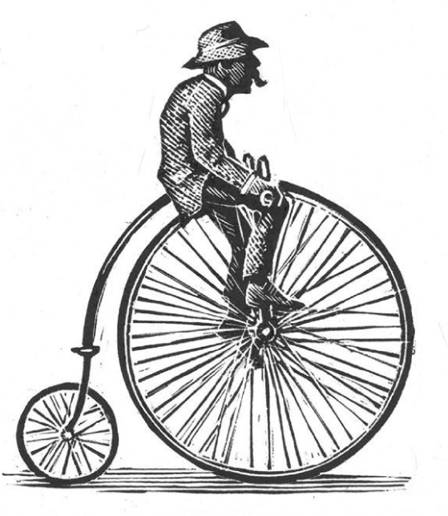

## Kapitel 3: Der wirklich wilde Westen

Das ist eine Geschichte aus dem wirklich wilden Westen.

In Llanoggie ist wieder Zeit für das <abbr class="word" title="das Schaf-Rodeo, -s — sheep rodeo; a Welsh twist on the Wild West">Schaf-Rodeo</abbr>. Die kleine Stadt liegt an der Grenze zwischen England und Wales. Auf den Straßen stehen überall Schafe. Dazu kommen große, haarige Schafbauern und kleine schwarz-weiße Hunde. Die Hunde sehen nicht besonders ehrlich aus.

Die Stadt hat zwei <abbr class="word" title="der Pub, -s — British public house; drinking establishment">Pubs</abbr>. Auf der walisischen Straßenseite steht Three Feathers. Auf der anderen Seite steht Hearts of Oak. Beide verkaufen sehr viel Bier. Mehrere Fensterscheiben sind schon kaputt.

Es ist noch lauter und wilder als sonst. Der große <abbr class="word" title="der Kohlerausch — coal rush: a rush to find coal and make money">Kohlerausch</abbr> von 1871 hat angefangen. Die Stadt ist voll von alten Männern mit grauen Bärten. Sie suchen <abbr class="word" title="die Kohle — coal">Kohle</abbr> und wollen sich ein Stück Land <abbr class="word" title="sich etwas sichern, sicherte, hat gesichert — secure something for themselves">sichern</abbr>. <abbr class="construction" title="The English joke switches “stake their claims” to “claim their steaks”. The German version keeps the parallel demand for land and dinner.">Und ein Stück Steak</abbr>, denn es ist Zeit zum Abendessen.

Klaviere spielen, Hunde bellen und Männer fangen Streit an. Die Stadt bereitet sich auf eine richtig heiße Nacht vor.

Mr Owen Jones sitzt fast schlafend im Hinterzimmer von seinem Laden. Er führt die Post, das <abbr class="word" title="das Telegrafenamt, Telegrafenämter — telegraph office: an office sending messages by wire">Telegrafenamt</abbr> und den Süßigkeitenladen von Llanoggie. Draußen ist es so laut, dass er eine Nachricht fast nicht hört. Sie kommt als <abbr class="word" title="das Morsezeichen, - — Morse-code signal: a pattern of short and long signals">Morsezeichen</abbr> über die Leitung aus dem fernen Hereford.

„Mein Himmel!“, ruft er. Er hört die kurzen und langen Zeichen. Schnell greift er nach einem Bleistift und schreibt die Nachricht auf. Dann <abbr class="word" title="hinken, hinkte, ist gehinkt — limps">hinkt</abbr> er zum Three Feathers.

Der Raum ist voller Rauch.

„Ist Big Dai hier?“, ruft Mr Jones.

Ein riesiger Mann mit einem dicken schwarzen Bart schaut auf. Er spielt gerade <abbr class="word" title="das Domino — dominoes">Domino</abbr> gegen einen Mann aus Cardiff. Der andere spielt gern um Geld. Hier spielen beide nicht besonders freundlich.

„Schau dir das an, Big Dai!“, sagt Mr Jones.

Big Dai liest:

> „POLIZIST MCDOUGAL KOMMT HEUTE ABEND NACH LLANOGGIE STOP
> HIER GIBT ES VIEL ZU VIELE VERBRECHEN STOP
> DAS MUSS STOPPEN STOP
> POLIZEICHEF HEREFORD“

Big Dai stiehlt mehr Schafe und Ponys als alle anderen in der Gegend. Auch mit <abbr class="word" title="der Lauch — leek; a vegetable associated with Wales">Lauch</abbr> handelt er heimlich gegen das Gesetz. Er lacht so sehr, dass er vom Stuhl fällt. Dabei rutschen ein paar Dominosteine aus seinem Ärmel.

Bald lachen alle. Wenn Big Dai lacht, ist es am sichersten, auch zu lachen.

Big Dai sagt: „<abbr class="construction" title="Wegschicken is separable; schicken is conjugated and weg comes at the end.">Wir schicken ihn in weniger als einer Woche wieder weg.</abbr> Sonst kenne ich Llanoggie nicht mehr, Junge. Und seinen <abbr class="word" title="der Helm, -e — helmet; the British policeman&#x27;s headgear">Helm</abbr> hänge ich über meinen Kamin!“

Eine Stunde später fährt ein Mensch in Blau die High Street entlang. Er sitzt auf einem Fahrrad von der Polizei.

Big Dai lehnt draußen an der Wand vom Three Feathers.

„Im Sattel sieht er nicht besonders groß aus“, sagt er.

„<abbr class="construction" title="Ja adds mocking emphasis here; it does not mean yes.">Der trägt ja fast noch Windeln.</abbr>“ Das sagt Dylan Morgan. Alle kennen und fürchten ihn als Lone Crofter.

Polizist Hamish McDougal kommt frisch von der Polizeischule in Hendon. Vorsichtig stellt er sein Fahrrad an die Wand von der alten Polizeistation.

Schon früher haben Polizisten versucht, hier für Recht und Ordnung zu sorgen. Aber Big Dai und die anderen haben das immer verhindert.

In der Station liegt überall Staub. Außerdem stehen dort viele Schafe. In einer <abbr class="word" title="die Zelle, -n — prison cell">Zelle</abbr> schläft ein sehr kleiner Mann. Seine Kleidung sieht schlecht aus. Er trägt einen großen Hut und hat einen wilden Bart.

„He …“, beginnt Hamish. Da beißt etwas in seine dicke Hose. Scharfe Zähne halten sein Bein sehr fest.

„Was? Oh, die Polizei! He, he, he! Gut, Sandy, lass los“, sagt der bärtige Mann. „Bei Fremden ist sie manchmal etwas schnell.“

Hamish wagt einen Blick nach unten. Ein großer Hund mit <abbr class="word" title="struppig — scruffy, shaggy">struppigem</abbr> Fell lässt sein Bein los. Die Hündin kriecht unter das Bett in der Zelle.

Der bärtige Mann steht auf und gibt Hamish die Hand.

„Wer sind Sie?“, fragt Hamish.

„Man nennt mich Crabapple Evans. Der letzte Polizist ist weggegangen. <abbr class="word" title="seitdem — since then">Seitdem</abbr> passe ich hier auf das Haus auf.“

Hamish setzt sich auf eine staubige Bank.

„Gut. Erzählen Sie mir von Llanoggie.“

„Ein schrecklicher Ort, Junge. Ein schrecklicher Ort! <abbr class="word" title="der Schmuggel — smuggling; taking goods secretly across a border">Schmuggel</abbr> mit <abbr class="word" title="die Narzisse, -n — daffodil; another Welsh national symbol">Narzissen</abbr>, Jagd ohne Erlaubnis und jede Nacht Streit bei den Kohleminen. <abbr class="construction" title="Sind ... gegangen is the Perfekt with sein for movement; it refers to earlier departures.">Im letzten Jahr sind schon siebenundzwanzig Polizisten gegangen.</abbr> He, he!“

Crabapple nimmt eine große walisische <abbr class="word" title="die Harfe, -n — harp">Harfe</abbr> von einem Nagel an der Wand.

„Entschuldigung. Jetzt muss ich für den Abend üben“, sagt er. „<abbr class="construction" title="Für introduces the event he is practising for. A bardic contest is a competition for poets and singers.">Ich trainiere für den Llanoggie Bardic Contest.</abbr> Gehen Sie doch zum Three Feathers und stellen Sie sich vor. He, he!“

Hamish geht die High Street entlang. Aus dem Zellenfenster hört er Crabapples Stimme. Sie klingt dünn und etwas schief. Er singt:

> „Verlass mich nicht, Blodwen Morgan,
> nicht heute, an unserem Hochzeitstag …“

Im Three Feathers zeigt die Uhr zehn nach neun. Das macht sie schon seit fünfzehn Jahren. Tatsächlich ist es fünf Minuten nach der Zeit zum Schließen.

Big Dai und der Lone Crofter spielen <abbr class="word" title="das Dart — a game of throwing small pointed darts at a board">Dart</abbr> gegen zwei schicke Männer aus Hereford. Sie gewinnen. Kein Wunder: In ihren Pfeilen stecken heimlich extra Gewichte. Gibt es überhaupt einen gemeinen Trick, den Big Dai nicht benutzt?

Der Lone Crofter summt eine kleine Melodie. Dann sagt er leise: „Morgen Abend kommt der Kohlezug nach London durch Llanoggie. Das habe ich gehört. Er hat die beste Kohle dabei. Und die Besitzer von den Minen schicken ihre Ersparnisse mit. Alles in Gold.“

„Ach, wirklich, Junge?“, sagt Big Dai nachdenklich. „Wie schade, wenn den Zug jemand ganz zufällig <abbr class="word" title="ausrauben, raubte aus, hat ausgeraubt — robs; steals its valuable contents">ausraubt</abbr>. Darüber muss ich mal nachdenken.“

Jetzt erscheint Polizist McDougal in der Tür. Dies ist seine erste richtige Aufgabe als Polizist. Darum ist seine amtliche Stimme etwas unsicher.

„Guten Abend zusammen. Na, na, na, was ist denn hier los? Viertel vor elf, und Sie haben noch offen?“

Der Mann hinter der Theke hebt die Schultern. Der Pub schließt eben erst, wenn Big Dai das sagt. Alle warten. Was macht Big Dai jetzt?

Aber er wird nicht böse. Er <abbr class="word" title="sich verbeugen, verbeugte sich, hat sich verbeugt — bows">verbeugt</abbr> sich sogar.

„Dieser Herr hat wirklich recht“, sagt er. „Kommt, Jungs, trinkt aus. <abbr class="construction" title="Dürfen with auf keinen Fall expresses a firm prohibition: must not under any circumstances.">Wir dürfen auf keinen Fall gegen das Gesetz handeln.</abbr>“

„Äh, gut. Aber das darf nicht wieder passieren“, sagt Hamish. Er ist ziemlich stolz auf sich.

Draußen fragt der Lone Crofter: „Warum hast du ihm nicht eine gehauen?“

„Wir wollen doch morgen den Schnellzug ausrauben“, sagt Dai. „Da soll er keinen Verdacht bekommen. Hinterher kümmern wir uns um ihn. Hol die <abbr class="word" title="die Bande, -n — gang">Bande</abbr> zusammen. Wir machen einen Plan.“

Am späten nächsten Nachmittag fängt Crabapple Kaninchen bei der Bahnstrecke. Dort fährt der Zug durch einen tiefen Graben an Llanoggie vorbei. Crabapple bewegt sich leise und versteckt sich hinter Büschen. Die Kaninchen gehören ihm nämlich nicht. Das Land auch nicht.

Da hört er Stimmen. Er schaut durch die Büsche und sieht Big Dai mit seinen Männern. Sie legen schwere Holzbalken quer über die <abbr class="word" title="die Schiene, -n — rail; part of a railway track">Schienen</abbr>.

Der Lone Crofter steht nur ein paar Zentimeter von Crabapple entfernt.

Unter Crabapples Hand <abbr class="word" title="knacken, knackte, hat geknackt — snaps; makes a sharp breaking sound">knackt</abbr> ein kleiner Zweig.

„Wer ist da?“, ruft der Lone Crofter und dreht sich um.

„Hier ist niemand außer uns Kaninchen“, sagt Crabapple. Sofort denkt er: Das war keine gute Antwort. Im nächsten Moment rennt er um sein Leben.

Der Lone Crofter rennt hinterher. Aber Sandy springt aus den Büschen und beißt ihn ins Bein.

„****!!“, <abbr class="word" title="fluchen, fluchte, hat geflucht — swears; curses">flucht</abbr> der Lone Crofter.

Polizist McDougal will sich gerade setzen. Da stürzt Crabapple herein.

„Sie … sie … sie …“, sagt der alte Mann außer Atem.

„Was machen sie?“

„Sie wollen den Schnellzug von den Schienen werfen!“

„Was?!“ Hamish springt auf und greift nach seinem Helm. Beide rennen zu seinem Fahrrad. Aber die zwei Räder sind weg. Jemand hat sie abgenommen.

„Big Dai ist jetzt oben am Graben!“, sagt Crabapple.

Hamish schaut zur Stadtuhr.

„Der Zug kommt in wenigen Minuten“, sagt er. „Schnell! Hat hier noch jemand ein Fahrrad?“

„Na ja, ich habe ein altes im <abbr class="word" title="der Schuppen, - — shed">Schuppen</abbr> hinter dem Haus“, beginnt Crabapple.

Das Rad ist wirklich alt. Es ist ein <abbr class="word" title="das Hochrad, Hochräder — penny-farthing: a bicycle with a very large front wheel">Hochrad</abbr>. Vorne hat es ein riesiges Rad, hinten ein kleines. Die Reifen sind ganz aus Gummi, ohne Luft.

Sie fahren schwankend die Straße hinunter. Crabapple tritt wild in die Pedale. Polizist McDougal hält sich an seinem Gürtel fest. Sandy rennt bellend hinterher.

Unterwegs sagt Crabapple: „<abbr class="construction" title="The indirect question introduced by wo puts können at the end.">Ich weiß, wo wir den Zug stoppen können.</abbr> Dort kommt er noch nicht an das Hindernis. <abbr class="construction" title="Es gibt means there is or there are and takes an accusative object.">Nur gibt es ein kleines Problem.</abbr> Der Hügel ist ziemlich steil …“

Oben auf dem Hügel hören sie die <abbr class="word" title="die Pfeife, -n — whistle; the train&#x27;s signal">Pfeife</abbr> vom Zug. Unten fährt der Schnellzug durch das Tal. Crabapple lässt das Fahrrad einfach den Hügel hinunterrollen.

Bäume und Büsche fliegen an ihnen vorbei. Sandy bleibt weit zurück. Die Räder drehen sich so schnell, dass man sie nicht mehr sieht.

„Kannst du <abbr class="word" title="bremsen, bremste, hat gebremst — brake; slow down using brakes">bremsen</abbr>?“, schreit Hamish gegen den Wind.

„Was sind <abbr class="word" title="die Bremse, -n — brake; a device for slowing a vehicle">Bremsen</abbr>?“, kreischt Crabapple.

Aus der Mitte von den Rädern kommt Rauch. Die Metallstangen, um die sich die Räder drehen, glühen schon rot.

Sir Humphrey Clinker sitzt in einem Wagen im Schnellzug. Er fährt in der ersten Klasse. Er besitzt eine Mine und liest The Times. Da sieht er etwas sehr Seltsames.

Neben dem schnellen Zug fährt ein altmodisches Fahrrad. Es hält genau mit dem Zug mit. Ein alter Mann mit Bart lenkt es. Er singt so laut wie möglich „Land of My Fathers“. Ein junger Polizist hält sich am Sattel fest. Mit seinem Helm schlägt er nach den Flammen auf den Rädern. Er versucht, das Feuer auszumachen.

„Wie seltsam“, sagt Sir Humphrey.

Der Polizist schaut hoch. Offenbar entscheidet er sich. Mit einem Sprung verlässt er das Fahrrad. Er hält sich außen am schwankenden Wagen fest.

Dann klettert er durch das offene Fenster hinein.

„<abbr class="word" title="im Namen des Gesetzes — in the name of the law; a fixed police formula">Im Namen des Gesetzes</abbr>! Wo ist die Leine für die <abbr class="word" title="die Notbremse, -n — emergency brake">Notbremse</abbr>?“, ruft er.

„Mein lieber Herr“, sagt Sir Humphrey. „Daran dürfen Sie nur bei einem <abbr class="word" title="der Notfall, Notfälle — emergency">Notfall</abbr> ziehen. Sonst müssen Sie fünf Pfund Strafe zahlen.“

„Das ist ein Notfall!“, ruft Hamish.

Sir Humphrey steht auf und greift nach der Leine.

„Dann erlauben Sie mir etwas, mein lieber Herr“, sagt er. „<abbr class="construction" title="Present möchte with seit describes a wish that began earlier and still exists.">Das möchte ich schon seit meiner Kindheit machen.</abbr>“

Er zieht die Leine mit einem schnellen Ruck nach unten. Sofort stehen alle Räder fest. Der Schnellzug ruckelt und hält an. Nur wenige Meter trennen ihn von Big Dais <abbr class="word" title="das Hindernis, -se — obstacle; the barrier across the railway">Hindernis</abbr>.

„Meine Güte“, sagt Sir Humphrey. „Das macht ja wirklich Spaß! Dafür sind fünf Pfund gar nicht viel. Warum habe ich das nicht schon früher versucht?“

Hamish rennt am Zug entlang. Er erwischt Big Dai beim Klettern in den hinteren Wagen. Aber der Lone Crofter und die übrige Bande sind auch da.

„Bindet ihn fest!“, knurrt Big Dai.

Doch seine Männer schauen mit großem Schrecken auf etwas hinter ihm.

Neben den Schienen kommt eine riesige Wolke aus schwarzem Rauch und roten Flammen angerast. Mittendrin erkennt man gerade noch ein Gesicht voller Rauch. Es macht seltsame Geräusche.

Im nächsten Moment erreicht Crabapple die Bande. Sein Fahrrad trifft einen Stein und <abbr class="word" title="explodieren, explodierte, ist explodiert — explodes">explodiert</abbr>. Funken und Metallstücke fliegen durch die Luft.

Hamish nutzt die Gelegenheit. Er packt Big Dai mit dem Judo-Griff Nummer 24 (b). Genau nach den Regeln von der Polizeischule Hendon.

Krach! Ein Rad landet auf dem Kopf vom Lone Crofter.

Polizist McDougal sagt: „Ich habe Grund zu glauben …“

Rums! Crabapple fällt aus dem Himmel auf mehrere <abbr class="word" title="der Räuber, - — robber">Räuber</abbr>.

„… dass Sie mir helfen können …“

Grrr! Sandy bringt mit ihren Zähnen einen weiteren Räuber zu Fall.

„… bei meinen Fragen zu diesem Fall“, beendet Polizist McDougal seinen Satz.

Man macht Crabapple für kurze Zeit zu einem besonderen Hilfspolizisten. Gemeinsam stellen sie die erschrockene Bande in eine Reihe. Mit <abbr class="word" title="die Handschelle, -n; meist Plural — handcuff; usually handcuffs">Handschellen</abbr> verbinden sie die Männer miteinander. Dann marschieren sie mit ihnen zum Gefängnis von Llanoggie.

In dieser Nacht ist es sehr still in der Stadt.

Hamish steht an der Tür von der Polizeistation. Er hört Crabapple ein neues Lied singen: „Hang Down Your Head, Big Dai“.

„Ja, ich glaube, jetzt bleibt es friedlich in Llanoggie“, sagt Hamish.

Und so ist es auch. Ungefähr drei Tage lang. Llanoggie ist eine sehr wilde Stadt.

### Words in this chapter

- **das Schaf-Rodeo, -s** — sheep rodeo; a Welsh twist on the Wild West
- **der Pub, -s** — British public house; drinking establishment
- **der Kohlerausch** — coal rush: a rush to find coal and make money
- **die Kohle** — coal
- **sich etwas sichern, sicherte, hat gesichert** — secure something for themselves
- **das Telegrafenamt, Telegrafenämter** — telegraph office: an office sending messages by wire
- **das Morsezeichen, -** — Morse-code signal: a pattern of short and long signals
- **hinken, hinkte, ist gehinkt** — limps
- **das Domino** — dominoes
- **der Lauch** — leek; a vegetable associated with Wales
- **der Helm, -e** — helmet; the British policeman's headgear
- **die Zelle, -n** — prison cell
- **struppig** — scruffy, shaggy
- **seitdem** — since then
- **der Schmuggel** — smuggling; taking goods secretly across a border
- **die Narzisse, -n** — daffodil; another Welsh national symbol
- **die Harfe, -n** — harp
- **das Dart** — a game of throwing small pointed darts at a board
- **ausrauben, raubte aus, hat ausgeraubt** — robs; steals its valuable contents
- **sich verbeugen, verbeugte sich, hat sich verbeugt** — bows
- **die Bande, -n** — gang
- **die Schiene, -n** — rail; part of a railway track
- **knacken, knackte, hat geknackt** — snaps; makes a sharp breaking sound
- **fluchen, fluchte, hat geflucht** — swears; curses
- **der Schuppen, -** — shed
- **das Hochrad, Hochräder** — penny-farthing: a bicycle with a very large front wheel
- **die Pfeife, -n** — whistle; the train's signal
- **bremsen, bremste, hat gebremst** — brake; slow down using brakes
- **die Bremse, -n** — brake; a device for slowing a vehicle
- **im Namen des Gesetzes** — in the name of the law; a fixed police formula
- **die Notbremse, -n** — emergency brake
- **der Notfall, Notfälle** — emergency
- **das Hindernis, -se** — obstacle; the barrier across the railway
- **explodieren, explodierte, ist explodiert** — explodes
- **der Räuber, -** — robber
- **die Handschelle, -n; meist Plural** — handcuff; usually handcuffs

### Constructions and sentences
- **“Bald lachen alle.”** — “Soon everyone is laughing.” Even with bald first, the conjugated verb lachen stays in second position.

- **“Der trägt ja fast noch Windeln.”** — “He's practically still in nappies.” Ja adds the speaker's mocking emphasis rather than meaning “yes” here.

- **“Im letzten Jahr sind schon siebenundzwanzig Polizisten gegangen.”** — “Twenty-seven policemen have already left in the past year.” The Perfekt of gehen uses sein; gegangen appears at the end.

- **“Ich trainiere für den Llanoggie Bardic Contest.”** — “I am practising for the Llanoggie Bardic Contest.” Für introduces the event; a bardic contest is a competition for poets and singers.

- **“Wir dürfen auf keinen Fall gegen das Gesetz handeln.”** — “We must not break the law under any circumstances.” Dürfen with a negative expression indicates prohibition, not lack of ability.

- **“Nur gibt es ein kleines Problem.”** — “Only there is one small problem.” Es gibt introduces something that exists; ein kleines Problem is accusative.

- **“Das möchte ich schon seit meiner Kindheit machen.”** — “I've wanted to do that since childhood.” German uses present möchte with seit for the continuing wish.

- **“Er zieht die Leine mit einem schnellen Ruck nach unten.”** — “He pulls the cord down with a quick jerk.” Mit takes the dative: einem schnellen Ruck.

- **“Llanoggie ist eine sehr wilde Stadt.”** — “Llanoggie is a very wild town.” Eine is feminine nominative here; the adjective before Stadt ends in -e.

---

[← Previous](kapitel-02.md) · [Contents](README.md) · [Next →](kapitel-04.md)
