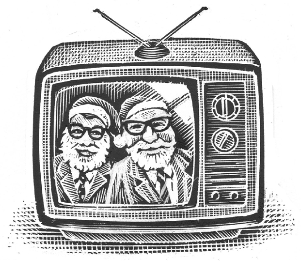

## Kapitel 4: Wie Scrooge einen Geist sah und lieber wieder Weihnachten hasste

„Uuh. Uuuuuuh!“, sagt Marleys <abbr class="word" title="der Geist, -er — ghost">Geist</abbr>. Das klingt nicht besonders echt. Er <abbr class="word" title="rasseln, rasselte, hat gerasselt — rattles">rasselt</abbr> mit seinen <abbr class="word" title="die Kette, -n — chains">Ketten</abbr>.

Scrooge schaut müde ins dunkle Zimmer. „Was’n das?“, fragt er und zieht die Bettdecke enger um sich.

„Uuuuh, Ebenezer Scrooge! Ich bin es, Marley, dein alter Freund und <abbr class="word" title="der Geschäftspartner, - — business partner">Geschäftspartner</abbr>. Ich bin <abbr class="word" title="aus Versehen — by accident">aus Versehen</abbr> vom Dach gefallen. Das Haus hatte zwölf Stockwerke. Ähem.“

Der Geist trägt Geisterketten. Eine Kette hängt an seinem Fuß. Daran hängt eine alte, leuchtende <abbr class="word" title="die Rechenmaschine, -n — adding machine">Rechenmaschine</abbr>: eine IBM 1456.

„Also, ich bin hier, weil du falsch lebst. Das soll ich dir zeigen“, sagt Marley. „Oh! Hier sieht es aber gut aus, Ebenezer. Dir geht es wirklich sehr gut!“

<abbr class="construction" title="The separable verb anmachen places an at the end.">Scrooge macht das Licht an.</abbr> An den Wänden hängt sehr teure <abbr class="word" title="die Seide — silk">Seide</abbr>. Seine Bettdecke ist aus teurem Fell. Er trägt kein altmodisches Nachthemd und keine Mütze mit einem kleinen Wollball. Nein, er trägt einen James-Bond-Kung-Fu-Schlafanzug.

„Ach, du bist es, mein alter Geschäftspartner Marley! Du bist vom Dach gefallen. Das Haus hatte zwölf Stockwerke. <abbr class="construction" title="Konnte is the familiar past form of the modal können; the infinitive aufhalten comes last. Nicht mehr means no longer.">Ich konnte dich nicht mehr aufhalten.</abbr> Ähem, ähem. Wie laufen die Geschäfte bei den Geistern?“

Marley sieht etwas überrascht aus. „Ach, nicht besonders gut, nicht besonders schlecht“, sagt er leise.

Scrooge steigt aus dem Bett. Auf seinem <abbr class="word" title="der Morgenmantel, Morgenmäntel — dressing gown">Morgenmantel</abbr> sind Muster aus Goldfäden.

„Also, alter Freund, was soll das? Du besuchst mich jetzt zum zweiten Mal als Geist. Erinnerst du dich? Klirr, klirr! Deine Ketten haben mich sehr beeindruckt. Klirr, klirr! Wirklich sehr. Danach war ich ein besserer Mensch und so weiter. Mr Dickens hat viel darüber geschrieben.“

„Ja, aber …“, beginnt Marley.

Scrooge öffnet den Schrank mit seinen Getränken. „Früher habe ich Weihnachten gehasst. Whisky? Oder magst du als Geist keinen <abbr class="word" title="der Weingeist — alcohol; Weingeist echoes Geist, the word for a ghost, to recreate the English spirits joke">Weingeist</abbr>? Haha. Jedenfalls ist das vorbei. Oh ja, du hast mir meine Fehler gezeigt …“

„Ich gebe auf“, sagt der Geist leise. Dann pfeift er laut und hoch.

Plopp! Mitten im Zimmer erscheint noch ein Geist. Er hat kurze Locken und ein großes Lächeln. In einer Hand hält er ein leuchtendes Buch. Er spricht in ein <abbr class="word" title="das Mikrofon, -e — microphone">Mikrofon</abbr>.

„Aaah!“, schreit Scrooge. „Das ist Eamonn O’Fizzy!“

„Ja, Ebenezer“, sagt der Geist mit süßer Stimme. „Erinnerst du dich an diese Stimme? Begorrah!“

„Ja, das ist deine Stimme“, sagt Scrooge leise. Das beeindruckt ihn nicht.

„Ich meine diese Stimme!“, sagt O’Fizzy scharf.

„Gott segne uns alle“, sagt eine winzige Stimme.

Scrooge holt laut Luft, wie ein Schauspieler. „Er ist es! Nein! Doch! Meine Güte! Es ist Tiny Tim!“

„Begot. Ja, Scrooge. Und jetzt gehen wir zurück …“

Vor Scrooge erscheint ein Bild, wie auf einem Geisterfernseher. Die ganze Familie Cratchit sitzt glücklich um ihren Tisch.

„Ja“, sagt Scrooge. „Da sitzt die Familie Cratchit glücklich zu Hause am Tisch. Ich habe mich geändert. Ich bin ein besserer Mensch geworden und mag jetzt Weihnachten.“

„Und dann hast du Firmen für <abbr class="word" title="das Knallbonbon, -s — Christmas crackers, pulled apart to release a small gift">Knallbonbons</abbr> gekauft“, sagt O’Fizzy. „Und Bauernhöfe mit <abbr class="word" title="der Truthahn, Truthähne — turkeys">Truthähnen</abbr>. Und Fabriken für Papierketten und Schneemänner aus <abbr class="word" title="das Styropor — polystyrene">Styropor</abbr> …“

„Richtig. Auch Läden für Schnee aus der Sprühdose. Eine Fabrik für Luftballons. Und eine Fabrik für Weihnachtsmänner aus Plastik. Die kommen auf eklige kleine Kuchen mit rosa <abbr class="word" title="der Zuckerguss — icing">Zuckerguss</abbr>. <abbr class="construction" title="Perfekt describes an earlier completed action; zu einer großen Firma expresses the result.">Ich habe alle Firmen zu einer großen Firma gemacht.</abbr> Zu einer großen Weihnachtsfirma: UniScrooge!“

O’Fizzy verschwindet. Bunte Lichter schießen hoch wie Wasser aus einem Brunnen. Ein zweiter schrecklicher Geist hüpft ins Zimmer. Er ist so furchtbar, dass Scrooge die Vorhänge packt.

„Das ist … das ist …“, sagt Scrooge voller Angst. Über ihm hängt ein riesiges Kinn. Das Gesicht dazu grinst ihn an.

„Alles in Ordnung, mein Lieber?“, fragt Bruce Forsooth. „Ich erzähle die Geschichte weiter. Jetzt schauen wir auf heute. Gut?“

Scrooge sieht Läden voller UniScrooge-Produkte. Kleine, harte Stücke Seife liegen in sehr viel Weihnachtspapier. Dieses Papier muss sehr teuer sein. Damit kostet die Seife nämlich tausend Prozent mehr!

Er sieht große, heiße Kaufhäuser. Väter <abbr class="word" title="fluchen, fluchte, hat geflucht — swear">fluchen</abbr>. Kinder schreien. Die Mütter sind normalerweise nett. Aber jetzt rufen sie: „Warte nur, bis wir zu Hause sind! Dann kriegst du was von mir!“

Da sind Schachteln mit Knallbonbons. Eigentlich kosten die Dinger 2 Pence. Jetzt kostet jedes einzelne 45 Pence. Und in jedem steckt ein echtes Stück Plastik!

Da sind trockene <abbr class="word" title="die Zigarre, -n — cigars">Zigarren</abbr> und lustige <abbr class="word" title="der Korkenzieher, - — corkscrews">Korkenzieher</abbr>. Auf Partys trinken die Leute zu viel. Sie sind betrunken. Dann fahren sie mit ihren Autos ineinander.

Im Fernsehen laufen Sendungen wie: „Tausend alte Szenen aus Filmen von Walt Disney, die ihr schon zehnmal gesehen habt“.

Das Bild wird kurz unklar. Dann sieht Scrooge wieder die Familie Cratchit. Alle sind sehr dick und haben genug von allem. Sie liegen um ihren Farbfernseher und <abbr class="word" title="stöhnen, stöhnte, hat gestöhnt — groan">stöhnen</abbr>. Sein Bildschirm ist siebenundzwanzig Zoll groß. Besonders glücklich sieht die Familie nicht aus.

Auf dem Bildschirm sind Leute, die nicht an Gott glauben und über Gott fluchen. Sie tragen Papierhüte. In einem Studio mit kalten Lichtern versuchen sie, Weihnachtsfreude zu machen.

„Weißt du noch, Mrs C?“, fragt Bob Cratchit. „Früher hatten wir Spaß. Dieses Jahr habe ich wirklich genug von Weihnachten. Nie wieder!“

Das Bild und Bruce Forsooth verschwinden. Jetzt kommt etwas wirklich Furchtbares. Seine Augen rollen, und sein Grinsen ist ganz schief. Scrooge schreit vor Angst.

„Nein! Nicht Hugey Grin!“

„Danke, danke, Freunde“, sagt der Geist. „Und einen großen <abbr class="word" title="der Applaus — applause">Applaus</abbr> für Bruce Forsooth! Das hat er doch gut gemacht, oder? Und jetzt, Freunde, sehen wir Weihnachten in der Zukunft …“

Kurz sieht Scrooge dunkle Läden und traurige Straßen. Dann verschwindet das Bild. Es ist einfach zu peinlich.

„… Was ist passiert?“, fragt Scrooge.

„Alle haben gesagt: Nie wieder“, antwortet Hugey Grin.

„Kein Weihnachten mehr?“, fragt Scrooge leise.

„Sie sehen keinen Sinn mehr darin“, sagt Hugey Grin. „<abbr class="construction" title="Auch means even here; kann plus an infinitive expresses possibility.">Auch von einer guten Sache kann man zu viel haben.</abbr>“

Am nächsten Morgen wacht Scrooge auf und geht sofort zum Fenster. Er sieht die fröhlichen Weihnachtslichter auf der Straße. Die Ladenbesitzer haben sie aufgehängt. So müssen sie nicht selbst freundlich zu den Kunden sein.

Er sieht auch einen kleinen Jungen. Der sieht ziemlich hart aus.

Scrooge will alle seine Weihnachtsfabriken verkaufen. Seine Fernsehstudios auch. Er will wieder ein <abbr class="word" title="der Geizhals, Geizhälse — miser">Geizhals</abbr> sein. Das ist wenigstens gesund.

Aber das muss warten. Mit etwas Kleinem kann er sofort anfangen.

„He!“, ruft er dem Jungen zu. „Hier sind fünf Pfund. <abbr class="construction" title="Wenn introduces a condition; the finite verb gehst ends its clause.">Du bekommst noch fünf Pfund, wenn du zu den Cratchits gehst.</abbr> Tritt ihren Fernseher kaputt!“

Dann macht er das Fenster zu.

„<abbr class="word" title="der Humbug — nonsense; Scrooge&#x27;s delighted rejection of Christmas">Humbug</abbr>“, denkt er fröhlich. „Humbug.“

### Words in this chapter

- **der Geist, -er** — ghost
- **rasseln, rasselte, hat gerasselt** — rattles
- **die Kette, -n** — chains
- **der Geschäftspartner, -** — business partner
- **aus Versehen** — by accident
- **die Rechenmaschine, -n** — adding machine
- **die Seide** — silk
- **der Morgenmantel, Morgenmäntel** — dressing gown
- **der Weingeist** — alcohol; Weingeist echoes Geist, the word for a ghost, to recreate the English spirits joke
- **das Mikrofon, -e** — microphone
- **das Knallbonbon, -s** — Christmas crackers, pulled apart to release a small gift
- **der Truthahn, Truthähne** — turkeys
- **das Styropor** — polystyrene
- **der Zuckerguss** — icing
- **fluchen, fluchte, hat geflucht** — swear
- **die Zigarre, -n** — cigars
- **der Korkenzieher, -** — corkscrews
- **stöhnen, stöhnte, hat gestöhnt** — groan
- **der Applaus** — applause
- **der Geizhals, Geizhälse** — miser
- **der Humbug** — nonsense; Scrooge's delighted rejection of Christmas

### Constructions and sentences
- **“Scrooge macht das Licht an.”** — Scrooge switches on the light. The prefix of the separable verb *anmachen* goes at the end.

- **“Ich konnte dich nicht mehr aufhalten.”** — I could no longer stop you. *Konnte* is the familiar past form of the modal *können*; the infinitive *aufhalten* comes last. The throat-clearing keeps Scrooge's account ambiguous, without asserting regret.

- **“Ich habe alle Firmen zu einer großen Firma gemacht.”** — I turned all the companies into one large company. Perfekt describes his earlier action; *zu* introduces the result.

- **“Auch von einer guten Sache kann man zu viel haben.”** — You can have too much even of a good thing. *Kann* takes the infinitive *haben* at the end.

- **“Du bekommst noch fünf Pfund, wenn du zu den Cratchits gehst.”** — You get another five pounds if you go to the Cratchits. The *wenn* clause expresses a condition and ends with its finite verb.

---

[← Previous](kapitel-03.md) · [Contents](README.md) · [Next →](kapitel-05.md)
