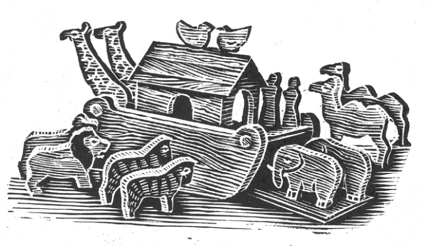

## Kapitel 5: Gesucht: Ein dicker, fröhlicher Mann mit einer roten Wollmütze

„<abbr class="construction" title="Perfekt with haben describes a completed action; kündigen means to quit a job here.">Ich habe gekündigt.</abbr>“, sagt der Weihnachtsmann. Er wirft seine rote Mütze auf den Haken hinter der Tür. Dann schiebt er die Katze aus seinem Sessel.

Mrs Christmas steht in der Küchentür. Wütend rührt sie den Teig für <abbr class="word" title="der Yorkshire-Pudding, -s — a baked batter dish, not a sweet pudding">Yorkshire-Pudding</abbr>.

„Ho, ja“, sagt sie scharf. „Und warum, wenn ich fragen darf?“

„Ich habe die Geschenkliste angeschaut. Da habe ich gedacht: Ach, Schluss mit dem Unsinn! Ich mache das seit fünfhundert Jahren. Und was habe ich davon? Keine bessere Stelle in der Zukunft. Keine <abbr class="word" title="die Rente, -n — pension">Rente</abbr>. Ho! Ho! Ho! Es ist Zeit für etwas anderes.“ Er nimmt eine Zeitung. Einen Augenblick später reißt seine Frau sie ihm aus den Händen.

„Du suchst dir eine andere Arbeit“, sagt Mrs Christmas fest.

„Ja, meine Liebe. Aber erst ein paar Wochen Urlaub …“

„Bei den Preisen für <abbr class="word" title="das Rentierfutter — reindeer fodder">Rentierfutter</abbr>?“ Mrs Christmas zieht ihn aus dem Sessel. Sie drückt die Mütze auf seine weißen Locken. Dann schiebt sie ihn schnell zur Tür.

„Los, mein Junge! Keine Arbeit, kein Abendessen! Du willst den ganzen Tag faul zu Hause sitzen? Das kannst du vergessen!“

Traurig geht der Weihnachtsmann zum <abbr class="word" title="das Arbeitsbüro, -s — job agency">Arbeitsbüro</abbr>. Dort sitzt ein junger Mann. Er will gern helfen. Aber sein neuer Besucher überrascht ihn sehr: ein dicker Mann mit roten Wangen und einem weißen Bart. Auf das Formular schreibt dieser Mann als Beruf: „Ich mache selbstständig Spielzeug und liefere Sachen über große Entfernungen.“

Trotzdem versucht der junge Mann, ihm zu helfen.

„Sie möchten eine Arbeit mit guten Chancen für die Zukunft? Dann versuchen Sie es bei einer Bank“, sagt er etwas unsicher. „Die Bank hier in der Straße hat eine freie Stelle.“

„Sehr schön“, sagt der Weihnachtsmann.

Am nächsten Tag sitzt er wieder auf demselben Stuhl. Er sieht etwas <abbr class="word" title="verlegen — sheepish, embarrassed">verlegen</abbr> aus. Der junge Mann hört dem Bankdirektor am Telefon zu. Der Bankdirektor ist gar nicht glücklich.

„Ein völlig Verrückter!“, schreit er. „Er hat 4765 Pfund und 15 Pence verschenkt! Erst dann haben wir gemerkt, was los ist. Sogar die Stifte und die Telefone hat er verschenkt! Ho! Ho! Ho! Na, schönen Dank! Und seine Kleidung! Die müssen Sie sehen!“

Nach ein paar Minuten legt der junge Mann den <abbr class="word" title="der Hörer, - — telephone receiver">Hörer</abbr> auf.

„Na, das war kein großer Erfolg, oder? Unser <abbr class="word" title="der Finanzminister, - — finance minister; the government official responsible for money">Finanzminister</abbr> muss jetzt wohl keine Angst um seine Stelle haben“, sagt er streng.

„So bin ich eben“, sagt der Weihnachtsmann leise.

Der junge Mann hat wirklich ein gutes Herz. Er sucht noch einmal in seiner Mappe mit freien Stellen.

„Haben Sie schon mit großen, schweren Lastwagen gearbeitet?“, fragt er.

Der Weihnachtsmann denkt nach. Sein <abbr class="word" title="der Schlitten, - — sleigh">Schlitten</abbr> ist mit all den Spielsachen sehr schwer. Er kann ihn kaum aus der Garage schieben.

„Ja“, sagt er schließlich.

Am nächsten Tag ist der Weihnachtsmann wieder sehr verlegen. Der junge Mann versucht, den Chef von der Lastwagenfirma zu <abbr class="word" title="beruhigen, beruhigte, hat beruhigt — calm down">beruhigen</abbr>. Zum Glück ist dieser Chef nur am Telefon. Aber er ist so wütend, dass man ihn im ganzen Zimmer hört. Endlich legt der Mann vom Arbeitsbüro auf.

„<abbr class="construction" title="Ja adds pointed emphasis here; the praise is sarcastic because the truck is on a roof.">Na, das haben Sie ja toll gemacht!</abbr>“, sagt er. „Sagen Sie mal: Wie haben Sie einen Lastwagen auf das Dach gebracht? Er hat sechzehn Räder und wiegt dreißig Tonnen! Und das Haus hat drei Stockwerke!“

„Ist das nicht normal?“, fragt der Weihnachtsmann. „<abbr class="construction" title="Auf dem Dach uses dative because it describes location, not movement onto the roof.">Ich parke immer auf dem Dach.</abbr>“

Er sieht sehr traurig aus. Da wird der junge Mann wieder freundlicher.

„Hören Sie“, sagt er. „Andere Kleidung hilft vielleicht. Etwas mehr … äh … etwas, das zu einer ordentlichen Arbeitsstelle passt.“

„Was ist denn falsch an roten Hosen mit Fell unten an den Beinen?“, fragt der Weihnachtsmann. „Und an einer spitzen Mütze mit einem <abbr class="word" title="der Bommel, - — woolly pompom">Bommel</abbr>? Bisher hat sich niemand beschwert.“

„Gut, gut. Wir versuchen es noch einmal. Die Spielzeugfabrik hier braucht jemanden für Weihnachten. Diese Arbeit können Sie sicher nicht falsch machen.“

„Nun, auch diese Arbeit haben Sie falsch gemacht“, sagt der junge Mann. Jetzt will er nicht mehr so gern helfen. Er entschuldigt sich beim Chef von der Spielzeugfabrik und legt das Telefon auf.

„Ich mache nicht gern Spielzeugsoldaten und <abbr class="word" title="das Maschinengewehr, -e — machine guns">Maschinengewehre</abbr>“, sagt der Weihnachtsmann. „Das sind unangenehme Dinge.“

„Ja, aber <abbr class="word" title="die Arche, -n — arks: toy versions of Noah&#x27;s ship">Archen</abbr> von Noah aus Holz und <abbr class="word" title="der Teddybär, -en — teddy bears">Teddybären</abbr>?“, fragt der junge Mann. „Was sind denn das für Geschenke für Kinder? Tut mir leid, Mr Christmas. In unserem Beruf sagen wir: Niemand kann Sie <abbr class="word" title="einstellen, stellte ein, hat eingestellt — employ, hire">einstellen</abbr>. Ich finde nichts, das zu Ihnen passt.“

Der Weihnachtsmann will gerade gehen. Da klingelt das Telefon. Der Mann vom Arbeitsbüro nimmt den Hörer ab und hört zu.

„Oh, ja? Erzählen Sie weiter. Dick, sagen Sie? Fröhlich? Ich verstehe. Es ist gut, wenn er Ho! Ho! Ho! sagen kann? Ja, ich suche jemanden für Sie. Ich glaube sogar, ich habe genau den richtigen Mann.“

Er legt den Hörer auf. „Mr Christmas, möchten Sie in einem <abbr class="word" title="das Kaufhaus, Kaufhäuser — department store">Kaufhaus</abbr> arbeiten?“

Der Weihnachtsmann kommt pfeifend nach Hause. Er sieht sehr fröhlich aus.

„Wie war die neue Arbeit?“, fragt Mrs Christmas.

„Wirklich sehr gut“, sagt er und setzt sich an den Tisch. „Die Arbeit ist kinderleicht. <abbr class="construction" title="Muss takes the infinitive sitzen later in the sentence; nur means just or only.">Ich muss nur</abbr> in einer Art <abbr class="word" title="die Märchenhöhle, -n — fairy-tale grotto, a decorated space for the store Santa">Märchenhöhle</abbr> sitzen. Vor mir steht eine Schlange von Kindern. Sie kommen zu mir und sagen mir ihre Wünsche für Weihnachten. Warum, weiß ich nicht genau.“

„Hoffentlich hat sich niemand über deinen schönen roten Anzug beschwert“, sagt Mrs Christmas. „Ich habe so lange daran gearbeitet.“

„Nein. Komisch, aber ich glaube, der Chef freut sich sehr darüber“, sagt der Weihnachtsmann. „Deshalb hat er mir sogar extra Geld gegeben. Ich bekomme kostenlos Mittagessen und zwei Teepausen. Alle kennen auch meinen Namen. Sie sagen: Hallo, Weihnachtsmann! <abbr class="construction" title="The indirect question begins with wozu and puts ist at the end.">Ich frage mich nur, wozu das alles gut ist.</abbr>“

Mrs Christmas stellt ihm mit einem lauten Klack einen Teller hin. Dann küsst sie seine weißen Locken.

„Sie mögen dich offenbar einfach“, sagt sie.

### Words in this chapter

- **der Yorkshire-Pudding, -s** — a baked batter dish, not a sweet pudding
- **die Rente, -n** — pension
- **das Rentierfutter** — reindeer fodder
- **das Arbeitsbüro, -s** — job agency
- **verlegen** — sheepish, embarrassed
- **der Hörer, -** — telephone receiver
- **der Finanzminister, -** — finance minister; the government official responsible for money
- **der Schlitten, -** — sleigh
- **beruhigen, beruhigte, hat beruhigt** — calm down
- **der Bommel, -** — woolly pompom
- **das Maschinengewehr, -e** — machine guns
- **die Arche, -n** — arks: toy versions of Noah's ship
- **der Teddybär, -en** — teddy bears
- **einstellen, stellte ein, hat eingestellt** — employ, hire
- **das Kaufhaus, Kaufhäuser** — department store
- **die Märchenhöhle, -n** — fairy-tale grotto, a decorated space for the store Santa

### Constructions and sentences
- **“Ich habe gekündigt.”** — I have quit. Perfekt describes a completed action; *kündigen* means to leave a job here.

- **“Na, das haben Sie ja toll gemacht!”** — Well, you have really done a great job! *Haben … gemacht* is Perfekt; *ja* adds pointed emphasis. The praise is sarcastic because Santa has parked a huge truck on a roof.

- **“Ich parke immer auf dem Dach.”** — I always park on the roof. *Auf dem Dach* describes a location and uses dative.

- **“Ich muss nur in einer Art Märchenhöhle sitzen.”** — I just have to sit in a sort of fairy-tale grotto. *Muss* takes an infinitive; *nur* means just or only.

- **“Ich frage mich nur, wozu das alles gut ist.”** — I just wonder what it is all for. The indirect question begins with *wozu* and ends with the finite verb *ist*.

---

[← Previous](kapitel-04.md) · [Contents](README.md) · [Next →](kapitel-06.md)
