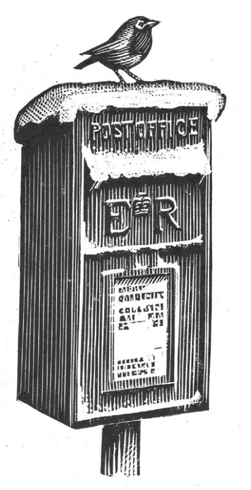

## Kapitel 6: Ein Rebhuhn im Briefkasten

Am ersten Weihnachtstag kommt ein großes Paket im sehr kleinen Postamt von Collip St Pancras an. Das Paket hat eine sehr seltsame Form.

Albert Button, der <abbr class="word" title="der Briefträger, - — postman">Briefträger</abbr>, sieht es einmal an. „<abbr class="construction" title="The modal kann takes the infinitive ausliefern at the end; nicht makes it negative.">Das kann ich nicht ausliefern.</abbr> Das ist viel zu groß! Was ist das überhaupt?“

„Du glaubst es bestimmt nicht“, sagt der Postchef. „Aber es ist ein <abbr class="word" title="das Rebhuhn, Rebhühner — partridge">Rebhuhn</abbr> in einem Birnbaum.“

Und tatsächlich: Unter dem braunen Papier und dem Klebeband <abbr class="word" title="rascheln, raschelte, hat geraschelt — rustles">raschelt</abbr> und <abbr class="word" title="brummen, brummte, hat gebrummt — grumbles">brummt</abbr> es. So klingt ein kleiner, wütender Vogel nach einer ganzen Nacht in einem Paket.

Also legt Albert Button das Paket vorn auf sein Fahrrad. Er fährt den ganzen Weg zu einem großen Haus auf einem Hügel. Eine wunderschöne junge Dame öffnet die Tür. Sie gibt ihm <abbr class="word" title="das Trinkgeld, -er — tip, money for a service">Trinkgeld</abbr>.

Am zweiten Weihnachtstag steht eine Holzkiste im Postamt. Aus ihr kommen leise „Gurr, gurr“-Geräusche.

„Eine <abbr class="word" title="die Expresslieferung, -en — express delivery">Expresslieferung</abbr>“, sagt der Postchef. „Ich höre, es sind zwei <abbr class="word" title="die Turteltaube, -n — turtle doves">Turteltauben</abbr>.“

Am nächsten Tag schaut Albert durch einen Korb. Darin sitzen drei kleine, dicke Vögel. Sie tragen französische Mützen und trinken Rotwein. Einer spielt <abbr class="word" title="das Akkordeon, -s — accordion">Akkordeon</abbr>.

„Das sind wohl die drei französischen Hühner“, sagt Albert. Mit Mühe hebt er sie auf sein Fahrrad.

Am vierten Weihnachtstag …

„Ihr <abbr class="word" title="der Liebste, die Liebsten — her true love">Liebster</abbr> hat überhaupt nicht an den armen alten Briefträger gedacht“, sagt Albert. Er atmet schwer und <abbr class="word" title="keuchen, keuchte, hat gekeucht — pants, wheezes">keucht</abbr> den Hügel hinauf. Im Paket sitzen vier sehr schwere Vögel, die laut rufen.

Am nächsten Tag gibt es natürlich nur fünf goldene Ringe. Die junge Dame freut sich sehr. Sie lächelt Albert an. Er pfeift den ganzen Weg nach Hause.

Am nächsten Morgen muss er sechs <abbr class="word" title="die Gans, Gänse — geese">Gänse</abbr> bringen. Sie legen überall auf seiner Posttasche Eier. Aber nicht einmal das stört ihn. Mit den sieben schwimmenden <abbr class="word" title="der Schwan, Schwäne — swans">Schwänen</abbr> ist er vorsichtiger.

„Ein Schlag mit ihrer Nase kann einem Mann den Arm brechen“, sagt er.

Am achten Weihnachtstag spricht er mit den acht Mädchen beim <abbr class="word" title="melken, melkte, hat gemolken — milking; taking milk from a cow">Melken</abbr>. „Hört mal, meine Damen. <abbr class="construction" title="Genug Platz für means enough room for; auf meinem Fahrrad is a location in the dative.">Auf meinem Fahrrad ist nicht genug Platz für euch alle.</abbr> Ich muss euch einzeln mitnehmen. Eine nach der anderen, hier auf der Stange.“ Er wird rot.

Am neunten Tag kennt Albert die Sache schon gut.

Die <abbr class="word" title="der Trommler, - — drummers">Trommler</abbr> stehen herum und wissen nicht, was sie tun sollen. Überall auf ihnen kleben Briefmarken für einen Penny. „Also, Jungs!“, sagt Albert. „Alle zusammen! Und eins, und zwei, und eins-zwei-drei-vier …“

Am zehnten Tag fährt er stolz auf seinem Fahrrad voraus. Hinter ihm spielen zehn <abbr class="word" title="der Dudelsackspieler, - — pipers, musicians playing bagpipes">Dudelsackspieler</abbr> das Lied „Will Ye No Come Back Again?“.

Am elften Tag tanzt er mit elf Damen den Hügel hinauf. Sie tanzen Walzer, Foxtrott und Tango. Besonders gern tanzt er mit einer hübschen Dame mit schwarzen Haaren. Sie gibt ihm einen Kuss.

Aber am zwölften Weihnachtstag sagt der Postchef: „Ja, genau. Sie sind weg. Niemand findet sie.“

„Weg?“, fragt Albert. „Weg? Wie kann man zwölf hüpfende <abbr class="word" title="der Lord, -s — lords, noblemen">Lords</abbr> verlieren?“

„Wahrscheinlich hüpfen sie in Crewe auf einem Gleis für Güterzüge“, sagt der Postchef. „British Rail sucht schon den ganzen Morgen. Die Leute haben alles Mögliche gefunden, aber keine Lords. Einen kleinen <abbr class="word" title="der Baron, -e — baron, a nobleman">Baron</abbr> haben sie gefunden. In einem Briefkasten bei Bath. Aber ich habe ihnen gesagt: Der gehört nicht zu uns. Also haben sie ihn wieder hineingesteckt.“

„Das ist schrecklich!“, sagt Albert. „Sie wird so <abbr class="word" title="enttäuscht — disappointed">enttäuscht</abbr> sein. Vielleicht denkt sie, ihr Liebster hat die Lords vergessen!“

Er springt auf sein Fahrrad von der Post. Wie verrückt fährt er zum Hauptpostamt in Blackbury. Alle anderen Briefträger kennen die Geschichte mit den seltsamen Geschenken schon. Zusammen mit Albert suchen sie schnell zwischen den Paketen.

Aber da ist nicht einmal ein <abbr class="word" title="der Ritter, - — knight">Ritter</abbr>. Es riecht nicht einmal nach einem <abbr class="word" title="der Graf, -en — earl or count">Grafen</abbr>.

Albert Button setzt sich auf einen Haufen Briefe. Er hält den Kopf in den Händen. Müde sieht er die anderen Briefträger an. Es sind sechs. Der Telefonchef und seine Techniker dazu: Das macht neun, denkt er. Dazu der Hauptpostchef, der zweite Chef und ich: zwölf.

Er steht auf. „Meine Herren! Das ist eine sehr ernste Situation. Können wir hier irgendwo <abbr class="word" title="die Kniehose, -n — knee breeches">Kniehosen</abbr> aus Seide mieten? Und ein Dutzend kleine Kronen?“

Am zwölften Weihnachtstag schaut die junge Dame im Haus auf dem Hügel aus dem Fenster. Männer ziehen ein großes <abbr class="word" title="das Trampolin, -e — trampoline">Trampolin</abbr> auf den Rasen vor ihrem Haus.

„Los, Jungs!“, <abbr class="word" title="zischen, zischte, hat gezischt — hisses">zischt</abbr> Albert leise. „Hüpft um euer Leben!“

Sie fliegen auf und ab. Sie schlagen Räder und machen <abbr class="word" title="der Salto, -s — somersaults">Saltos</abbr>. Sie fliegen in einer Acht. Boing! Spring! Hüpf!

„Wir sind Lords“, sagt Albert sehr deutlich. Er fliegt gerade mit dem Kopf nach unten am Fenster vorbei. „Das ist wirklich so. Stimmt’s, Jungs?“

<abbr class="construction" title="The separable verb zuwinken places zu at the end; ihnen is the dative object.">Sie lächelt und winkt ihnen zu.</abbr>

Am dreizehnten Weihnachtstag heiratet sie ihren Liebsten. Albert Button ist der <abbr class="word" title="der Trauzeuge, -n — best man; a witness at a wedding">Trauzeuge</abbr>. Er steht in seiner besten Uniform da. Alle Knöpfe glänzen. In der Hand hält er die fünf goldenen Ringe.

Die kleine Krone von einem Lord sitzt ganz fest auf seinem Kopf. <abbr class="construction" title="Muss takes the infinitive tragen; darüber means over it, referring to the crown.">Er muss seine Mütze darüber tragen.</abbr> Aber er lächelt.

### Words in this chapter

- **der Briefträger, -** — postman
- **das Rebhuhn, Rebhühner** — partridge
- **rascheln, raschelte, hat geraschelt** — rustles
- **brummen, brummte, hat gebrummt** — grumbles
- **das Trinkgeld, -er** — tip, money for a service
- **die Expresslieferung, -en** — express delivery
- **die Turteltaube, -n** — turtle doves
- **das Akkordeon, -s** — accordion
- **der Liebste, die Liebsten** — her true love
- **keuchen, keuchte, hat gekeucht** — pants, wheezes
- **die Gans, Gänse** — geese
- **der Schwan, Schwäne** — swans
- **melken, melkte, hat gemolken** — milking; taking milk from a cow
- **der Trommler, -** — drummers
- **der Dudelsackspieler, -** — pipers, musicians playing bagpipes
- **der Lord, -s** — lords, noblemen
- **der Baron, -e** — baron, a nobleman
- **enttäuscht** — disappointed
- **der Ritter, -** — knight
- **der Graf, -en** — earl or count
- **die Kniehose, -n** — knee breeches
- **das Trampolin, -e** — trampoline
- **zischen, zischte, hat gezischt** — hisses
- **der Salto, -s** — somersaults
- **der Trauzeuge, -n** — best man; a witness at a wedding

### Constructions and sentences
- **“Das kann ich nicht ausliefern.”** — I cannot deliver that. The modal *kann* takes the infinitive *ausliefern* at the end.

- **“Auf meinem Fahrrad ist nicht genug Platz für euch alle.”** — There is not enough room on my bike for all of you. *Genug Platz für* means enough room for; *auf meinem Fahrrad* uses dative for location.

- **“Sie lächelt und winkt ihnen zu.”** — She smiles and waves to them. The separable verb *zuwinken* leaves *zu* at the end and takes a dative object, *ihnen*.

- **“Er muss seine Mütze darüber tragen.”** — He has to wear his cap over it. *Muss* takes the infinitive *tragen*; *darüber* refers to the crown.

---

[← Previous](kapitel-05.md) · [Contents](README.md) · [Next →](kapitel-07.md)
