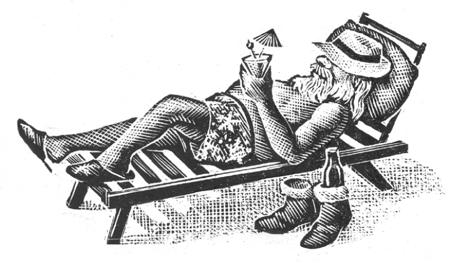

## Kapitel 7: Der neue Weihnachtsmann

Am Nordpol steht eine große Fabrik für Weihnachtsspielzeug. Im Büro sprechen der Weihnachtsmann und die Vertreter seiner Arbeiter miteinander. Es geht um schwierige Fragen: Arbeit und Geld. Aber das Gespräch kommt nicht weiter.

„Nein“, sagt der Weihnachtsmann.

Sean O’Haircut ist der Chef der <abbr class="word" title="der Gnom, die Gnome — gnomes; small magical workers">Gnome</abbr>. Er fragt: „Ist das Ihr letztes Wort?“

„Ja“, sagt der Weihnachtsmann und legt die Arme vor die Brust.

Sean ist auch der Vertreter der Arbeiter in der Fabrik. Er bläst in seine Pfeife. Dann geht er zum großen Raum mit den Spielzeugmaschinen. An die Wand hängt er eine Nachricht. Alle haben Angst vor dieser Nachricht:

„Die Gespräche zwischen dem Chef, dem Weihnachtsmann, und unseren Gruppen sind zu Ende. GELPA ist der Verein für Gnome, <abbr class="word" title="die Elfe, die Elfen — elves">Elfen</abbr>, <abbr class="word" title="der Kobold, die Kobolde — leprechauns; small magical beings">Kobolde</abbr> und <abbr class="word" title="die Fee, die Feen — pixies; little fairies">Feen</abbr>. RNRAASP ist der Verein für <abbr class="word" title="das Rentier, die Rentiere — reindeer">Rentiere</abbr> mit roten Nasen und andere <abbr class="word" title="der Schlittenzieher, die Schlittenzieher — creatures that pull sleighs">Schlittenzieher</abbr>. UFJS ist die <abbr class="word" title="die Gewerkschaft, die Gewerkschaften — trade union">Gewerkschaft</abbr> der dicken, fröhlichen Schneemänner. Deshalb beginnen wir jetzt einen <abbr class="word" title="der Streik, die Streiks — strike; refusal to work">Streik</abbr>.

Unterschrift: Sean O’Haircut, Vertreter aller Arbeiter.

PS: Wer trotzdem arbeitet, wird ganz bestimmt ein Frosch!

Unterschrift: Sean O’Haircut.“

Eine Maschine nach der anderen steht still. Die kleinen Zauberwesen legen ihr Werkzeug hin. An der magischen Kuckucksuhr melden sie das Ende ihrer Arbeitszeit. Dann gehen sie nach Hause.

Der Weihnachtsmann sitzt da und hält den Kopf in den Händen. Jack Frost kommt schnell herein. Viele Schneeflocken fliegen mit ihm ins Zimmer.

„Ach je“, sagt Jack Frost.

„<abbr class="construction" title="The modal müssen places the main infinitive absagen at the end.">Wir müssen Weihnachten absagen.</abbr> Die <abbr class="word" title="das Rentier, die Rentiere — reindeer">Rentiere</abbr> sagen, der <abbr class="word" title="der Schlitten, die Schlitten — sleigh">Schlitten</abbr> ist zu schwer. Es gibt immer mehr Kinder auf der Welt. Die Gnome sagen, sie arbeiten zu viel und bekommen zu wenig Geld. Ach je, ach je …“

„Ich gebe Rudolph die Schuld“, sagt Jack Frost sehr kalt. „Er ist schließlich so ein Rentier mit roter Nase.“

Der Weihnachtsmann hat fünfundzwanzig Telefone. Eines davon klingelt. Die BBC ruft an. Dann ruft noch jemand an. Das Gespräch dauert lange. Meistens hört man nur den Weihnachtsmann <abbr class="word" title="seufzen, seufzte, hat geseufzt — sigh">seufzen</abbr>.

Danach sagt er zu Jack Frost: „Jemand möchte mich in einer Fernsehsendung haben. Sean O’Haircut soll auch kommen. Und eine junge Dame namens … Raquel Welch, glaube ich? Und viele andere Leute. Für einen Mann vom Fernsehen ist er wirklich ein super Kerl. Er klingt wie ein Verwandter von dir.“

Bald kennt die ganze Welt die schreckliche Nachricht: Die Arbeiter streiken, deshalb fällt Weihnachten aus. Die Leute nehmen den Weihnachtsschmuck wieder weg. Die Fernsehsender müssen neue Programme finden. Jetzt können sie nicht einfach die langweiligen alten Filme zeigen. Viele kleine Kinder weinen und weinen und weinen.

Auch der Schnee fällt. Jack Frost hat ihn extra für diese Jahreszeit bestellt. Alles ist weiß, so weiß wie das Innere eines Tischtennisballs. Aber die Weihnachtsfreude fehlt. Es gibt keine <abbr class="word" title="das Rotkehlchen, die Rotkehlchen — robins; traditional Christmas birds">Rotkehlchen</abbr> und keine dicken, fröhlichen Schneemänner. Auch sie streiken.

Der Weihnachtsmann kommt in die Fernsehnachrichten „News at Ten“. Er spricht von <abbr class="word" title="der Gewinn, die Gewinne — profits">Gewinnen</abbr> und dem <abbr class="word" title="der Lohnstopp, die Lohnstopps — freeze on wages">Lohnstopp</abbr> und all den anderen Problemen. Deshalb kann er jetzt nicht weiter über Geld sprechen, sagt er. Sean O’Haircut kommt in „Panorama“. Dort macht er aus Robin Day einen Papagei.

Der Weihnachtsmann sitzt vor seinem Feuer und schaut fern. Die Sache mit dem Papagei findet er ziemlich lustig.

Er denkt: „<abbr class="construction" title="Zu + adjective expresses an excessive degree: too old.">Ich bin zu alt für diesen Spaß.</abbr> Eigentlich kann ich schon seit etwa vierhundert Jahren in <abbr class="word" title="die Rente, die Renten — retirement; pension">Rente</abbr> gehen. Ich ziehe an die Costa Bombe. Ein jüngerer Mann kann meinen Platz haben.“

Eine Woche später kommt der neue Weihnachtsmann zur Arbeit. Er ist groß, dünn und ziemlich jung. Er hat lange Haare. Seine Brille hat keinen Rand. Um den Hals trägt er eine Kette mit kleinen Glocken für Ziegen aus Tibet. Seine roten Hosen werden unten sehr weit. Die Spielzeugmacher haben noch nie einen so seltsamen Bart gesehen.

Er <abbr class="word" title="entlassen, entließ, hat entlassen — dismisses; fires from a job">entlässt</abbr> die Rentiere. <abbr class="construction" title="The English source uses the unusual phrase peer driven without explaining it. It is given as the reason for dismissing the reindeer; the mechanism remains unspecified.">Sein Schlitten ist jetzt nämlich „peer driven“.</abbr>

Er sagt zu allen „Mann“. Das ärgert die <abbr class="word" title="die Elfe, die Elfen — elves">Elfen</abbr> sehr. Außerdem <abbr class="word" title="schnippen, schnippte, hat geschnippt — snaps his fingers">schnippt</abbr> er dauernd mit den Fingern.

Er will die Fabrik „modern und einfacher“ machen. Das heißt: Fast alle verlieren ihre Arbeit. Maschinen sollen die Arbeit machen. „Moderne Spielsachen, darauf kommt es an, Mann“, sagt er. „Niemand will eure <abbr class="word" title="die Arche, die Archen — ark; the boat in the Noah story">Arche</abbr> Noah aus Holz.“

Die Vertreter der Arbeiter treffen sich in der Kantine.

„Das macht mich ganz traurig“, sagt ein Schneemann namens Brown.

Ein alter Gnom <abbr class="word" title="schimpfen, schimpfte, hat geschimpft — grumbles; complains angrily">schimpft</abbr>: „Ständig soll ich Raketen machen, die wirklich funktionieren. Raketen gegen andere Raketen. Was soll das überhaupt sein?“

Rudolph, das Rentier mit der roten Nase, sagt: „<abbr class="construction" title="Perfekt with haben + gemacht refers to their earlier decision.">Vielleicht haben wir etwas Dummes gemacht.</abbr> Was meint ihr, <abbr class="word" title="der Genosse, die Genossen — comrades; fellow members of the workers&#x27; group">Genossen</abbr>?“

Alle schauen Sean O’Haircut an. Sein Gesicht wird rot.

„Na gut“, <abbr class="word" title="murmeln, murmelte, hat gemurmelt — mutters">murmelt</abbr> er. „Ich besuche den alten Herrn. So schlimm wie dieser hier war er nicht. Das muss ich zugeben.“

Früh am 24. Dezember kommt Sean O’Haircut an die Costa Bombe. Die Sonne brennt auf den Strand. Der alte Weihnachtsmann liegt dort in einer roten Badehose und sonnt sich.

Die beiden sprechen lange miteinander. Bald sitzen sie in einem <abbr class="word" title="das Sonderflugzeug, die Sonderflugzeuge — special plane">Sonderflugzeug</abbr> zum Nordpol.

Der Weihnachtsmann geht in die Fabrik und reibt sich die Hände.

„So! Was ist denn hier los? Was macht diese Maschine? Und wo sind meine Rentiere? WER IST DAFÜR VERANTWORTLICH?“

Fünf Minuten später hört man einen schrecklichen Streit im Büro. Der neue Weihnachtsmann fliegt hinaus.

Eine kleine Bemerkung dazu: <abbr class="construction" title="A playful image: he moves into a good new job with his characteristic finger-snapping.">Bald schnippt er sich in einen ziemlich guten neuen Job.</abbr> Er leitet eine Popgruppe namens Purple Santas.

„So“, sagt der Weihnachtsmann. Er zieht seine rote Jacke mit dem warmen Fell innen an. Dann schaut er auf die Uhr. „<abbr class="construction" title="Nur noch means only a limited amount remains.">Wir haben nur noch ein paar Stunden.</abbr> Also, schnell an die Arbeit!“

„Ja, Chef!“, rufen die Elfen alle zusammen.

„Und bei all den Gewinnen und so weiter bekommt ihr wohl alle ein großes <abbr class="word" title="das Weihnachtsgeld — Christmas bonus">Weihnachtsgeld</abbr>“, sagt der Weihnachtsmann. Er ist schließlich nicht dumm.

Und alle bekommen es wirklich.

### Words in this chapter

- **der Gnom, die Gnome** — gnomes; small magical workers
- **die Elfe, die Elfen** — elves
- **der Kobold, die Kobolde** — leprechauns; small magical beings
- **die Fee, die Feen** — pixies; little fairies
- **das Rentier, die Rentiere** — reindeer
- **der Schlittenzieher, die Schlittenzieher** — creatures that pull sleighs
- **die Gewerkschaft, die Gewerkschaften** — trade union
- **der Streik, die Streiks** — strike; refusal to work
- **der Schlitten, die Schlitten** — sleigh
- **seufzen, seufzte, hat geseufzt** — sigh
- **das Rotkehlchen, die Rotkehlchen** — robins; traditional Christmas birds
- **der Gewinn, die Gewinne** — profits
- **der Lohnstopp, die Lohnstopps** — freeze on wages
- **die Rente, die Renten** — retirement; pension
- **entlassen, entließ, hat entlassen** — dismisses; fires from a job
- **schnippen, schnippte, hat geschnippt** — snaps his fingers
- **die Arche, die Archen** — ark; the boat in the Noah story
- **schimpfen, schimpfte, hat geschimpft** — grumbles; complains angrily
- **der Genosse, die Genossen** — comrades; fellow members of the workers' group
- **murmeln, murmelte, hat gemurmelt** — mutters
- **das Sonderflugzeug, die Sonderflugzeuge** — special plane
- **das Weihnachtsgeld** — Christmas bonus

### Constructions and sentences
- **“Wir müssen Weihnachten absagen.”** — “We have to cancel Christmas.” With the modal *müssen*, the infinitive *absagen* comes last.

- **“Ich bin zu alt für diesen Spaß.”** — “I am too old for this game.” *Zu* before an adjective means “too”.

- **“Sein Schlitten ist jetzt nämlich „peer driven“.”** — “His sleigh is now ‘peer driven’.” The source does not explain this unusual English phrase. It gives it as the reason for dismissing the reindeer; the exact mechanism remains unspecified.

- **“Vielleicht haben wir etwas Dummes gemacht.”** — “Perhaps we have done something foolish.” The Perfekt *haben … gemacht* refers to an earlier action.

- **“Bald schnippt er sich in einen ziemlich guten neuen Job.”** — “Soon he finger-snaps his way into quite a good new job.” This playful image keeps his characteristic finger-snapping; it does not describe how he gets hired.

- **“Wir haben nur noch ein paar Stunden.”** — “We only have a few hours left.” *Nur noch* marks the small amount remaining.

---

[← Previous](kapitel-06.md) · [Contents](README.md) · [Next →](kapitel-08.md)
