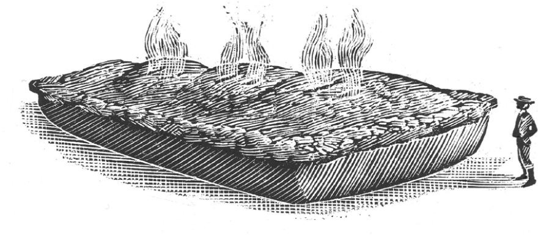

## Kapitel 8: Der große Kuchen von Blackbury

Dies ist die Geschichte vom großen <abbr class="word" title="der Fleischkuchen, die Fleischkuchen — meat pie; savoury pastry filled with meat">Fleischkuchen</abbr> von Blackbury. Dazu gehören die erstaunlichen Ereignisse am Weihnachtstag 1850 in Gritshire.

Blackbury ist eigentlich eine nette kleine Stadt. Dort lebt der Millionär Albert Wincepartner. Er ist klein und rund und hat ein rotes Gesicht. Als <abbr class="word" title="der Bürgermeister, die Bürgermeister — mayor">Bürgermeister</abbr> leitet er die Stadt. Sein Geld hat er mit Kaninchen verdient: Er hat sie nach Australien verkauft.

An einem Tag Anfang Dezember geht er auf der High Street spazieren. Sein Freund Blanket kommt mit. Blanket leitet das Büro der Stadt.

„Weißt du, Blanket“, sagt der Bürgermeister, „um diese Jahreszeit denke ich immer an die armen Leute. Sie bekommen kein Weihnachtsessen.“

„Ja“, sagt Blanket. Aber er denkt an etwas ganz anderes.

„Wir müssen etwas tun“, sagt der Bürgermeister. „Schreib das auf, Blanket. Ich bezahle … sagen wir, hundert Fleischkuchen für die armen Leute von Gritshire. Jeder Kuchen soll einen <abbr class="word" title="der Fuß, die Füße — foot; unit of length, about 30.5 centimetres">Fuß</abbr> breit sein. Kuchen zu Weihnachten: Das passt genau. Kümmere dich darum.“

<abbr class="construction" title="Zuhören is separable: zu comes at the end of the main clause.">Aber Blanket hört nicht richtig zu.</abbr> Zurück im Büro spricht er mit seinem Helfer. Der spricht mit einer Sekretärin. Die geht zu Mr Gwilliam Plum, einem bekannten Bäcker.

„<abbr class="construction" title="One pie, a hundred feet across? A hundred feet is about 30.5 metres; the order was for a hundred separate one-foot pies.">Ein Kuchen, hundert Fuß breit?</abbr>“, fragt Plum. „Sind Sie sicher? Aber … also … hundert Fuß!“

Mr Plum denkt nach. Langsam beginnt er zu lächeln. Das ist seine große Gelegenheit!

Am nächsten Tag hat Plum viel zu tun. Er holt alle Bäcker und <abbr class="word" title="der Metzger, die Metzger — butchers">Metzger</abbr> von Blackbury zusammen. Dann erklärt er seinen Plan.

„Das wird ein wunderbarer Kuchen!“, ruft er. „Ein König unter den Kuchen! Der größte Kuchen aller Zeiten! Und so lecker …“

Ein kleiner Mann kommt heran. Er trägt einen hohen schwarzen Hut. Im Mund hat er eine dicke <abbr class="word" title="die Zigarre, die Zigarren — cigar">Zigarre</abbr>.

„Sie brauchen keine Köche“, sagt er. „Für so einen großen Kuchen brauchen Sie einen <abbr class="word" title="der Ingenieur, die Ingenieure — engineer">Ingenieur</abbr>. Ich heiße Isambard Brunel. Im Moment baue ich keine Schiffe und keine Eisenbahnen. Also kümmere ich mich jetzt um etwas wirklich Schwieriges: einen Kuchen, hundert Fuß breit.“

Und das tut er. Am Rand der Stadt macht er einen großen Platz frei. Tausend Männer beginnen dort mit der Arbeit. Sie bauen den größten <abbr class="word" title="der Ofen, die Öfen — oven">Ofen</abbr> der Welt.

Brunel zündet eine neue Zigarre an.

„Wo bekommen wir eine Kuchenform, hundert Fuß breit?“, fragt er. „Sie muss so groß wie ein <abbr class="word" title="der Gasbehälter, die Gasbehälter — gas storage tank; gasometer">Gasbehälter</abbr> sein!“

Er schaut zum Gaswerk von Blackbury und grinst. Einen Augenblick später gehen fünfzig Männer dorthin. Sie haben eine große <abbr class="word" title="die Säge, die Sägen — saw">Säge</abbr> dabei.

Inzwischen kommen Hunderte von Wagen den Hügel hinauf. Sie bringen alles für den Kuchen.

Mr Plum hat eine lange Liste. Er liest die Liste und macht dabei Haken.

„Fünfhundert Tonnen <abbr class="word" title="das Mehl — flour">Mehl</abbr>“, liest er. „Drei Tonnen Salz. Zwei Tonnen Pfeffer. Zweihundert Tonnen Zwiebeln. Ein <abbr class="word" title="das Lorbeerblatt, die Lorbeerblätter — bay leaf">Lorbeerblatt</abbr> …“

Die Männer schleppen den Gasbehälter an seinen Platz. Sie stellen ihn auf den Kopf. Zweihundert Bäcker legen den ersten <abbr class="word" title="der Teig, die Teige — pastry dough">Teig</abbr> hinein. Das ist der Boden vom Kuchen.

Weitere Wagen kommen von Metzgern aus der ganzen Gegend. Sie bringen Rindfleisch, Schaffleisch, Hühner, Gänse, Lammfleisch, <abbr class="word" title="der Speck — bacon">Speck</abbr> und Fett vom Braten. Mit Schaufeln werfen die Männer alles hinein. Dann lassen sie den riesigen Deckel aus Teig hinunter.

Brunel zündet den Ofen mit dem Ende seiner Zigarre an.

Plum läuft zum Kuchenbüro. Die Männer haben dieses Büro ganz schnell gebaut.

„Erstaunlich!“, ruft der Bäcker. „Hier ist ein <abbr class="word" title="das Telegramm, die Telegramme — telegram; short message sent by wire">Telegramm</abbr>. Die Königin kommt!“

Sofort stehen alle ganz gerade da. Brunel zeichnet gleich die Pläne für ein königliches Kuchenmesser. Es soll fünfzig Fuß lang sein.

Jetzt wollen alle den Kuchen sehen. Er steht auf seinem riesigen Ofen und dampft. Kleine Jungen <abbr class="word" title="rösten, röstete, hat geröstet — roast">rösten</abbr> Kastanien im Feuer. Rund um den Kuchen gibt es schon einen <abbr class="word" title="der Jahrmarkt, die Jahrmärkte — fair; outdoor entertainment and stalls">Jahrmarkt</abbr>. Für eine <abbr class="word" title="die halbe Krone — a half-crown; an old British coin worth two shillings and sixpence">halbe Krone</abbr> führt man Besucher an der warmen <abbr class="word" title="die Kruste, die Krusten — crust">Kruste</abbr> entlang. Dazu spielt die Blackbury Voluntary Silver Band mehrere <abbr class="word" title="der Walzer, die Walzer — waltzes; dances in triple time">Walzer</abbr>.

Am Abend vor Weihnachten geht Mr Plum ins Bett. Er träumt von seinem zukünftigen <abbr class="word" title="der Ruhm — fame">Ruhm</abbr>. Königin Victoria soll seinen Kuchen anschneiden. Danach kennt ihn bestimmt die ganze Welt!

Aber dann wacht er auf. Er schwitzt.

„Großer Himmel!“, ruft er und zieht schnell seine Hose an. „Der <abbr class="word" title="der Eierbecher, die Eierbecher — egg cup; here used to vent the pie">Eierbecher</abbr>! <abbr class="construction" title="Perfekt with haben + vergessen refers to an omission during preparation.">Wir haben den Eierbecher vergessen.</abbr>“

Die Sonne geht gerade auf. Plum rennt durch die High Street von Blackbury. Er trägt seine Hose, aber seine Füße sind nackt.

Der riesige Kuchen steht hoch über der Stadt. Plum schlägt voller Angst gegen die Tür zum Kuchenbüro. Brunel öffnet. Er trägt sein Nachthemd.

„Was’n los?“

„Wir haben den Eierbecher vergessen!“, sagt Plum. Er kann kaum atmen.

Brunel reibt sich die Augen und schaut zum Kuchen hinauf. Ein tiefes <abbr class="word" title="das Rumpeln — rumbling sound">Rumpeln</abbr> kommt aus dem Kuchen.

„Was ist denn so wichtig an einem Eierbecher?“

„Man muss einen Eierbecher in den Kuchen stellen. Dann kann die Luft beim Backen hinaus. <abbr class="construction" title="Wenn introduces a condition; the verb goes last in that clause.">Wenn die Luft nicht hinaus kann, explodiert der Kuchen!</abbr>“

„Du lieber Himmel!“

Jetzt steht die Sonne am Himmel. Immer mehr Menschen kommen zum Kuchenplatz. Brunel denkt an den Schaden durch so einen riesigen Kuchen. Er <abbr class="word" title="zittern, zitterte, hat gezittert — shudders; trembles">zittert</abbr>.

Er läuft zum Ofen und hört genau hin. Hinter der dicken Kruste ist wirklich etwas los.

„<abbr class="construction" title="The plural imperative tells several people to move back.">Geht zurück!</abbr>“, ruft er. „Ich glaube, gleich …!“

… rumpel rumpel Rumpel RUMPEL

BUMM!

Die Teigstücke sind <abbr class="word" title="glühend — red-hot">glühend</abbr> heiß. Sie fliegen durch die Luft. Noch zehn <abbr class="word" title="die Meile, die Meilen — miles; ten miles is about 16 kilometres">Meilen</abbr> entfernt schneiden sie große Haufen Heu in zwei Teile. Heiße Bratensoße schießt wie eine riesige Säule aus Wasser in den Himmel. Ein Stück Rindfleisch mit Zwiebeln schlägt das Dach vom Rathaus weg. Erbsen fliegen wie <abbr class="word" title="die Kugel, die Kugeln — bullets; projectiles">Kugeln</abbr> umher.

Den großen Deckel aus Teig sieht niemand wieder. In ihm war kein Eierbecher. In Shropshire fällt kurz ein heftiger Regen aus Rinderfett.

Die Menschen von Blackbury rufen vor Freude. Sie greifen nach Messern und Gabeln und beginnen zu essen. Bald ist die Stadt still. Man hört nur noch, wie alle kauen.

Fünfzig Meilen entfernt sieht Königin Victoria ein großes Ding über Windsor fliegen. Es sieht sehr nach einer Kuchenkruste aus.

„Das finde ich überhaupt nicht lustig“, sagt sie.

Brunel sitzt ganz oben auf dem Kirchturm. Plum hängt am <abbr class="word" title="der Wetterhahn, die Wetterhähne — weathercock on a church steeple">Wetterhahn</abbr>. Gerade beginnt Schnee zu fallen.

„Beim nächsten Mal“, sagt Brunel zu Plum, „bleibe ich einfach bei den Eisenbahnen.“

Und das tut er.

### Words in this chapter

- **der Fleischkuchen, die Fleischkuchen** — meat pie; savoury pastry filled with meat
- **der Bürgermeister, die Bürgermeister** — mayor
- **der Fuß, die Füße** — foot; unit of length, about 30.5 centimetres
- **der Metzger, die Metzger** — butchers
- **die Zigarre, die Zigarren** — cigar
- **der Ingenieur, die Ingenieure** — engineer
- **der Ofen, die Öfen** — oven
- **der Gasbehälter, die Gasbehälter** — gas storage tank; gasometer
- **die Säge, die Sägen** — saw
- **das Mehl** — flour
- **das Lorbeerblatt, die Lorbeerblätter** — bay leaf
- **der Teig, die Teige** — pastry dough
- **der Speck** — bacon
- **das Telegramm, die Telegramme** — telegram; short message sent by wire
- **rösten, röstete, hat geröstet** — roast
- **der Jahrmarkt, die Jahrmärkte** — fair; outdoor entertainment and stalls
- **die halbe Krone** — a half-crown; an old British coin worth two shillings and sixpence
- **die Kruste, die Krusten** — crust
- **der Walzer, die Walzer** — waltzes; dances in triple time
- **der Ruhm** — fame
- **der Eierbecher, die Eierbecher** — egg cup; here used to vent the pie
- **das Rumpeln** — rumbling sound
- **zittern, zitterte, hat gezittert** — shudders; trembles
- **glühend** — red-hot
- **die Meile, die Meilen** — miles; ten miles is about 16 kilometres
- **die Kugel, die Kugeln** — bullets; projectiles
- **der Wetterhahn, die Wetterhähne** — weathercock on a church steeple

### Constructions and sentences
- **“Aber Blanket hört nicht richtig zu.”** — “But Blanket is not listening properly.” The separable verb *zuhören* splits into *hört … zu*.

- **“Wir haben den Eierbecher vergessen.”** — “We have forgotten the egg cup.” *Haben … vergessen* is the Perfekt; *vergessen* has no added *ge-*.

- **“Wenn die Luft nicht hinaus kann, explodiert der Kuchen!”** — “If the air cannot get out, the pie explodes!” The *wenn* clause puts *kann* last; the main clause begins with its verb.

- **“Geht zurück!”** — “Move back!” *Geht* is the imperative for several people addressed as *ihr*.

---

[← Previous](kapitel-07.md) · [Contents](README.md) · [Next →](kapitel-09.md)
