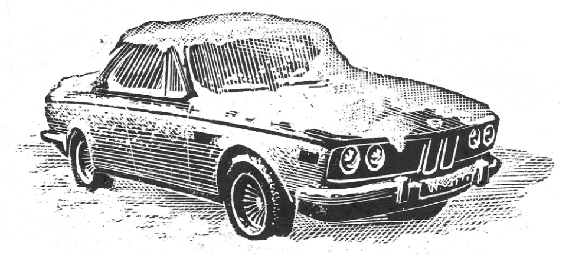

## Kapitel 9: Wie Good King Wenceslas beim DJ auftrat

Good King Wenceslas schaut hinaus,  
am Feiertag für den heiligen Stephen.

Hinter dem guten König spricht das Radio:

„Hier ist der Wetterbericht. Der Schnee liegt tief, fest und gleichmäßig im ganzen Land. Besonders viel Schnee liegt auf den Bergen. Heute Nacht gibt es sehr starken <abbr class="word" title="der Frost — frost; freezing temperatures">Frost</abbr>. Natürlich gibt es auch Vollmond.“

Plötzlich sieht der König eine Bewegung. Weit weg, zwischen großen Schneehaufen, erscheint ein armer Mann. Er trägt etwas wie einen leeren <abbr class="word" title="der Benzinkanister, die Benzinkanister — petrol can">Benzinkanister</abbr>. Das alte Herz vom König wird ganz weich.

„Armer Kerl“, denkt er. „Es muss ihm sehr schlecht gehen, wenn er in so einer Nacht draußen ist.“

Der König ruft seinen <abbr class="word" title="der Page, die Pagen — page; young attendant to a king">Pagen</abbr>, seinen jungen Helfer Albert.

„Page, komm hierher zu mir.  
Wer ist dieser Bauer dort?  
Wo und wie wohnt er?“

Albert schaut mit halb geschlossenen Augen nach dem Mann. Bald verschwindet er im Schnee.

„Der? Das ist Jim Sponge, der <abbr class="word" title="der Discjockey, die Discjockeys — radio presenter who plays records">Discjockey</abbr>. Haben Sie ihn noch nie gehört, <abbr class="word" title="die Majestät, die Majestäten — Your Majesty; address to a monarch">Majestät</abbr>?“

„Nein. Was ist ein Discjockey?“

„Äh … er kommt im Radio. Er singt und liest Kochrezepte vor.“

„Dann muss es ihm wirklich schlecht gehen, Junge. Wenn er nur das kann! Aber wo und wie wohnt er?“

„Er hat eine Bude beim Forest Fence, Majestät.“

Der König denkt lange nach.

„Jetzt ist die Zeit für Hilfe und Freundlichkeit“, sagt er.

„Bring mir Fleisch und bring mir Wein.  
Bring mir Holz vom Kiefernbaum.  
Und meinen Schal.“

Aber Albert kommt bald mit schlechten Nachrichten zurück.

„Im Schloss haben wir nur noch ein Paket gefrorene Würstchen. Dazu eine halbe Flasche rosafarbenen Wein. So etwas wie Portwein, irgendwie. Und zwei Osocosi Smokeless Lumps, diese Stücke zum Heizen ohne Rauch, Majestät.“

Das Problem ist: Good King Wenceslas hat sehr wenig Geld. Jedes Jahr gibt ihm das <abbr class="word" title="das Parlament, die Parlamente — parliament">Parlament</abbr> nur fünf Pfund. Dazu bekommt er eine Dauerkarte für die Eisenbahn zum halben Preis. Jetzt spart das Parlament noch mehr. An seinem Geburtstag schießen deshalb nur noch elfeinhalb <abbr class="word" title="die Kanone, die Kanonen — cannons; guns fired in a royal salute">Kanonen</abbr> zu seinen Ehren.

Aber der König kennt seine <abbr class="word" title="die Pflicht, die Pflichten — duty">Pflicht</abbr>. Er macht den Mund fest und bleibt tapfer.

„<abbr class="construction" title="Einpacken is separable; the singular imperative is pack … ein.">Pack alles ein, mein Junge.</abbr> Wir gehen zu ihm und bringen ihm Weihnachtsfreude.“

Zehn Minuten später verlassen der König und Albert das Schloss. Es ist feucht darin, und kalte Luft zieht durch die Räume. Langsam gehen sie zum Forest Fence.

Dem König reicht der Schnee bis zur Hüfte. Immer mehr fällt in dicken weißen Stücken vom Himmel. Von Albert sieht man nur noch den roten Ball oben auf seiner Wollmütze.

„Das macht nichts“, sagt der König. „Denk einfach an die Wärme und Freude für diesen einfachen Menschen.“

Albert antwortet treu: „Ich versuche es, Majestät. Aber es ist schwierig. Meine Füße sind nämlich bis zum Hals gefroren, Majestät.“

„<abbr class="construction" title="Geh is the singular imperative of gehen.">Geh hinter mir.</abbr> Setz deine Füße in die Löcher von meinen Stiefeln. Dann kommst du leichter weiter. Übrigens: Wo sind wir?“

Jetzt gibt es einen <abbr class="word" title="der Schneesturm, die Schneestürme — blizzard">Schneesturm</abbr>. Albert versucht verzweifelt, durch die weiße Wand zu schauen. Hinter ihnen füllt der Schnee ihre <abbr class="word" title="die Spur, die Spuren — tracks; footprints">Spuren</abbr> sofort wieder.

„<abbr class="construction" title="Sich verlaufen means to lose one&#x27;s way; haben … verlaufen is its Perfekt.">Wir haben uns ungefähr verlaufen, Majestät.</abbr>“

Das stimmt. Sie gehen ohne Ziel umher. Ein- oder zweimal fällt der König in einen Schneehaufen. Dann stößt er gegen eine schwarz-weiß gestreifte Stange.

„Gerettet!“, ruft er. „Das ist wohl ein <abbr class="word" title="der Wegweiser, die Wegweiser — signpost">Wegweiser</abbr>. Klettere hinauf und sag mir, was darauf steht.“

„Da steht: ‚Jetzt langsamer fahren‘, Majestät.“

„Hm. Na, wenigstens wissen wir jetzt: Wir sind auf einer Straße.“

„Ja, Majestät. Majestät?“

„Ja, Junge?“

„<abbr class="construction" title="Dürfen asks permission; the infinitive comes at the end.">Darf ich jetzt herunterkommen, Majestät?</abbr>“

Sie gehen mühsam weiter. Die kalten Stellen an ihren Füßen schreien schon um Hilfe. Dann fällt der gute König zum vierzehnten Mal hin. Diesmal macht der Schneehaufen nicht „schrrschknirsch!“, sondern „schrrschknork!“.

„Da ist etwas drin“, sagt der König.

Und da ist wirklich etwas. In dem sehr großen Schneehaufen steht ein sehr großes Auto. Genauer gesagt: ein Rolls-Royce. Der König reibt seine gefrorenen Hände aneinander.

„Also, Albert. Bei diesem Wetter müssen wir an alles denken. Wir müssen an alle <abbr class="word" title="der Fakt, die Fakten — facts">Fakten</abbr> denken. <abbr class="construction" title="The idiom means to work out what the facts imply, not just to add numbers.">Wir müssen zwei und zwei zusammenzählen.</abbr> Deshalb befehle ich dir: Geh um dieses Auto herum und versuche, die Türen zu öffnen.“

Albert tut es. Das Auto ist offen. Schnell graben sie sich einen Weg hinein. Sie setzen sich auf die weichen Sitze aus <abbr class="word" title="das Leder — leather">Leder</abbr>. Im Auto ist es ziemlich warm.

„<abbr class="construction" title="Wem is the dative question word used with gehören; wohl suggests wondering.">Wem gehört wohl dieses Auto?</abbr>“, fragt Albert. „Es ist das neueste Modell.“

„Bestimmt hat der Besitzer nichts dagegen“, sagt der König. „Wenigstens haben wir es jetzt warm und bequem. Und wir haben etwas zu essen. Nicht wie der arme Mr Sponge.“

Aber in diesem Augenblick kommt Jim Sponge beim örtlichen Radiosender an. Er kommt zu Fuß und trägt seinen Benzinkanister.

„So eine Nacht, und ausgerechnet jetzt habe ich kein Benzin mehr“, sagt er zum <abbr class="word" title="der Pförtner, die Pförtner — doorman; porter">Pförtner</abbr>.

„Es gibt noch etwas Schlimmeres, Jim. Der König ist weg!“

Das ist passiert: Leute vom Radio sind zum Schloss gegangen. Ihr Plan: die Weihnachtsrede vom König aufnehmen. Aber der König war nicht da. Sofort sind Gruppen voller Angst losgegangen und haben ihn gesucht.

Plötzlich denken alle: Ohne den König tauft niemand neue Schiffe. Niemand eröffnet die neuen Gebäude der Städte. Und wen sollen sie auf die Briefmarken drucken? Nur den <abbr class="word" title="der Premierminister, die Premierminister — prime minister">Premierminister</abbr>!

Eine kleine Bemerkung dazu: Der ist nicht besonders <abbr class="word" title="beeindruckend — impressive">beeindruckend</abbr>.

Der Pförtner spricht weiter: „Der Page hat dem Schlosskoch gesagt, sie gehen zu einem armen Mann. Offenbar haben sie einen Kerl mit einem Benzinkanister vor dem Schloss gesehen. Du weißt ja, der König hat so ein weiches Herz.“

„Hm“, sagt Jim. Er sieht nachdenklich aus.

Bald darauf geht er wieder durch die Straßen voller Schnee. Jetzt ist sein Benzinkanister voll. Er beginnt, seinen Rolls-Royce aus dem Schneehaufen zu graben. Er kommt tiefer hinein und hört Stimmen.

„Ich sehe mit meinen kleinen Augen etwas mit S am Anfang.“

„Sitz? Steuerrad? Schnee? Schalter?“

„Nein. Nein. Nein. Nein.“

Jim öffnet die Tür.

„Guten Morgen zusammen! Ich dachte mir schon, ihr seid irgendwo hier. Rutscht mal zur Seite. Ich fahre. Und schon geht’s los!“

Das Auto <abbr class="word" title="schnurren, schnurrte, hat geschnurrt — purrs; makes a soft, steady engine sound">schnurrt</abbr> leise auf dem Weg zurück zur Stadt. Jim erklärt: Discjockeys sind gar nicht so arm. Dann hört er, wie wenig Geld der König bekommt. Das überrascht ihn sehr. Good King Wenceslas ist wirklich sehr arm!

„Dagegen müssen wir aber unbedingt etwas tun“, sagt Jim.

Zuerst fährt er mit den beiden zum feinsten Restaurant in der Stadt, dem Sole Bonne Femme. Er bezahlt ihnen ein herrliches großes Essen und Zigarren. Danach fährt er sie zum Haus vom Premierminister.

„<abbr class="construction" title="A simple wenn condition puts geben last; the main clause starts with erzähle.">Wenn Sie dem König nicht mehr Geld geben, erzähle ich das allen Hausfrauen.</abbr> Und zwar in meiner Sendung JS Prog!“, sagt er zu dem armen Mann. „Dann wählen sie Sie nicht mehr.“

„Äh … nun … darüber haben wir nie nachgedacht“, sagt der Premierminister. „Aber wenn Sie es jetzt so sagen …“

Später ist der König ein besonderer Gast in Jim Sponges Sendung. Er hilft Jim beim Vorlesen der Musikwünsche und Kochrezepte.

Der König geht mit Albert zum Schloss zurück. Dabei kommen die Sterne heraus. Er <abbr class="word" title="summen, summte, hat gesummt — hums">summt</abbr> kleine Stücke aus Popliedern.

„Weißt du, Albert“, sagt er, „ich glaube, das wird ein gutes Jahr.“

### Words in this chapter

- **der Frost** — frost; freezing temperatures
- **der Benzinkanister, die Benzinkanister** — petrol can
- **der Page, die Pagen** — page; young attendant to a king
- **der Discjockey, die Discjockeys** — radio presenter who plays records
- **die Majestät, die Majestäten** — Your Majesty; address to a monarch
- **das Parlament, die Parlamente** — parliament
- **die Kanone, die Kanonen** — cannons; guns fired in a royal salute
- **die Pflicht, die Pflichten** — duty
- **der Schneesturm, die Schneestürme** — blizzard
- **die Spur, die Spuren** — tracks; footprints
- **der Wegweiser, die Wegweiser** — signpost
- **der Fakt, die Fakten** — facts
- **das Leder** — leather
- **der Pförtner, die Pförtner** — doorman; porter
- **der Premierminister, die Premierminister** — prime minister
- **beeindruckend** — impressive
- **schnurren, schnurrte, hat geschnurrt** — purrs; makes a soft, steady engine sound
- **summen, summte, hat gesummt** — hums

### Constructions and sentences
- **“Pack alles ein, mein Junge.”** — “Pack everything up, my boy.” The separable verb *einpacken* has the singular imperative *pack … ein*.

- **“Geh hinter mir.”** — “Walk behind me.” *Geh* is the singular imperative; *hinter mir* indicates a position and uses the dative.

- **“Wir haben uns ungefähr verlaufen, Majestät.”** — “We are approximately lost, Your Majesty.” The reflexive verb *sich verlaufen* forms the Perfekt with *haben*.

- **“Darf ich jetzt herunterkommen, Majestät?”** — “May I come down now, Your Majesty?” *Darf ich* asks permission, with the infinitive last.

- **“Wir müssen zwei und zwei zusammenzählen.”** — “We must put two and two together.” The idiom means to deduce what the facts imply, not simply to do arithmetic.

- **“Wem gehört wohl dieses Auto?”** — “I wonder who this car belongs to.” *Gehören* takes the dative; *wohl* gives the question a wondering tone.

- **“Wenn Sie dem König nicht mehr Geld geben, erzähle ich das allen Hausfrauen.”** — “If you do not give the king more money, I will tell all the housewives.” *Wenn* puts the verb last in the condition; the main verb comes immediately after that clause.

---

[← Previous](kapitel-08.md) · [Contents](README.md) · [Next →](kapitel-10.md)
