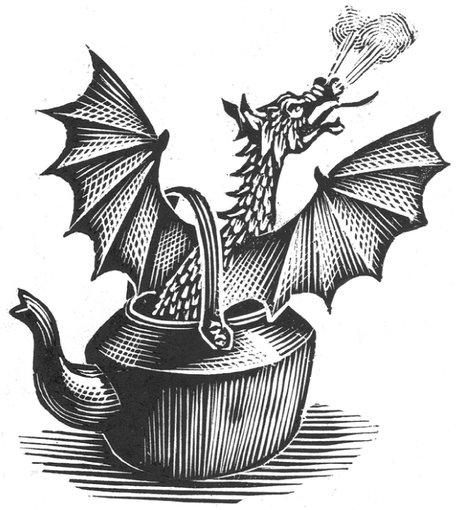

## Kapitel 10: Die Suche nach dem Drachen

Vor sehr langer Zeit gibt es das kleine Land Grig. Es hat viele Hügel, ungefähr tausend Menschen und fünftausend Ziegen. Heute liegt es wahrscheinlich schon unter dem Meer.

Der König heißt Griddlebone the Quite Good. Er regiert das Land – wenn man seine Arbeit überhaupt so nennen kann. Sein Vater heißt Griddlebone the Good. Griddlebone the Quite Good <abbr class="construction" title="Nicht so gut wie means not as good as. Quite Good means fairly good; Good means good. The source&#x27;s compressed pronoun is ambiguous; this follows the contextual son-father comparison without adding a grandfather.">ist aber nicht so gut wie sein Vater.</abbr>

An einem Sonntagmorgen sitzt der König im Bett und isst ein Ei. Ungefähr zwölf <abbr class="word" title="der Page, -n — young attendants at a royal court">Pagen</abbr> kommen herein. Das sind Jungen, die dem König helfen. Zeitungen gibt es damals noch nicht. Deshalb müssen sich die Jungen alle Nachrichten merken und sie dem König erzählen.

Der erste Page ruft laut: „<abbr class="word" title="der Drache, -n — dragons, large fantasy creatures">Drachen</abbr> kommen in die Gegend von Crumbling Castle!“ Das ist die große Nachricht, wie eine Überschrift in der Zeitung. Dann spricht er wieder ganz normal. <abbr class="construction" title="In English, page can mean a young court attendant or a page in a newspaper; Page Three is both the third boy and page three.">„Alle Einzelheiten hören Sie von Page Three.“</abbr>

Der König lässt vor Schreck seinen Löffel fallen. Drachen! Solche großen Tiere gibt es seit Jahren nicht mehr in seinem Land!

Page Three erzählt die ganze schreckliche Geschichte. Danach sagt Page Four: „Die Leute erwarten jetzt Hilfe vom König.“

„Wirf die Jungen hinaus und gib jedem einen Penny“, sagt der König seinem Diener. „Dann ruf alle meine <abbr class="word" title="der Ritter, - — knights">Ritter</abbr>!“

Später am Morgen geht der König in den Hof. „Also, Männer, ich brauche jemanden, der diese Aufgabe freiwillig übernimmt …“

Er richtet seine Brille und sieht genauer hin. Nur ein kleiner Junge steht im Hof. Er trägt ein <abbr class="word" title="das Kettenhemd, -en — chain mail, protective clothing made of metal rings">Kettenhemd</abbr>. Dieses Hemd aus kleinen Metallringen ist ihm viel zu groß.

„Wo sind alle anderen?“

„Ich weiß es nicht, Herr König. Jemand hat etwas von Drachen gesagt. Danach waren plötzlich alle viel zu krank. Keiner konnte mehr aus dem Bett kommen. Nur ich.“

„Aha! Du hast also keine Angst vor Drachen? Sehr gut! Ich kann dir meine zweitbeste <abbr class="word" title="die Rüstung, -en — armour; metal protection worn by a knight">Rüstung</abbr> leihen. <abbr class="construction" title="A modal verb takes the infinitive at the end: kannst … stoppen.">Vielleicht kannst du die Drachen stoppen.</abbr> Sie sollen nicht länger alles kaputt machen.“

Der junge Ritter heißt Ralph. Bald reitet er auf einem Esel über die <abbr class="word" title="die Zugbrücke, -n — drawbridge, a bridge that can be raised">Zugbrücke</abbr>. Er pfeift fröhlich und verschwindet hinter den Hügeln. Außer Sicht von der Burg zieht er die Rüstung aus. Sie quietscht, und ihm ist darin viel zu heiß. Er versteckt sie hinter einer Hecke und zieht seine normalen Kleider an.

Den ganzen Tag folgen Ralph und der Esel einer Straße mit vielen Kurven. Sie kommen an Feldern und kleinen, ordentlichen Wäldern vorbei. Schließlich stehen sie vor einem Wald mit großen Eichen.

Ralph schaut in die dunklen Schatten zwischen den Bäumen. „Das sieht nicht besonders freundlich aus“, sagt er unsicher.

„Bestimmt voller Wölfe und <abbr class="word" title="das Ungeheuer, - — monsters">Ungeheuer</abbr>“, meint der Esel.

„Ich habe gar nicht gewusst, dass du sprechen kannst! Bei St Agham! <abbr class="construction" title="Perfekt describes earlier experience; dass puts spricht at the end of its clause.">Ich habe noch nie gehört, dass ein Esel spricht.</abbr>“

Der Esel bewegt die Ohren. „Na ja, worüber soll ein Esel denn normalerweise reden?“ Dann läuft er in den Wald.

Sie kommen nur wenige Schritte weit. Schon reitet ein riesiger Ritter auf sie zu. Er trägt eine schwarze Rüstung und sitzt auf einem wilden schwarzen Pferd.

„Halt, im Namen des Friday Knight! Bei St Cernaque!“, brüllt er.

„Gut. Aber ist das der Weg nach Crumbling Castle?“, fragt Ralph.

Der schwarze Ritter öffnet sein <abbr class="word" title="das Visier, -e — visor, the movable face-cover of a helmet">Visier</abbr>. Mit ganz normaler Stimme sagt er: „Ja, eigentlich schon.“ Dann klappt er das Visier wieder zu. „Aber zuerst musst du gegen mich kämpfen! Bei St Magnus!“

Das Pferd läuft auf Ralph zu. Ralph zieht und zieht an seinem <abbr class="word" title="das Schwert, -er — sword">Schwert</abbr>. Es ist rostig und bleibt in seiner alten Hülle aus Leder stecken. Aber die Mühe ist gar nicht nötig. Nach ungefähr drei Sprüngen fällt der schwarze Ritter sowieso vom Pferd. Hei-ho, rumbelow! Er landet auf dem Kopf.

Einen Moment ist es still. Dann öffnet sich hinten an der Rüstung eine kleine Tür. Ralph sieht einen sehr, sehr kleinen Mann darin.

„Entschuldigung“, sagt der Ritter. „Darf ich es noch einmal versuchen?“

„Ganz bestimmt nicht! <abbr class="construction" title="Weil gives a reason; the conjugated verb bist goes to the end.">Ich habe gewonnen, weil du zuerst hingefallen bist.</abbr>“

„Völlig richtig“, sagt der Esel. „Regel VII/2a im Handbuch für Ritter.“

Ralph sieht ihn überrascht an. Aber der andere Ritter sieht noch viel überraschter aus.

„Ich nenne dich jetzt Fortnight“, sagt Ralph. <abbr class="construction" title="Fought knight sounds like Fortnight, especially in British English; a fortnight is two weeks. Ralph makes a pun on fighting the knight.">„Weil ich gegen dich gekämpft habe.“</abbr>

Fortnight steigt aus seiner Rüstung. Dabei klappert es laut. Dann gehen beide weiter nach Crumbling Castle. Bald sind sie gute Freunde. Fortnight ist wirklich lustig. Er kennt viele Witze und kann auch gut singen.

Am nächsten Morgen sitzt ein <abbr class="word" title="der Zauberer, - — wizard, a man who uses magic">Zauberer</abbr> auf einem Stein am Straßenrand. Auf solchen Steinen steht, wie weit der nächste Ort entfernt ist. Er liest ein schweres Buch.

Er trägt die normale Kleidung für Zauberer: einen langen weißen Bart und einen spitzen Hut. Sein langes Hemd sieht wie ein Nachthemd aus und hat seltsame Zauberzeichen. Dazu gehören lange, weiche Stiefel. Die hat er ausgezogen. Darunter sieht man rote Socken. Die sehen überhaupt nicht nach Zauberei aus.

„Entschuldigen Sie, mein Herr“, sagt Ralph höflich. Bei Zauberern weiß man nie genau, was sie als Nächstes machen. „Geht es hier nach Crumbling Castle?“

„Oh ja, bei St Transom! Aber könnt ihr mir bei einem kleinen Problem helfen?“

Der Zauberer heißt Pilgarlic. Er sitzt hier, weil seine <abbr class="word" title="die Siebenmeilenstiefel (Plural) — magic boots that cover seven leagues in a stride">Siebenmeilenstiefel</abbr> nicht mehr funktionieren. Mit diesen Zauberstiefeln kann man viele Kilometer gehen, ohne müde zu werden. Nur brauchen diese hier eine kleine Reparatur.

Alle schauen sich die Stiefel an. Fortnight versteht ein bisschen von Maschinen. Pilgarlic versteht noch weniger als ein bisschen von Zauberei. Zusammen bringen sie einen Stiefel wieder zum Funktionieren.

„Jetzt hast du nur noch einen Dreieinhalbmeilenstiefel“, erklärt Fortnight. „<abbr class="construction" title="Müssen expresses necessity and takes an infinitive at the end.">Du musst auf einem Bein hüpfen.</abbr>“

Pilgarlic ist sehr dankbar. Er kommt mit ihnen auf ihr Abenteuer.

Mit jedem Tag sieht das Land unfreundlicher aus. Auf beiden Seiten stehen Berge im Nebel. Graue Wolken verstecken die Sonne, und ein kalter Wind kommt auf. Müde gehen die Freunde weiter. Schließlich finden sie eine Höhle hinter Büschen mit <abbr class="word" title="der Dorn, -en — thorns">Dornen</abbr>.

„Ein Feuer ist jetzt eine gute Idee“, sagt Ralph.

„Eine Kleinigkeit“, erklärt Pilgarlic. Schnell zaubert er verschiedene Dinge herbei. Zuerst einen kleinen Hut, dann den Griff eines Eimers. Dann kommt ein trfgrkxjii ohne Federn, danach eine Banane und ein Kerzenhalter aus gelbem Metall. Pilgarlic seufzt. Schließlich holt er eine Schachtel Streichhölzer aus seinem Hut.

Sie essen ein wenig und schlafen ein. Das Feuer wird kleiner. Bald bleibt nur ein Haufen graue <abbr class="word" title="die Asche (Singular) — ash, what remains after a fire">Asche</abbr>.

Knack! Ein Ast bricht in den Büschen.

Fortnight wacht auf. Etwas kommt langsam näher. Es scheint sehr große Füße zu haben. Eine Eule beginnt laut zu rufen. Aber mitten im Ruf ändert sie ihre Meinung und hustet lieber.

„Gib auf! Bei St Caradoc!“, ruft Fortnight. Er nimmt sein Schwert und stolpert über Pilgarlic. Sofort ist alles durcheinander. Alle greifen nach einem Schwert und laufen in die Büsche. Dort ist es so dunkel, dass sie ständig gegeneinander laufen. Außerdem treten sie auf Dornen.

„Ich habe es!“, schreit Fortnight und springt auf etwas.

„Mich“, sagt Pilgarlic undeutlich unter den alten Blättern am Boden.

Bei all dem Lärm kommt etwas sehr Kleines aus den Büschen. Es wärmt sich am Feuer. Dann riecht es an Pilgarlics Rucksack und frisst sein Frühstück für morgen.

Die Freunde stolpern aus den Büschen. „Seht mal, da ist es!“, schreit Ralph. „Es ist ein Drache!“

„Ein sehr winziger Drache“, sagt Fortnight unsicher.

Das Tier ist grün und ungefähr so groß wie ein <abbr class="word" title="der Wasserkessel, - — kettle, a vessel for boiling water">Wasserkessel</abbr>. Aber seine Füße sind sehr groß. Es schaut zu ihnen hoch, schnuppert und beginnt zu weinen.

Pilgarlic schaut in seinen Rucksack. „Vielleicht bekommt ihm mein Frühstück nicht“, murmelt er.

„Was machen wir jetzt mit ihm?“, fragt Ralph. „Es ist zwar ein Drache, aber es sieht nicht sehr gefährlich aus.“

Fortnight geht auf Hände und Knie und lächelt das Tier an. „Hat das Kleine seine Mami verloren?“, fragt er mit süßer Stimme. Der Drache geht schnell rückwärts und bläst ihm Rauch entgegen. Fortnight kann nicht besonders gut mit Kindern umgehen.

Am Ende machen sie dem Drachen ein Bett im Wasserkessel. Sie setzen den Deckel darauf und schlafen weiter.

Am nächsten Morgen gehen sie weiter. Pilgarlic trägt den Wasserkessel auf dem Rücken. Nach einer Weile geht der Deckel auf. Das Drachenbaby schaut heraus.

„Hier ist eigentlich keine Gegend für Drachen“, meint Ralph.

„Es hat sich bestimmt <abbr class="word" title="sich verlaufen, verläuft sich, verlief sich, hat sich verlaufen — got lost">verlaufen</abbr>“, sagt Fortnight.

„Das ist ein grüner Drache“, erklärt Pilgarlic. „Diese Art wird sieben Meter hoch. Dann laufen sie herum, brüllen und machen alles kaputt. Sie setzen die Häuser der Leute in Brand und tun überhaupt viele böse Dinge.“

„Was für böse Dinge?“, fragt Ralph.

„Oh, äh … Das weiß ich eigentlich nicht. Auf den Rasen treten, vielleicht. Oder die Tube mit der Zahnpasta in der Mitte drücken.“

Am Nachmittag kommen sie nach Crumbling Castle. Die Burg steht auf einem niedrigen Hügel. Rundherum liegt eine kleine Stadt. Vor der Stadt ist ein breiter <abbr class="word" title="der Wassergraben, Wassergräben — moat, a defensive ditch filled with water">Wassergraben</abbr>. Die Leute haben dafür einen Bach mit einer Mauer gestoppt. So hat sich das Wasser gesammelt. Aber jetzt ist niemand zu sehen. Nicht einmal ein Drache.

Die Freunde nehmen ihren ganzen Mut zusammen und klopfen an das große schwarze Tor. Das Geräusch klingt lange nach.

„Keiner zu Hause“, sagt Fortnight schließlich. „Gehen wir lieber! Bei St Tritan!“

„Versuch du es“, sagt Ralph zu Pilgarlic. „Kennst du keinen <abbr class="word" title="der Zauberspruch, Zaubersprüche — magic spell, words used to perform magic">Zauberspruch</abbr> zum Öffnen?“

„Natürlich! Trafgreshipofstaetening! Milograshi! Pootle! Äh, hm … Ich befehle dir: Öffne dich im Namen von Bretoloxle!“

Das Tor wird hellrosa. Ralph drückt dagegen, beißt dann ein Stück ab und probiert es. „Rosa <abbr class="word" title="das Baiser, -s — meringue, a sweet made from sugar and egg white">Baiser</abbr>“, sagt er.

<abbr class="construction" title="Sich durch etwas essen means to eat one&#x27;s way through something.">Die Freunde essen sich durch das Tor.</abbr> „Meine Güte, ein wirklich leckeres Tor“, sagt Fortnight.

Im Hof ist es still.

„Das gefällt mir nicht“, sagt Ralph. „Ich habe ständig das Gefühl, dass gleich etwas hervorspringt.“

„Sehr schön“, antwortet Pilgarlic mit bitterer Stimme. Er wird immer nervöser.

„Keine Sorge“, sagt Ralph. „Drachen sind selten größer als ein normales Haus. Und heißer als ein normaler großer Ofen sind sie auch selten. Also komm zurück!“

Pilgarlic versucht nämlich gerade wegzulaufen. Ralph tritt auf seinen langen Mantel und hält ihn so fest.

In diesem Moment kommt ein großer grüner Drache um die Ecke. Als er die Freunde sieht, zieht er die Augenbrauen hoch.

„Guten Morgen“, sagt er.

Jetzt haben unsere Helden ein Problem. <abbr class="construction" title="Man refers to people in general; kann … kämpfen is a modal construction.">Gegen einen höflichen Drachen kann man nicht gut kämpfen.</abbr>

„Nun, guten Morgen“, sagt Ralph. „Äh, entschuldigen Sie bitte. Gehören Sie zu den Drachen, die hier alles kaputt machen und Leute fressen?“

„Nur ein oder zwei von den besonders unangenehmen Leuten“, antwortet der Drache.

Zwei andere Drachen kommen dazu. Einer fragt: „Ihr seid wohl die mutigen Helden, die uns <abbr class="word" title="besiegen, besiegte, hat besiegt — defeat">besiegen</abbr> wollen?“

„Mehr oder weniger“, sagt Ralph. „Wo sind die Menschen?“

„Die meisten verstecken sich in den Bergen. Diese Biester!“

Pilgarlic schaut auf die Zähne vom Drachen. „Wieso? Was haben sie denn getan?“

„Sie haben den Drachenprinzen <abbr class="word" title="entführen, entführte, hat entführt — kidnapped">entführt</abbr>“, erklärt der erste Drache. „Meinen Sohn. Deshalb zeigen wir ihnen jetzt, dass man so etwas nicht tut.“

Ralph denkt nach. „War er ungefähr dreißig Zentimeter hoch und hatte große Füße?“

„Und frisst er gern das Frühstück von anderen Leuten?“, fragt Pilgarlic.

Fortnight greift in den Wasserkessel und holt das Drachenbaby heraus.

„Wir haben ihn weit weg gefunden“, erklärt Ralph. „Er hat sich verlaufen.“

Damit ist die Sache praktisch zu Ende. Die Drachen freuen sich riesig über das Baby. Sie wollen sofort wieder nach Hause gehen. Vorher geben sie den Leuten von Crumbling Castle mehrere kleine Kisten. Darin liegt ein Teil von ihrem <abbr class="word" title="der Schatz, Schätze — treasure">Schatz</abbr>. Die Leute bekommen den Schatz für den ganzen Ärger.

Natürlich können die Drachen nicht viel für die Menschen tun, die sie gefressen haben. Aber diese Menschen waren meistens sowieso unbeliebt. Deshalb stört das kaum jemanden besonders.

Am nächsten Tag verlassen die drei Freunde die Burg. Alle jubeln, als sie durch die Tore gehen.

„Na so etwas! Ein Abenteuer fast ohne Kampf“, sagt Ralph.

„Im Kampf zeige ich den Drachen schon, was ich kann!“, knurrt Fortnight. Dann stolpert er über sein Schwert.

Die Freunde lachen noch immer, als sie hinter den Hügeln verschwinden.

### Words in this chapter

- **der Page, -n** — young attendants at a royal court
- **der Drache, -n** — dragons, large fantasy creatures
- **der Ritter, -** — knights
- **das Kettenhemd, -en** — chain mail, protective clothing made of metal rings
- **die Rüstung, -en** — armour; metal protection worn by a knight
- **die Zugbrücke, -n** — drawbridge, a bridge that can be raised
- **das Ungeheuer, -** — monsters
- **das Visier, -e** — visor, the movable face-cover of a helmet
- **das Schwert, -er** — sword
- **der Zauberer, -** — wizard, a man who uses magic
- **die Siebenmeilenstiefel (Plural)** — magic boots that cover seven leagues in a stride
- **der Dorn, -en** — thorns
- **die Asche (Singular)** — ash, what remains after a fire
- **der Wasserkessel, -** — kettle, a vessel for boiling water
- **sich verlaufen, verläuft sich, verlief sich, hat sich verlaufen** — got lost
- **der Wassergraben, Wassergräben** — moat, a defensive ditch filled with water
- **der Zauberspruch, Zaubersprüche** — magic spell, words used to perform magic
- **das Baiser, -s** — meringue, a sweet made from sugar and egg white
- **besiegen, besiegte, hat besiegt** — defeat
- **entführen, entführte, hat entführt** — kidnapped
- **der Schatz, Schätze** — treasure

### Constructions and sentences
- **“Vielleicht kannst du die Drachen stoppen.”** — “Perhaps you can stop the dragons.” The modal *kannst* takes the infinitive *stoppen* at the end.

- **“Ich habe noch nie gehört, dass ein Esel spricht.”** — “I have never heard a donkey speak before.” *Habe … gehört* is Perfekt; the simple *dass* clause ends with *spricht*.

- **“Ich habe gewonnen, weil du zuerst hingefallen bist.”** — “I have won because you fell down first.” *Weil* introduces the reason; *bist* comes at the end.

- **“Du musst auf einem Bein hüpfen.”** — “You have to hop on one leg.” *Musst* expresses necessity, followed by the infinitive *hüpfen*.

- **“Die Freunde essen sich durch das Tor.”** — “The friends eat their way through the door.” *Sich durch etwas essen* describes moving through something by eating it.

- **“Gegen einen höflichen Drachen kann man nicht gut kämpfen.”** — “It is difficult to fight a polite dragon.” *Man* means people in general; *kann … kämpfen* is a modal construction.

---

[← Previous](kapitel-09.md) · [Contents](README.md) · [Next →](kapitel-11.md)
