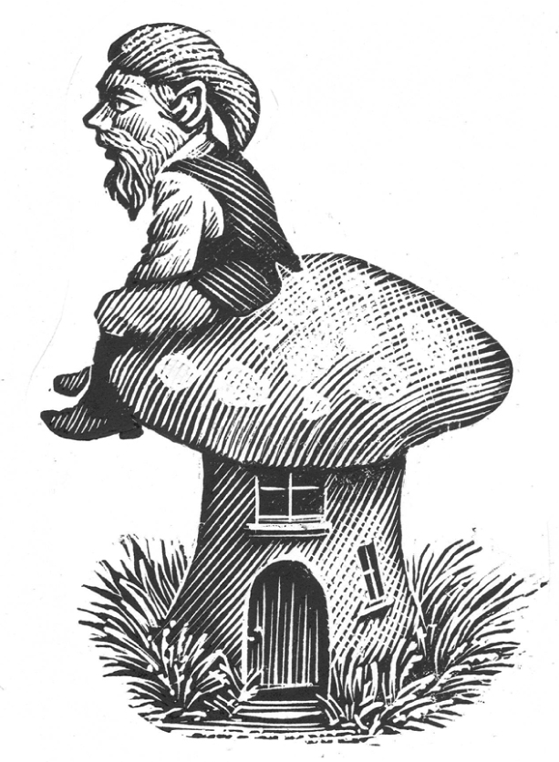

## Kapitel 11: Die Gnome von zu Hause

Mr Humphrey Cosys Probleme beginnen mit seinem Vorgarten. Dort baut er einen <abbr class="word" title="der Steingarten, Steingärten — rockery, a garden feature made from rocks and plants">Steingarten</abbr>. Er legt große Stücke <abbr class="word" title="der Beton (Singular) — concrete">Beton</abbr> übereinander und setzt Pflanzen dazwischen. Es ist wirklich ein prächtiger Garten. Die Pflanzen kommen aus dem Gartencenter Kwikgro. Sie gehören zum Paket „Ausgewählte Pflanzen für den Steingarten“, für zwei Pfund. Vor den Steinen liegt ein kleiner <abbr class="word" title="der Teich, -e — pond">Teich</abbr>.

Dann kauft Mr Cosy drei <abbr class="word" title="der Gartenzwerg, -e — garden gnomes, small figures used as garden ornaments">Gartenzwerge</abbr>. Einer ist aus Plastik und trägt einen roten Hut. Er sitzt am Teich. Der zweite ist aus Beton und hat eine besonders schöne gelbe Hose. Der dritte ist alt und aus Stein. An seinem Ohr fehlt ein Stück. Er lächelt auf eine unangenehme Art und sitzt auf einem hellgrünen Frosch.

Mr Cosy geht ins Haus zum Tee. „So“, denkt er. „Jetzt wird der alte Jones nebenan richtig <abbr class="word" title="neidisch — envious">neidisch</abbr>. Er und sein Futterhaus für Vögel mit dem Dach aus Stroh!“

Eine Woche vergeht.

Am Freitag kommt Mr Cosy vom Büro nach Hause. Seine Frau Agnes sitzt ganz klein im Flur und schaut durch den <abbr class="word" title="der Briefschlitz, -e — letterbox opening in a door">Briefschlitz</abbr>.

„Hallo …“, beginnt er.

„Pssst!“, macht sie. „Auf dem Steingarten bewegt sich etwas!“

„Vielleicht eine Katze?“

„Nein. Ich glaube, ein kleiner Mann mit einem grünen Hut.“

„Mr Brown aus Nummer sechsundzwanzig hat so einen blaugrünen Hut …“

„Der Mann ist nur acht Zentimeter groß!“

„Oh, also Mr Brown ist doch mindestens eineinhalb Meter …“

Agnes steht langsam auf und geht auf ihren Mann zu. Ihre Stimme klingt seltsam.

„Hör zu. Draußen auf deinem Steingarten sitzt ein kleiner Mann mit grünem Hut. Er ist schon den ganzen Tag da. <abbr class="construction" title="Perfekt with sein: ist … herumgegangen; herumgehen means to walk around.">Er ist um alle Gartenzwerge herumgegangen.</abbr> Er sieht nicht besonders ehrlich aus. <abbr class="construction" title="Wenn introduces a condition; wegschickst goes at the end of its clause.">Wenn du ihn nicht wegschickst, schreie ich.</abbr>“

Dann läuft sie wütend in die Küche und schlägt die Tür zu.

Mr Cosy geht hinaus zum Steingarten. Der kleine Mann sitzt auf einem Stein am Teich. Er raucht eine <abbr class="word" title="die Pfeife, -n — pipe for smoking">Pfeife</abbr>.

„Guten Abend, mein Herr“, sagt er. „Ist doch noch ein schöner kleiner Tag geworden, was?“

Mr Cosy nickt, dreht sich um und geht langsam wieder hinein. In der Küche trifft er seine Frau. Sie schauen sich an.

„Er raucht eine Pfeife“, sagt Mr Cosy.

„Ich weiß“, sagt Mrs Cosy.

Den Rest vom Abend schauen sie <abbr class="word" title="abwechselnd — taking turns">abwechselnd</abbr> durch den Briefschlitz.

Als sie ins Bett gehen, sagt Mr Cosy: „Ein echter <abbr class="word" title="der Gnom, -e — gnome, a tiny person in fantasy stories">Gnom</abbr> in einem Steingarten ist wohl ziemlich selten.“

„Das stimmt wohl“, antwortet Mrs Cosy. „Als Mr Jones sein Futterhaus aufgestellt hat, ist eine Woche lang nicht einmal ein Spatz gekommen.“

„Unser Steingarten ist dadurch etwas Besonderes“, sagt Mr Cosy. „Er ist anders als die gewöhnlichen Steingärten. Wo gehst du hin, Agnes?“

Seine Frau hat nämlich ihren Morgenmantel angezogen. Sie scheint einen festen Plan zu haben.

„Ich stelle dem lieben Kleinen einen Unterteller mit Brot und Milch hin.“

Am nächsten Morgen steht vor dem alten Steinzwerg ein Schild:

> <abbr class="construction" title="A pun on stately homes: grand historic houses open to visitors. Gimlet advertises garden gnomes as if they were a grand tourist attraction.">STATELY GNOMES OF ENGLAND</abbr>  
> Besitzer: P. H. Gimlet  
> Sehen Sie die erstaunliche <abbr class="word" title="versteinert — petrified; turned to stone">versteinerte</abbr> Höhle aus Beton!  
> Staunen Sie über den schrecklichen grünen Frosch!  
> Bootsfahrten rund um die <abbr class="word" title="die Seerose, -n — water lily">Seerose</abbr>!  
> Ein Fest voller Spaß für die ganze Familie!

Neben dem Teich steht außerdem ein neuer Pilz. Er ist rot und weiß und hat kleine Türen und Fenster. Der kleine Mann sitzt davor in einem winzigen Liegestuhl.

Mr Cosy schneidet gerade seine Rosen zurück. Er liest das Schild genau. Dann schaut er zu dem kleinen Mann hinunter. Der grinst ihn an.

„Sind Sie P. H. Gimlet?“

„Das bin ich, mein Herr. Natürlich ist das erst der Anfang. Eigentlich will ich einen <abbr class="word" title="der Wildpark, -s — wildlife park">Wildpark</abbr>. Die Leute sollen im Auto hindurchfahren. Sie müssen nicht einmal aussteigen.“

Mr Cosy erzählt seiner Frau davon.

„Es ist doch schön, wenn ein paar von seinen kleinen Freunden kommen“, sagt sie. „Ich verstehe deine Sorgen nicht.“

Es klopft. Vor der Haustür steht ein Mann von ganz normaler Größe. Er sieht etwas verlegen aus und arbeitet für Town and Country Coach Tours. Ein großer, sehr bequemer Reisebus steht am Straßenrand.

„Wir haben einen Anruf bekommen“, erklärt der Fahrer. „Wir sollen regelmäßig Busfahrten hierher machen.“

Er geht zur Seite. Jetzt kann Mr Cosy den Garten sehen. „Die Fahrt für diese ganze Gruppe kostet sechsundzwanzig Pfund. Und viel Glück, mein Freund!“

Der Garten ist voller Gnome. Gnome stehen auf dem Rasen und klettern auf dem Steingarten herum. Kleine Gnomkinder rennen wild umher. Mehrere Gnome mit grauen Bärten angeln im Teich. Große Gruppen besichtigen die Gartenfiguren. Andere Gnome führen sie herum und erklären alles.

„Ich bezahle nicht!“, schreit Mr Cosy. „Gehen Sie zu P. H. Gimlet!“

Den ganzen Nachmittag klopfen Gnome an die Haustür. Sie bitten um Wasser zum Trinken.

Schließlich hält Mr Cosy es nicht mehr aus. Er will mit großen Schritten zum Pilz am Teich gehen. Aber überall sitzen Gnome beim Picknick oder liegen in der Sonne. So muss er eher zwischen ihnen hindurchhüpfen. Er schlägt auf das Pilzdach.

„Kommen Sie heraus, P. H. Gimlet! Sie gemeiner Kerl!“, brüllt er. „Ich mag keinen Streit, aber ich will meinen Garten zurück!“

Der Pilz zittert, und die Haustür fällt ab.

P. H. Gimlet erscheint in <abbr class="word" title="der Hosenträger, - — braces, straps that hold trousers up">Hosenträgern</abbr>. „Diese neuen Pilzhäuser sind wirklich schlecht gebaut“, sagt er. „Aber was erwartet man? Die bauen sie ja in einer einzigen Nacht! Was kann ich für Sie tun, mein Herr?“

„Machen Sie meinen Garten nicht zu einem <abbr class="word" title="der Vergnügungspark, -s — amusement park">Vergnügungspark</abbr>! Ich will keinen Ärger. Aber sonst … sonst trete ich auf Ihren Pilz!“

Mr Cosy ist jetzt furchtbar wütend. Gerade hat er ein kleines Schild zwischen seinen geliebten Rosen entdeckt:

> HIER BAUEN WIR: 120 GROSSE PILZHÄUSER  
> Baufirma: Tinkerbelle Construction Ltd  
> Direktor: P. H. Gimlet

„Am liebsten werfe ich die Steinfiguren in den Teich!“, sagt Mr Cosy böse.

„He, das können Sie nicht machen!“, antwortet Gimlet. „Die sind eine richtige kleine <abbr class="word" title="die Goldgrube, -n — gold mine; something that earns lots of money">Goldgrube</abbr>!“

„Gefällt Ihnen das etwa, wenn viele Leute durch Ihren Garten trampeln?“

„Oh, das haben sie schon getan“, sagt Gimlet. „Früher habe ich in einem Wald gewohnt. Die Menschen haben alle Bäume <abbr class="word" title="fällen, fällte, hat gefällt — cut down trees">gefällt</abbr> und dort viele Häuser gebaut. Entschuldigen Sie, mein Teewasser kocht noch.“

Mr Cosy seufzt. Vorsichtig geht er zwischen den vielen Gnomen zurück. Neben dem Teich entdeckt er noch ein neues Schild:

> <abbr class="construction" title="The source says The Magic Yuman Bean Wishing Well. Yuman bean sounds like human being; the gnome comically misnames a human. A wishing well is a well where people make wishes.">DER MAGISCHE WUNSCHBRUNNEN DER MENSCHENBOHNE</abbr>

Da hat Mr Cosy eine Idee. <abbr class="construction" title="In with the accusative marks movement into a place.">Er geht in seinen Gartenschuppen.</abbr> Eine halbe Stunde lang hört man viele Hammerschläge. Dann kommt er mit einem großen Schild heraus. Er stellt es ans Gartentor.

Kurz darauf klopft es ganz leise an der Haustür. P. H. Gimlet steht draußen.

„He, da sind viele Menschen im Garten!“, beschwert er sich.

„Ja, ich weiß“, sagt Mr Cosy.

„Und an Ihrem Tor steht ein Schild. Es lädt die Menschen zu einer Teeparty der <abbr class="word" title="die Elfe, -n — pixies, small magical beings">Elfen</abbr> ein.“

„Ich weiß. Ich habe es dort aufgestellt.“

„Aber jetzt sind alle meine Kunden weg! <abbr class="construction" title="Wollen expresses a wish; the dass clause ends with anstarrt. Anstarren means to stare at someone.">Sie wollen nicht, dass man sie anstarrt.</abbr> Und auf einige hat fast jemand getreten!“

P. H. Gimlet läuft wütend zurück zum Steingarten. Mr Cosy schaut zu. Gimlet nimmt seine Schilder herunter und geht mit festen, ärgerlichen Schritten über den Rasen davon.

Bald ist der Garten leer. In dieser Nacht gräbt Mr Cosy hinten im Garten ein großes Loch. Er <abbr class="word" title="vergraben, vergräbt, vergrub, hat vergraben — buries">vergräbt</abbr> die drei Gartenzwerge darin.

Aber am nächsten Tag kauft er eine kleine <abbr class="word" title="die Meerjungfrau, -en — mermaid, a fantasy woman with a fish&#x27;s tail">Meerjungfrau</abbr> aus Beton. Er setzt sie an den Teich.

Am Abend kommt er nach Hause. Seine Frau sitzt wieder ganz klein im Flur.

„Im Goldfischteich sind ungefähr fünfzehn winzige Fischfrauen“, flüstert sie scharf.

Beide schauen durch den Briefschlitz.

„Oh je“, sagt Mr Cosy.

### Words in this chapter

- **der Steingarten, Steingärten** — rockery, a garden feature made from rocks and plants
- **der Beton (Singular)** — concrete
- **der Teich, -e** — pond
- **der Gartenzwerg, -e** — garden gnomes, small figures used as garden ornaments
- **neidisch** — envious
- **der Briefschlitz, -e** — letterbox opening in a door
- **die Pfeife, -n** — pipe for smoking
- **abwechselnd** — taking turns
- **der Gnom, -e** — gnome, a tiny person in fantasy stories
- **versteinert** — petrified; turned to stone
- **die Seerose, -n** — water lily
- **der Wildpark, -s** — wildlife park
- **der Hosenträger, -** — braces, straps that hold trousers up
- **der Vergnügungspark, -s** — amusement park
- **die Goldgrube, -n** — gold mine; something that earns lots of money
- **fällen, fällte, hat gefällt** — cut down trees
- **die Elfe, -n** — pixies, small magical beings
- **vergraben, vergräbt, vergrub, hat vergraben** — buries
- **die Meerjungfrau, -en** — mermaid, a fantasy woman with a fish's tail

### Constructions and sentences
- **“Er ist um alle Gartenzwerge herumgegangen.”** — “He has walked around all the garden gnomes.” The movement verb *herumgehen* forms Perfekt with *sein*.

- **“Wenn du ihn nicht wegschickst, schreie ich.”** — “If you don't send him away, I will scream.” *Wenn* introduces a condition; German can use Präsens for a future consequence.

- **“Er geht in seinen Gartenschuppen.”** — “He goes into his garden shed.” *In* takes the accusative here because he moves into the shed.

- **“Sie wollen nicht, dass man sie anstarrt.”** — “They don't want people to stare at them.” *Man* means people in general; *dass* sends the verb to the end.

---

[← Previous](kapitel-10.md) · [Contents](README.md) · [Next →](kapitel-12.md)
