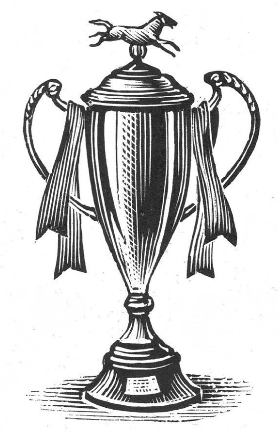

## Kapitel 12: Aus dem Mund des Pferdes

In Blackbury passieren seltsame Dinge. Vielleicht liegt es am Wetter. Vielleicht liegt es am Boden. Aber ganz normal geht es hier nie zu. Das zeigt auch die Geschichte von Johnno, dem Pferd.

Johnno gehört Ron Weasel. Ron ist der Letzte in Blackbury, der mit Pferd und Wagen <abbr class="word" title="die alte Sache, die alten Sachen — old unwanted goods; Ron is the town&#x27;s last rag-and-bone man">alte Sachen</abbr> sammelt und verkauft.

Eines Morgens scheint die große rote Sonne durch den Nebel über dem Rathaus. Es ist ein schöner Morgen. Ron geht in den Stall und gibt Johnno Futter. Er macht den <abbr class="word" title="der Futtersack, die Futtersäcke — feed bag hanging around a horse’s muzzle">Futtersack</abbr> vor Johnnos Maul richtig fest.

Da sagt eine Stimme aus dem Sack: „Ein schöner Morgen.“

„Ja, sehr angenehm“, sagt Ron. Er sieht sich um. Wer ist in den Stall gekommen?

„Das habe ich gesagt“, sagt Johnno. Seine Stimme klingt <abbr class="word" title="vorwurfsvoll — reproachful; sounding as if Ron has done something wrong">vorwurfsvoll</abbr>.

Feine Leute finden vieles an Ron nicht gut. Er badet zum Beispiel nicht besonders gern. Und ans Putzen denkt er überhaupt nicht. Aber dumm ist er nicht. Ein Pferd spricht mit ihm. Also redet er sich nicht ein: Ich habe nichts gehört.

„Na, na, na, na, na“, sagt er. „Wie lange kannst du denn schon sprechen?“

Johnno bewegt seinen Schwanz hin und her.

„Du hast gesagt: ein schöner Morgen“, sagt Ron weiter. „Das habe ich von dir noch nie gehört.“

„Bis jetzt waren die Morgen meistens ziemlich schlecht“, sagt Johnno.

Ron denkt eine Minute nach. Dann fragt er: „Na gut. Wollen wir also unsere Runde machen?“

Johnno dreht sich in seinem Platz im Stall um. Er zeigt seine großen gelben Zähne und grinst böse.

„Aha! Du hast also gedacht, ich kann nicht sprechen. Da heißt es einfach: das alte <abbr class="word" title="das Geschirr, die Geschirre — harness that connects a horse to a cart">Geschirr</abbr> anlegen und los! Früher hast du immer gesagt: Zwischen die <abbr class="word" title="die Stange, die Stangen — shafts; long bars on either side of the horse pulling a cart">Stangen</abbr> am Wagen, du großer Sack voll Knochen! Jetzt nicht mehr so, was? Jetzt bist du etwas höflicher. Etwas mehr <abbr class="word" title="der Respekt — respect">Respekt</abbr>. Weniger Hüh und Brr, was?“

„Also gut“, sagt Ron. „Wir versuchen es in der Gegend um die Station Road. <abbr class="construction" title="The Perfekt with sein refers to their earlier absence from that area.">Wir sind lange nicht dort gewesen.</abbr>“

Tatsächlich sammeln sie viele gute Sachen. Mittags fahren sie in eine Seitenstraße. Johnno bekommt seinen Futtersack, Ron isst Sandwiches. Dabei liest Ron die Sportseiten der Zeitung.

„Ähem“, sagt Johnno. „Ich habe nachgedacht. Mein ganzes Leben ziehe ich diesen Wagen. Einen richtigen Lohn bekomme ich nie. Ohne mich gibt es die alte Firma gar nicht. Na ja, du bist kein schlechter Chef. Aber nächste Woche will ich frei haben. Sonst <abbr class="word" title="streiken, streikte, hat gestreikt — go on strike; refuse to work">streike</abbr> ich. Ich will auf die <abbr class="word" title="die Fuchsjagd, die Fuchsjagden — fox hunt with riders and hounds">Fuchsjagd</abbr>.“

„Fuchsjagd!“, ruft Ron. „Das machen doch die feinen Leute! <abbr class="construction" title="The modal kann expresses ability; the infinitive reiten stays at the end.">Und ich kann nicht reiten!</abbr>“

„Das lass meine Sorge sein! Fuchsjagd muss es sein. Sonst streike ich!“

Also tritt Ron der Jagdgruppe von Blackbury bei. Das kostet viel Geld. Besonders der rote Mantel ist teuer, den er extra kaufen muss.

Zu Hause sagt er Johnno: „Der Mann im Laden nennt die Farbe <abbr class="word" title="das Hunting Pink — traditional name for the scarlet coat worn by fox hunters; not ordinary pink">Hunting Pink</abbr>. Für mich sieht sie so rot wie ein Briefkasten aus.“

„Einen <abbr class="word" title="der Sattel, die Sättel — saddle">Sattel</abbr> brauchst du nicht“, sagt das Pferd. „Ich passe auf, dass du nicht herunterfällst. Aber hoffentlich sind da keine verdammten Hunde. Ich hasse verdammte Hunde.“

„Ich glaube, da gibt es wahrscheinlich ein oder zwei <abbr class="word" title="der Jagdhund, die Jagdhunde — hounds used in a hunt">Jagdhunde</abbr>“, sagt Ron langsam.

Am nächsten Tag zieht Ron seine Jagdkleider an. Er weiß, dass das keine gute Idee ist. Trotzdem reitet er zum Jug and Bottle. Dort trifft sich die Jagdgruppe.

Vor dem Lokal sitzen viele andere Leute auf Pferden. Sie trinken aus kleinen Gläsern. Ein Mann kommt und fragt Ron nach seinem Wunsch.

„Ein dunkles <abbr class="word" title="das Ale, die Ales — a type of beer">Ale</abbr>“, sagt Ron.

„Und ich nehme ein <abbr class="word" title="das Pale Ale; der Eimer, die Eimer — pale and pail sound the same; pale ale is served in a pail, a bucket">Pale Ale im Eimer</abbr>“, knurrt Johnno. „Und hier sind zu viele verdammte Hunde!“

„Donnerwetter!“, sagt der Mann.

Die anderen Jäger schauen Ron seltsam an. Vielleicht liegt es an seiner flachen Mütze. Die hat er nämlich noch auf. Endlich reitet die Gruppe einen kleinen Weg entlang.

Sie kommen nicht weit. Aus einem nahen Wald klingt ein <abbr class="word" title="das Horn, die Hörner — hunting horn">Horn</abbr>. Sofort stellt Johnno seine großen <abbr class="word" title="der Huf, die Hufe — hooves">Hufe</abbr> eng zusammen. Dann schießt er los wie eine Rakete.

<abbr class="construction" title="A traditional shout used in fox hunting.">„Yoicks!“</abbr>, brüllt er.

„…!“, denkt Ron. Für mehr hat er keine Zeit.

Johnno ist ein <abbr class="word" title="das Zugpferd, die Zugpferde — large horse bred to pull carts">Zugpferd</abbr>, und ein sehr großes dazu. Er donnert über die Felder. Über manche <abbr class="word" title="die Hecke, die Hecken — hedges">Hecken</abbr> kann er nicht springen. Dann läuft er einfach durch sie hindurch. Auf seinem breiten Rücken hüpft Ron wie eine Erbse auf einer Trommel. Hinter ihnen kommen die anderen Jäger. Die Jagdhunde bellen laut.

„Zu viele verdammte Hunde! Die machen alles kaputt!“, brüllt Johnno. Er tritt ein paarmal nach ihnen.

„Das darfst du nicht!“, schreit Ron.

Langsam kommt Johnno neben den Fuchs. Das Tier atmet sehr schnell.

„Und jetzt?“, fragt das Pferd. „Bekommen wir einen Preis oder so?“

Ron bekommt kaum Luft. Doch er erklärt kurz, was mit dem Fuchs passieren soll. Die Hunde sollen ihn töten.

„Niemals!“, ruft Johnno. „Was für eine schlechte Idee! He, Fuchs! Ja, du mit dem großen Schwanz! <abbr class="construction" title="Auf jemandes Seite sein means to support that person; here the horse supports the fox.">ICH BIN AUF DEINER SEITE!</abbr>“

Der Fuchs blickt hoch. In großer Angst springt er auf Johnnos Rücken. Er landet hinter Ron.

„Gut!“, sagt Johnno. <abbr class="construction" title="To show someone a clean pair of heels means to run away faster than them. Johnno has four hooves, so the source joke uses two clean pairs of hooves.">„Jetzt zeigen wir diesen Hunden zwei saubere Paare Hufe!“</abbr>

Und schon rasen sie weiter über das Land.

Weit hinter ihnen braucht Lord Cake Hilfe. Er ist der Chef der Jagdgruppe, aber jetzt kann er nicht allein vom Pferd steigen. Sein Gesicht ist schon rot vor Ärger. Dann wird es lila vor großer Wut. Schließlich wird es weiß vor noch größerer Wut. Aber er kommt in dieser Geschichte nicht mehr vor, also …

Bald hören sie die Jagdgruppe nur noch weit hinter sich. Johnno läuft leicht und schön durch Gritshire.

„Was machen wir jetzt?“, fragt er.

„Ich will nur nach Hause“, sagt Ron traurig.

„Unsinn! Jetzt wird der Tag erst interessant!“, sagt Johnno fröhlich. „Das ist viel besser als immer diesen blöden Wagen durch die Stadt ziehen!“

Er läuft um einen Wald herum. Da kommen sie zu einer <abbr class="word" title="die Rennbahn, die Rennbahnen — racecourse">Rennbahn</abbr> für Pferde.

„O nein“, denkt Ron.

„Donnerwetter!“, sagt Johnno.

Es ist die Rennbahn von Blackbury. Heute findet hier das Gritshire Handicap statt, ein Pferderennen. Johnno kommt natürlich auf der anderen Seite der Bahn an. Dort stehen nicht viele Leute.

Er steckt seinen Kopf über das Geländer. „Ich sehe mich schon ein Rennen gewinnen“, sagt er nachdenklich.

„O nein!“, denkt Ron wieder.

Sie gehen an der Bahn entlang. Der Fuchs ist inzwischen eingeschlafen. Die Leute beachten die drei kaum. Hier gibt es schließlich überall kleine Männer auf Pferden.

Johnno kommt zum Platz mit den Rennpferden. Er <abbr class="word" title="wiehern, wieherte, hat gewiehert — neigh; make a horse’s call">wiehert</abbr> leise. Sofort wiehern die anderen Pferde zurück. Alle laufen zum Zaun. Dort führen sie eine Art Gespräch. Sie flüstern in ihrer Pferdesprache.

„Ich denke wirklich, wir müssen nach Hause“, sagt Ron. Er hat Angst. Die Sache ist wohl nicht mehr unter seiner Kontrolle.

Aber seine Worte helfen nicht. Die Rennpferde verlassen den Platz mit ihren Menschen. Johnno will unbedingt mit und läuft hinterher. Dann stehen alle Pferde am Start. Johnno steht mitten unter ihnen.

„He!“, sagt ein <abbr class="word" title="der Jockey, die Jockeys — rider in a horse race">Jockey</abbr>.

„Was zum …!“, sagt der Mann am Start.

„He!“, sagt ein anderer wichtiger Mann im weißen Mantel.

Hoch geht das <abbr class="word" title="das Starttor, die Starttore — starting gate for a horse race">Starttor</abbr>!

Die Rennpferde rasen los. Johnno läuft langsam und schwer hinter ihnen her. Ron schaut zurück. Viele böse Männer laufen ihnen nach und schütteln die Fäuste.

Aber vor ihnen passieren seltsame Dinge. Manche Rennpferde gehen jetzt nur noch langsam. Andere fressen Gras. Sie schauen wie im Traum in die Landschaft. Ihre Jockeys sehen einander an. Niemand versteht das.

Johnno läuft schwer an den Pferden vorbei und grinst.

„Wie hast du das gemacht?“, fragt Ron.

„Ach, sie haben gesagt: Das ist doch das Mindeste für ein armes Pferd. Sein ganzes Leben zieht es einen schweren Wagen über harte Straßen.“ Johnno grinst noch breiter. Er läuft am Zielpfosten vorbei.

Er drückt seine großen Zähne zusammen. „Jetzt hole ich den <abbr class="word" title="der Pokal, die Pokale — trophy cup">Pokal</abbr>!“

Johnno schnaubt und rennt gerade auf einen Tisch zu. Dort wartet der <abbr class="word" title="der Bürgermeister, die Bürgermeister — mayor">Bürgermeister</abbr> von Blackbury. Er will dem Sieger den großen silbernen Pokal geben. Aber niemand kann so schnell reagieren. Johnno packt den Pokal mit seinem Maul. Er dreht sich um und springt über den Zaun ins nächste Feld.

Kurz danach hören sie großen Lärm hinter sich. Die Jagdgruppe von Blackbury kommt auf der Rennbahn an. Einen Augenblick denkt niemand mehr an Johnno. Hunde bellen und beißen wichtige Männer. Jockeys und Jäger laufen durcheinander. Überall herrscht Chaos.

„Nach Hause“, sagt Ron fest. „<abbr class="construction" title="The separable verb zurückbringen places zurück at the end; present tense with morgen expresses a future plan.">Und morgen bringe ich den Pokal zurück.</abbr>“

„Dann glauben sie dir nie“, sagt Johnno. „Wer hat schon von einem sprechenden Pferd gehört? Ich habe diesen Pokal ehrlich gewonnen. Na ja, mehr oder weniger jedenfalls.“

Es ist dunkel, als sie Rons Hof mit den alten Sachen erreichen. Ron schiebt Johnno und den Fuchs in den Stall. Er schließt die Tür ab. Dann eilt er ins Bett. Niemand soll ihn sehen.

Am nächsten Morgen geht er wieder in den Stall. Der Pokal liegt in Johnnos <abbr class="word" title="der Futtertrog, die Futtertröge — manger; container from which an animal eats">Futtertrog</abbr>. Daneben schläft der Fuchs.

„Kein besonders schöner Morgen“, sagt Ron.

Johnno sagt nichts.

„Vielleicht wird das Wetter später besser“, sagt Ron. Er sieht nachdenklich aus.

Johnno kaut auf einem Strohhalm.

„Ich glaube, du hast deine Stimme verloren“, sagt Ron. Er greift nach dem Pokal. Johnno tritt ihm leicht auf den Fuß.

Ron denkt noch etwas nach. Dann geht er hinaus. <abbr class="construction" title="Zurückkommen is separable: kommt and zurück frame the sentence.">Er kommt mit einer doppelten Portion Futterbrei zurück.</abbr>

„Lass dir Zeit beim Frühstück“, sagt er. „Danach schauen wir vielleicht nach ein bisschen Arbeit.“

Er denkt: „<abbr class="construction" title="The Perfekt question begins with habe; geträumt names the completed experience.">Habe ich das alles geträumt?</abbr>“ Dann schaut er wieder auf den Pokal.

Johnno grinst in seinen Futtersack. „Doppelte Portionen und ein bisschen Respekt“, denkt er. „Er hat seine Lektion gelernt. Von jetzt an wird mein Leben ziemlich gut.“

Und so ist es auch.

### Words in this chapter

- **die alte Sache, die alten Sachen** — old unwanted goods; Ron is the town's last rag-and-bone man
- **der Futtersack, die Futtersäcke** — feed bag hanging around a horse’s muzzle
- **vorwurfsvoll** — reproachful; sounding as if Ron has done something wrong
- **das Geschirr, die Geschirre** — harness that connects a horse to a cart
- **die Stange, die Stangen** — shafts; long bars on either side of the horse pulling a cart
- **der Respekt** — respect
- **streiken, streikte, hat gestreikt** — go on strike; refuse to work
- **die Fuchsjagd, die Fuchsjagden** — fox hunt with riders and hounds
- **das Hunting Pink** — traditional name for the scarlet coat worn by fox hunters; not ordinary pink
- **der Sattel, die Sättel** — saddle
- **der Jagdhund, die Jagdhunde** — hounds used in a hunt
- **das Ale, die Ales** — a type of beer
- **das Pale Ale; der Eimer, die Eimer** — pale and pail sound the same; pale ale is served in a pail, a bucket
- **das Horn, die Hörner** — hunting horn
- **der Huf, die Hufe** — hooves
- **das Zugpferd, die Zugpferde** — large horse bred to pull carts
- **die Hecke, die Hecken** — hedges
- **die Rennbahn, die Rennbahnen** — racecourse
- **wiehern, wieherte, hat gewiehert** — neigh; make a horse’s call
- **der Jockey, die Jockeys** — rider in a horse race
- **das Starttor, die Starttore** — starting gate for a horse race
- **der Pokal, die Pokale** — trophy cup
- **der Bürgermeister, die Bürgermeister** — mayor
- **der Futtertrog, die Futtertröge** — manger; container from which an animal eats

### Constructions and sentences
- **“Wir sind lange nicht dort gewesen.”** — “We haven’t been there for a long time.” The Perfekt of sein uses sind and gewesen.

- **“Und ich kann nicht reiten!”** — “And I can’t ride!” The modal kann expresses ability; reiten comes last.

- **“ICH BIN AUF DEINER SEITE!”** — “I AM ON YOUR SIDE!” Auf jemandes Seite sein means to support someone.

- **“Und morgen bringe ich den Pokal zurück.”** — “And tomorrow I’ll return the cup.” Zurückbringen is separable; morgen makes the present tense a future plan.

- **“Er kommt mit einer doppelten Portion Futterbrei zurück.”** — “He comes back with a double portion of mash.” The prefix zurück stands at the end.

- **“Habe ich das alles geträumt?”** — “Did I dream all of that?” A yes/no question in the Perfekt starts with the auxiliary habe.

---

[← Previous](kapitel-11.md) · [Contents](README.md) · [Next →](kapitel-13.md)
