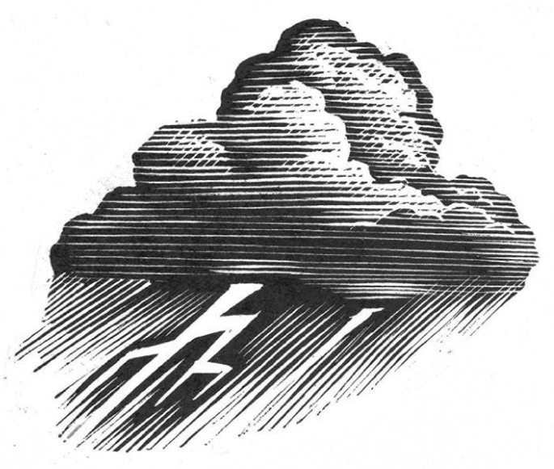

## Kapitel 13: Das Wetter von Blackbury

Es ist ein gewöhnlicher Samstagnachmittag in Blackbury. Die kleine Stadt mit ihrem Markt liegt in Gritshire.

Na ja, ganz gewöhnlich ist dieser Nachmittag nicht. Auf dem Platz der Blackbury Rovers spielt die Mannschaft der Stadt gegen East Slate United. Es geht um den Pokal im <abbr class="word" title="das Endspiel, die Endspiele — final match">Endspiel</abbr>. <abbr class="construction" title="Both Ends Meat sounds like both ends meet in make both ends meet, meaning to have enough money to live on; meat also suits a sausage factory.">Der Platz liegt hinter der Wurstfabrik</abbr> Gridley „Both Ends Meat“ Sausage Co. Ltd.

Nach fünfundachtzig Minuten steht es immer noch <abbr class="word" title="unentschieden — drawn; with both teams on the same score">unentschieden</abbr>. Die Zuschauer halten plötzlich den Atem an. Jim Sponge, der Spieler außen bei East Slate, bekommt den Ball. Blitzschnell läuft er auf das Tor von Blackbury zu.

In diesem Augenblick entsteht eine winzige schwarze Wolke. Sie hängt am klaren blauen Himmel über dem Platz. Eine Minute bleibt sie dort und macht kleine Donnergeräusche. Dann schießt sie hinter Sponge her. Sie erreicht ihn genau am Tor. Ein <abbr class="word" title="der Blitz, die Blitze — flash of lightning">Blitz</abbr> leuchtet auf und …

BUMM!

Die Leute finden Jims Fußballschuhe auf halber Höhe der Zuschauerreihen. Rauch kommt aus den Schuhen. Jim selbst liegt auf dem Dach der Umkleideräume. Er versteht nicht recht, was los ist. Aber er ist unverletzt, bis auf seine <abbr class="word" title="die Augenbraue, die Augenbrauen — eyebrows">Augenbrauen</abbr>. Die brauchen Wochen zum Nachwachsen. Den Ball findet niemand mehr.

Das <abbr class="word" title="geheimnisvoll — mysterious">geheimnisvolle</abbr> Wetter von Blackbury hat wieder zugeschlagen!

An diesem Abend ruft Stadtrat Maurice Oxford eine besondere Sitzung im Rathaus zusammen. Er leitet die Gruppe für Geld, allgemeine Aufgaben und allerlei sonstige Dinge.

„Letzte Woche hat es <abbr class="word" title="das Hagelkorn, die Hagelkörner — hailstones">Hagelkörner</abbr> geregnet“, sagt er. „So groß wie Cricketbälle! Genau da ist der Minister für <abbr class="word" title="die Einmischung, die Einmischungen — interference; meddling in other people’s business">Einmischung</abbr> zu uns gekommen. Er hat das neue Institut für Unsinn in der Praxis eröffnet. Und ihr erinnert euch sicher an Dienstag. Da hat es <abbr class="construction" title="Twelve inches of rain: just over thirty centimetres.">zwölf Zoll</abbr> geregnet. Genau da hat der Bürgermeister das neue Schwimmbad eröffnet. Und der Regen ist nur auf den Bürgermeister gefallen!“

Oxford blickt alle im Zimmer böse an. „Mit dem Wetter in Blackbury stimmt etwas überhaupt nicht. <abbr class="construction" title="Müssen expresses necessity; the indirect question was los ist has its verb at the end.">Wir müssen herausfinden, was los ist.</abbr> Und zwar …“

Er hört auf zu sprechen und starrt in die Mitte vom Zimmer. Jetzt sehen es alle. Die Luft wird dort immer dichter. In wenigen Sekunden bildet sie eine kleine, drehende <abbr class="word" title="die Spirale, die Spiralen — spiral; a shape curling around itself">Spirale</abbr>. Sie ist höchstens dreißig Zentimeter hoch.

„Das ist ein <abbr class="word" title="der Wirbelwind, die Wirbelwinde — whirlwind">Wirbelwind</abbr> …“, beginnt Oxford.

Wusch! Papier fliegt durch das Zimmer. Alle wollen gleichzeitig hinaus. Sie bleiben zusammen in der Tür stecken.

Oxford reagiert zum Glück schnell. Er schlägt die schweren Türen aus Eichenholz zu. Jetzt stehen alle im Flur und hören den Lärm hinter der Tür. Der kleine Wirbelwind saust im Zimmer herum. Er wirft Stühle um und zerbricht Glühbirnen.

Nun spricht Stadtrat E. I. Addio. Er ist auch der Manager der Blackbury Rovers.

„Wetter im Haus ist nicht natürlich“, sagt er. „Ich sage euch: Da steckt mehr dahinter.“

„Auseinander!“, schreit jemand.

Über ihren Köpfen entsteht eine kleine schwarze Wolke. Die Stadträte rennen den Flur hinunter. Ihre langen Amtskleider fliegen hinter ihnen her. Sie biegen um die Ecke und fallen in einen großen Schneeberg. Zwischen dem Büro für Bauarbeiten und dem Büro für Rechnungen tobt ein schwerer <abbr class="word" title="der Schneesturm, die Schneestürme — blizzard">Schneesturm</abbr>.

Aber das ist noch nicht alles. Im Büro vom obersten Rathausbeamten kracht ein ziemlich interessantes <abbr class="word" title="das Gewitter, die Gewitter — thunderstorm">Gewitter</abbr>. Jedenfalls klingt es so. Tatsächlich jagt das Gewitter den Mann um seinen Schreibtisch herum.

Auch draußen passieren seltsame Dinge. Im Park liegen <abbr class="word" title="der Eisberg, die Eisberge — icebergs">Eisberge</abbr> im kleinen Wasserbecken für Kinder. Eine halbe Meile weiter, in West Blackbury, schwitzen die Leute <abbr class="construction" title="Ninety-six degrees Fahrenheit is about thirty-six degrees Celsius: very hot weather.">bei sechsundneunzig Grad Fahrenheit</abbr>.

Ein starker Sturm fegt durch North Blackbury. In Blackbury New Town steht die Luft dagegen völlig still. Dafür ist sie voll mit riesigen Schneeflocken.

Das Seltsamste passiert in einem Wasserkessel. Er gehört Mrs E. Blanket in der Mafeking Road. Im Kessel entsteht ein richtiger kleiner <abbr class="word" title="der Hurrikan, die Hurrikane — hurricane">Hurrikan</abbr>. Mrs Blanket lässt ihn heraus. Laut brüllend fliegt er über die Schornsteine davon.

Spät in dieser Nacht gibt es noch eine besondere Sitzung. Maurice Oxford und Mr Addio treffen sich mit <abbr class="word" title="der Chefinspektor, die Chefinspektoren — chief inspector; senior police officer">Chefinspektor</abbr> Charlie Artful. Er kommt von der Polizeizentrale in Gritshire. Sie sitzen in einem Keller im Rathaus. Zur Sicherheit haben alle Regenschirme dabei.

„Das Wetteramt in London hat sich bei uns gemeldet“, flüstert Artful. „Das passiert offenbar nur in Blackbury. An der Stadtgrenze hört dieses seltsame Wetter auf!“

„Habt ihr schon Hinweise?“, fragt Addio. Er schaut nervös zur Decke.

„Wir haben die Hagelkörner nach <abbr class="word" title="der Fingerabdruck, die Fingerabdrücke — fingerprints">Fingerabdrücken</abbr> untersucht“, sagt der Inspektor. „Vielleicht macht jemand dieses verrückte Wetter. Wir wissen aber nicht, wie. Und gegen welches Gesetz verstößt er damit überhaupt?“

„Aha“, sagt Oxford. „Ihr findet also den Täter. Dann könnt ihr sagen: Er <abbr class="word" title="die öffentliche Ruhe stören, störte, hat gestört — cause a breach of the peace; disturb public order">stört die öffentliche Ruhe</abbr>. Oder er lässt es ohne <abbr class="word" title="die Erlaubnis, die Erlaubnisse — permission; here an official licence">Erlaubnis</abbr> schneien!“

„Keine Ahnung“, sagt Artful. „Ich fange die Leute nur. Ich weiß nicht, was danach mit ihnen passiert. Aber eines wissen wir. Das Wetter erscheint im Rathaus oder an Orten mit Blick auf den Uhrturm. Vielleicht hat jemand einen Apparat, der das Wetter ändern kann. Dann zielt er vielleicht vom Turm aus.“

„Meine Güte“, sagt E. I. Addio. „Seid ihr schon oben gewesen?“

„Ja. Wir haben ein paar <abbr class="word" title="der Zigarettenstummel, die Zigarettenstummel — cigarette ends">Zigarettenstummel</abbr> gefunden. <abbr class="construction" title="The Perfekt of sein reports a recent earlier presence; vor Kurzem means recently.">Jemand ist vor Kurzem dort oben gewesen.</abbr>“

Oxford sieht nachdenklich aus. „Dieser Mensch macht den Stadtrat offenbar gern lächerlich“, sagt er langsam. „Also habe ich eine Idee …“

Drei Tage später findet die Feier für den neuen Bürgermeister statt. Er übernimmt das Amt für ein Jahr. Diese <abbr class="word" title="die Tradition, die Traditionen — tradition">Tradition</abbr> ist sehr alt. Es gibt sie seit 1329.

Der alte und der neue Bürgermeister müssen auf einem schmalen Brett über den Fluss Um gehen. Dort <abbr class="word" title="sich verbeugen, verbeugte sich, hat sich verbeugt — bow; bend forward as a formal greeting">verbeugen</abbr> sie sich dreimal voreinander. Dabei machen sie viele Dinge nach den alten Regeln. Dazu gehören Papierrollen, Ketten und Cedric, die Ente.

Cedric ist das offizielle <abbr class="word" title="das Maskottchen, die Maskottchen — mascot">Maskottchen</abbr> der Stadtverwaltung von Blackbury. Seit 1598 zeigt das <abbr class="word" title="das Stadtwappen, die Stadtwappen — town crest; official emblem of a town">Stadtwappen</abbr> eine Ente. Niemand weiß, warum. Vielleicht mögen sie einfach Enten.

Hinter jedem Busch verstecken sich Polizisten. Charlie Artful selbst wartet heimlich zwischen den Büschen bei der Uhr.

Maurice Oxford wird der neue Bürgermeister. Die Stadtkapelle beginnt das traditionelle Lied „Blackbury Races“. Oxford schaut nervös zu den kleinen Fenstern um die Turmuhr. Er glaubt, dort einen Schatten zu sehen. Langsam schiebt er sich auf dem Brett über den Um vorwärts. Die Menge jubelt.

Der alte Bürgermeister, Horace Milparslie, starrt zum Turm hinauf.

„He“, sagt er, „seht mal, wer da oben ist! Das ist …“

Fzzzzzip! Ein winziger Blitz stößt ihn in den Fluss. Die <abbr class="word" title="die Strömung, die Strömungen — current; flowing water">Strömung</abbr> trägt ihn davon. Er spuckt Wasser und bekommt kaum Luft. Am ganzen Ufer springen Polizisten ins Wasser.

Die kleine Gewitterwolke dreht sich nun zu Maurice Oxford. Langsam geht er rückwärts. Gerade rechtzeitig zieht er den Kopf ein. Die Wolke fliegt über ihn hinweg und gerade in eine <abbr class="word" title="die Tuba, die Tuben — large low brass instrument">Tuba</abbr>. Ein erstaunter Musiker hält das Instrument. In den Rohren macht die Wolke einen schrecklichen Lärm.

Oxford greift nach einer Trompete und bläst einen mächtigen Ton.

„Zum Uhrturm!“, brüllt er. „Der geheimnisvolle Wettermann ist dort oben!“

<abbr class="construction" title="The source says a chase is like meat and drink to them: something they love doing.">Die Leute von Blackbury lieben eine gute Verfolgung.</abbr> Alle drehen sich gleichzeitig um und rennen zum Turm. Hinter ihnen kommen die Stadtkapelle, der Stadtrat und Cedric, die Ente. Auch der klatschnasse alte Bürgermeister rennt mit. Dazu kommt eine ganze Gruppe schreiender Schulkinder.

Zuerst finden sie Charlie Artful. Er ist völlig <abbr class="word" title="einfrieren, fror ein, ist eingefroren — frozen solid">eingefroren</abbr>. Er hält seine Polizeipfeife noch auf halbem Weg zum Mund.

„Geht es Ihnen gut?“, fragt Oxford außer Atem.

„Gießen Sie mir etwas Whisky zwischen die Lippen“, murmelt Artful durch den Frost. „Er hat mich sofort erwischt. <abbr class="construction" title="The Perfekt with haben describes the failed recognition; erkannt is the participle of erkennen.">Ich habe ihn nicht erkannt.</abbr> Brrrr!“

Inzwischen sieht jemand eine laufende Gestalt am anderen Ende der High Street. Sofort donnern alle wieder los. Am Ende der Straße gehört Oxford schon wieder zu den Ersten. Aus Seitenstraßen laufen weitere Menschen herbei. <abbr class="construction" title="Wollen expresses intention; the separable infinitive mitmachen remains one word after the modal.">Sie wollen bei der Verfolgung mitmachen.</abbr>

Maurice sieht die Gestalt etwas hochheben. Es sieht wie ein <abbr class="word" title="das Gewehr, die Gewehre — rifle">Gewehr</abbr> aus.

Fzzzzip!

Plötzlich bedeckt eine Schicht Eis die Straße. Die Menschen rutschen durcheinander. Aber Maurice will unbedingt weiter. Er gleitet über das Eis. Seine langen Bürgermeisterkleider flattern im Wind.

Sie laufen weiter. Die Gruppe ist jetzt kleiner, aber sehr wütend. Sie rennt die Slate Road hinunter. Dann geht es zurück durch die Market Street und durch Bodgers Alley. Maurice Oxford kommt dem Mann immer näher.

Im Laufen nimmt er die Bürgermeisterkette von seinem Hals. Er schwingt sie immer wieder im Kreis. Dann lässt er los. Die Kette schießt durch die Luft. Sie schlägt den seltsamen Apparat aus der Hand von dem Mann.

„Oh, sehr gut, Sir!“, sagt jemand hinter Oxford.

Maurice rennt weiter und hebt das Ding auf. Es hat ein großes <abbr class="word" title="das Rohr, die Rohre — barrel of the rifle-shaped weather machine">Rohr</abbr> und viele Knöpfe und <abbr class="word" title="der Hebel, die Hebel — lever; control that you push or pull">Hebel</abbr>. Der größte steht auf „Eis“. Maurice stellt ihn auf „Wirbelwind“. Dann zielt er auf den laufenden Mann. Er drückt einen interessanten blauen Hebel.

Fzzzip!

Der Wind hebt den Mann hoch über die Straßen von Blackbury. Er tritt um sich und kämpft gegen den Wind. Aber der Wind trägt ihn gerade über den Um. Dort gibt es eine besonders <abbr class="word" title="schlammig — muddy">schlammige</abbr> Stelle. Genau darüber <abbr class="construction" title="Ausschalten is separable; aus comes at the end of the clause.">schaltet Maurice die Maschine aus.</abbr>

Platsch!

Der Mann taucht auf und schnappt nach Luft. Alle schreien: „E. I. Addio!“

Später sagt Maurice: „Ich habe ihn eigentlich von Anfang an <abbr class="word" title="verdächtigen, verdächtigte, hat verdächtigt — suspect someone of having done something wrong">verdächtigt</abbr>. Schließlich ist er Manager der Rovers. Und Bürgermeister war er noch nie. <abbr class="construction" title="Weil gives the reason and moves war to the end of the subordinate clause.">Er mag den Stadtrat nicht, weil er nie Bürgermeister war.</abbr> Ich glaube, er hat die Maschine im Uhrturm angelassen. Deshalb hat sie auch gearbeitet, als er bei uns war.“

„Sehr klug von ihm, so etwas zu erfinden“, sagt Charlie Artful. „Äh, wo ist die Maschine übrigens?“

Maurice sagt, dass er es nicht weiß. Dabei klingt er ein bisschen zu unschuldig.

Aber später an diesem Abend bindet jemand eine Maschine an die <abbr class="word" title="die Wetterfahne, die Wetterfahnen — weather vane; here a cock-shaped wind indicator">Wetterfahne</abbr> auf dem Uhrturm. Die Maschine sieht aus wie ein Gewehr. Jemand stellt sie auf „Sonnig“.

Maurice hat das beste Wetter überhaupt in seinem Jahr als Bürgermeister.

Bis die Batterien leer sind.

### Words in this chapter

- **das Endspiel, die Endspiele** — final match
- **unentschieden** — drawn; with both teams on the same score
- **der Blitz, die Blitze** — flash of lightning
- **die Augenbraue, die Augenbrauen** — eyebrows
- **geheimnisvoll** — mysterious
- **das Hagelkorn, die Hagelkörner** — hailstones
- **die Einmischung, die Einmischungen** — interference; meddling in other people’s business
- **die Spirale, die Spiralen** — spiral; a shape curling around itself
- **der Wirbelwind, die Wirbelwinde** — whirlwind
- **der Schneesturm, die Schneestürme** — blizzard
- **das Gewitter, die Gewitter** — thunderstorm
- **der Eisberg, die Eisberge** — icebergs
- **der Hurrikan, die Hurrikane** — hurricane
- **der Chefinspektor, die Chefinspektoren** — chief inspector; senior police officer
- **der Fingerabdruck, die Fingerabdrücke** — fingerprints
- **die öffentliche Ruhe stören, störte, hat gestört** — cause a breach of the peace; disturb public order
- **die Erlaubnis, die Erlaubnisse** — permission; here an official licence
- **der Zigarettenstummel, die Zigarettenstummel** — cigarette ends
- **die Tradition, die Traditionen** — tradition
- **sich verbeugen, verbeugte sich, hat sich verbeugt** — bow; bend forward as a formal greeting
- **das Maskottchen, die Maskottchen** — mascot
- **das Stadtwappen, die Stadtwappen** — town crest; official emblem of a town
- **die Strömung, die Strömungen** — current; flowing water
- **die Tuba, die Tuben** — large low brass instrument
- **einfrieren, fror ein, ist eingefroren** — frozen solid
- **das Gewehr, die Gewehre** — rifle
- **das Rohr, die Rohre** — barrel of the rifle-shaped weather machine
- **der Hebel, die Hebel** — lever; control that you push or pull
- **schlammig** — muddy
- **verdächtigen, verdächtigte, hat verdächtigt** — suspect someone of having done something wrong
- **die Wetterfahne, die Wetterfahnen** — weather vane; here a cock-shaped wind indicator

### Constructions and sentences
- **“Wir müssen herausfinden, was los ist.”** — “We have to find out what is going on.” Müssen expresses necessity; the indirect question ends with ist.

- **“Jemand ist vor Kurzem dort oben gewesen.”** — “Someone has been up there recently.” The Perfekt of sein uses ist and gewesen; vor Kurzem means recently.

- **“Ich habe ihn nicht erkannt.”** — “I didn’t recognize him.” Erkannt is the participle of erkennen; the Perfekt refers to the earlier encounter.

- **“Sie wollen bei der Verfolgung mitmachen.”** — “They want to join the chase.” Wollen expresses intention; mitmachen is the final infinitive.

- **“Genau darüber schaltet Maurice die Maschine aus.”** — “Right above that spot, Maurice switches the machine off.” Ausschalten is separable; the verb stays second after the opening phrase.

- **“Er mag den Stadtrat nicht, weil er nie Bürgermeister war.”** — “He dislikes the council because he was never mayor.” The weil clause gives the reason and puts war last.

---

[← Previous](kapitel-12.md) · [Contents](README.md) · [Next →](kapitel-14.md)
