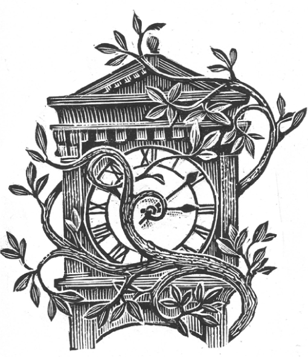

## Kapitel 14: Der Dschungel von Blackbury

Dies ist die Geschichte vom <abbr class="word" title="der Dschungel, die Dschungel — jungle">Dschungel</abbr> in Blackbury. Sie beginnt um zehn nach drei am Nachmittag, wie fast alles in Blackbury. Eigentlich passiert dort alles um diese Zeit. Die Uhr am <abbr class="word" title="das Rathaus, die Rathäuser — town hall">Rathaus</abbr> ist nämlich eines Tages im Jahr 1869 um zehn nach drei stehen geblieben.

An diesem sonnigen Nachmittag trifft sich der <abbr class="word" title="der Stadtrat, die Stadträte — town council">Stadtrat</abbr> im Rathaus. Der Saal ist staubig, hat eine hohe Decke und Wände mit dunklem Eichenholz. Heute geht es unter anderem um den Park.

„Blackbury braucht mehr Farbe“, sagt der <abbr class="word" title="der Bürgermeister, die Bürgermeister — mayor">Bürgermeister</abbr>, Amos Stepforward. „Mehr Blumen auf den <abbr class="word" title="das Beet, die Beete — flower beds">Beeten</abbr> und solche Dinge. Dann sieht die Stadt freundlicher aus und mehr Touristen kommen. Auf den Channel Islands gibt es eine <abbr class="word" title="die Blumenschlacht, die Blumenschlachten — Battle of Flowers; a flower festival">Blumenschlacht</abbr>. So etwas können wir auch machen.“

Eli Prune, ein Mitglied des Stadtrats, schläft schon fast. Er sagt: „Ich habe gar nicht gewusst, dass Blumen so gern kämpfen.“

„Ja, also, hrrrm“, macht der Bürgermeister und schaut ihn böse an. „Jedenfalls schlage ich vor: Unser Parkgärtner kauft ein paar Tüten mit <abbr class="word" title="der Samen, die Samen — seeds">Samen</abbr>. Dann fangen wir an.“

Am nächsten Tag bestellt der Parkgärtner Bert Juggins verschiedene Blumensamen. Der kleine Park von Blackbury ist ziemlich eng. Es gibt dort grüne <abbr class="word" title="das Gitter, die Gitter — railings">Gitter</abbr> und viele große Büsche, die im Frühling blühen. Nun sollen passende neue Blumen dazukommen.

Aber Bert bekommt ein seltsames grünes Paket mit nur etwa dreißig Samen. Nicht einmal eine Briefmarke ist darauf. Er hat bei einem guten Samengeschäft bestellt, aber auch der Name des Geschäfts fehlt.

„Na, <abbr class="construction" title="The separable verb ausprobieren places aus at the end: I will simply try them.">ich probiere sie einfach aus</abbr>“, sagt Bert. „Aber für Blumensamen sind sie wirklich ziemlich groß.“

Er macht dreißig kleine Löcher in die Beete, legt die Samen hinein und gibt ihnen Wasser. Dafür nimmt er die <abbr class="word" title="die Gießkanne, die Gießkannen — watering can">Gießkanne</abbr> der Stadt. Dann geht er nach Hause.

Nach dem Abendessen will Bert seine <abbr class="word" title="die Pfeife, die Pfeifen — smoking pipe">Pfeife</abbr> aus der Jacke holen. Da merkt er: <abbr class="construction" title="Perfekt with hat and liegen lassen describes something he did earlier: He left his pipe in the park.">Er hat seine Pfeife im Park liegen lassen.</abbr> Sie liegt im kleinen Haus für die Gartengeräte. Berts eigenes Häuschen steht am Rand des Parks, hinter ein paar Bäumen. Er nimmt eine Taschenlampe und läuft schnell über den Rasen. Der Mond scheint.

Doch im Park ist etwas ganz anders als sonst …

Es ist halb eins in der Nacht, und Bürgermeister Stepforward schläft tief. Plötzlich klappert etwas an seinem Fenster. Es klingt nach einer Handvoll kleiner Steine, die jemand dagegen wirft.

Er stolpert aus dem Bett, öffnet das Fenster und murmelt: „Wasnlos?“

Unten steht Bert und hüpft aufgeregt auf und ab. „Ich bin es, Herr Bürgermeister! Sie müssen runterkommen! Der Park ist verrückt geworden!“

„Verrückt?“

„Alles wächst!“

„Das hoffe ich doch!“ Der Bürgermeister macht das Fenster zu und legt sich wieder ins Bett. „Was erwartet er denn sonst in einem Park?“, murmelt er und schläft ein.

Unten dreht und drückt Bert nervös seine Hände. Dann läuft er los, um jemand anderen zu suchen.

Inzwischen sieht man den Park nicht mehr unter all dem Grün. Alles wächst rasend schnell. Lange <abbr class="word" title="die Ranke, die Ranken — long climbing plant stems; vines">Ranken</abbr> bewegen sich wie Schlangen und greifen nach den Gittern. Riesige <abbr class="word" title="der Baumstamm, die Baumstämme — tree trunks">Baumstämme</abbr> schießen wie Raketen in die Höhe. Plötzlich haben sie Blätter, dann Blüten und dann große violette Früchte. Eine Kletterpflanze wächst schon am Rathausdach entlang zur Uhr.

Am Morgen wacht der Bürgermeister auf, weil etwas seine Nase kitzelt. Es ist eine große gelbe Blume am Ende eines <abbr class="word" title="der Ast, die Äste — tree branch">Astes</abbr>. Der Ast ist durch das Fenster gewachsen. Andere Büsche haben sich ebenfalls einen Weg ins Zimmer gemacht.

„Meine Güte!“, ruft er und setzt sich auf. Da fällt ihm eine große grüne Melone auf den Kopf.

Ein Busch mit <abbr class="word" title="der Dorn, die Dornen — thorns">Dornen</abbr> hält seine Hose fest. Der Bürgermeister muss richtig kämpfen, um sie zu bekommen. Sein Hut hängt an einer Ranke fast unter der Decke. Die Pflanzen versperren auch die Haustür. Also muss er aus dem Fenster klettern.

Man sieht Blackbury kaum noch. Überall sind Blumen, Früchte und Ranken, und alles wächst weiter. Auf einem Ast sitzt der Briefträger und isst eine Banane.

„Was ist passiert?“, fragt der Bürgermeister.

„Das ist einfach alles gewachsen“, sagt der Briefträger. „Möchten Sie eine Banane?“

Die Stadt liegt unter einem grünen Berg. Überall wachsen Kletterpflanzen. In der High Street stehen riesige Bäume. Aus jeder <abbr class="word" title="die Dachrinne, die Dachrinnen — rain gutter">Dachrinne</abbr> wachsen riesige rote, weiße und violette <abbr class="word" title="die Orchidee, die Orchideen — orchids">Orchideen</abbr>. Auf dem Rathausdach hängen ganze Gruppen gelber Blüten.

Der Bürgermeister sucht sich einen Weg durch die Stadt. Oft kommt er am Boden nicht weiter. Dann klettert er auf Bäume, atmet schwer und stöhnt laut. Oben läuft er über die Äste.

Viele Leute aus Blackbury kommen aus ihren Häusern. Staunend stecken sie die Hände zwischen die dichten Pflanzen. Ein paar besonders praktische Leute schneiden sich gleich ganze Bündel Bananen und Weintrauben ab.

„Ich glaube, <abbr class="construction" title="Sich an etwas gewöhnen means to get used to something; daran refers to this new situation.">daran kann ich mich gewöhnen</abbr>“, sagt der Bürgermeister. Er greift nach einer Ranke und schaut, wie weit der nächste Ast entfernt ist. „Vielleicht kann ich hinüberschwingen wie Tarzan of the Apes? Man ist so jung, wie man sich fühlt …“

Einen Augenblick später sitzt er auf einem Haufen <abbr class="word" title="der Farn, die Farne — ferns">Farne</abbr> und hält sich den Kopf. Bert Juggins sitzt neben ihm und stöhnt.

„Entschuldigung“, sagt Bert. „Ich habe nicht gesehen, dass Sie von der anderen Seite kommen.“

„Au! Mein Kopf! Jetzt weiß ich, wie sich eine Kastanie beim <abbr class="word" title="das Kastanienspiel — conkers: children swing chestnuts on strings to hit one another&#x27;s chestnut">Kastanienspiel</abbr> fühlt! Bert, das ist ja ein schönes Durcheinander! Und alles durch Ihre Samen!“

„Ich glaube, ich habe die falschen Samen bekommen“, sagt Bert. „Ich habe große Gartenblumen und kleine weiße Blumen bestellt. Keine Bananenbäume!“

„Blackbury kann doch nicht wie ein riesiges, völlig volles <abbr class="word" title="das Gewächshaus, die Gewächshäuser — greenhouse">Gewächshaus</abbr> aussehen!“, sagt der Bürgermeister. „Was wollen Sie jetzt dagegen tun?“

Bert pflückt eine große blaue <abbr class="word" title="die Pflaume, die Pflaumen — plum">Pflaume</abbr> von einem Busch und beißt hinein. „Tun? Wissen Sie, wie teuer frisches Obst heute ist? Wir können damit sehr viel Geld verdienen. Und wir können <abbr class="word" title="die Safari, die Safaris — guided trips through the jungle">Safaris</abbr> durch die High Street anbieten.“

„Hm“, macht der Bürgermeister und denkt nach.

Am Nachmittag trifft sich der Stadtrat wieder im Rathaus. Das ist diesmal nicht einfach. Schon das Rathaus zwischen all den geheimnisvollen Pflanzen zu finden, ist schwierig. Eli Prune <abbr class="word" title="sich verirren, verirrte sich, hat sich verirrt — gets lost">verirrt sich</abbr> zum Beispiel zwischen dichten <abbr class="word" title="die Bambuspflanze, die Bambuspflanzen — bamboo plants">Bambuspflanzen</abbr>. Und der Bürgermeister bleibt an einem Baum mit klebrigem Saft hängen. Das ist eine ziemlich klebrige Sache.

Die Mitglieder des Stadtrats sitzen auf Ästen oder weichen Haufen <abbr class="word" title="das Moos — moss">Moos</abbr>. Mehrere essen Pflaumen und Melonen von den Ranken, die überall im Saal hängen.

Der Bürgermeister erklärt Berts Plan. Sie verkaufen das frische Obst und bieten Safaris durch den Dschungel an. So kommen mehr Touristen nach Blackbury. <abbr class="construction" title="Finden plus an object and an adjective expresses an opinion: Everyone thinks the idea is good.">Alle finden die Idee gut.</abbr>

Nun fragt kaum noch jemand, wie der Dschungel überhaupt hierhergekommen ist. Die Leute in Blackbury gewöhnen sich schnell an alles. Nach ein oder zwei Tagen findet niemand etwas Seltsames daran: Alte Damen schwingen an Ranken von Baum zu Baum, um einkaufen zu gehen. Die Blackbury High School zieht auf die Äste eines großen Elefantenbaums.

Ein Lastwagen nach dem anderen fährt aus der Stadt. Alle sind voll mit frischen <abbr class="word" title="die Papaya, die Papayas — papayas; pawpaws">Papayas</abbr>, Weintrauben, Dschungelpflaumen, grünen Melonen und <abbr class="word" title="die Kokosnuss, die Kokosnüsse — coconuts">Kokosnüssen</abbr>. Am anderen Ende der Stadt kommen ganze Busse voller Touristen an.

Es gibt nur ein Problem: Im Dschungel leben gar keine wilden Tiere. Vielleicht zählt die Rathauskatze dazu. Die ist fast immer ziemlich wütend.

Doch der Bürgermeister findet eine Lösung. Er versteckt sich hinter Büschen und macht Tiergeräusche nach. Bert zieht ein <abbr class="word" title="das Gorillakostüm, die Gorillakostüme — gorilla costume">Gorillakostüm</abbr> an, das etwas alt und feucht riecht. Es ist kein besonders gutes Kostüm.

Ein Tourist arbeitet als <abbr class="word" title="der Tierpfleger, die Tierpfleger — zookeeper">Tierpfleger</abbr>. Er sagt <abbr class="word" title="spöttisch — mockingly; sarcastically">spöttisch</abbr>: „So einen Gorilla habe ich noch nie gesehen! Er hat einen <abbr class="word" title="der Reißverschluss, die Reißverschlüsse — zip; zipper">Reißverschluss</abbr> über den ganzen Rücken!“ Aber die meisten Besucher sind zufrieden.

Nach einer Woche trifft sich der Stadtrat noch einmal. Blackbury verdient jetzt Tausende von Pfund am Tag!

„Das ist wunderbar!“, sagt der Bürgermeister und reibt sich die Hände. „Und morgen kommt eine besonders große Gruppe Touristen!“

Aber morgen wird auch noch etwas anderes passieren.

Der Bürgermeister wohnt nicht mehr in seinem Haus. Es liegt unter einem Berg von Pflanzen. Wie viele andere hat er sich ein <abbr class="word" title="das Baumhaus, die Baumhäuser — tree house">Baumhaus</abbr> gebaut. Es steht zwischen den Ästen eines Huggermuggerbaums.

Er beobachtet die Touristen. Da klettert Bert an einer Ranke herauf. Im Mund hat er einen alten, ziemlich kaputten grünen <abbr class="word" title="der Umschlag, die Umschläge — envelope; seed packet">Umschlag</abbr>.

„Das habe ich im Park gefunden“, murmelt er. „Es hing in einem Bananenbaum. Darin waren die Samen! Das ist überhaupt keine normale Samentüte!“

Der Bürgermeister schaut sie an. In gelber und violetter Schrift steht darauf:

SOFORT-DSCHUNGEL-SAMEN

An einem warmen Ort pflanzen.

Achtung: Pflanzen aus diesen Samen leben selten länger als sieben Tage.

„Na und?“, fragt der Bürgermeister und lehnt sich an einen Ast. Der Ast bricht ab. Bert fängt den Bürgermeister gerade noch auf, sonst fällt er aus dem Baum.

„Ich habe mich umgesehen“, sagt Bert. „Die Hälfte der Bäume ist schon so trocken und leicht wie Papier. <abbr class="construction" title="Müssen expresses necessity and takes the infinitive warnen at the end: We must warn people!">Wir müssen die Leute warnen!</abbr>“

„Glauben Sie, sie wollen ihr Geld zurück?“, fragt der Bürgermeister ängstlich. Beide klettern vom Baum. Ein sehr großer Ast fällt dem Bürgermeister auf den Kopf. Aber es tut nicht weh: Der Ast wird sofort zu einer Wolke aus <abbr class="word" title="der Staub — dust">Staub</abbr>. Als sie unten ankommen, regnet es um sie herum Staub und kleine trockene Zweige.

Der ganze Dschungel wird trocken. Die Pflanzen rollen sich zusammen, <abbr class="word" title="knarren, knarrte, hat geknarrt — creak">knarren</abbr> und zerfallen mit kleinen Knallgeräuschen zu Staub. <abbr class="construction" title="The separable verb auftauchen means appear or emerge; auf comes after wieder here.">Die Häuser von Blackbury tauchen wieder auf, wie durch Zauberei.</abbr>

Die Touristen finden das natürlich wunderbar. Sie machen wie verrückt Fotos. Der Bürgermeister schüttelt traurig den Kopf.

„Da geht unser ganzes leckeres Obst dahin“, sagt er. „Alles wird zu <abbr class="word" title="das Pulver, die Pulver — powder">Pulver</abbr>. Und das Aufräumen kostet uns einen Haufen Geld!“

„Die Ranken und Blumen waren schön, ja“, sagt Bert. „Aber ehrlich gesagt gefällt mir das alte Blackbury doch besser.“

„Mir auch“, sagt der Bürgermeister.

„Kommen Sie, wir gehen nach Hause.“

### Words in this chapter

- **der Dschungel, die Dschungel** — jungle
- **das Rathaus, die Rathäuser** — town hall
- **der Stadtrat, die Stadträte** — town council
- **der Bürgermeister, die Bürgermeister** — mayor
- **das Beet, die Beete** — flower beds
- **die Blumenschlacht, die Blumenschlachten** — Battle of Flowers; a flower festival
- **der Samen, die Samen** — seeds
- **das Gitter, die Gitter** — railings
- **die Gießkanne, die Gießkannen** — watering can
- **die Pfeife, die Pfeifen** — smoking pipe
- **die Ranke, die Ranken** — long climbing plant stems; vines
- **der Baumstamm, die Baumstämme** — tree trunks
- **der Ast, die Äste** — tree branch
- **der Dorn, die Dornen** — thorns
- **die Dachrinne, die Dachrinnen** — rain gutter
- **die Orchidee, die Orchideen** — orchids
- **der Farn, die Farne** — ferns
- **das Kastanienspiel** — conkers: children swing chestnuts on strings to hit one another's chestnut
- **das Gewächshaus, die Gewächshäuser** — greenhouse
- **die Pflaume, die Pflaumen** — plum
- **die Safari, die Safaris** — guided trips through the jungle
- **sich verirren, verirrte sich, hat sich verirrt** — gets lost
- **die Bambuspflanze, die Bambuspflanzen** — bamboo plants
- **das Moos** — moss
- **die Papaya, die Papayas** — papayas; pawpaws
- **die Kokosnuss, die Kokosnüsse** — coconuts
- **das Gorillakostüm, die Gorillakostüme** — gorilla costume
- **der Tierpfleger, die Tierpfleger** — zookeeper
- **spöttisch** — mockingly; sarcastically
- **der Reißverschluss, die Reißverschlüsse** — zip; zipper
- **das Baumhaus, die Baumhäuser** — tree house
- **der Umschlag, die Umschläge** — envelope; seed packet
- **der Staub** — dust
- **knarren, knarrte, hat geknarrt** — creak
- **das Pulver, die Pulver** — powder

### Constructions and sentences
- **“Ich habe gar nicht gewusst, dass Blumen so gern kämpfen.”** — “I never knew flowers were so fond of fighting.” Familiar Perfekt introduces an earlier lack of knowledge; the verb in the dass-clause comes last.

- **“Er hat seine Pfeife im Park liegen lassen.”** — “He left his pipe in the park.” In this Perfekt construction, lassen remains an infinitive after liegen instead of becoming gelassen.

- **“Die Mitglieder des Stadtrats sitzen auf Ästen oder weichen Haufen Moos.”** — “The council members sit on branches or soft clumps of moss.” Auf takes the dative here because it describes a location, not a destination.

- **“Alle finden die Idee gut.”** — “Everyone thinks the idea is good.” Finden with an object and an adjective expresses an opinion.

- **“Alle sind voll mit frischen Papayas, Weintrauben, Dschungelpflaumen, grünen Melonen und Kokosnüssen.”** — “They are all full of fresh pawpaws, grapes, jungle plums, green melons and coconuts.” Alle refers to the lorries; mit introduces their contents in the dative.

- **“Wir müssen die Leute warnen!”** — “We must warn people!” Müssen expresses necessity; the second verb stays in the infinitive at the end.

---

[← Previous](kapitel-13.md) · [Contents](README.md) · [Next →](kapitel-15.md)
