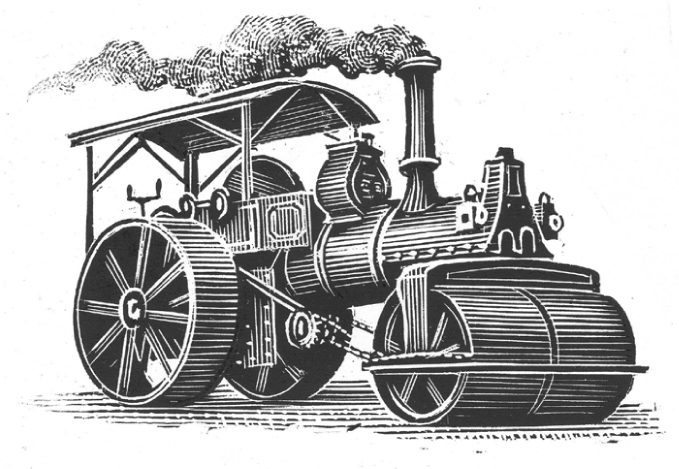

## Kapitel 15: Die Dampfwalze, bei der es spukt

Dies ist die Geschichte einer <abbr class="word" title="die Dampfwalze, die Dampfwalzen — steamroller">Dampfwalze</abbr>, bei der es <abbr class="word" title="spuken (spukte, hat gespukt) — is haunted; spooky things happen">spukt</abbr>. Sie geht so:

Die Stadt Blackbury hat verschiedene Maschinen für die Arbeit an ihren Straßen. Eine davon ist eine große dunkelrote Dampfwalze. Sie fährt mit <abbr class="word" title="der Dampf — steam">Dampf</abbr> und macht mit ihren schweren Rädern die Straßen glatt. Sie ist ein altes Modell mit vielen Knöpfen aus glänzendem gelbem <abbr class="word" title="das Messing — brass">Messing</abbr> und Rohren aus <abbr class="word" title="das Kupfer — copper">Kupfer</abbr>. Sie heißt J22. Das ist ihre Nummer aus der Fabrik.

Aber sie braucht viel <abbr class="word" title="die Kohle, die Kohlen — coal">Kohle</abbr>, und es macht viel Arbeit, sie sauber und glänzend zu halten.

Eines Tages sagt der <abbr class="word" title="der Bürgermeister, die Bürgermeister — mayor">Bürgermeister</abbr> von Blackbury: „Die alte Walze ist nicht mehr zu gebrauchen. Wir müssen sie <abbr class="word" title="verschrotten, verschrottete, hat verschrottet — scrap; break up as scrap metal">verschrotten</abbr> und eine neue kaufen, die mit Diesel fährt.“

Der Mann, der die Straßenarbeiten der Stadt plant, ist einverstanden. Dann sagt er: „Aber der alte Bert findet das bestimmt nicht gut. Er fährt J22 schon seit vielen, vielen Jahren. Schon, als ich ein kleiner Junge war.“

Das stimmt. Bert Nettle fährt die Walze seit langer Zeit. Er ist der einzige Arbeiter der Stadt, der sich die Mühe macht, J22 schön glänzend zu <abbr class="word" title="polieren, polierte, hat poliert — polish">polieren</abbr>. Bert selbst ist auch ziemlich altmodisch. Er hat einen grauen Bart, der an den Seiten herunterhängt. Er trägt eine große silberne Uhr an einer Kette und eine <abbr class="word" title="die Weste, die Westen — waistcoat; vest">Weste</abbr> aus dickem weichem Stoff.

Der Bürgermeister denkt nach. „Bert muss etwa siebzig sein. <abbr class="construction" title="Es ist Zeit, dass introduces what should happen now; the finite verb geht ends the subordinate clause.">Es ist Zeit, dass er in Rente geht.</abbr> Das ist besser für ihn. All der Rauch und das Öl sind sicher nicht gesund. Wir können ihm eine schöne goldene Uhr schenken.“

Später am Tag kommt Bert mit J22 von der Straßenarbeit zurück. Da erfährt er von dem Plan und ist entsetzt. Die anderen verstehen etwas Wichtiges nicht: Die Arbeit mit seiner alten Dampfwalze ist Berts einziges Interesse im Leben.

Er sorgt dafür, dass das Feuer in J22 nur noch schwach brennt. Dann geht er nach Hause und früh ins Bett. In seiner kleinen Küche steht die Hälfte der Regale voll mit Dosen zum Polieren und besonderem <abbr class="word" title="das Fett, die Fette — grease">Fett</abbr> für Dampfwalzen.

J22 steht in der dunklen Garage der Stadt neben den Müllwagen. Die Kirchturmuhren in ganz Blackbury schlagen Mitternacht.

Da zischt und klappert es im <abbr class="word" title="der Feuerkasten, die Feuerkästen — firebox; enclosed space for the fire">Feuerkasten</abbr>. Sehr, sehr langsam beginnt das große <abbr class="word" title="das Schwungrad, die Schwungräder — flywheel">Schwungrad</abbr> an der Seite der Maschine sich zu drehen. Dann macht J22 ein stolzes „Tschuff!“ und fährt los.

Krach! Die Dampfwalze bricht durch das Garagentor und fährt durch die leeren Straßen. Die Leute reißen erstaunt ihre Schlafzimmerfenster auf. J22 rollt vorbei, und <abbr class="word" title="der Funke, die Funken — sparks">Funken</abbr> fliegen aus ihrem <abbr class="word" title="der Schornstein, die Schornsteine — chimney; smokestack">Schornstein</abbr>.

Bert wacht auf, als die Walze laut durch die High Street fährt.

„Das ist ja eine seltsame Sache!“, denkt er und zieht schnell seine Hose an. „<abbr class="construction" title="Perfekt of stehlen: hat gestohlen means has stolen; the accusation concerns an earlier action.">Jemand hat meine Dampfwalze gestohlen!</abbr>“ Zwei Minuten später sitzt er auf dem Fahrrad und tritt kräftig in die Pedale. Er verfolgt J22, die aus der Stadt aufs Land fährt.

Bald kann er ihren Weg leicht erkennen. Die <abbr class="word" title="die Hecke, die Hecken — hedges">Hecken</abbr> und Straßenlaternen sind ganz flach. Und an einer Stelle liegt eine Telefonzelle. Nun ja: Sie ist jetzt etwa fünfzig Meter lang und nur drei Millimeter dick!

Zur Frühstückszeit ist Bert hoch oben auf Even Moor, nördlich von Blackbury. Dort gibt es viel offenes Land. Es ist schon sehr heiß, und er findet keine <abbr class="word" title="die Spur, die Spuren — tracks">Spuren</abbr> der Walze mehr. Er setzt sich gerade zum Ausruhen hin, da hält ein Polizeiauto neben ihm. Auf dem Rücksitz sitzt der Bürgermeister.

„Was ist hier bloß los?“, fragt er. „Die Polizei ist überall! Haben Sie die Walze gesehen?“

„Nein“, sagt Bert. „Aber ich glaube, sie ist in diese Richtung gefahren.“

„Dampfwalzen zu stehlen ist gefährlich“, sagt <abbr class="word" title="der Hauptinspektor, die Hauptinspektoren — chief inspector">Hauptinspektor</abbr> Jones am Steuer. „Steigen Sie ein, Bert.“

Sie fahren weiter. „Ich weiß, das klingt verrückt“, sagt der Bürgermeister. „Aber ein paar Leute haben J22 gesehen. Sie sagen, niemand hat die Walze gefahren!“

„Und noch etwas ist seltsam“, sagt Bert. „Sie hatte kaum Kohle oder Wasser dabei. Sie braucht doch Wasser für den Dampf. Das Wasser muss schon seit Stunden alle sein.“

Denken Sie daran: Das hier ist Gritshire. An anderen Orten suchen die Leute bei so etwas nach allen möglichen seltsamen Erklärungen. Aber in Gritshire, besonders in der Gegend von Blackbury, passieren jeden Tag merkwürdige Dinge. Die Leute denken dort praktischer.

„<abbr class="word" title="die Zauberei, die Zaubereien — magic">Zauberei</abbr> …“, sagt der Bürgermeister. „Ach du liebe Zeit!“

„Sie hat sicher gehört, dass die Stadt sie verschrotten will“, sagt Bert. „Darum ist sie weggelaufen. Das arme alte Mädchen.“

„Schön und gut“, sagt Hauptinspektor Jones. „Aber was passiert, wenn sie jemanden <abbr class="word" title="überfahren, überfuhr, hat überfahren — runs over">überfährt</abbr>?“ Alle denken an die Telefonzelle.

Auf dem größten Teil von Even Moor wächst kaum etwas. Der Wind bläst über das Land. Nur hier und da gibt es kleine Wälder mit krummen alten Bäumen. Nicht einmal eine kleine Dampfwalze findet dort ein Versteck.

Dann sehen sie J22 am Rand eines Wäldchens. Sie hat etwas wie einen <abbr class="word" title="der Rüssel, die Rüssel — trunk of an elephant">Rüssel</abbr>. Damit zieht sie Äste von den Bäumen und steckt sie in ihren Feuerkasten. Sie sieht genau wie ein Elefant beim Essen aus. Als sie die drei Männer entdeckt, hupt sie und fährt dampfend zwischen die Bäume.

„Meine Güte!“, sagt der Bürgermeister.

„Das Ding wie ein Rüssel ist ihr langer <abbr class="word" title="der Wasserschlauch, die Wasserschläuche — water hose">Wasserschlauch</abbr>“, erklärt Bert. „Kommen Sie!“

„Also“, sagt Hauptinspektor Jones, „nennen Sie mich ruhig einen <abbr class="word" title="der Feigling, die Feiglinge — coward">Feigling</abbr>. Aber ich möchte einer verrückten Dampfwalze nicht direkt gegenüberstehen. Wir holen besser Hilfe.“

Eine Stunde später kommt eine Nachricht aus Stoke Cangle, einem kleinen Dorf nördlich von Even Moor. Eine Dampfwalze hat die Mauer am Hof eines Kohlehändlers umgeworfen. Dann hat sie eine Tonne seiner besten Kohle gestohlen. Der Händler ist sehr wütend: Mit ihrem Schlauch hat die Walze ihn vorsichtig hochgehoben und auf sein Hausdach gesetzt.

Noch weiter nördlich finden die Männer J22 wieder. Sie saugt Wasser aus einem Teich neben der Straße.

Der Hauptinspektor hat einen großen Wagen mit einem <abbr class="word" title="der Kran, die Kräne — crane">Kran</abbr> geholt. Dazu kommen mehrere Lastwagen voller Geräte. Bert gefällt das alles gar nicht.

„Was machen wir jetzt?“, fragt er.

„Polizist Peddle versucht, eine <abbr class="word" title="die Kette, die Ketten — chain">Kette</abbr> um die hintere <abbr class="word" title="die Achse, die Achsen — axle">Achse</abbr> der Walze zu legen“, erklärt Jones. „Dann können wir sie zurück nach Blackbury ziehen.“

„Und danach machen Sie die arme alte J22 zu <abbr class="word" title="der Schrott — scrap metal">Schrott</abbr>“, sagt Bert und schüttelt den Kopf. „Daran mag ich gar nicht denken. Wir haben zusammen die Straßen von Blackbury glatt gemacht, als die Stadt kaum mehr als ein Dorf war. Ich erinnere mich an ein Weihnachten. Das war wohl 1924. Der Schnee war so tief! J22 und ich haben den <abbr class="word" title="der Bischof, die Bischöfe — bishop">Bischof</abbr> von Blackbury und den ganzen Kirchenchor herumgefahren. Sie haben dabei Weihnachtslieder gesungen.“ Bert muss sich die Nase putzen, weil ihn die Erinnerung so traurig macht.

Der Bürgermeister klopft ihm freundlich auf den Rücken. „Kopf hoch“, sagt er. „Bert, wir haben jetzt 1973. Dampfwalzen sind nicht mehr modern. Aber wir bekommen eine schöne neue Dieselwalze. Und wissen Sie was? Sie dürfen als Erster damit fahren.“

Bert sieht den Bürgermeister mit einem schlauen kleinen Lächeln an. „Es ist gefährlich, ihr einen <abbr class="word" title="der Haken, die Haken — hook">Haken</abbr> um den Knöchel zu legen. Ich meine: um die Achse. <abbr class="construction" title="The polite imperative with lassen means Let me do that; machen stays in the infinitive.">Lassen Sie mich das machen.</abbr> J22 kennt mich schließlich.“

Der Hauptinspektor ist nicht ganz sicher, aber er lässt Bert zur Walze gehen. J22 trinkt noch immer laut aus dem Teich. Als Bert näher kommt, dampft sie nervös. Er klopft ihr auf ein großes Rad. „Ruhig, Mädchen.“

Dann passiert alles ganz schnell. Bert springt auf die Walze und zieht einen großen <abbr class="word" title="der Hebel, die Hebel — lever">Hebel</abbr>. Dampf zischt in alle Richtungen. Rauch füllt die Luft, und J22 fährt donnernd die Straße hinauf. Die erstaunten Leute hören durch den Lärm nur Berts Lachen und seine Rufe:

„Zurück und in Rente gehen? Nicht mit uns!“

Natürlich fahren Dampfwalzen nicht besonders schnell. Aber man kann sie nur sehr schwer aufhalten. Hier will es sowieso niemand versuchen. Also fahren die beiden von Even Moor herunter und weiter nach Norden.

Bert merkt, dass er gar nicht <abbr class="word" title="lenken, lenkte, hat gelenkt — steer">lenken</abbr> muss. J22 findet den Weg allein, und sie fährt ausgezeichnet. Sie hält sogar genau dann an, wenn Bert absteigen will. An einem Ort kauft er ein Pfund Würstchen, an einem anderen eine Packung <abbr class="word" title="der Tabak, die Tabake — tobacco">Tabak</abbr>.

Das große Schwungrad dreht sich, die schweren Räder rollen, und Bert singt. Auf dem Feuerkasten brät er seine Würstchen. <abbr class="construction" title="An indirect question with wohin puts fahren at the end; aber connects the contrasting main clause.">Er weiß nicht, wohin sie fahren, aber er ist sehr glücklich.</abbr>

Zurück in Blackbury machen sich der Bürgermeister und der Hauptinspektor große Sorgen.

„Nach dem Gesetz hat Bert die Dampfwalze natürlich gestohlen“, sagt der Bürgermeister. „Dagegen machen wir nichts. Aber wir müssen die beiden aufhalten. Das ist besser für Bert.“

Der Hauptinspektor schaut auf die Karte. „Sie fahren noch immer nach Norden. Wo wollen sie bloß hin? Heute Nachmittag kommen sie wohl durch Dewley. Vielleicht können wir sie dort stoppen. Aber wie hält man eine Dampfwalze auf?“

„Mit einer anderen“, sagt der Bürgermeister. „In Dewley gibt es eine von diesen neuen Dieselwalzen. Die Leute dort stellen sie quer auf die Straße. Dann kommt J22 bestimmt nicht vorbei!“

Als J22 durch Dewley fährt, sieht Bert die andere Walze. Sie ist groß und grün und sieht sehr schwer aus. Dahinter stehen der Bürgermeister und viele Leute, die ziemlich besorgt aussehen.

Bert schüttelt den Kopf und zieht den <abbr class="word" title="der Bremshebel, die Bremshebel — brake lever">Bremshebel</abbr>. Aber J22 fährt einfach weiter. Erst einen Meter vor der anderen Walze hält sie zischend an.

„Also, Bert, wir haben verstanden, was Sie wollen!“, ruft der Bürgermeister. „Kommen Sie jetzt herunter. Seien Sie so nett.“

Doch J22 bewegt sich schon wieder … Boing! Mit einem lauten Krach stoßen die Walzen zusammen. J22 zittert bis hinauf zur kleinen Anzeige für ihren <abbr class="word" title="der Druck — pressure">Druck</abbr>. Der Fahrer auf der grünen Walze lacht gemein. Seine große Maschine bewegt sich offensichtlich nicht von der Stelle. Stattdessen drückt sie J22 sogar rückwärts.

Da hupt J22 dreimal lang. Die grüne Walze hält an und pfeift. Ihr Fahrer versteht das nicht, denn er hat nichts angefasst. Alle holen überrascht Luft: Die grüne Walze fährt sehr höflich rückwärts und macht Platz.

J22 hupt noch einmal und lässt ihre Maschine etwas schneller laufen. Sie prüft, ob alles in Ordnung ist. Dann rollt sie weiter. Der Bürgermeister muss schnell zur Seite springen.

Bald fährt J22 mit lautem Donnern die Straße entlang. Eine ganze Menge wütender Menschen läuft hinter ihr her. Bert versteht das alles kaum. Hat J22 die andere Walze einfach gebeten, aus dem Weg zu gehen?

Selbst mit voller Geschwindigkeit ist J22 nicht sehr schnell. Darum kommen die Leute hinter ihr immer näher. Sie fährt auf zwei große eiserne Tore zu. Die Tore stehen in einer Mauer auf der anderen Seite der Stadt. Zum Glück sind sie offen, denn J22 fährt einfach hindurch. Ein breiter Weg mit kleinen Steinen führt zu einem riesigen Landhaus.

Rund um das Haus stehen steinerne Schuppen. Und vor diesen Schuppen stehen – Dampfwalzen!

Es sind Dutzende. Da gibt es große rote Walzen und andere Dampfmaschinen auf Rädern in allen Farben. Manche ziehen schwere Wagen. Andere haben glänzende Dächer und blanke kleine Dinger aus Messing. Alle machen Dampf. Die ganze Luft riecht nach heißem Öl.

J22 hält an. Ein großer dünner Mann in einem sehr teuren Anzug eilt über den Hof zu ihr. Er setzt seine Brille auf und schaut sich die Walze aufgeregt an. Bert beachtet er gar nicht.

„Also wirklich!“, sagt er. „Das ist doch eine J-Modell-Walze mit zwei <abbr class="word" title="der Zylinder, die Zylinder — cylinders in an engine">Zylindern</abbr> und einem <abbr class="word" title="der Kessel, die Kessel — boiler">Kessel</abbr> aus Messing! Aus der alten Fabrik Snobbut and Munchapple!“

„Ja, genau“, sagt Bert. Er ist erstaunt: Dieser Mann weiß sehr viel über Dampfwalzen! Der große Mann schüttelt ihm herzlich die Hand.

„Ich bin Lord Hugh von Dewley“, sagt er. „Und das ist mein neues <abbr class="word" title="das Dampfmaschinenmuseum, die Dampfmaschinenmuseen — steam engine museum">Dampfmaschinenmuseum</abbr>. Morgen öffnen wir für Besucher. Genau diese Maschine fehlt noch in meiner <abbr class="word" title="die Sammlung, die Sammlungen — collection">Sammlung</abbr>. Und sie ist in ausgezeichnetem Zustand! Wie viel wollen Sie dafür haben?“

„Also, ich …“, beginnt Bert. Doch jetzt erreichen auch der Bürgermeister und alle anderen den Hof. Sie fangen sofort an, alle gleichzeitig zu reden.

Lord Hugh nimmt sie mit ins Haus. Dort gibt es ein großes Essen zum Tee, mit Erdbeeren und Sahne. Danach hält der Bürgermeister einen <abbr class="word" title="der Scheck, die Schecks — cheque; check">Scheck</abbr> über ziemlich viel Geld in der Hand. Es reicht auf jeden Fall für eine neue Dieselwalze für Blackbury. J22 fährt in Lord Hughs Werkstatt. Dort machen die Leute sie noch einmal gründlich sauber.

„Das Problem ist“, sagt Lord Hugh, „heute verstehen nicht mehr genug Leute wirklich etwas von Dampfwalzen. <abbr class="construction" title="Present tense with seit describes a search that began earlier and is still continuing: I have been looking for a workshop chief for months.">Ich suche schon seit Monaten einen Chef für meine Werkstatt.</abbr>“

„Na ja, also …“, beginnt Bert <abbr class="word" title="bescheiden — modestly; without boasting">bescheiden</abbr>. Und sehr bald – Sie haben es sicher schon erraten – bekommt er eine Uniform und die Stelle. Nun kümmert er sich als Chef um die Maschinen.

Alle anderen fahren zufrieden nach Hause. Ein bisschen wundern sie sich noch immer. Aber Bert schaut vor dem Schlafengehen noch einmal nach J22.

Die alte Dampfwalze steht mit vielen anderen in einem großen Schuppen. Hier scheint sie ganz zu Hause zu sein.

Also sagt Bert nur: „Gute Nacht.“ <abbr class="construction" title="The separable verb zumachen splits into macht and zu: Then he closes the door.">Dann macht er die Tür zu.</abbr>

### Words in this chapter

- **die Dampfwalze, die Dampfwalzen** — steamroller
- **spuken (spukte, hat gespukt)** — is haunted; spooky things happen
- **der Dampf** — steam
- **das Messing** — brass
- **das Kupfer** — copper
- **die Kohle, die Kohlen** — coal
- **der Bürgermeister, die Bürgermeister** — mayor
- **verschrotten, verschrottete, hat verschrottet** — scrap; break up as scrap metal
- **polieren, polierte, hat poliert** — polish
- **die Weste, die Westen** — waistcoat; vest
- **das Fett, die Fette** — grease
- **der Feuerkasten, die Feuerkästen** — firebox; enclosed space for the fire
- **das Schwungrad, die Schwungräder** — flywheel
- **der Funke, die Funken** — sparks
- **der Schornstein, die Schornsteine** — chimney; smokestack
- **die Hecke, die Hecken** — hedges
- **die Spur, die Spuren** — tracks
- **der Hauptinspektor, die Hauptinspektoren** — chief inspector
- **die Zauberei, die Zaubereien** — magic
- **überfahren, überfuhr, hat überfahren** — runs over
- **der Rüssel, die Rüssel** — trunk of an elephant
- **der Wasserschlauch, die Wasserschläuche** — water hose
- **der Feigling, die Feiglinge** — coward
- **der Kran, die Kräne** — crane
- **die Kette, die Ketten** — chain
- **die Achse, die Achsen** — axle
- **der Schrott** — scrap metal
- **der Bischof, die Bischöfe** — bishop
- **der Haken, die Haken** — hook
- **der Hebel, die Hebel** — lever
- **lenken, lenkte, hat gelenkt** — steer
- **der Tabak, die Tabake** — tobacco
- **der Bremshebel, die Bremshebel** — brake lever
- **der Druck** — pressure
- **der Zylinder, die Zylinder** — cylinders in an engine
- **der Kessel, die Kessel** — boiler
- **das Dampfmaschinenmuseum, die Dampfmaschinenmuseen** — steam engine museum
- **die Sammlung, die Sammlungen** — collection
- **der Scheck, die Schecks** — cheque; check
- **bescheiden** — modestly; without boasting

### Constructions and sentences
- **“Es ist Zeit, dass er in Rente geht.”** — “It is time for him to retire.” The dass-clause states what should happen, with geht at its end; in Rente gehen is the ordinary expression for retiring.

- **“Jemand hat meine Dampfwalze gestohlen!”** — “Someone has stolen my steamroller!” The Perfekt of stehlen uses hat and the irregular participle gestohlen.

- **“Steigen Sie ein, Bert.”** — “Get in, Bert.” The polite imperative keeps Sie and separates ein from einsteigen.

- **“Lassen Sie mich das machen.”** — “Let me do that.” The polite imperative lassen takes an object, mich, and another infinitive, machen.

- **“Er weiß nicht, wohin sie fahren, aber er ist sehr glücklich.”** — “He does not know where they are going, but he is very happy.” Wohin introduces an indirect question about a destination; fahren comes at its end.

- **“Die grüne Walze fährt sehr höflich rückwärts und macht Platz.”** — “The green roller backs away very politely and makes room.” Platz machen is a fixed expression for making room or clearing the way.

- **“Ich suche schon seit Monaten einen Chef für meine Werkstatt.”** — “I have been looking for a chief for my workshop for months.” German uses the present with seit when the situation began earlier and still continues.

- **“Dann macht er die Tür zu.”** — “Then he closes the door.” Zumachen is separable: macht … zu.

---

[← Previous](kapitel-14.md) · [Contents](README.md) · [Next →](kapitel-16.md)
