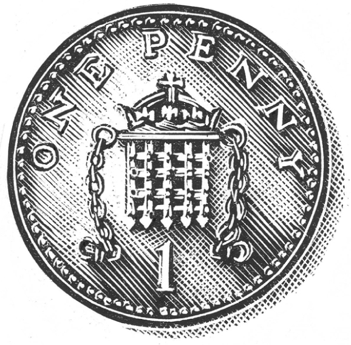

## Kapitel 16: Der Geldbaum

Die Frau von Mr Rupert Wrist wollte einen Fernseher.

Für Mr Wrist war das ein kleines Problem. Er arbeitete in einer Fabrik für <abbr class="word" title="die Streichholzschachtel, -n — matchbox">Streichholzschachteln</abbr>. Dort half er, Witze für die kleinen Schilder auf den Schachteln zu schreiben. Glauben Sie mir: So eine Arbeit ist interessant, aber man verdient dabei nicht viel.

„Ich habe es satt“, sagte seine Frau. „Immer muss ich zu Mrs Jones weiter unten in der Straße gehen, wenn etwas Gutes im Fernsehen kommt.“

Eines Tages sah Mr Wrist eine kleine Anzeige in der Zeitung. Da stand:

**Verdienen Sie Geld in Ihrer Freizeit!**

**Ja, Sie können £££ verdienen – mit nur wenigen Stunden Arbeit pro Woche!**

**Schicken Sie eine Postanweisung über £1. Dann erfahren Sie mehr.**

Eine <abbr class="word" title="die Postanweisung, -en — postal money order">Postanweisung</abbr> war eine Möglichkeit, Geld mit der Post zu schicken. Mr Wrist kam sich dabei etwas dumm vor. Trotzdem schickte er das eine Pfund und vergaß die Sache wieder. Etwa eine Woche später kam ein sehr kleines Paket. Darin lag ein einziger <abbr class="word" title="der Samen, - — seed">Samen</abbr>. Auf einem Schild stand: „An einem feuchten Ort pflanzen.“

„Du hast dein Geld verschwendet“, sagte Mrs Wrist, als er ihr davon erzählte.

Rupert Wrist schüttelte den Kopf. „In der Zeitung stand, man kann mit wenigen Stunden Arbeit £££ verdienen. Also muss es wahr sein. Ich habe den Samen jedenfalls neben den <abbr class="word" title="der Komposthaufen, - — compost heap">Komposthaufen</abbr> gepflanzt.“

„Hoffentlich wird daraus nicht so eine riesige <abbr class="word" title="menschenfressend — man-eating">menschenfressende</abbr> Bohnenpflanze“, sagte Mrs Wrist. „Wie in dem Horrorfilm, den wir gesehen haben.“ Damit war das Gespräch zu Ende.

Mehrere Tage lang ging Mr Wrist gleich nach der Arbeit zu der Stelle. Aber dort wuchs nichts außer <abbr class="word" title="das Unkraut — weeds">Unkraut</abbr>. Bald hatte er genug davon.

An einem warmen Abend ging er zwischen seinen Kohlpflanzen spazieren. Er sah dem Sonnenuntergang zu. Da hörte er ein leises <abbr class="word" title="das Rascheln — rustling sound">Rascheln</abbr>.

Aus dem Samen wuchs jetzt eine Pflanze. Ein dünner grüner <abbr class="word" title="der Stängel, - — plant stem">Stängel</abbr> bewegte sich über dem Unkraut. Vor Mr Wrists Augen öffnete sich ein weiteres dünnes Blatt. Die Pflanze wuchs noch mindestens zweieinhalb Zentimeter.

„Rita, komm mal her und sieh dir das an!“, rief er seiner Frau zu.

<abbr class="construction" title="Als introduces a single event in the past; the verb comes last in its clause.">Als Rita kam, war die Pflanze schon fast einen Meter hoch.</abbr> Neue Blätter kamen in alle Richtungen heraus. Im ganzen Garten hörte man ein seltsames <abbr class="word" title="das Knistern — crackling">Knistern</abbr>. Es klang wie Schritte durch dünnes Seidenpapier.

„Mir gefällt das nicht“, sagte Mrs Wrist und zitterte. „Die sieht richtig böse aus. Gleich kriecht sie noch durch London und reißt Big Ben ein. Genau wie das Ding im Film.“

Rupert Wrist zündete seine <abbr class="word" title="die Pfeife, -n — smoking pipe">Pfeife</abbr> an. „Ich möchte wissen, wie wir damit Geld verdienen können. Bei der Arbeit kenne ich einen Mann. Sein Bruder verdient etwas Geld mit Pilzen im Keller. Vielleicht sind es auch Blumen. Wir könnten die Blumen abschneiden und verkaufen. Aber die Pflanze sieht eher wie ein Busch aus.“

Der Stängel war inzwischen gut drei Meter hoch. Jetzt wuchs er nicht mehr nach oben. Stattdessen kamen oben <abbr class="word" title="der Ast, Äste — tree branches">Äste</abbr> heraus. Sie wurden immer länger und breiter vor dem dunklen Himmel. Schließlich standen die Wrists unter einem großen Baum.

„Vielleicht Äpfel“, dachte Mr Wrist. „Oder Birnen. Oder sogar Pfirsiche.“

„Wenn wir morgen tot in unseren Betten aufwachen, ist es nicht meine Schuld“, sagte Rita.

Die beiden schliefen in dieser Nacht kaum. Sie lagen im Bett und starrten ins Dunkel. Im Garten knisterte und knackte es leise. Schließlich hielt Rupert es nicht mehr aus. Er sprang aus dem Bett und öffnete das Fenster.

Der Baum hatte jetzt Blüten. Riesige Blüten mit vielen feinen Teilen glänzten im Mondlicht. Sie waren wunderschön.

„Also doch Blumen zum Verkaufen“, dachte er. „Sie sehen wirklich schön aus. Vielleicht kauft ein Blumenhändler sie mir ab.“

Die Blüten hatten einen Duft, der das ganze Zimmer füllte. Mr Wrist legte sich wieder hin und schlief ein. Kurz davor dachte er noch: „Komisch. So sollten Blumen eigentlich nicht riechen. Es riecht ein bisschen wie … äh … wie in einer Bank.“

Am Morgen <abbr class="word" title="klimpern, klimperte, hat geklimpert — jingled, like coins">klimperte</abbr> der Baum im Wind. Die Äste bogen sich unter dem Gewicht seiner Früchte. Die meisten Blüten waren fort. Mr Wrist ging im <abbr class="word" title="der Morgenmantel, -mäntel — dressing gown">Morgenmantel</abbr> hinaus, um den Baum anzusehen.

Etwas traf ihn am Kopf. Dann kam noch ein Windstoß. Überall fielen Früchte herunter. Nur waren es eigentlich gar keine Früchte.

„Das ist Geld! Ich glaube es nicht!“, sagte Rupert und ließ sich vor Überraschung auf den Boden sinken.

Immer mehr <abbr class="word" title="die Münze, -n — coins">Münzen</abbr> fielen von den Ästen. Meistens waren es Stücke zu einem oder zwei Pence. Aber am Baum hingen auch mehrere 50-Pence-Stücke. Die waren fast <abbr class="word" title="reif — ripe">reif</abbr>.

Rupert ging auf unsicheren Beinen in die Küche. Er zog seine Frau zur Tür. „<abbr class="construction" title="Wenn introduces a condition; the verb moves to the end.">Du glaubst mir nicht, wenn ich es dir nur erzähle.</abbr> Komm und sieh selbst!“

Die beiden standen da und sahen voller Staunen nach oben. Das Geld lag ihnen bis an die Knöchel. Die meisten Münzen waren aus <abbr class="word" title="das Kupfer — copper">Kupfer</abbr>. <abbr class="construction" title="Obwohl introduces a concession: the spots do not prevent a good harvest.">Obwohl einige Münzen kleine Flecken hatten</abbr>, war es eine gute <abbr class="word" title="die Ernte, -n — harvest; here, a crop of money">Ernte</abbr>.

An diesem Tag ging Mr Wrist nicht zur Arbeit. Er zählte Geld. Schon waren zwanzig Pfund und dreizehn Pence reif. Am nächsten Morgen klimperten weitere fünfundzwanzig Pfund an den Ästen.

„Schade, dass nicht mehr Silber dabei ist“, sagte Rita. „Es macht keinen Spaß, das ganze schwere Geld zur Bank zu schleppen.“

„Hm. Ich habe an große Kürbisse gedacht“, sagte Mr Wrist. Diesmal zündete er eine <abbr class="word" title="die Zigarre, -n — cigar">Zigarre</abbr> an.

„Kürbisse? Was ist mit denen?“

„Wenn man größere Kürbisse will, muss man die Pflanze füttern. Mit <abbr class="word" title="der Dünger, - — fertilizer">Dünger</abbr> und … äh … <abbr class="word" title="der Mist — animal manure">Mist</abbr> und solchen Sachen. Sollen wir es versuchen?“

Er kaufte eine Flasche Gianto Wonder Plant Food. Das war Nahrung für Pflanzen. <abbr class="construction" title="Damit introduces a purpose involving a different subject; wurden is the past of werden.">Er goss sie um den Baum, damit die Münzen größer wurden.</abbr>

Am nächsten Morgen gab es ziemlich viele 5-Pence-Stücke. Außerdem hing am Baum eine große <abbr class="word" title="die Knospe, -n — flower bud">Knospe</abbr>. Langsam öffnete sie sich. Darin lag ein Ein-Pfund-Schein. Er war noch ganz zerknittert und etwas feucht.

„Wir sind auf dem richtigen Weg“, sagte Mr Wrist. „Aber wenn man ehrlich ist: Es ist doch recht mühsam, all diese 5-Pence-Stücke aufzusammeln.“

An diesem Abend schüttete er zwei Flaschen Gianto um den Baum. Dazu kam eine ganze <abbr class="word" title="die Schubkarre, -n — wheelbarrow">Schubkarre</abbr> voll Pferdemist.

Am nächsten Tag bestand die Ernte vor allem aus 50-Pence-Stücken. Allerdings sahen einige davon etwas schwach und kümmerlich aus. Es gab auch mehrere Ein-Pfund-Scheine mit kleinen Flecken.

„Ich würde es jetzt dabei lassen“, warnte Rita. „<abbr class="construction" title="Könnte is present Konjunktiv II of können and expresses a possible risk.">Zu viel Futter könnte dem Baum schaden.</abbr>“

„Ich verlange doch nicht viel“, sagte Rupert. „Ich möchte nur einmal Fünf-Pfund-Scheine ernten. Nur einmal! Danach kann er meinetwegen wieder Ein-Penny-Stücke tragen.“

Er nahm eine alte Blechbadewanne als Schüssel. Darin mischte er siebenundzwanzig verschiedene Sorten Pflanzennahrung zusammen.

„So“, dachte er beim Zubettgehen. „Das müsste reichen.“

Die ganze Nacht schüttelte und bewegte sich der Geldbaum. Er zitterte.

Am Morgen stand dort nur noch ein <abbr class="word" title="vertrocknet — withered; dried up">vertrockneter</abbr> <abbr class="word" title="der Stumpf, Stümpfe — stump">Stumpf</abbr> mit einem schwarzen Ast. An diesem Ast hing ein ziemlich schlechter, matter Penny.

Die Wrists sahen ihn traurig an. Er fiel herunter.

„Damit ist der Traum vom Millionär vorbei“, sagte Mr Wrist. „Ob ich wohl meine alte Arbeit noch bekommen kann?“

Er schrieb an die Leute mit der Anzeige. Sie schickten einen ziemlich <abbr class="word" title="spöttisch — mocking; sarcastic">spöttischen</abbr> Brief zurück. Sie erklärten: „Wir haben Ihnen nur ein Set für Pilze geschickt. Sonst nichts. <abbr class="construction" title="Present hypothetical: könnten describes an imagined ability; würden plus verkaufen gives its consequence.">Wenn wir Geld wachsen lassen könnten, würden wir doch keine Pilz-Sets verkaufen.</abbr> Damit würden wir nur unsere Zeit verschwenden, oder?“

Es war gerade genug Geld für einen Fernseher übrig. Also kauften sie einen. Und Mr Wrist pflanzte den letzten Penny ein.

Etwa eine Woche später band er schlecht gelaunt seine Gartenblumen an Stöcken fest. Da sah er, wie aus dem Penny eine Pflanze wuchs. Sie war klein und reichte nur bis an sein Knie. Sie bekam ein paar Blüten wie <abbr class="word" title="das Gänseblümchen, - — daisies">Gänseblümchen</abbr>. Die dufteten süß und blühten einige Stunden lang. Dann trocknete die ganze Pflanze aus und schrumpfte zusammen.

Mr Wrist <abbr class="word" title="seufzen, seufzte, hat geseufzt — sighed">seufzte</abbr>. Dann ging er den Rasen mähen. <abbr class="construction" title="Das Beste is a noun formed from the superlative; was introduces a short relative clause.">Das schien ihm das Beste zu sein, was er jetzt tun konnte.</abbr>

### Words in this chapter

- **die Streichholzschachtel, -n** — matchbox
- **die Postanweisung, -en** — postal money order
- **der Samen, -** — seed
- **der Komposthaufen, -** — compost heap
- **menschenfressend** — man-eating
- **das Unkraut** — weeds
- **das Rascheln** — rustling sound
- **der Stängel, -** — plant stem
- **das Knistern** — crackling
- **die Pfeife, -n** — smoking pipe
- **der Ast, Äste** — tree branches
- **klimpern, klimperte, hat geklimpert** — jingled, like coins
- **der Morgenmantel, -mäntel** — dressing gown
- **die Münze, -n** — coins
- **reif** — ripe
- **das Kupfer** — copper
- **die Ernte, -n** — harvest; here, a crop of money
- **die Zigarre, -n** — cigar
- **der Dünger, -** — fertilizer
- **der Mist** — animal manure
- **die Knospe, -n** — flower bud
- **die Schubkarre, -n** — wheelbarrow
- **vertrocknet** — withered; dried up
- **der Stumpf, Stümpfe** — stump
- **spöttisch** — mocking; sarcastic
- **das Gänseblümchen, -** — daisies
- **seufzen, seufzte, hat geseufzt** — sighed

### Constructions and sentences
- **“Als Rita kam, war die Pflanze schon fast einen Meter hoch.”** — “When Rita arrived, the plant was already almost a metre tall.” *Als* introduces a single past event; *kam* and *war* are familiar Präteritum forms.

- **“Du glaubst mir nicht, wenn ich es dir nur erzähle.”** — “You won’t believe me if I only tell you about it.” In the *wenn* clause, the finite verb goes last.

- **“Obwohl einige Münzen kleine Flecken hatten, war es eine gute Ernte.”** — “Although some coins were a little speckled, it was a good harvest.” *Obwohl* introduces a concession; the main-clause verb follows immediately after that clause.

- **“Er goss sie um den Baum, damit die Münzen größer wurden.”** — “He poured it around the tree so that the coins would get bigger.” *Damit* expresses purpose with a separate subject; *goss* is the past of *gießen*.

- **“Zu viel Futter könnte dem Baum schaden.”** — “Too much food could harm the tree.” *Könnte* expresses a possible risk, not a certain result.

- **“Wenn wir Geld wachsen lassen könnten, würden wir doch keine Pilz-Sets verkaufen.”** — “If we could grow money, we certainly wouldn’t sell mushroom kits.” Könnten and würden … verkaufen express a present hypothetical condition and consequence.

- **“Das schien ihm das Beste zu sein, was er jetzt tun konnte.”** — “That seemed to him to be the best thing he could do now.” *Schien* is the past of *scheinen*; *was* refers back to *das Beste*.

---

[← Previous](kapitel-15.md) · [Contents](README.md) · [Next →](kapitel-17.md)
