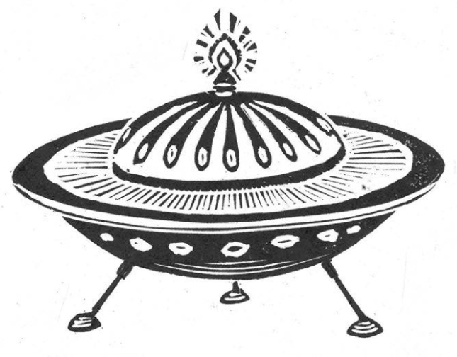

## Kapitel 17: Das Ding von Blackbury

Es war sehr spät in der Nacht. Der Polizist Ronald Biddle von der Polizei in Gritshire ging durch Blackbury. Die Straßen waren still und voller Nebel. Da hörte er ein seltsames Pfeifen.

„Na, na, na, was ist denn hier los?“, dachte er. Er sah in den kalten Nachthimmel. Zwischen den Sternen leuchtete ein roter Punkt. Er wurde größer.

„Feuerwerk“, dachte Biddle. „Komisch. Wir haben doch erst Januar.“

Das Pfeifen wurde lauter. Bald klang es wie das Schreien eines Düsenflugzeugs.

„Andererseits könnte es ein Flugzeug sein“, dachte er.

Jetzt sah er Flammen um den Punkt. Der flog sehr schnell auf Grumble’s Wood zu. Der Wald lag gleich außerhalb der Stadt.

„Oder eine Rakete. Oder ein Ballon“, dachte Biddle.

**KRAWUMM!**

Hunde bellten. Überall in Blackbury fiel Staub von den Brettern über den Kaminen. Mehrere <abbr class="word" title="die Fledermaus, -mäuse — bats">Fledermäuse</abbr> fielen aus einem Glockenturm. Und die Uhr am Rathaus schlug siebzehnmal.

Über Grumble’s Wood leuchtete es hell. Schon wenige Minuten später fuhr Biddle mit dem Fahrrad durch die dunklen kleinen Straßen zum Wald. Er trat so schnell er konnte in die Pedale. Um ihn herum flogen Blätter und <abbr class="word" title="der Splitter, - — splinters">Splitter</abbr> wie Hagel durch die Luft.

<abbr class="construction" title="Als marks a single past event; ankam is the past of the separable verb ankommen.">Als er ankam, war vom größten Teil des Waldes nur ein riesiges Loch übrig.</abbr> Rauch und Dampf füllten es. Unten im Loch war …

Biddle <abbr class="word" title="kneifen, kniff, hat gekniffen — narrowed; here, screwed up his eyes">kniff</abbr> die Augen zusammen und sah durch den Rauch. Am Boden des <abbr class="word" title="der Krater, - — crater">Kraters</abbr> lag ein großes, glühendes Ding. Er starrte es an.

Hinter ihm hörte er plötzlich das Geräusch eines Verbrechens: Jemand <abbr class="word" title="stehlen, stahl, hat gestohlen — stole">stahl</abbr> ganz heimlich ein offizielles Polizeifahrrad. Sein Polizeifahrrad!

„He!“, brüllte er und drehte sich um.

Aber der geheimnisvolle Dieb war schon auf dem Weg nach Blackbury.

Am nächsten Morgen sah es bei Grumble’s Wood ganz anders aus. Zunächst einmal schneite es. Mehrere Polizeiautos standen dort. Auch ein Land Rover von der Universität Blackbury war gekommen. Um das Loch herum herrschte große Aufregung.

„Was es auch war: <abbr class="word" title="der Astronom, -en — astronomers; scientists who study space">Astronomen</abbr> auf der ganzen Welt haben es gesehen“, sagte Dr Jasper Blot.

„Komisch“, sagte <abbr class="word" title="der Hauptinspektor, -en — chief inspector">Hauptinspektor</abbr> William Jones. „Es ist den ganzen weiten Weg gekommen, nur um auf den alten Wald zu fallen. Äh, was machen Sie eigentlich an der Universität, Doktor?“

„Ich unterrichte Stricken und Haushaltsführung. Alle Leute aus den Naturwissenschaften sind verreist. Deshalb haben sie mich geschickt. Warum, weiß ich auch nicht.“

Das Ding im Loch war nämlich immer noch rot vor Hitze. Auf seiner Oberfläche sah man einige ziemlich seltsame Zeichen.

„Haben Sie letzte Woche im Odeon *The Ghastly Thing From Dr Death’s Horror Plane* gesehen?“, fragte Jones. „Da kam so ein Ding aus einem <abbr class="word" title="das Raumschiff, -e — spaceship">Raumschiff</abbr>. Und es fraß … Na ja, jedenfalls fing der Film genau so an. Heute Abend schließe ich lieber mein Gewächshaus ab. Glauben Sie, dass hier etwas herausgekommen ist und Biddles Fahrrad gestohlen hat?“

<abbr class="construction" title="Bevor means before; the infinitive and past modal stand at the end of its clause.">Bevor Dr Blot antworten konnte, summte das Funkgerät in Jones’ Polizeiauto.</abbr> Jones schaltete es ein.

„Wir haben etwas sehr Seltsames auf der East Slate Road gefunden“, sagte eine Stimme. „Etwas ist in einen Obst- und Gemüseladen eingebrochen. Sie sollten sich das besser ansehen, Sir.“

Jemand hatte das Fenster des Ladens zerschlagen und dreiundzwanzig Kohlköpfe gestohlen. Aber das war noch nicht das Seltsamste. Im Schnee vor dem Laden war ein einziger sehr großer, langer <abbr class="word" title="der Fußabdruck, -abdrücke — footprint">Fußabdruck</abbr>. Ein paar Meter weiter lag der nächste. Noch weiter der dritte.

„Oje“, sagte Hauptinspektor Jones. „Oje, oje, oje.“

Den ganzen Tag liefen Polizisten hinter den riesigen Fußabdrücken her. Schließlich verloren sie die Spur in den Büschen auf Blackbury Common, dem offenen Land bei der Stadt.

Am nächsten Tag standen große <abbr class="word" title="die Schlagzeile, -n — newspaper headlines">Schlagzeilen</abbr> in den Morgenzeitungen:

**BLACKBURY: SCHOCK UND HORROR AUS DEM WELTALL!**

Am Freitag brachte sogar die *Blackbury Gazette, Journal and Weekly Post* eine Schlagzeile. Sie stand auf der ersten Seite zwischen den Anzeigen für <abbr class="word" title="die Versteigerung, -en — auctions">Versteigerungen</abbr>:

**Seltsames Rätsel um riesige Fußabdrücke beschäftigt die Polizei.**

Mehr Aufregung erlaubte sich diese Zeitung eigentlich nie. Sie stellte sich so vor: „Gegründet 1867. Die erste Adresse für Werbung in North Gritshire. Preise auf Anfr.“

Bei der Polizei klingelte jetzt ständig das Telefon. Die Anrufer erzählten von seltsamen grünen Männern in den Straßen. Oder von violetten Männern. Oder von großen blauen Spinnen.

Jones dachte: „<abbr class="construction" title="Könnte expresses a hypothetical ability or inability in the present.">Eine große blaue Spinne könnte die Pedale gar nicht treten.</abbr> Also hat keine Spinne Biddles Fahrrad gestohlen.“

Dann musste ein Polizeiauto zu Mrs Edna Bucket fahren. „Ein riesiges haariges <abbr class="word" title="das Monster, - — monster">Monster</abbr> hat mich erschreckt“, sagte sie.

„Ich hängte gerade die Wäsche auf“, erzählte sie. „Da sprang es über den Zaun!“

Der Hauptinspektor holte Dr Blot dazu. „Jetzt haben wir zum ersten Mal eine genaue Beschreibung von dem Ding“, sagte er. „Es ist groß und haarig. Es hat lange Ohren und ein einziges Bein. Und einen Schwanz.“

„Und es muss Kohl fressen“, sagte Dr Blot.

„Laut Mrs Bucket kann es sogar über eine Wäscheleine springen“, sagte Jones. „Vielleicht kommt es von einem Planeten mit wenig <abbr class="word" title="die Schwerkraft — gravity">Schwerkraft</abbr>. Dann kann man dort leicht hoch springen. Und wahrscheinlich wächst dort sehr viel Kohl.“

In dieser Nacht sprang etwas Großes und Haariges eine dunkle Straße entlang. Es stieß gegen den Helm eines Polizisten. Der Helm rutschte dem Mann über die Augen.

Am nächsten Tag kam die Armee. Viele Fachleute vom Verteidigungsministerium untersuchten das geheimnisvolle Ding in Grumble’s Wood. Sie stocherten daran herum. Viele Reporter kamen aus London.

An diesem Nachmittag fand Biddle sein Fahrrad wieder. Es lehnte an einem Zaun in seinem Polizeibezirk. Jemand pumpte gerade den Reifen auf.

„Na, was haben wir denn da?“, sagte Biddle mit seiner richtigen Polizeistimme. „Soapy Fred, wenn ich mich nicht irre.“

Soapy Fred war ein bekannter <abbr class="word" title="der Wilderer, - — poacher; someone who hunts illegally">Wilderer</abbr> aus Blackbury. Er richtete sich auf. Als er den Blick in Biddles Augen sah, nickte er.

„Na gut, Ron. Ich habe es geklaut“, sagte er. „Ich wollte nur schnell aus dem Wald weg.“

„Aus Grumble’s Wood? Was hast du denn da gemacht?“

„<abbr class="word" title="der Fasan, -e — pheasants">Fasane</abbr> beobachtet, sozusagen. Und dann landete dieses Ding keine hundert Meter von mir entfernt.“

Biddle kratzte sich langsam am Kinn. „Aber was ist dann dieses Ding, das der ganzen Stadt Angst macht?“

Die Soldaten gingen schon durch Blackbury. Im Schnee fanden sie weitere riesige Fußabdrücke. Wieder führte die Spur zu den dichten Büschen auf Blackbury Common. Bald standen rund um die Büsche <abbr class="word" title="der Panzer, - — tanks; armoured military vehicles">Panzer</abbr> und große Kanonen.

Etwa zur gleichen Zeit war eine sehr besorgte Frau in East Slate. Das Dorf lag zehn Meilen entfernt. <abbr class="construction" title="Um … zu expresses purpose when the same person performs both actions.">Sie ging zur kleinen Polizeistation, um ein Tier als vermisst zu melden.</abbr>

„Ich leite das Altersheim für kranke Tiere aus Tiershows in Grubbs Lane“, sagte sie. „Eines unserer Tiere ist weggelaufen. Ich kann es nirgends finden.“

„Und um was für ein Tier handelt es sich denn dabei?“, fragte der Polizist. Er leckte die Spitze seines Bleistifts an.

„Der große Knall neulich bei Blackbury muss ihn erschreckt haben“, sagte die Frau weiter. „Er sprang einfach über die Mauer. Es ist ein <abbr class="word" title="das Känguru, -s — kangaroo">Känguru</abbr>. Es heißt Babo. Aber das arme Tier hat nur ein Bein. Als es noch ganz klein war, hatte es einen Unfall …“

Der Polizist dachte kurz nach. „Entschuldigen Sie, Madam. Ich glaube, ich sollte lieber einmal telefonieren.“

Etwa eine Stunde später kam die Frau aus den Büschen auf Blackbury Common. Sie führte ein ziemlich kleines, trauriges Känguru mit sich. <abbr class="construction" title="Ohne … zu means without doing something; einander means each other.">Sehr leise gingen alle anderen nach Hause, ohne einander anzusehen.</abbr>

Spät in dieser Nacht kletterte oben in Grumble’s Wood ein großes Ding aus einem Baum. Es hatte violette Haut, drei Augen und <abbr class="word" title="der Tentakel, - — tentacles">Tentakel</abbr>. Die letzten paar Tage hatte es dort oben verbracht. Jetzt bewegte es sich vorsichtig zu der Kugel im Krater hinüber. Es drückte auf ein paar Beulen an der Außenseite. <abbr class="construction" title="Aufging is the past of the separable verb aufgehen; als places the event in the past.">Als die versteckte Tür aufging, kletterte es hinein.</abbr>

„Hierher komme ich nicht noch einmal in den Urlaub“, dachte es. „Diese Menschen sind verrückt.“

Ein paar Minuten später hörte man einen Motor starten. Gerade als die Sonne aufging, stieg das kleine runde Raumschiff aus Grumble’s Wood auf. Sehr bald verschwand es in den Wolken.

### Words in this chapter

- **die Fledermaus, -mäuse** — bats
- **der Splitter, -** — splinters
- **kneifen, kniff, hat gekniffen** — narrowed; here, screwed up his eyes
- **der Krater, -** — crater
- **stehlen, stahl, hat gestohlen** — stole
- **der Astronom, -en** — astronomers; scientists who study space
- **der Hauptinspektor, -en** — chief inspector
- **das Raumschiff, -e** — spaceship
- **der Fußabdruck, -abdrücke** — footprint
- **die Schlagzeile, -n** — newspaper headlines
- **die Versteigerung, -en** — auctions
- **das Monster, -** — monster
- **die Schwerkraft** — gravity
- **der Wilderer, -** — poacher; someone who hunts illegally
- **der Fasan, -e** — pheasants
- **der Panzer, -** — tanks; armoured military vehicles
- **das Känguru, -s** — kangaroo
- **der Tentakel, -** — tentacles

### Constructions and sentences
- **“Als er ankam, war vom größten Teil des Waldes nur ein riesiges Loch übrig.”** — “When he arrived, only a huge hole remained of most of the wood.” *Als* introduces one past event; *ankam* is the Präteritum of *ankommen*.

- **“Bevor Dr Blot antworten konnte, summte das Funkgerät in Jones’ Polizeiauto.”** — “Before Dr Blot could answer, the radio in Jones’s police car buzzed.” *Bevor* introduces a time clause; *antworten konnte* puts the infinitive before the modal at the end.

- **“Eine große blaue Spinne könnte die Pedale gar nicht treten.”** — “A big blue spider couldn’t possibly turn the pedals.” *Könnte* describes hypothetical ability; *gar nicht* strengthens the negative.

- **“Sie ging zur kleinen Polizeistation, um ein Tier als vermisst zu melden.”** — “She went to the small police station to report a missing animal.” *Um … zu* gives the purpose of her own action.

- **“Sehr leise gingen alle anderen nach Hause, ohne einander anzusehen.”** — “Very quietly, everyone else went home without looking at each other.” *Ohne … zu* describes something they did not do; *anzusehen* places *zu* inside a separable verb.

- **“Als die versteckte Tür aufging, kletterte es hinein.”** — “When the hidden door opened, it climbed in.” *Aufging* is the past of *aufgehen*; the main clause starts with its verb after the time clause.

---

[← Previous](kapitel-16.md) · [Contents](README.md) · [Next →](kapitel-18.md)
