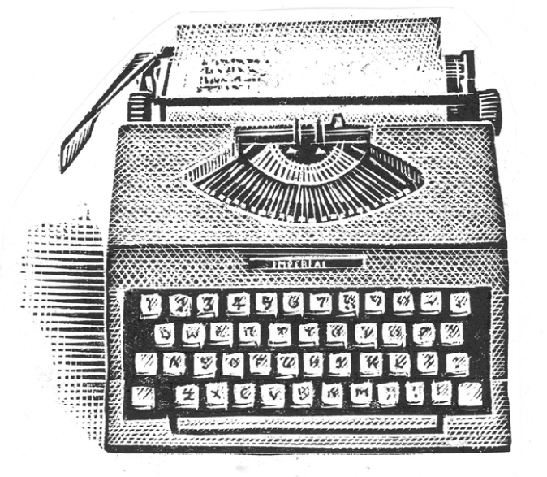

## Kapitel 18: Mr Browns Unfall im Urlaub

Es war ein schöner Sommermorgen, und Mr John Brown fuhr in den Urlaub. Eigentlich war er erst halb unterwegs. Auf halbem Weg zur Küste steckte er nämlich in einem <abbr class="word" title="der Stau, -s — traffic jam">Stau</abbr>.

„Vierzehn ganze Tage, ohne für Trouser, Trouser, Middling and Fedge arbeiten zu müssen“, dachte er. „Die werde ich ganz bestimmt nicht in einer Autoschlange verbringen!“

Dann tat er etwas, das nach den späteren Ereignissen wirklich schrecklich und beunruhigend war. Er verließ die Hauptstraße und fuhr in eine schmale Straße, an der Bäume standen. Er wunderte sich selbst darüber. Normalerweise kam so etwas für ihn überhaupt nicht infrage. Aber die Vögel sangen, überall waren Blüten, und sein Auto rollte fröhlich weiter.

Bis er mitten auf der leeren Straße gegen etwas fuhr. Es gab ein schreckliches Geräusch, als würde etwas <abbr class="word" title="reißen, riss, ist gerissen — tear apart">reißen</abbr>.

Als er die Augen öffnete, waren die <abbr class="word" title="der Obstgarten, Obstgärten — orchards">Obstgärten</abbr>, die Hügel und der Himmel verschwunden. Vor seinem Auto lag eine weite Fläche aus Beton. Überall standen Lastwagen und große Lampen, dazwischen lagen Holzstapel. Kleine Männer rannten auf ihn zu.

Offenbar war das Auto durch eine hohe, dünne Wand gefahren.

„Das muss der Hof einer Baufirma sein. Vielleicht fahre ich lieber vorsichtig wieder weg“, dachte Brown. Er legte den <abbr class="word" title="der Rückwärtsgang, Rückwärtsgänge — reverse gear">Rückwärtsgang</abbr> ein und sah über seine Schulter. Erst jetzt bemerkte er die Wand. Der Himmel, die Hügel und die Obstgärten waren darauf gemalt! Links und rechts reichte sie kilometerweit.

„Das ist ja nur eine <abbr class="word" title="die Kulisse, -n — painted theatrical scenery">Kulisse</abbr>!“

Ein Dutzend kleine Männer in blauen Arbeitsanzügen packten das Auto und zogen es durch das Loch zurück. <abbr class="construction" title="Past passive: wurde plus a past participle describes what was done to John.">John wurde aus dem Auto gezogen.</abbr> Er schrie, während zwei Männer schon eilig das Loch in der Landschaft reparierten.

Man trug Mr Brown in eine Holzhütte und setzte ihn unsanft auf einen Stuhl. Dann wurde die Tür abgeschlossen.

Die Hütte war eigentlich ganz normal. In einer Ecke brannte ein eiserner Ofen. An den Wänden hingen Karten und Pläne. Hinter einem Schreibtisch saß ein kleiner Mann mit hochgeschobenen Hemdärmeln. Er sah besorgt aus, und sein Tisch verschwand fast unter Papier.

„Ich weiß auch nicht“, jammerte er und suchte zwischen den Blättern. „Warum könnt ihr Leute nicht tun, was von euch erwartet wird? Mal sehen. Sie sind John Brown und fahren in den Urlaub. Warum sind Sie nicht auf den Hauptstraßen geblieben? Dafür haben wir die Kulissen fertig. Auf dieser kleinen Straße wurde jahrelang niemand erwartet.“

„Kulissen …?“

„Sie glauben doch nicht, dass alle diese Bäume und Hügel einfach gewachsen sind? Sie sind seit sechs Monaten der Erste auf dieser Straße. Denken Sie nur an die Arbeit! Wir müssten die ganze Zeit eine echte Landschaft in Ordnung halten. Übrigens heiße ich Snigsley. Ich kümmere mich um die <abbr class="word" title="die Requisite, -n — objects used on a stage">Requisiten</abbr> auf dieser <abbr class="word" title="die Bühne, -n — stage">Bühne</abbr>.“

Jemand klopfte heftig an die Tür. Snigsley öffnete, und draußen stand ein Arbeiter.

„Gelber Alarm, Sir! Der <abbr class="word" title="der Pfarrer, - — parson; vicar">Pfarrer</abbr> von St Not’s macht einen Spaziergang nach Hangman’s Wood!“

„Na, das ist doch in Ordnung.“

„Nein, Sir. Haben Sie es vergessen? Wir haben die Kulisse von Hangman’s Wood abgebaut. Auf die Rückseite haben wir eine Wiese mit gelben Blumen gemalt. Dort ist jetzt gar nichts!“

Snigsley griff nach seiner Mütze.

„Kommen Sie! Das ist ein <abbr class="word" title="der Notfall, Notfälle — emergency">Notfall</abbr>. Wenn wir nichts tun, geht er direkt hinter die Bühne!“

Er rannte aus der Hütte und zog John Brown mit. Ein Lastwagen hielt an, voller kleiner Männer in blauen Arbeitsanzügen. Snigsley schob Brown hinauf und sprang selbst hinterher. Schon raste der Wagen los.

Sie fuhren an Haufen von großen Lampen und alten Kulissen vorbei. Snigsley erklärte die Sache.

„Es gibt so viele Teile der Landschaft, denen die Menschen niemals nahe kommen. Da ist es viel billiger, sie zu malen und hin und her zu schieben. Nehmen Sie einen Wald. Die Leute bleiben meistens auf den Wegen. Sie sehen nur die Bäume, die direkt neben ihnen stehen. Die anderen machen wir aus <abbr class="word" title="die Pappe — cardboard">Pappe</abbr>. Seit ungefähr zweihundert Jahren gibt es in diesem Land keine wirklich natürliche Landschaft mehr.“

„Aber warum?“ Brown starrte auf einen ordentlich gestapelten Haufen Hügel aus Pappe, an dem sie vorbeifuhren.

„Sie wollten Geld sparen. Benutzt so wenig Landschaft wie möglich, hieß es. Deshalb arbeiten wir uns die Finger wund. Dauernd müssen wir Bäume und Berge, Schafe aus Plastik und <abbr class="word" title="die Hecke, -n — hedges">Hecken</abbr> verschieben. Dazu kommen noch Zäune aus ganz leichtem Holz. <abbr class="construction" title="Damit introduces a purpose clause; the verb comes at the end.">Wir tun das alles, damit keiner von euch Schauspielern ein großes Loch in der Landschaft bemerkt.</abbr>“

„Schauspieler? Ich bin kein Schauspieler! Ich bin ein <abbr class="word" title="der Buchhalter, - — here: a chartered accountant, a professionally qualified accountant">Buchhalter</abbr> mit Berufsqualifikation!“

„Richtig. Das ist Ihre Rolle. Sie spielen einen Buchhalter mit Berufsqualifikation. Jetzt ist etwas schiefgegangen, und Sie sind hinter der Bühne. Wahrscheinlich war der Mann schuld, der Ihnen Ihren nächsten Text zuflüstert. Wie sollen wir mit diesem Zeug ordentlich arbeiten? Was man uns hier gibt, ist wirklich unmöglich!“

„Wer ist eigentlich dieses ‚Sie‘? Und wenn ich Schauspieler bin, was ist dann das Stück?“

„‚Sie‘ sind die Leitung. Das Stück heißt *Die absolute und vollständige Geschichte der Erde, in 3.982.611.037.278.901.777.690.535.016.152 Akten*. Und mit einer Pause von fünfzehn Minuten.“ Ein <abbr class="word" title="der Akt, -e — act in a play">Akt</abbr> war ein Teil des Theaterstücks.

Mit quietschenden Reifen hielt der Lastwagen an. Die Arbeiter sprangen heraus. Snigsley stöhnte und nahm ein <abbr class="word" title="das Megafon, -e — megaphone">Megafon</abbr>.

„Der Pfarrer sollte im Pfarrhaus sein und nicht spazieren gehen! Die Autoren haben wieder einen Fehler gemacht. Los, Leute, packt die Bäume! Eins, zwei – genau! Clompers, streu ein paar tote Blätter herum. Schneller, Mann! So ist es richtig. Jetzt die grünen Waldpflanzen. Wo sind die <abbr class="word" title="der Farn, -e — ferns">Farne</abbr>? FARNE! Gut, Vogelgesang einschalten! Blimpo, dort müssen mehr Pilze hin. Schnell, der Weg! Pfützen! Lasst die Blumen wachsen und bringt ein paar Bienen. BIENEN! Mann, setz das <abbr class="word" title="das Eichhörnchen, - — squirrel">Eichhörnchen</abbr> auf den Baum! Gut, richtig, wunderbar! VERSCHWINDET! Da kommt er!“

Brown sah staunend zu. Die kahle Fläche hinter der Bühne wurde mit Erde bedeckt. Bäume erschienen, Gras wuchs, und Vögel begannen zu singen. Der Pfarrer spazierte freundlich lächelnd vorbei. Er schien keinen Fehler zu bemerken. Direkt hinter ihm verschwand die Landschaft schon wieder.

Snigsley zog ein rotes Taschentuch heraus und wischte sich die Stirn.

„Das war knapp! Eines Tages biegt jemand um eine Ecke und findet nur zwei Bühnenarbeiter, die ihren Tee trinken. Gut, Leute, fahren wir zurück!“

„Was ist mit mir?“, fragte Brown.

„Mit Ihnen? Ach ja, Sie müssen wieder ins Stück geschrieben werden. Sprechen Sie mit den Autoren. Gehen Sie durch die Tür dort.“ Er zeigte auf eine Tür, die ganz allein mitten auf der Fläche stand.

„Sie führt doch nirgendwohin. Ich kann dahintersehen.“

„Dann glauben Sie eben, was Sie wollen“, sagte Snigsley. „Ich bin hier bloß <abbr class="word" title="der Dumme, die Dummen — the poor fool left to do all the work">der Dumme</abbr>. Gehen Sie einfach und lassen Sie mich in Ruhe.“

Brown ging ein- oder zweimal um die Tür herum. Dann beschloss er, es doch zu versuchen. Er drückte sie auf. Ein Licht blitzte, und plötzlich stand er in einem langen Flur. Die Wände waren braun und cremefarben gestrichen. Der Flur reichte weit in die Ferne, und überall gab es Türen. Auf einer las Brown ein unordentlich geschriebenes Schild.

„Autoren: Flur 1, Zimmer 1. Na gut, versuchen wir es.“

„Also gut, herein!“

Brown sah einen kleinen Mann hinter einer <abbr class="word" title="die Schreibmaschine, -n — typewriter">Schreibmaschine</abbr> sitzen. Das Zimmer war voller Tabakrauch. Auf dem Boden lagen Papierblätter in großen Haufen.

„Bitte, ich möchte wieder ins Stück zurück …“, begann Brown.

„Wie heißen Sie? Brown? Sprechen Sie lauter, Mann, <abbr class="word" title="nuscheln, nuschelte, hat genuschelt — mumble">nuscheln</abbr> Sie nicht! Sie sind im falschen Flur. Gehen Sie bis ans Ende und dann links. Der Mann ist ein Idiot, ein Idiot …“

Brown schloss leise die Tür und ging den Flur entlang. Mehrere Stunden später bog er links in einen anderen Flur ein. Nach weiteren Stunden kam er zu einer Tür mit seinem Namen. Eigentlich gab es dort 8.979 Türen mit demselben Namen. Noch bevor ein weiterer Tag vergangen war, erreichte er aber die richtige. Auf ihr stand: „John Trevor Brown, 29 Jahre, Buchhalter mit Berufsqualifikation. 12 Windmill Place, Blackbury. Autoren: Parsnip, Bagel und Blintz.“

„Ich werde ganz bestimmt nicht anklopfen!“, dachte er und stieß die Tür auf.

Parsnip, Bagel und Blintz standen um eine Schreibmaschine. Sie zeigten Brown den Rücken und lachten. Bagel tippte langsam.

„Gut, jetzt haben wir ihn am Strand“, sagte er. „Wie wäre es, wenn seine Hose herunterfällt? Oder könnten wir seinen <abbr class="word" title="der Liegestuhl, Liegestühle — deckchair">Liegestuhl</abbr> zusammenbrechen lassen?“

„Er könnte ein Eis kaufen und es dann in den Sand fallen lassen“, schlug Parsnip vor.

„He, gut! Das ist sehr komisch“, sagte Blintz.

„Ähem“, machte Brown.

Alle drehten sich um. „Wer sind Sie?“, fragte Bagel.

„<abbr class="construction" title="Dessen means whose and links the man&#x27;s name to the man in a relative clause.">Ich bin der Mann, dessen Name an der Tür steht.</abbr> Und Sie sind wohl meine Autoren …“

Blintz eilte auf ihn zu und schüttelte ihm die Hand.

„Ich wollte Sie schon immer kennenlernen! Seit Jahren schreibe ich Ihr Leben, Mr Brown. Das gibt es doch nicht! Aber wie sind Sie hierhergekommen?“

„Ich bin irgendwie hinter die Kulissen geraten“, sagte Brown. „Ich wollte gerade in den Urlaub fahren. Haben Sie darüber geschrieben? Was ich gehört habe, gefällt mir gar nicht!“

„Oh, es ist wirklich lustig“, sagte Bagel. „Ein Riesenspaß! Sie sind ein geborener Komiker, auch wenn wir das selbst sagen. Das <abbr class="word" title="das Publikum — audience">Publikum</abbr> liebt Sie wirklich.“

„Aber auf der Welt leben Milliarden Menschen! Wie können sie ausgerechnet mich sehen?“

„Sie können es eben“, sagte Parsnip hastig. „Tja, wer hätte das gedacht? Ein Schauspieler kommt hinter die Bühne!“

„Ich bin mit meiner Rolle nicht zufrieden. Eine <abbr class="word" title="die Hauptrolle, -n — starring role">Hauptrolle</abbr> ist das ja kaum“, sagte Brown. Er gewöhnte sich bereits an den Gedanken, Schauspieler zu sein.

„Unsinn, Sie spielen diese Figur ausgezeichnet“, antwortete Parsnip. Da klingelte ein kleines grünes Telefon, das halb unter einem Papierhaufen versteckt war. Parsnip nahm ab, und sein Gesicht wurde weiß.

„Ja, Sir. Er ist hier, Sir. Ja, Sir, ich verstehe, Sir. Wir schicken ihn sofort hinauf, Sir. Auf Wiedersehen, Sir.“

„Das war der <abbr class="word" title="der Regisseur, -e — director of a play or film">Regisseur</abbr>“, sagte er. „Er will Sie in seinem Büro sehen. Du meine Güte! Wahrscheinlich werden Sie jetzt … Sie können froh sein, wenn Sie nicht <abbr class="word" title="rauswerfen, warf raus, hat rausgeworfen — sacked; fired">rausgeworfen</abbr> werden!“

„Das soll er nur versuchen!“, sagte Brown. „Ich habe genug. Ich will zurück!“

„Auf Wiedersehen!“, riefen die Autoren gemeinsam. Es gab einen blauen Blitz und einen leisen Donnerschlag. Brown überschlug sich und landete auf einem sehr dicken roten Teppich.

Er kam schwankend auf die Füße. Der Teppich reichte ihm bis an die Knöchel. Er befand sich in einem Büro, aber die Wände waren so weit entfernt, dass sie im Nebel zu verschwinden schienen. Ungefähr eine halbe Meile entfernt stand ein großer Schreibtisch. Brown kämpfte sich durch den Teppich dorthin.

Ein großer Mann im blauen Anzug saß dahinter und hatte die Füße auf den Tisch gelegt. Er rauchte eine <abbr class="word" title="die Zigarre, -n — cigar">Zigarre</abbr> und trug eine dunkle Brille. Als Brown näher kam, las er eine Zeitung.

Brown stand fünf Minuten neben dem Tisch. <abbr class="construction" title="Um ... zu gives the purpose of an action by the same person.">Dann hustete er deutlich, um auf sich aufmerksam zu machen.</abbr>

„Ach, Sie sind es?“, sagte der Regisseur und schaute über seine Zeitung. „Möchten Sie eine Zigarre? Ich verstehe euch Schauspieler nicht. Ihr macht alle nur Ärger. Worum geht es denn?“

Brown erzählte seine Geschichte.

„Durch die Kulisse, was? Na gut, es war nicht Ihre Schuld. Aber die Frage ist, Brown, die Frage ist: Was machen wir jetzt mit Ihnen?“

„Hören Sie“, sagte John Brown. „Ich will nur wieder in meinem kleinen Auto sitzen. Mitten in diesem Stau. Ich möchte die ganze Sache einfach vergessen.“

Der Regisseur zog an seiner Zigarre.

„Gut“, sagte er. „Dann müssen wir die <abbr class="word" title="die Handlung, -en — plot">Handlung</abbr> ein bisschen umschreiben. Abracabazomah!“

Wieder blitzte es blau. Jetzt stand Brown neben dem Regisseur auf einer hohen Plattform. Unter ihnen lag der größte Raum, den Brown je gesehen hatte. Er reichte in alle Richtungen, voller riesiger Bücherregale. Tausende kleine Männer kletterten darauf herum. Kleine elektrische Züge fuhren auf schmalen Gleisen zwischen den Regalen hin und her, beladen mit Büchern.

Der Regisseur strahlte. „Sehen Sie sich das an! Hier steht jedes Wort, das jemals jemand gesagt hat. Auch alles, was die Menschen jetzt sagen oder in Zukunft sagen werden. Vom allerersten Wort an! Damals ließ ein großer, haariger <abbr class="word" title="der Höhlenmensch, -en — caveman">Höhlenmensch</abbr> ein Stück Holz auf seinen Zeh fallen. Bis zu den letzten Worten. Die kann ich Ihnen nicht verraten, sonst kennen Sie schon das Ende.“

Er nahm ein Megafon. „ACHTUNG! HIER SPRICHT EUER REGISSEUR! BRINGT MIR DEN TEXT FÜR FIGUR NR. 40.908.775.821.001!“

Ein <abbr class="word" title="der Bibliothekar, -e — librarian">Bibliothekar</abbr> kam eilig heran und zog einen großen Wagen hinter sich her. Der Regisseur nahm ein großes, ziemlich abgenutztes Buch heraus. Ein rotes <abbr class="word" title="das Lesezeichen, - — bookmark">Lesezeichen</abbr> steckte ungefähr nach dem ersten Drittel darin.

„Hm, da haben wir es. Wir setzen Sie einfach wieder in Ihr Auto, kurz bevor Sie in die kleine Straße abgebogen sind. Dann müsste alles passen. Ja, was ist denn?“

Ein Bühnenarbeiter war zu ihnen gekommen und verbeugte sich höflich. „Der <abbr class="word" title="der Produzent, -en — producer">Produzent</abbr> ist für Sie am Telefon, Sir.“

„Dauert nur einen Augenblick“, sagte der Regisseur und ging eilig weg. <abbr class="construction" title="Sobald means as soon as and introduces a temporal clause with the verb at the end.">Sobald der Regisseur ihm den Rücken zeigte, öffnete Brown das Buch.</abbr>

Er las seine Lebensgeschichte bis zu dem Augenblick, als er mit dem Regisseur den Raum voller Texte betrat. Während er las, erschienen von selbst neue Wörter auf der nächsten leeren Seite: „Brown springt zum Buch und beginnt zu lesen.“

„Gut, sehen wir mal, ob es nicht etwas besser geht“, dachte er und nahm einen Stift. Schnell schrieb er auf, dass er beim <abbr class="word" title="das Fußballtoto — football pools: a betting competition based on football results">Fußballtoto</abbr> gewann. Außerdem sollte er ein gesunkenes Schatzschiff entdecken, bei den Olympischen Spielen jeden Wettbewerb gewinnen und mit 198 Jahren friedlich sterben.

„Das ist viel zu einfach“, dachte er. Dann kam ihm eine Idee, und ein böses Lächeln breitete sich auf seinem Gesicht aus. Vorsichtig schrieb er: „Während Brown im Raum mit den Texten ist, bekommt er folgende Bücher: den Text des Premierministers, des Präsidenten der Vereinigten Staaten und jedes anderen führenden Politikers. Außerdem bekommt er den Text von Mr Fitzburrow Robinson, dem Chef der Büroangestellten bei Trouser, Trouser, Middling and Fedge. Das ist die Firma, für die Brown zurzeit arbeitet.“

Zwanzig große Bücher erschienen neben ihm. Er schrieb schnell eine kurze Notiz in jedes Buch. <abbr class="construction" title="Obwohl introduces a concession: he managed this despite having little time.">Obwohl er wenig Zeit hatte, schrieb er die Bücher noch rechtzeitig in ihre Regale zurück.</abbr> Dann kam der Regisseur eilig wieder.

„Alles ist erledigt“, sagte er. „Blazonkeraba!“

Brown saß wieder am Steuer seines Autos, mitten im Verkehr.

Das Autoradio lief. Der Nachrichtensprecher sagte gerade: „Heute Morgen begannen führende Politiker auf der ganzen Welt, auf und ab zu springen. Dabei riefen sie: ‚Es lebe Mr John Brown, ein wunderbarer Kerl!‘ Auch ein leitender Büroangestellter in Gritshire tat das. Eine Erklärung scheint es dafür nicht zu geben …“

Brown <abbr class="word" title="grinsen, grinste, hat gegrinst — grinned">grinste</abbr>. „Das hat alles schön durcheinandergebracht“, sagte er. „Hurra!“

### Words in this chapter

- **der Stau, -s** — traffic jam
- **reißen, riss, ist gerissen** — tear apart
- **der Obstgarten, Obstgärten** — orchards
- **der Rückwärtsgang, Rückwärtsgänge** — reverse gear
- **die Kulisse, -n** — painted theatrical scenery
- **die Requisite, -n** — objects used on a stage
- **die Bühne, -n** — stage
- **der Pfarrer, -** — parson; vicar
- **der Notfall, Notfälle** — emergency
- **die Pappe** — cardboard
- **die Hecke, -n** — hedges
- **der Buchhalter, -** — here: a chartered accountant, a professionally qualified accountant
- **der Akt, -e** — act in a play
- **das Megafon, -e** — megaphone
- **der Farn, -e** — ferns
- **das Eichhörnchen, -** — squirrel
- **der Dumme, die Dummen** — the poor fool left to do all the work
- **die Schreibmaschine, -n** — typewriter
- **nuscheln, nuschelte, hat genuschelt** — mumble
- **der Liegestuhl, Liegestühle** — deckchair
- **das Publikum** — audience
- **die Hauptrolle, -n** — starring role
- **der Regisseur, -e** — director of a play or film
- **rauswerfen, warf raus, hat rausgeworfen** — sacked; fired
- **die Zigarre, -n** — cigar
- **die Handlung, -en** — plot
- **der Höhlenmensch, -en** — caveman
- **der Bibliothekar, -e** — librarian
- **das Lesezeichen, -** — bookmark
- **der Produzent, -en** — producer
- **das Fußballtoto** — football pools: a betting competition based on football results
- **grinsen, grinste, hat gegrinst** — grinned

### Constructions and sentences
- **“John wurde aus dem Auto gezogen.”** — John was pulled out of the car. Past passive uses *wurde* and the past participle; John receives the action.

- **“Wir tun das alles, damit keiner von euch Schauspielern ein großes Loch in der Landschaft bemerkt.”** — We do all this so that none of you actors notices a big hole in the landscape. *Damit* introduces the purpose, with the verb at the end.

- **“Ich bin der Mann, dessen Name an der Tür steht.”** — I am the man whose name is on the door. *Dessen* is a possessive relative pronoun referring to *der Mann*.

- **“Dann hustete er deutlich, um auf sich aufmerksam zu machen.”** — Then he coughed pointedly to draw attention to himself. *Um … zu* gives the purpose of an action by the same person.

- **“Sobald der Regisseur ihm den Rücken zeigte, öffnete Brown das Buch.”** — As soon as the director turned his back on him, Brown opened the book. *Sobald* introduces a time clause; the following main clause starts with its verb.

- **“Obwohl er wenig Zeit hatte, schrieb er die Bücher noch rechtzeitig in ihre Regale zurück.”** — Although he had little time, he wrote the books back onto their shelves just in time. *Obwohl* marks a concession; *zurückschreiben* is separable here and describes the story’s magical action.

---

[← Previous](kapitel-17.md) · [Contents](README.md) · [Next →](kapitel-19.md)
