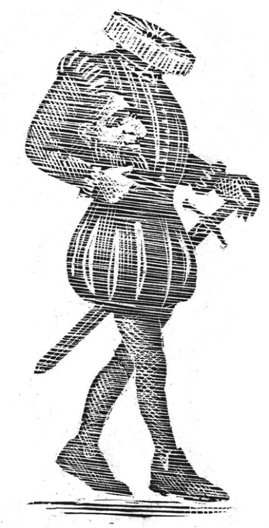

## Kapitel 19: Pilgarlic Towers

Hoch oben in den düsteren Even Hills stand die <abbr class="word" title="die Ruine, -n — ruin">Ruine</abbr> Pilgarlic Towers. Es war die feuchteste und graueste Ecke von Gritshire, und das alte Gebäude zerfiel langsam.

An den Mauern wuchs <abbr class="word" title="der Efeu — ivy">Efeu</abbr>. Auf dem Efeu wuchs <abbr class="word" title="das Moos — moss">Moos</abbr>, und auf allem wuchsen schreckliche gelbe Pilze. Nachts war es dort so <abbr class="word" title="unheimlich — eerie; spooky">unheimlich</abbr>, dass sogar die Fledermäuse den Ort vermieden. Die Eulen riefen nur leise und nervös vor sich hin.

Eines Tages radelte ein Mann nervös zum rostigen Eisentor. Er hängte einen kleinen Zettel daran und eilte sofort wieder davon. Auf dem Zettel stand:

> GESETZ ÜBER ÄRGER IN STADT UND LAND, 1871
>
> Für das Grundstück Pilgarlic Towers gilt Absatz 83B/a2 (1877) dieses Gesetzes. Gemeint ist die geänderte Form des Gesetzes. Das Gebäude wird abgerissen, damit eine Autobahn gebaut werden kann. Und das wird auch Zeit.
>
> Auf Befehl des Kreisrats von Gritshire. Das Ministerium für Ärger macht dem Kreisrat in dieser Sache nämlich kräftig Druck.

In dieser Nacht griff eine leuchtende weiße Hand durch das Tor und nahm den Zettel. Innerhalb einer Stunde versammelten sich alle <abbr class="word" title="der Geist, -er — ghosts">Geister</abbr> in der Halle des <abbr class="word" title="das Spukhaus, Spukhäuser — haunted house">Spukhauses</abbr>, durch die kalter Wind zog. Die Versammlung war laut und wild.

„Knochen und Kettenrasseln! Das ist <abbr class="word" title="ungeheuerlich — outrageous">ungeheuerlich</abbr>!“, sagte Sir Rufus Grue, der Schrecken ohne Kopf.

„Seit dreihundert Jahren wohne ich hier, erst als Mensch und dann als Geist. Jetzt wollen sie mich hinauswerfen“, jammerte der schreiende <abbr class="word" title="der Mönch, -e — monk">Mönch</abbr>. Eine Geisterträne rollte über seine Wange.

„Wenn ihr mich fragt, sind wir wohl bald dran. Uns geht es an den <abbr class="word" title="der Kragen, - — collar; in the idiom: we&#x27;re for the chop">Kragen</abbr>“, sagte Cedric, der verrückte <abbr class="word" title="der Henker, - — executioner">Henker</abbr>.

„Dabei wollte ich doch immer nur einen schönen feuchten Keller und ein Stück Kette zum <abbr class="word" title="rasseln, rasselte, hat gerasselt — rattle">Rasseln</abbr> …“, schluchzte der Mönch weiter.

„Weinen hilft nicht. Was sollen wir tun?“, fragte Lady Jane Black. Sie bot dem Mönch eine Ecke ihres langen Geisterkleids als Taschentuch an.

Sir Rufus Grue klemmte seinen Kopf bequemer unter einen Arm. „Was ist eine Autobahn?“, fragte er.

„Ich weiß es“, sagte Ronald Fitzgibbon, der Geisterkutscher. Alle zwei Wochen fuhr er die <abbr class="word" title="die Geisterkutsche, -n — phantom stagecoach">Geisterkutsche</abbr> über das Grundstück. „Eine Art große Straße für Kutschen ohne Pferde.“

„… nur einen kleinen Keller, vielleicht mit ein paar Spinnen …“, weinte der Mönch und putzte sich laut die Nase.

Sir Rufus hörte nicht auf ihn. „Könnten wir nicht auf dieser Autobahn <abbr class="word" title="spuken, spukte, hat gespukt — haunt a place">spuken</abbr>?“

„Fußgänger sind dort nicht erlaubt“, sagte Ronald. „Außerdem fahren die Leute so schnell, dass sie uns gar nicht bemerken würden.“

„… und ein paar <abbr class="word" title="die Kröte, -n — toads">Kröten</abbr>, damit es gemütlich wird …“, schniefte der Mönch.

Sir Rufus dachte nach. „Ich habe eine Idee. Wir machen eine kleine Reise nach London. <abbr class="construction" title="Wenn gives a condition; the main clause states what must follow from it.">Wenn das Ministerium unser Zuhause abreißen will, muss es uns ein anderes geben.</abbr>“

Eine Woche später zitterten die Dorfbewohner von Pilgarlic Parva in ihren Betten. Die Geisterkutsche rollte rasselnd durch die leeren Straßen.

Alle Geister saßen darin, außer Septimus, dem schrecklichen schwarzen Hund. Er lief bellend hinterher. Die Geister sangen begeistert *On Ilkla Moor Baht ’At*. Auf dem Dach war ein ganzer Haufen Geistergepäck festgebunden.

Zerrissene Wolken jagten über den Mond. Mit einem Regen aus Funken bog die Kutsche auf die Hauptstraße ein. Blaue Flammen zischten und knisterten um sie herum.

„Bist du sicher, dass du den Weg nach London kennst?“, rief Sir Rufus.

„Natürlich! Habe ich nicht früher dort gewohnt?“, antwortete Ronald.

Lady Jane Black lehnte sich aus dem Fenster. „Eine Art pferdelose Kutsche scheint uns zu verfolgen. Oben drauf hat sie ein blaues Blinklicht.“

„Du meine Güte! Die Bow Street Runners! Die Londoner Polizei!“, schrie Ronald und ließ seine <abbr class="word" title="die Peitsche, -n — whip">Peitsche</abbr> knallen.

Der Polizeiwagen verfolgte sie kilometerweit. Schließlich fuhr Ronald aus Verzweiflung mitten durch eine Hecke, einen <abbr class="word" title="der Heuhaufen, - — haystack">Heuhaufen</abbr>, fünf Kühe, einen Laternenpfahl, zwei kleine Häuser und einen Obstgarten. <abbr class="construction" title="Weil introduces the reason, with war at the end of its clause; durch alles hindurch means right through everything.">Weil es eine Geisterkutsche war, fuhr sie einfach durch alles hindurch.</abbr> Sie war wie ein Hauch von Nebel.

Im Osten war der Himmel schon rosa, als die Kutsche London erreichte. Alle Geister streckten die Hälse, um besser sehen zu können.

„Westminster! Ach, diese Erinnerungen!“, sagte Sir Rufus. „Wusstet ihr, dass ich einmal <abbr class="word" title="der Abgeordnete, die Abgeordneten — member of parliament">Abgeordneter</abbr> für Blackbury war? Natürlich war das in den guten alten Zeiten. Damals hatte das gewöhnliche <abbr class="word" title="das Gesindel — riff-raff; a contemptuous term for ordinary people">Gesindel</abbr> noch kein <abbr class="word" title="das Wahlrecht, -e — the right to vote">Wahlrecht</abbr>.“

Die Geisterkutsche hielt vor dem Ministerium für Ärger. Die Geister strömten hinaus und durch die Drehtüren ins Haus.

Das Gebäude war ganz neu. Sir Rufus schauderte: Alles war so ordentlich und sauber! Nicht ein einziges anständiges Spinnennetz war zu sehen.

„Hier scheint niemand zu sein“, sagte er.

Lady Jane Black sah sich um. „Um diese frühe Uhrzeit haben sie hier wohl nur eine ‚<abbr class="word" title="die Skelettbesetzung (invented joke compound; not a standard German expression) — deliberate German wordplay on English skeleton staff: very few workers; Rufus imagines actual skeletons">Skelettbesetzung</abbr>‘.“

„Ah! Das klingt schon viel besser“, sagte der Geisterritter.

„Ich meine, dass nur wenige Leute hier sind.“

„Oh.“

Inzwischen wanderten die Geister überall im Ministerium herum.

Cedric, der verrückte Henker, bekam an einer elektrischen <abbr class="word" title="die Schreibmaschine, -n — typewriter">Schreibmaschine</abbr> einen bösen Stromschlag. Der Mönch klemmte seinen Finger in einem <abbr class="word" title="der Aktenschrank, Aktenschränke — filing cabinet">Aktenschrank</abbr> ein und brach in Tränen aus.

Ronald Fitzgibbon interessierte sich für Maschinen. Er untersuchte einen großen Computer, der fünf ganze Zimmer für sich allein hatte.

Sir Rufus ging mit großen Schritten durch die glänzenden Flure. Schließlich fand er eine eindrucksvolle Tür mit der Aufschrift:

> DER SEHR EHRENWERTE RICHARD CARPET, MINISTER FÜR ÄRGER

„Genau der richtige Mann!“, dachte er und trat durch das Schlüsselloch ein.

Er musste lange warten. Endlich, gegen halb elf, kam ein Mann herein, der etwas wichtig tat. Er setzte sich an einen riesigen glänzenden Schreibtisch.

Sir Rufus steckte seinen Kopf unter den Arm und stieg würdevoll aus dem <abbr class="word" title="das Tintenfass, Tintenfässer — inkwell">Tintenfass</abbr> auf.

„UUUUUuuuuh!“, stöhnte er. „Dunkel schleicht die Stunde des <abbr class="word" title="das Verderben — doom; ruin">Verderbens</abbr> über den schrecklichen Sand!“

Der Minister beugte sich zu seiner <abbr class="word" title="die Sprechanlage, -n — intercom">Sprechanlage</abbr>. „Bringen Sie mir bitte die Akte über Störungen, Miss Fisher“, sagte er ruhig.

Sir Rufus hatte das Gefühl, dass etwas nicht stimmte. Er versuchte es noch einmal.

„AAAAAaaaah! Zittere, du <abbr class="word" title="der Sterbliche, die Sterblichen — mortal human being">Sterblicher</abbr>!“

Der Minister zündete seine Pfeife an und starrte aus dem Fenster.

„Es hilft nichts. Er kann dich weder sehen noch hören“, sagte Lady Jane Black und erschien auf dem Fensterbrett. „Ich habe gerade zehn Minuten lang versucht, seine Sekretärin Miss Fisher zu erschrecken. Sie hat überhaupt nichts bemerkt.“

Cedric, der verrückte Henker, trat aus der Wand. Er sah wirklich großartig aus und leuchtete grün. „Es hilft nichts. Sie glauben nicht an uns“, sagte er.

„Das ist ungeheuerlich!“, sagte Sir Rufus wütend. „In den guten alten Zeiten haben wir kilometerweit das ganze Land in Angst versetzt!“

„Ja, aber damals rechneten die Leute mit Geistern“, murmelte Lady Jane Black. „Heute gelten wir nur noch als lächerlicher <abbr class="word" title="der Aberglaube — superstition">Aberglaube</abbr>. Außerdem: Wie soll man in so einem Gebäude überhaupt spuken?“

„Seht!“, sagte Sir Rufus.

Der Minister las ein langes, amtlich aussehendes Schreiben. Die Überschrift lautete: „Befehl zum <abbr class="word" title="der Abriss, -e — demolition">Abriss</abbr> von Pilgarlic Towers“.

„Wir müssen etwas tun! Es muss doch eine Möglichkeit geben, uns bemerkbar zu machen!“

Die Sprechanlage summte. „Es tut mir sehr leid, Sie zu stören, Sir, aber … äh … nun, der Computer ist kaputt.“

„Ich verstehe nicht, warum Sie mich deswegen stören müssen, Miss Fisher.“

„Ja, Sir. Aber er singt unanständige Lieder, Sir.“

„Du meine Güte!“, sagte der Minister und stürzte aus dem Zimmer.

„Das ist Ronald!“, riefen die Geister.

„Er hat einen Weg gefunden! Er spukt im Computer!“, sagte Sir Rufus.

Im Zimmer darunter hatte die Maschine gerade ein ziemlich unanständiges Lied mit dem Titel *As Turpin Was A’Riding* ausgedruckt. Jetzt erzählte sie einen Witz aus dem achtzehnten Jahrhundert.

Sobald die anderen Geister verstanden hatten, wie es ging, stand das ganze Ministerium still. Die Aktenschränke ließen sich nicht mehr öffnen. Die Aufzüge flogen auf und ab. In einem saß sogar der <abbr class="word" title="der Staatssekretär, -e — senior government official">Staatssekretär</abbr> für amtliche Neugier. Sein Aufzug raste neunzehnmal zwischen Keller und achtem Stock hin und her, bevor er ihn auf dem Dach hinauswarf.

Der Minister eilte gerade die <abbr class="word" title="die Feuertreppe, -n — fire escape stairs">Feuertreppe</abbr> hinunter. <abbr class="construction" title="Während introduces an action happening at the same time as the main action.">Während er die Treppe hinunterlief, schoss ein Telefon aus einem Fenster.</abbr> Sein Kabel legte sich wie eine Fangschlinge um den Minister. Er wurde auf den Teewagen gezogen, der ihn hinunter zum Computer fuhr. Vor Angst war er ganz weiß im Gesicht.

Der Computer tippte: „NICHT BÖSE GEMEINT, ABER SO GEHT ES WEITER, WENN SIE NICHT DEN ABRISS VON PILGARLIC TOWERS VERHINDERN.“

„Das kann ich nicht!“, keuchte der Minister. „Die <abbr class="word" title="die Planierraupe, -n — bulldozers">Planierraupen</abbr> sind schon dort!“

Ein Telefon schwebte heran. Der Computer tippte: „SAGEN SIE IHNEN, SIE SOLLEN DIE ARBEIT EINSTELLEN.“

Zitternd tat der Minister, was verlangt wurde. Wie durch Zauberei war im Ministerium plötzlich alles wieder normal.

Später dachte er natürlich, dass alles nur an zu viel Arbeit oder etwas Ähnlichem lag. <abbr class="construction" title="Deshalb links this action to his preceding belief that the strange events were caused by overwork; the finite verb follows deshalb.">Deshalb schickte er die Planierraupen wieder an die Arbeit.</abbr> Da drehten sich zwei der Maschinen gegeneinander. Sie begannen, sich wie <abbr class="word" title="der Widder, - — rams">Widder</abbr> gegenseitig zu stoßen. Jetzt sah der Minister nachdenklich aus.

Plötzlich stellte man fest, dass Pilgarlic Towers historisch sehr wichtig war. <abbr class="construction" title="Passive infinitive with a modal: musste plus gebaut werden expresses what had to be done.">Die Autobahn musste um das Gebäude herum gebaut werden.</abbr>

Die Geister freuten sich, dass sie ihr Zuhause wiederhatten. Allerdings langweilte sie das gewöhnliche Spuken inzwischen ein wenig.

Wenn also Telefone ohne Grund klingeln oder Computer nicht richtig funktionieren, gibt es eine mögliche Erklärung. <abbr class="construction" title="A relative clause describes the typewriters; scheinen plus zu-infinitive means seem to.">Das gilt auch für Schreibmaschinen, die plötzlich ihren eigenen Willen zu haben scheinen.</abbr> Wahrscheinlich haben Sir Rufus oder der schreiende Mönch einfach ein bisschen Spaß.

### Words in this chapter

- **die Ruine, -n** — ruin
- **der Efeu** — ivy
- **das Moos** — moss
- **unheimlich** — eerie; spooky
- **der Geist, -er** — ghosts
- **das Spukhaus, Spukhäuser** — haunted house
- **ungeheuerlich** — outrageous
- **der Mönch, -e** — monk
- **der Kragen, -** — collar; in the idiom: we're for the chop
- **der Henker, -** — executioner
- **rasseln, rasselte, hat gerasselt** — rattle
- **die Geisterkutsche, -n** — phantom stagecoach
- **spuken, spukte, hat gespukt** — haunt a place
- **die Kröte, -n** — toads
- **die Peitsche, -n** — whip
- **der Heuhaufen, -** — haystack
- **der Abgeordnete, die Abgeordneten** — member of parliament
- **das Gesindel** — riff-raff; a contemptuous term for ordinary people
- **das Wahlrecht, -e** — the right to vote
- **die Skelettbesetzung (invented joke compound; not a standard German expression)** — deliberate German wordplay on English skeleton staff: very few workers; Rufus imagines actual skeletons
- **die Schreibmaschine, -n** — typewriter
- **der Aktenschrank, Aktenschränke** — filing cabinet
- **das Tintenfass, Tintenfässer** — inkwell
- **das Verderben** — doom; ruin
- **die Sprechanlage, -n** — intercom
- **der Sterbliche, die Sterblichen** — mortal human being
- **der Aberglaube** — superstition
- **der Abriss, -e** — demolition
- **der Staatssekretär, -e** — senior government official
- **die Feuertreppe, -n** — fire escape stairs
- **die Planierraupe, -n** — bulldozers
- **der Widder, -** — rams

### Constructions and sentences
- **“Wenn das Ministerium unser Zuhause abreißen will, muss es uns ein anderes geben.”** — If the ministry wants to pull down our home, it must give us another one. *Wenn* introduces the condition; *ein anderes* stands for another home.

- **“Weil es eine Geisterkutsche war, fuhr sie einfach durch alles hindurch.”** — Because it was a ghost coach, it simply passed right through everything. *Weil* introduces the reason and puts *war* at the end of its clause; *durch alles hindurch* describes movement right through everything.

- **“Während er die Treppe hinunterlief, schoss ein Telefon aus einem Fenster.”** — While he was running down the stairs, a telephone shot out of a window. *Während* links simultaneous actions; both use Präteritum.

- **“Deshalb schickte er die Planierraupen wieder an die Arbeit.”** — That is why he sent the bulldozers back to work. *Deshalb* connects the action to his explanation of the earlier events; the finite verb comes second.

- **“Die Autobahn musste um das Gebäude herum gebaut werden.”** — The motorway had to be built around the building. A modal verb combines with a passive infinitive: *musste … gebaut werden*.

- **“Das gilt auch für Schreibmaschinen, die plötzlich ihren eigenen Willen zu haben scheinen.”** — This also applies to typewriters that suddenly seem to have a will of their own. The relative clause refers to *Schreibmaschinen*; *scheinen … zu haben* means “seem to have.”

---

[← Previous](kapitel-18.md) · [Contents](README.md) · [Next →](kapitel-20.md)
