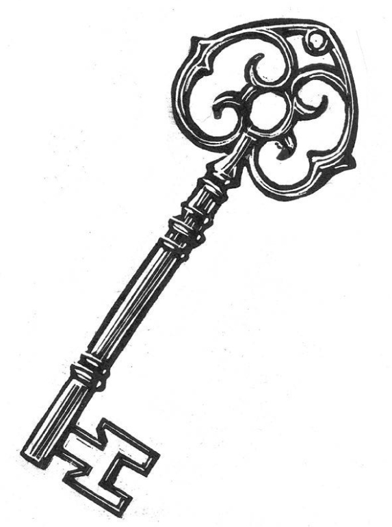

## Kapitel 20: Die Suche nach den Schlüsseln

Weit weg und vor langer Zeit gab es noch <abbr class="word" title="der Drache, die Drachen — dragon">Drachen</abbr>. Als einziges Spiel am Automaten konnte man damals Tischtennis in Schwarz-Weiß spielen. In dieser Zeit betrat ein <abbr class="word" title="der Zauberer, die Zauberer — wizard">Zauberer</abbr> vorsichtig eine verrauchte <abbr class="word" title="die Kneipe, die Kneipen — pub; tavern">Kneipe</abbr>. Sie lag in Morpork, einer alten, bösen Stadt voller Nebel. Der Zauberer ging seitlich zur Theke, als wollte er möglichst wenig auffallen.

Zauberer waren in Kneipen meistens nicht besonders willkommen. Beim Pfeilwerfen schafften sie nämlich gern hundertneunzig Punkte.

„Ich suche einen Mann, der für Geld mit dem Schwert kämpft“, sagte er zum Wirt.

„Ah“, sagte der Wirt. „Einer, der sich unvorstellbaren Gefahren stellt? Der gegen Monster ohne Namen kämpft? Also das Übliche?“

„Genau so einen, ja.“

Der Wirt zeigte zur Ecke. „Der dort könnte der richtige Mann für Sie sein.“

Auf einer Bank am Feuer saß ein junger Mann. Seine Schultern waren breit wie die eines Ochsen, sein Gesicht wirkte ehrlich. Er trug sehr unpraktische Lederkleidung. Ein echter <abbr class="word" title="der Abenteurer, die Abenteurer — adventurer">Abenteurer</abbr> hätte sich niemals ohne solche Kleidung sehen lassen, nicht einmal tot.

„Sie glauben also, dass er viel aushält?“, fragte der Zauberer.

„Nun, er hat gerade fünfzehn Tüten knusprige Schweinehaut gegessen. Dazu einen Eimer Chips mit Käse und geräuchertem Drachengeschmack, zehn eingelegte Eier und eine alte kleine Fleischpastete. Die Pastete benutzte ich eigentlich, damit meine Papiere nicht wegflogen.“

„Du meine Güte“, sagte der Zauberer. „Dann geben Sie mir bitte ein großes, billiges Bier. Und eine kleine Limonade mit einer Kirsche darin.“

Er setzte sich neben den großen Mann und stellte die Getränke ab.

„Ich rede nicht lange um die Sache herum. Mein Name ist Grubble the Utterly Untrustworthy. Das bedeutet: der völlig Unzuverlässige. Ich suche einen <abbr class="word" title="der Held, die Helden — hero">Helden</abbr>.“

Der Mann streckte eine Hand aus, die wie ein Bündel Bananen aussah.

„Das bin ich“, sagte er. „Ich heiße Kron.“ Seine mächtigen Augenbrauen zogen sich zusammen. Lautlos bewegte er die Lippen. „Ja, ich bin sicher, dass das stimmt“, sagte er nicht ganz sicher. „Ja. Kron.“

„Also, Kron. Ich habe gerade herausgefunden, wo die Fünf Schlüssel von Zag sind. Was sagst du dazu?“

Krons Gesicht änderte sich nicht. „Das ist bestimmt schön für dich.“

„Nein, nein, nein!“, sagte Grubble scharf. „Das sagt man nicht. Man sagt: Nicht etwa die Fünf Schlüssel von Zag? Seit tausend Jahren hat kein Mensch ihren wunderbaren <abbr class="word" title="der Schatz, die Schätze — treasure">Schatz</abbr> gesehen! Ach, wie großartig! Lass mich dir bei deiner Suche helfen, o Zauberer. Dafür bekomme ich höchstens zwanzig Prozent vom Schatz, nachdem die Kosten bezahlt sind. Wann fange ich an?“

„Okay“, sagte Kron. „Ich hatte heute sowieso nicht viel vor.“

„Wir müssen uns beeilen. Der erste Schlüssel dürfte nicht schwer sein. Eine alte <abbr class="word" title="die Hexe, die Hexen — witch">Hexe</abbr> bewacht ihn. Sie kann nur Essen herzaubern. Das wird, hehe, <abbr class="word" title="das Zuckerschlecken — an easy task; literally licking sugar">ein Zuckerschlecken</abbr>.“

„Klingt ganz vernünftig“, sagte Kron. „Wann fange ich—“

„GONDROPISTREL!“, schrie Grubble.

Kron verschwand so plötzlich, dass ein kleiner Donnerschlag zu hören war.

Grubble eilte aus der Kneipe und sprach dabei mit sich selbst. „Er darf nicht zu viele Fragen stellen. Er macht einfach, was er am besten kann, und ich mache, was ich am besten kann. Wahrscheinlich betrüge ich ihn um seinen Teil des Schatzes, falls er den Schatz überhaupt findet. Das dürfte nicht schwer sein. Im Kopf scheint er nicht besonders viel Gewicht zu haben.“

„Warte mal“, sagte Kron. „Ich hätte noch ein oder zwei Fragen—“

Aber er war allein mitten in einem Wald. Es war offensichtlich ein Wald, in dem sogar die Monster aus Sicherheitsgründen zu zweit gingen. Überall standen riesige alte Bäume. Ihre krummen Äste sahen gefährlich aus.

Eine Karte dieses Waldes wäre völlig grün gewesen. Genau in der Mitte hätte ein kleiner Punkt gelegen. Ein Pfeil hätte Kron erklärt: „Sie sind hier. Aber wahrscheinlich nicht mehr lange.“

Kron zog sein <abbr class="word" title="das Schwert, die Schwerter — sword">Schwert</abbr> und sah sich vorsichtig um. Genau in diesem Moment rief jemand: „Runter!“

Der durchschnittliche Mensch hätte jetzt das Offensichtliche getan: still dagestanden, den Mund geöffnet und dumm geschaut. Kron dagegen warf sich nach vorn. Ein <abbr class="word" title="der Speer, die Speere — spear">Speer</abbr> pfiff über seinen Kopf und blieb in einem Baum stecken. Er zitterte und summte wie ein kleines Musikinstrument. Etwas lachte böse und verschwand im Gebüsch.

„Was war das?“, fragte Kron laut.

„Das kommt darauf an, was du mit ‚das‘ meinst“, sagte eine Stimme direkt neben seinem Ohr. Sie klang hohl und hölzern. „Übrigens, würdest du bitte diesen Speer aus mir herausziehen?“

Kron schaute zu einer großen <abbr class="word" title="die Eiche, die Eichen — oak tree">Eiche</abbr> hoch. Ungewöhnlich war vor allem, dass die Eiche zurückschaute.

„Du bist ein Baum?“, fragte er.

Der Baum stöhnte. „Ja. Manche Leute würden sagen, dass die Wurzeln, die Äste, die Rinde und natürlich die vielen Blätter deutliche Hinweise sind. Aber ja, wenn du schon fragst: Ich bin ein Baum. Hat Grubble dich geschickt?“

„Woher weißt du das?“

Die Eiche zuckte mit den Schultern. Bei einem Baum war das ziemlich eindrucksvoll.

„Noch ein dummer Schatzsucher“, sagte sie. „Damit sind es diese Woche drei. Es funktioniert nicht, weißt du. Die Hexe weiß, an welcher Stelle er euch erscheinen lässt. Sie wartet hier und wirft Speere auf euch. Oder sie verzaubert euch. Oder was ihr sonst einfällt.“

„Davon hat er nichts gesagt.“

„Natürlich nicht. Wenn man sagt: ‚Bitte hier entlang, der sichere Tod ist garantiert‘, melden sich nicht viele Freiwillige.“

Kron betrachtete den Speer. „Bis jetzt habe ich überlebt. Wo wohnt diese Hexe?“

„Etwa eine Meile von hier. Ich helfe dir, dorthin zu kommen, wenn du willst.“

„Klar“, sagte Kron.

Ein Ast senkte sich knarrend zu ihm. „Steig auf.“

Die Reise war ziemlich unruhig, aber schnell. Die Eiche drehte sich langsam und setzte Kron vorsichtig in die Äste des nächsten Baumes. Dieser reichte ihn einem anderen Baum weiter. Tief unter ihm schwankte der Boden hin und her.

„Sei vorsichtig“, sagte eine Kastanie, als sie ihn weitergab. „Die Hexe hat nämlich diesen Hund …“

Die Hexe hatte tatsächlich einen Hund. Er hatte zwei Köpfe und war fast so groß wie Kron. Offenbar hatte sie noch nicht gehört, dass eine Hexe eigentlich eine Katze haben sollte.

Wenn Kron das Haus der Hexe erreichen wollte, musste er zuerst an diesem Tier vorbei. So ein Haus hatte er noch nie gesehen. Auf der freien Fläche davor lagen einige Knochen und Teile von <abbr class="word" title="die Rüstung, die Rüstungen — armour">Rüstungen</abbr>. Anscheinend hatten andere Leute den Weg schon versucht. Der Hund sah nicht freundlich aus. Hungrig sah er allerdings aus.

Kron beobachtete ihn eine Weile aus einem Busch. Dann betrachtete er seinen Speer. Ein einziger Speer schien wirklich nicht genug, um …

Da kam ihm eine Idee.

Die Bäume schauten voller Entsetzen zu. Kron trat aus dem Busch, brach den Speer über seinem Knie entzwei und grinste. In jeder Hand hielt er eine Hälfte.

„Jetzt ist er völlig verrückt geworden“, murmelte ein Busch mit spitzen Blättern.

„Hierher, Hündchen!“, rief Kron.

So etwas war der zweiköpfige Hund nicht gewohnt. Schwerfällig rannte er über die freie Fläche. Beide Köpfe <abbr class="word" title="sabbern, sabberte, hat gesabbert — drool">sabberten</abbr> schrecklich. Jeder wollte Kron zuerst beißen.

Und Kron warf auch noch seinen Speer weg.

„Verrückt“, sagte eine Buche. „Und verloren.“

Der Hund donnerte auf Kron zu. Kron warf die beiden Speerhälften in entgegengesetzte Richtungen und schrie: „Hol sie!“

Einen langen Augenblick hing der Hund in der Luft. Jeder Kopf versuchte, den Körper zu seiner Hälfte des Speers zu ziehen. Dann schnellten die Köpfe zurück und stießen zusammen. Der Hund rollte auf die Seite. Er war <abbr class="word" title="bewusstlos — unconscious">bewusstlos</abbr>.

Kron rannte zum Hexenhaus und warf sich gegen eine Wand. Die Wand bestand aus <abbr class="word" title="der Lebkuchen, die Lebkuchen — gingerbread">Lebkuchen</abbr>.

Das ganze Haus bestand aus Lebkuchen. An manchen Stellen hatte der Erbauer natürlich etwas anderes gebraucht. Auf dem Schornstein saßen zum Beispiel bunte <abbr class="word" title="das Lakritzbonbon, die Lakritzbonbons — liquorice sweet">Lakritzbonbons</abbr>. Die Stufen vor der Tür waren aus Schokolade. Aber im Großen und Ganzen war es eindeutig ein Lebkuchenhaus.

An der Tür hing ein Klopfer aus Zuckerwatte. Der Türgriff fühlte sich klebrig an. Karamell, erkannte Kron. Er konnte die Hand nicht mehr lösen. Und die Tür ging auf.

„Der Trick mit dem Karamellgriff klappt jedes Mal!“, lachte die Hexe böse. Sie trieb Kron in ihre Küche. „Dieser gemeine alte Zauberer gibt einfach nicht auf!“

Ein riesiger <abbr class="word" title="der Donut, die Donuts — doughnut">Donut</abbr> hielt Krons Arme fest an seinem Körper.

Die Küche war groß und roch sehr süß. Das war bei einer Hexe, die nur Zauber mit Zucker und Mehl konnte, wohl zu erwarten. An einer Wand standen mehrere <abbr class="word" title="der Käfig, die Käfige — cage">Käfige</abbr>. Kron wurde in einen von ihnen geschoben.

„Sie sagen, ich muss mit der Zeit gehen“, murmelte die Hexe. „Ich soll das Haus neu machen und das süße Zeug wegschaffen. Alles aus Vollkornbrot und Joghurt! Als hätte jemals jemand von einem gesunden Vollkornhäuschen gehört.“

„Ja, lächerlich“, stimmte Kron zu.

„Ich verstehe es nicht“, sagte die Hexe. „Man macht ihre Zähne kaputt, stiehlt ihre Kinder, sorgt dafür, dass sie Pickel bekommen. Und plötzlich haben sie ohne jeden Grund etwas gegen einen. Aber du bist ein großer Junge. Nachdem ich dich etwas dicker gemacht habe, kann ich bestimmt zwei Wochen lang von dir essen.“

„Du isst Menschen?“

„Das ist <abbr class="word" title="die Tradition, die Traditionen — tradition">Tradition</abbr>. Es gehört zum Beruf.“

Sie <abbr class="word" title="humpeln, humpelte, ist gehumpelt — hobble; limp">humpelte</abbr> aus der Küche. Kron sah sich um. Über dem großen Ofen hing ein Schlüssel. Bei dem Gedanken an den Ofen musste er schlucken. War das der Schlüssel von Zag? Im Käfig nebenan saß außerdem ein sehr kleiner, hässlicher <abbr class="word" title="der Troll, die Trolle — troll">Troll</abbr>.

„Hi, Mann“, sagte der Troll müde.

„Schon lange hier?“

„Ewig, Mann. Ich werde einfach nicht dicker. Wenn sie mir anständige Nacktschnecken oder Kröten geben würde, wäre alles gut. Aber ich kann dieses ganze süße Zeug nicht ausstehen. <abbr class="construction" title="Present unreal condition: würde plus infinitive states the imagined preference; könnte describes its possible result.">Wenn ich Lakritz mögen würde, könnte ich mich schon morgen hier herausessen.</abbr>“

Kron schaute die Stäbe des Käfigs an. Er wusste bereits, dass sie dick und schwarz waren. Aber sie waren auch klebrig. Lakritz!

Seine Muskeln spannten sich wie Gummibänder. Er sprengte den Donut und griff die Lakritzstäbe mit den Zähnen an. Der Troll schaute interessiert zu.

<abbr class="construction" title="The past perfect marks the eating as completed before her return in the narrative past.">Als die Hexe zurückkam, hatte Kron schon drei Stäbe durchgegessen.</abbr> Ihm war inzwischen ziemlich schlecht. Die Hexe kreischte, winkte mit einer Hand und ließ eine große Masse <abbr class="word" title="das Marshmallow — soft sugary sweet material">Marshmallow</abbr> über seinem Kopf erscheinen. Aber Kron drängte sich bereits nach vorn. Er kam aus dem Käfig frei.

„He, Mann“, rief der Troll. „Vergiss mich nicht. Meine Haut wird hier auch nicht schöner!“

Da brach die Lebkuchentür auf. Der zweiköpfige Hund sprang herein. Beide Köpfe knurrten Kron an. Kron schlug das Tier so fest, wie er konnte. Dann packte er sein Schwert vom Tisch, zerschnitt mehrere Stäbe am Käfig des Trolls und riss den Schlüssel vom Haken. Schnell duckte er sich. Die Hexe hatte eine ganze Reihe harter Zuckerbonbons durch die Luft geschickt. Sie waren scharf wie Rasierklingen.

„He, wow, ein Hund!“, sagte der Troll und <abbr class="word" title="sich zwängen, zwängte sich, hat sich gezwängt — squeeze oneself through a narrow gap">zwängte sich</abbr> aus seinem Käfig. „Hat jemand Senf?“

Das Monster biss ihn in beide Beine. Da Trollhaut fester als Leder war, war das keine besonders gute Idee. Der Troll biss zurück. Eine Sekunde später waren beide verschwunden. Aus der Ferne hörte Kron das Jaulen des Hundes. Dazu rief der Troll nach Salz und Pfeffer.

Auch die Hexe war weg. Kron trat ein Loch durch eine Wand. Gerade noch sah er, wie ihr <abbr class="word" title="der Besen, die Besen — broom; here a flying broomstick">Besen</abbr> über den Bäumen davonraste.

Er hielt den Schlüssel über den Kopf. „Okay, Grubble. Ich habe den Schlüssel. Mach deine Sache!“

Er verschwand.

Kron erschien mitten in einem Haufen. Er fühlte sich an wie … Pappkartons. Kron drückte dagegen und hörte Grubbles Stimme gedämpft zwischen den Kisten.

„He! Das ist <abbr class="word" title="die Qualitätsware — quality merchandise">Qualitätsware</abbr>!“

Licht fiel herein, als Grubble einige Kartons wegschob. Er half Kron aus dem Haufen. Sie waren in einer <abbr class="word" title="die Höhle, die Höhlen — cave">Höhle</abbr>. Darin lagen ein paar alte Zaubersachen, an denen Motten gefressen hatten. Vor allem aber war die Höhle voller Kartons.

„Hast du den Schlüssel?“, fragte Grubble und <abbr class="word" title="reißen, riss, hat gerissen — snatch; pull sharply">riss</abbr> ihn Kron aus der Hand. „Gut, großartig, wunderbar. Nun deine nächste Aufgabe. Ich möchte, dass du—“

„Moment“, sagte Kron schnell. „Wir sollten miteinander reden.“

„Keine Zeit. Ich muss das alles verkaufen.“

Kron schaute die Kartons an. „Was ist denn da drin?“

„<abbr class="word" title="der Glücksbringer, die Glücksbringer — good-luck charm">Glücksbringer</abbr>. Sehr billig bekommen. Den Hersteller hat nämlich der Blitz getroffen. Echte Sonderangebote! Mit einer richtigen, festen Messingschicht außen. Für dich nur drei Goldstücke pro Stück. Gut, zwei. Also schön, eins. Aber dabei mache ich mich selbst arm! Weißt du, was ich mache? Weißt du, was ich mache? Zu je drei Glücksbringern gebe ich einen völlig echten <abbr class="word" title="der Liebestrank, die Liebestränke — love potion">Liebestrank</abbr> dazu. Ein besseres Angebot kann ich gar nicht machen, oder?“

„Du hast es gerade gemacht“, sagte Kron.

„Die ganze Zauberei, um dich herumzuschicken, kostet mich ein Vermögen“, jammerte Grubble. „Komm schon, kauf ein paar. Sie sind nur an manchen Stellen ein bisschen dunkel geworden. Das kam durch die geheimnisvolle Überschwemmung nach dem Feuer. Man sieht es kaum.“

„Nein“, sagte Kron. „Hör mal. Ich bin mit diesen Aufgaben nicht besonders glücklich. Es sieht so aus, als müsste ich ziemlich viel riskieren.“

„Kaum etwas“, sagte Grubble. „Wirklich nicht der Rede wert. Wenn du jetzt bitte hier in diesen Zauberkreis treten würdest …“

„Ja“, sagte Kron. Er hatte langsam das Gefühl, dass er nicht mehr verstand, wie dieses Gespräch lief. „Aber—“

„SWERSGROMMLE!“, sagte Grubble.

Kron verschwand.

Der Zauberer hätte ein oder zwei Dinge über Kron wissen sollen. Für einen Helden war Kron ziemlich klug. Aber er konnte Norden und Süden nicht auseinanderhalten. Er verwechselte sie immer. Mit Osten und Westen kam er zurecht. Auch oben und unten machten ihm wenig Schwierigkeiten.

Nun erschien er am hellen Tag in einer felsigen Gegend. Es war eiskalt, obwohl aus Löchern im Boden Dampf strömte.

„Das war nicht sehr höflich“, sagte er. „Aber wenn ich schon hier bin, schaue ich mich besser um. Also, hinter mir ist eine Höhle, genau im Süden. Dort oben ist ein großer <abbr class="word" title="der Vulkan, die Vulkane — volcano">Vulkan</abbr>. Ich glaube, ich sehe mir den merkwürdigen Stein daneben an.“

Es war ein hoher Felsen. Darin waren die rätselhaften Wörter „IT SNORT HO’ME“ eingehauen.

„Wer oder was ist ‚it snort ho’me‘?“, fragte Kron laut.

Hinter dem Felsen <abbr class="word" title="stöhnen, stöhnte, hat gestöhnt — groan">stöhnte</abbr> jemand. Kron zog sein Schwert und ging nachsehen. Auf dem Boden lag ein sehr kleiner Mann. Er war völlig mit Seilen <abbr class="word" title="fesseln, fesselte, hat gefesselt — tie up; bind">gefesselt</abbr>.

„Hilfe, Hilfe“, schlug der kleine Mann vor.

„Einen Augenblick“, sagte Kron. Er holte sein Taschenbuch für Abenteurer über magische Wesen heraus.

„Hm. Sehr klein, mit Bart. Vielleicht ein <abbr class="word" title="der Kobold, die Kobolde — goblin">Kobold</abbr>? Nein, die Mütze hat die falsche Farbe. Ein <abbr class="word" title="der Zwerg, die Zwerge — dwarf">Zwerg</abbr>? Interessant. Hier steht, Zwerge lügen nachmittags immer und hassen Bemerkungen über ihr Aussehen. Ein <abbr class="word" title="der Elf, die Elfen — elf">Elf</abbr>? Nein, der Bart ist zu lang—“

„Wenn du dann endlich fertig bist“, sagte der Mann. „Ich bin ein <abbr class="word" title="der Gnom, die Gnome — gnome">Gnom</abbr>. Mach mich frei, dann sage ich dir, was der Felsen bedeutet.“

Kron löste die Seile. „Nun?“

„Er zeigt den Weg, wenn du ihn richtig liest“, sagte der Gnom. „Die Zwerge haben ihn hier als Wegzeichen aufgestellt. Sie haben mich auch angegriffen und gefesselt. Sie dachten, ich suche einen der Schlüssel, die sie versteckt haben.“

„Hast du das getan?“

„Wer, ich?“, sagte der Gnom. Dabei sah er aus, als hätte er etwas angestellt. „Alles, was ich weiß: Er ist nicht unter Eis. Was auch immer das bedeutet.“

Kron eilte die Straße hinunter. Der Gnom schaute ihm zu, wie er nach Süden lief.

An einer Gabelung warf Kron eine Münze. Sie sollte entscheiden, welchen Weg er nahm. Dann rannte er über eine Brücke. Die nächste Abzweigung nahm er nicht. Er konnte sehen, dass sie zu einem dampfenden See führte. An der folgenden Abzweigung ging er auf eine sehr wacklige Brücke zu. Dort lag ein kleines schwarzes Buch.

Kron hob es auf. Sofort sprach das Buch zu ihm.

„Wenn du glaubst, dass du nach Westen gehst, sage ich dir: Der Schlüssel ist nicht auf dem Land. Wenn du glaubst, dass du nach Osten gehst, sage ich dir: Der Schlüssel ist nicht im Wasser. Wenn du glaubst, dass du nördlich von den Pointy Hills unterwegs bist, sage ich dir: Der Schlüssel ist westlich von den Pointy Hills. Und soll ich dir noch etwas ganz umsonst sagen?“

„Was denn?“

„Deine Stiefel sind voller Schlamm.“

Kron schaute nach unten. Die Stiefel waren wirklich schmutzig.

„Fünfzig Goldstücke das Paar haben die gekostet“, jammerte er. „Aus Hush Dragons bekommt man einfach keinen Schlamm heraus.“

Trotzdem setzte er sich auf einen Felsen und versuchte es. Das war aus zwei Gründen falsch. Erstens wurde ihm vom kalten Stein ein bisschen kalt. Zweitens hatten ihn einige Zwerge hinter dem Felsen beobachtet. Jetzt nutzten sie die Gelegenheit und schlugen ihn wirklich sehr kräftig.

Als Kron erwachte, lag er fest verschnürt in einer der vielen Höhlen in den Hügeln. An den Wänden sah er Zwergenschrift.

„Das muss ihr Lager sein“, dachte er.

Außerdem bemerkte er ungefähr siebzehn Dinge. Sechzehn davon waren Zwerge. Keiner war größer als etwa sechzig Zentimeter. Das siebzehnte Ding war eine Uhr mit vielen Verzierungen. Die Zwerge beobachteten sie sehr aufmerksam.

Die Zeiger standen auf eine Minute vor zwölf.

„Ach je“, sagte Kron laut. „Das wird sehr peinlich.“

„Er ist aufgewacht!“, rief ein Zwerg.

Kron stand auf und zerriss sämtliche Seile. „Peinlich wird es aus diesem Grund: Zwerge machen sehr schlechte Seile. Aber wenn bekannt wird, dass ich gegen viele Zwerge gekämpft habe, lachen mich die anderen aus der <abbr class="word" title="die Heldengewerkschaft — heroes&#x27; union">Heldengewerkschaft</abbr> hinaus.“

„Ach, warum?“, fragte der oberste Zwerg.

„Nun. Ihr müsst doch zugeben, dass euch allen ein bisschen Körpergröße fehlt.“

„Packt ihn, Leute!“, schrie der oberste Zwerg. „Kopfstoß gegen die Kniescheiben!“

Kron kümmerte sich nicht um die kleinen Männer, die gegen seine <abbr class="word" title="der Knöchel, die Knöchel — ankle">Knöchel</abbr> traten. Er packte ihren Anführer am Gürtel und hielt ihn mit ausgestrecktem Arm hoch. Der Zwerg kämpfte und zappelte.

„Normalerweise greife ich niemanden an, der kleiner ist als ich“, sagte Kron. „Aber bei dir mache ich eine Ausnahme, wenn du mir nicht sagst, wo ihr den Schlüssel versteckt habt.“

„Ich sage dir zwei Dinge“, antwortete der Zwerg beleidigt. „Der Schlüssel ist in einer Höhle …“

„Bong!“, sagte die Uhr zwölfmal.

„Sieh einer an“, sagte Kron. „Schon Nachmittag.“

„Und er ist östlich von den Six Standing Stones“, beendete der Zwerg seinen Satz. Er sah dabei aus, als hätte er gewonnen.

Kron dachte einen Moment nach. „Mehr brauche ich nicht zu wissen. Ich weiß, wo der Schlüssel ist!“

<abbr class="construction" title="Sobald introduces the trigger; wurde plus past participle is a past passive.">Sobald Kron den zweiten Schlüssel von Zag berührte, wurde er zurück in die Höhle gezaubert.</abbr> Jedenfalls hoffte er, dass es die Höhle war.

Alle Kartons waren verschwunden. Stattdessen gab es viele Glasrohre, blubbernde Gläser und Dampf. Flüssigkeiten mit hässlichen Farben liefen ruckweise durch spiralige Rohre und tropften in Flaschen. Am Ende der Anlage saß Grubble the Utterly Untrustworthy. Vor ihm lagen ein Trichter und ein Stapel klebriger <abbr class="word" title="das Etikett, die Etiketten — label">Etiketten</abbr>.

„Was ist aus dem Geschäft mit den Glücksbringern geworden?“, fragte Kron.

„Bei Scrobblast the Devious gegen dieses ganze Zeug getauscht“, sagte Grubble. Er leckte ein Etikett an und klebte es auf eine volle Flasche. Darin war eine schrecklich blaue Flüssigkeit.

„Und was machst du jetzt?“

„<abbr class="word" title="der Zaubertrank, die Zaubertränke — magic potion">Zaubertränke</abbr>.“ Grubble zeigte auf sechs Kisten mit Flaschen. Alle waren verkorkt und hatten Etiketten.

„Was für welche?“

Grubble zeigte auf seinen Etikettenstapel. „Was für welche möchtest du denn?“

Kron nahm einige davon in die Hand. „Was ist das? ‚Liebestrank‘, ‚Krafttrank‘, ‚Salbe gegen walisisches Fernsehen‘, ‚Flugtrank‘ … Alles auf demselben Zeug? Und hier steht: ‚Garantiert hundert Prozent künstliche Zusatzstoffe‘! Das ist doch nur Müll. Wie kannst du das Magie nennen?“

„Die Beschreibung stimmt genau“, sagte Grubble und schaute dabei nicht besonders ehrlich. „Die Leute bezahlen fünf Goldstücke pro Flasche für so etwas. Wenn das keine Magie ist, weiß ich auch nicht. Hast du den Schlüssel?“

Kron gab ihn nur ungern her.

„Diese Abenteuer“, begann er. „Sie sind etwas gefährlich. Ich möchte darüber reden, wie viel ich dafür bekom—“

„Was, du vertraust mir nicht?“, fragte Grubble. „Das ist ja schockierend!“

„Es ist nicht so, dass ich dir eigentlich nicht vertraue“, sagte Kron. „Es ist eher so, dass ich dir, na ja, überhaupt nicht vertraue. Um ganz ehrlich zu sein.“

„THREEPSNANCE!“, schrie der Zauberer.

Kron verschwand.

Grubble betrachtete die beiden Schlüssel. „Noch drei“, murmelte er. „Und dann bin ich so reich wie Creosote.“

Kron erschien auf einem schmalen, eisigen <abbr class="word" title="der Felsvorsprung, die Felsvorsprünge — rock ledge">Felsvorsprung</abbr>. Er lag mehrere tausend Fuß hoch an einer fast senkrechten Felswand. Ein Schneesturm tobte.

„Oh, großartig“, murmelte Kron. „Wirklich erstklassig. Wunderbar. Wie soll ich hier wieder wegkommen?“

Er versuchte, nicht hinunterzusehen, und schob sich seitlich an der Wand entlang. Damit es noch interessanter wurde, fiel der Vorsprung nach außen ab. Nasser, rutschiger Schnee sammelte sich darauf. Eiswasser begann ihm in den Nacken zu laufen.

„Ich sage, ich sage, ich sage, bitte entschuldigen“, sagte eine Stimme hinter ihm.

Kron drehte vorsichtig den Kopf. Auf dem Vorsprung stand ein sehr kleiner Mann ohne Haare. Er trug ein schwarzes Gewand und hatte keine Schuhe an. Überraschender war jedoch seine große rote Gumminase. Ein Gummiband hielt sie vor seinem Gesicht. Es war um seine Ohren geknotet.

Tatsächlich war dies die normale Kleidung eines <abbr class="word" title="der Witzmönch, die Witzmönche — Joke Monk">Witzmönchs</abbr>. Aber das konnte Kron nicht wissen.

„Bitte entschuldigen, boomboom. Freundlicherweise den Vorsprung verlassen“, sagte der Mönch in einem singenden Ton. „Ich sage, ich sage.“

„Du machst wohl Witze“, sagte Kron schwach.

„Ja, muss Witze machen. Also bitte zur Seite treten. Boomboom.“

Kron blieb stehen. Der Mönch zuckte mit den Schultern und ging mühelos um ihn herum. Kron war sicher, dass der kleine Mann dabei mehrere Schritte auf der leeren Luft gemacht hatte. Dann rannte er den Vorsprung entlang.

Kron schluckte. „Wenn der das kann, kann ich es auch“, dachte er. Aber er glaubte sich selbst nicht.

Als er das Ende erreichte, war der Schneesturm vorbei. Die Sonne schien. Er sah hohe Schneeberge und glänzende <abbr class="word" title="der Gletscher, die Gletscher — glacier">Gletscher</abbr> in der Ferne. Da fast alle weit unter ihm lagen, half ihm die Aussicht nicht besonders.

Der Witzmönch war inzwischen ein ferner Punkt auf einem weiten Schneefeld. Das Feld lag in einer großen Mulde des Berges. Kron folgte ihm so gut wie möglich. Bei jedem Schritt sank er bis zu den Knien ein.

Schließlich verschwand der Mönch zwischen zwei hohen Felsen. Als Kron dort ankam, sah er hinunter in ein schmales Tal voller Gärten und Bäume. Die hohen Berge verbargen es vor der Außenwelt.

Der kleine Mönch sprach mit zwei <abbr class="word" title="der Wächter, die Wächter — guard">Wächtern</abbr>. Sie versperrten den Weg. Ihre Arme waren so groß und muskulös, dass sie wie zwei Säcke voller Melonen aussahen.

„Mein Hund hat keine Nase“, sagte der Mönch in seinem singenden Ton.

„Wie riecht er?“, fragte einer der Wächter.

„Schrecklich. Boomboom.“

„Wollen wir nicht wissen. Bitte den Weg weiter hinuntergehen.“ Der Wächter trat zur Seite.

Kron versteckte sich noch hinter einem Felsen. „Witze?“, murmelte er. „Sie leben hier oben und erzählen WITZE?“

Nun, alles war besser, als zu erfrieren. Er trat hervor und ging auf die Wächter zu. Ihre Speere versperrten ihm den Weg.

Kron versuchte, sich einen Witz auszudenken.

„Ähm“, sagte er. Die beiden Wächter schauten ihn an.

„Wie nennt man einen Hund, der zaubern kann?“

„Wie nennt man ihn?“

„Einen Labrakadabrador“, antwortete Kron nervös. „Boomboom.“

Die Wächter schauten einander an.

„Na gut“, sagte Kron. „Kennt ihr den von dem Mann, der einfach davonlief?“

„Wie geht der?“

„So“, sagte Kron.

Er raste den Weg hinunter, der im Zickzack ins Tal führte. Die überraschten Wächter blieben weit hinter ihm. Als er anhielt, um Luft zu holen, konnte er das ganze Tal sehen. Kleine Mönche arbeiteten in den Gärten oder hüteten Ziegen. Jeder hatte eine große rote Gumminase am Gummiband.

Sogar das große <abbr class="word" title="das Kloster, die Klöster — monastery">Kloster</abbr> am oberen Ende des Tals hatte ein großes, rotes, rundes Dach.

Schließlich holte Kron den Mönch ein, dem er gefolgt war.

„Was ist das für ein Ort?“, fragte er.

Der kleine Mann grinste. „Dies ist das verlorene Tal von Shangri Larf. Boomboom. Kommst du zu uns, um Witzmönch zu werden? Den ganzen Tag Witze erzählen? Ein großer Mönch werden wie Alec Guinness, nur nicht so gut bezahlt?“

„Eigentlich suche ich den Schlüssel—“, begann Kron.

Der Mönch packte seinen Arm. „Du kommst zum High Lama. Boomboom.“

Kron wurde in das Kloster geführt. Dort saß der High Lama auf einem <abbr class="word" title="der Thron, die Throne — throne">Thron</abbr>. Vielleicht war es der einzige Thron der Welt mit einem eingebauten <abbr class="word" title="das Furzkissen, die Furzkissen — whoopee cushion">Furzkissen</abbr>.

Der Lama trug einen Fez, eine kleine rote Mütze. Zur roten Nase der anderen Mönche kamen bei ihm eine Plastikbrille und falsche Augenbrauen.

„Hier in Shangri Larf haben wir ein erstaunliches Geheimnis für ein langes Leben gefunden“, sagte er. „Ich zum Beispiel bin zweihundert Jahre alt. Wir erzählen den ganzen Tag Witze. Alle bleiben glücklich und leben lange.“

Er sprach weiter: „Außerdem sagt die <abbr class="word" title="die Prophezeiung, die Prophezeiungen — prophecy">Prophezeiung</abbr>: Wenn alle Witze der Welt neun Milliarden Mal erzählt worden sind, geht die ganze Welt zu Ende. Einfach so. Dann dürfen alle nach Hause.“

„Von mir aus“, sagte Kron. „Aber eigentlich suche ich den Schlüssel von Zag.“

„Wir haben ihn im Schatzhaus. Die Prophezeiung sagt: Der erste Mann, der uns einen Witz erzählt, den wir noch nicht gehört haben, bekommt den Schlüssel. Boomboom.“

„Oh, das kann ich bestimmt“, sagte Kron.

„Gut. Denn die Prophezeiung sagt auch … Nun, weißt du, wenn ein Komiker auf der Bühne einen Witz erzählt und das Publikum ihn nicht gut findet, sagt man: Er ‚stirbt‘? Bei dir zu Hause ist das nur eine Redensart. Hier oben machen wir keine halben Sachen, wenn wir nicht lachen. Boomboom.“

Plötzlich bemerkte Kron sehr genau, wie viele Wächter in der Halle standen. Sie hatten zwar alle rote Nasen. Aber ihre Speere und Schwerter waren kein Witz.

„Äh. Wenn ihr keine halben Sachen macht, was bedeutet das?“

„Wenn der Witz uns nicht zum Lachen bringt, schlagen wir dem Komiker eine traditionelle, tausend Jahre alte <abbr class="word" title="die Puddingtorte, die Puddingtorten — custard pie used for a comic pie-in-the-face">Puddingtorte</abbr> ins Gesicht …“

„Da bin ich aber erleichtert!“

„… dann werfen wir ihn von der Klippe und lachen ordentlich.“

Man führte Kron tief ins Kloster, in ein kleines Zimmer. Ein Mönch wartete dort und hielt ihm eine rote Nase entgegen.

„Der Fremde muss die Kleidung für die Zeremonie tragen“, sagte er.

Dann erklang ein <abbr class="word" title="der Gong, die Gongs — gong">Gong</abbr>. Wächter begleiteten Kron und den Mönch in einen Hof. Tausende Witzmönche warteten dort gespannt. Auf einer Bühne erzählte ein Mönch … Witze?

„1.456.098!“, schrie er.

Alle Mönche lachten.

„45.875.449!“, rief er.

Alle jubelten.

„87.076!“, kicherte er.

Alle klatschten.

„Fwas foll das?“, fragte Kron. Wegen der Gumminase klang seine Stimme seltsam.

„Wir haben jeden Witz so oft gehört, dass es einfacher ist, jedem Witz eine Nummer zu geben“, erklärte der High Lama. „Die Mönche hören die Nummer, denken an den Witz, und alle lachen. Boomboom. Das spart Zeit und Arbeit.“

Er schob Kron nach vorn. „Du bist dran!“

Kron schlurfte auf die Bühne. Ein kleines Orchester begann eine Melodie. Sie klang wie eine Handvoll Stahlstangen, die eine Nottreppe hinunterfielen.

Die riesige Menge wartete gespannt. Wahrscheinlich warteten die Mönche weniger auf den Witz als auf die feierliche, tausend Jahre alte Torte in Krons Gesicht. Zwei Wächter hielten sie bereit.

„Ähm“, sagte Kron. „Äh …“

Die Torte stank wirklich entsetzlich. Ihre alte Kruste war scharf wie eine Rasierklinge.

Alle Witze haben Nummern, dachte Kron.

„199.874.390!“, schrie er.

Zuerst war es still. Dann begann ein Mönch zu kichern. Einen Augenblick später bog sich die ganze Menge vor Lachen.

Diesen hatten sie noch nicht gehört.

Kron verlor keine Zeit. Er packte den High Lama und zog dessen rote Gumminase so weit nach vorn, wie das Gummiband reichte.

„Gib mir den Fschlüssel“, knurrte er, „oder ich knalle dir die ganze Nase ins Fgesicht!“

„Kein Problem“, sagte der Lama. Er zitterte vor Lachen. „Sehr gern. Ein sehr lustiger Witz. Wie denkst du sie dir aus? Hier ist der berühmte Schlüssel von Zag. Und als besondere Freude darfst du die traditionelle Torte essen.“

Kron hatte keinen Hunger. Er griff nach dem Schlüssel und rannte davon. Die Wächter liefen hinter ihm her.

Am Eingang des Tals blieb er nicht stehen. Nicht einmal an der Klippe blieb er stehen.

Er sprang.

„Grubble, mach deine Fsache!“, schrie er.

Es gab den üblichen blendenden Lichtblitz. Dann lag Kron auf dem Boden von Grubbles Höhle.

Der Zauberer arbeitete an einem Tisch voller Papiere. Er schaute nicht einmal hoch.

„Alles in Ordnung?“, war alles, was er sagte. „Keine Probleme?“

Kron riss sich die Gumminase und die weite Hose herunter.

„Viele“, sagte er. „Aber es lohnt sich nicht, sie dir zu erzählen. Sobald ich mich beschwere, sagst du ein Zauberwort. Dann lande ich in etwas noch Schlimmerem.“

Er warf den dritten Schlüssel von Zag auf den Tisch. Dabei brachte er die Papierstapel durcheinander. Auf ihnen standen schwierige Berechnungen für Zaubersprüche.

„Danke“, sagte Grubble. „Was ist acht mal drei?“

„888“, sagte Kron.

„Sicher? Das sieht nicht richtig aus.“

Kron schaute über Grubbles Schulter. Der Zauberer zeichnete zittrige rote Linien auf eine Tabelle mit seltsamen Zeichen.

„Worum geht es da?“

„Der vierte Schlüssel wurde in Zeit und Raum versteckt“, erklärte Grubble müde. „Sehr schwierig, die richtige Magie auszurechnen, damit du dorthin kommst.“

„TREMBLIGHT!“, sagte er.

Nichts geschah.

„Offenbar muss ich die unteren Bereiche noch etwas anders einstellen“, murmelte er.

„TROWBLOWED!“

Lila Funken schossen aus Krons Ohren. Grünes Licht flackerte um seinen Kopf. Er begann ein wenig hin und her zu schwanken.

„Moment, fast geschafft. TRIBLIFFEN!“

Kron verschwand.

Grubble nahm die drei Schlüssel hoch. „Nur noch zwei!“, sagte er voller Freude. „888? Klingt immer noch nicht richtig …“

Kron wirbelte hilflos durch den Raum. Das war nicht die normale Zauberei. In der Dunkelheit hörte er schreckliche Geräusche. Helle Blitze blendeten ihn immer wieder.

Schließlich war es vorbei. Nach einem letzten blauen Blitz saß er in staubiger Dunkelheit. Um ihn herum war es eng und voll. Es roch nach … wonach eigentlich? Nach Möbelpolitur?

Vorsichtig streckte er eine Hand aus und berührte einen Holzstab. Der fiel klappernd um. Dann fiel ihm etwas Glattes, Schlangenartiges um den Hals.

Kron schrie, zog sein Schwert und schlug wild in die Dunkelheit.

Im engen Raum versuchte er zurückzuweichen. Dabei stieß er gegen eine Tür, die aufging. Er fiel rückwärts hindurch. Dosen, Bürsten, alte Stiefel und das Schlangenmonster fielen hinter ihm her.

Er schlug noch ein paarmal mit dem Schwert auf das Monster. Er wollte sicher sein, dass es tot war. Dann eilte er einen Gang entlang in einen schwach beleuchteten Raum. Der schien vor allem aus weißen Kästen zu bestehen.

Krons Herz klopfte heftig. Vorsichtig zog er am Griff des nächsten Kastens. Der Kasten war voller Winter.

Es war eiskalt darin. Jemand war dumm genug gewesen, Essen hineinzulegen. Zum Beispiel fast ein ganzes gebratenes Huhn.

Kron beschloss, dieses Huhn wirklich genau zu untersuchen. Gründlich.

Während er kaute, ging er vorsichtig durch den Raum. Dort stand ein großer schwarzer Kasten mit Knöpfen an der Vorderseite. Kron drückte und drehte daran. Auf dem Kasten begannen Ringe rot zu glühen.

Daneben war ein großes Metallbecken. Hinten daran saßen zwei spitze Dinge. Kron konnte nicht recht erkennen, wie sie funktionierten. Deshalb schlug er mit dem Ende seines Schwerts darauf. Eines brach ab. Ein Wasserstrahl schoss durch den Raum.

Kron wich zurück. Er sah einen kleineren Kasten mit noch mehr Knöpfen und drückte darauf.

Plötzlich war der ganze Raum voller Lärm. Es heulte und schrie von allen Seiten. Verzweifelt drückte Kron wieder auf die Knöpfe. Das brachte aber nur andere Geräusche hervor. Sogar Menschenstimmen waren dabei.

„<abbr class="word" title="der Dämon, die Dämonen — demon">Dämonen</abbr>!“, dachte er. „Menschen, die ein Zauber in kleine Kästen gesperrt hat!“

Er ließ sein Schwert kräftig auf den Kasten fallen. Unter vielen Funken flog er auseinander. Nicht einmal sehr kleine Menschen waren darin.

Dann hörte Kron hinter sich eine Stimme. Helles Licht erfüllte den Raum.

„Mama! Mama! In der Küche ist ein Mann mit einem Schwert. Er hat gerade das Radio getötet!“

In der Tür stand ein sehr kleiner Junge im blauen Schlafanzug.

„He, unseren Staubsauger hast du ja ganz schön kaputtgemacht“, sagte er. „Du bist nicht aus einer fliegenden Untertasse gekommen, oder? Wie in dem Film, weißt du: bing bong bing bang BONG.“

Kron <abbr class="word" title="zurückweichen, wich zurück, ist zurückgewichen — move back; recoil">wich</abbr> hastig vor dem kleinen Verrückten zurück. Leider legte er dabei eine Hand auf den heißen Herd.

„Du bist sogar hässlicher als ET“, sagte der Junge ganz freundlich.

„Argh!“, schrie Kron. Er trat rückwärts gegen die Waschmaschine. Sie begann zu drehen und zu rumpeln.

Schließlich sprang er in völliger Angst auf das Spülbecken und <abbr class="word" title="hechten, hechtete, ist gehechtet — dive; leap headfirst">hechtete</abbr> durch das Fenster.

Er hörte noch undeutlich Rufe hinter sich, während er über Gras rannte und über einen Zaun sprang. Aber es sollte noch schlimmer kommen. Die Straße war sehr klein. Auf Stangen standen kleine Sonnen. Und etwas, das nur ein Drache sein konnte, kam brüllend auf ihn zu.

Das war wenigstens eine Erleichterung. Mit Drachen kannte Kron sich aus. Dieser hatte eine seltsame Form und zwei leuchtende Augen. Aber eindeutig war es ein Drache.

Kron stellte sich vor ihn auf die Straße und zog sein Schwert. Es gab ein hässliches Quietschen. Heißer Atem brüllte ihm entgegen, als der Drache langsamer wurde. Als das Tier ihn fast erreicht hatte, schlug Kron zu.

Sein Schwert traf genau zwischen die leuchtenden Augen. Das wirkte ziemlich gut. Dampf schoss heraus, und die Augen gingen aus.

Eine kleine Stimme hinter ihm sagte: „Jetzt hast du es geschafft. Den Lastwagen hast du auch noch getötet.“

Kron drehte sich um. Der Junge stand auf dem Gehweg und schaute interessiert zu. Über seinen Schlafanzug hatte er inzwischen einen Morgenmantel gezogen.

An der Seite des Drachen ging eine Tür auf. Ein kleiner, aber sehr wütender Mann stieg heraus.

„Meine Mama hat die Polizei gerufen“, erklärte der Junge. „Warum ist deine Haut nicht grün wie bei diesem Incredible Dingsda?“

Der Lastwagenfahrer rollte die Ärmel hoch. Krons Schwert saß fest im Drachen. Kron nahm die Beine in die Hand und rannte.

<abbr class="construction" title="Erst…als means not until; the als clause identifies the moment when he finally stopped.">Er blieb erst stehen, als er mehrere Straßen weit weg war.</abbr>

„Grubble“, murmelte er, „wenn ich jemals aus diesem verrückten Ort herauskomme, drehe ich dir deinen widerlichen Kopf ab.“

Kleinere Drachen brüllten die Straße hinauf und hinunter. Ein großer flog über Kron hinweg, knurrte und ließ Lichter blinken. Überall gab es Licht und Lärm.

Kron fühlte sich verloren, hilflos und allein. Und sehr, sehr hungrig …

Er schnupperte. Ein fremder Geruch lag in der Luft. Er war würzig und lecker. Kron lief das Wasser im Mund zusammen. So etwas hatte er noch nie gerochen.

Auf der anderen Seite der dunklen Straße leuchtete ein Schild wie durch Magie. Er konnte die Wörter lesen, aber nicht verstehen. Dort stand: „FISH ’N’ CHIPS TO TAKE AWAY.“ Also Fisch mit Pommes frites zum Mitnehmen.

Kron hatte noch nie von einem Fish’n’chip gehört. Aber er nahm seinen Mut zusammen und ging hinein.

Ein über zwei Meter großer Mann in Leder und Fellen, der ein bisschen sabberte, machte dem Besitzer des Ladens Sorgen. Allerdings nicht besonders große Sorgen. Ein anderer Mann im Laden beunruhigte ihn schon viel mehr. Der hielt ihm eine <abbr class="word" title="die Pistole, die Pistolen — pistol; gun">Pistole</abbr> entgegen und suchte in der Kasse nach Geld.

Der Mann drehte sich um. Er richtete das kleine schwarze Metallding auf Kron. Kron schaute es verständnislos an. Dieser Mann wollte ihn davon abhalten, an den wunderbaren Geruch zu kommen.

Kron schlug ihn nieder.

Jubel brach aus. Viele Menschen krochen unter den Tischen hervor. Dort hatten sie sich versteckt. Kron beachtete sie nicht. Er schlug auf die Theke.

„Fish’n’chip“, verlangte er.

„Gebt es ihm besser“, sagte eine kleine Stimme hinter ihm stolz. „Er ist ein Master of the Universe oder so.“

Kron schaute nach unten. Er wusste schon, wen er dort sehen würde.

„Und für mich eine Portion Kabeljau und doppelt Pommes, bitte“, fügte der Junge hinzu.

„Er kann so viel haben, wie er essen kann“, sagte der Besitzer.

Die Kunden drängten sich um Kron. Sie stellten sich auf die Zehenspitzen und versuchten, ihm auf den Rücken zu klopfen. Der Mann, der den Laden hatte ausrauben wollen, lag bewusstlos da.

Kron setzte sich und aß sich durch Berge von Kabeljau und anderem Fisch. Dazu kam ein großer Behälter weicher Erbsen, jede Wurst im Laden und genug Pommes, um daraus ein ziemlich fettiges Modell der St Paul’s Cathedral zu bauen.

Der Junge im Morgenmantel saß gegenüber und strahlte stolz. Anscheinend hatte er Kron als eine Art Haustier angenommen.

Da hielt draußen ein Auto mit einem blauen Blinklicht. Kron hatte das Gefühl, dass es Ärger bedeutete. Und er hatte den Schlüssel noch nicht gefunden! Er konnte nicht nach Hause! Fast hätte er geweint.

„Vielleicht solltest du besser hinten hinausgehen“, sagte der Junge. „Die Polizei versteht die Sache mit dem Lastwagen vielleicht nicht.“ Er packte Krons Arm.

Ein Blitz. Plötzliche Dunkelheit. Kron wirbelte durch den Raum. Ohne den Schlüssel!

Magische Lichter flackerten um ihn herum. Das ganze Weltall schien abwechselnd an- und auszugehen.

Eine kleine Stimme hinter ihm sagte: „He, ist das so eine Art Disco?“

Kron erschien in Grubbles Höhle.

Der Zauberer war gerade damit beschäftigt, einen ziemlich kaputten Besen mit einem Mittel gegen Holzwürmer zu bestreichen. Ein Schild in leuchtend roten Buchstaben hing daran. In schlechter Rechtschreibung stand dort:

„Ein Schnäpchen! Das Sonderangebot dieser Woch! Nur eine Vorbesitzerin, eine alte Dame, die ihn nur an Halloween rausgenommen hatt!“

Mit einem etwas kleineren Knall erschien der Junge im Morgenmantel neben Kron. Grubble wich so plötzlich zurück, dass er sich das Mittel gegen Holzwürmer über den ganzen Ärmel spritzte.

„Was ist DAS?!“

„Er ist mir einfach gefolgt“, sagte Kron elend. „Ich glaube, er ist ein Zauberer. Der Ort, zu dem du mich geschickt hast, war voller Zauberer. Du hast keine Ahnung—“

„Ähm“, sagte Grubble. „Äh. Hab keine Angst, kleiner Junge.“

„Habe ich nicht.“ Der Junge schaute sich um. „Ich weiß alles über Hochbeamen und solche Sachen. Ist das eine richtige Zaubererhöhle?“

„Hochbeamen? Ja, ist es“, sagte Grubble. „Vielleicht findest du sie ein bisschen unheimlich, aber—“

„Sie riecht nach alten Socken.“

Grubble kniff die Augen zusammen. „Wie heißt du, Junge? Außer unverschämter kleiner Störenfried, natürlich.“

„Alan“, sagte der Junge. „Alan Key.“

Kron schaute Grubble an. Der Zauberer zuckte mit den Schultern.

„Niemand hat gesagt, dass die Schlüssel von Zag gewöhnliche Metallschlüssel sind“, erklärte er nachdenklich. „Sie sind schließlich magisch. Sie könnten alles Mögliche sein.“

Alan Key: Key bedeutete Schlüssel.

„Heißt das, wir müssen ihn behalten?“, fragte Kron.

„Fürchte schon.“

„Aber ich weiß überhaupt nichts über Kinder!“, jammerte Kron.

„Das sind einfach Menschen mit kurzen Beinen“, sagte Grubble. „Du gibst ihnen Milch. Und, äh, Fahrräder. Du brauchst keine Angst vor ihnen zu haben. LEGE DAS HIN! Und sie mögen, äh, Puppen …“

„Einmal alle Star Wars-Figuren, bitte“, sagte Alan.

Er stieß etwas Hässliches in einem Glas an. Es blinzelte ihn an.

„Putzt hier denn niemand?“

„Ich gehe nicht mehr auf die Suche“, erklärte Kron fest. „Man hat mir auf den Kopf geschlagen. Drachen haben mich angegriffen. Ich bin fast erfroren. Unangenehme Leute hätten mich beinahe gegessen. Ich <abbr class="word" title="streiken, streikte, hat gestreikt — go on strike">streike</abbr> jetzt. Was sagst du dazu, he?“

„Nur ein Wort“, sagte Grubble.

„Welches?“

„SPANFROOD!“

Kron verschwand. Zum großen Erstaunen des Zauberers verschwand auch Alan.

„Meine Magie muss besser sein, als ich dachte“, sagte Grubble.

Kron erschien mit einem Blitz. Stellt euch seine Überraschung vor: Niemand schrie ihn an. Das Wetter war schön. Er stand in einem kleinen Wald. Vögel sangen, und keine Wolke war am Himmel. Er war nicht einmal sehr ärgerlich, als Alan ein paar Schritte entfernt erschien.

„Musst du das bei deiner Arbeit oft machen?“, fragte Alan.

„Zu oft“, sagte Kron bitter.

Der Wald lag oben auf einem Hügel. Unten im Tal sah Kron bunte Zelte um eine große graue Burg. Hunderte Menschen liefen zwischen ihnen herum.

„Ich denke, wir sollten uns das ansehen“, sagte er. „Ich brauche allerdings ein Schwert. Meins habe ich in diesem Drachending gelassen.“

„Lastwagen“, verbesserte Alan ihn.

„Ja. Drachenlastwagen. Komm.“

Im Tal fand eine Art Jahrmarkt statt. An den Ständen konnte man eine kleine Münze rollen lassen oder beim Kegeln einen <abbr class="word" title="der Oger, die Oger — ogre">Oger</abbr> gewinnen. Man konnte auch Hexen im Burggraben untertauchen lassen. Das alles war ziemlich langweilig. Es war aber besser, als tausend Jahre darauf zu warten, dass das Fernsehen erfunden wurde.

In der Mitte des Jahrmarkts lag eine große freie Fläche mit einem roten Zelt. Vor dem Zelt stand eine Menschenmenge. Sie umringte ein Schwert.

Das Schwert steckte in einem Stein.

In den Stein war eine Nachricht eingehauen. In uralten magischen Buchstaben stand dort:

„Wer dieses Schwert aus diesem Stein zieht, gewinnt einen Spanienurlaub für zwei Personen, den Schlüssel zur Burg, neue Fenster mit Doppelverglasung für das ganze Haus und ein Kuscheltier.“

Kron und Alan lasen die Nachricht.

„Was ist <abbr class="word" title="die Doppelverglasung — double glazing">Doppelverglasung</abbr>?“, fragte Kron.

„So etwas wie zusätzliches Glas in den Fenstern“, erklärte Alan.

„Oh“, sagte Kron. Dann fragte er: „Was ist Glas?“

Mehrere sehr kräftige Männer stiegen nacheinander die Stufen zum Schwert hoch. Die Menge feuerte sie an. Jeder versuchte, das Schwert herauszuziehen. Aber es bewegte sich nicht.

Ein älterer Zauberer eilte zu Kron und Alan. Er hatte einen spitzen Hut und den langen weißen Bart, der zu einem Zauberer gehörte. In der Hand trug er einen Stapel Formulare.

„Wollt ihr euer Glück versuchen, junge Herren?“, fragte er. Er gab Kron ein Formular. „Zieht einfach das Schwert heraus. Dann gehören euch Ruhm und Reichtum. Für nur fünf Goldstücke darfst du es versuchen.“

„Was für ein Kuscheltier?“, fragte Kron.

Das Schwert sah nicht schlecht aus, dachte er. Es könnte sich lohnen, es zu bekommen. Besonders, wenn das Kuscheltier gut war.

„Du bekommst drei Versuche“, sagte der Zauberer freundlich.

„Das ist Betrug“, sagte Alan. „Haben sie hier Videospiele?“ Er ging davon.

<abbr class="construction" title="Nachdem with the past perfect places the walking before the main past-tense event.">Nachdem Alan eine Weile über den Jahrmarkt gelaufen war, langweilte er sich.</abbr> Es gab keinen Strom und keine Knöpfe, auf die man drücken konnte. Außerdem hatte es angefangen zu regnen. Alan ging hinten um das große rote Zelt herum und schaute hinein.

Vor dem Zelt führte eine junge Frau Kron zum Schwert im Stein. Ihre Strumpfhose glänzte mit kleinen aufgenähten Scheiben. Die Zuschauer waren sehr gespannt. Krons Arme sahen schließlich wie zwei Säcke voller Melonen aus. Vielleicht konnte er den Preis tatsächlich gewinnen.

„Ooo-kay!“, brüllte der alte Zauberer durch einen Lautsprechertrichter. „Der nächste Teilnehmer ist Kron der <abbr class="word" title="der Barbar, die Barbaren — barbarian">Barbar</abbr>! Erster Versuch!“

Im Zelt schauten mehrere andere Zauberer durch ein Loch nach draußen.

„Er sieht dumm genug aus“, sagte einer. „Was meint ihr?“

Neben ihm steckte ein riesiger <abbr class="word" title="der Hebel, die Hebel — lever">Hebel</abbr> im Boden. Darauf stand in altertümlicher Schrift: „Hiermit wird das Schwert freigegeben.“

„Sehen wir erst, wie er sich macht“, sagte der kleinste Zauberer. „Man kann nicht vorsichtig genug sein.“

Draußen packte Kron das Schwert und zog mit aller Kraft. Die Menge wurde still. Lange zitterten Kron und das Schwert nur ein wenig. Er schnappte nach Luft.

„Leider Pech gehabt!“, rief der alte Zauberer. „Jetzt der nächste Versuch!“

Alan schlich ins Zelt und versteckte sich hinter einem Tisch. Die drei Zauberer beobachteten Krons zweiten Versuch.

„Groß, stark und dumm“, sagte einer. „Ich sage, lassen wir ihn das Schwert herausziehen. Dann kann er König werden. Er macht, was man ihm sagt, und wir verdienen alle ordentlich daran.“

„Er sieht aus, als hätte er seinen eigenen Willen“, antwortete der kleinste Zauberer. „Der Trick mit dem Schwert im Stein ist riskant. Denkt nur an den alten Merlin. Er dachte, er müsste sich nie wieder Sorgen um Geld machen. Und plötzlich hat der Junge eigene Ideen. Dann gibt er Geld für Round Tables und so ein Zeug aus!“

„Zweiter Versuch, leider nichts!“, rief der Zauberer draußen. „Einen großen Applaus, Leute! Und noch ein letzter Versuch!“

Kron spuckte in die Hände und griff zum dritten Mal nach dem Schwert.

„Ich weiß nicht“, sagte der kleinste Zauberer. „Vielleicht macht der Schwierigkeiten.“

Alan machte ebenfalls Schwierigkeiten. Er lief nach vorn und zog am Hebel. Die Zuschauer draußen holten überrascht Luft. Kron auch. Das Schwert begann sich sehr langsam aus dem Stein zu heben.

Die Zauberer drehten sich um, schrien Alan an und packten alle drei den Hebel. Wieder ging ein erstauntes Raunen durch die Menge. Es sah aus, als zog der Stein zurück.

Zum Pech der Zauberer arbeiteten sie nicht besonders gut zusammen. Sie standen sich gegenseitig im Weg. Alan gelang es, noch einmal am Hebel zu ziehen. Draußen kam das Schwert zum zweiten Mal aus dem Stein. Krons Knie zitterten vor Anstrengung.

Alan bekam einen Schlag ans Ohr. Der Hebel wurde zurückgedrückt, und das Schwert sank wieder.

Alan rollte sich unter der Zeltwand hindurch und rannte zum Stein. Zwei der Zauberer liefen hinter ihm her.

„Ich habe doch gesagt, dass es Betrug ist!“, schrie er. „Kron, sie halten das Schwert unten fest!“

„Also, Leute, das reicht dann wohl für—“, begann der alte Zauberer neben Kron hastig.

Kron nahm eine Hand vom Schwert und zog dem Mann den spitzen Hut über die Augen. Dann packte er das Schwert wieder mit beiden Händen. Er stellte die Füße fester hin, biss die Zähne zusammen und zog.

Das Schwert hob sich. Mehrere Meter Rasen hoben sich ebenfalls. Unter der Erde knirschte und krachte es schrecklich. Verschiedene Metallhebel und <abbr class="word" title="das Zahnrad, die Zahnräder — cogwheel">Zahnräder</abbr> flogen durch die Luft. Der Stein zerbrach. Darunter kam ein kompliziertes System von <abbr class="word" title="der Magnet, die Magnete — magnet">Magneten</abbr> zum Vorschein.

Das Schwert war frei.

„Okay“, sagte Kron. Er ging auf die Zauberer zu, die sich ängstlich kleiner machten. „Was ist jetzt mit dem Kuscheltier?“

„Und dem Schlüssel“, sagte Alan. „Los. Wo ist der Schlüssel?“

Vorsichtig gab der kleinste Zauberer Alan einen großen schwarzen Schlüssel.

„Und das Kuscheltier“, wiederholte Kron. „Und der Urlaub in diesem Dingsda. Und doppelte Dingsda-Verglasung für meine Fenster!“ Drohend hob er das Schwert.

„Ich glaube, das vergessen wir besser“, sagte Alan.

Er wusste nicht, wie gut Schwerter gegen Zauberei halfen. Die Zauberer erholten sich langsam von ihrem Schreck. Vielleicht war es wirklich keine gute Idee, noch länger hierzubleiben.

Tatsächlich zog der älteste Zauberer seinen Hut ab. Er hob eine Hand, schrie ein Zauberwort und schickte einen <abbr class="word" title="der Feuerball, die Feuerbälle — fireball">Feuerball</abbr> auf die beiden zu.

<abbr class="construction" title="Past unreal condition: hätte plus participle describes what would have happened without Alan&#x27;s kick.">Kron hätte sich nicht geduckt, wenn Alan ihn nicht gegen den Knöchel getreten hätte.</abbr> Er war viel zu wütend.

Plötzlich rauschte es neben ihnen. Ein Besen schwebte in der Luft. Grubble hing daran und hielt sich fest, als ging es um sein Leben.

„Steigt auf!“, schrie er. „Los, das Ding lässt sich nicht leicht steuern!“

„Ich habe ehrlich gewonnen“, sagte Kron. „Ich habe Anspruch auf meinen Preis!“

„Du hast gleich Anspruch darauf, ein Frosch zu sein, wenn du hierbleibst!“, schrie Grubble. „Hier kommt sehr starke Magie auf uns zu!“

Schließlich sprang Kron auf den Besen. Alan hielt sich an den <abbr class="word" title="die Borste, die Borsten — bristle">Borsten</abbr> fest. Erstaunlicherweise brach der Besen nicht in der Mitte durch. Und das, obwohl er zu den Besen gehörte, die Grubble verkaufte!

Er senkte sich nur ein wenig und raste dann dicht über den Boden. Die Zauberer schickten Feuerbälle hinterher.

Menschen sprangen zur Seite, und Marktstände kippten um. Aber schließlich stieg der überladene Besen etwas höher.

„Fünf Schlüssel!“, schrie Grubble siegreich gegen den Wind. „Festhalten! Los geht’s!“

Regenbogenlicht explodierte um sie herum. Dann verschwanden der Besen und seine drei Reiter.

Der Besen flog lautlos durch einen Tunnel voller seltsamer Lichter und Farben. Kron, Alan und Grubble the Utterly Untrustworthy saßen darauf.

„Wo genau fliegen wir hin?“, fragte Kron.

Grubble drehte sich nicht um. „Das wird sich zeigen.“

„Du meinst, du weißt es nicht? Wir fliegen durch dieses ganze—“

„Ziemlich gute Spezialeffekte“, warf Alan ein.

„Ja, ziemlich gute Spezialeffekte“, sagte Kron unsicher. „Und du weißt nicht, wo wir wieder herauskommen?“

„Nicht genau wissen, wenn du es so ausdrückst“, antwortete Grubble elend. „Eher so eine Art Vermutung.“

„Ich sollte dich zu einem Knoten zusammenbinden“, knurrte Kron.

„Nur meine Magie hält uns in der Luft“, sagte der Zauberer. „Glaubst du, dass du dieses Ding fliegen kannst?“

„Nein.“

„Dann sei still.“

Der magische Tunnel verschwand. Der Besen sauste über eine Wüste hinunter. Fast überall lag nur Sand. Aber direkt unter ihnen stand eine <abbr class="word" title="die Pyramide, die Pyramiden — pyramid">Pyramide</abbr>. Sie war sehr groß und unglaublich alt.

„Die Große Pyramide von Zag“, sagte Grubble. Er flog tiefer, um sie genauer anzusehen. „Sehr berühmt. Eines der Neun Ziemlich Interessanten Weltwunder, weißt du.“

„Was waren die anderen?“, fragte Kron.

„Ach, nichts Besonderes. Festhalten, ich versuche zu landen. Bist du schon einmal einen Besen geflogen, Junge?“

„Nein“, sagte Alan.

„Was für ein Zufall. Ich auch nicht“, sagte Grubble.

Zum Glück war der Sand ziemlich weich. Das war wirklich gut so.

„Nicht schlecht“, sagte Grubble.

Kron schüttelte sich den Sand aus den Ohren.

Die Pyramide ragte vor ihnen auf. In ihrer großen Tür saßen dicke Krusten aus Rost und altem Schmutz. Aber sie hatte ein Schlüsselloch.

„Nun“, sagte Grubble zu Kron. „Hier sind die Schlüssel. Den Jungen hast du auch. Also gehst du hinein. Ich bleibe einfach draußen und, äh, beschütze sozusagen deinen Rücken. Aua!“

Kron hatte sein Ohr gepackt.

„Nein“, sagte er. „Du kommst sozusagen ebenfalls mit hinein.“

„Was ist eigentlich dieser Schatz?“, fragte Alan.

„Die <abbr class="word" title="die Legende, die Legenden — legend">Legende</abbr> sagt, es sind die wertvollsten Dinge im ganzen Weltall“, erklärte Grubble.

„Ja, aber WAS sind sie?“

Grubble holte ein uralt aussehendes Buch aus seinem Gewand.

„Hier. Lies selbst, was darin steht.“

Vorsichtig öffnete Alan es. Das Buch war sehr alt. Statt Schrift enthielt es viele winzige, schwierige Bilder. Grubbles Finger zeigte auf eine Seite.

„Also, da ist ein Haus“, sagte Alan. „So eine Art Boot, eine Giraffe, ein Kaninchen auf dem Kopf, zwei Halbmonde und ein wackliges Ding mit einem Loch darin. Und?“

„Ah, aber das sind Hiero-Hero-Hairogly … alte Bildzeichen“, sagte Grubble. „Das bedeutet: ‚Und der Große Zag sprach: In meiner Pyramide gibt es viele Schätze. Aber ihr könnt dort auch die wertvollsten Dinge im Weltall finden. Ehrlich. Kein Witz. Ich meine es wirklich.‘ Erstaunlich, nicht?“

„Komm“, sagte Kron. „Schließ diese Tür auf. Sehen wir uns den erstaunlichen Schatz endlich an.“

Der erste Schlüssel schloss die Tür tatsächlich auf. Mit einiger Mühe öffnete Kron sie. Dahinter lag ein langer, trockener Gang.

Sie kamen zu zwei weiteren Türen. Kron schloss sie auf und zog sie ebenfalls auf.

<abbr class="construction" title="Past passive with wurde plus participle; kein einziger emphasizes the complete absence of arrows.">Es wurde kein einziger vergifteter Pfeil aus den Wänden geschossen.</abbr> Überhaupt geschah absolut nichts. Keine großen Steinkugeln rollten heran. Keine <abbr class="word" title="die Falltür, die Falltüren — trapdoor">Falltüren</abbr> öffneten sich. Es gab einen erstaunlichen Mangel an gefährlichen Fallen.

Über dem Schloss der nächsten Tür waren Bildzeichen eingehauen.

Sie zeigten: „Kleines Kaninchen, Ding mit vielen krummen Linien, krummer Baum, Ente mit Hut und zwei Pferde auf einer Art Fahrrad.“ Laut Grubble bedeutete das: „Geheime Schätze, bitte hier entlang.“

„Oh nein“, sagte Kron. „Alle werden mich auslachen, wenn sie von diesem Abenteuer hören!“

Grubble schloss die vierte Tür auf. Langsam schwang sie zurück. Dahinter lag ein großer Steinraum. Die Wände waren voller Bildzeichen. In der Mitte des Bodens lag eine erhöhte Steinplatte. Darauf war …

„Schatz!“, hauchte Grubble.

Er lief hin und wühlte durch die vielen Säcke und Kisten.

Eine tiefe Stimme, die von keinem bestimmten Ort kam, sprach:

„Werdet ihr dies nehmen und gehen? Oder werdet ihr nach den wertvollsten Dingen im Weltall suchen?“

„Wer hat das gesagt?“, fragte Kron.

„Ich nicht“, sagte Alan. „Aber wir sollten gehen.“

„Oh, wir wollen die wertvollsten Dinge“, sagte Grubble. Er füllte seine Taschen mit <abbr class="word" title="der Diamant, die Diamanten — diamond">Diamanten</abbr>. „Das hier ist doch nur Kleinkram.“

Die Tür schlug zu. Es war ein schwerer, dumpfer Schlag. Ein solcher Schlag war besonders unangenehm, wenn man sich gerade daran erinnerte, wo der Schlüssel steckte.

Er steckte im Schloss. Auf der ANDEREN SEITE.

Dann begann jemand zu lachen. Ihr kennt wahrscheinlich diese Art von Lachen. Es kam von überall.

„Wenn ihr die wertvollsten Dinge im Weltall wollt, fangt besser an zu suchen!“, donnerte die Stimme. „PS: Die Decke kommt herunter.“

„Wir suchen besser die Geheimtür“, sagte Alan.

Die beiden anderen starrten ihn an.

„Es gibt immer eine Geheimtür“, erklärte er.

Alan und Grubble begannen gegen die Wände zu klopfen. Kron tat das nicht. Die Decke war schon knapp über seinem Kopf. Er spuckte in die Hände und versuchte, sie festzuhalten.

„Es gibt keine Geheimtür!“, jammerte Grubble. „Wir sind verloren!“

„Versuch es mit Magie“, sagte Alan.

„Und beeil dich“, murmelte Kron. Unter dem Gewicht der Decke sank er langsam zusammen.

„Habe ich schon! Sie funktioniert nicht!“

Es krachte, und Kron verschwand.

Alan und Grubble krochen zu der Stelle, an der er gestanden hatte. Die Decke war jetzt sehr tief. Unten in einem Tunnel saß Kron.

„Du hast die ganze Zeit darauf gestanden!“, sagte Grubble vorwurfsvoll. „Los, hilf uns hinunter!“

Sie eilten durch den dunklen Gang. Kron ging voran. Grubble blieb hinter ihnen zurück. <abbr class="construction" title="The past perfect recalls the earlier loading; so viel ... dass introduces its result.">Er hatte so viel Schatz in seine Stiefel, seinen Hut und jede Tasche gestopft, dass er nur langsam gehen konnte.</abbr>

Plötzlich blieb Kron stehen und betrachtete den Boden sehr genau. Dann riss er Grubble einen <abbr class="word" title="der Goldbarren, die Goldbarren — gold bar">Goldbarren</abbr> aus der Hand. Er warf ihn auf eine Steinplatte ein Stück vor ihnen.

Es gab ein unangenehmes metallisches Geräusch. Mehrere rostige <abbr class="word" title="die Schwertklinge, die Schwertklingen — sword blade">Schwertklingen</abbr> schossen aus der Wand.

„Netter Kerl, dieser Zag“, sagte Kron. Er trat gegen die Klingen, bis sie abbrachen. „Weiter!“

Alan packte ihn am Gürtel.

„<abbr class="construction" title="Present unreal condition with wäre and würde plus infinitive; Alan imagines Zag&#x27;s design choice.">Wenn ich Zag wäre, würde ich genau hier eine zweite Falle bauen.</abbr> Die Leute würden nicht damit rechnen und hineingeraten.“

„Gut gedacht“, sagte Kron. Er nahm dem Zauberer einen weiteren Barren ab und ließ ihn auf den nächsten Stein fallen.

Ein Dutzend uralte Speere fiel aus der Decke. Auf dem Boden zerbrachen sie.

„Dieser Zag hatte wirklich viele Ideen“, sagte Kron bitter und schaute auf die Speere.

„Wir müssen immer noch die wertvollsten Dinge im Weltall finden“, jammerte Grubble. „Werft doch nicht meine—“

Der Rest des Satzes verschwand aus dem Blick. Die Platte, auf der er stand, kippte um. Es gab einen Schrei. Dann hörten sie weit unten ein Platschen.

„Kannst du schwimmen?“, fragte Kron Alan.

„Ich habe ein Schwimmabzeichen der dritten Stufe.“

„Was bedeutet das?“

„Es bedeutet ja.“

Sie sprangen dem Zauberer hinterher und landeten in tiefem, kaltem Wasser. Mit einem prustenden Geräusch tauchte Kron wieder auf. Er zog den bewusstlosen Grubble mit sich.

„Das ist der ganze Schatz in seinen Taschen“, sagte Kron. „Er ist wie ein Stein gesunken. Siehst du irgendwo einen Weg hinaus? Ich habe gerade einen <abbr class="word" title="der Alligator, die Alligatoren — alligator">Alligator</abbr> gebissen. Ich glaube, er ist losgegangen, um seine Freunde zu holen.“

Alan fand ein paar schleimige Stufen. Sie krochen aus dem Wasser auf einen dunklen Vorsprung knapp über der Oberfläche. Ein pechschwarzer Tunnel führte nach oben.

Kron hielt den Zauberer kopfüber, damit das Wasser aus ihm herauslief. <abbr class="word" title="der Edelstein, die Edelsteine — precious stone; jewel">Edelsteine</abbr> hüpften über den Vorsprung. Die meisten fielen ins Wasser.

Dann machten sie sich durch den Tunnel auf den Weg nach oben. Sie hatten sich verirrt, waren völlig nass und überhaupt nicht glücklich.

Nach einer Weile wurde der Tunnel eben. Dann führte er wieder nach unten. Ein- oder zweimal musste Kron dichte <abbr class="word" title="die Spinnwebe, die Spinnweben — cobweb">Spinnweben</abbr> mit dem Schwert durchhauen.

Grubble wachte auf und begann sich zu beschweren. Sie hatten Schatz aus seinen Taschen genommen, damit er leichter zu tragen war.

„Wir haben diesen besonders wertvollen Schatz immer noch nicht gefunden“, sagte er. „Zag hat doch ständig davon geredet. Hat jemand etwas gesehen, das so aussieht? Wahrscheinlich wird es Gold sein. Was ist das für ein Rumpeln?“

Sie drehten sich um. Im schwachen Licht konnten sie gerade eine große Steinkugel erkennen. Sie füllte den ganzen Gang aus und rollte auf sie zu.

„Oh, nicht schon wieder dieser alte Trick“, sagte Kron. „Kommt. Jetzt sollen wir rennen.“

„Das ist eine <abbr class="word" title="die Sackgasse, die Sackgassen — dead end">Sackgasse</abbr>“, sagte Alan.

Die Kugel war schon ziemlich nah.

„Grubble!“, schrien beide. „Mach endlich MAGIE!“

„Ich bin darin nicht besonders gut“, sagte der Zauberer.

Er streckte einen Finger aus. Grünes Licht schoss daraus hervor. Eine gewaltige Explosion folgte. Staub erfüllte die Luft. Durch ein Loch in der Decke schien Sonnenlicht herein.

Die Steinkugel war verschwunden.

„Kommt!“, schrie Kron. „Wir können über die <abbr class="word" title="die Trümmer, Plural — rubble">Trümmer</abbr> hinaufklettern!“

<abbr class="construction" title="Später connects this scene to the escape; standen is the simple past of stehen.">Wenige Minuten später standen sie wieder draußen im Sand.</abbr> Die Pyramide war ein ganzes Stück entfernt.

„Sonnenlicht, Freiheit und frische Luft“, sagte Kron. „Das nenne ich einen Schatz—“

Er brach ab und starrte Grubble an. Der wich zurück.

„Die wertvollsten Dinge im Weltall!“, knurrte Kron. „Das hat Zag gemeint! Du hast den ganzen Schatz für frische Luft aufgegeben, du Kröte.“

Alan schnupperte.

„War es aber wert“, sagte er.

„Genau, genau!“, sagte Grubble. Er versteckte sich hinter dem Jungen. „Besser hier draußen als in diesen Tunneln, oder?“

„Außerdem haben wir nicht alles verloren“, sagte Alan.

Er griff in seine Tasche und holte vier riesige Diamanten heraus.

Während die drei streitend über den Sand davongingen, hörte man als Letztes Grubbles Stimme:

„Natürlich können wir sie gleichmäßig verteilen. Zwei für euch zwei und zwei für mich auch …“

### Words in this chapter

- **der Drache, die Drachen** — dragon
- **der Zauberer, die Zauberer** — wizard
- **die Kneipe, die Kneipen** — pub; tavern
- **der Abenteurer, die Abenteurer** — adventurer
- **der Held, die Helden** — hero
- **der Schatz, die Schätze** — treasure
- **die Hexe, die Hexen** — witch
- **das Zuckerschlecken** — an easy task; literally licking sugar
- **das Schwert, die Schwerter** — sword
- **der Speer, die Speere** — spear
- **die Eiche, die Eichen** — oak tree
- **die Rüstung, die Rüstungen** — armour
- **sabbern, sabberte, hat gesabbert** — drool
- **bewusstlos** — unconscious
- **der Lebkuchen, die Lebkuchen** — gingerbread
- **das Lakritzbonbon, die Lakritzbonbons** — liquorice sweet
- **der Donut, die Donuts** — doughnut
- **der Käfig, die Käfige** — cage
- **die Tradition, die Traditionen** — tradition
- **humpeln, humpelte, ist gehumpelt** — hobble; limp
- **der Troll, die Trolle** — troll
- **das Marshmallow** — soft sugary sweet material
- **sich zwängen, zwängte sich, hat sich gezwängt** — squeeze oneself through a narrow gap
- **der Besen, die Besen** — broom; here a flying broomstick
- **die Qualitätsware** — quality merchandise
- **die Höhle, die Höhlen** — cave
- **reißen, riss, hat gerissen** — snatch; pull sharply
- **der Glücksbringer, die Glücksbringer** — good-luck charm
- **der Liebestrank, die Liebestränke** — love potion
- **der Vulkan, die Vulkane** — volcano
- **stöhnen, stöhnte, hat gestöhnt** — groan
- **fesseln, fesselte, hat gefesselt** — tie up; bind
- **der Kobold, die Kobolde** — goblin
- **der Zwerg, die Zwerge** — dwarf
- **der Elf, die Elfen** — elf
- **der Gnom, die Gnome** — gnome
- **die Heldengewerkschaft** — heroes' union
- **der Knöchel, die Knöchel** — ankle
- **das Etikett, die Etiketten** — label
- **der Zaubertrank, die Zaubertränke** — magic potion
- **der Felsvorsprung, die Felsvorsprünge** — rock ledge
- **der Witzmönch, die Witzmönche** — Joke Monk
- **der Gletscher, die Gletscher** — glacier
- **der Wächter, die Wächter** — guard
- **das Kloster, die Klöster** — monastery
- **der Thron, die Throne** — throne
- **das Furzkissen, die Furzkissen** — whoopee cushion
- **die Prophezeiung, die Prophezeiungen** — prophecy
- **die Puddingtorte, die Puddingtorten** — custard pie used for a comic pie-in-the-face
- **der Gong, die Gongs** — gong
- **der Dämon, die Dämonen** — demon
- **zurückweichen, wich zurück, ist zurückgewichen** — move back; recoil
- **hechten, hechtete, ist gehechtet** — dive; leap headfirst
- **die Pistole, die Pistolen** — pistol; gun
- **streiken, streikte, hat gestreikt** — go on strike
- **der Oger, die Oger** — ogre
- **die Doppelverglasung** — double glazing
- **der Barbar, die Barbaren** — barbarian
- **der Hebel, die Hebel** — lever
- **das Zahnrad, die Zahnräder** — cogwheel
- **der Magnet, die Magnete** — magnet
- **der Feuerball, die Feuerbälle** — fireball
- **die Borste, die Borsten** — bristle
- **die Pyramide, die Pyramiden** — pyramid
- **die Legende, die Legenden** — legend
- **die Falltür, die Falltüren** — trapdoor
- **der Diamant, die Diamanten** — diamond
- **der Goldbarren, die Goldbarren** — gold bar
- **die Schwertklinge, die Schwertklingen** — sword blade
- **der Alligator, die Alligatoren** — alligator
- **der Edelstein, die Edelsteine** — precious stone; jewel
- **die Spinnwebe, die Spinnweben** — cobweb
- **die Sackgasse, die Sackgassen** — dead end
- **die Trümmer, Plural** — rubble

### Constructions and sentences
- **“Wenn ich Lakritz mögen würde, könnte ich mich schon morgen hier herausessen.”** — “If I liked liquorice, I could eat my way out of here tomorrow.” *Würde … mögen* states an unreal present condition; *könnte* gives the possible result.

- **“Als die Hexe zurückkam, hatte Kron schon drei Stäbe durchgegessen.”** — “When the witch returned, Kron had already eaten through three bars.” *Als* introduces a single past event; the past perfect shows what had happened earlier.

- **“Sobald Kron den zweiten Schlüssel von Zag berührte, wurde er zurück in die Höhle gezaubert.”** — “As soon as Kron touched the second key of Zag, he was magically sent back to the cave.” *Sobald* gives the trigger; *wurde … gezaubert* is a past passive.

- **“Er blieb erst stehen, als er mehrere Straßen weit weg war.”** — “He did not stop until he was several streets away.” *Erst … als* delays the action until the stated moment; *stehen bleiben* is “to stop.”

- **“Nachdem Alan eine Weile über den Jahrmarkt gelaufen war, langweilte er sich.”** — “After Alan had walked around the fair for a while, he became bored.” *Nachdem* with the past perfect places one past action before another; *sich langweilen* is reflexive.

- **“Kron hätte sich nicht geduckt, wenn Alan ihn nicht gegen den Knöchel getreten hätte.”** — “Kron would not have ducked if Alan had not kicked his ankle.” Both clauses use past counterfactual forms; Alan actually did kick him.

- **“Es wurde kein einziger vergifteter Pfeil aus den Wänden geschossen.”** — “Not a single poisoned arrow was fired from the walls.” The past passive focuses on the missing action rather than an attacker.

- **“Er hatte so viel Schatz in seine Stiefel, seinen Hut und jede Tasche gestopft, dass er nur langsam gehen konnte.”** — “He had stuffed so much treasure into his boots, hat and every pocket that he could only walk slowly.” The past perfect recalls the loading; *so viel … dass* gives its result.

- **“Wenn ich Zag wäre, würde ich genau hier eine zweite Falle bauen.”** — “If I were Zag, I would put a second trap right here.” *Wäre* and *würde … bauen* express an imagined situation, not an actual identity.

- **“Wenige Minuten später standen sie wieder draußen im Sand.”** — “A few minutes later they were standing outside in the sand again.” *Standen* is the narrative past of *stehen*; *wieder* marks their return outside.

---

[← Previous](kapitel-19.md) · [Contents](README.md)
