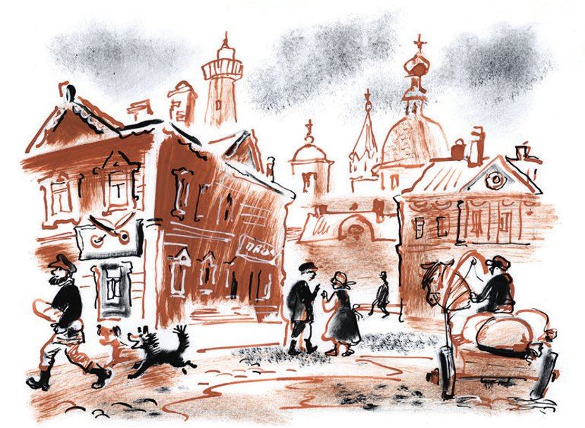
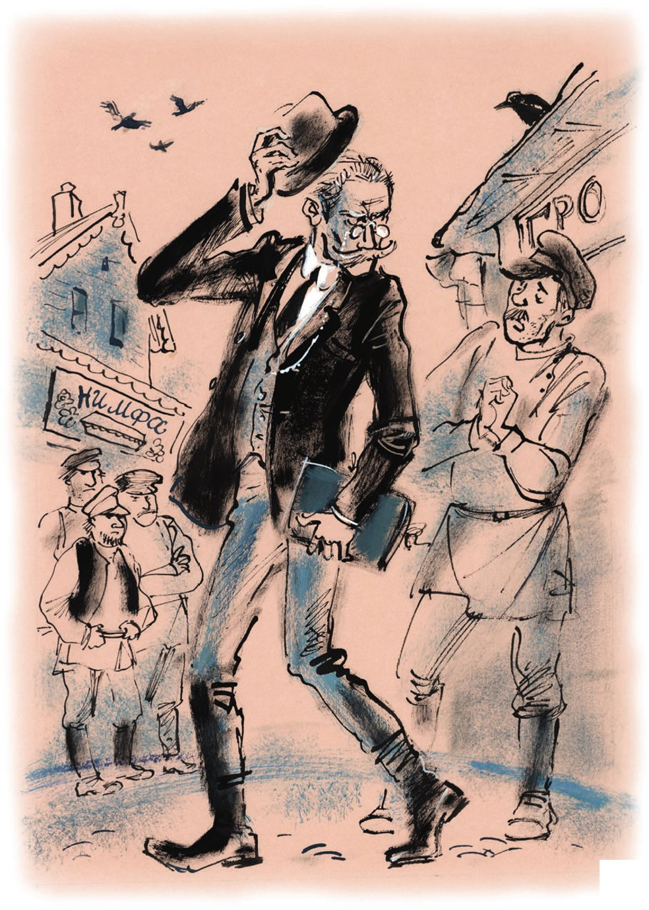

# Erster Teil: Der Löwe von Stargorod

## Kapitel 1: Besentschuk und die «Nymphen»

In der <abbr title="die Kreisstadt, die Kreisstädte — уездный город">Kreisstadt</abbr> N gibt es sehr viele Friseure und sehr viele <abbr title="das Beerdigungsbüro, die Beerdigungsbüros — похоронное бюро">Beerdigungsbüros</abbr>. Man denkt: Die Menschen in dieser Stadt kommen nur auf die Welt, und dann <abbr title="sich rasieren — бриться">rasieren sie sich</abbr>, lassen sich die Haare schneiden, bekommen ein bisschen <abbr title="das Haarwasser — лосьон для волос">Haarwasser</abbr> – und sterben sofort. Aber das stimmt nicht. In der Stadt N werden die Leute nur selten geboren, sie rasieren sich selten, und sie sterben auch selten. Das Leben in N ist sehr, sehr ruhig. Die Frühlingsabende sind <abbr title="wunderschön — прекрасный, упоительный">wunderschön</abbr>. Der <abbr title="der Schmutz — грязь">Schmutz</abbr> auf der Straße <abbr title="glänzen — блестеть, сверкать">glänzt</abbr> im <abbr title="das Mondlicht — лунный свет">Mondlicht</abbr> wie Kohle. Und alle jungen Männer in der Stadt sind in die Sekretärin von der <abbr title="die Gewerkschaft, die Gewerkschaften — профсоюз (местком)">Gewerkschaft</abbr> <abbr title="verliebt sein in + Akk. — быть влюблённым в">verliebt</abbr>. Sie sind so verliebt, dass die arme Frau nicht mehr arbeiten kann.

Liebe und <abbr title="der Tod — смерть">Tod</abbr> sind für Ippolit Matwejewitsch Worobjaninow kein Problem. <abbr title="dabei — при этом, хотя">Dabei</abbr> arbeitet er jeden Tag mit genau diesen Themen: von neun Uhr morgens bis fünf Uhr abends, mit einer halben Stunde Pause für das Frühstück.

Jeden Morgen trinkt er ein Glas heiße Milch. Seine <abbr title="die Schwiegermutter, die Schwiegermütter — тёща">Schwiegermutter</abbr>, Klawdija Iwanowna, bringt sie ihm. Dann verlässt er sein kleines, dunkles Haus und geht auf die Straße. Die Straße heißt «Genosse-Gubernski-Straße». Sie ist hell und breit und voll von Frühlingslicht. Es ist die schönste Straße, die man in einer Kreisstadt finden kann.

Links, hinter grünen Fenstern, glänzen die silbernen <abbr title="der Sarg, die Särge — гроб">Särge</abbr> vom Beerdigungsbüro «Nymphe». Rechts, hinter kleinen, schmutzigen Fenstern, liegen die Särge vom <abbr title="der Sargmacher, die Sargmacher — гробовщик, гробовых дел мастер">Sargmacher</abbr> Besentschuk. Sie sind aus <abbr title="das Eichenholz — дуб (древесина)">Eichenholz</abbr>, <abbr title="staubig — пыльный">staubig</abbr> und langweilig, und sie sehen sehr <abbr title="düster — мрачный, угрюмый">düster</abbr> aus. Etwas weiter hat der «Friseurmeister Pierre und Konstantin» seinen Laden. Er <abbr title="versprechen (versprach, hat versprochen) — обещать">verspricht</abbr> seinen <abbr title="der Kunde, die Kunden — клиент, покупатель">Kunden</abbr> «<abbr title="die Pflege — уход, холя">Pflege</abbr> der Nägel» und «Ondulasion zu Hause». Dann kommt ein Hotel mit einem Friseur. Und hinter dem Hotel, auf einem leeren Platz, steht ein junges, hellbraunes <abbr title="das Kalb, die Kälber — телёнок">Kalb</abbr>. Das Kalb <abbr title="lecken — лизать">leckt</abbr> <abbr title="zärtlich — нежно">zärtlich</abbr> an einem alten, <abbr title="rostig — ржавый">rostigen</abbr> <abbr title="das Schild, die Schilder — вывеска">Schild</abbr>. Auf dem Schild steht:

«Beerdigungsbüro „Herzlich willkommen“»

Es gibt also viele Beerdigungsbüros. Aber sie haben keine reichen Kunden. Das Büro «Herzlich willkommen» ist schon vor drei Jahren <abbr title="pleitegehen (ging pleite, ist pleitegegangen) — обанкротиться, лопнуть">pleitegegangen</abbr>. Und Meister Besentschuk trinkt zu viel. Einmal wollte er sogar seinen besten Sarg ins <abbr title="das Pfandhaus, die Pfandhäuser — ломбард">Pfandhaus</abbr> bringen.

Die Menschen in N sterben selten. Das weiß Ippolit Matwejewitsch besser als alle anderen. Denn er arbeitet auf dem <abbr title="das Standesamt, die Standesämter — ЗАГС">Standesamt</abbr>. Dort ist er für die Tode und die Hochzeiten <abbr title="zuständig sein für + Akk. — ведать, отвечать за">zuständig</abbr>.

Sein Schreibtisch sieht aus wie ein alter <abbr title="der Grabstein, die Grabsteine — надгробная плита">Grabstein</abbr>. Die linke Ecke haben die <abbr title="die Ratte, die Ratten — крыса">Ratten</abbr> gefressen. Die dünnen Beine vom Tisch <abbr title="zittern — дрожать, трястись">zittern</abbr>, denn auf dem Tisch liegen viele dicke, braune <abbr title="der Ordner, die Ordner — папка">Ordner</abbr>. In diesen Ordnern findet man alles über die Familien von der Stadt N. Wer hat wen geheiratet? Wer ist wann gestorben? Hier steht es.

Am Freitag, dem 15. April 1927, wacht Ippolit Matwejewitsch wie immer um halb acht auf. Sofort setzt er seinen alten <abbr title="der Kneifer, die Kneifer — пенсне">Kneifer</abbr> auf die Nase. Das ist eine Brille ohne <abbr title="der Bügel, die Bügel — дужка (очков)">Bügel</abbr>, mit einem kleinen goldenen <abbr title="der Rahmen, die Rahmen — оправа, рама">Rahmen</abbr>. Eine normale Brille trägt er nicht. Einmal hat er gedacht: «Ein Kneifer ist nicht <abbr title="hygienisch — гигиеничный">hygienisch</abbr>.» Er ist zum <abbr title="der Optiker, die Optiker — оптик">Optiker</abbr> gegangen und hat eine moderne Brille gekauft. Die Brille hat ihm gut gefallen. Aber seine Frau hat gesagt: «Mit dieser Brille siehst du genau aus wie Miljukow, der Politiker!» (Das war kurz vor ihrem Tod.) Da hat er die Brille dem <abbr title="der Hausmeister, die Hausmeister — дворник">Hausmeister</abbr> geschenkt. Der Hausmeister sieht eigentlich gut. Aber er hat <abbr title="sich gewöhnen an + Akk. — привыкнуть к">sich an die Brille gewöhnt</abbr>, und jetzt trägt er sie sehr gern.

— Bonjour! — singt Ippolit Matwejewitsch und stellt die Füße auf den Boden.

«Bonjour» bedeutet: Ippolit Matwejewitsch hat gute <abbr title="die Laune, die Launen — настроение">Laune</abbr>. Sagt er beim Aufwachen auf Deutsch «Guten Morgen», dann bedeutet das etwas anderes. Dann tut ihm die <abbr title="die Leber — печень">Leber</abbr> weh, dann denkt er: «Zweiundfünfzig Jahre sind kein Spaß», und dann ist das Wetter <abbr title="feucht — сырой, влажный">feucht</abbr>.

Ippolit Matwejewitsch zieht seine Hose an. Die Hose ist alt, sie ist noch von vor dem <abbr title="der Krieg, die Kriege — война">Krieg</abbr>. Unten bindet er sie mit <abbr title="das Band, die Bänder — тесёмка, лента">Bändern</abbr> fest. Dann zieht er kurze, weiche <abbr title="der Stiefel, die Stiefel — сапог">Stiefel</abbr> an. Fünf Minuten später trägt er schon seine <abbr title="die Weste, die Westen — жилет">Weste</abbr> mit kleinen silbernen Sternen und eine glänzende Jacke. Er <abbr title="wischen — смахивать, вытирать">wischt</abbr> sich die Wassertropfen aus den grauen Haaren. Er bewegt wild seinen <abbr title="der Schnurrbart, die Schnurrbärte — усы">Schnurrbart</abbr>. <abbr title="unsicher — неуверенно">Unsicher</abbr> fasst er an sein <abbr title="das Kinn, die Kinne — подбородок">Kinn</abbr> – soll er sich rasieren? Er <abbr title="bürsten — причёсывать щёткой">bürstet</abbr> seine kurzen, grauen Haare. Sie sehen aus wie <abbr title="das Aluminium — алюминий">Aluminium</abbr>. Dann lächelt er <abbr title="höflich — вежливо, учтиво">höflich</abbr> und geht seiner Schwiegermutter <abbr title="jemandem entgegengehen — идти навстречу кому-то">entgegen</abbr>. Klawdija Iwanowna kommt gerade ins Zimmer.

— Eppole-et! — <abbr title="donnern — греметь">donnert</abbr> sie. — Heute hatte ich einen schlechten Traum.

Das Wort «Traum» sagt sie mit französischem <abbr title="der Akzent, die Akzente — акцент, прононс">Akzent</abbr>.

Ippolit Matwejewitsch sieht von oben auf seine Schwiegermutter. Er ist 1,85 Meter groß. Von so weit oben ist es leicht, eine Schwiegermutter nicht so ernst zu nehmen.

Klawdija Iwanowna spricht weiter:

— Ich habe die <abbr title="verstorben — покойный">verstorbene</abbr> Marie gesehen. Sie hatte offene Haare und einen goldenen <abbr title="der Gürtel, die Gürtel — пояс, кушак">Gürtel</abbr>.

Ihre Stimme ist laut wie eine <abbr title="die Kanone, die Kanonen — пушка">Kanone</abbr>. Die alte Lampe an der <abbr title="die Decke, die Decken — потолок">Decke</abbr> zittert.

— Ich bin sehr <abbr title="beunruhigt — встревоженный">beunruhigt</abbr>. Ich habe Angst, dass etwas passiert.

Die letzten Worte sind so laut, dass sich die Haare auf dem Kopf von Ippolit Matwejewitsch bewegen. Er <abbr title="das Gesicht verziehen (verzog, hat verzogen) — морщиться, кривиться">verzieht das Gesicht</abbr> und sagt langsam und <abbr title="deutlich — отчётливо, раздельно">deutlich</abbr>:

— Nichts passiert, Maman. Haben Sie das Wasser schon bezahlt?

Nein, das Wasser hat sie nicht bezahlt. Die <abbr title="der Gummischuh, die Gummischuhe — калоша">Gummischuhe</abbr> hat sie auch nicht geputzt. Ippolit Matwejewitsch mag seine Schwiegermutter nicht. Klawdija Iwanowna ist dumm. Und sie ist schon so alt, dass sie bestimmt nicht mehr klüger wird. Sie ist auch sehr <abbr title="geizig — скупой">geizig</abbr>. Nur weil Ippolit Matwejewitsch arm ist, kann sie nicht noch geiziger sein. Ihre Stimme ist so stark, dass sogar König Richard Löwenherz <abbr title="neidisch sein auf + Akk. — завидовать">neidisch</abbr> ist. Und das Schlimmste: Klawdija Iwanowna hat Träume. Sie hat immer Träume. Sie träumt von Mädchen mit Gürteln, von Pferden mit gelben <abbr title="der Streifen, die Streifen — полоса, кант">Streifen</abbr>, von Hausmeistern, die <abbr title="die Harfe, die Harfen — арфа">Harfe</abbr> spielen, von <abbr title="der Engel, die Engel — ангел">Engeln</abbr> in dicken Wintermänteln, die nachts mit einer <abbr title="die Rassel, die Rasseln — колотушка, трещотка">Rassel</abbr> spazieren gehen. Und sie träumt von <abbr title="die Stricknadel, die Stricknadeln — вязальная спица">Stricknadeln</abbr>, die alleine durch das Zimmer springen und ein <abbr title="schrecklich — ужасный">schreckliches</abbr> «Kling-kling» machen. Klawdija Iwanowna ist eine leere, dumme alte Frau. <abbr title="außerdem — кроме того">Außerdem</abbr> hat sie unter der Nase einen Schnurrbart. Jedes Haar sieht aus wie ein <abbr title="der Rasierpinsel, die Rasierpinsel — кисточка для бритья">Rasierpinsel</abbr>.

Ippolit Matwejewitsch ist ein bisschen <abbr title="ärgerlich — раздражённый, сердитый">ärgerlich</abbr>. Er geht aus dem Haus. Vor seinem alten Laden steht der Sargmacher Besentschuk. Er <abbr title="lehnen an + Dat. — прислоняться к">lehnt</abbr> an der Tür und hat die Arme <abbr title="kreuzen — скрещивать">gekreuzt</abbr>. Seine Geschäfte gehen schon lange schlecht, und er trinkt schon lange viel <abbr title="der Schnaps, die Schnäpse — водка, шнапс">Schnaps</abbr>. Deshalb sind seine Augen ganz gelb, wie bei einer Katze, und sie brennen wie Feuer.

— Ehre dem lieben Gast! — ruft er schnell, als er Ippolit Matwejewitsch sieht. — Guten Morgen!

Ippolit Matwejewitsch hebt höflich seinen alten, <abbr title="fleckig — запятнанный">fleckigen</abbr> Hut.

— Und wie geht es der Frau Schwiegermutter, wenn ich fragen darf?

— Mrr-mrr-mrr, — antwortet Ippolit Matwejewitsch <abbr title="unklar — неопределённо">unklar</abbr>. Er <abbr title="mit den Schultern zucken — пожимать плечами">zuckt mit den Schultern</abbr> und geht weiter.

— Na, Gott gebe ihr Gesundheit, — sagt Besentschuk <abbr title="bitter — горько">bitter</abbr>. — Wir verdienen ja nichts, <abbr title="zum Kuckuck noch mal! — чёрт побери! (у Безенчука: «туды его в качель»)">zum Kuckuck noch mal</abbr>!

Er kreuzt wieder die Arme und lehnt sich an die Tür.

Vor dem Beerdigungsbüro «Nymphe» muss Ippolit Matwejewitsch wieder stehen bleiben.

Die «Nymphe» hat drei <abbr title="der Besitzer, die Besitzer — владелец">Besitzer</abbr>. Alle drei <abbr title="sich verbeugen — кланяться">verbeugen sich</abbr> <abbr title="gleichzeitig — одновременно">gleichzeitig</abbr>. Und alle drei fragen im <abbr title="der Chor, die Chöre — хор">Chor</abbr> nach der Gesundheit von der Schwiegermutter.

— Gesund, gesund, — antwortet Ippolit Matwejewitsch. — Was soll ihr schon passieren! Heute hat sie ein goldenes Mädchen mit offenen Haaren gesehen. Im Traum.

Die drei «Nymphen» sehen sich an und <abbr title="seufzen — вздыхать">seufzen</abbr> laut.

Wegen dieser Gespräche kommt Ippolit Matwejewitsch heute zu spät zur Arbeit. Über seinem Tisch hängt eine Uhr und darunter ein <abbr title="das Plakat, die Plakate — плакат, лозунг">Plakat</abbr>: «Arbeit fertig? Dann geh!» Die Uhr zeigt fünf nach neun.

Im Büro nennen alle Ippolit Matwejewitsch «Maciste». Maciste ist ein sehr großer, sehr starker Mann aus einem italienischen Film. Ippolit Matwejewitsch ist auch sehr groß, und er hat einen tollen Schnurrbart. Aber der echte Maciste hat gar keinen Schnurrbart.

Ippolit Matwejewitsch nimmt ein kleines blaues <abbr title="das Kissen, die Kissen — подушка, подушечка">Kissen</abbr> aus der <abbr title="die Schublade, die Schubladen — ящик стола">Schublade</abbr> und legt es auf den Stuhl. Er bringt seinen Schnurrbart in die richtige Position (parallel zum Tisch). Dann setzt er sich auf das Kissen. Jetzt sitzt er ein bisschen höher als seine drei Kollegen. Er hat keine Angst vor Krankheiten. Er hat nur Angst, dass seine Hose kaputtgeht. Deshalb sitzt er auf dem Kissen.

Zwei junge Leute <abbr title="beobachten — наблюдать, следить">beobachten</abbr> ihn <abbr title="schüchtern — застенчиво, робко">schüchtern</abbr>: ein Mann und ein Mädchen. Der Mann trägt eine dicke Jacke. Er hat Angst vor diesem Büro, vor dem <abbr title="der Geruch, die Gerüche — запах">Geruch</abbr> von <abbr title="die Tinte — чернила">Tinte</abbr>, vor der Uhr, die schwer und laut <abbr title="atmen — дышать">atmet</abbr>, und vor allem vor dem strengen Plakat «Arbeit fertig? Dann geh!». Der Mann hat seine Arbeit hier noch gar nicht angefangen. Aber er möchte schon gehen. Er denkt: «Unsere <abbr title="die Angelegenheit, die Angelegenheiten — дело">Angelegenheit</abbr> ist so klein! Wir dürfen diesen wichtigen grauen Herrn nicht stören.» Ippolit Matwejewitsch weiß auch: Die Angelegenheit von diesem Mann ist klein, sie kann warten. Deshalb öffnet er Ordner Nummer 2 und liest wichtig in seinen Papieren. Das Mädchen trägt eine lange Jacke mit schwarzen Bändern. Sie <abbr title="flüstern — шептать(ся)">flüstert</abbr> kurz mit dem Mann. Dann wird sie rot und geht langsam zu Ippolit Matwejewitsch.

— Genosse, — sagt sie, — wo kann man hier …

Der Mann atmet <abbr title="erleichtert — с облегчением">erleichtert</abbr> auf. Und plötzlich ruft er laut – er ist selbst <abbr title="überrascht — удивлённый">überrascht</abbr>:

— <abbr title="sich trauen lassen; sich trauen — пожениться (вступить в брак); также «осмелиться»">Uns trauen</abbr>!

Ippolit Matwejewitsch sieht das <abbr title="das Paar, die Paare — пара, чета">Paar</abbr> aufmerksam an.

— Geburt? Tod?

— Uns trauen, — wiederholt der Mann und sieht sich unsicher um.

Das Mädchen <abbr title="losprusten — прыснуть (со смеху)">prustet los</abbr>. Jetzt geht alles schnell. Ippolit Matwejewitsch arbeitet wie ein <abbr title="der Zauberer, die Zauberer — фокусник, волшебник">Zauberer</abbr>. Er schreibt die Namen in die dicken Bücher. Seine <abbr title="die Handschrift, die Handschriften — почерк">Handschrift</abbr> sieht aus wie die Handschrift von einer alten Frau. Er fragt streng die <abbr title="der Zeuge, die Zeugen — свидетель">Zeugen</abbr>. (Die <abbr title="die Braut, die Bräute — невеста">Braut</abbr> hat sie schnell vom Hof geholt.) Lange und zärtlich <abbr title="hauchen auf + Akk. — дышать на">haucht</abbr> er auf die <abbr title="der Stempel, die Stempel — печать, штамп">Stempel</abbr>. Dann steht er ein bisschen auf und drückt die Stempel in die alten Pässe. Das Paar bezahlt zwei Rubel. Ippolit Matwejewitsch gibt ihnen eine <abbr title="die Quittung, die Quittungen — квитанция">Quittung</abbr> und sagt mit einem Lächeln: «Für das heilige <abbr title="das Sakrament, die Sakramente — таинство">Sakrament</abbr>.» Dann steht er auf. Er ist sehr groß, und er macht eine breite Brust (früher hat er ein <abbr title="das Korsett, die Korsetts — корсет">Korsett</abbr> getragen). Dicke, gelbe <abbr title="der Sonnenstrahl, die Sonnenstrahlen — солнечный луч">Sonnenstrahlen</abbr> liegen auf seinen Schultern wie bei einem General. Er sieht ein bisschen lustig aus, aber auch sehr <abbr title="feierlich — торжественный">feierlich</abbr>. Sein Kneifer leuchtet wie ein <abbr title="der Scheinwerfer, die Scheinwerfer — прожектор">Scheinwerfer</abbr>. Die jungen Leute stehen da wie zwei kleine <abbr title="das Schaf, die Schafe — овца, барашек">Schafe</abbr>.

— Junge Leute, — sagt Ippolit Matwejewitsch feierlich, — ich <abbr title="gratulieren zu + Dat. — поздравлять с">gratuliere</abbr> Ihnen zu Ihrer <abbr title="die Ehe, die Ehen — брак">Ehe</abbr>, wie man früher gesagt hat. Es ist sehr, seeehr schön, junge Menschen wie Sie zu sehen. Hand in Hand gehen Sie zu den <abbr title="ewig — вечный">ewigen</abbr> <abbr title="das Ideal, die Ideale — идеал">Idealen</abbr>. Sehr, seeehr schön!

Dann gibt er den beiden die Hand, setzt sich wieder und liest weiter in Ordner Nummer 2. Er ist sehr <abbr title="zufrieden sein mit + Dat. — быть довольным чем-то">zufrieden mit sich</abbr>.

Am Nachbartisch lachen die Kollegen leise in ihre <abbr title="das Tintenfass, die Tintenfässer — чернильница">Tintenfässer</abbr>. Es klingt wie das <abbr title="grunzen — хрюкать">Grunzen</abbr> von Schweinen.

Dann wird der Arbeitstag ruhig. Niemand stört den Tisch für Tode und Hochzeiten. Durch das Fenster sieht man die Leute. Es ist kalt, und sie gehen nach Hause. Genau um zwölf Uhr <abbr title="krähen — кукарекать">kräht</abbr> ein <abbr title="der Hahn, die Hähne — петух">Hahn</abbr> in der <abbr title="die Genossenschaft, die Genossenschaften — кооператив">Genossenschaft</abbr> «Pflug und Hammer». Niemand <abbr title="sich wundern über + Akk. — удивляться">wundert sich</abbr>. Dann hört man ein lautes <abbr title="knattern — трещать, тарахтеть">Knattern</abbr>. Aus der Genosse-Gubernski-Straße kommt eine dicke, violette <abbr title="die Rauchwolke, die Rauchwolken — клуб дыма">Rauchwolke</abbr>. Das Knattern wird lauter. Aus dem Rauch kommt das Auto vom Kreiskomitee, das Auto Nummer 1. Es hat einen <abbr title="winzig — крошечный">winzigen</abbr> Motor und eine <abbr title="riesig — огромный">riesige</abbr> <abbr title="die Karosserie, die Karosserien — кузов">Karosserie</abbr>. Das Auto fährt <abbr title="schwanken — качаться, покачиваться">schwankend</abbr> durch den <abbr title="der Schlamm — грязь, слякоть">Schlamm</abbr>, über den Platz, und <abbr title="verschwinden (verschwand, ist verschwunden) — исчезать">verschwindet</abbr> im Rauch. Die Kollegen stehen noch lange am Fenster. Sie diskutieren: Was bedeutet das? Werden jetzt Leute im Büro <abbr title="entlassen (entließ, hat entlassen) — увольнять">entlassen</abbr>? Etwas später geht Meister Besentschuk vorsichtig am Fenster vorbei. Er läuft jeden Tag durch die ganze Stadt und fragt: «Ist vielleicht jemand gestorben?»

Dann kommt die halbe Stunde Frühstückspause. Alle essen und <abbr title="schmatzen — чавкать">schmatzen</abbr> laut. Eine alte Frau möchte ihren kleinen <abbr title="der Enkel, die Enkel — внук">Enkel</abbr> <abbr title="registrieren — регистрировать">registrieren</abbr>. Sie muss draußen auf dem Platz warten.

Der <abbr title="der Schreiber, die Schreiber — переписчик, писарь">Schreiber</abbr> Sapeschnikow beginnt wieder seine <abbr title="die Jagdgeschichte, die Jagdgeschichten — охотничий рассказ">Jagdgeschichten</abbr>. Alle kennen sie schon. Die Geschichten haben immer dieselbe <abbr title="die Moral — мораль, смысл">Moral</abbr>: Auf der <abbr title="die Jagd, die Jagden — охота">Jagd</abbr> ist es angenehm und sogar <abbr title="notwendig — необходимый">notwendig</abbr>, Wodka zu trinken. Mehr kann man von Sapeschnikow nicht <abbr title="erfahren (erfuhr, hat erfahren) — узнать">erfahren</abbr>.

— Nun ja, — sagt Ippolit Matwejewitsch <abbr title="ironisch — иронически">ironisch</abbr>. — Sie haben also gerade gesagt, Sie haben zwei halbe Flaschen <abbr title="leeren — опустошать, «раздавить»">geleert</abbr> … Und dann?

— Dann? Dann sage ich: Auf einen <abbr title="der Hase, die Hasen — заяц">Hasen</abbr> muss man mit großem <abbr title="der Schrot — дробь">Schrot</abbr> schießen … Na ja … Und Grigori Wassiljewitsch hat mit mir <abbr title="wetten — спорить, держать пари">gewettet</abbr> und verloren. Er hat eine Flasche bezahlt. Die haben wir getrunken, und dann noch ein <abbr title="das Gläschen, die Gläschen — рюмочка, стопочка">Gläschen</abbr>. So war das.

Ippolit Matwejewitsch <abbr title="brummen — ворчать, хмыкать">brummt</abbr> ärgerlich.

— Und die Hasen? Haben Sie mit großem Schrot auf sie geschossen?

— Warten Sie, <abbr title="unterbrechen (unterbrach, hat unterbrochen) — перебивать">unterbrechen</abbr> Sie mich nicht. Da kommt Donnikow mit seinem <abbr title="der Wagen, die Wagen — телега, повозка">Wagen</abbr>. Und unter dem <abbr title="das Stroh — солома">Stroh</abbr>, der <abbr title="der Gauner, die Gauner — жулик, бродяга">Gauner</abbr>, hat er eine ganz große Flasche <abbr title="verstecken — прятать">versteckt</abbr> …

Sapeschnikow lacht laut.

— Zu viert haben wir die ganze große Flasche <abbr title="schaffen — одолеть, справиться">geschafft</abbr>. Dann sind wir schlafen gegangen. Wir mussten ja früh auf die Jagd. Am Morgen stehen wir auf. Es ist noch dunkel und kalt. Also, ich hatte noch eine halbe Flasche. Die trinken wir. Wir merken: Das <abbr title="reichen — хватать, быть достаточным">reicht</abbr> nicht. Eine Frau im Dorf hat dann noch Wein gebracht. Sie hat dort <abbr title="heimlich — тайком">heimlich</abbr> Wein verkauft …

— Und wann haben Sie gejagt, wenn ich fragen darf?

— Na, dann eben … Was mit Grigori Wassiljewitsch los war! Ich, wissen Sie, mir wird nie schlecht … Und ich habe noch ein kleines <abbr title="das Fläschchen, die Fläschchen — бутылочка, «мерзавчик»">Fläschchen</abbr> getrunken, für den Kopf. Und Donnikow, der Gauner, ist wieder mit seinem Wagen weggefahren. Er sagt: «Bleibt hier, Jungs! Ich bringe noch was.» Und er hat natürlich noch was gebracht. Wir haben sogar den Hunden etwas gegeben …

— Und die Jagd?! Die Jagd! — rufen alle.

— Mit <abbr title="betrunken — пьяный">betrunkenen</abbr> Hunden? Was für eine Jagd soll das sein? — sagt Sapeschnikow <abbr title="beleidigt — обиженно">beleidigt</abbr>.

— So ein <abbr title="der Lausbub, die Lausbuben — мальчишка, сорванец">Lausbub</abbr>! — flüstert Ippolit Matwejewitsch <abbr title="empört — возмущённо">empört</abbr> und geht zu seinem Tisch.

So endet die halbe Stunde Frühstückspause.

Der Arbeitstag geht zu Ende. Am gelb-weißen <abbr title="der Kirchturm, die Kirchtürme — колокольня">Kirchturm</abbr> nebenan <abbr title="läuten — звонить (о колоколах)">läuten</abbr> die <abbr title="die Glocke, die Glocken — колокол">Glocken</abbr>, so laut sie können. Die Fenster zittern. Viele <abbr title="die Dohle, die Dohlen — галка">Dohlen</abbr> fliegen vom Turm, <abbr title="kreisen — кружить">kreisen</abbr> über dem Platz und fliegen weg. Der Abendhimmel über dem leeren Platz wird <abbr title="eisig — ледяной">eisig</abbr>.

Ins Büro kommt ein <abbr title="der Milizionär, die Milizionäre — милиционер">Milizionär</abbr>. Er hat einen roten Bart, eine <abbr title="die Mütze, die Mützen — фуражка, шапка">Mütze</abbr> und einen dicken <abbr title="der Pelzmantel, die Pelzmäntel — тулуп, шуба">Pelzmantel</abbr>. Unter dem Arm trägt er vorsichtig ein kleines, <abbr title="fettig — засаленный">fettiges</abbr> Heft. Schüchtern geht er in seinen riesigen Stiefeln zu Ippolit Matwejewitsch. Er lehnt sich mit der Brust an das dünne <abbr title="das Geländer, die Geländer — перила">Geländer</abbr>.

— Tag, Genosse, — sagt der Milizionär mit tiefer Stimme und nimmt ein großes Papier aus dem Heft. — Der Genosse Chef schickt mich. Sie sollen das hier registrieren.

Auf dem Papier steht:

«<abbr title="dienstlich — служебный">Dienstliche</abbr> <abbr title="die Notiz, die Notizen — записка">Notiz</abbr>. An das Standesamt. Genosse Worobjaninow! Sei so gut. Mir ist gerade ein Sohn geboren. Um 3 Uhr 15 heute Nacht. Registriere ihn bitte sofort, ohne <abbr title="die Warteschlange, die Warteschlangen — очередь">Warteschlange</abbr> und ohne <abbr title="die Bürokratie — бюрократия, волокита">Bürokratie</abbr>. Name des Sohnes – Iwan, Familienname – meiner. Mit kommunistischem Tschüss, <abbr title="stellvertretend — заместитель (зам.)">Stellvertretender</abbr> Chef der <abbr title="die Kreismiliz — уездная милиция">Kreismiliz</abbr>, Pererwin.»

Ippolit Matwejewitsch <abbr title="sich beeilen — спешить, торопиться">beeilt sich</abbr>. Ohne Bürokratie und ohne Warteschlange (es gibt hier sowieso nie eine Warteschlange) registriert er das Kind der Kreismiliz.

Der Milizionär riecht nach Tabak, so stark wie Peter der Große. Ippolit Matwejewitsch ist ein feiner Mensch. Erst als der Milizionär gegangen ist, kann er wieder frei atmen.

Auch für Ippolit Matwejewitsch ist es jetzt Zeit, nach Hause zu gehen. Alles, was heute geboren werden sollte, ist geboren und steht in den dicken Büchern. Alle, die heiraten wollten, sind <abbr title="verheiratet — женатый, замужняя">verheiratet</abbr> und stehen auch in den dicken Büchern. Nur gestorben ist heute niemand. Kein <abbr title="einzig — единственный">einziger</abbr> Mensch. Für die Sargmacher ist das eine <abbr title="die Katastrophe, die Katastrophen — катастрофа, разорение">Katastrophe</abbr>. Ippolit Matwejewitsch <abbr title="aufräumen — убирать, складывать">räumt</abbr> seine Papiere auf. Er legt das Kissen in die Schublade. Er <abbr title="kämmen — причёсывать гребнем">kämmt</abbr> seinen Schnurrbart. Er denkt schon an eine heiße Suppe und will gerade gehen – da geht plötzlich die Tür auf. In der Tür steht der Sargmacher Besentschuk.

— Ehre dem lieben Gast! — sagt Ippolit Matwejewitsch und lächelt. — Was gibt’s?

Das wilde Gesicht von Besentschuk <abbr title="strahlen — сиять">strahlt</abbr> in der <abbr title="die Dämmerung — сумерки">Dämmerung</abbr>. Aber er kann nichts sagen.

— Na? — fragt Ippolit Matwejewitsch etwas strenger.

— Die «Nymphe», zum Kuckuck noch mal, haben die etwa gute <abbr title="die Ware, die Waren — товар">Ware</abbr>? — sagt der Sargmacher unklar. — Können die einen Kunden <abbr title="zufriedenstellen — удовлетворить">zufriedenstellen</abbr>? So ein Sarg, der braucht viel Holz …

— Was? — fragt Ippolit Matwejewitsch.

— Na, die «Nymphe» … Drei Familien leben von einem kleinen Geschäft. Ihr <abbr title="das Material, die Materialien — материал">Material</abbr> ist schlecht, die Arbeit ist schlecht, und die Farbe ist dünn, zum Kuckuck noch mal. Aber ich, ich bin eine alte <abbr title="die Firma, die Firmen — фирма">Firma</abbr>. <abbr title="gründen — основывать">Gegründet</abbr> 1907. Meine Särge sind wie frische <abbr title="die Gurke, die Gurken — огурец">Gurken</abbr>. Erste <abbr title="die Qualität, die Qualitäten — качество">Qualität</abbr>, für <abbr title="der Kenner, die Kenner — знаток, любитель">Kenner</abbr> …

— Bist du <abbr title="verrückt — сумасшедший">verrückt</abbr> geworden? — fragt Ippolit Matwejewitsch <abbr title="sanft — кротко, мягко">sanft</abbr> und geht zum <abbr title="der Ausgang, die Ausgänge — выход">Ausgang</abbr>. — Du wirst noch ganz verrückt zwischen deinen Särgen.

Besentschuk <abbr title="aufreißen (riss auf, hat aufgerissen) — распахнуть, рвануть">reißt</abbr> schnell die Tür auf und lässt Ippolit Matwejewitsch <abbr title="vorgehen (ging vor, ist vorgegangen) — пропустить вперёд, идти впереди">vorgehen</abbr>. Dann läuft er ihm nach. Er zittert fast vor <abbr title="die Ungeduld — нетерпение">Ungeduld</abbr>.

— Früher, als es «Herzlich willkommen» noch gab, ja, da war es anders! Gegen deren Särge mit <abbr title="der Goldstoff — глазет (парча)">Goldstoff</abbr> hatte keine Firma eine Chance, nicht mal in Twer, zum Kuckuck noch mal. Aber heute sage ich ganz ehrlich: Meine Ware ist die beste. Sie brauchen gar nicht weiter zu suchen.

Ippolit Matwejewitsch dreht sich <abbr title="wütend — сердито, в гневе">wütend</abbr> um. Eine Sekunde sieht er Besentschuk böse an. Dann geht er schneller. Bei der Arbeit war heute alles in Ordnung. Aber jetzt fühlt er sich <abbr title="ziemlich — довольно">ziemlich</abbr> <abbr title="mies — паршиво, гадко">mies</abbr>.

Die drei Besitzer von der «Nymphe» stehen vor ihrem Büro. Sie stehen genau so da wie heute Morgen. Man denkt: Sie haben <abbr title="seitdem — с тех пор">seitdem</abbr> kein Wort gesprochen. Aber ihre Gesichter sind ganz anders als am Morgen. In ihren Augen ist ein <abbr title="geheimnisvoll — таинственный">geheimnisvolles</abbr>, zufriedenes Licht. Sie wissen <abbr title="offenbar — очевидно, по-видимому">offenbar</abbr> etwas Wichtiges.

Besentschuk sieht seine <abbr title="der Konkurrent, die Konkurrenten — конкурент">Konkurrenten</abbr>. <abbr title="verzweifelt — отчаянно">Verzweifelt</abbr> <abbr title="winken — махать">winkt</abbr> er mit der Hand, bleibt stehen und flüstert Worobjaninow nach:

— Ich mache Ihnen einen Preis: zweiunddreißig Rubel.

Ippolit Matwejewitsch verzieht das Gesicht und geht schneller.

— Sie können auch <abbr title="in Raten zahlen — платить в рассрочку (в кредит)">in Raten</abbr> zahlen, — sagt Besentschuk noch.

Die drei Besitzer von der «Nymphe» sagen nichts. Sie laufen <abbr title="schweigen (schwieg, hat geschwiegen) — молчать">schweigend</abbr> hinter Worobjaninow her. Beim Laufen nehmen sie immer wieder ihre Mützen ab und verbeugen sich höflich.

Diese dummen Sargmacher machen Ippolit Matwejewitsch ganz wütend. Schneller als sonst läuft er die Treppe zu seinem Haus hinauf. Er <abbr title="abkratzen — соскребать">kratzt</abbr> ärgerlich den Schmutz von den Schuhen ab. Er hat großen Hunger. Er geht in den Flur. Da kommt ihm jemand aus dem Zimmer entgegen: Vater Fjodor, der <abbr title="der Priester, die Priester — священник">Priester</abbr> von der Kirche Frol und Lawr. Sein Gesicht ist rot und heiß. Er hält mit der rechten Hand seinen langen <abbr title="der Priesterrock, die Priesterröcke — ряса">Priesterrock</abbr> fest, sieht Ippolit Matwejewitsch gar nicht und <abbr title="eilen — спешить, нестись">eilt</abbr> hinaus.

Jetzt sieht Ippolit Matwejewitsch: Die Wohnung ist zu sauber. Die wenigen <abbr title="die Möbel (Pl.) — мебель">Möbel</abbr> stehen anders als sonst. Und es riecht stark nach Medizin. In seiner Nase <abbr title="kitzeln — щекотать">kitzelt</abbr> es. Im ersten Zimmer wartet die <abbr title="die Nachbarin, die Nachbarinnen — соседка">Nachbarin</abbr>, die <abbr title="die Agronomin, die Agronominnen — агрономша">Agronomin</abbr> Kusnezowa. Sie flüstert und winkt mit den Händen.

— Es geht ihr schlechter. Sie hat gerade <abbr title="beichten — исповедоваться">gebeichtet</abbr>. Laufen Sie nicht so laut mit den Stiefeln.

— Ich laufe nicht laut, — antwortet Ippolit Matwejewitsch <abbr title="brav — покорно, послушно">brav</abbr>. — Was ist denn passiert?

Frau Kusnezowa macht den Mund klein und zeigt auf die Tür vom zweiten Zimmer.

— Ein ganz schwerer <abbr title="der Herzanfall, die Herzanfälle — сердечный приступ">Herzanfall</abbr>.

Dann sagt sie noch einen Satz. Diesen Satz hat sie offenbar von jemand anderem gehört. Er klingt so wichtig, dass er ihr gut gefällt:

— Ein <abbr title="tödlich — смертельный">tödlicher</abbr> Ausgang ist nicht <abbr title="ausgeschlossen — исключённый">ausgeschlossen</abbr>. Ich bin heute schon den ganzen Tag <abbr title="auf den Beinen sein — быть на ногах">auf den Beinen</abbr>. Am Morgen komme ich wegen dem <abbr title="der Fleischwolf, die Fleischwölfe — мясорубка">Fleischwolf</abbr>, und was sehe ich? Die Tür ist offen, in der Küche ist niemand, in diesem Zimmer auch nicht. Na, ich denke, Klawdija Iwanowna ist <abbr title="das Mehl — мука">Mehl</abbr> kaufen gegangen, für den <abbr title="der Osterkuchen, die Osterkuchen — кулич">Osterkuchen</abbr>. Das wollte sie neulich schon. Mehl, das wissen Sie ja, wenn man es nicht früh kauft …

Frau Kusnezowa möchte noch lange erzählen: über das Mehl, über die hohen Preise und darüber, wie sie Klawdija Iwanowna gefunden hat – auf dem Boden neben dem <abbr title="der Ofen, die Öfen — печь">Ofen</abbr>, fast wie tot. Aber da hört Ippolit Matwejewitsch aus dem Nebenzimmer ein <abbr title="stöhnen — стонать">Stöhnen</abbr>. Das Stöhnen tut ihm in den Ohren weh. Schnell macht er mit seiner <abbr title="taub — онемевший; глухой">tauben</abbr> Hand ein <abbr title="das Kreuzzeichen — крестное знамение">Kreuzzeichen</abbr> und geht in das Zimmer von seiner Schwiegermutter.

---

### Neue Wörter

- **die Kreisstadt, die Kreisstädte** — уездный город
- **das Beerdigungsbüro, die Beerdigungsbüros** — похоронное бюро
- **sich rasieren** — бриться
- **das Haarwasser** — лосьон для волос
- **wunderschön** — прекрасный, упоительный
- **der Schmutz** — грязь
- **glänzen** — блестеть, сверкать
- **das Mondlicht** — лунный свет
- **die Gewerkschaft, die Gewerkschaften** — профсоюз (местком)
- **verliebt sein in + Akk.** — быть влюблённым в
- **der Tod** — смерть
- **dabei** — при этом, хотя
- **die Schwiegermutter, die Schwiegermütter** — тёща
- **der Sarg, die Särge** — гроб
- **der Sargmacher, die Sargmacher** — гробовщик, гробовых дел мастер
- **das Eichenholz** — дуб (древесина)
- **staubig** — пыльный
- **düster** — мрачный, угрюмый
- **versprechen (versprach, hat versprochen)** — обещать
- **der Kunde, die Kunden** — клиент, покупатель
- **die Pflege** — уход, холя
- **das Kalb, die Kälber** — телёнок
- **lecken** — лизать
- **zärtlich** — нежно
- **rostig** — ржавый
- **das Schild, die Schilder** — вывеска
- **pleitegehen (ging pleite, ist pleitegegangen)** — обанкротиться, лопнуть
- **das Pfandhaus, die Pfandhäuser** — ломбард
- **das Standesamt, die Standesämter** — ЗАГС
- **zuständig sein für + Akk.** — ведать, отвечать за
- **der Grabstein, die Grabsteine** — надгробная плита
- **die Ratte, die Ratten** — крыса
- **zittern** — дрожать, трястись
- **der Ordner, die Ordner** — папка
- **der Kneifer, die Kneifer** — пенсне
- **der Bügel, die Bügel** — дужка (очков)
- **der Rahmen, die Rahmen** — оправа, рама
- **hygienisch** — гигиеничный
- **der Optiker, die Optiker** — оптик
- **der Hausmeister, die Hausmeister** — дворник
- **sich gewöhnen an + Akk.** — привыкнуть к
- **die Laune, die Launen** — настроение
- **die Leber** — печень
- **feucht** — сырой, влажный
- **der Krieg, die Kriege** — война
- **das Band, die Bänder** — тесёмка, лента
- **der Stiefel, die Stiefel** — сапог
- **die Weste, die Westen** — жилет
- **wischen** — смахивать, вытирать
- **der Schnurrbart, die Schnurrbärte** — усы
- **unsicher** — неуверенно
- **das Kinn, die Kinne** — подбородок
- **bürsten** — причёсывать щёткой
- **das Aluminium** — алюминий
- **höflich** — вежливо, учтиво
- **jemandem entgegengehen** — идти навстречу кому-то
- **donnern** — греметь
- **der Akzent, die Akzente** — акцент, прононс
- **verstorben** — покойный
- **der Gürtel, die Gürtel** — пояс, кушак
- **die Kanone, die Kanonen** — пушка
- **die Decke, die Decken** — потолок
- **beunruhigt** — встревоженный
- **das Gesicht verziehen (verzog, hat verzogen)** — морщиться, кривиться
- **deutlich** — отчётливо, раздельно
- **der Gummischuh, die Gummischuhe** — калоша
- **geizig** — скупой
- **neidisch sein auf + Akk.** — завидовать
- **der Streifen, die Streifen** — полоса, кант
- **die Harfe, die Harfen** — арфа
- **der Engel, die Engel** — ангел
- **die Rassel, die Rasseln** — колотушка, трещотка
- **die Stricknadel, die Stricknadeln** — вязальная спица
- **schrecklich** — ужасный
- **außerdem** — кроме того
- **der Rasierpinsel, die Rasierpinsel** — кисточка для бритья
- **ärgerlich** — раздражённый, сердитый
- **lehnen an + Dat.** — прислоняться к
- **kreuzen** — скрещивать
- **der Schnaps, die Schnäpse** — водка, шнапс
- **fleckig** — запятнанный
- **unklar** — неопределённо
- **mit den Schultern zucken** — пожимать плечами
- **bitter** — горько
- **zum Kuckuck noch mal!** — чёрт побери! (у Безенчука: «туды его в качель»)
- **der Besitzer, die Besitzer** — владелец
- **sich verbeugen** — кланяться
- **gleichzeitig** — одновременно
- **der Chor, die Chöre** — хор
- **seufzen** — вздыхать
- **das Plakat, die Plakate** — плакат, лозунг
- **das Kissen, die Kissen** — подушка, подушечка
- **die Schublade, die Schubladen** — ящик стола
- **beobachten** — наблюдать, следить
- **schüchtern** — застенчиво, робко
- **der Geruch, die Gerüche** — запах
- **die Tinte** — чернила
- **atmen** — дышать
- **die Angelegenheit, die Angelegenheiten** — дело
- **flüstern** — шептать(ся)
- **erleichtert** — с облегчением
- **überrascht** — удивлённый
- **sich trauen lassen; sich trauen** — пожениться (вступить в брак); также «осмелиться»
- **das Paar, die Paare** — пара, чета
- **losprusten** — прыснуть (со смеху)
- **der Zauberer, die Zauberer** — фокусник, волшебник
- **die Handschrift, die Handschriften** — почерк
- **der Zeuge, die Zeugen** — свидетель
- **die Braut, die Bräute** — невеста
- **hauchen auf + Akk.** — дышать на
- **der Stempel, die Stempel** — печать, штамп
- **die Quittung, die Quittungen** — квитанция
- **das Sakrament, die Sakramente** — таинство
- **das Korsett, die Korsetts** — корсет
- **der Sonnenstrahl, die Sonnenstrahlen** — солнечный луч
- **feierlich** — торжественный
- **der Scheinwerfer, die Scheinwerfer** — прожектор
- **das Schaf, die Schafe** — овца, барашек
- **gratulieren zu + Dat.** — поздравлять с
- **die Ehe, die Ehen** — брак
- **ewig** — вечный
- **das Ideal, die Ideale** — идеал
- **zufrieden sein mit + Dat.** — быть довольным чем-то
- **das Tintenfass, die Tintenfässer** — чернильница
- **grunzen** — хрюкать
- **krähen** — кукарекать
- **der Hahn, die Hähne** — петух
- **die Genossenschaft, die Genossenschaften** — кооператив
- **sich wundern über + Akk.** — удивляться
- **knattern** — трещать, тарахтеть
- **die Rauchwolke, die Rauchwolken** — клуб дыма
- **winzig** — крошечный
- **riesig** — огромный
- **die Karosserie, die Karosserien** — кузов
- **schwanken** — качаться, покачиваться
- **der Schlamm** — грязь, слякоть
- **verschwinden (verschwand, ist verschwunden)** — исчезать
- **entlassen (entließ, hat entlassen)** — увольнять
- **schmatzen** — чавкать
- **der Enkel, die Enkel** — внук
- **registrieren** — регистрировать
- **der Schreiber, die Schreiber** — переписчик, писарь
- **die Jagdgeschichte, die Jagdgeschichten** — охотничий рассказ
- **die Moral** — мораль, смысл
- **die Jagd, die Jagden** — охота
- **notwendig** — необходимый
- **erfahren (erfuhr, hat erfahren)** — узнать
- **ironisch** — иронически
- **leeren** — опустошать, «раздавить»
- **der Hase, die Hasen** — заяц
- **der Schrot** — дробь
- **wetten** — спорить, держать пари
- **das Gläschen, die Gläschen** — рюмочка, стопочка
- **brummen** — ворчать, хмыкать
- **unterbrechen (unterbrach, hat unterbrochen)** — перебивать
- **der Wagen, die Wagen** — телега, повозка
- **das Stroh** — солома
- **der Gauner, die Gauner** — жулик, бродяга
- **verstecken** — прятать
- **schaffen** — одолеть, справиться
- **reichen** — хватать, быть достаточным
- **heimlich** — тайком
- **das Fläschchen, die Fläschchen** — бутылочка, «мерзавчик»
- **betrunken** — пьяный
- **beleidigt** — обиженно
- **der Lausbub, die Lausbuben** — мальчишка, сорванец
- **empört** — возмущённо
- **der Kirchturm, die Kirchtürme** — колокольня
- **läuten** — звонить (о колоколах)
- **die Glocke, die Glocken** — колокол
- **die Dohle, die Dohlen** — галка
- **kreisen** — кружить
- **eisig** — ледяной
- **der Milizionär, die Milizionäre** — милиционер
- **die Mütze, die Mützen** — фуражка, шапка
- **der Pelzmantel, die Pelzmäntel** — тулуп, шуба
- **fettig** — засаленный
- **das Geländer, die Geländer** — перила
- **dienstlich** — служебный
- **die Notiz, die Notizen** — записка
- **die Warteschlange, die Warteschlangen** — очередь
- **die Bürokratie** — бюрократия, волокита
- **stellvertretend** — заместитель (зам.)
- **die Kreismiliz** — уездная милиция
- **sich beeilen** — спешить, торопиться
- **verheiratet** — женатый, замужняя
- **einzig** — единственный
- **die Katastrophe, die Katastrophen** — катастрофа, разорение
- **aufräumen** — убирать, складывать
- **kämmen** — причёсывать гребнем
- **strahlen** — сиять
- **die Dämmerung** — сумерки
- **die Ware, die Waren** — товар
- **zufriedenstellen** — удовлетворить
- **das Material, die Materialien** — материал
- **die Firma, die Firmen** — фирма
- **gründen** — основывать
- **die Gurke, die Gurken** — огурец
- **die Qualität, die Qualitäten** — качество
- **der Kenner, die Kenner** — знаток, любитель
- **verrückt** — сумасшедший
- **sanft** — кротко, мягко
- **der Ausgang, die Ausgänge** — выход
- **aufreißen (riss auf, hat aufgerissen)** — распахнуть, рвануть
- **vorgehen (ging vor, ist vorgegangen)** — пропустить вперёд, идти впереди
- **die Ungeduld** — нетерпение
- **der Goldstoff** — глазет (парча)
- **wütend** — сердито, в гневе
- **ziemlich** — довольно
- **mies** — паршиво, гадко
- **seitdem** — с тех пор
- **geheimnisvoll** — таинственный
- **offenbar** — очевидно, по-видимому
- **der Konkurrent, die Konkurrenten** — конкурент
- **verzweifelt** — отчаянно
- **winken** — махать
- **in Raten zahlen** — платить в рассрочку (в кредит)
- **schweigen (schwieg, hat geschwiegen)** — молчать
- **abkratzen** — соскребать
- **der Priester, die Priester** — священник
- **der Priesterrock, die Priesterröcke** — ряса
- **eilen** — спешить, нестись
- **die Möbel (Pl.)** — мебель
- **kitzeln** — щекотать
- **die Nachbarin, die Nachbarinnen** — соседка
- **die Agronomin, die Agronominnen** — агрономша
- **beichten** — исповедоваться
- **brav** — покорно, послушно
- **der Herzanfall, die Herzanfälle** — сердечный приступ
- **tödlich** — смертельный
- **ausgeschlossen** — исключённый
- **auf den Beinen sein** — быть на ногах
- **der Fleischwolf, die Fleischwölfe** — мясорубка
- **das Mehl** — мука
- **der Osterkuchen, die Osterkuchen** — кулич
- **der Ofen, die Öfen** — печь
- **stöhnen** — стонать
- **taub** — онемевший; глухой
- **das Kreuzzeichen** — крестное знамение

[Inhalt](README.md) · [Kapitel 2 →](kapitel-02.md)
