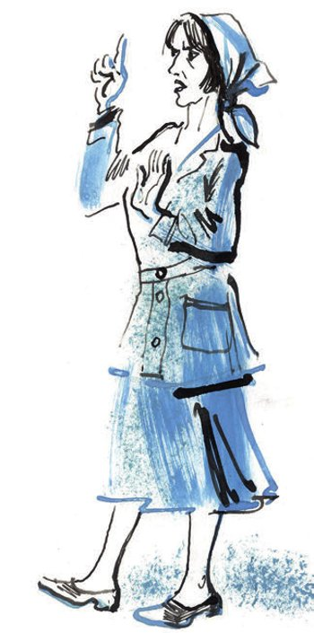
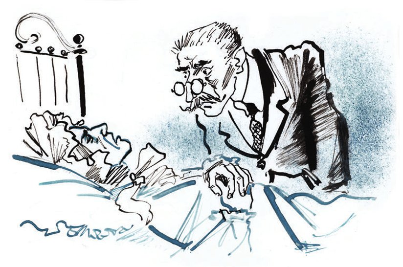

## Kapitel 2: Der Tod von Madame Petuchowa

Klawdija Iwanowna liegt auf dem Rücken. Eine Hand hat sie unter den Kopf gelegt. Auf dem Kopf trägt sie eine <abbr title="die Haube, die Hauben — чепец">Haube</abbr> in einer <abbr title="grell — яркий, кричащий">grellen</abbr> <abbr title="die Aprikosenfarbe — абрикосовый цвет">Aprikosenfarbe</abbr>. So eine Haube war irgendwann in irgendeinem Jahr modern. Damals haben die Damen Hüte «Chantecler» getragen. Und man hat gerade angefangen, einen argentinischen Tanz zu tanzen: den «Tango».

Das Gesicht von Klawdija Iwanowna ist feierlich, aber es <abbr title="ausdrücken — выражать">drückt</abbr> gar nichts aus. Die Augen sehen an die Decke.

— Klawdija Iwanowna! — ruft Worobjaninow.

Die Schwiegermutter bewegt schnell die <abbr title="die Lippe, die Lippen — губа">Lippen</abbr>. Ippolit Matwejewitsch <abbr title="erwarten — ожидать">erwartet</abbr> ihre laute Stimme, die wie eine <abbr title="die Trompete, die Trompeten — труба">Trompete</abbr> klingt. Aber er hört nur ein Stöhnen. Es ist leise, dünn und so <abbr title="kläglich — жалобный, жалостный">kläglich</abbr>, dass sein Herz zittert. Eine glänzende <abbr title="die Träne, die Tränen — слеза">Träne</abbr> kommt plötzlich aus ihrem Auge. Sie <abbr title="rollen — катиться">rollt</abbr> schnell über das Gesicht, wie <abbr title="das Quecksilber — ртуть">Quecksilber</abbr>.

— Klawdija Iwanowna, — wiederholt Worobjaninow, — was ist mit Ihnen?

Aber wieder bekommt er keine Antwort. Die alte Frau schließt die Augen und fällt ein bisschen auf die Seite.

Leise kommt die Agronomin ins Zimmer. Sie nimmt Ippolit Matwejewitsch an der Hand und führt ihn hinaus, wie einen kleinen Jungen, der sich waschen soll.

— Sie schläft. Der Arzt hat gesagt: Man darf sie nicht stören. Wissen Sie was, <abbr title="mein Lieber — голубчик">mein Lieber</abbr>? Gehen Sie in die <abbr title="die Apotheke, die Apotheken — аптека">Apotheke</abbr>. Hier ist das <abbr title="das Rezept, die Rezepte — рецепт">Rezept</abbr>. Und fragen Sie, was ein <abbr title="der Eisbeutel, die Eisbeutel — пузырь для льда">Eisbeutel</abbr> kostet.

Ippolit Matwejewitsch <abbr title="gehorchen — слушаться, подчиняться">gehorcht</abbr> Frau Kusnezowa in allem. Er fühlt: In solchen Dingen ist sie viel erfahrener als er.

Die Apotheke ist weit weg. Ippolit Matwejewitsch hält das Rezept fest in der <abbr title="die Faust, die Fäuste — кулак">Faust</abbr>, wie ein Schüler, und läuft schnell auf die Straße.

Es ist schon fast dunkel. Am Himmel <abbr title="verglühen — догорать, угасать">verglüht</abbr> das letzte Abendrot. Vor dem roten Himmel sieht man die kleine, <abbr title="mager — тощий, тщедушный">magere</abbr> <abbr title="die Gestalt, die Gestalten — фигура">Gestalt</abbr> von Besentschuk. Er lehnt an seinem Holztor und isst Brot mit <abbr title="die Zwiebel, die Zwiebeln — лук">Zwiebeln</abbr>. Gleich daneben <abbr title="hocken — сидеть на корточках">hocken</abbr> die drei «Nymphen». Sie essen <abbr title="der Buchweizenbrei — гречневая каша">Buchweizenbrei</abbr> aus einem kleinen <abbr title="gusseisern — чугунный">gusseisernen</abbr> Topf und lecken ihre <abbr title="der Löffel, die Löffel — ложка">Löffel</abbr> ab. Als sie Ippolit Matwejewitsch sehen, stehen die Sargmacher <abbr title="gerade — прямо, навытяжку">gerade</abbr> wie Soldaten. Besentschuk zuckt beleidigt mit den Schultern. Er zeigt mit der Hand auf seine Konkurrenten und brummt:

— Die laufen einem nur zwischen den Füßen herum, zum Kuckuck noch mal.

Mitten auf dem Staropanski-Platz steht eine kleine <abbr title="die Büste, die Büsten — бюст">Büste</abbr> von dem Dichter Schukowski. Auf dem <abbr title="der Sockel, die Sockel — цоколь, постамент">Sockel</abbr> steht: «Die Poesie ist Gott in den heiligen Träumen von der Erde.» Hier sprechen die Leute <abbr title="lebhaft — оживлённо">lebhaft</abbr> miteinander. Alle haben die Nachricht schon gehört: Klawdija Iwanowna ist <abbr title="schwer krank — тяжело больной">schwer krank</abbr>. Die Bürger sind sich einig: «Wir müssen alle einmal dorthin» und «Gott hat es gegeben, Gott hat es genommen».

Auch der Friseur «Pierre und Konstantin» ist hier. (Eigentlich heißt er Andrej Iwanowitsch, und auf diesen Namen hört er auch gern.) Er weiß viel über Medizin. Das hat er alles aus der Moskauer <abbr title="die Zeitschrift, die Zeitschriften — журнал">Zeitschrift</abbr> «Ogonjok» gelernt. Und er <abbr title="verpassen — упускать">verpasst</abbr> keine <abbr title="die Gelegenheit, die Gelegenheiten — случай, возможность">Gelegenheit</abbr>, sein <abbr title="das Wissen — знания">Wissen</abbr> zu zeigen.

— Die moderne <abbr title="die Wissenschaft, die Wissenschaften — наука">Wissenschaft</abbr>, — sagt Andrej Iwanowitsch, — kann heute das Unmögliche. Zum Beispiel: Ein Kunde hat einen <abbr title="der Pickel, die Pickel — прыщик">Pickel</abbr> am Kinn. Früher ist daraus oft eine <abbr title="die Blutvergiftung, die Blutvergiftungen — заражение крови">Blutvergiftung</abbr> geworden. Aber heute, in Moskau – ich weiß nicht, ob es stimmt oder nicht –, bekommt jeder Kunde einen eigenen, <abbr title="steril — стерильный">sterilen</abbr> Rasierpinsel.

Die Bürger seufzen lange.

— Na, Andrej, da <abbr title="übertreiben (übertrieb, hat übertrieben) — преувеличивать">übertreibst</abbr> du ein bisschen …

— Wo hat man so was schon gesehen? Für jeden Menschen einen eigenen Pinsel? Was der sich <abbr title="sich ausdenken (dachte aus, hat ausgedacht) — выдумывать">ausdenkt</abbr>!

Prusis war früher ein «Proletarier der Kopfarbeit». Jetzt hat er einen <abbr title="der Kiosk, die Kioske — ларёк, палатка">Kiosk</abbr>. Er wird sogar richtig <abbr title="nervös — нервный">nervös</abbr>.

— Erlauben Sie, Andrej Iwanowitsch! In Moskau leben nach der letzten <abbr title="die Volkszählung, die Volkszählungen — перепись населения">Volkszählung</abbr> mehr als zwei Millionen Menschen. Dann braucht man also mehr als zwei Millionen Pinsel? Sehr <abbr title="originell — оригинально">originell</abbr>!

Das Gespräch wird immer heißer. Wer weiß, wie es endet! Aber da sieht man am Ende von der Ossypnaja-Straße Ippolit Matwejewitsch. Er läuft im <abbr title="der Passgang — иноходь">Passgang</abbr>, wie ein Pferd.

— Er läuft schon wieder in die Apotheke. Es steht also schlecht.

— Die Alte stirbt. Nicht <abbr title="umsonst — недаром; даром">umsonst</abbr> läuft Besentschuk so aufgeregt durch die Stadt.

— Und was sagt der Arzt?

— Ach, der Arzt! Sind das etwa Ärzte, in der <abbr title="die Krankenkasse, die Krankenkassen — страхкасса, больничная касса">Krankenkasse</abbr>? Die behandeln sogar einen Gesunden <abbr title="zu Tode — до смерти">zu Tode</abbr>!

«Pierre und Konstantin» möchte schon lange etwas über Medizin sagen. Jetzt sieht er sich vorsichtig nach allen Seiten um und sagt:

— Heute liegt die ganze Kraft im <abbr title="das Hämoglobin — гемоглобин">Hämoglobin</abbr>.

Dann schweigt «Pierre und Konstantin».

Auch die Bürger schweigen. Jeder denkt auf seine Art über die geheimnisvollen Kräfte vom Hämoglobin nach.

Dann steigt der Mond auf. Sein <abbr title="minzgrün — мятный (цвет)">minzgrünes</abbr> Licht fällt auf die kleine Büste von Schukowski. Jetzt kann man auf ihrem <abbr title="kupfern — медный">kupfernen</abbr> Rücken deutlich ein kurzes <abbr title="das Schimpfwort, die Schimpfwörter — ругательство">Schimpfwort</abbr> lesen. Es ist mit <abbr title="die Kreide — мел">Kreide</abbr> geschrieben. Zum ersten Mal hat so ein Wort am 15. Juni 1897 auf der Büste gestanden, gleich in der ersten Nacht nach der <abbr title="die Einweihung, die Einweihungen — открытие (памятника)">Einweihung</abbr>. Die Polizei, und später die Miliz, hat sich sehr <abbr title="sich bemühen — стараться">bemüht</abbr>. Aber das böse Wort steht jeden Tag <abbr title="ordentlich — аккуратно">ordentlich</abbr> wieder da.

In den kleinen Holzhäusern mit <abbr title="der Fensterladen, die Fensterläden — ставня">Fensterläden</abbr> singen schon die <abbr title="der Samowar, die Samoware — самовар">Samoware</abbr>. Es ist Zeit für das Abendessen. Die Bürger wollen keine Zeit <abbr title="verlieren (verlor, hat verloren) — терять">verlieren</abbr> und gehen nach Hause. Ein Wind kommt auf.

Klawdija Iwanowna stirbt <abbr title="inzwischen — тем временем">inzwischen</abbr>. Mal möchte sie etwas trinken. Mal sagt sie, sie muss aufstehen und die guten Schuhe von Ippolit Matwejewitsch holen, denn die sind in der <abbr title="die Reparatur, die Reparaturen — починка, ремонт">Reparatur</abbr>. Mal <abbr title="klagen über + Akk. — жаловаться на">klagt</abbr> sie über den <abbr title="der Staub — пыль">Staub</abbr>: Man kann hier <abbr title="ersticken — задохнуться">ersticken</abbr>! Und mal will sie, dass man alle Lampen anmacht.

Ippolit Matwejewitsch ist schon müde von der <abbr title="die Aufregung, die Aufregungen — волнение">Aufregung</abbr>. Er geht im Zimmer hin und her. Unangenehme Gedanken kommen ihm in den Kopf, Gedanken über Geld und Haushalt. Er muss bei der <abbr title="die Hilfskasse, die Hilfskassen — касса взаимопомощи">Hilfskasse</abbr> einen <abbr title="der Vorschuss, die Vorschüsse — аванс">Vorschuss</abbr> nehmen. Er muss den <abbr title="der Pope, die Popen — поп">Popen</abbr> holen. Und er muss auf die <abbr title="der Beileidsbrief, die Beileidsbriefe — письмо с соболезнованием">Beileidsbriefe</abbr> von den Verwandten antworten. Er möchte sich ein bisschen <abbr title="sich ablenken — отвлечься, развеяться">ablenken</abbr> und geht vor die Haustür. Im grünen Mondlicht steht der Sargmacher Besentschuk.

— Also, was befehlen Sie, Herr Worobjaninow? — fragt der Meister und drückt seine <abbr title="die Schirmmütze, die Schirmmützen — картуз">Schirmmütze</abbr> an die Brust.

— Na gut, meinetwegen, — antwortet Ippolit Matwejewitsch <abbr title="finster — угрюмо, мрачно">finster</abbr>.

— Und die «Nymphe», zum Kuckuck noch mal, hat die etwa gute Ware? — sagt Besentschuk aufgeregt.

— Ach, geh zum <abbr title="der Teufel, die Teufel — чёрт">Teufel</abbr>! Du gehst mir auf die <abbr title="der Nerv, die Nerven — нерв">Nerven</abbr>!

— Ich sag ja nichts. Ich frage nur wegen den <abbr title="die Quaste, die Quasten — кисть (украшение)">Quasten</abbr> und dem Goldstoff. Wie soll ich es machen, zum Kuckuck noch mal? Erste Sorte, prima? Oder wie?

— Ohne Quasten und ohne Goldstoff. Ein <abbr title="einfach — простой">einfacher</abbr> Holzsarg. Aus <abbr title="das Kiefernholz — сосна (древесина)">Kiefernholz</abbr>. Verstanden?

Besentschuk legt einen Finger an die Lippen. Das bedeutet: Er versteht alles. Er dreht sich um und geht nach Hause. Er <abbr title="balancieren — балансировать">balanciert</abbr> mit seiner Mütze, aber trotzdem <abbr title="torkeln — шататься, пошатываться">torkelt</abbr> er. Erst jetzt merkt Ippolit Matwejewitsch: Der Sargmacher ist <abbr title="sturzbetrunken — мертвецки пьян">sturzbetrunken</abbr>.

Ippolit Matwejewitsch fühlt sich wieder sehr, sehr mies. Er stellt sich vor: Bald kommt er jeden Abend in eine leere, schmutzige Wohnung. Ihm scheint: Mit dem Tod von der Schwiegermutter verschwinden auch die kleinen <abbr title="die Bequemlichkeit, die Bequemlichkeiten — удобство">Bequemlichkeiten</abbr> und <abbr title="die Gewohnheit, die Gewohnheiten — привычка">Gewohnheiten</abbr>. Nach der <abbr title="die Revolution, die Revolutionen — революция">Revolution</abbr> hat er sie <abbr title="mühsam — с трудом">mühsam</abbr> wieder aufgebaut. Die Revolution hat ihm ja die großen Bequemlichkeiten und die breiten Gewohnheiten <abbr title="rauben — похищать, отнимать">geraubt</abbr>. «Heiraten? — denkt Ippolit Matwejewitsch. — Aber wen? Die <abbr title="die Nichte, die Nichten — племянница">Nichte</abbr> von dem Chef der Kreismiliz? Warwara Stepanowna, die Schwester von Prusis? Oder soll ich eine <abbr title="die Haushälterin, die Haushälterinnen — домработница">Haushälterin</abbr> nehmen? Ach was! Die bringt mich nur vor <abbr title="das Gericht, die Gerichte — суд">Gericht</abbr>. Und teuer ist das auch.»

Plötzlich ist das Leben für Ippolit Matwejewitsch ganz schwarz. Voll <abbr title="die Empörung — негодование">Empörung</abbr> und <abbr title="der Ekel — отвращение">Ekel</abbr> vor der ganzen Welt geht er wieder ins Haus.

Klawdija Iwanowna <abbr title="fantasieren — бредить">fantasiert</abbr> nicht mehr. Sie liegt hoch auf den Kissen. Sie sieht Ippolit Matwejewitsch ganz klar an, und – so scheint es ihm – sogar streng.

— Ippolit, — flüstert sie deutlich, — setzen Sie sich zu mir. Ich muss Ihnen etwas erzählen …

Ippolit Matwejewitsch setzt sich, aber nicht gern. Er sieht in das <abbr title="abgemagert — исхудавший">abgemagerte</abbr> Gesicht von der Schwiegermutter, mit dem Schnurrbart. Er versucht zu lächeln und etwas <abbr title="tröstend — ободряющий, утешительный">Tröstendes</abbr> zu sagen. Aber das Lächeln wird ganz wild, und tröstende Worte findet er gar nicht. Aus seinem Hals kommt nur ein <abbr title="peinlich — неловкий">peinliches</abbr> <abbr title="piepsen — пищать">Piepsen</abbr>.

— Ippolit, — wiederholt die Schwiegermutter, — erinnern Sie sich an unsere <abbr title="die Salongarnitur, die Salongarnituren — гостиный гарнитур">Salongarnitur</abbr>?

— Welche? — fragt Ippolit Matwejewitsch so <abbr title="zuvorkommend — предупредительно">zuvorkommend</abbr>, wie man nur mit sehr kranken Menschen spricht.

— Die … mit dem englischen <abbr title="der Kattun — ситец">Kattun</abbr> <abbr title="beziehen (bezog, hat bezogen) — обивать, обтягивать">bezogen</abbr> …

— Ach, die in meinem Haus?

— Ja, in Stargorod …

— Ich erinnere mich, sehr gut sogar … Ein <abbr title="das Sofa, die Sofas — диван">Sofa</abbr>, ein <abbr title="das Dutzend, die Dutzende — дюжина">Dutzend</abbr> Stühle und ein runder Tisch mit sechs Beinen. Die Möbel waren <abbr title="ausgezeichnet — превосходный">ausgezeichnet</abbr>, von Meister Gambs … Aber warum denken Sie jetzt daran?

Aber Klawdija Iwanowna kann nicht antworten. Ihr Gesicht wird langsam blau, wie <abbr title="das Kupfervitriol — медный купорос">Kupfervitriol</abbr>. Auch Ippolit Matwejewitsch <abbr title="stocken — перехватывать (дыхание)">stockt</abbr> plötzlich der Atem. Er sieht ganz deutlich den <abbr title="der Salon, die Salons — гостиная">Salon</abbr> in seinem großen Haus vor sich: die Möbel aus <abbr title="der Nussbaum — орех (дерево)">Nussbaum</abbr> mit den <abbr title="gebogen — гнутый">gebogenen</abbr> Beinen, schön <abbr title="symmetrisch — симметрично">symmetrisch</abbr> <abbr title="aufstellen — расставлять">aufgestellt</abbr>; den <abbr title="polieren — натирать, полировать">polierten</abbr> Fußboden aus <abbr title="das Wachs — воск">Wachs</abbr>; den alten braunen <abbr title="der Flügel, die Flügel — рояль">Flügel</abbr>; und an den Wänden die <abbr title="oval — овальный">ovalen</abbr> schwarzen Rahmen mit alten Fotos von wichtigen Verwandten.

Da sagt Klawdija Iwanowna mit hölzerner, <abbr title="gleichgültig — равнодушный">gleichgültiger</abbr> Stimme:

— In den <abbr title="der Sitz, die Sitze — сиденье">Sitz</abbr> von einem Stuhl habe ich meine <abbr title="der Brillant, die Brillanten — бриллиант">Brillanten</abbr> <abbr title="einnähen — зашивать, вшивать">eingenäht</abbr>.

Ippolit Matwejewitsch sieht die alte Frau von der Seite an.

— Was für Brillanten? — fragt er <abbr title="automatisch — машинально">automatisch</abbr>. Aber dann denkt er nach. — Hat man sie Ihnen damals nicht weggenommen, bei der <abbr title="die Hausdurchsuchung, die Hausdurchsuchungen — обыск">Hausdurchsuchung</abbr>?

— Ich habe die Brillanten in einen Stuhl eingenäht, — wiederholt die alte Frau <abbr title="stur — упрямо">stur</abbr>.

Ippolit Matwejewitsch <abbr title="aufspringen (sprang auf, ist aufgesprungen) — вскочить">springt auf</abbr>. Er sieht das <abbr title="steinern — каменный">steinerne</abbr> Gesicht von Klawdija Iwanowna im Licht von der <abbr title="die Petroleumlampe, die Petroleumlampen — керосиновая лампа">Petroleumlampe</abbr>. Jetzt versteht er: Sie fantasiert nicht.

— Ihre Brillanten! — schreit er. Er <abbr title="erschrecken (erschrak, ist erschrocken) — испугаться">erschrickt</abbr> selbst, so laut ist seine Stimme. — In einen Stuhl! Wer hat Ihnen das geraten? Warum haben Sie sie nicht mir gegeben?

— Wie sollte ich Ihnen die Brillanten geben? Sie haben doch das ganze <abbr title="das Gut, die Güter — имение">Gut</abbr> von meiner Tochter <abbr title="verschleudern — пустить по ветру, промотать">verschleudert</abbr>! — sagt die alte Frau ruhig und böse.

Ippolit Matwejewitsch setzt sich und steht sofort wieder auf. Sein Herz <abbr title="pumpen — качать">pumpt</abbr> laut das Blut durch den ganzen Körper. In seinem Kopf beginnt es zu <abbr title="summen — гудеть">summen</abbr>.

— Aber Sie haben sie doch herausgenommen? Sie sind hier?

Die alte Frau schüttelt den Kopf.

— Ich hatte keine Zeit mehr. Sie wissen doch, wie schnell und <abbr title="plötzlich — неожиданно, внезапно">plötzlich</abbr> wir <abbr title="fliehen (floh, ist geflohen) — бежать, спасаться бегством">fliehen</abbr> mussten. Sie sind im Stuhl <abbr title="bleiben (blieb, ist geblieben) — оставаться">geblieben</abbr>. Der Stuhl hat zwischen der <abbr title="die Terrakotta — терракота">Terrakotta</abbr>-Lampe und dem <abbr title="der Kamin, die Kamine — камин">Kamin</abbr> gestanden.

— Aber das ist doch <abbr title="der Wahnsinn — безумие">Wahnsinn</abbr>! Sie sind genau wie Ihre Tochter! — schreit Ippolit Matwejewitsch so laut er kann.

Es ist ihm jetzt egal, dass er am Bett von einer <abbr title="die Sterbende, die Sterbenden — умирающая">Sterbenden</abbr> steht. Er <abbr title="schieben (schob, hat geschoben) — отодвигать, двигать">schiebt</abbr> mit lautem Krach den Stuhl weg und läuft mit kleinen, schnellen Schritten durch das Zimmer. Die alte Frau sieht ihm <abbr title="teilnahmslos — безучастно">teilnahmslos</abbr> zu.

— Aber wissen Sie wenigstens, wohin diese Stühle gekommen sind? Oder denken Sie vielleicht, sie stehen ganz brav in meinem Salon und warten, bis Sie kommen und Ihre R-r-<abbr title="die Regalien (Pl.) — регалии">Regalien</abbr> holen?

Die alte Frau antwortet nicht.

Vor <abbr title="die Wut — злость, ярость">Wut</abbr> fällt dem Beamten vom Standesamt der Kneifer von der Nase. Der goldene Bügel <abbr title="blitzen — сверкать, мелькать">blitzt</abbr> kurz an den Knien <abbr title="aufblitzen — сверкнуть, мелькнуть">auf</abbr>, und dann <abbr title="knallen — грохнуться, хлопнуть">knallt</abbr> der Kneifer auf den Boden.

— Was? Brillanten für siebzigtausend in einen Stuhl <abbr title="stecken — засовывать, всаживать">stecken</abbr>! In einen Stuhl, auf dem wer weiß wer sitzt! …

Aber da <abbr title="schluchzen — всхлипывать">schluchzt</abbr> Klawdija Iwanowna. Mit dem ganzen Körper <abbr title="sich beugen — наклоняться, подаваться">beugt sie sich</abbr> zum Rand vom Bett. Ihre Hand macht einen halben Kreis. Sie will Ippolit Matwejewitsch festhalten. Aber dann fällt die Hand sofort auf die violette <abbr title="die Steppdecke, die Steppdecken — стёганое одеяло">Steppdecke</abbr>.

Ippolit Matwejewitsch <abbr title="quieken — повизгивать, визжать">quiekt</abbr> vor Angst und läuft zur Nachbarin.

— Ich glaube, sie stirbt!

Die Agronomin macht <abbr title="sachlich — деловито">sachlich</abbr> ein Kreuzzeichen. Sie ist sehr <abbr title="neugierig — любопытный">neugierig</abbr> und zeigt es auch. Mit ihrem Mann, einem Agronomen mit Bart, läuft sie in das Haus von Ippolit Matwejewitsch. Worobjaninow selbst geht ganz <abbr title="benommen — ошеломлённый, оглушённый">benommen</abbr> in den Stadtpark.

Die beiden Agronomen und ihr <abbr title="das Dienstmädchen, die Dienstmädchen — прислуга">Dienstmädchen</abbr> räumen das Zimmer von der Toten auf. <abbr title="währenddessen — тем временем">Währenddessen</abbr> <abbr title="wandern — бродить">wandert</abbr> Ippolit Matwejewitsch durch den Park. Er <abbr title="stolpern über + Akk. — спотыкаться о">stolpert</abbr> über die <abbr title="die Bank, die Bänke — скамья">Bänke</abbr>. Im Park sitzen junge <abbr title="das Pärchen, die Pärchen — парочка">Pärchen</abbr>. Sie sind ganz <abbr title="steif — окоченевший">steif</abbr> vor Frühlingsliebe und vor Kälte. Ippolit Matwejewitsch <abbr title="halten für + Akk. (hielt, hat gehalten) — принимать за">hält</abbr> sie für <abbr title="der Busch, die Büsche — куст">Büsche</abbr>.

In seinem Kopf ist ein <abbr title="das Durcheinander — кавардак, неразбериха">Durcheinander</abbr> – Gott weiß, was alles. Er hört <abbr title="der Zigeunerchor, die Zigeunerchöre — цыганский хор">Zigeunerchöre</abbr>. Damenorchester mit großen <abbr title="der Busen, die Busen — грудь, бюст">Busen</abbr> spielen ohne Pause den «Tango Amapa». Er sieht den Moskauer Winter vor sich. Und ein langes schwarzes <abbr title="das Rennpferd, die Rennpferde — рысак">Rennpferd</abbr>, das <abbr title="verächtlich — презрительно">verächtlich</abbr> die <abbr title="der Fußgänger, die Fußgänger — пешеход">Fußgänger</abbr> <abbr title="angrunzen — хрюкать на">angrunzt</abbr>. Er sieht noch viel mehr: orange <abbr title="die Unterhose, die Unterhosen — кальсоны">Unterhosen</abbr>, wunderbar teuer. Diener, die ihm <abbr title="treu — преданный, верный">treu</abbr> sind wie Hunde. Und vielleicht eine Reise nach Toulouse.

Ippolit Matwejewitsch geht langsamer. Plötzlich stolpert er über den Körper von Besentschuk. Der Meister schläft in seinem Pelzmantel quer über dem Weg. Er wacht auf, <abbr title="niesen — чихать">niest</abbr> und steht schnell auf.

— Machen Sie sich keine Sorgen, Herr Worobjaninow, — sagt er <abbr title="eifrig — горячо, рьяно">eifrig</abbr>. Es klingt, als ob er ein altes Gespräch weiterspricht. — So ein Sarg, der liebt die Arbeit.

— Klawdija Iwanowna ist gestorben, — sagt der Kunde.

— Na, Gott hab sie selig, — sagt Besentschuk. — Die alte Dame ist also <abbr title="entschlafen (entschlief, ist entschlafen) — почить, преставиться">entschlafen</abbr> … Alte Damen, die entschlafen immer … Oder sie <abbr title="aushauchen — испустить">hauchen</abbr> ihre <abbr title="die Seele, die Seelen — душа">Seele</abbr> aus. Das kommt auf die alte Dame an. Ihre zum Beispiel, die ist klein und <abbr title="rundlich — полненький, «в теле»">rundlich</abbr>. Also ist sie entschlafen. Aber eine größere und dünnere, von der sagt man: Sie hat ihre Seele ausgehaucht …

— Wieso sagt man? Wer sagt das?

— Wir sagen das. Wir Meister. Sie zum Beispiel, Sie sind ein <abbr title="stattlich — видный, представительный">stattlicher</abbr> Mann, sehr groß, auch wenn Sie dünn sind. Wenn Sie, Gott <abbr title="bewahren — хранить; «Боже упаси»">bewahre</abbr>, sterben, dann sagt man: Er ist <abbr title="in die Kiste springen — сыграть в ящик">in die Kiste gesprungen</abbr>. Ein Mann vom Handel, früher in der <abbr title="die Kaufmannsgilde, die Kaufmannsgilden — купеческая гильдия">Kaufmannsgilde</abbr>, der hat <abbr title="das Zeitliche segnen — приказать долго жить">das Zeitliche gesegnet</abbr>. Einer mit kleinerem <abbr title="der Rang, die Ränge — чин, ранг">Rang</abbr>, ein Hausmeister zum Beispiel, oder ein <abbr title="der Bauer, die Bauern — крестьянин">Bauer</abbr> – von dem sagt man: Er hat <abbr title="den Löffel abgeben — отдать концы, «перекинуться»">den Löffel abgegeben</abbr>, oder: Er hat <abbr title="alle viere von sich strecken — протянуть ноги">alle viere von sich gestreckt</abbr>. Aber wenn die <abbr title="mächtig — могучий, могущественный">Mächtigsten</abbr> sterben, <abbr title="der Schaffner, die Schaffner — кондуктор">Schaffner</abbr> von der Eisenbahn oder ein Chef, dann sagt man: Sie <abbr title="ins Gras beißen (biss, hat gebissen) — «дать дуба»">beißen ins Gras</abbr>. Genau so sagt man es: «Und unser Chef, haben Sie gehört? Der hat ins Gras gebissen.»

Diese etwas <abbr title="seltsam — странный">seltsame</abbr> <abbr title="die Einteilung, die Einteilungen — классификация, деление">Einteilung</abbr> von den menschlichen Toden <abbr title="erschüttern — потрясать">erschüttert</abbr> Ippolit Matwejewitsch. Er fragt:

— Na, und wenn du stirbst? Was sagen dann die Meister über dich?

— Ich bin ein kleiner Mann. Man sagt: «Besentschuk ist <abbr title="hopsgehen (ging hops, ist hopsgegangen) — «гигнуться», загнуться">hopsgegangen</abbr>.» Und mehr sagt man nicht.

Und dann sagt er noch streng:

— Ins Gras beißen oder in die Kiste springen – das kann ich nicht. Ich bin zu klein <abbr title="gebaut sein — быть сложённым (о фигуре)">gebaut</abbr> … Und was ist mit dem Sarg, Herr Worobjaninow? Wollen Sie ihn wirklich ohne Quasten und ohne Goldstoff?

Aber Ippolit Matwejewitsch ist schon wieder tief in seinen <abbr title="strahlend — ослепительный, сияющий">strahlenden</abbr> Träumen. Er antwortet nicht und geht weiter. Besentschuk geht hinter ihm her. Er zählt etwas an den Fingern und <abbr title="murmeln — бормотать">murmelt</abbr> wie immer.

Der Mond ist schon lange weg. Es ist kalt wie im Winter. Auf den <abbr title="die Pfütze, die Pfützen — лужа">Pfützen</abbr> liegt wieder dünnes Eis, <abbr title="zerbrechlich — ломкий, хрупкий">zerbrechlich</abbr> wie eine <abbr title="die Waffel, die Waffeln — вафля">Waffel</abbr>. Die beiden kommen auf die Genosse-Gubernski-Straße. Hier <abbr title="kämpfen mit + Dat. — драться, бороться с">kämpft</abbr> der Wind mit den Schildern. Vom Staropanski-Platz her kommt die <abbr title="die Feuerwehr, die Feuerwehren — пожарная команда">Feuerwehr</abbr> mit ihren Wagen und mageren Pferden. Es klingt, als ob jemand ein <abbr title="das Rollo, die Rollos — штора, жалюзи">Rollo</abbr> herunterlässt.

Die <abbr title="der Feuerwehrmann, die Feuerwehrleute — пожарный">Feuerwehrleute</abbr> sitzen auf dem Wagen. Sie lassen ihre Beine in den Hosen aus <abbr title="das Segeltuch — парусина">Segeltuch</abbr> herunterhängen. Sie <abbr title="schütteln — трясти, мотать">schütteln</abbr> die Köpfe mit den <abbr title="der Helm, die Helme — каска, шлем">Helmen</abbr> und singen <abbr title="absichtlich — нарочно, нарочито">absichtlich</abbr> mit <abbr title="scheußlich — противный, мерзкий">scheußlichen</abbr> Stimmen:

Ruhm unserem <abbr title="der Brandmeister, die Brandmeister — брандмейстер">Brandmeister</abbr>, Ruhm unserem lieben Genossen Pumpow, Ru-u-uhm! …

— Die haben auf der Hochzeit von Kolja gefeiert, dem Sohn vom Brandmeister, — sagt Besentschuk gleichgültig und <abbr title="sich kratzen — чесаться">kratzt sich</abbr> unter dem Pelzmantel an der Brust. — Also wirklich ohne Goldstoff und ohne alles?

Genau in diesem Moment hat Ippolit Matwejewitsch alles <abbr title="entscheiden (entschied, hat entschieden) — решать">entschieden</abbr>. «Ich fahre hin, — denkt er. — Ich finde sie. Und dann sehen wir weiter.» Und in seinen Brillantenträumen ist sogar die tote Schwiegermutter jetzt netter, als sie wirklich war. Er dreht sich zu Besentschuk um:

— Zum Teufel mit dir! Mach es! Mit Goldstoff! Mit Quasten!

---

### Neue Wörter

- **die Haube, die Hauben** — чепец
- **grell** — яркий, кричащий
- **die Aprikosenfarbe** — абрикосовый цвет
- **ausdrücken** — выражать
- **die Lippe, die Lippen** — губа
- **erwarten** — ожидать
- **die Trompete, die Trompeten** — труба
- **kläglich** — жалобный, жалостный
- **die Träne, die Tränen** — слеза
- **rollen** — катиться
- **das Quecksilber** — ртуть
- **mein Lieber** — голубчик
- **die Apotheke, die Apotheken** — аптека
- **das Rezept, die Rezepte** — рецепт
- **der Eisbeutel, die Eisbeutel** — пузырь для льда
- **gehorchen** — слушаться, подчиняться
- **die Faust, die Fäuste** — кулак
- **verglühen** — догорать, угасать
- **mager** — тощий, тщедушный
- **die Gestalt, die Gestalten** — фигура
- **die Zwiebel, die Zwiebeln** — лук
- **hocken** — сидеть на корточках
- **der Buchweizenbrei** — гречневая каша
- **gusseisern** — чугунный
- **der Löffel, die Löffel** — ложка
- **gerade** — прямо, навытяжку
- **die Büste, die Büsten** — бюст
- **der Sockel, die Sockel** — цоколь, постамент
- **lebhaft** — оживлённо
- **schwer krank** — тяжело больной
- **die Zeitschrift, die Zeitschriften** — журнал
- **verpassen** — упускать
- **die Gelegenheit, die Gelegenheiten** — случай, возможность
- **das Wissen** — знания
- **die Wissenschaft, die Wissenschaften** — наука
- **der Pickel, die Pickel** — прыщик
- **die Blutvergiftung, die Blutvergiftungen** — заражение крови
- **steril** — стерильный
- **übertreiben (übertrieb, hat übertrieben)** — преувеличивать
- **sich ausdenken (dachte aus, hat ausgedacht)** — выдумывать
- **der Kiosk, die Kioske** — ларёк, палатка
- **nervös** — нервный
- **die Volkszählung, die Volkszählungen** — перепись населения
- **originell** — оригинально
- **der Passgang** — иноходь
- **umsonst** — недаром; даром
- **die Krankenkasse, die Krankenkassen** — страхкасса, больничная касса
- **zu Tode** — до смерти
- **das Hämoglobin** — гемоглобин
- **minzgrün** — мятный (цвет)
- **kupfern** — медный
- **das Schimpfwort, die Schimpfwörter** — ругательство
- **die Kreide** — мел
- **die Einweihung, die Einweihungen** — открытие (памятника)
- **sich bemühen** — стараться
- **ordentlich** — аккуратно
- **der Fensterladen, die Fensterläden** — ставня
- **der Samowar, die Samoware** — самовар
- **verlieren (verlor, hat verloren)** — терять
- **inzwischen** — тем временем
- **die Reparatur, die Reparaturen** — починка, ремонт
- **klagen über + Akk.** — жаловаться на
- **der Staub** — пыль
- **ersticken** — задохнуться
- **die Aufregung, die Aufregungen** — волнение
- **die Hilfskasse, die Hilfskassen** — касса взаимопомощи
- **der Vorschuss, die Vorschüsse** — аванс
- **der Pope, die Popen** — поп
- **der Beileidsbrief, die Beileidsbriefe** — письмо с соболезнованием
- **sich ablenken** — отвлечься, развеяться
- **die Schirmmütze, die Schirmmützen** — картуз
- **finster** — угрюмо, мрачно
- **der Teufel, die Teufel** — чёрт
- **der Nerv, die Nerven** — нерв
- **die Quaste, die Quasten** — кисть (украшение)
- **einfach** — простой
- **das Kiefernholz** — сосна (древесина)
- **balancieren** — балансировать
- **torkeln** — шататься, пошатываться
- **sturzbetrunken** — мертвецки пьян
- **die Bequemlichkeit, die Bequemlichkeiten** — удобство
- **die Gewohnheit, die Gewohnheiten** — привычка
- **die Revolution, die Revolutionen** — революция
- **mühsam** — с трудом
- **rauben** — похищать, отнимать
- **die Nichte, die Nichten** — племянница
- **die Haushälterin, die Haushälterinnen** — домработница
- **das Gericht, die Gerichte** — суд
- **die Empörung** — негодование
- **der Ekel** — отвращение
- **fantasieren** — бредить
- **abgemagert** — исхудавший
- **tröstend** — ободряющий, утешительный
- **peinlich** — неловкий
- **piepsen** — пищать
- **die Salongarnitur, die Salongarnituren** — гостиный гарнитур
- **zuvorkommend** — предупредительно
- **der Kattun** — ситец
- **beziehen (bezog, hat bezogen)** — обивать, обтягивать
- **das Sofa, die Sofas** — диван
- **das Dutzend, die Dutzende** — дюжина
- **ausgezeichnet** — превосходный
- **das Kupfervitriol** — медный купорос
- **stocken** — перехватывать (дыхание)
- **der Salon, die Salons** — гостиная
- **der Nussbaum** — орех (дерево)
- **gebogen** — гнутый
- **symmetrisch** — симметрично
- **aufstellen** — расставлять
- **polieren** — натирать, полировать
- **das Wachs** — воск
- **der Flügel, die Flügel** — рояль
- **oval** — овальный
- **gleichgültig** — равнодушный
- **der Sitz, die Sitze** — сиденье
- **der Brillant, die Brillanten** — бриллиант
- **einnähen** — зашивать, вшивать
- **automatisch** — машинально
- **die Hausdurchsuchung, die Hausdurchsuchungen** — обыск
- **stur** — упрямо
- **aufspringen (sprang auf, ist aufgesprungen)** — вскочить
- **steinern** — каменный
- **die Petroleumlampe, die Petroleumlampen** — керосиновая лампа
- **erschrecken (erschrak, ist erschrocken)** — испугаться
- **das Gut, die Güter** — имение
- **verschleudern** — пустить по ветру, промотать
- **pumpen** — качать
- **summen** — гудеть
- **plötzlich** — неожиданно, внезапно
- **fliehen (floh, ist geflohen)** — бежать, спасаться бегством
- **bleiben (blieb, ist geblieben)** — оставаться
- **die Terrakotta** — терракота
- **der Kamin, die Kamine** — камин
- **der Wahnsinn** — безумие
- **die Sterbende, die Sterbenden** — умирающая
- **schieben (schob, hat geschoben)** — отодвигать, двигать
- **teilnahmslos** — безучастно
- **die Regalien (Pl.)** — регалии
- **die Wut** — злость, ярость
- **blitzen** — сверкать, мелькать
- **aufblitzen** — сверкнуть, мелькнуть
- **knallen** — грохнуться, хлопнуть
- **stecken** — засовывать, всаживать
- **schluchzen** — всхлипывать
- **sich beugen** — наклоняться, подаваться
- **die Steppdecke, die Steppdecken** — стёганое одеяло
- **quieken** — повизгивать, визжать
- **sachlich** — деловито
- **neugierig** — любопытный
- **benommen** — ошеломлённый, оглушённый
- **das Dienstmädchen, die Dienstmädchen** — прислуга
- **währenddessen** — тем временем
- **wandern** — бродить
- **stolpern über + Akk.** — спотыкаться о
- **die Bank, die Bänke** — скамья
- **das Pärchen, die Pärchen** — парочка
- **steif** — окоченевший
- **halten für + Akk. (hielt, hat gehalten)** — принимать за
- **der Busch, die Büsche** — куст
- **das Durcheinander** — кавардак, неразбериха
- **der Zigeunerchor, die Zigeunerchöre** — цыганский хор
- **der Busen, die Busen** — грудь, бюст
- **das Rennpferd, die Rennpferde** — рысак
- **verächtlich** — презрительно
- **der Fußgänger, die Fußgänger** — пешеход
- **angrunzen** — хрюкать на
- **die Unterhose, die Unterhosen** — кальсоны
- **treu** — преданный, верный
- **niesen** — чихать
- **eifrig** — горячо, рьяно
- **entschlafen (entschlief, ist entschlafen)** — почить, преставиться
- **aushauchen** — испустить
- **die Seele, die Seelen** — душа
- **rundlich** — полненький, «в теле»
- **stattlich** — видный, представительный
- **bewahren** — хранить; «Боже упаси»
- **in die Kiste springen** — сыграть в ящик
- **die Kaufmannsgilde, die Kaufmannsgilden** — купеческая гильдия
- **das Zeitliche segnen** — приказать долго жить
- **der Rang, die Ränge** — чин, ранг
- **der Bauer, die Bauern** — крестьянин
- **den Löffel abgeben** — отдать концы, «перекинуться»
- **alle viere von sich strecken** — протянуть ноги
- **mächtig** — могучий, могущественный
- **der Schaffner, die Schaffner** — кондуктор
- **ins Gras beißen (biss, hat gebissen)** — «дать дуба»
- **seltsam** — странный
- **die Einteilung, die Einteilungen** — классификация, деление
- **erschüttern** — потрясать
- **hopsgehen (ging hops, ist hopsgegangen)** — «гигнуться», загнуться
- **gebaut sein** — быть сложённым (о фигуре)
- **strahlend** — ослепительный, сияющий
- **murmeln** — бормотать
- **die Pfütze, die Pfützen** — лужа
- **zerbrechlich** — ломкий, хрупкий
- **die Waffel, die Waffeln** — вафля
- **kämpfen mit + Dat.** — драться, бороться с
- **die Feuerwehr, die Feuerwehren** — пожарная команда
- **das Rollo, die Rollos** — штора, жалюзи
- **der Feuerwehrmann, die Feuerwehrleute** — пожарный
- **das Segeltuch** — парусина
- **schütteln** — трясти, мотать
- **der Helm, die Helme** — каска, шлем
- **absichtlich** — нарочно, нарочито
- **scheußlich** — противный, мерзкий
- **der Brandmeister, die Brandmeister** — брандмейстер
- **sich kratzen** — чесаться
- **entscheiden (entschied, hat entschieden)** — решать

[← Kapitel 1](kapitel-01.md) · [Inhalt](README.md) · [Kapitel 3 →](kapitel-03.md)
