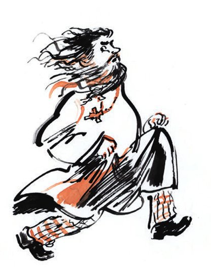
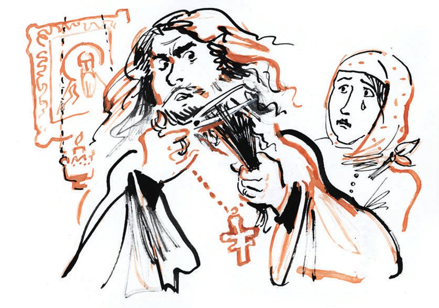

## Kapitel 3: Der Spiegel des Sünders

Vater Fjodor Wostrikow ist der Priester von der Kirche Frol und Lawr. Er hat der sterbenden Klawdija Iwanowna die <abbr title="die Beichte, die Beichten — исповедь">Beichte</abbr> <abbr title="die Beichte abnehmen — исповедовать">abgenommen</abbr>. Jetzt verlässt er das Haus von Worobjaninow in großer Aufregung. Auf dem ganzen Weg nach Hause sieht er <abbr title="zerstreut — рассеянно">zerstreut</abbr> nach links und nach rechts und lächelt <abbr title="verlegen — смущённо">verlegen</abbr>. Am Ende vom Weg ist er so zerstreut, dass er fast unter das Auto vom Kreiskomitee kommt, das Auto Nummer 1. Er kommt aus der violetten Rauchwolke von dieser <abbr title="höllisch — адский">höllischen</abbr> Maschine wieder heraus. Jetzt ist Vater Wostrikow völlig <abbr title="durcheinander sein — быть в полном расстройстве">durcheinander</abbr>. Er ist ein <abbr title="würdig — почтенный">würdiger</abbr> Priester und nicht mehr jung. Trotzdem läuft er den Rest vom Weg in einem <abbr title="leichtsinnig — легкомысленный, фривольный">leichtsinnigen</abbr> halben <abbr title="der Galopp — галоп">Galopp</abbr>.

Seine Frau, das «Mütterchen» Katerina Alexandrowna, <abbr title="den Tisch decken — накрывать на стол">deckt den Tisch</abbr> für das Abendessen. Vater Fjodor isst gern früh zu Abend, wenn er am Abend keinen <abbr title="der Gottesdienst, die Gottesdienste — богослужение (всенощная)">Gottesdienst</abbr> hat. Aber jetzt zieht er schnell den Hut und seinen warmen, <abbr title="wattiert — на вате, ватный">wattierten</abbr> Priesterrock aus und läuft ins <abbr title="das Schlafzimmer, die Schlafzimmer — спальня">Schlafzimmer</abbr>. Seine Frau <abbr title="staunen — удивляться">staunt</abbr>: Er <abbr title="sich einschließen (schloss ein, hat eingeschlossen) — запираться">schließt sich ein</abbr>. Und dann singt er mit dumpfer Stimme das Kirchenlied «Würdig ist es».

Das Mütterchen setzt sich auf einen Stuhl und flüstert <abbr title="ängstlich — боязливо">ängstlich</abbr>:

— Er hat schon wieder eine neue Idee …

Die <abbr title="unruhig — беспокойный, порывистый">unruhige</abbr> Seele von Vater Fjodor hat nie Ruhe. Nie hatte sie Ruhe. Nicht als er noch klein war, der Schüler Fedja in der <abbr title="geistlich — духовный">geistlichen</abbr> Schule. Nicht als er schon einen Schnurrbart hatte, der <abbr title="der Seminarist, die Seminaristen — семинарист">Seminarist</abbr> Fjodor Iwanowitsch. Vom <abbr title="das Priesterseminar, die Priesterseminare — семинария">Priesterseminar</abbr> ist er an die <abbr title="die Universität, die Universitäten — университет">Universität</abbr> gegangen. Drei Jahre hat er dort <abbr title="Jura (ohne Artikel) — юриспруденция">Jura</abbr> studiert. Aber 1915 hat er Angst bekommen: Vielleicht muss er in den Krieg! Da ist er schnell wieder zur Kirche zurückgegangen. Zuerst ist er <abbr title="der Diakon, die Diakone — дьякон">Diakon</abbr> geworden, dann Priester. Man hat ihn in die Kreisstadt N geschickt. Und immer, in jeder Phase von seiner geistlichen und <abbr title="weltlich — светский, гражданский">weltlichen</abbr> <abbr title="die Karriere, die Karrieren — карьера">Karriere</abbr>, wollte Vater Fjodor nur eins: Geld. Er war und bleibt <abbr title="habgierig — стяжательский, жадный">habgierig</abbr>.

Vater Wostrikow <abbr title="träumen von + Dat. — мечтать о">träumt</abbr> von einer eigenen <abbr title="die Kerzenfabrik, die Kerzenfabriken — свечной завод">Kerzenfabrik</abbr>. Er sieht im Traum große <abbr title="die Trommel, die Trommeln — барабан">Trommeln</abbr> in der Fabrik. Sie <abbr title="aufwickeln — наматывать">wickeln</abbr> dicke <abbr title="das Seil, die Seile — канат">Seile</abbr> aus Wachs auf. Dieses Bild <abbr title="quälen — мучить, терзать">quält</abbr> ihn. Deshalb <abbr title="erfinden (erfand, hat erfunden) — изобретать, придумывать">erfindet</abbr> Vater Fjodor <abbr title="ständig — постоянно">ständig</abbr> neue Projekte. Mit ihnen möchte er das <abbr title="das Kapital — капитал">Kapital</abbr> für eine kleine Fabrik in Samara verdienen. Diese Fabrik hat er schon lange gesehen und möchte sie kaufen.

Die Ideen kommen Vater Fjodor ganz plötzlich, und sofort beginnt er zu arbeiten. Einmal hat er <abbr title="die Waschseife — стиральное мыло">Waschseife</abbr> gekocht, mit <abbr title="das Marmormuster, die Marmormuster — мраморный узор">Marmormuster</abbr>. Er hat viele <abbr title="das Pud, die Pud — пуд (16 кг)">Pud</abbr> davon gekocht. Die Seife hatte sehr viel Fett. Aber sie hat nicht <abbr title="schäumen — пениться, мылиться">geschäumt</abbr>. Und sie war dreimal so teuer wie die Seife aus der Genossenschaft «Pflug und Hammer». Lange hat die Seife dann im <abbr title="der Flur, die Flure — сени, прихожая">Flur</abbr> gelegen. Sie ist weich geworden und hat <abbr title="stinken (stank, hat gestunken) — вонять">gestunken</abbr>. Katerina Alexandrowna hat sogar ein bisschen geweint, wenn sie an ihr vorbeigegangen ist. Und dann hat man die Seife in die <abbr title="die Jauchegrube, die Jauchegruben — выгребная яма">Jauchegrube</abbr> geworfen.

Einmal hat Vater Fjodor in einer Zeitschrift für <abbr title="die Viehzucht — животноводство">Viehzucht</abbr> etwas über <abbr title="das Kaninchen, die Kaninchen — кролик">Kaninchen</abbr> gelesen. Das Fleisch ist so <abbr title="zart — нежный">zart</abbr> wie bei einem Hühnchen. Die Kaninchen <abbr title="sich vermehren — размножаться">vermehren sich</abbr> sehr schnell. Und ein <abbr title="fleißig — рачительный, прилежный">fleißiger</abbr> Besitzer kann damit viel Geld verdienen. Sofort hat Vater Fjodor ein halbes Dutzend Kaninchen gekauft. Nur zwei Monate später waren Hof und Haus voll mit Tieren mit langen Ohren. So viele! Der Hund Nerka hat Angst bekommen und ist weggelaufen. Niemand weiß, wohin. Aber die <abbr title="verflucht — проклятый">verfluchten</abbr> Bürger von der Stadt N waren sehr <abbr title="konservativ — консервативный">konservativ</abbr>. Alle waren sich einig: Niemand hat bei Wostrikow ein Kaninchen gekauft. Kein einziges! Da hat Vater Fjodor mit seiner Frau gesprochen. Sie haben beschlossen: Wir essen die Kaninchen selbst. Das Fleisch schmeckt doch besser als Hühnchen! Es gab <abbr title="der Kaninchenbraten, die Kaninchenbraten — жаркое из кролика">Kaninchenbraten</abbr>, <abbr title="die Frikadelle, die Frikadellen — биток, котлета">Frikadellen</abbr> und <abbr title="das Kotelett, die Koteletts — котлета">Koteletts</abbr>. Es gab Kaninchensuppe, kaltes Kaninchen zum Abendessen und Kaninchen im <abbr title="der Auflauf, die Aufläufe — запеканка">Auflauf</abbr>. Es hat nichts genützt. Vater Fjodor hat <abbr title="rechnen — считать, подсчитывать">gerechnet</abbr>: Wenn die Familie nur noch Kaninchen isst, dann schafft sie höchstens vierzig Tiere im Monat. Aber jeden Monat kommen neunzig junge Kaninchen auf die Welt. Und jeden Monat werden es mehr, in <abbr title="geometrisch — геометрический">geometrischer</abbr> <abbr title="die Progression, die Progressionen — прогрессия">Progression</abbr>.

Da haben die Wostrikows beschlossen: Wir verkaufen <abbr title="das Mittagessen, die Mittagessen — обед">Mittagessen</abbr>, wie zu Hause gekocht. Vater Fjodor hat einen ganzen Abend lang <abbr title="die Anzeige, die Anzeigen — объявление">Anzeigen</abbr> geschrieben. Er hat einen <abbr title="der Tintenstift, die Tintenstifte — химический карандаш">Tintenstift</abbr> genommen und kleine Blätter <abbr title="das Rechenpapier — бумага в клетку (для арифметики)">Rechenpapier</abbr>, schön ordentlich <abbr title="schneiden (schnitt, hat geschnitten) — резать">geschnitten</abbr>. Die Anzeigen haben leckeres Essen wie zu Hause <abbr title="anbieten (bot an, hat angeboten) — предлагать">angeboten</abbr>, nur mit frischer <abbr title="die Kuhbutter — коровье масло">Kuhbutter</abbr> gekocht. Die Anzeige hat mit den Worten begonnen: «Billig und lecker». Die Popenfrau hat eine kleine <abbr title="die Schüssel, die Schüsseln — миска">Schüssel</abbr> mit <abbr title="der Mehlkleister — мучной клейстер">Mehlkleister</abbr> gefüllt. Spät am Abend hat Vater Fjodor die Anzeigen an alle <abbr title="der Telegrafenmast, die Telegrafenmasten — телеграфный столб">Telegrafenmasten</abbr> <abbr title="kleben — клеить">geklebt</abbr>, und auch in der Nähe von den sowjetischen <abbr title="das Amt, die Ämter — учреждение">Ämtern</abbr>.

Die neue Idee war ein großer <abbr title="der Erfolg, die Erfolge — успех">Erfolg</abbr>. Schon am ersten Tag sind sieben Leute gekommen. Unter ihnen war Bendin, ein Beamter vom <abbr title="das Militärkommissariat, die Militärkommissariate — военкомат">Militärkommissariat</abbr>. Und Koslow, der Chef von der Abteilung für <abbr title="die Stadtverschönerung — благоустройство">Stadtverschönerung</abbr>. Koslow hat vor Kurzem das einzige alte <abbr title="das Denkmal, die Denkmäler — памятник">Denkmal</abbr> in der Stadt <abbr title="abreißen (riss ab, hat abgerissen) — сносить">abreißen</abbr> lassen: einen <abbr title="der Triumphbogen, die Triumphbögen — триумфальная арка">Triumphbogen</abbr> aus der Zeit von der <abbr title="die Zarin, die Zarinnen — царица">Zarin</abbr> Elisabeth. Er hat gesagt, der Bogen stört den <abbr title="der Verkehr — движение (уличное)">Verkehr</abbr>. Allen hat das Essen sehr gut geschmeckt. Am nächsten Tag sind vierzehn Leute gekommen. Man hatte kaum Zeit, den Kaninchen das <abbr title="das Fell, die Felle — шкурка, мех">Fell</abbr> <abbr title="abziehen (zog ab, hat abgezogen) — сдирать">abzuziehen</abbr>. Eine ganze Woche ist alles <abbr title="prima — отлично">prima</abbr> gelaufen. Vater Fjodor hat schon an eine kleine <abbr title="die Kürschnerei, die Kürschnereien — скорняжная мастерская">Kürschnerei</abbr> gedacht, ohne Motor. Doch da ist etwas ganz <abbr title="unerwartet — непредвиденный, неожиданный">Unerwartetes</abbr> passiert.

Die Genossenschaft «Pflug und Hammer» war drei Wochen lang <abbr title="geschlossen — закрытый">geschlossen</abbr>, wegen <abbr title="die Inventur, die Inventuren — переучёт товаров">Inventur</abbr>. Jetzt hat sie wieder geöffnet. Die <abbr title="der Verkäufer, die Verkäufer — продавец">Verkäufer</abbr> haben <abbr title="schnaufen — пыхтеть">schnaufend</abbr> ein <abbr title="das Fass, die Fässer — бочка">Fass</abbr> mit <abbr title="verfault — гнилой">verfaultem</abbr> <abbr title="der Kohl — капуста">Kohl</abbr> auf den Hinterhof gerollt. Diesen Hof hat die Genossenschaft <abbr title="gemeinsam — общий, совместно">gemeinsam</abbr> mit Vater Fjodor. Sie haben den Kohl in die Jauchegrube geworfen. Der <abbr title="pikant — пикантный">pikante</abbr> Geruch hat die Kaninchen <abbr title="anlocken — привлекать, приманивать">angelockt</abbr>. Sie sind alle zur Grube gelaufen. Und schon am nächsten Morgen hat bei den zarten <abbr title="das Nagetier, die Nagetiere — грызун">Nagetieren</abbr> eine <abbr title="die Seuche, die Seuchen — мор, эпидемия">Seuche</abbr> begonnen. Die Seuche hat nur drei Stunden <abbr title="wüten — свирепствовать">gewütet</abbr>. Aber sie hat 240 erwachsene Kaninchen <abbr title="dahinraffen — унести (о болезни), уложить">dahingerafft</abbr>, und dazu alle jungen. Wie viele das waren, kann niemand mehr zählen.

Vater Fjodor war ganz <abbr title="erschüttert — потрясённый, ошеломлённый">erschüttert</abbr>. Ganze zwei Monate war er still. Erst heute ist sein Mut wieder da: Er kommt aus dem Haus von Worobjaninow und schließt sich im Schlafzimmer ein. Das Mütterchen staunt. Alles zeigt: Vater Fjodor hat eine neue Idee, und sie <abbr title="erfüllen — наполнять, захватывать">erfüllt</abbr> seine ganze Seele.

Katerina Alexandrowna <abbr title="klopfen — стучать">klopft</abbr> mit dem <abbr title="der Knöchel, die Knöchel — костяшка (пальца)">Knöchel</abbr> an die Schlafzimmertür. Keine Antwort. Nur das Singen wird lauter. Nach einer Minute geht die Tür ein bisschen auf. Im <abbr title="der Spalt, die Spalte — щель">Spalt</abbr> zeigt sich das Gesicht von Vater Fjodor. Seine <abbr title="die Wange, die Wangen — щека">Wangen</abbr> sind rosa wie bei einem jungen Mädchen.

— Gib mir schnell die <abbr title="die Schere, die Scheren — ножницы">Schere</abbr>, Mutter, — sagt Vater Fjodor schnell.

— Und das Abendessen?

— Ja, ja. Später.

Vater Fjodor nimmt die Schere, schließt sich wieder ein und geht zum Spiegel. Der Spiegel ist oval und hängt an der Wand, in einem schwarzen Rahmen mit vielen <abbr title="der Kratzer, die Kratzer — царапина">Kratzern</abbr>.

Neben dem Spiegel hängt ein altes <abbr title="das Volksbild, die Volksbilder — лубок, народная картинка">Volksbild</abbr>: «Der Spiegel des Sünders». Es ist von einer <abbr title="die Kupferplatte, die Kupferplatten — медная доска">Kupferplatte</abbr> <abbr title="drucken — печатать">gedruckt</abbr> und schön mit der Hand <abbr title="bemalen — раскрашивать">bemalt</abbr>. Nach dem Unglück mit den Kaninchen hat dieses Bild Vater Fjodor sehr <abbr title="trösten — утешать">getröstet</abbr>. Denn es zeigt deutlich: Alles auf der Erde ist <abbr title="vergänglich — бренный, преходящий">vergänglich</abbr>. Oben sind vier Bilder in einer Reihe. Unter ihnen stehen in alter kirchenslawischer Schrift wichtige Worte, die die Seele ruhig machen: «Sem betet fromm, Ham sät das Korn, Japhet hat die Macht. Der Tod hat über alle Macht.» Der Tod hat eine <abbr title="die Sense, die Sensen — коса">Sense</abbr> und eine <abbr title="die Sanduhr, die Sanduhren — песочные часы">Sanduhr</abbr> mit Flügeln. Er sieht aus, als ob er aus <abbr title="die Prothese, die Prothesen — протез">Prothesen</abbr> und <abbr title="orthopädisch — ортопедический">orthopädischen</abbr> Teilen gebaut ist. Er steht mit breiten Beinen auf einer leeren <abbr title="hügelig — холмистый">hügeligen</abbr> Erde. Man sieht sofort: Das Unglück mit den Kaninchen ist eine <abbr title="die Kleinigkeit, die Kleinigkeiten — пустяк">Kleinigkeit</abbr>.

Heute gefällt Vater Fjodor ein anderes Bild besser: «Japhet hat die Macht». Ein dicker, reicher Mann mit Bart sitzt in einem kleinen <abbr title="der Saal, die Säle — зал">Saal</abbr> auf einem <abbr title="der Thron, die Throne — трон">Thron</abbr>.

Vater Fjodor lächelt. Er sieht sich aufmerksam im Spiegel an und beginnt, seinen schönen, <abbr title="würdevoll — благообразный">würdevollen</abbr> Bart zu <abbr title="stutzen — подстригать">stutzen</abbr>. Die Haare fallen auf den Boden, die Schere <abbr title="quietschen — скрипеть">quietscht</abbr>. Nach fünf Minuten weiß Vater Fjodor: Er kann gar keinen Bart schneiden. Sein Bart ist jetzt <abbr title="schief — косой, кривой">schief</abbr>, auf eine Seite. Er sieht <abbr title="unanständig — неприличный">unanständig</abbr> aus, und sogar <abbr title="verdächtig — подозрительный">verdächtig</abbr>.

Vater Fjodor steht noch eine Weile vor dem Spiegel. Dann wird er böse. Er ruft seine Frau, gibt ihr die Schere und sagt <abbr title="gereizt — раздражённо">gereizt</abbr>:

— Hilf du mir wenigstens, Mütterchen. Ich komme mit meinen <abbr title="die Zottel, die Zotteln — космы, лохмы">Zotteln</abbr> einfach nicht <abbr title="zurechtkommen mit + Dat. — справляться с">zurecht</abbr>.

Das Mütterchen ist so überrascht, dass sie die Hände hinter den Rücken nimmt.

— Was hast du denn mit dir gemacht? — sagt sie endlich.

— Gar nichts habe ich gemacht. Ich schneide mir die Haare. Hilf mir bitte. Hier, da ist es irgendwie schief geworden …

— Herrgott, — sagt das Mütterchen und <abbr title="greifen nach + Dat. (griff, hat gegriffen) — хвататься за, посягать на">greift</abbr> nach den <abbr title="die Locke, die Locken — локон">Locken</abbr> von Vater Fjodor. — Fedja, willst du etwa zu den «Erneuerern» gehen?

(Die «Erneuerer» sind moderne Priester, die sich mit der Sowjetmacht gut <abbr title="sich verstehen mit + Dat. — ладить с">verstehen</abbr>.)

Vater Fjodor freut sich, dass das Gespräch diese Richtung nimmt.

— Und warum soll ich nicht zu den Erneuerern gehen, Mutter? Sind die Erneuerer etwa keine Menschen?

— Doch, natürlich sind das Menschen, — sagt das Mütterchen <abbr title="giftig — ядовито">giftig</abbr>. — Na klar: Sie gehen ins <abbr title="das Kino, die Kinos — кино (иллюзион)">Kino</abbr>, sie zahlen <abbr title="der Unterhalt — алименты">Unterhalt</abbr> für ihre Kinder …

— Dann gehe ich eben auch ins Kino.

— Geh doch, bitte schön.

— Und ich gehe auch.

— Du wirst schon sehen, wohin du gehst. Sieh dich doch mal im Spiegel an.

Und wirklich: Aus dem Spiegel sieht Vater Fjodor ein <abbr title="flott — бойкий, лихой">flottes</abbr> Gesicht mit schwarzen Augen an. Es hat einen kleinen, wilden Bart und einen <abbr title="lächerlich — нелепо, смешно">lächerlich</abbr> langen Schnurrbart.

Sie schneiden den Schnurrbart. Am Ende hat er die richtige Größe.

Was dann kommt, <abbr title="verblüffen — поражать, ошеломлять">verblüfft</abbr> das Mütterchen noch mehr. Vater Fjodor sagt: Er muss noch heute Abend <abbr title="geschäftlich — по делу, по делам">geschäftlich</abbr> <abbr title="verreisen — уезжать (в поездку)">verreisen</abbr>. Katerina Alexandrowna soll zu ihrem Bruder laufen, dem <abbr title="der Bäcker, die Bäcker — булочник, пекарь">Bäcker</abbr>. Sie soll sich bei ihm für eine Woche einen Mantel mit <abbr title="der Lammfellkragen, die Lammfellkragen — барашковый воротник">Lammfellkragen</abbr> <abbr title="leihen (lieh, hat geliehen) — одалживать, брать взаймы">leihen</abbr>. Und eine braune Schirmmütze aus <abbr title="der Entenstoff — утиный картуз (из парусиновой ткани)">Entenstoff</abbr>.

— Ich gehe nirgendwohin! — sagt das Mütterchen und weint.

Eine halbe Stunde geht Vater Fjodor im Zimmer hin und her und redet <abbr title="der Unsinn — чепуха, вздор">Unsinn</abbr>. Sein neues Gesicht macht seiner Frau Angst. Das Mütterchen versteht nur eins: Vater Fjodor hat sich ohne Grund die Haare geschnitten. Er will mit einer <abbr title="albern — дурацкий, нелепый">albernen</abbr> Mütze irgendwohin fahren, niemand weiß, wohin. Und sie <abbr title="verlassen (verließ, hat verlassen) — бросать, покидать">verlässt</abbr> er.

— Ich verlasse dich nicht, — sagt Vater Fjodor immer wieder, — ich verlasse dich nicht. In einer Woche bin ich zurück. Ein Mensch kann doch mal etwas zu tun haben. Kann er oder kann er nicht?

— Kann er nicht, — sagt die Popenfrau.

Vater Fjodor ist ein sanfter Mensch. Aber jetzt muss er sogar mit der Faust auf den Tisch <abbr title="hauen — стучать, бить">hauen</abbr>. Er haut vorsichtig und <abbr title="ungeschickt — неумело, неловко">ungeschickt</abbr>, denn er hat das noch nie gemacht. Trotzdem bekommt die Popenfrau große Angst. Sie nimmt ihr <abbr title="das Kopftuch, die Kopftücher — платок">Kopftuch</abbr> und läuft zu ihrem Bruder. Dort holt sie die <abbr title="die Zivilkleidung — штатская одежда">Zivilkleidung</abbr>.

Jetzt ist Vater Fjodor allein. Eine Minute denkt er nach. Dann sagt er: «Für die Frauen ist es auch schwer.» Er zieht eine kleine <abbr title="die Truhe, die Truhen — сундучок">Truhe</abbr> unter dem Bett hervor. Sie ist mit <abbr title="das Blech — жесть">Blech</abbr> <abbr title="beschlagen — обитый">beschlagen</abbr>. Solche Truhen haben meistens die Soldaten von der Roten Armee. Innen sind sie mit <abbr title="gestreift — полосатый">gestreifter</abbr> <abbr title="die Tapete, die Tapeten — обои">Tapete</abbr> <abbr title="bekleben — оклеивать">beklebt</abbr>. Und auf der Tapete <abbr title="prangen — красоваться">prangt</abbr> ein <abbr title="das Porträt, die Porträts — портрет">Porträt</abbr> von Genosse Budjonny. Oder ein Bild von einer <abbr title="die Zigarettenschachtel, die Zigarettenschachteln — папиросная коробка">Zigarettenschachtel</abbr> der Marke «Strand»: drei schöne Frauen liegen am <abbr title="der Kieselstrand, die Kieselstrände — галечный пляж">Kieselstrand</abbr> von Batumi. Auch die Truhe von den Wostrikows ist innen mit Bildern beklebt. Das gefällt Vater Fjodor nicht. Aber es ist weder Budjonny noch eine Schöne aus Batumi zu sehen. Die Popenfrau hat die ganze Truhe mit Fotos beklebt. Sie hat sie aus der Zeitschrift «<abbr title="die Chronik, die Chroniken — летопись, хроника">Chronik</abbr> vom Krieg 1914» <abbr title="ausschneiden (schnitt aus, hat ausgeschnitten) — вырезать">ausgeschnitten</abbr>. Da gibt es «Die <abbr title="die Eroberung, die Eroberungen — взятие, завоевание">Eroberung</abbr> von Przemyśl» und «Warme Kleidung für die einfachen Soldaten an der <abbr title="die Front, die Fronten — фронт, позиции">Front</abbr>», und … was nicht noch alles.

Oben in der Truhe liegen Bücher. Vater Fjodor legt sie auf den Boden: alle Hefte von der Zeitschrift «Der russische <abbr title="der Pilger, die Pilger — паломник">Pilger</abbr>» aus dem Jahr 1903, eine <abbr title="dick — толстый">dicke</abbr> «Geschichte von der <abbr title="die Kirchenspaltung, die Kirchenspaltungen — церковный раскол">Kirchenspaltung</abbr>» und ein kleines <abbr title="das Heft, die Hefte — брошюрка, тетрадь">Heft</abbr> «Ein Russe in Italien». Auf dem <abbr title="der Umschlag, die Umschläge — обложка">Umschlag</abbr> <abbr title="rauchen — дымиться">raucht</abbr> der <abbr title="der Vesuv — Везувий">Vesuv</abbr>. Dann steckt Vater Fjodor die Hand ganz tief in die Truhe. Er zieht eine alte, <abbr title="abgetragen — поношенный, обтрёпанный">abgetragene</abbr> Haube von seiner Frau heraus. Plötzlich riecht es stark nach <abbr title="die Mottenkugel, die Mottenkugeln — нафталин">Mottenkugeln</abbr>. Vater Fjodor <abbr title="die Augen zusammenkneifen (kniff zusammen, hat zusammengekniffen) — зажмуриваться">kneift die Augen zusammen</abbr>. Er <abbr title="zerreißen (zerriss, hat zerrissen) — разрывать">zerreißt</abbr> die <abbr title="die Spitze, die Spitzen — кружево">Spitzen</abbr> und die <abbr title="die Naht, die Nähte — шов">Nähte</abbr>. Aus der Haube nimmt er eine schwere kleine <abbr title="die Wurst, die Würste — колбаса, колбаска">Wurst</abbr> aus <abbr title="das Leinen — полотно">Leinen</abbr>. In der Wurst sind zwanzig <abbr title="die Goldmünze, die Goldmünzen — золотая монета">Goldmünzen</abbr> zu je zehn Rubel. Das ist alles, was von den <abbr title="das Geschäftsabenteuer, die Geschäftsabenteuer — коммерческая авантюра">Geschäftsabenteuern</abbr> von Vater Fjodor übrig ist.

Mit einer <abbr title="gewohnt — привычный">gewohnten</abbr> Bewegung hebt er seinen Priesterrock und steckt die Wurst in die Tasche von seiner gestreiften Hose. Dann geht er zur <abbr title="die Kommode, die Kommoden — комод">Kommode</abbr>. Aus einer <abbr title="die Pralinenschachtel, die Pralinenschachteln — конфетная коробка">Pralinenschachtel</abbr> nimmt er fünfzig Rubel, in <abbr title="der Schein, die Scheine — купюра, банкнота">Scheinen</abbr> zu drei und zu fünf Rubel. In der Schachtel bleiben noch zwanzig Rubel.

— Das reicht für den Haushalt, — <abbr title="beschließen (beschloss, hat beschlossen) — решать">beschließt</abbr> er.

---

### Neue Wörter

- **die Beichte, die Beichten** — исповедь
- **die Beichte abnehmen** — исповедовать
- **zerstreut** — рассеянно
- **verlegen** — смущённо
- **höllisch** — адский
- **durcheinander sein** — быть в полном расстройстве
- **würdig** — почтенный
- **leichtsinnig** — легкомысленный, фривольный
- **der Galopp** — галоп
- **den Tisch decken** — накрывать на стол
- **der Gottesdienst, die Gottesdienste** — богослужение (всенощная)
- **wattiert** — на вате, ватный
- **das Schlafzimmer, die Schlafzimmer** — спальня
- **staunen** — удивляться
- **sich einschließen (schloss ein, hat eingeschlossen)** — запираться
- **ängstlich** — боязливо
- **unruhig** — беспокойный, порывистый
- **geistlich** — духовный
- **der Seminarist, die Seminaristen** — семинарист
- **das Priesterseminar, die Priesterseminare** — семинария
- **die Universität, die Universitäten** — университет
- **Jura (ohne Artikel)** — юриспруденция
- **der Diakon, die Diakone** — дьякон
- **weltlich** — светский, гражданский
- **die Karriere, die Karrieren** — карьера
- **habgierig** — стяжательский, жадный
- **träumen von + Dat.** — мечтать о
- **die Kerzenfabrik, die Kerzenfabriken** — свечной завод
- **die Trommel, die Trommeln** — барабан
- **aufwickeln** — наматывать
- **das Seil, die Seile** — канат
- **quälen** — мучить, терзать
- **erfinden (erfand, hat erfunden)** — изобретать, придумывать
- **ständig** — постоянно
- **das Kapital** — капитал
- **die Waschseife** — стиральное мыло
- **das Marmormuster, die Marmormuster** — мраморный узор
- **das Pud, die Pud** — пуд (16 кг)
- **schäumen** — пениться, мылиться
- **der Flur, die Flure** — сени, прихожая
- **stinken (stank, hat gestunken)** — вонять
- **die Jauchegrube, die Jauchegruben** — выгребная яма
- **die Viehzucht** — животноводство
- **das Kaninchen, die Kaninchen** — кролик
- **zart** — нежный
- **sich vermehren** — размножаться
- **fleißig** — рачительный, прилежный
- **verflucht** — проклятый
- **konservativ** — консервативный
- **der Kaninchenbraten, die Kaninchenbraten** — жаркое из кролика
- **die Frikadelle, die Frikadellen** — биток, котлета
- **das Kotelett, die Koteletts** — котлета
- **der Auflauf, die Aufläufe** — запеканка
- **rechnen** — считать, подсчитывать
- **geometrisch** — геометрический
- **die Progression, die Progressionen** — прогрессия
- **das Mittagessen, die Mittagessen** — обед
- **die Anzeige, die Anzeigen** — объявление
- **der Tintenstift, die Tintenstifte** — химический карандаш
- **das Rechenpapier** — бумага в клетку (для арифметики)
- **schneiden (schnitt, hat geschnitten)** — резать
- **anbieten (bot an, hat angeboten)** — предлагать
- **die Kuhbutter** — коровье масло
- **die Schüssel, die Schüsseln** — миска
- **der Mehlkleister** — мучной клейстер
- **der Telegrafenmast, die Telegrafenmasten** — телеграфный столб
- **kleben** — клеить
- **das Amt, die Ämter** — учреждение
- **der Erfolg, die Erfolge** — успех
- **das Militärkommissariat, die Militärkommissariate** — военкомат
- **die Stadtverschönerung** — благоустройство
- **das Denkmal, die Denkmäler** — памятник
- **abreißen (riss ab, hat abgerissen)** — сносить
- **der Triumphbogen, die Triumphbögen** — триумфальная арка
- **die Zarin, die Zarinnen** — царица
- **der Verkehr** — движение (уличное)
- **das Fell, die Felle** — шкурка, мех
- **abziehen (zog ab, hat abgezogen)** — сдирать
- **prima** — отлично
- **die Kürschnerei, die Kürschnereien** — скорняжная мастерская
- **unerwartet** — непредвиденный, неожиданный
- **geschlossen** — закрытый
- **die Inventur, die Inventuren** — переучёт товаров
- **der Verkäufer, die Verkäufer** — продавец
- **schnaufen** — пыхтеть
- **das Fass, die Fässer** — бочка
- **verfault** — гнилой
- **der Kohl** — капуста
- **gemeinsam** — общий, совместно
- **pikant** — пикантный
- **anlocken** — привлекать, приманивать
- **das Nagetier, die Nagetiere** — грызун
- **die Seuche, die Seuchen** — мор, эпидемия
- **wüten** — свирепствовать
- **dahinraffen** — унести (о болезни), уложить
- **erschüttert** — потрясённый, ошеломлённый
- **erfüllen** — наполнять, захватывать
- **klopfen** — стучать
- **der Knöchel, die Knöchel** — костяшка (пальца)
- **der Spalt, die Spalte** — щель
- **die Wange, die Wangen** — щека
- **die Schere, die Scheren** — ножницы
- **der Kratzer, die Kratzer** — царапина
- **das Volksbild, die Volksbilder** — лубок, народная картинка
- **die Kupferplatte, die Kupferplatten** — медная доска
- **drucken** — печатать
- **bemalen** — раскрашивать
- **trösten** — утешать
- **vergänglich** — бренный, преходящий
- **die Sense, die Sensen** — коса
- **die Sanduhr, die Sanduhren** — песочные часы
- **die Prothese, die Prothesen** — протез
- **orthopädisch** — ортопедический
- **hügelig** — холмистый
- **die Kleinigkeit, die Kleinigkeiten** — пустяк
- **der Saal, die Säle** — зал
- **der Thron, die Throne** — трон
- **würdevoll** — благообразный
- **stutzen** — подстригать
- **quietschen** — скрипеть
- **schief** — косой, кривой
- **unanständig** — неприличный
- **verdächtig** — подозрительный
- **gereizt** — раздражённо
- **die Zottel, die Zotteln** — космы, лохмы
- **zurechtkommen mit + Dat.** — справляться с
- **greifen nach + Dat. (griff, hat gegriffen)** — хвататься за, посягать на
- **die Locke, die Locken** — локон
- **sich verstehen mit + Dat.** — ладить с
- **giftig** — ядовито
- **das Kino, die Kinos** — кино (иллюзион)
- **der Unterhalt** — алименты
- **flott** — бойкий, лихой
- **lächerlich** — нелепо, смешно
- **verblüffen** — поражать, ошеломлять
- **geschäftlich** — по делу, по делам
- **verreisen** — уезжать (в поездку)
- **der Bäcker, die Bäcker** — булочник, пекарь
- **der Lammfellkragen, die Lammfellkragen** — барашковый воротник
- **leihen (lieh, hat geliehen)** — одалживать, брать взаймы
- **der Entenstoff** — утиный картуз (из парусиновой ткани)
- **der Unsinn** — чепуха, вздор
- **albern** — дурацкий, нелепый
- **verlassen (verließ, hat verlassen)** — бросать, покидать
- **hauen** — стучать, бить
- **ungeschickt** — неумело, неловко
- **das Kopftuch, die Kopftücher** — платок
- **die Zivilkleidung** — штатская одежда
- **die Truhe, die Truhen** — сундучок
- **das Blech** — жесть
- **beschlagen** — обитый
- **gestreift** — полосатый
- **die Tapete, die Tapeten** — обои
- **bekleben** — оклеивать
- **prangen** — красоваться
- **das Porträt, die Porträts** — портрет
- **die Zigarettenschachtel, die Zigarettenschachteln** — папиросная коробка
- **der Kieselstrand, die Kieselstrände** — галечный пляж
- **die Chronik, die Chroniken** — летопись, хроника
- **ausschneiden (schnitt aus, hat ausgeschnitten)** — вырезать
- **die Eroberung, die Eroberungen** — взятие, завоевание
- **die Front, die Fronten** — фронт, позиции
- **der Pilger, die Pilger** — паломник
- **dick** — толстый
- **die Kirchenspaltung, die Kirchenspaltungen** — церковный раскол
- **das Heft, die Hefte** — брошюрка, тетрадь
- **der Umschlag, die Umschläge** — обложка
- **rauchen** — дымиться
- **der Vesuv** — Везувий
- **abgetragen** — поношенный, обтрёпанный
- **die Mottenkugel, die Mottenkugeln** — нафталин
- **die Augen zusammenkneifen (kniff zusammen, hat zusammengekniffen)** — зажмуриваться
- **zerreißen (zerriss, hat zerrissen)** — разрывать
- **die Spitze, die Spitzen** — кружево
- **die Naht, die Nähte** — шов
- **die Wurst, die Würste** — колбаса, колбаска
- **das Leinen** — полотно
- **die Goldmünze, die Goldmünzen** — золотая монета
- **das Geschäftsabenteuer, die Geschäftsabenteuer** — коммерческая авантюра
- **gewohnt** — привычный
- **die Kommode, die Kommoden** — комод
- **die Pralinenschachtel, die Pralinenschachteln** — конфетная коробка
- **der Schein, die Scheine** — купюра, банкнота
- **beschließen (beschloss, hat beschlossen)** — решать

[← Kapitel 2](kapitel-02.md) · [Inhalt](README.md) · [Kapitel 4 →](kapitel-04.md)
