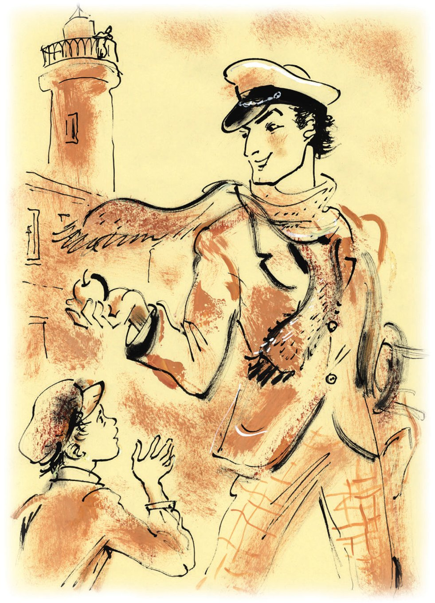
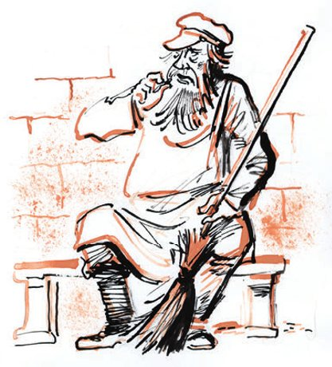
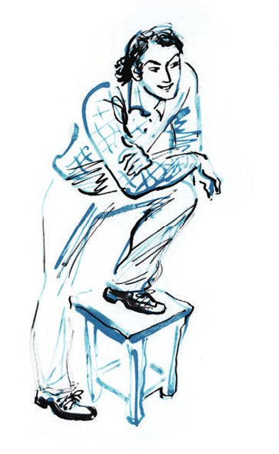

## Kapitel 5: Der große Kombinator

Um halb zwölf kommt ein junger Mann nach Stargorod. Er ist ungefähr achtundzwanzig Jahre alt. Er kommt von Nordwesten, vom Dorf Tschmarowka. Hinter ihm läuft ein <abbr title="das Straßenkind, die Straßenkinder — беспризорник">Straßenkind</abbr>.

— Onkel, — ruft der Junge fröhlich, — gib mir zehn Kopeken!

Der junge Mann nimmt einen warmen <abbr title="der Apfel, die Äpfel — яблоко">Apfel</abbr> aus der Tasche und gibt ihn dem Jungen. Aber der Junge geht nicht weg. Da bleibt der Fußgänger stehen. Er sieht den Jungen ironisch an und sagt leise:

— Soll ich dir vielleicht noch den Schlüssel zu der Wohnung geben, wo das Geld liegt?

Der <abbr title="frech — нахальный, зарвавшийся">freche</abbr> Junge versteht: Seine <abbr title="die Forderung, die Forderungen — требование, претензия">Forderungen</abbr> haben keine <abbr title="die Grundlage, die Grundlagen — основание, почва">Grundlage</abbr>. Er bleibt zurück.

Der junge Mann hat <abbr title="lügen (log, hat gelogen) — лгать, врать">gelogen</abbr>. Er hat kein Geld. Er hat keine Wohnung, wo das Geld liegen kann. Und er hat auch keinen Schlüssel für so eine Wohnung. Er hat nicht einmal einen Mantel. Er trägt einen grünen, <abbr title="tailliert — приталенный, «в талию»">taillierten</abbr> <abbr title="der Anzug, die Anzüge — костюм">Anzug</abbr>. Um seinen starken Hals hat er mehrmals einen alten <abbr title="der Wollschal, die Wollschals — шерстяной шарф">Wollschal</abbr> <abbr title="wickeln — обматывать">gewickelt</abbr>. An den Füßen trägt er <abbr title="der Lackschuh, die Lackschuhe — лаковый ботинок (штиблет)">Lackschuhe</abbr>. Oben sind sie aus orangefarbenem <abbr title="das Wildleder — замша">Wildleder</abbr>. <abbr title="die Socke, die Socken — носок">Socken</abbr> trägt er nicht. In der Hand hält der junge Mann ein <abbr title="das Astrolabium, die Astrolabien — астролябия">Astrolabium</abbr>.

«O Bajadere, ti-ri-rim, ti-ri-ra!» – singt er und geht zum <abbr title="der Markt, die Märkte — рынок">Markt</abbr>.

Hier gibt es viel für ihn zu tun. Er <abbr title="sich drängen — протискиваться, втискиваться">drängt sich</abbr> in die Reihe von den <abbr title="der Händler, die Händler — торговец">Händlern</abbr>. Sie verkaufen ihre Waren direkt vom Boden. Er hält das Astrolabium nach vorn und ruft mit ernster Stimme:

— Wer möchte ein Astrolabium?! Ein Astrolabium, ganz billig! <abbr title="der Rabatt, die Rabatte — скидка">Rabatt</abbr> für <abbr title="die Delegation, die Delegationen — делегация">Delegationen</abbr> und <abbr title="die Frauenabteilung, die Frauenabteilungen — женотдел">Frauenabteilungen</abbr>!

Das <abbr title="das Angebot, die Angebote — предложение">Angebot</abbr> ist <abbr title="ungewöhnlich — неожиданный, необычный">ungewöhnlich</abbr>. Lange will niemand ein Astrolabium. Die Delegationen von den Hausfrauen interessieren sich mehr für <abbr title="knapp — дефицитный, скудный">knappe</abbr> Waren. Sie stehen in Gruppen vor den <abbr title="der Stand, die Stände — палатка, прилавок">Ständen</abbr> mit <abbr title="der Stoff, die Stoffe — ткань, мануфактура">Stoffen</abbr>. Zweimal geht ein <abbr title="der Agent, die Agenten — агент">Agent</abbr> von der <abbr title="die Kriminalpolizei — уголовный розыск">Kriminalpolizei</abbr> an dem Verkäufer vorbei. Gestern hat jemand aus dem Büro von der «Butterzentrale» eine <abbr title="die Schreibmaschine, die Schreibmaschinen — пишущая машинка">Schreibmaschine</abbr> gestohlen. Aber das Astrolabium sieht gar nicht aus wie eine Schreibmaschine. Deshalb <abbr title="hypnotisieren — гипнотизировать">hypnotisiert</abbr> der Agent den jungen Mann nicht mehr mit den Augen und geht weg.

Am Mittag hat der junge Mann das Astrolabium verkauft, an einen <abbr title="der Schlosser, die Schlosser — слесарь">Schlosser</abbr>, für drei Rubel.

— Es misst ganz von allein, — sagt der junge Mann und gibt dem Käufer das Astrolabium. — Man braucht nur etwas zum <abbr title="messen (maß, hat gemessen) — мерить, измерять">Messen</abbr>.

Jetzt ist der fröhliche junge Mann das <abbr title="schlau — хитрый">schlaue</abbr> <abbr title="das Instrument, die Instrumente — инструмент, прибор">Instrument</abbr> los. Er isst in der <abbr title="die Kantine, die Kantinen — столовая">Kantine</abbr> «Geschmacksecke» zu Mittag und sieht sich dann die Stadt an. Er geht durch die Sowjetstraße. Dann kommt er auf die Rotarmistenstraße (früher Große Puschkinstraße). Er geht über die Genossenschaftsstraße und ist plötzlich wieder auf der Sowjetstraße. Aber das ist nicht mehr dieselbe Sowjetstraße: In der Stadt gibt es nämlich zwei Sowjetstraßen. Darüber wundert sich der junge Mann sehr. Dann ist er in der Straße der Lena-Ereignisse (früher Denissowstraße). Vor dem Haus Nummer 28 bleibt er stehen. Es ist ein schönes, zweistöckiges <abbr title="das Herrenhaus, die Herrenhäuser — особняк">Herrenhaus</abbr>. Auf dem Schild steht: «UdSSR. RSFSR. 2. Haus der <abbr title="die Sozialfürsorge — социальное обеспечение">Sozialfürsorge</abbr> von Stargubstrach». Am Tor sitzt der Hausmeister auf einer kleinen Steinbank. Der junge Mann möchte sich bei ihm Feuer für seine Zigarette holen.

— Sag mal, Väterchen, — fragt der junge Mann und <abbr title="ziehen an + Dat. (zog, hat gezogen) — затягиваться">zieht</abbr> an der Zigarette, — gibt es in eurer Stadt Bräute?

Der alte Hausmeister wundert sich gar nicht.

— Für manchen ist sogar eine <abbr title="die Stute, die Stuten — кобыла">Stute</abbr> eine Braut, — antwortet er. Er redet gern.

— Keine weiteren Fragen, — sagt der junge Mann schnell.

Und sofort stellt er eine neue Frage:

— So ein Haus, und keine Bräute drin?

— Unsere Bräute, — sagt der Hausmeister, — die sucht man schon lange im <abbr title="das Jenseits — тот свет">Jenseits</abbr> mit <abbr title="die Laterne, die Laternen — фонарь">Laternen</abbr>. Hier ist ein staatliches <abbr title="das Altersheim, die Altersheime — богадельня, дом престарелых">Altersheim</abbr>. Hier wohnen alte Frauen, mit <abbr title="die Vollpension — полный пансион">Vollpension</abbr>.

— Verstehe. Die, die noch vor dem historischen <abbr title="der Materialismus — материализм">Materialismus</abbr> geboren sind?

— Ja, das stimmt. Wann sie geboren sind, da sind sie eben geboren.

— Und was war in diesem Haus vor dem historischen Materialismus?

— Wann?

— Na, damals, unter dem alten <abbr title="das Regime, die Regime — режим">Regime</abbr>.

— Unter dem alten Regime hat mein <abbr title="der Herr, die Herren — барин, господин">Herr</abbr> hier gewohnt.

— Ein <abbr title="der Bourgeois, die Bourgeois — буржуй">Bourgeois</abbr>?

— Selber Bourgeois! Er war kein Bourgeois. Er war Adelsmarschall.

— Also ein <abbr title="der Proletarier, die Proletarier — пролетарий">Proletarier</abbr>?

— Selber Proletarier! Ich sag dir doch: Adelsmarschall.

Der kluge Hausmeister versteht nicht viel von der <abbr title="die Klassenstruktur — классовая структура">Klassenstruktur</abbr> von der Gesellschaft. Das Gespräch dauert vielleicht noch Gott weiß wie lange. Aber da <abbr title="anpacken — браться (за дело)">packt</abbr> der junge Mann die Sache <abbr title="energisch — решительно">energisch</abbr> an.

— Weißt du was, Großväterchen, — sagt er, — ein Gläschen Wein ist jetzt nicht schlecht.

— Na, dann <abbr title="einladen (lud ein, hat eingeladen) — угощать, приглашать">lad mich ein</abbr>.

Eine Stunde lang sind beide weg. Als sie zurückkommen, ist der Hausmeister schon der allerbeste Freund von dem jungen Mann.

— Dann <abbr title="übernachten — ночевать">übernachte</abbr> ich also bei dir, — sagt der neue Freund.

— Von mir aus wohn hier dein ganzes Leben lang. Du bist ein guter Mensch.

So schnell hat der Gast sein Ziel erreicht. <abbr title="flink — проворно">Flink</abbr> geht er hinunter in die <abbr title="die Hausmeisterwohnung, die Hausmeisterwohnungen — дворницкая">Hausmeisterwohnung</abbr>. Er zieht die orangefarbenen Schuhe aus und legt sich lang auf die Bank. Er denkt über seinen Plan für morgen nach.

Der junge Mann heißt Ostap Bender. Aus seiner <abbr title="die Biografie, die Biografien — биография">Biografie</abbr> erzählt er meistens nur ein <abbr title="das Detail, die Details — подробность, деталь">Detail</abbr>. «Mein Papa, — sagt er, — war türkischer <abbr title="der Staatsbürger, die Staatsbürger — подданный, гражданин">Staatsbürger</abbr>.» Der Sohn von dem türkischen Staatsbürger hatte in seinem Leben schon viele <abbr title="der Beruf, die Berufe — профессия, занятие">Berufe</abbr>. Er hat einen sehr lebhaften <abbr title="der Charakter, die Charaktere — характер">Charakter</abbr>. Deshalb kann er nicht immer nur eine Sache machen. Sein Charakter wirft ihn ständig in alle Ecken vom Land. Und jetzt hat er ihn nach Stargorod gebracht: ohne Socken, ohne Schlüssel, ohne Wohnung und ohne Geld.

In der Hausmeisterwohnung ist es warm, so warm, dass es stinkt. Ostap Bender liegt da und <abbr title="feilen an + Dat. — оттачивать, шлифовать">feilt</abbr> in Gedanken an zwei <abbr title="die Variante, die Varianten — вариант">Varianten</abbr> für seine Karriere.

Erste Variante: Er kann ein <abbr title="der Bigamist, die Bigamisten — многоженец">Bigamist</abbr> werden. Dann fährt er ruhig von Stadt zu Stadt. Er hat einen neuen <abbr title="der Koffer, die Koffer — чемодан">Koffer</abbr> dabei, voll mit <abbr title="wertvoll — ценный">wertvollen</abbr> Sachen von der Ehefrau vom Dienst.

Zweite Variante: Er kann schon morgen zur Kinderkommission von Stargorod gehen. Dort schlägt er vor: Ich <abbr title="verbreiten — распространять">verbreite</abbr> für euch ein <abbr title="das Gemälde, die Gemälde — картина (живописная)">Gemälde</abbr>. Es ist noch nicht gemalt, aber die Idee ist <abbr title="genial — гениальный">genial</abbr>: «Die <abbr title="der Bolschewik, die Bolschewiken — большевик">Bolschewiken</abbr> schreiben einen Brief an Chamberlain». Nach dem <abbr title="berühmt — знаменитый">berühmten</abbr> Bild von dem <abbr title="der Maler, die Maler — художник">Maler</abbr> Repin: «Die <abbr title="die Saporoger Kosaken (Pl.) — запорожцы">Saporoger Kosaken</abbr> schreiben einen Brief an den <abbr title="der Sultan, die Sultane — султан">Sultan</abbr>». Wenn es klappt, bringt diese Variante vielleicht vierhundert Rubel.

Beide Varianten hat Ostap bei seinem letzten <abbr title="der Aufenthalt, die Aufenthalte — пребывание">Aufenthalt</abbr> in Moskau <abbr title="entwickeln — разрабатывать, развивать">entwickelt</abbr>. Die Idee mit der <abbr title="die Vielweiberei — многожёнство">Vielweiberei</abbr> ist ihm in den Kopf gekommen, als er in der Abendzeitung einen <abbr title="der Gerichtsbericht, die Gerichtsberichte — судебный отчёт">Gerichtsbericht</abbr> gelesen hat. Dort hat ganz klar gestanden: Ein Bigamist hat nur zwei Jahre bekommen, ohne strenge <abbr title="die Isolationshaft — строгая изоляция">Isolationshaft</abbr>. Und die Idee Nummer 2 ist Bender gekommen, als er mit einer <abbr title="die Freikarte, die Freikarten — контрамарка, бесплатный билет">Freikarte</abbr> eine <abbr title="die Ausstellung, die Ausstellungen — выставка">Ausstellung</abbr> von der AChRR besucht hat (das ist der <abbr title="der Verein, die Vereine — объединение, союз">Verein</abbr> von den Künstlern von der Revolution).

Aber beide Projekte haben ihre <abbr title="der Nachteil, die Nachteile — недостаток">Nachteile</abbr>. Eine Karriere als Bigamist kann man nicht ohne einen <abbr title="herrlich — дивный, великолепный">herrlichen</abbr> grauen Anzug mit <abbr title="das Apfelmuster — «серый в яблоках»">Apfelmuster</abbr> beginnen. Außerdem braucht man mindestens zehn Rubel für einen guten <abbr title="der Auftritt, die Auftritte — представительство, выход">Auftritt</abbr> und die <abbr title="die Verführung, die Verführungen — обольщение">Verführung</abbr>. Natürlich kann Bender auch in seinem grünen Reiseanzug heiraten. Seine männliche Kraft und seine Schönheit sind für die <abbr title="das Gretchen, die Gretchen — Гретхен (наивная девушка; ср. «Маргарита»)">Gretchen</abbr> aus der Provinz, die heiraten wollen, absolut <abbr title="unwiderstehlich — неотразимый">unwiderstehlich</abbr>. Aber das ist, wie Ostap sagt, «niedrige Sorte, keine saubere Arbeit». Auch mit dem Bild geht nicht alles glatt. Es gibt vielleicht rein <abbr title="technisch — технический">technische</abbr> Schwierigkeiten. Darf man Genosse Kalinin mit <abbr title="die Pelzmütze, die Pelzmützen — папаха">Pelzmütze</abbr> und weißem <abbr title="der Filzmantel, die Filzmäntel — бурка">Filzmantel</abbr> malen? Und Genosse Tschitscherin mit nacktem <abbr title="der Oberkörper, die Oberkörper — торс, «голый по пояс»">Oberkörper</abbr>? Wenn nötig, kann man natürlich alle in normalen Anzügen malen. Aber das ist nicht dasselbe.

— Das hat nicht denselben <abbr title="der Effekt, die Effekte — эффект">Effekt</abbr>! — sagt Ostap laut.

Da merkt er: Der Hausmeister erzählt schon lange und eifrig etwas. Er <abbr title="sich erinnern an + Akk. — вспоминать">erinnert sich</abbr> an den früheren Besitzer vom Haus:

— Der <abbr title="der Polizeichef, die Polizeichefs — полицмейстер">Polizeichef</abbr> hat vor ihm <abbr title="salutieren — отдавать честь">salutiert</abbr> … Ich komme zu ihm, sagen wir mal, will ich sagen, zu Neujahr und gratuliere – und er gibt mir drei Rubel … Zu Ostern, sagen wir mal, will ich sagen, noch mal drei Rubel. Und dann, sagen wir mal, zu seinem <abbr title="der Namenstag, die Namenstage — именины, день ангела">Namenstag</abbr> gratulierst du … So kommen nur von den Gratulationen im Jahr fünfzehn Rubel zusammen … Er hat mir sogar eine <abbr title="die Medaille, die Medaillen — медаль">Medaille</abbr> versprochen. Ich will, sagt er, dass mein Hausmeister eine Medaille hat. Genau so hat er gesagt: «Tichon, du hast die Medaille schon so gut wie sicher …»

— Na, und? Hast du sie bekommen?

— Warte doch … Ich brauche keinen Hausmeister ohne Medaille, sagt er. Er ist nach Sankt Petersburg gefahren, wegen der Medaille. Na, beim ersten Mal, will ich sagen, hat es nicht geklappt. Die Herren <abbr title="der Beamte, die Beamten — чиновник">Beamten</abbr> wollten nicht. Der Zar, sagen sie, ist ins Ausland gefahren, jetzt geht es nicht. Mein Herr hat mir befohlen: Warte. Du, Tichon, sagt er, warte, du bekommst deine Medaille.

— Und deinen Herrn, haben sie den <abbr title="abknallen — «шлёпнуть», пристрелить">abgeknallt</abbr>? — fragt Ostap plötzlich.

— Niemand hat ihn abgeknallt. Er ist selbst weggefahren. Was soll er hier mit den <abbr title="der Soldat, die Soldaten — солдат">Soldaten</abbr> sitzen … Und gibt man heute Medaillen für die Arbeit als Hausmeister?

— Ja, gibt man. Ich kann dir eine <abbr title="besorgen — выхлопотать, раздобыть">besorgen</abbr>.

Der Hausmeister sieht Bender mit <abbr title="der Respekt — уважение">Respekt</abbr> an.

— Ohne Medaille geht es bei mir nicht. Ich habe so eine Arbeit.

— Und wohin ist dein Herr gefahren?

— Wer weiß das schon! Die Leute sagen, nach Paris.

— Ah! … Weiße <abbr title="die Akazie, die Akazien — акация">Akazien</abbr>, Blumen der <abbr title="die Emigration — эмиграция">Emigration</abbr> … Er ist also ein <abbr title="der Emigrant, die Emigranten — эмигрант">Emigrant</abbr>?

— Selber Emigrant … Nach Paris ist er gefahren, sagen die Leute. Und das Haus hat man für die alten Frauen genommen … Denen kannst du jeden Tag gratulieren, du bekommst keinen <abbr title="der Groschen, die Groschen — гривенник, грош">Groschen</abbr>! … Ach! Das war ein Herr! …

In diesem Moment zappelt über der Tür eine rostige <abbr title="die Klingel, die Klingeln — звонок">Klingel</abbr>. Der Hausmeister <abbr title="ächzen — кряхтеть">ächzt</abbr> und <abbr title="schlurfen — плестись, шаркать">schlurft</abbr> zur Tür. Er macht sie auf und <abbr title="zurückweichen (wich zurück, ist zurückgewichen) — отступать, отшатнуться">weicht</abbr> verwirrt zurück.

Auf der obersten <abbr title="die Stufe, die Stufen — ступенька">Stufe</abbr> steht Ippolit Matwejewitsch Worobjaninow. Er hat einen schwarzen Schnurrbart und schwarze Haare. Seine Augen <abbr title="funkeln — сверкать, сиять">funkeln</abbr> hinter dem Kneifer, wie vor dem Krieg.

— Der Herr! — <abbr title="muhen — мычать">muht</abbr> Tichon <abbr title="leidenschaftlich — страстно">leidenschaftlich</abbr>. — Aus Paris!

In der Hausmeisterwohnung ist ein <abbr title="der Fremde, die Fremden — посторонний, чужой">Fremder</abbr>. Erst jetzt sieht Ippolit Matwejewitsch hinter dem Tisch seine nackten violetten Füße. Er ist verlegen und will schon weglaufen. Aber Ostap Bender springt schnell auf und <abbr title="sich verneigen — кланяться">verneigt sich</abbr> tief vor Ippolit Matwejewitsch.

— Bei uns ist es zwar nicht Paris, aber herzlich willkommen in unserer <abbr title="die Hütte, die Hütten — шалаш, хижина">Hütte</abbr>.

— Guten Tag, Tichon, — muss Ippolit Matwejewitsch sagen. — Ich komme gar nicht aus Paris. Wie kommst du denn darauf?

Aber Ostap Bender hat eine lange, <abbr title="edel — благородный">edle</abbr> Nase, und diese Nase <abbr title="den Braten riechen — чуять, где пахнет жареным">riecht den Braten</abbr>. Er lässt den Hausmeister nicht einmal <abbr title="nicht piep sagen — и пикнуть не дать">piep</abbr> sagen.

— Wunderbar, — sagt er und sieht <abbr title="schielen — косить глазом">schielend</abbr> zur Seite. — Sie kommen nicht aus Paris. Natürlich. Sie kommen aus Kologriw. Sie besuchen Ihre verstorbene Großmutter …

Dabei <abbr title="umarmen — обнимать">umarmt</abbr> er zärtlich den <abbr title="verdattert — ошалевший, очумевший">verdatterten</abbr> Hausmeister und schiebt ihn zur Tür hinaus. Tichon versteht gar nicht, was passiert ist. Erst draußen kommt er langsam <abbr title="zu sich kommen — опомниться, прийти в себя">zu sich</abbr>. Er versteht nur drei Dinge: Der Herr ist aus Paris gekommen. Man hat ihn, Tichon, aus seiner eigenen Wohnung <abbr title="werfen (warf, hat geworfen) — бросать, выставлять">geworfen</abbr>. Und in seiner linken Hand hält er einen Rubelschein. Der Hausmeister sieht auf den Schein und ist so <abbr title="gerührt — растроганный">gerührt</abbr>, dass er in die <abbr title="die Kneipe, die Kneipen — пивная">Kneipe</abbr> geht. Dort bestellt er sich zwei Flaschen Bier von der Brauerei Gorschanow.

Bender schließt die Tür hinter dem Hausmeister <abbr title="sorgfältig — тщательно">sorgfältig</abbr> ab. Dann dreht er sich zu Worobjaninow um. Der steht immer noch mitten im Zimmer.

— Ruhig, alles in Ordnung. Mein Name ist Bender! Haben Sie vielleicht schon von mir gehört?

— Nein, — antwortet Ippolit Matwejewitsch nervös.

— Na ja, woher soll man in Paris den Namen Ostap Bender kennen? Ist es jetzt warm in Paris? Eine gute Stadt. Meine <abbr title="die Cousine, die Cousinen — двоюродная сестра">Cousine</abbr> ist dort verheiratet. Neulich hat sie mir ein <abbr title="das Seidentuch, die Seidentücher — шёлковый платок">Seidentuch</abbr> geschickt, als <abbr title="das Einschreiben, die Einschreiben — заказное письмо">Einschreiben</abbr> …

— Was für ein Unsinn! — ruft Ippolit Matwejewitsch. — Was für Tücher? Ich komme nicht aus Paris, sondern aus …

— Wunderbar, wunderbar! Aus Morschansk.

Ippolit Matwejewitsch hatte noch nie mit so einem <abbr title="temperamentvoll — темпераментный">temperamentvollen</abbr> jungen Mann zu tun. Er fühlt sich gar nicht gut.

— Nun, wissen Sie, ich gehe jetzt, — sagt er.

— Wohin wollen Sie denn gehen? Sie müssen sich nicht beeilen. Die GPU kommt schon von selbst zu Ihnen.

(Die GPU ist die <abbr title="die Geheimpolizei — тайная полиция">Geheimpolizei</abbr>.)

Ippolit Matwejewitsch weiß nicht, was er antworten soll. Er <abbr title="aufknöpfen — расстёгивать">knöpft</abbr> seinen Mantel auf. Der <abbr title="der Samtkragen, die Samtkragen — бархатный воротник">Samtkragen</abbr> ist schon ganz <abbr title="abgewetzt — потёртый, облезлый">abgewetzt</abbr>. Er setzt sich auf die Bank und sieht Bender unfreundlich an.

— Ich verstehe Sie nicht, — sagt er <abbr title="kleinlaut — упавшим голосом">kleinlaut</abbr>.

— Das ist nicht schlimm. Gleich verstehen Sie es. Einen kleinen Moment.

Ostap zieht die orangefarbenen Schuhe über seine nackten Füße, geht einmal durch das Zimmer und beginnt:

— Über welche <abbr title="die Grenze, die Grenzen — граница">Grenze</abbr> sind Sie gekommen? Über die polnische? Die finnische? Die rumänische? Das ist bestimmt ein teures <abbr title="das Vergnügen, die Vergnügen — удовольствие">Vergnügen</abbr>. Ein Bekannter von mir ist neulich über die Grenze gegangen. Er wohnt in Slawuta, auf unserer Seite. Und die Eltern von seiner Frau wohnen auf der anderen Seite. Er hat sich mit seiner Frau <abbr title="sich streiten (stritt, hat gestritten) — ссориться">gestritten</abbr>, eine Familiensache. Und sie kommt aus einer sehr <abbr title="empfindlich — обидчивый, чувствительный">empfindlichen</abbr> Familie. Sie hat ihm ins Gesicht <abbr title="spucken — плевать">gespuckt</abbr> und ist über die Grenze zu ihren Eltern <abbr title="abhauen (haute ab, ist abgehauen) — удрать, смыться">abgehauen</abbr>. Mein Bekannter hat drei Tage allein gesessen und sieht: Die Sache steht schlecht. Kein Mittagessen, das Zimmer ist schmutzig. Da will er sich mit ihr <abbr title="sich versöhnen — мириться">versöhnen</abbr>. In der Nacht geht er los, über die Grenze, zu seinem <abbr title="der Schwiegervater, die Schwiegerväter — тесть">Schwiegervater</abbr>. Da haben ihn die <abbr title="der Grenzsoldat, die Grenzsoldaten — пограничник">Grenzsoldaten</abbr> <abbr title="schnappen — схватить, поймать">geschnappt</abbr>. Man hat ihm einen <abbr title="der Prozess, die Prozesse — судебный процесс, «дело»">Prozess</abbr> gemacht. Sechs Monate Gefängnis hat er bekommen, und dann hat man ihn aus der Gewerkschaft geworfen. Jetzt, sagt man, ist die Frau zurückgekommen, die dumme Kuh, und der Mann sitzt im Gefängnis. Sie bringt ihm jetzt <abbr title="das Paket, die Pakete — передача, посылка">Pakete</abbr> … Und Sie, sind Sie auch über die polnische Grenze gekommen?

— <abbr title="das Ehrenwort — честное слово">Ehrenwort</abbr>, — sagt Ippolit Matwejewitsch. Er fühlt plötzlich: Er ist <abbr title="abhängig von + Dat. — зависимый от">abhängig</abbr> von diesem jungen Mann, der so viel redet. Der junge Mann steht auf seinem Weg zu den Brillanten. — Ehrenwort, ich bin Staatsbürger von der RSFSR.

— Ich kann Ihnen ja auch meinen <abbr title="der Pass, die Pässe — паспорт">Pass</abbr> zeigen …

— Heute, mit der modernen <abbr title="die Drucktechnik — печатное дело">Drucktechnik</abbr> im Westen, ist ein sowjetischer Pass eine Kleinigkeit. Man muss darüber lachen … Ein Bekannter von mir hat sogar <abbr title="der Dollar, die Dollars — доллар">Dollars</abbr> gedruckt. Und wissen Sie, wie schwer man amerikanische Dollars <abbr title="fälschen — подделывать">fälschen</abbr> kann? Da ist das Papier mit so kleinen, bunten <abbr title="der Faden, die Fäden — нить, волосок">Fäden</abbr>, wissen Sie. Man braucht viel <abbr title="die Technik — техника">Technik</abbr>. Er hat sie <abbr title="erfolgreich — успешно">erfolgreich</abbr> auf dem Moskauer <abbr title="der Schwarzmarkt, die Schwarzmärkte — чёрная биржа, чёрный рынок">Schwarzmarkt</abbr> <abbr title="loswerden (wurde los, ist losgeworden) — сбыть, избавиться">losgeworden</abbr>. Und dann? Sein Großvater, ein bekannter <abbr title="der Devisenhändler, die Devisenhändler — валютчик">Devisenhändler</abbr>, hat sie in Kiew gekauft. Und er ist völlig pleitegegangen, denn die Dollars waren ja trotzdem <abbr title="falsch — фальшивый">falsch</abbr>. Also, mit Ihrem Pass können Sie auch <abbr title="reinfallen (fiel rein, ist reingefallen) — прогадать, влипнуть">reinfallen</abbr>.

Ippolit Matwejewitsch ist <abbr title="verärgert — рассерженный">verärgert</abbr>. Er will energisch die Brillanten suchen. Aber stattdessen sitzt er in dieser stinkenden Hausmeisterwohnung. Und er hört dem <abbr title="das Geschwätz — болтовня, трескотня">Geschwätz</abbr> von einem jungen <abbr title="der Frechdachs, die Frechdachse — нахал">Frechdachs</abbr> zu, über die dunklen Geschäfte von seinen Bekannten. Trotzdem kann er nicht gehen. Er hat große Angst: Vielleicht erzählt der unbekannte junge Mann in der ganzen Stadt, dass der frühere Adelsmarschall hier ist. Dann ist alles aus. Und vielleicht kommt er sogar ins Gefängnis.

— Bitte sagen Sie niemandem, dass Sie mich gesehen haben, — <abbr title="bitten (bat, hat gebeten) — просить">bittet</abbr> Ippolit Matwejewitsch. — Sonst denken die Leute wirklich, dass ich ein Emigrant bin.

— Da! Da! Das ist <abbr title="kongenial — конгениально">kongenial</abbr>! Zuerst die <abbr title="die Aktiva (Pl.) — актив">Aktiva</abbr>: Wir haben einen Emigranten, er kommt zurück in seine <abbr title="die Heimatstadt, die Heimatstädte — родной город">Heimatstadt</abbr>. Die <abbr title="die Passiva (Pl.) — пассив">Passiva</abbr>: Er hat Angst, dass die GPU ihn holt.

— Aber ich habe Ihnen doch schon tausendmal gesagt: Ich bin kein Emigrant!

— Wer sind Sie dann? Warum sind Sie hierhergekommen?

— Na, ich bin aus der Stadt N gekommen, geschäftlich.

— Was für ein Geschäft?

— Na, ein <abbr title="privat — личный, частный">privates</abbr> Geschäft.

— Und dann sagen Sie, Sie sind kein Emigrant? … Ein Bekannter von mir ist auch mal gekommen …

Da ist Ippolit Matwejewitsch verzweifelt. Die Geschichten über die Bekannten von Bender sind zu viel für ihn. Er sieht: Diesen Mann kann man nicht <abbr title="umstimmen — переубедить">umstimmen</abbr>. Er gibt auf.

— Gut, — sagt er, — ich erkläre Ihnen alles.

«Ohne einen <abbr title="der Helfer, die Helfer — помощник">Helfer</abbr> ist es ja doch schwer, — denkt Ippolit Matwejewitsch. — Und er ist, glaube ich, ein großer Gauner. So einer kann <abbr title="nützlich — полезный">nützlich</abbr> sein.»

---

### Neue Wörter

- **das Straßenkind, die Straßenkinder** — беспризорник
- **der Apfel, die Äpfel** — яблоко
- **frech** — нахальный, зарвавшийся
- **die Forderung, die Forderungen** — требование, претензия
- **die Grundlage, die Grundlagen** — основание, почва
- **lügen (log, hat gelogen)** — лгать, врать
- **tailliert** — приталенный, «в талию»
- **der Anzug, die Anzüge** — костюм
- **der Wollschal, die Wollschals** — шерстяной шарф
- **wickeln** — обматывать
- **der Lackschuh, die Lackschuhe** — лаковый ботинок (штиблет)
- **das Wildleder** — замша
- **die Socke, die Socken** — носок
- **das Astrolabium, die Astrolabien** — астролябия
- **der Markt, die Märkte** — рынок
- **sich drängen** — протискиваться, втискиваться
- **der Händler, die Händler** — торговец
- **der Rabatt, die Rabatte** — скидка
- **die Delegation, die Delegationen** — делегация
- **die Frauenabteilung, die Frauenabteilungen** — женотдел
- **das Angebot, die Angebote** — предложение
- **ungewöhnlich** — неожиданный, необычный
- **knapp** — дефицитный, скудный
- **der Stand, die Stände** — палатка, прилавок
- **der Stoff, die Stoffe** — ткань, мануфактура
- **der Agent, die Agenten** — агент
- **die Kriminalpolizei** — уголовный розыск
- **die Schreibmaschine, die Schreibmaschinen** — пишущая машинка
- **hypnotisieren** — гипнотизировать
- **der Schlosser, die Schlosser** — слесарь
- **messen (maß, hat gemessen)** — мерить, измерять
- **schlau** — хитрый
- **das Instrument, die Instrumente** — инструмент, прибор
- **die Kantine, die Kantinen** — столовая
- **das Herrenhaus, die Herrenhäuser** — особняк
- **die Sozialfürsorge** — социальное обеспечение
- **ziehen an + Dat. (zog, hat gezogen)** — затягиваться
- **die Stute, die Stuten** — кобыла
- **das Jenseits** — тот свет
- **die Laterne, die Laternen** — фонарь
- **das Altersheim, die Altersheime** — богадельня, дом престарелых
- **die Vollpension** — полный пансион
- **der Materialismus** — материализм
- **das Regime, die Regime** — режим
- **der Herr, die Herren** — барин, господин
- **der Bourgeois, die Bourgeois** — буржуй
- **der Proletarier, die Proletarier** — пролетарий
- **die Klassenstruktur** — классовая структура
- **anpacken** — браться (за дело)
- **energisch** — решительно
- **einladen (lud ein, hat eingeladen)** — угощать, приглашать
- **übernachten** — ночевать
- **flink** — проворно
- **die Hausmeisterwohnung, die Hausmeisterwohnungen** — дворницкая
- **die Biografie, die Biografien** — биография
- **das Detail, die Details** — подробность, деталь
- **der Staatsbürger, die Staatsbürger** — подданный, гражданин
- **der Beruf, die Berufe** — профессия, занятие
- **der Charakter, die Charaktere** — характер
- **feilen an + Dat.** — оттачивать, шлифовать
- **die Variante, die Varianten** — вариант
- **der Bigamist, die Bigamisten** — многоженец
- **der Koffer, die Koffer** — чемодан
- **wertvoll** — ценный
- **verbreiten** — распространять
- **das Gemälde, die Gemälde** — картина (живописная)
- **genial** — гениальный
- **der Bolschewik, die Bolschewiken** — большевик
- **berühmt** — знаменитый
- **der Maler, die Maler** — художник
- **die Saporoger Kosaken (Pl.)** — запорожцы
- **der Sultan, die Sultane** — султан
- **der Aufenthalt, die Aufenthalte** — пребывание
- **entwickeln** — разрабатывать, развивать
- **die Vielweiberei** — многожёнство
- **der Gerichtsbericht, die Gerichtsberichte** — судебный отчёт
- **die Isolationshaft** — строгая изоляция
- **die Freikarte, die Freikarten** — контрамарка, бесплатный билет
- **die Ausstellung, die Ausstellungen** — выставка
- **der Verein, die Vereine** — объединение, союз
- **der Nachteil, die Nachteile** — недостаток
- **herrlich** — дивный, великолепный
- **das Apfelmuster** — «серый в яблоках»
- **der Auftritt, die Auftritte** — представительство, выход
- **die Verführung, die Verführungen** — обольщение
- **das Gretchen, die Gretchen** — Гретхен (наивная девушка; ср. «Маргарита»)
- **unwiderstehlich** — неотразимый
- **technisch** — технический
- **die Pelzmütze, die Pelzmützen** — папаха
- **der Filzmantel, die Filzmäntel** — бурка
- **der Oberkörper, die Oberkörper** — торс, «голый по пояс»
- **der Effekt, die Effekte** — эффект
- **sich erinnern an + Akk.** — вспоминать
- **der Polizeichef, die Polizeichefs** — полицмейстер
- **salutieren** — отдавать честь
- **der Namenstag, die Namenstage** — именины, день ангела
- **die Medaille, die Medaillen** — медаль
- **der Beamte, die Beamten** — чиновник
- **abknallen** — «шлёпнуть», пристрелить
- **der Soldat, die Soldaten** — солдат
- **besorgen** — выхлопотать, раздобыть
- **der Respekt** — уважение
- **die Akazie, die Akazien** — акация
- **die Emigration** — эмиграция
- **der Emigrant, die Emigranten** — эмигрант
- **der Groschen, die Groschen** — гривенник, грош
- **die Klingel, die Klingeln** — звонок
- **ächzen** — кряхтеть
- **schlurfen** — плестись, шаркать
- **zurückweichen (wich zurück, ist zurückgewichen)** — отступать, отшатнуться
- **die Stufe, die Stufen** — ступенька
- **funkeln** — сверкать, сиять
- **muhen** — мычать
- **leidenschaftlich** — страстно
- **der Fremde, die Fremden** — посторонний, чужой
- **sich verneigen** — кланяться
- **die Hütte, die Hütten** — шалаш, хижина
- **edel** — благородный
- **den Braten riechen** — чуять, где пахнет жареным
- **nicht piep sagen** — и пикнуть не дать
- **schielen** — косить глазом
- **umarmen** — обнимать
- **verdattert** — ошалевший, очумевший
- **zu sich kommen** — опомниться, прийти в себя
- **werfen (warf, hat geworfen)** — бросать, выставлять
- **gerührt** — растроганный
- **die Kneipe, die Kneipen** — пивная
- **sorgfältig** — тщательно
- **die Cousine, die Cousinen** — двоюродная сестра
- **das Seidentuch, die Seidentücher** — шёлковый платок
- **das Einschreiben, die Einschreiben** — заказное письмо
- **temperamentvoll** — темпераментный
- **die Geheimpolizei** — тайная полиция
- **aufknöpfen** — расстёгивать
- **der Samtkragen, die Samtkragen** — бархатный воротник
- **abgewetzt** — потёртый, облезлый
- **kleinlaut** — упавшим голосом
- **die Grenze, die Grenzen** — граница
- **das Vergnügen, die Vergnügen** — удовольствие
- **sich streiten (stritt, hat gestritten)** — ссориться
- **empfindlich** — обидчивый, чувствительный
- **spucken** — плевать
- **abhauen (haute ab, ist abgehauen)** — удрать, смыться
- **sich versöhnen** — мириться
- **der Schwiegervater, die Schwiegerväter** — тесть
- **der Grenzsoldat, die Grenzsoldaten** — пограничник
- **schnappen** — схватить, поймать
- **der Prozess, die Prozesse** — судебный процесс, «дело»
- **das Paket, die Pakete** — передача, посылка
- **das Ehrenwort** — честное слово
- **abhängig von + Dat.** — зависимый от
- **der Pass, die Pässe** — паспорт
- **die Drucktechnik** — печатное дело
- **der Dollar, die Dollars** — доллар
- **fälschen** — подделывать
- **der Faden, die Fäden** — нить, волосок
- **die Technik** — техника
- **erfolgreich** — успешно
- **der Schwarzmarkt, die Schwarzmärkte** — чёрная биржа, чёрный рынок
- **loswerden (wurde los, ist losgeworden)** — сбыть, избавиться
- **der Devisenhändler, die Devisenhändler** — валютчик
- **falsch** — фальшивый
- **reinfallen (fiel rein, ist reingefallen)** — прогадать, влипнуть
- **verärgert** — рассерженный
- **das Geschwätz** — болтовня, трескотня
- **der Frechdachs, die Frechdachse** — нахал
- **bitten (bat, hat gebeten)** — просить
- **kongenial** — конгениально
- **die Aktiva (Pl.)** — актив
- **die Heimatstadt, die Heimatstädte** — родной город
- **die Passiva (Pl.)** — пассив
- **privat** — личный, частный
- **umstimmen** — переубедить
- **der Helfer, die Helfer** — помощник
- **nützlich** — полезный

[← Kapitel 4](kapitel-04.md) · [Inhalt](README.md) · [Kapitel 6 →](kapitel-06.md)
