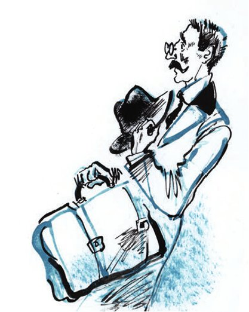

## Kapitel 6: Brillantenrauch

Ippolit Matwejewitsch nimmt seinen fleckigen Hut aus <abbr title="der Biberfilz — касторовый фетр">Biberfilz</abbr> ab. Er kämmt seinen Schnurrbart. Als der <abbr title="der Kamm, die Kämme — гребешок, расчёска">Kamm</abbr> ihn berührt, fliegt ein kleiner <abbr title="der Schwarm, die Schwärme — стайка, рой">Schwarm</abbr> von elektrischen Funken heraus. Dann <abbr title="sich räuspern — откашливаться">räuspert</abbr> er sich <abbr title="entschlossen — решительно">entschlossen</abbr>. Und er erzählt Ostap Bender alles, was er von seiner sterbenden Schwiegermutter über die Brillanten weiß. Ostap Bender ist der erste <abbr title="der Hochstapler, die Hochstapler — проходимец, аферист">Hochstapler</abbr>, den er hier getroffen hat.

Beim Erzählen springt Ostap mehrmals auf. Er wendet sich zum eisernen Ofen und ruft <abbr title="begeistert — восторженно">begeistert</abbr>:

— Das Eis ist gebrochen, meine Herren <abbr title="der Geschworene, die Geschworenen — присяжный заседатель">Geschworenen</abbr>! Das Eis ist gebrochen!

Schon eine Stunde später sitzen beide an einem <abbr title="wacklig — шаткий">wackligen</abbr> kleinen Tisch. Ihre Köpfe <abbr title="aneinanderstoßen — упираться друг в друга">stoßen</abbr> aneinander. Sie lesen die lange Liste von dem Schmuck. Früher war dieser Schmuck an den Fingern von der Schwiegermutter, an ihrem Hals, an ihren Ohren, auf ihrer Brust und in ihren Haaren.

Der Kneifer <abbr title="wackeln — шататься, колебаться">wackelt</abbr> auf der Nase von Ippolit Matwejewitsch, und jede Minute rückt er ihn gerade. Er liest mit <abbr title="die Betonung, die Betonungen — ударение, выразительность">Betonung</abbr>:

— Drei <abbr title="die Perlenkette, die Perlenketten — нитка жемчуга">Perlenketten</abbr> … Daran erinnere ich mich gut. Zwei mit je vierzig <abbr title="die Perle, die Perlen — жемчужина, бусина">Perlen</abbr>, und eine große mit hundertzehn. Ein <abbr title="der Brillantanhänger, die Brillantanhänger — бриллиантовый кулон">Brillantanhänger</abbr> … Klawdija Iwanowna hat gesagt, er ist viertausend wert, eine alte Arbeit …

Dann kommen die <abbr title="der Ring, die Ringe — кольцо">Ringe</abbr>. Keine <abbr title="der Ehering, die Eheringe — обручальное кольцо">Eheringe</abbr> – die sind dick, dumm und billig. Nein, dünne, leichte Ringe mit reinen, sauber <abbr title="gewaschen — умытый">gewaschenen</abbr> Brillanten darin. Schwere <abbr title="der Ohrring, die Ohrringe — серьга, подвеска">Ohrringe</abbr>, die so <abbr title="blenden — ослеплять">blenden</abbr>, dass man die Augen schließen muss. Sie werfen buntes Feuer auf das kleine Ohr von einer Frau. <abbr title="das Armband, die Armbänder — браслет">Armbänder</abbr> in Form von Schlangen, mit <abbr title="die Schuppe, die Schuppen — чешуя">Schuppen</abbr> aus <abbr title="der Smaragd, die Smaragde — изумруд">Smaragden</abbr>. Eine <abbr title="die Schließe, die Schließen — застёжка, фермуар">Schließe</abbr> – für sie hat man die ganze <abbr title="die Ernte, die Ernten — урожай">Ernte</abbr> von fünfhundert <abbr title="die Desjatine, die Desjatinen — десятина (≈ 1,1 га)">Desjatinen</abbr> Land bezahlt. Ein <abbr title="das Perlencollier, die Perlencolliers — жемчужное колье">Perlencollier</abbr>, das nur eine berühmte <abbr title="die Primadonna, die Primadonnen — примадонна">Primadonna</abbr> aus der <abbr title="die Operette, die Operetten — оперетта">Operette</abbr> tragen kann. Und als <abbr title="die Krönung — венец, увенчание">Krönung</abbr> von allem: ein <abbr title="das Diadem, die Diademe — диадема">Diadem</abbr> für vierzigtausend.

Ippolit Matwejewitsch sieht sich um. In den dunklen Ecken von der <abbr title="verpestet — зачумлённый, провонявший">verpesteten</abbr> Hausmeisterwohnung <abbr title="flackern — вспыхивать, мерцать">flackert</abbr> ein grünes Frühlingslicht, grün wie Smaragde. Unter der Decke hängt Brillantenrauch. Perlenketten rollen über den Tisch und springen auf den Boden. Eine <abbr title="kostbar — драгоценный">kostbare</abbr> <abbr title="die Fata Morgana — мираж">Fata Morgana</abbr> erschüttert das Zimmer.

Ippolit Matwejewitsch ist ganz aufgeregt. Erst die Stimme von Ostap holt ihn zurück.

— Keine schlechte <abbr title="die Auswahl — выбор">Auswahl</abbr>. Die Steine sind, wie ich sehe, mit <abbr title="der Geschmack — вкус">Geschmack</abbr> <abbr title="aussuchen — подбирать, выбирать">ausgesucht</abbr>. Was hat diese ganze Musik gekostet?

— So siebzig- bis fünfundsiebzigtausend.

— Hm … Dann ist sie heute also hundertfünfzigtausend wert.

— Wirklich so viel? — fragt Worobjaninow <abbr title="erfreut — обрадованно">erfreut</abbr>.

— Nicht weniger. Aber Sie, lieber Genosse aus Paris, <abbr title="spucken auf + Akk. — плевать на">spucken</abbr> Sie auf das alles.

— Wie – spucken?

— Mit <abbr title="die Spucke — слюна, плевок">Spucke</abbr>, — antwortet Ostap. — So, wie man vor der <abbr title="die Epoche, die Epochen — эпоха">Epoche</abbr> vom historischen Materialismus gespuckt hat. Daraus wird nichts.

— Wieso denn?

— Darum. Wie viele Stühle waren es?

— Ein Dutzend. Eine Salongarnitur.

— Ihre Salongarnitur ist bestimmt schon lange in irgendeinem Ofen <abbr title="verbrennen (verbrannte, ist verbrannt) — сгорать">verbrannt</abbr>.

Worobjaninow erschrickt so sehr, dass er sogar aufsteht.

— Ruhig, ruhig. Ich <abbr title="übernehmen (übernahm, hat übernommen) — брать на себя">übernehme</abbr> die Sache. Die <abbr title="die Sitzung, die Sitzungen — заседание">Sitzung</abbr> geht weiter. <abbr title="übrigens — кстати">Übrigens</abbr>, wir zwei müssen einen kleinen <abbr title="der Vertrag, die Verträge — договор">Vertrag</abbr> <abbr title="schließen (schloss, hat geschlossen) — заключать">schließen</abbr>.

Ippolit Matwejewitsch atmet schwer. Er <abbr title="nicken — кивать">nickt</abbr>: Er ist einverstanden. Da beginnt Ostap Bender mit den <abbr title="die Bedingung, die Bedingungen — условие">Bedingungen</abbr>.

— Wenn wir den Schatz finden und zu Geld machen, dann bekomme ich sechzig <abbr title="das Prozent, die Prozente — процент">Prozent</abbr>. Denn ich bin direkter <abbr title="der Teilnehmer, die Teilnehmer — участник">Teilnehmer</abbr> an der <abbr title="die Konzession, die Konzessionen — концессия">Konzession</abbr> und technischer <abbr title="der Leiter, die Leiter — руководитель">Leiter</abbr>. Die <abbr title="die Sozialversicherung — соцстрах">Sozialversicherung</abbr> müssen Sie für mich nicht bezahlen. Das ist mir egal.

Ippolit Matwejewitsch wird ganz grau im Gesicht.

— Das ist <abbr title="der Raub — грабёж">Raub</abbr> am <abbr title="am helllichten Tag — среди бела дня">helllichten Tag</abbr>.

— Und wie viel wollten Sie mir anbieten?

— N-n-na, fünf Prozent, oder meinetwegen zehn. Verstehen Sie doch, das sind fünfzehntausend Rubel!

— Sonst wollen Sie nichts?

— N-nein.

— Oder wollen Sie vielleicht, dass ich umsonst arbeite? Und dass ich Ihnen noch den Schlüssel zu der Wohnung gebe, wo das Geld liegt? Und Ihnen sage, wo kein Milizionär steht?

— Dann, <abbr title="verzeihen (verzieh, hat verziehen) — простить">verzeihen</abbr> Sie, — sagt Worobjaninow durch die Nase. — Ich habe allen Grund zu glauben: Mit meiner Sache <abbr title="fertigwerden mit + Dat. (wurde fertig, ist fertiggeworden) — справляться с">werde</abbr> ich auch allein fertig.

— Aha! Dann, verzeihen Sie, — antwortet der <abbr title="großartig — великолепный">großartige</abbr> Ostap, — habe ich nicht weniger Grund zu glauben, wie Andy Tucker gesagt hat: Mit Ihrer Sache werde ich auch allein fertig.

(Andy Tucker ist ein Gauner aus den Geschichten von O. Henry.)

— <abbr title="der Betrüger, die Betrüger — мошенник">Betrüger</abbr>! — schreit Ippolit Matwejewitsch. Er zittert.

Ostap bleibt <abbr title="kühl — холодный, хладнокровный">kühl</abbr>.

— Hören Sie, Herr aus Paris: Wissen Sie, dass unsere Brillanten schon fast in meiner Tasche sind? Und Sie interessieren mich nur, weil ich für Ihr <abbr title="das Alter — старость, возраст">Alter</abbr> <abbr title="sorgen für + Akk. — заботиться о, обеспечивать">sorgen</abbr> möchte.

Erst jetzt versteht Ippolit Matwejewitsch: Eiserne <abbr title="die Pfote, die Pfoten — лапа">Pfoten</abbr> halten ihn an der <abbr title="die Kehle, die Kehlen — горло">Kehle</abbr> fest.

— Zwanzig Prozent, — sagt er finster.

— Und mein Essen? — fragt Ostap <abbr title="spöttisch — насмешливо">spöttisch</abbr>.

— Fünfundzwanzig.

— Und den Schlüssel zu der Wohnung, wo das Geld liegt?

— Das sind doch siebenunddreißigeinhalbtausend!

— Wozu so <abbr title="genau — точный">genau</abbr>? Na gut, meinetwegen – fünfzig Prozent. Die Hälfte für Sie, die Hälfte für mich.

Das <abbr title="feilschen — торговаться">Feilschen</abbr> geht weiter. Ostap gibt noch mehr nach. Aus Respekt vor der <abbr title="die Person, die Personen — личность">Person</abbr> Worobjaninow ist er bereit, für vierzig Prozent zu arbeiten.

— Sechzigtausend! — schreit Worobjaninow.

— Sie sind ein ziemlicher <abbr title="der Spießer, die Spießer — пошляк, обыватель">Spießer</abbr>, — sagt Bender. — Sie lieben das Geld mehr, als man darf.

— Und Sie lieben kein Geld? — <abbr title="jaulen — выть, взвыть">jault</abbr> Ippolit Matwejewitsch mit einer Stimme wie eine <abbr title="die Flöte, die Flöten — флейта">Flöte</abbr>.

— Nein.

— Wozu brauchen Sie dann sechzigtausend?

— Aus <abbr title="das Prinzip, die Prinzipien — принцип">Prinzip</abbr>!

Ippolit Matwejewitsch muss erst einmal Luft holen.

— Na, ist das Eis gebrochen? — fragt Ostap und gibt ihm den Rest.

Worobjaninow schnauft und sagt <abbr title="gehorsam — покорно">gehorsam</abbr>:

— Gebrochen.

— Na, <abbr title="abgemacht! — по рукам!, договорились!">abgemacht</abbr>, Kreis-<abbr title="der Häuptling, die Häuptlinge — вождь (племени)">Häuptling</abbr> der <abbr title="der Komantsche, die Komantschen — команч">Komantschen</abbr>! Das Eis ist gebrochen! Das Eis ist gebrochen, meine Herren Geschworenen!

Ippolit Matwejewitsch ist beleidigt, weil man ihn «Häuptling der Komantschen» nennt. Er <abbr title="verlangen — требовать">verlangt</abbr> eine <abbr title="die Entschuldigung, die Entschuldigungen — извинение">Entschuldigung</abbr>. Ostap hält eine Rede und entschuldigt sich. In der Rede nennt er ihn «<abbr title="der Feldmarschall, die Feldmarschälle — фельдмаршал">Feldmarschall</abbr>». Dann beginnen sie mit dem <abbr title="der Schlachtplan, die Schlachtpläne — диспозиция, план действий">Schlachtplan</abbr>.

Um Mitternacht <abbr title="sich schleppen — тащиться">schleppt sich</abbr> der Hausmeister Tichon in seinen Keller. Er hält sich an jedem <abbr title="der Gartenzaun, die Gartenzäune — палисадник, забор">Gartenzaun</abbr> fest. An jedem <abbr title="der Pfosten, die Pfosten — столб">Pfosten</abbr> bleibt er lange stehen und <abbr title="sich lehnen an + Akk. — прислоняться к">lehnt sich</abbr> an. Zu seinem Unglück ist heute <abbr title="der Neumond — новолуние">Neumond</abbr>.

— Ah! Der Proletarier der Kopfarbeit! Der Arbeiter vom <abbr title="der Besen, die Besen — метла">Besen</abbr>! — ruft Ostap, als er den Hausmeister sieht. Tichon ist krumm wie ein Rad.

Der Hausmeister muht mit tiefer, leidenschaftlicher Stimme. So <abbr title="gurgeln — булькать, бормотать">gurgelt</abbr> manchmal in der Stille von der Nacht plötzlich eine <abbr title="die Toilette, die Toiletten — унитаз, туалет">Toilette</abbr>, heiß und geschäftig.

— Das ist kongenial, — sagt Ostap zu Ippolit Matwejewitsch. — Aber Ihr Hausmeister ist ein ziemlich großer Spießer. Wie kann man sich für einen Rubel so <abbr title="sich betrinken (betrank, hat betrunken) — напиваться">betrinken</abbr>?

— D-doch, das k-kann man, — sagt der Hausmeister plötzlich.

— Hör mal, Tichon, — beginnt Ippolit Matwejewitsch, — weißt du vielleicht, mein Lieber, was mit meinen Möbeln passiert ist?

Ostap hält Tichon vorsichtig fest. So können die Worte frei aus seinem weit offenen Mund <abbr title="fließen (floss, ist geflossen) — литься, течь">fließen</abbr>. Ippolit Matwejewitsch wartet <abbr title="gespannt — напряжённо">gespannt</abbr>. Im Mund vom Hausmeister wachsen die <abbr title="der Zahn, die Zähne — зуб">Zähne</abbr> nicht in einer Reihe, sondern mit <abbr title="die Lücke, die Lücken — промежуток, щель">Lücken</abbr>: ein Zahn, kein Zahn, ein Zahn. Aus diesem Mund kommt ein <abbr title="ohrenbetäubend — оглушительный">ohrenbetäubender</abbr> Schrei:

— Es ga-ga-gab einmal fr-r-röhliche Tage …

Die Hausmeisterwohnung ist voll von <abbr title="der Donner — гром">Donner</abbr> und Klingen. Der Hausmeister singt das Lied fleißig und sorgfältig. Kein einziges Wort <abbr title="auslassen (ließ aus, hat ausgelassen) — пропускать">lässt</abbr> er aus. Er brüllt und geht dabei durch das Zimmer. Mal <abbr title="abtauchen — нырять">taucht</abbr> er ohne <abbr title="das Bewusstsein — сознание">Bewusstsein</abbr> unter den Tisch ab. Mal stößt er mit der Mütze an das runde <abbr title="das Gewicht, die Gewichte — гиря">Gewicht</abbr> aus <abbr title="das Messing — латунь, медь">Messing</abbr> von der <abbr title="die Wanduhr, die Wanduhren — ходики, настенные часы">Wanduhr</abbr>. Mal <abbr title="knien — стоять на коленях, вставать на колено">kniet</abbr> er auf einem Knie. Er hat schrecklich viel Spaß.

Ippolit Matwejewitsch weiß überhaupt nicht mehr, was er tun soll.

— Wir müssen die <abbr title="die Befragung, die Befragungen — опрос, допрос">Befragung</abbr> von den Zeugen auf morgen <abbr title="verschieben (verschob, hat verschoben) — откладывать">verschieben</abbr>, — sagt Ostap. — Jetzt schlafen wir.

Der Hausmeister ist im Schlaf schwer wie eine Kommode. Sie tragen ihn auf die Bank. Worobjaninow und Ostap wollen sich zusammen in das Bett vom Hausmeister legen. Unter seiner Jacke trägt Ostap ein «Cowboyhemd», schwarz-rot <abbr title="kariert — клетчатый">kariert</abbr>. Unter dem Cowboyhemd trägt er gar nichts mehr. Dafür trägt Ippolit Matwejewitsch unter der Weste mit den silbernen Sternen – der Leser kennt sie schon – noch eine zweite Weste. Sie ist aus <abbr title="das Wollgarn — гарус, шерстяная пряжа">Wollgarn</abbr> und <abbr title="knallblau — ярко-голубой">knallblau</abbr>.

— So eine Weste muss man einfach verkaufen, — sagt Bender <abbr title="neidisch — завистливо">neidisch</abbr>. — Sie <abbr title="passen + Dat. — подходить, быть впору">passt</abbr> mir genau. Verkaufen Sie sie mir.

Ippolit Matwejewitsch kann seinem neuen <abbr title="der Kompagnon, die Kompagnons — компаньон">Kompagnon</abbr> und direkten Teilnehmer an der Konzession nicht gut Nein sagen. Er verzieht das Gesicht und ist einverstanden: Er verkauft die Weste zum <abbr title="der Einkaufspreis, die Einkaufspreise — своя цена, закупочная цена">Einkaufspreis</abbr> – acht Rubel.

— Das Geld bekommen Sie, wenn wir unseren Schatz zu Geld gemacht haben, — sagt Bender. Er nimmt Worobjaninow die Weste ab. Sie ist noch warm.

— Nein, so geht das nicht, — sagt Ippolit Matwejewitsch und wird rot. — Geben Sie mir bitte die Weste zurück.

Die feine <abbr title="die Natur, die Naturen — натура">Natur</abbr> von Ostap ist empört.

— Aber das ist doch <abbr title="der Krämergeist — лавочничество, мелочность">Krämergeist</abbr>! — ruft er. — Sie beginnen ein Geschäft für hundertfünfzigtausend, und dann streiten Sie wegen acht Rubel! Lernen Sie, <abbr title="großzügig — широко, щедро">großzügig</abbr> zu leben!

Ippolit Matwejewitsch wird noch röter. Er nimmt ein kleines <abbr title="das Notizbuch, die Notizbücher — блокнот, записная книжка">Notizbuch</abbr> heraus und schreibt in <abbr title="die Schönschrift — каллиграфия, красивый почерк">Schönschrift</abbr>: «25.IV.27. An Gen. Bender ausgegeben: 8 Rbl.»

Ostap sieht in das Notizbuch.

— Oho! Wenn Sie schon ein <abbr title="das Konto, die Konten — счёт (лицевой)">Konto</abbr> für mich <abbr title="eröffnen — открывать">eröffnen</abbr>, dann führen Sie es wenigstens richtig. Machen Sie ein <abbr title="das Soll — дебет">Soll</abbr>, machen Sie ein <abbr title="das Haben — кредит">Haben</abbr>. Ins Soll schreiben Sie die 60 000 Rubel, die Sie mir <abbr title="schulden — быть должным">schulden</abbr>. Und ins Haben – die Weste. <abbr title="der Saldo, die Salden — сальдо">Saldo</abbr> zu meinen <abbr title="zu jemandes Gunsten — в чью-то пользу">Gunsten</abbr>: 59 992 Rubel. Damit kann man noch leben.

Danach schläft Ostap ein. Er schläft <abbr title="lautlos — беззвучно">lautlos</abbr>, wie ein Kind. Ippolit Matwejewitsch zieht seine <abbr title="der Pulswärmer, die Pulswärmer — напульсник (вязаный)">Pulswärmer</abbr> aus Wolle aus, und seine <abbr title="vornehm — барский, аристократический">vornehmen</abbr> Stiefel wie von einem <abbr title="der Baron, die Barone — барон">Baron</abbr>. Jetzt trägt er nur noch seine <abbr title="stopfen — штопать">gestopfte</abbr> Jäger-<abbr title="die Unterwäsche — нижнее бельё">Unterwäsche</abbr> aus Wolle. Er <abbr title="schniefen — сопеть">schnieft</abbr> leise und <abbr title="kriechen (kroch, ist gekrochen) — ползти, залезать">kriecht</abbr> unter die Decke. Er liegt sehr <abbr title="unbequem — неудобно">unbequem</abbr>. Auf der äußeren Seite ist die Decke zu kurz, und es ist kalt. Und auf der anderen Seite <abbr title="brennen (brannte, hat gebrannt) — жечь, гореть">brennt</abbr> der junge Körper vom großen Kombinator. Er ist heiß und voll von <abbr title="zitternd — трепетный">zitternden</abbr> Ideen.

Alle drei haben Träume.

Worobjaninow hat schwarze Träume: <abbr title="die Mikrobe, die Mikroben — микроб">Mikroben</abbr>, die Kriminalpolizei, <abbr title="der Russenkittel, die Russenkittel — толстовка">Russenkittel</abbr> aus Samt und der Sargmacher Besentschuk im <abbr title="der Smoking, die Smokings — смокинг">Smoking</abbr>, aber nicht rasiert.

Ostap sieht den <abbr title="der Vulkan, die Vulkane — вулкан">Vulkan</abbr> Fudschijama, den Chef vom <abbr title="der Buttertrust — Маслотрест">Buttertrust</abbr> und Taras Bulba. Taras Bulba verkauft <abbr title="die Postkarte, die Postkarten — открытка">Postkarten</abbr> mit Bildern vom Dnjeprostroi, dem großen neuen <abbr title="das Kraftwerk, die Kraftwerke — электростанция">Kraftwerk</abbr> am Dnjepr.

Und der Hausmeister träumt: Aus dem <abbr title="der Stall, die Ställe — конюшня">Stall</abbr> ist ein Pferd weggelaufen. Im Traum sucht er es bis zum Morgen. Er findet es nicht und wacht <abbr title="zerschlagen — разбитый (усталый)">zerschlagen</abbr> und <abbr title="missmutig — мрачный, угрюмый">missmutig</abbr> auf. Lange und erstaunt sieht er auf die Menschen, die in seinem Bett schlafen. Er versteht gar nichts. Dann nimmt er seinen Besen und geht auf die Straße. Dort erfüllt er seine wichtigsten Pflichten: Er sammelt die <abbr title="der Pferdeapfel, die Pferdeäpfel — конские яблоки (навоз)">Pferdeäpfel</abbr> ein und schreit die alten Frauen aus dem Altersheim an.

---

### Neue Wörter

- **der Biberfilz** — касторовый фетр
- **der Kamm, die Kämme** — гребешок, расчёска
- **der Schwarm, die Schwärme** — стайка, рой
- **sich räuspern** — откашливаться
- **entschlossen** — решительно
- **der Hochstapler, die Hochstapler** — проходимец, аферист
- **begeistert** — восторженно
- **der Geschworene, die Geschworenen** — присяжный заседатель
- **wacklig** — шаткий
- **aneinanderstoßen** — упираться друг в друга
- **wackeln** — шататься, колебаться
- **die Betonung, die Betonungen** — ударение, выразительность
- **die Perlenkette, die Perlenketten** — нитка жемчуга
- **die Perle, die Perlen** — жемчужина, бусина
- **der Brillantanhänger, die Brillantanhänger** — бриллиантовый кулон
- **der Ring, die Ringe** — кольцо
- **der Ehering, die Eheringe** — обручальное кольцо
- **gewaschen** — умытый
- **der Ohrring, die Ohrringe** — серьга, подвеска
- **blenden** — ослеплять
- **das Armband, die Armbänder** — браслет
- **die Schuppe, die Schuppen** — чешуя
- **der Smaragd, die Smaragde** — изумруд
- **die Schließe, die Schließen** — застёжка, фермуар
- **die Ernte, die Ernten** — урожай
- **die Desjatine, die Desjatinen** — десятина (≈ 1,1 га)
- **das Perlencollier, die Perlencolliers** — жемчужное колье
- **die Primadonna, die Primadonnen** — примадонна
- **die Operette, die Operetten** — оперетта
- **die Krönung** — венец, увенчание
- **das Diadem, die Diademe** — диадема
- **verpestet** — зачумлённый, провонявший
- **flackern** — вспыхивать, мерцать
- **kostbar** — драгоценный
- **die Fata Morgana** — мираж
- **die Auswahl** — выбор
- **der Geschmack** — вкус
- **aussuchen** — подбирать, выбирать
- **erfreut** — обрадованно
- **spucken auf + Akk.** — плевать на
- **die Spucke** — слюна, плевок
- **die Epoche, die Epochen** — эпоха
- **verbrennen (verbrannte, ist verbrannt)** — сгорать
- **übernehmen (übernahm, hat übernommen)** — брать на себя
- **die Sitzung, die Sitzungen** — заседание
- **übrigens** — кстати
- **der Vertrag, die Verträge** — договор
- **schließen (schloss, hat geschlossen)** — заключать
- **nicken** — кивать
- **die Bedingung, die Bedingungen** — условие
- **das Prozent, die Prozente** — процент
- **der Teilnehmer, die Teilnehmer** — участник
- **die Konzession, die Konzessionen** — концессия
- **der Leiter, die Leiter** — руководитель
- **die Sozialversicherung** — соцстрах
- **der Raub** — грабёж
- **am helllichten Tag** — среди бела дня
- **verzeihen (verzieh, hat verziehen)** — простить
- **fertigwerden mit + Dat. (wurde fertig, ist fertiggeworden)** — справляться с
- **großartig** — великолепный
- **der Betrüger, die Betrüger** — мошенник
- **kühl** — холодный, хладнокровный
- **das Alter** — старость, возраст
- **sorgen für + Akk.** — заботиться о, обеспечивать
- **die Pfote, die Pfoten** — лапа
- **die Kehle, die Kehlen** — горло
- **spöttisch** — насмешливо
- **genau** — точный
- **feilschen** — торговаться
- **die Person, die Personen** — личность
- **der Spießer, die Spießer** — пошляк, обыватель
- **jaulen** — выть, взвыть
- **die Flöte, die Flöten** — флейта
- **das Prinzip, die Prinzipien** — принцип
- **gehorsam** — покорно
- **abgemacht!** — по рукам!, договорились!
- **der Häuptling, die Häuptlinge** — вождь (племени)
- **der Komantsche, die Komantschen** — команч
- **verlangen** — требовать
- **die Entschuldigung, die Entschuldigungen** — извинение
- **der Feldmarschall, die Feldmarschälle** — фельдмаршал
- **der Schlachtplan, die Schlachtpläne** — диспозиция, план действий
- **sich schleppen** — тащиться
- **der Gartenzaun, die Gartenzäune** — палисадник, забор
- **der Pfosten, die Pfosten** — столб
- **sich lehnen an + Akk.** — прислоняться к
- **der Neumond** — новолуние
- **der Besen, die Besen** — метла
- **gurgeln** — булькать, бормотать
- **die Toilette, die Toiletten** — унитаз, туалет
- **sich betrinken (betrank, hat betrunken)** — напиваться
- **fließen (floss, ist geflossen)** — литься, течь
- **gespannt** — напряжённо
- **der Zahn, die Zähne** — зуб
- **die Lücke, die Lücken** — промежуток, щель
- **ohrenbetäubend** — оглушительный
- **der Donner** — гром
- **auslassen (ließ aus, hat ausgelassen)** — пропускать
- **abtauchen** — нырять
- **das Bewusstsein** — сознание
- **das Gewicht, die Gewichte** — гиря
- **das Messing** — латунь, медь
- **die Wanduhr, die Wanduhren** — ходики, настенные часы
- **knien** — стоять на коленях, вставать на колено
- **die Befragung, die Befragungen** — опрос, допрос
- **verschieben (verschob, hat verschoben)** — откладывать
- **kariert** — клетчатый
- **das Wollgarn** — гарус, шерстяная пряжа
- **knallblau** — ярко-голубой
- **neidisch** — завистливо
- **passen + Dat.** — подходить, быть впору
- **der Kompagnon, die Kompagnons** — компаньон
- **der Einkaufspreis, die Einkaufspreise** — своя цена, закупочная цена
- **die Natur, die Naturen** — натура
- **der Krämergeist** — лавочничество, мелочность
- **großzügig** — широко, щедро
- **das Notizbuch, die Notizbücher** — блокнот, записная книжка
- **die Schönschrift** — каллиграфия, красивый почерк
- **das Konto, die Konten** — счёт (лицевой)
- **eröffnen** — открывать
- **das Soll** — дебет
- **das Haben** — кредит
- **schulden** — быть должным
- **der Saldo, die Salden** — сальдо
- **zu jemandes Gunsten** — в чью-то пользу
- **lautlos** — беззвучно
- **der Pulswärmer, die Pulswärmer** — напульсник (вязаный)
- **vornehm** — барский, аристократический
- **der Baron, die Barone** — барон
- **stopfen** — штопать
- **die Unterwäsche** — нижнее бельё
- **schniefen** — сопеть
- **kriechen (kroch, ist gekrochen)** — ползти, залезать
- **unbequem** — неудобно
- **brennen (brannte, hat gebrannt)** — жечь, гореть
- **zitternd** — трепетный
- **die Mikrobe, die Mikroben** — микроб
- **der Russenkittel, die Russenkittel** — толстовка
- **der Smoking, die Smokings** — смокинг
- **der Vulkan, die Vulkane** — вулкан
- **der Buttertrust** — Маслотрест
- **die Postkarte, die Postkarten** — открытка
- **das Kraftwerk, die Kraftwerke** — электростанция
- **der Stall, die Ställe** — конюшня
- **zerschlagen** — разбитый (усталый)
- **missmutig** — мрачный, угрюмый
- **der Pferdeapfel, die Pferdeäpfel** — конские яблоки (навоз)

[← Kapitel 5](kapitel-05.md) · [Inhalt](README.md) · [Kapitel 7 →](kapitel-07.md)
