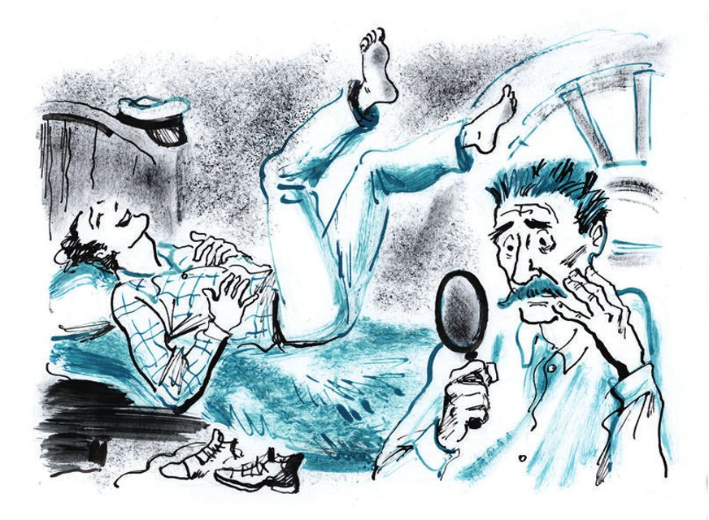

## Kapitel 7: Die Spuren von «Titanic»

Ippolit Matwejewitsch wacht wie immer um halb acht auf. Er brummt «Guten Morgen» und geht zum <abbr title="das Waschbecken, die Waschbecken — умывальник, раковина">Waschbecken</abbr>. Er wäscht sich mit großem Vergnügen: Er spuckt, er <abbr title="jammern — причитать, охать">jammert</abbr> und schüttelt den Kopf, denn er hat Wasser in den Ohren. Das <abbr title="abtrocknen — вытирать(ся)">Abtrocknen</abbr> ist angenehm. Aber dann nimmt Ippolit Matwejewitsch das <abbr title="das Handtuch, die Handtücher — полотенце">Handtuch</abbr> vom Gesicht und sieht: Das Handtuch ist <abbr title="schmutzig — грязный, испачканный">schmutzig</abbr>. Es hat genau die radikal schwarze Farbe, die seit <abbr title="vorgestern — позавчера">vorgestern</abbr> seinen <abbr title="waagerecht — горизонтальный">waagerechten</abbr> Schnurrbart färbt. Das Herz von Ippolit Matwejewitsch bleibt fast stehen. Er <abbr title="sich stürzen auf + Akk. — броситься к">stürzt</abbr> zu seinem kleinen <abbr title="der Taschenspiegel, die Taschenspiegel — карманное зеркальце">Taschenspiegel</abbr>. Im Spiegel sieht er eine große Nase und die linke Hälfte vom Schnurrbart. Sie ist grün wie junges <abbr title="das Gras — трава">Gras</abbr>. Schnell schiebt Ippolit Matwejewitsch den Spiegel nach rechts. Die rechte Hälfte hat dieselbe <abbr title="ekelhaft — омерзительный, мерзкий">ekelhafte</abbr> Farbe. Er <abbr title="senken — опускать, наклонять">senkt</abbr> den Kopf, als ob er den Spiegel mit den <abbr title="das Horn, die Hörner — рог">Hörnern</abbr> stoßen will. Da sieht der <abbr title="der Unglückliche, die Unglücklichen — несчастный">Unglückliche</abbr>: In der Mitte ist das Haar noch radikal schwarz. Aber rundherum wächst ein grüner <abbr title="der Rand, die Ränder — край, кайма">Rand</abbr>, wie <abbr title="der Rasen — газон, травка">Rasen</abbr>. Ippolit Matwejewitsch stöhnt so laut, dass Ostap Bender seine klaren blauen Augen öffnet.

— Sind Sie <abbr title="verrückt werden — сойти с ума">verrückt geworden</abbr>? — ruft Bender und macht die <abbr title="schläfrig — сонный">schläfrigen</abbr> Augen sofort wieder zu.

— Genosse Bender, — flüstert das <abbr title="das Opfer, die Opfer — жертва">Opfer</abbr> von «Titanic» flehend.

Ippolit Matwejewitsch muss Ostap lange <abbr title="rütteln — трясти, толкать">rütteln</abbr> und <abbr title="überreden — уговаривать">überreden</abbr>. Endlich wacht Ostap auf. Er sieht Ippolit Matwejewitsch aufmerksam an und lacht <abbr title="fröhlich — весело, радостно">fröhlich</abbr>. Er dreht sich vom Direktor und <abbr title="der Gründer, die Gründer — учредитель, основатель">Gründer</abbr> der Konzession weg. Der Leiter der Arbeiten und technische Direktor <abbr title="beben — содрогаться, трястись">bebt</abbr> vor Lachen. Er hält sich am Bett fest, ruft: «Ich kann nicht mehr!» – und lacht wieder <abbr title="wie verrückt — как сумасшедший, неистово">wie verrückt</abbr>.

— Das ist nicht schön von Ihnen, Genosse Bender, — sagt Ippolit Matwejewitsch. Sein grüner Schnurrbart zittert.

Das gibt dem müden Ostap neue <abbr title="die Kraft, die Kräfte — сила">Kraft</abbr>. Er lacht noch zehn Minuten lang, ganz ehrlich und von Herzen. Dann <abbr title="wieder zu Atem kommen — отдышаться">kommt er wieder zu Atem</abbr> und wird plötzlich sehr ernst.

— Warum sehen Sie mich so böse an, wie ein Soldat eine <abbr title="die Laus, die Läuse — вошь">Laus</abbr>? Sehen Sie sich lieber selbst an!

— Aber der Apotheker hat mir gesagt, das wird eine radikal schwarze Farbe. Sie geht nicht ab, nicht mit kaltem Wasser, nicht mit heißem Wasser, nicht mit Seifenschaum und nicht mit Petroleum … Schmuggelware.

— Schmuggelware? Die ganze Schmuggelware macht man in Odessa, in der Malaja-Arnautskaja-Straße. Zeigen Sie mir die Flasche … Und jetzt sehen Sie mal hier. Haben Sie das gelesen?

— Ja, das habe ich gelesen.

— Und das hier, mit den kleinen Buchstaben? Hier steht es ganz klar: Nach dem Waschen mit heißem und kaltem Wasser, mit Seifenschaum und mit Petroleum darf man die Haare <abbr title="auf keinen Fall — ни в коем случае">auf keinen Fall</abbr> abtrocknen. Man muss sie in der Sonne oder am <abbr title="der Petroleumkocher, die Petroleumkocher — примус">Petroleumkocher</abbr> trocknen … Warum haben Sie sie nicht getrocknet? Wohin wollen Sie jetzt mit dieser grünen <abbr title="die Fälschung, die Fälschungen — подделка, «липа»">Fälschung</abbr> gehen?

Ippolit Matwejewitsch ist ganz <abbr title="niedergeschlagen — подавленный">niedergeschlagen</abbr>. Tichon kommt herein. Er sieht seinen alten Herrn mit dem grünen Schnurrbart und macht ein Kreuzzeichen. Dann bittet er um Geld für einen Schnaps <abbr title="gegen den Kater trinken — опохмелиться">gegen den Kater</abbr>.

— Geben Sie dem <abbr title="der Held der Arbeit — герой труда">Helden der Arbeit</abbr> einen Rubel, — sagt Ostap. — Aber schreiben Sie ihn bitte nicht auf mein Konto. Das ist Ihre private Sache mit einem alten Kollegen … Warte, Väterchen, geh noch nicht. Ich habe eine kleine Sache für dich.

Ostap beginnt mit dem Hausmeister ein Gespräch über die Möbel. Schon nach fünf Minuten wissen die Konzessionäre alles. 1919 hat man alle Möbel zum <abbr title="das Wohnungsamt, die Wohnungsämter — жилотдел">Wohnungsamt</abbr> gebracht. Nur ein Stuhl aus dem Salon ist nicht dorthin gekommen. Zuerst hat Tichon ihn behalten. Aber dann hat der <abbr title="der Verwalter, die Verwalter — завхоз, управляющий">Verwalter</abbr> vom Altersheim ihn mitgenommen.

— Dann ist der Stuhl also hier im Haus?

— Ja, hier steht er.

— Sag mal, mein Lieber, — fragt Worobjaninow. Sein Herz bleibt fast stehen. — Als du den Stuhl hattest, hast du ihn … nicht <abbr title="reparieren — чинить">repariert</abbr>?

— Den kann man nicht reparieren. Früher war die Arbeit gut. So ein Stuhl hält noch dreißig Jahre.

— Na gut, geh, mein Lieber. Nimm noch einen Rubel. Aber sag niemandem, dass ich hier bin.

— Ich schweige <abbr title="schweigen wie ein Grab — молчать как могила">wie ein Grab</abbr>, Bürger Worobjaninow.

Der Hausmeister geht. Ostap ruft: «Das Eis ist gebrochen!» Dann <abbr title="sich kümmern um + Akk. — заниматься, заботиться о">kümmert er sich</abbr> wieder um den Schnurrbart von Ippolit Matwejewitsch.

— Wir müssen ihn noch einmal färben. Geben Sie mir Geld, ich gehe in die Apotheke. Ihr «Titanic» <abbr title="taugen — годиться">taugt</abbr> gar nichts. Damit kann man nur Hunde färben … Früher, ja, da gab es noch gute Farbe! Ein Professor von der <abbr title="die Pferderennbahn, die Pferderennbahnen — ипподром, бега">Pferderennbahn</abbr> hat mir einmal eine <abbr title="spannend — захватывающий, волнующий">spannende</abbr> Geschichte erzählt. Interessieren Sie sich für <abbr title="das Pferderennen, die Pferderennen — скачки, бега">Pferderennen</abbr>? Nein? Schade. Eine spannende Sache. Also … Es gab einmal einen berühmten Kombinator, den Grafen Druzki. Er hat beim Pferderennen fünfhunderttausend Rubel verloren. Ein König im Verlieren! Er hatte nur noch Schulden und hat schon an <abbr title="der Selbstmord, die Selbstmorde — самоубийство">Selbstmord</abbr> gedacht. Da hat ihm ein Gauner für fünfzig Rubel einen tollen <abbr title="der Rat, die Ratschläge — совет">Rat</abbr> gegeben. Der Graf ist weggefahren. Nach einem Jahr ist er mit einem dreijährigen <abbr title="der Traber, die Traber — рысак">Traber</abbr> aus Orjol zurückgekommen. Danach hat der Graf nicht nur sein Geld zurückgewonnen. Er hat noch dreihunderttausend dazu gewonnen. Sein Orjol-Traber «Makler» hatte ein ausgezeichnetes <abbr title="das Zeugnis, die Zeugnisse — аттестат, свидетельство">Zeugnis</abbr> und war immer der Erste. Beim Derby war er eine ganze <abbr title="die Pferdelänge, die Pferdelängen — корпус (лошади)">Pferdelänge</abbr> vor «MacMahon». <abbr title="Donnerwetter! — гром! вот это да!">Donnerwetter</abbr>! Aber dann merkt Kurotschkin (haben Sie von ihm gehört?): Alle Orjol-Traber <abbr title="wechseln — менять">wechseln</abbr> die Farbe. Nur «Makler», das <abbr title="das Schätzchen, die Schätzchen — душечка, «дуся»">Schätzchen</abbr>, wechselt seine Farbe nicht. Das war ein <abbr title="unerhört — неслыханный">unerhörter</abbr> Skandal! Der Graf hat drei Jahre <abbr title="das Gefängnis, die Gefängnisse — тюрьма">Gefängnis</abbr> bekommen. Denn «Makler» war gar kein Orjol-Traber. Er war ein gefärbter <abbr title="der Mischling, die Mischlinge — метис, помесь">Mischling</abbr>. Und Mischlinge sind viel schneller als Orjol-Traber. Man lässt sie <abbr title="nicht einmal in die Nähe lassen — на версту не подпускать">nicht einmal in die Nähe</abbr>. Na, was sagen Sie? Das war eine Farbe! Nicht wie bei Ihrem Schnurrbart!

— Aber das Zeugnis? Er hatte doch ein ausgezeichnetes Zeugnis?

— Das war genau wie das Etikett auf Ihrem «Titanic»: <abbr title="gefälscht — фальшивый, поддельный">gefälscht</abbr>! Geben Sie mir Geld für die Farbe.

Ostap kommt mit einer neuen <abbr title="die Mixtur, die Mixturen — микстура, смесь">Mixtur</abbr> zurück.

— «Najade». Vielleicht ist sie besser als Ihr «Titanic». Ziehen Sie die Jacke aus!

Die <abbr title="die Zeremonie, die Zeremonien — обряд, церемония">Zeremonie</abbr> vom Färben beginnt. Auf der Flasche steht: «Eine wunderbare <abbr title="kastanienbraun — каштановый">kastanienbraune</abbr> Farbe. Sie macht das Haar zart und <abbr title="flauschig — пушистый">flauschig</abbr>.» Aber die Farbe <abbr title="sich mischen mit + Dat. — смешиваться с">mischt sich</abbr> mit dem Grün von «Titanic». Und plötzlich hat Ippolit Matwejewitsch auf dem Kopf und im Schnurrbart alle Farben vom <abbr title="der Regenbogen, die Regenbögen — радуга">Regenbogen</abbr>.

Worobjaninow hat seit dem Morgen nichts gegessen. Böse <abbr title="schimpfen auf + Akk. — ругать">schimpft</abbr> er auf alle <abbr title="die Parfümfabrik, die Parfümfabriken — парфюмерная фабрика">Parfümfabriken</abbr>: auf die <abbr title="staatlich — государственный">staatlichen</abbr> und auf die <abbr title="geheim — тайный, подпольный">geheimen</abbr>, die in Odessa sind, in der Malaja-Arnautskaja-Straße.

— So einen Schnurrbart hat nicht einmal Aristide Briand, — sagt Ostap <abbr title="munter — бодро">munter</abbr>. — Aber mit so <abbr title="ultraviolett — ультрафиолетовый">ultravioletten</abbr> Haaren soll man in Sowjetrussland lieber nicht leben. Wir müssen alles <abbr title="abrasieren — сбрить">abrasieren</abbr>.

— Das kann ich nicht, — antwortet Ippolit Matwejewitsch <abbr title="traurig — скорбно, печально">traurig</abbr>. — Das ist <abbr title="unmöglich — невозможно">unmöglich</abbr>.

— Was ist? Ist der Schnurrbart für Sie eine liebe <abbr title="die Erinnerung, die Erinnerungen — память, воспоминание">Erinnerung</abbr>?

— Ich kann nicht, — sagt Worobjaninow noch einmal und lässt den Kopf hängen.

— Dann sitzen Sie Ihr ganzes Leben in der Hausmeisterwohnung, und ich gehe allein die Stühle suchen. Übrigens: Der erste Stuhl steht direkt über unserem Kopf.

— <abbr title="rasieren — брить">Rasieren</abbr> Sie!

Bender findet eine Schere. In einer Sekunde schneidet er den Schnurrbart ab. Er fällt ganz leise auf den Boden. Dann nimmt der technische Direktor ein altes, gelbes <abbr title="das Rasiermesser, die Rasiermesser — бритва">Rasiermesser</abbr> von «Gillette» aus der Tasche. Aus der <abbr title="die Brieftasche, die Brieftaschen — бумажник">Brieftasche</abbr> nimmt er eine neue <abbr title="die Klinge, die Klingen — лезвие">Klinge</abbr>. Dann rasiert er Ippolit Matwejewitsch. Ippolit Matwejewitsch weint fast.

— Für Sie <abbr title="verbrauchen — тратить, расходовать">verbrauche</abbr> ich meine letzte Klinge. Vergessen Sie nicht: zwei Rubel für Rasieren und Haareschneiden auf mein Soll.

Ippolit Matwejewitsch zittert vor <abbr title="der Kummer — горе">Kummer</abbr>. Trotzdem fragt er:

— Warum denn so teuer? Überall kostet das vierzig Kopeken!

— Für die <abbr title="die Tarnung — конспирация, маскировка">Tarnung</abbr>, Genosse Feldmarschall, — antwortet Bender schnell.

Wenn man jemandem den Kopf mit einem <abbr title="der Rasierapparat, die Rasierapparate — безопасная бритва">Rasierapparat</abbr> rasiert, dann <abbr title="leiden (litt, hat gelitten) — страдать">leidet</abbr> der Mensch <abbr title="unglaublich — невероятно">unglaublich</abbr>. Das versteht Ippolit Matwejewitsch schon ganz am Anfang von der <abbr title="die Operation, die Operationen — операция">Operation</abbr>.

Aber alles hat ein Ende. Auch das.

— Fertig! Die Sitzung geht weiter! Nervöse Menschen sollen bitte nicht hinsehen! Jetzt sehen Sie aus wie Boborykin, der bekannte Autor von lustigen <abbr title="das Couplet, die Couplets — куплет">Couplets</abbr>.

Ippolit Matwejewitsch <abbr title="abschütteln — стряхивать">schüttelt</abbr> die scheußlichen <abbr title="das Büschel, die Büschel — клок, пучок">Büschel</abbr> ab. Vor kurzer Zeit waren sie noch seine schönen grauen Haare. Er wäscht sich. Der ganze Kopf brennt stark. Zum hundertsten Mal an diesem Tag <abbr title="starren — уставиться, пристально смотреть">starrt</abbr> er in den Spiegel. Und plötzlich gefällt ihm, was er sieht. Aus dem Spiegel sieht ihn ein ziemlich junges Gesicht an. Es ist vom Leiden <abbr title="verzerrt — искажённый">verzerrt</abbr>. Es ist das Gesicht von einem <abbr title="der Schauspieler, die Schauspieler — актёр">Schauspieler</abbr> ohne <abbr title="das Engagement, die Engagements — ангажемент">Engagement</abbr>.

— Na, <abbr title="vorwärts — вперёд">vorwärts</abbr>, die Trompete ruft! — ruft Ostap. — Ich gehe der <abbr title="die Spur, die Spuren — след">Spur</abbr> nach, zum Wohnungsamt, oder besser: in das Haus, wo früher einmal das Wohnungsamt war. Und Sie gehen zu den alten Frauen!

— Das kann ich nicht, — sagt Ippolit Matwejewitsch. — Es ist sehr schwer für mich, in mein eigenes Haus zu gehen.

— Ach ja! … Eine spannende Geschichte! Der <abbr title="verbannt — изгнанный, изгнанник">verbannte</abbr> Baron! Na gut. Sie gehen zum Wohnungsamt, und ich arbeite hier. <abbr title="der Treffpunkt, die Treffpunkte — сборный пункт, место встречи">Treffpunkt</abbr>: die Hausmeisterwohnung. <abbr title="Manege frei! — парад-алле! (цирк.)">Manege frei</abbr>!

---

### Neue Wörter

- **das Waschbecken, die Waschbecken** — умывальник, раковина
- **jammern** — причитать, охать
- **abtrocknen** — вытирать(ся)
- **das Handtuch, die Handtücher** — полотенце
- **schmutzig** — грязный, испачканный
- **vorgestern** — позавчера
- **waagerecht** — горизонтальный
- **sich stürzen auf + Akk.** — броситься к
- **der Taschenspiegel, die Taschenspiegel** — карманное зеркальце
- **das Gras** — трава
- **ekelhaft** — омерзительный, мерзкий
- **senken** — опускать, наклонять
- **das Horn, die Hörner** — рог
- **der Unglückliche, die Unglücklichen** — несчастный
- **der Rand, die Ränder** — край, кайма
- **der Rasen** — газон, травка
- **verrückt werden** — сойти с ума
- **schläfrig** — сонный
- **das Opfer, die Opfer** — жертва
- **rütteln** — трясти, толкать
- **überreden** — уговаривать
- **fröhlich** — весело, радостно
- **der Gründer, die Gründer** — учредитель, основатель
- **beben** — содрогаться, трястись
- **wie verrückt** — как сумасшедший, неистово
- **die Kraft, die Kräfte** — сила
- **wieder zu Atem kommen** — отдышаться
- **die Laus, die Läuse** — вошь
- **auf keinen Fall** — ни в коем случае
- **der Petroleumkocher, die Petroleumkocher** — примус
- **die Fälschung, die Fälschungen** — подделка, «липа»
- **niedergeschlagen** — подавленный
- **gegen den Kater trinken** — опохмелиться
- **der Held der Arbeit** — герой труда
- **das Wohnungsamt, die Wohnungsämter** — жилотдел
- **der Verwalter, die Verwalter** — завхоз, управляющий
- **reparieren** — чинить
- **schweigen wie ein Grab** — молчать как могила
- **sich kümmern um + Akk.** — заниматься, заботиться о
- **taugen** — годиться
- **die Pferderennbahn, die Pferderennbahnen** — ипподром, бега
- **spannend** — захватывающий, волнующий
- **das Pferderennen, die Pferderennen** — скачки, бега
- **der Selbstmord, die Selbstmorde** — самоубийство
- **der Rat, die Ratschläge** — совет
- **der Traber, die Traber** — рысак
- **das Zeugnis, die Zeugnisse** — аттестат, свидетельство
- **die Pferdelänge, die Pferdelängen** — корпус (лошади)
- **Donnerwetter!** — гром! вот это да!
- **wechseln** — менять
- **das Schätzchen, die Schätzchen** — душечка, «дуся»
- **unerhört** — неслыханный
- **das Gefängnis, die Gefängnisse** — тюрьма
- **der Mischling, die Mischlinge** — метис, помесь
- **nicht einmal in die Nähe lassen** — на версту не подпускать
- **gefälscht** — фальшивый, поддельный
- **die Mixtur, die Mixturen** — микстура, смесь
- **die Zeremonie, die Zeremonien** — обряд, церемония
- **kastanienbraun** — каштановый
- **flauschig** — пушистый
- **sich mischen mit + Dat.** — смешиваться с
- **der Regenbogen, die Regenbögen** — радуга
- **schimpfen auf + Akk.** — ругать
- **die Parfümfabrik, die Parfümfabriken** — парфюмерная фабрика
- **staatlich** — государственный
- **geheim** — тайный, подпольный
- **munter** — бодро
- **ultraviolett** — ультрафиолетовый
- **abrasieren** — сбрить
- **traurig** — скорбно, печально
- **unmöglich** — невозможно
- **die Erinnerung, die Erinnerungen** — память, воспоминание
- **rasieren** — брить
- **das Rasiermesser, die Rasiermesser** — бритва
- **die Brieftasche, die Brieftaschen** — бумажник
- **die Klinge, die Klingen** — лезвие
- **verbrauchen** — тратить, расходовать
- **der Kummer** — горе
- **die Tarnung** — конспирация, маскировка
- **der Rasierapparat, die Rasierapparate** — безопасная бритва
- **leiden (litt, hat gelitten)** — страдать
- **unglaublich** — невероятно
- **die Operation, die Operationen** — операция
- **das Couplet, die Couplets** — куплет
- **abschütteln** — стряхивать
- **das Büschel, die Büschel** — клок, пучок
- **starren** — уставиться, пристально смотреть
- **verzerrt** — искажённый
- **der Schauspieler, die Schauspieler** — актёр
- **das Engagement, die Engagements** — ангажемент
- **vorwärts** — вперёд
- **die Spur, die Spuren** — след
- **verbannt** — изгнанный, изгнанник
- **der Treffpunkt, die Treffpunkte** — сборный пункт, место встречи
- **Manege frei!** — парад-алле! (цирк.)

[← Kapitel 6](kapitel-06.md) · [Inhalt](README.md) · [Kapitel 8 →](kapitel-08.md)
