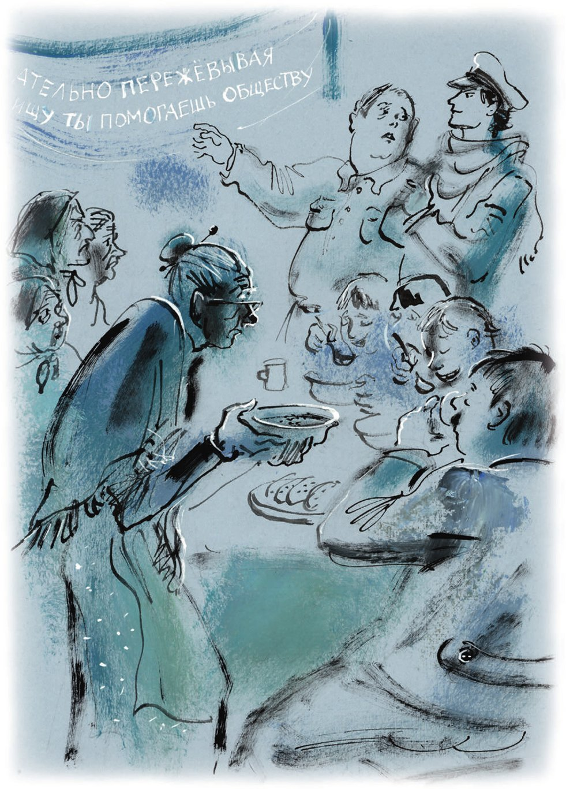

## Kapitel 8: Der blaue Dieb

Der Verwalter vom Altersheim Nummer 2 ist ein schüchterner <abbr title="der Dieb, die Diebe — вор, ворюга">Dieb</abbr>. Sein ganzes Wesen <abbr title="protestieren gegen + Akk. — протестовать против">protestiert</abbr> gegen das <abbr title="stehlen (stahl, hat gestohlen) — красть">Stehlen</abbr>. Aber er kann nicht anders, er muss stehlen. Er stiehlt, und er <abbr title="sich schämen — стыдиться">schämt sich</abbr>. Er stiehlt immer, und er schämt sich immer. Deshalb sind seine gut rasierten Wangen immer rot: rot vor <abbr title="die Verlegenheit — смущение">Verlegenheit</abbr>, vor Scham, vor Schüchternheit. Der Verwalter heißt Alexander Jakowlewitsch, und seine Frau heißt Alexandra Jakowlewna. Er nennt sie Saschchen, sie nennt ihn Alchen. So einen blauen Dieb wie Alexander Jakowlewitsch hat die Welt noch nicht gesehen.

Er ist nicht nur Verwalter, er ist auch der Leiter vom ganzen Haus. Der alte Leiter war sehr <abbr title="grob — грубый">grob</abbr> zu den alten Frauen. Deshalb hat man ihn entlassen – und zum <abbr title="der Kapellmeister, die Kapellmeister — капельмейстер, дирижёр">Kapellmeister</abbr> von einem <abbr title="das Sinfonieorchester, die Sinfonieorchester — симфонический оркестр">Sinfonieorchester</abbr> gemacht. Alchen ist ganz anders als sein <abbr title="unhöflich — невоспитанный, невежливый">unhöflicher</abbr> Chef. Er leitet das Haus <abbr title="nebenbei — попутно, по совместительству">nebenbei</abbr>, zusätzlich zu seiner Arbeit. Zu den <abbr title="die Rentnerin, die Rentnerinnen — пенсионерка">Rentnerinnen</abbr> ist er <abbr title="außerordentlich — чрезвычайно, отменно">außerordentlich</abbr> höflich. Und er macht im Haus wichtige <abbr title="die Reform, die Reformen — реформа">Reformen</abbr> und <abbr title="die Neuerung, die Neuerungen — нововведение">Neuerungen</abbr>.

Ostap Bender zieht an der schweren Tür aus Eichenholz und steht in der <abbr title="die Eingangshalle, die Eingangshallen — вестибюль">Eingangshalle</abbr> vom Haus der Worobjaninows. Hier riecht es nach <abbr title="angebrannt — подгоревший">angebranntem</abbr> <abbr title="der Brei, die Breie — каша">Brei</abbr>. Von oben hört man viele Stimmen. Es klingt wie ein <abbr title="fern — далёкий">fernes</abbr> «Hurra» von Soldaten. Niemand ist da, und niemand kommt. Eine Treppe aus Eichenholz führt nach oben. Früher waren die Stufen lackiert. Jetzt sieht man nur noch die Ringe. Die <abbr title="die Stange, die Stangen — прут, штанга">Stangen</abbr> aus Messing, die früher den <abbr title="der Teppich, die Teppiche — ковёр">Teppich</abbr> auf den Stufen gehalten haben, sind weg.

«Der Häuptling der Komantschen hat aber in <abbr title="kitschig — пошлый, безвкусный">kitschigem</abbr> <abbr title="der Luxus — роскошь">Luxus</abbr> gelebt», denkt Ostap und geht nach oben.

Im ersten Zimmer ist es hell und <abbr title="geräumig — просторный">geräumig</abbr>. Hier sitzen etwa fünfzehn kleine, grauhaarige alte Frauen im Kreis. Sie tragen Kleider aus einem ganz billigen, <abbr title="mausgrau — мышиного цвета">mausgrauen</abbr> <abbr title="der Baumwollstoff, die Baumwollstoffe — хлопчатобумажная ткань (туальденор)">Baumwollstoff</abbr>. Sie strecken ihre dünnen Hälse und sehen einen <abbr title="blühend — цветущий">blühenden</abbr> Mann in der Mitte an. Und sie singen:

*Von weitem hört man die <abbr title="das Glöckchen, die Glöckchen — бубенчик, колокольчик">Glöckchen</abbr> klingen,*

*die bekannte <abbr title="die Troika, die Troikas — тройка (лошадей)">Troika</abbr> kommt <abbr title="heran — сюда, ближе">heran</abbr> …*

*Und weit, so we-e-eit, liegt der glitzernde Schnee*

*wie ein weißes <abbr title="das Leichentuch, die Leichentücher — саван">Leichentuch</abbr>! …*

Der <abbr title="der Chorleiter, die Chorleiter — руководитель хора">Chorleiter</abbr> trägt eine graue <abbr title="die Kittelbluse, die Kittelblusen — толстовка">Kittelbluse</abbr> und eine Hose aus demselben mausgrauen Stoff. Er schlägt mit beiden Händen den <abbr title="der Takt, die Takte — такт">Takt</abbr>, dreht sich hin und her und ruft:

— <abbr title="der Sopran, die Soprane — сопрано, дискант">Sopran</abbr>, leiser! Kokuschkina, schwächer!

Er sieht Ostap. Aber er kann seine Hände nicht anhalten. Er sieht den Fremden nur <abbr title="unfreundlich — недружелюбно">unfreundlich</abbr> an und <abbr title="dirigieren — дирижировать">dirigiert</abbr> weiter. Der Chor singt laut und mit großer Mühe, aber es klingt wie durch ein Kissen:

*Ta-ta-ta, ta-ta-ta, ta-ta-ta-ta, to-ro-rom, tu-ru-rum, tu-ru-ram …*

— Sagen Sie, wo finde ich hier den Genossen Verwalter? — fragt Ostap in der ersten Pause.

— Worum geht es denn, Genosse?

Ostap gibt dem <abbr title="der Dirigent, die Dirigenten — дирижёр">Dirigenten</abbr> die Hand und fragt freundlich:

— <abbr title="das Volkslied, die Volkslieder — народная песня">Volkslieder</abbr>? Sehr interessant. Ich bin <abbr title="der Inspektor, die Inspektoren — инспектор">Inspektor</abbr> von der Feuerwehr.

Der Verwalter schämt sich.

— Ja, ja, — sagt er verlegen, — das <abbr title="passen — быть кстати, подходить">passt</abbr> sehr gut. Ich wollte sogar einen <abbr title="der Bericht, die Berichte — доклад, отчёт">Bericht</abbr> schreiben.

— Machen Sie sich keine Sorgen, — sagt Ostap großzügig. — Den Bericht schreibe ich selbst. Na, dann sehen wir uns mal das Haus an.

Alchen winkt kurz mit der Hand, und der Chor ist fertig. Die alten Frauen gehen mit kleinen, fröhlichen Schritten weg.

— Bitte folgen Sie mir, — sagt der Verwalter.

Aber zuerst sieht Ostap sich die Möbel im ersten Zimmer genau an. Im Zimmer stehen: ein Tisch, zwei <abbr title="die Gartenbank, die Gartenbänke — садовая скамейка">Gartenbänke</abbr> mit <abbr title="eisern — железный">eisernen</abbr> Beinen (in die <abbr title="die Lehne, die Lehnen — спинка">Lehne</abbr> von einer Bank hat jemand tief den Namen «Kolja» <abbr title="schnitzen — вырезать (ножом)">geschnitzt</abbr>) und ein rotbraunes <abbr title="das Harmonium, die Harmonien — фисгармония">Harmonium</abbr>.

— Machen Sie in diesem Zimmer Feuer im Petroleumkocher? Kleine Öfen und so weiter?

— Nein, nein. Hier haben unsere <abbr title="die Gruppe, die Gruppen — кружок, группа">Gruppen</abbr> ihren Unterricht: der Chor, das <abbr title="das Theater, die Theater — театр">Theater</abbr>, die <abbr title="die bildende Kunst — изобразительное искусство">bildende Kunst</abbr>, die Musikgruppe …

Beim Wort «Musik» wird Alexander Jakowlewitsch rot. Zuerst <abbr title="glühen — пылать">glüht</abbr> sein Kinn, dann die <abbr title="die Stirn, die Stirnen — лоб">Stirn</abbr> und die Wangen. Alchen schämt sich sehr. Er hat schon vor langer Zeit alle <abbr title="das Blasinstrument, die Blasinstrumente — духовой инструмент">Blasinstrumente</abbr> von der <abbr title="die Blaskapelle, die Blaskapellen — духовой оркестр, капелла">Blaskapelle</abbr> verkauft. Die alten Frauen haben schwache <abbr title="die Lunge, die Lungen — лёгкие">Lungen</abbr>. Aus den Instrumenten kam immer nur ein Quieken wie von kleinen Hunden. Es war lustig: so viel Metall, und so <abbr title="hilflos — беспомощный">hilflos</abbr>. Alchen konnte die Kapelle einfach nicht nicht stehlen. Und jetzt schämt er sich sehr.

An der Wand hängt ein <abbr title="das Spruchband, die Spruchbänder — лозунг, транспарант">Spruchband</abbr> von Fenster zu Fenster. Es ist mit weißen Buchstaben auf ein Stück von dem mausgrauen Stoff geschrieben:

«Die Blaskapelle ist der Weg zur <abbr title="kollektiv — коллективный">kollektiven</abbr> <abbr title="die Kreativität — творчество">Kreativität</abbr>».

— Sehr gut, — sagt Ostap. — Das Zimmer für die Gruppen ist für die Feuerwehr keine <abbr title="die Gefahr, die Gefahren — опасность">Gefahr</abbr>. Gehen wir weiter.

Schnell wie ein Pferd im Galopp geht Ostap durch die vorderen Zimmer vom Haus. Nirgends sieht er einen Stuhl aus Nussbaum mit gebogenen Beinen und hellem englischem Stoff mit kleinen Blumen. An den Wänden aus glattem <abbr title="der Marmor — мрамор">Marmor</abbr> hängen viele <abbr title="der Befehl, die Befehle — приказ">Befehle</abbr> für das Haus Nummer 2. Ostap liest sie. Ab und zu fragt er energisch: «Werden die Schornsteine <abbr title="regelmäßig — регулярно">regelmäßig</abbr> sauber gemacht? Sind die Öfen in Ordnung?» Er bekommt immer <abbr title="vollständig — исчерпывающий, полный">vollständige</abbr> Antworten und geht weiter.

Der Inspektor von der Feuerwehr sucht fleißig im ganzen Haus. Er möchte wenigstens eine gefährliche Ecke finden. Aber alles ist in Ordnung. Auch den Schatz findet er nicht. Ostap geht in die Schlafzimmer. Wenn er kommt, stehen die alten Frauen auf und verbeugen sich tief. Hier stehen schmale Betten mit <abbr title="zottig — ворсистый, лохматый">zottigen</abbr> Decken, rau wie das Fell von einem Hund. Auf einer Seite von jeder Decke steht, direkt in der <abbr title="die Fabrik, die Fabriken — фабрика">Fabrik</abbr> <abbr title="einweben — выткать">eingewebt</abbr>, das Wort «FÜSSE». Unter den Betten stehen kleine Truhen. Sie stehen genau ein Drittel unter dem Bett hervor. Das ist eine Idee von Alexander Jakowlewitsch, denn er liebt die <abbr title="militärisch — военный">militärische</abbr> Ordnung.

Alles im Haus Nummer 2 ist <abbr title="übertrieben — чрезмерный">übertrieben</abbr> <abbr title="bescheiden — скромный">bescheiden</abbr>: die Möbel, die nur aus Gartenbänken bestehen (sie kommen vom Alexander-Boulevard, heute heißt er «Boulevard der <abbr title="proletarisch — пролетарский">proletarischen</abbr> Subbotniks»), die billigen Petroleumlampen vom Markt und auch die Decken mit dem <abbr title="unheimlich — жуткий, пугающий">unheimlichen</abbr> Wort «FÜSSE». Nur eine Sache im Haus ist stark und <abbr title="prächtig — пышный, великолепный">prächtig</abbr>: die <abbr title="die Türfeder, die Türfedern — дверная пружина">Türfedern</abbr>.

Die Türfedern sind die große <abbr title="die Leidenschaft, die Leidenschaften — страсть">Leidenschaft</abbr> von Alexander Jakowlewitsch. Mit großer Mühe hat er alle Türen im Haus mit Federn <abbr title="ausstatten mit + Dat. — снабжать, оборудовать">ausgestattet</abbr>, ohne <abbr title="die Ausnahme, die Ausnahmen — исключение">Ausnahme</abbr>. Die Federn haben alle möglichen Systeme und Formen. Es gibt ganz einfache Federn wie eine Eisenstange. Es gibt Federn mit <abbr title="die Luftpumpe, die Luftpumpen — воздушный насос">Luftpumpen</abbr> aus Messing. Es gibt Systeme mit <abbr title="die Rolle, die Rollen — блок, ролик">Rollen</abbr> und schweren <abbr title="das Säckchen, die Säckchen — мешочек">Säckchen</abbr> voll Schrot, die nach unten fallen. Und es gibt Federn, die so kompliziert sind, dass sogar der Schlosser von der Sozialfürsorge nur erstaunt den Kopf schüttelt. Alle diese <abbr title="der Zylinder, die Zylinder — цилиндр">Zylinder</abbr>, Federn und <abbr title="das Gegengewicht, die Gegengewichte — противовес">Gegengewichte</abbr> haben eine <abbr title="gewaltig — могучий, огромный">gewaltige</abbr> Kraft. Die Türen <abbr title="zuknallen — захлопываться">knallen</abbr> so schnell zu wie bei einer <abbr title="die Mausefalle, die Mausefallen — мышеловка">Mausefalle</abbr>. Das ganze Haus zittert von diesen <abbr title="der Mechanismus, die Mechanismen — механизм">Mechanismen</abbr>. Die alten Frauen piepsen traurig und fliehen vor den Türen. Aber nicht immer <abbr title="gelingen (gelang, ist gelungen) — удаваться">gelingt</abbr> es ihnen. Die Türen holen die Frauen ein und stoßen sie in den Rücken. Und von oben fällt schon das Gegengewicht mit einem dumpfen <abbr title="krächzen — каркать">Krächzen</abbr>. Es fliegt am Kopf vorbei wie eine <abbr title="die Kanonenkugel, die Kanonenkugeln — пушечное ядро">Kanonenkugel</abbr>.

Als Bender und der Verwalter durch das Haus gehen, salutieren die Türen mit schrecklichen <abbr title="der Schlag, die Schläge — удар">Schlägen</abbr>.

Aber hinter dieser ganzen <abbr title="die Pracht — великолепие">Pracht</abbr> wie in einer <abbr title="die Festung, die Festungen — крепость">Festung</abbr> ist nichts versteckt. Der Stuhl ist nicht da. Bei der Suche nach Gefahren für die Feuerwehr kommt der Inspektor in die Küche. Dort <abbr title="kochen — вариться, кипеть">kocht</abbr> in einem großen <abbr title="der Wäschekessel, die Wäschekessel — бельевой котёл">Wäschekessel</abbr> der Brei. Den hat der große Kombinator schon in der Eingangshalle <abbr title="riechen (roch, hat gerochen) — чуять, нюхать">gerochen</abbr>. Ostap <abbr title="die Nase rümpfen — морщить нос">rümpft die Nase</abbr> und sagt:

— Was ist das? Mit <abbr title="das Maschinenöl — машинное масло">Maschinenöl</abbr> gekocht?

— Bei Gott, mit reiner <abbr title="die Butter — сливочное масло">Butter</abbr>! — sagt Alchen. Er wird rot bis zu den Tränen. — Wir kaufen sie auf dem <abbr title="der Bauernhof, die Bauernhöfe — ферма">Bauernhof</abbr>.

Er schämt sich sehr.

— Übrigens ist das keine Gefahr für die Feuerwehr, — sagt Ostap.

Auch in der Küche gibt es keinen Stuhl. Es gibt nur einen <abbr title="der Hocker, die Hocker — табуретка">Hocker</abbr>. Darauf sitzt der Koch. Er trägt eine Schürze und eine <abbr title="die Kochmütze, die Kochmützen — колпак повара">Kochmütze</abbr> aus dem mausgrauen Stoff.

— Warum ist bei Ihnen alles grau? Und der <abbr title="der Musselin — кисея, муслин">Musselin</abbr> ist so schlecht, damit kann man nur Fenster putzen.

Der schüchterne Alchen sieht noch tiefer auf den Boden.

— Wir bekommen nicht genug Geld vom Staat.

Er <abbr title="sich ekeln vor + Dat. — испытывать отвращение к">ekelt sich</abbr> vor sich selbst.

Ostap sieht ihn <abbr title="misstrauisch — недоверчиво, с сомнением">misstrauisch</abbr> an und sagt:

— Mit der Feuerwehr, die ich <abbr title="im Moment — в настоящий момент">im Moment</abbr> <abbr title="vertreten (vertrat, hat vertreten) — представлять">vertrete</abbr>, hat das nichts zu tun.

Alchen bekommt Angst.

— Gegen Feuer, — sagt er, — haben wir alles gemacht. Wir haben sogar einen <abbr title="der Schaumlöscher, die Schaumlöscher — пенный огнетушитель">Schaumlöscher</abbr> «Eclair».

Der Inspektor sieht unterwegs in alle kleinen <abbr title="die Abstellkammer, die Abstellkammern — чулан, кладовка">Abstellkammern</abbr>. Dann geht er <abbr title="widerwillig — неохотно">widerwillig</abbr> zum <abbr title="der Feuerlöscher, die Feuerlöscher — огнетушитель">Feuerlöscher</abbr>. Der Feuerlöscher ist ein roter <abbr title="der Kegel, die Kegel — конус">Kegel</abbr> aus Blech. Er ist die einzige Sache im Haus, die wirklich etwas mit der Feuerwehr zu tun hat. Aber gerade er macht den Inspektor besonders gereizt.

— Haben Sie den auf dem <abbr title="der Flohmarkt, die Flohmärkte — толкучка, барахолка">Flohmarkt</abbr> gekauft?

Alexander Jakowlewitsch steht da wie vom <abbr title="der Blitz, die Blitze — молния">Blitz</abbr> getroffen. Ostap wartet nicht auf eine Antwort. Er nimmt den «Eclair» vom rostigen <abbr title="der Nagel, die Nägel — гвоздь">Nagel</abbr>, zerschlägt ohne <abbr title="die Warnung, die Warnungen — предупреждение">Warnung</abbr> die <abbr title="die Kapsel, die Kapseln — капсюль">Kapsel</abbr> und dreht den Kegel schnell nach oben. Ostap erwartet einen dicken <abbr title="der Strahl, die Strahlen — струя">Strahl</abbr> Schaum. Aber aus dem Kegel kommt nur ein dünnes <abbr title="zischen — шипеть">Zischen</abbr>. Es klingt wie das alte <abbr title="das Kirchenlied, die Kirchenlieder — церковный гимн">Kirchenlied</abbr> «Wie herrlich ist unser Herr in Zion».

— Natürlich vom Flohmarkt, — sagt Ostap. Er hatte also recht. Er hängt den Feuerlöscher, der immer noch singt, wieder an seinen Platz.

Das Zischen <abbr title="begleiten — сопровождать">begleitet</abbr> sie, und sie gehen weiter.

«Wo kann der Stuhl sein?», denkt Ostap. «Das gefällt mir langsam nicht mehr.» Und er beschließt: Ich gehe erst dann aus diesem grauen <abbr title="der Palast, die Paläste — дворец, чертог">Palast</abbr>, wenn ich alles weiß.

Der Inspektor und der Verwalter klettern lange auf den <abbr title="der Dachboden, die Dachböden — чердак">Dachböden</abbr> herum. Sie prüfen jedes Detail vom <abbr title="der Brandschutz — противопожарная охрана">Brandschutz</abbr> und von den Schornsteinen. In dieser Zeit lebt das Altersheim Nummer 2 sein normales Leben.

Das Mittagessen ist fertig. Der Geruch von angebranntem Brei wird stärker. Jetzt ist er stärker als alle anderen sauren Gerüche, die im Haus wohnen. In den Fluren <abbr title="rascheln — шелестеть, шуршать">raschelt</abbr> es. Die alten Frauen kommen vorsichtig aus der Küche. Mit beiden Händen tragen sie kleine Schüsseln aus Blech mit Brei. Sie setzen sich an den großen Tisch. Sie versuchen, die Sprüche an den Wänden nicht anzusehen. Alexander Jakowlewitsch hat die Sprüche selbst ausgedacht, und Alexandra Jakowlewna hat sie künstlerisch <abbr title="malen — рисовать, писать красками">gemalt</abbr>. Die Sprüche sind:

«ESSEN IST DIE <abbr title="die Quelle, die Quellen — источник">QUELLE</abbr> DER GESUNDHEIT»

«EIN EI HAT SO VIEL FETT WIE 1/2 PFUND FLEISCH»

«PASS GUT AUF DEINE ZÄHNE AUF»

«WER GUT <abbr title="kauen — жевать">KAUT</abbr>, HILFT DER <abbr title="die Gesellschaft, die Gesellschaften — общество">GESELLSCHAFT</abbr>» und «FLEISCH IST <abbr title="schädlich — вредный">SCHÄDLICH</abbr>»

Alle diese heiligen Worte <abbr title="wecken — будить">wecken</abbr> bei den alten Frauen Erinnerungen: an ihre Zähne, die schon vor der Revolution verschwunden sind; an Eier, die ungefähr zur gleichen Zeit verschwunden sind; an Fleisch, das weniger Fett hat als Eier; und vielleicht auch an die Gesellschaft. Der können sie leider nicht helfen, denn sie können nicht gut kauen.

Am schlimmsten hat es die alte Kokuschkina. Sie sitzt vor einer großen <abbr title="die Zeichnung, die Zeichnungen — чертёж, рисунок">Zeichnung</abbr> von einer Kuh, schön mit <abbr title="die Aquarellfarbe, die Aquarellfarben — акварель">Aquarellfarben</abbr> gemalt. Die Zeichnung ist ein Geschenk von der «Gesellschaft für neue wissenschaftliche Organisation vom Alltag». Die <abbr title="sympathisch — симпатичный, милый">sympathische</abbr> Kuh sieht mit einem dunklen spanischen Auge aus dem Bild. Sie ist <abbr title="geschickt — искусно, умело">geschickt</abbr> in Teile <abbr title="teilen — делить">geteilt</abbr>. Sie sieht aus wie der <abbr title="der Bauplan, die Baupläne — план (строительный)">Bauplan</abbr> von einem neuen Wohnhaus. Nur steht auf dem Plan vom Haus: Toiletten, Küchen, Flure, <abbr title="die Hintertreppe, die Hintertreppen — чёрная лестница">Hintertreppen</abbr>. Und auf dem Plan von der Kuh steht: <abbr title="das Filet, die Filets — филе">Filet</abbr>, <abbr title="die Keule, die Keulen — окорок, ссек">Keule</abbr>, <abbr title="die Rippe, die Rippen — ребро, край">Rippe</abbr>, 1. Sorte, 2. und 3. Sorte.

Kokuschkina isst ihren Brei und hebt den Kopf nicht. Die <abbr title="erstaunlich — поразительный">erstaunliche</abbr> Kuh lässt ihr das <abbr title="das Wasser läuft im Mund zusammen — слюнки текут">Wasser im Mund zusammenlaufen</abbr>, und ihr Herz <abbr title="stolpern — спотыкаться; здесь: давать перебои">stolpert</abbr>. Im Altersheim Nummer 2 gibt es nämlich nie Fleisch zum Mittagessen.

Außer den alten Frauen sitzen am Tisch: Isidor Jakowlewitsch, Afanassi Jakowlewitsch, Kirill Jakowlewitsch, Oleg Jakowlewitsch und Pascha Emiljewitsch. Diese jungen Leute passen nicht in ein Altersheim, nicht nach dem Alter und nicht nach dem <abbr title="das Geschlecht, die Geschlechter — пол">Geschlecht</abbr>. Aber die vier Jakowlewitschs sind die jungen Brüder von Alchen, und Pascha Emiljewitsch ist ein <abbr title="der Großneffe, die Großneffen — двоюродный племянник">Großneffe</abbr> von Alexandra Jakowlewna. Der älteste von ihnen ist Pascha Emiljewitsch, er ist 32 Jahre alt. Die jungen Männer finden ihr Leben im Altersheim ganz normal. Sie leben hier mit den gleichen Rechten wie die alten Frauen. Sie haben auch staatliche Betten mit Decken, auf denen «FÜSSE» steht. Sie tragen auch den mausgrauen Stoff. Aber sie sind jung und stark, und deshalb essen sie besser als die alten Frauen. Sie stehlen im Haus alles, was Alchen noch nicht gestohlen hat. Pascha Emiljewitsch kann auf einmal zwei Kilo <abbr title="die Sprotte, die Sprotten — килька, тюлька">Sprotten</abbr> <abbr title="verschlingen (verschlang, hat verschlungen) — слопать, проглотить">verschlingen</abbr>. Das hat er einmal auch gemacht. Da hatte das ganze Haus kein Mittagessen.

Die alten Frauen haben den Brei noch gar nicht richtig <abbr title="probieren — пробовать">probiert</abbr>. Da haben die Jakowlewitschs und Emiljewitsch ihre <abbr title="die Portion, die Portionen — порция">Portionen</abbr> schon <abbr title="hinunterschlucken — проглотить">hinuntergeschluckt</abbr>. Sie <abbr title="rülpsen — рыгать">rülpsen</abbr>, stehen vom Tisch auf und gehen in die Küche. Dort suchen sie etwas Essbares.

Das Mittagessen geht weiter. Die alten Frauen <abbr title="schnattern — галдеть, гомонить">schnattern</abbr> los:

— Jetzt <abbr title="fressen (fraß, hat gefressen) — жрать">fressen</abbr> sie sich voll, und dann <abbr title="grölen — орать (песни)">grölen</abbr> sie Lieder!

— Und Pascha Emiljewitsch hat heute Morgen den Stuhl aus der «Roten Ecke» verkauft. Er hat ihn durch die Hintertür zu einem Händler getragen.

— Ihr werdet sehen, heute kommt er wieder betrunken nach Hause …

(Die «Rote Ecke» ist ein Zimmer für politische Bildung, mit Zeitungen und Plakaten.)

In diesem Moment <abbr title="sich die Nase putzen — сморкаться">putzt sich</abbr> jemand laut wie eine Trompete die Nase. Das ist lauter als der Feuerlöscher, der immer noch singt. Die alten Frauen hören auf zu sprechen. Eine Stimme wie von einer Kuh beginnt:

— … findung …

In der Ecke, auf dem sauberen <abbr title="das Parkett — паркет">Parkett</abbr>, steht ein <abbr title="der Lautsprecher, die Lautsprecher — громкоговоритель">Lautsprecher</abbr>. Die alten Frauen <abbr title="sich ducken — пригибаться">ducken sich</abbr> und drehen sich nicht um. Sie essen weiter. Sie hoffen, dass der Lautsprecher sie heute <abbr title="in Ruhe lassen — оставить в покое">in Ruhe lässt</abbr>. Aber der Lautsprecher spricht munter weiter:

— Ewokr-r-rach-ch-ch widussob … wertvolle <abbr title="die Erfindung, die Erfindungen — изобретение">Erfindung</abbr>. Der Bahnmeister von der <abbr title="die Eisenbahn, die Eisenbahnen — железная дорога">Eisenbahn</abbr> von Murmansk, Genosse Sokuzki: Samara, Orjol, Kleopatra, Ustinja, Zarizyn, Klementi, Iphigenie – So-kuz-ki …

Der <abbr title="der Trichter, die Trichter — рупор, труба">Trichter</abbr> <abbr title="einsaugen — втягивать">saugt</abbr> <abbr title="heiser — хрипло">heiser</abbr> Luft ein. Dann spricht er mit einer Stimme wie mit <abbr title="der Schnupfen — насморк">Schnupfen</abbr> weiter:

— … hat <abbr title="das Lichtsignal, die Lichtsignale — световой сигнал">Lichtsignale</abbr> für <abbr title="der Schneepflug, die Schneepflüge — снегоочиститель">Schneepflüge</abbr> erfunden. Die Erfindung ist vom Dorisul <abbr title="genehmigen — одобрять, утверждать">genehmigt</abbr>: Darja, Onega, Raimund …

Wie graue kleine <abbr title="die Ente, die Enten — утка">Enten</abbr> <abbr title="schwimmen (schwamm, ist geschwommen) — плыть">schwimmen</abbr> die alten Frauen in ihre Zimmer. Der Trichter <abbr title="hüpfen — подпрыгивать">hüpft</abbr> von seiner eigenen Kraft und <abbr title="toben — бушевать">tobt</abbr> weiter im leeren Zimmer:

— … Und jetzt hören Sie <abbr title="das Spottlied, die Spottlieder — частушка">Spottlieder</abbr> aus Nowgorod …

Weit, weit weg, ganz im <abbr title="der Mittelpunkt, die Mittelpunkte — центр">Mittelpunkt</abbr> von der Erde, <abbr title="zupfen — щипать (струны)">zupft</abbr> jemand die <abbr title="die Saite, die Saiten — струна">Saiten</abbr> von einer <abbr title="die Balalaika, die Balalaikas — балалайка">Balalaika</abbr>. Und ein Battistini mit einer Stimme aus schwarzer Erde singt:

*Auf der Wand, da sitzen Wanzen,*

*<abbr title="blinzeln — щуриться, моргать">blinzeln</abbr> froh ins Sonnenlicht.*

*Da kommt der <abbr title="der Steuerprüfer, die Steuerprüfer — фининспектор">Steuerprüfer</abbr> –*

*tot sind sie, sie leben nicht …*

Im Mittelpunkt der Erde machen diese Lieder großen <abbr title="der Lärm — шум">Lärm</abbr>. Im Trichter hört man ein schreckliches <abbr title="grollen — рокотать, грохотать">Grollen</abbr>. Ist das donnernder <abbr title="der Applaus — аплодисменты">Applaus</abbr>? Oder arbeiten <abbr title="unterirdisch — подземный">unterirdische</abbr> Vulkane?

Inzwischen ist der Inspektor von der Feuerwehr <abbr title="schlecht gelaunt — в плохом настроении, помрачневший">schlecht gelaunt</abbr>. Er klettert <abbr title="rückwärts — задом, назад">rückwärts</abbr> die Treppe vom Dachboden herunter. Wieder ist er in der Küche. Da sieht er fünf Bürger. Sie holen mit den bloßen Händen <abbr title="das Sauerkraut — квашеная капуста">Sauerkraut</abbr> aus einem Fass und <abbr title="sich vollstopfen mit + Dat. — обжираться">stopfen</abbr> sich damit voll. Sie essen schweigend. Nur Pascha Emiljewitsch dreht den Kopf wie ein <abbr title="der Feinschmecker, die Feinschmecker — гурман">Feinschmecker</abbr>. Er nimmt die Kohlstreifen aus seinem Schnurrbart wie <abbr title="die Alge, die Algen — водоросль">Algen</abbr> und sagt mit Mühe:

— So ein Kraut ohne Wodka zu essen, das ist eine <abbr title="die Sünde, die Sünden — грех">Sünde</abbr>.

— Eine neue <abbr title="die Lieferung, die Lieferungen — партия, поставка">Lieferung</abbr> alte Frauen? — fragt Ostap.

— Das sind <abbr title="die Waise, die Waisen — сирота">Waisen</abbr>, — antwortet Alchen. Er <abbr title="hinausdrängen — выталкивать, вытеснять">drängt</abbr> den Inspektor mit der Schulter aus der Küche hinaus. Heimlich <abbr title="drohen + Dat. — грозить">droht</abbr> er den Waisen mit der Faust.

— Hungerkinder von der Wolga?

Alchen <abbr title="zögern — мяться, колебаться">zögert</abbr>.

— Das schwere <abbr title="das Erbe — наследие, наследство">Erbe</abbr> vom <abbr title="das Zarenregime — царский режим">Zarenregime</abbr>?

Alchen breitet die Arme aus: Was soll man machen? So ist eben das Erbe.

— Gemeinsame <abbr title="die Erziehung — воспитание">Erziehung</abbr> von beiden Geschlechtern nach der modernen Methode?

Sofort, ohne eine Sekunde zu warten, lädt der schüchterne Alexander Jakowlewitsch den Feuerwehrinspektor zum Mittagessen ein. «Wir essen, was Gott uns <abbr title="schicken — посылать">geschickt</abbr> hat», sagt er.

An diesem Tag hat Gott Alexander Jakowlewitsch zum Mittagessen geschickt: eine Flasche <abbr title="der Büffelgraswodka — зубровка">Büffelgraswodka</abbr>, <abbr title="eingelegt — маринованный, домашний">eingelegte</abbr> Pilze, <abbr title="die Heringspastete — форшмак из селёдки">Heringspastete</abbr>, ukrainischen <abbr title="der Borschtsch — борщ">Borschtsch</abbr> mit Fleisch 1. Sorte, <abbr title="das Huhn, die Hühner — курица">Huhn</abbr> mit Reis und <abbr title="das Kompott, die Kompotte — компот">Kompott</abbr> aus <abbr title="getrocknet — сушёный">getrockneten</abbr> Äpfeln.

— Saschchen, — sagt Alexander Jakowlewitsch, — das ist ein Genosse von der Feuerwehr vom Gouvernement.

Ostap verbeugt sich wie ein <abbr title="der Künstler, die Künstler — артист, художник">Künstler</abbr> vor der Hausfrau. Er macht ihr ein langes <abbr title="das Kompliment, die Komplimente — комплимент">Kompliment</abbr> mit doppelter <abbr title="die Bedeutung, die Bedeutungen — значение, смысл">Bedeutung</abbr>. Es ist so lang, dass er es nicht zu Ende bringen kann. Saschchen ist eine große Dame. Sie ist <abbr title="eigentlich — вообще-то">eigentlich</abbr> <abbr title="hübsch — миловидный, хорошенький">hübsch</abbr>. Aber sie hat einen kleinen <abbr title="der Backenbart, die Backenbärte — бакенбарды">Backenbart</abbr> wie Zar Nikolaus, und das ist nicht so schön. Sie lacht leise und trinkt mit den Männern.

— Ich trinke auf Ihre <abbr title="die Kommunalwirtschaft — коммунальное хозяйство">Kommunalwirtschaft</abbr>! — ruft Ostap.

Das Essen ist lustig. Erst beim Kompott erinnert sich Ostap an den <abbr title="der Zweck, die Zwecke — цель">Zweck</abbr> von seinem Besuch.

— Warum, — fragt er, — gibt es in Ihrer <abbr title="der Kefir — кефир">Kefir</abbr>-<abbr title="die Anstalt, die Anstalten — заведение">Anstalt</abbr> so wenig <abbr title="das Inventar — инвентарь, обстановка">Inventar</abbr>?

— Wie bitte? — fragt Alchen <abbr title="aufgeregt — взволнованно">aufgeregt</abbr>. — Und das Harmonium?

— Ich weiß, ich weiß, <abbr title="vox humana (lat.) — «человеческий голос» (регистр органа)">Vox humana</abbr>. Aber man kann sich bei Ihnen nirgends <abbr title="gemütlich — уютно, удобно">gemütlich</abbr> hinsetzen. Nur diese Garten-<abbr title="der Trog, die Tröge — лохань, корыто">Tröge</abbr>.

— In der Roten Ecke steht ein Stuhl, — sagt Alchen <abbr title="gekränkt — обиженно">gekränkt</abbr>. — Ein englischer Stuhl. Man sagt, er ist noch von den alten Möbeln.

— Ihre Rote Ecke habe ich übrigens noch nicht gesehen. Wie ist sie für den Brandschutz? Ist da alles <abbr title="sicher — надёжный, безопасный">sicher</abbr>? Ich muss sie mir ansehen.

— Herzlich willkommen.

Ostap dankt der Hausfrau für das Essen und geht los.

In der Roten Ecke macht niemand Feuer im Petroleumkocher. Es gibt keine kleinen Öfen. Die Schornsteine sind in Ordnung und werden regelmäßig sauber gemacht. Aber der Stuhl ist nicht da. Alchen ist <abbr title="maßlos — безмерно">maßlos</abbr> erstaunt. Alle suchen den Stuhl. Sie sehen unter die Betten und unter die Bänke. Sie schieben <abbr title="aus irgendeinem Grund — почему-то, зачем-то">aus irgendeinem Grund</abbr> das Harmonium weg. Sie fragen die alten Frauen. Die alten Frauen sehen nur ängstlich zu Pascha Emiljewitsch. Den Stuhl finden sie nicht. Pascha Emiljewitsch sucht besonders fleißig. Alle sind schon ruhig, aber Pascha Emiljewitsch läuft noch durch die Zimmer. Er sieht unter die <abbr title="die Karaffe, die Karaffen — графин">Karaffen</abbr>, er schiebt die Teetassen aus Blech hin und her und murmelt:

— Wo kann er nur sein? Heute war er noch da, ich habe ihn mit meinen eigenen Augen gesehen! Das ist ja lustig.

— Traurig, meine Damen, — sagt Ostap mit eisiger Stimme.

— Das ist einfach lustig! — wiederholt Pascha Emiljewitsch frech.

Aber da singt der Schaumlöscher «Eclair» plötzlich ein ganz hohes F. So hoch kann nur Neschdanowa singen, die Volkskünstlerin der Republik. Dann ist er eine Sekunde <abbr title="still — тихий">still</abbr>. Und dann <abbr title="spritzen — брызгать, бить струёй">spritzt</abbr> er mit einem Schrei den ersten Strahl Schaum. Der Strahl trifft die Decke und wirft dem Koch die graue Kochmütze vom Kopf. Dann kommt der zweite Strahl, mausgrau wie der Stoff. Er wirft den <abbr title="minderjährig — несовершеннолетний">minderjährigen</abbr> Isidor Jakowlewitsch um. Danach arbeitet der «Eclair» <abbr title="ohne Pause — бесперебойно">ohne Pause</abbr>.

Pascha Emiljewitsch, Alchen und alle Jakowlewitschs, die noch stehen können, laufen zum <abbr title="der Unfallort, die Unfallorte — место происшествия">Unfallort</abbr>.

— Saubere Arbeit! — sagt Ostap. — Eine <abbr title="idiotisch — идиотский">idiotische</abbr> Erfindung!

Jetzt sind die alten Frauen allein mit Ostap, ohne <abbr title="der Chef, die Chefs — начальник">Chefs</abbr>. Sofort <abbr title="sich beschweren über + Akk. — жаловаться на">beschweren sie sich</abbr>:

— Seine Brüder hat er im Haus <abbr title="einquartieren — поселить">einquartiert</abbr>. Die fressen alles!

— Die <abbr title="das Ferkel, die Ferkel — поросёнок">Ferkel</abbr> bekommen bei ihm Milch, und uns gibt er Brei.

— Alles hat er aus dem Haus getragen.

— Ruhig, meine Damen, — sagt Ostap und geht ein paar Schritte zurück. — Zu Ihnen kommt jemand von der <abbr title="die Arbeitsinspektion — инспекция труда">Arbeitsinspektion</abbr>. Ich habe vom <abbr title="der Senat — сенат">Senat</abbr> keine <abbr title="die Vollmacht, die Vollmachten — полномочие">Vollmacht</abbr> bekommen.

Die alten Frauen hören nicht zu.

— Und Paschka Melentjewitsch, der hat heute den Stuhl weggetragen und verkauft. Ich habe es selbst gesehen.

— An wen? — schreit Ostap.

— Verkauft, und fertig. Meine Decke wollte er auch verkaufen.

Im Flur geht ein harter <abbr title="der Kampf, die Kämpfe — борьба">Kampf</abbr> gegen den Feuerlöscher weiter. Endlich <abbr title="siegen — побеждать">siegt</abbr> das menschliche <abbr title="das Genie, die Genies — гений">Genie</abbr>. Pascha Emiljewitsch <abbr title="zertrampeln — растоптать">zertrampelt</abbr> den Schaumlöscher mit seinen eisernen Füßen. Der Feuerlöscher <abbr title="ausspucken — выплёвывать">spuckt</abbr> ein letztes Mal einen schwachen Strahl aus und ist für immer still.

Man schickt die alten Frauen den Boden wischen. Der Inspektor von der Feuerwehr senkt den Kopf. Er <abbr title="wiegen — покачивать">wiegt</abbr> ein bisschen die <abbr title="die Hüfte, die Hüften — бедро">Hüften</abbr> und geht zu Pascha Emiljewitsch.

— Ein Bekannter von mir, — sagt Ostap <abbr title="bedeutungsvoll — веско, многозначительно">bedeutungsvoll</abbr>, — hat auch Möbel vom Staat verkauft. Jetzt ist er ins <abbr title="das Kloster, die Klöster — монастырь">Kloster</abbr> gegangen. Er sitzt jetzt in einer <abbr title="die Zelle, die Zellen — келья; камера">Zelle</abbr> – im Gefängnis.

— Ihre <abbr title="grundlos — беспочвенный">grundlosen</abbr> <abbr title="die Beschuldigung, die Beschuldigungen — обвинение">Beschuldigungen</abbr> sind mir <abbr title="fremd — чуждый, странный">fremd</abbr>, — sagt Pascha Emiljewitsch. Er riecht stark nach Schaum.

— An wen hast du den Stuhl verkauft? — fragt Ostap. Sein Flüstern klingt wie Metall.

Pascha Emiljewitsch hat ein <abbr title="übernatürlich — сверхъестественный">übernatürliches</abbr> <abbr title="das Gespür — чутьё">Gespür</abbr>. Jetzt versteht er: Gleich <abbr title="verprügeln — бить, отлупить">verprügelt</abbr> man ihn, vielleicht sogar mit den Füßen.

— An einen Händler, — antwortet er.

— <abbr title="die Adresse, die Adressen — адрес">Adresse</abbr>?

— Ich habe ihn zum ersten Mal in meinem Leben gesehen.

— Zum ersten Mal in deinem Leben?

— Bei Gott.

— Ich würde dir gern die <abbr title="die Fresse, die Fressen — морда, рыло">Fresse</abbr> polieren, — sagt Ostap <abbr title="verträumt — мечтательно">verträumt</abbr>. — Aber <abbr title="Zarathustra — Заратустра">Zarathustra</abbr> erlaubt es nicht. Na los, geh zum Teufel!

Pascha Emiljewitsch lächelt unterwürfig und geht langsam weg.

— He, du <abbr title="die Missgeburt, die Missgeburten — выродок, «жертва аборта»">Missgeburt</abbr>, — sagt Ostap <abbr title="hochmütig — высокомерно">hochmütig</abbr>, — wirf die Leinen nicht los, Matrose, <abbr title="ablegen — отчаливать">leg</abbr> nicht ab! Der Händler, war er <abbr title="blond — блондин, белокурый">blond</abbr> oder <abbr title="dunkelhaarig — брюнет, темноволосый">dunkelhaarig</abbr>?

Pascha Emiljewitsch erklärt alles <abbr title="ausführlich — подробно">ausführlich</abbr>. Ostap hört aufmerksam zu. Dann beendet er das <abbr title="das Interview, die Interviews — интервью">Interview</abbr> mit den Worten:

— Das hat <abbr title="selbstverständlich — безусловно, само собой">selbstverständlich</abbr> nichts mit der Feuerwehr zu tun.

Im Flur kommt der schüchterne Alchen zu Bender, der gerade gehen will. Er gibt ihm einen <abbr title="der Tscherwonez, die Tscherwonzen — червонец (10 рублей)">Tscherwonez</abbr>.

— Das ist Paragraf 114 vom <abbr title="das Strafgesetzbuch, die Strafgesetzbücher — Уголовный кодекс">Strafgesetzbuch</abbr>, — sagt Ostap. — <abbr title="die Bestechung, die Bestechungen — взятка, подкуп">Bestechung</abbr> von einem Beamten im <abbr title="der Dienst, die Dienste — служба">Dienst</abbr>.

Aber das Geld nimmt er. Er sagt Alexander Jakowlewitsch nicht auf Wiedersehen und geht zum Ausgang. Die Tür mit ihrem mächtigen <abbr title="der Apparat, die Apparate — прибор, аппарат">Apparat</abbr> geht mit Mühe auf. Dann gibt sie Ostap einen <abbr title="der Stoß, die Stöße — толчок, удар">Stoß</abbr> in den <abbr title="der Hintern, die Hintern — зад">Hintern</abbr>. Der Stoß ist anderthalb <abbr title="die Tonne, die Tonnen — тонна">Tonnen</abbr> schwer.

— Der Stoß hat <abbr title="stattfinden (fand statt, hat stattgefunden) — состояться">stattgefunden</abbr>, — sagt Ostap und <abbr title="reiben (rieb, hat gerieben) — тереть, потирать">reibt</abbr> sich die <abbr title="schmerzen — болеть, ныть">schmerzende</abbr> Stelle. — Die Sitzung geht weiter!

---

### Neue Wörter

- **der Dieb, die Diebe** — вор, ворюга
- **protestieren gegen + Akk.** — протестовать против
- **stehlen (stahl, hat gestohlen)** — красть
- **sich schämen** — стыдиться
- **die Verlegenheit** — смущение
- **grob** — грубый
- **der Kapellmeister, die Kapellmeister** — капельмейстер, дирижёр
- **das Sinfonieorchester, die Sinfonieorchester** — симфонический оркестр
- **unhöflich** — невоспитанный, невежливый
- **nebenbei** — попутно, по совместительству
- **die Rentnerin, die Rentnerinnen** — пенсионерка
- **außerordentlich** — чрезвычайно, отменно
- **die Reform, die Reformen** — реформа
- **die Neuerung, die Neuerungen** — нововведение
- **die Eingangshalle, die Eingangshallen** — вестибюль
- **angebrannt** — подгоревший
- **der Brei, die Breie** — каша
- **fern** — далёкий
- **die Stange, die Stangen** — прут, штанга
- **der Teppich, die Teppiche** — ковёр
- **kitschig** — пошлый, безвкусный
- **der Luxus** — роскошь
- **geräumig** — просторный
- **mausgrau** — мышиного цвета
- **der Baumwollstoff, die Baumwollstoffe** — хлопчатобумажная ткань (туальденор)
- **blühend** — цветущий
- **das Glöckchen, die Glöckchen** — бубенчик, колокольчик
- **die Troika, die Troikas** — тройка (лошадей)
- **heran** — сюда, ближе
- **das Leichentuch, die Leichentücher** — саван
- **der Chorleiter, die Chorleiter** — руководитель хора
- **die Kittelbluse, die Kittelblusen** — толстовка
- **der Takt, die Takte** — такт
- **der Sopran, die Soprane** — сопрано, дискант
- **unfreundlich** — недружелюбно
- **dirigieren** — дирижировать
- **der Dirigent, die Dirigenten** — дирижёр
- **das Volkslied, die Volkslieder** — народная песня
- **der Inspektor, die Inspektoren** — инспектор
- **passen** — быть кстати, подходить
- **der Bericht, die Berichte** — доклад, отчёт
- **die Gartenbank, die Gartenbänke** — садовая скамейка
- **eisern** — железный
- **die Lehne, die Lehnen** — спинка
- **schnitzen** — вырезать (ножом)
- **das Harmonium, die Harmonien** — фисгармония
- **die Gruppe, die Gruppen** — кружок, группа
- **das Theater, die Theater** — театр
- **die bildende Kunst** — изобразительное искусство
- **glühen** — пылать
- **die Stirn, die Stirnen** — лоб
- **das Blasinstrument, die Blasinstrumente** — духовой инструмент
- **die Blaskapelle, die Blaskapellen** — духовой оркестр, капелла
- **die Lunge, die Lungen** — лёгкие
- **hilflos** — беспомощный
- **das Spruchband, die Spruchbänder** — лозунг, транспарант
- **kollektiv** — коллективный
- **die Kreativität** — творчество
- **die Gefahr, die Gefahren** — опасность
- **der Marmor** — мрамор
- **der Befehl, die Befehle** — приказ
- **regelmäßig** — регулярно
- **vollständig** — исчерпывающий, полный
- **zottig** — ворсистый, лохматый
- **die Fabrik, die Fabriken** — фабрика
- **einweben** — выткать
- **militärisch** — военный
- **übertrieben** — чрезмерный
- **bescheiden** — скромный
- **proletarisch** — пролетарский
- **unheimlich** — жуткий, пугающий
- **prächtig** — пышный, великолепный
- **die Türfeder, die Türfedern** — дверная пружина
- **die Leidenschaft, die Leidenschaften** — страсть
- **ausstatten mit + Dat.** — снабжать, оборудовать
- **die Ausnahme, die Ausnahmen** — исключение
- **die Luftpumpe, die Luftpumpen** — воздушный насос
- **die Rolle, die Rollen** — блок, ролик
- **das Säckchen, die Säckchen** — мешочек
- **der Zylinder, die Zylinder** — цилиндр
- **das Gegengewicht, die Gegengewichte** — противовес
- **gewaltig** — могучий, огромный
- **zuknallen** — захлопываться
- **die Mausefalle, die Mausefallen** — мышеловка
- **der Mechanismus, die Mechanismen** — механизм
- **gelingen (gelang, ist gelungen)** — удаваться
- **krächzen** — каркать
- **die Kanonenkugel, die Kanonenkugeln** — пушечное ядро
- **der Schlag, die Schläge** — удар
- **die Pracht** — великолепие
- **die Festung, die Festungen** — крепость
- **kochen** — вариться, кипеть
- **der Wäschekessel, die Wäschekessel** — бельевой котёл
- **riechen (roch, hat gerochen)** — чуять, нюхать
- **die Nase rümpfen** — морщить нос
- **das Maschinenöl** — машинное масло
- **die Butter** — сливочное масло
- **der Bauernhof, die Bauernhöfe** — ферма
- **der Hocker, die Hocker** — табуретка
- **die Kochmütze, die Kochmützen** — колпак повара
- **der Musselin** — кисея, муслин
- **sich ekeln vor + Dat.** — испытывать отвращение к
- **misstrauisch** — недоверчиво, с сомнением
- **im Moment** — в настоящий момент
- **vertreten (vertrat, hat vertreten)** — представлять
- **der Schaumlöscher, die Schaumlöscher** — пенный огнетушитель
- **die Abstellkammer, die Abstellkammern** — чулан, кладовка
- **widerwillig** — неохотно
- **der Feuerlöscher, die Feuerlöscher** — огнетушитель
- **der Kegel, die Kegel** — конус
- **der Flohmarkt, die Flohmärkte** — толкучка, барахолка
- **der Blitz, die Blitze** — молния
- **der Nagel, die Nägel** — гвоздь
- **die Warnung, die Warnungen** — предупреждение
- **die Kapsel, die Kapseln** — капсюль
- **der Strahl, die Strahlen** — струя
- **zischen** — шипеть
- **das Kirchenlied, die Kirchenlieder** — церковный гимн
- **begleiten** — сопровождать
- **der Palast, die Paläste** — дворец, чертог
- **der Dachboden, die Dachböden** — чердак
- **der Brandschutz** — противопожарная охрана
- **rascheln** — шелестеть, шуршать
- **malen** — рисовать, писать красками
- **die Quelle, die Quellen** — источник
- **kauen** — жевать
- **die Gesellschaft, die Gesellschaften** — общество
- **schädlich** — вредный
- **wecken** — будить
- **die Zeichnung, die Zeichnungen** — чертёж, рисунок
- **die Aquarellfarbe, die Aquarellfarben** — акварель
- **sympathisch** — симпатичный, милый
- **geschickt** — искусно, умело
- **teilen** — делить
- **der Bauplan, die Baupläne** — план (строительный)
- **die Hintertreppe, die Hintertreppen** — чёрная лестница
- **das Filet, die Filets** — филе
- **die Keule, die Keulen** — окорок, ссек
- **die Rippe, die Rippen** — ребро, край
- **erstaunlich** — поразительный
- **das Wasser läuft im Mund zusammen** — слюнки текут
- **stolpern** — спотыкаться; здесь: давать перебои
- **das Geschlecht, die Geschlechter** — пол
- **der Großneffe, die Großneffen** — двоюродный племянник
- **die Sprotte, die Sprotten** — килька, тюлька
- **verschlingen (verschlang, hat verschlungen)** — слопать, проглотить
- **probieren** — пробовать
- **die Portion, die Portionen** — порция
- **hinunterschlucken** — проглотить
- **rülpsen** — рыгать
- **schnattern** — галдеть, гомонить
- **fressen (fraß, hat gefressen)** — жрать
- **grölen** — орать (песни)
- **sich die Nase putzen** — сморкаться
- **das Parkett** — паркет
- **der Lautsprecher, die Lautsprecher** — громкоговоритель
- **sich ducken** — пригибаться
- **in Ruhe lassen** — оставить в покое
- **die Erfindung, die Erfindungen** — изобретение
- **die Eisenbahn, die Eisenbahnen** — железная дорога
- **der Trichter, die Trichter** — рупор, труба
- **einsaugen** — втягивать
- **heiser** — хрипло
- **der Schnupfen** — насморк
- **das Lichtsignal, die Lichtsignale** — световой сигнал
- **der Schneepflug, die Schneepflüge** — снегоочиститель
- **genehmigen** — одобрять, утверждать
- **die Ente, die Enten** — утка
- **schwimmen (schwamm, ist geschwommen)** — плыть
- **hüpfen** — подпрыгивать
- **toben** — бушевать
- **das Spottlied, die Spottlieder** — частушка
- **der Mittelpunkt, die Mittelpunkte** — центр
- **zupfen** — щипать (струны)
- **die Saite, die Saiten** — струна
- **die Balalaika, die Balalaikas** — балалайка
- **blinzeln** — щуриться, моргать
- **der Steuerprüfer, die Steuerprüfer** — фининспектор
- **der Lärm** — шум
- **grollen** — рокотать, грохотать
- **der Applaus** — аплодисменты
- **unterirdisch** — подземный
- **schlecht gelaunt** — в плохом настроении, помрачневший
- **rückwärts** — задом, назад
- **das Sauerkraut** — квашеная капуста
- **sich vollstopfen mit + Dat.** — обжираться
- **der Feinschmecker, die Feinschmecker** — гурман
- **die Alge, die Algen** — водоросль
- **die Sünde, die Sünden** — грех
- **die Lieferung, die Lieferungen** — партия, поставка
- **die Waise, die Waisen** — сирота
- **hinausdrängen** — выталкивать, вытеснять
- **drohen + Dat.** — грозить
- **zögern** — мяться, колебаться
- **das Erbe** — наследие, наследство
- **das Zarenregime** — царский режим
- **die Erziehung** — воспитание
- **schicken** — посылать
- **der Büffelgraswodka** — зубровка
- **eingelegt** — маринованный, домашний
- **die Heringspastete** — форшмак из селёдки
- **der Borschtsch** — борщ
- **das Huhn, die Hühner** — курица
- **das Kompott, die Kompotte** — компот
- **getrocknet** — сушёный
- **der Künstler, die Künstler** — артист, художник
- **das Kompliment, die Komplimente** — комплимент
- **die Bedeutung, die Bedeutungen** — значение, смысл
- **eigentlich** — вообще-то
- **hübsch** — миловидный, хорошенький
- **der Backenbart, die Backenbärte** — бакенбарды
- **die Kommunalwirtschaft** — коммунальное хозяйство
- **der Zweck, die Zwecke** — цель
- **der Kefir** — кефир
- **die Anstalt, die Anstalten** — заведение
- **das Inventar** — инвентарь, обстановка
- **aufgeregt** — взволнованно
- **vox humana (lat.)** — «человеческий голос» (регистр органа)
- **gemütlich** — уютно, удобно
- **der Trog, die Tröge** — лохань, корыто
- **gekränkt** — обиженно
- **sicher** — надёжный, безопасный
- **maßlos** — безмерно
- **aus irgendeinem Grund** — почему-то, зачем-то
- **die Karaffe, die Karaffen** — графин
- **still** — тихий
- **spritzen** — брызгать, бить струёй
- **minderjährig** — несовершеннолетний
- **ohne Pause** — бесперебойно
- **der Unfallort, die Unfallorte** — место происшествия
- **idiotisch** — идиотский
- **der Chef, die Chefs** — начальник
- **sich beschweren über + Akk.** — жаловаться на
- **einquartieren** — поселить
- **das Ferkel, die Ferkel** — поросёнок
- **die Arbeitsinspektion** — инспекция труда
- **der Senat** — сенат
- **die Vollmacht, die Vollmachten** — полномочие
- **der Kampf, die Kämpfe** — борьба
- **siegen** — побеждать
- **das Genie, die Genies** — гений
- **zertrampeln** — растоптать
- **ausspucken** — выплёвывать
- **wiegen** — покачивать
- **die Hüfte, die Hüften** — бедро
- **bedeutungsvoll** — веско, многозначительно
- **das Kloster, die Klöster** — монастырь
- **die Zelle, die Zellen** — келья; камера
- **grundlos** — беспочвенный
- **die Beschuldigung, die Beschuldigungen** — обвинение
- **fremd** — чуждый, странный
- **übernatürlich** — сверхъестественный
- **das Gespür** — чутьё
- **verprügeln** — бить, отлупить
- **die Adresse, die Adressen** — адрес
- **die Fresse, die Fressen** — морда, рыло
- **verträumt** — мечтательно
- **Zarathustra** — Заратустра
- **die Missgeburt, die Missgeburten** — выродок, «жертва аборта»
- **hochmütig** — высокомерно
- **ablegen** — отчаливать
- **blond** — блондин, белокурый
- **dunkelhaarig** — брюнет, темноволосый
- **ausführlich** — подробно
- **das Interview, die Interviews** — интервью
- **selbstverständlich** — безусловно, само собой
- **der Tscherwonez, die Tscherwonzen** — червонец (10 рублей)
- **das Strafgesetzbuch, die Strafgesetzbücher** — Уголовный кодекс
- **die Bestechung, die Bestechungen** — взятка, подкуп
- **der Dienst, die Dienste** — служба
- **der Apparat, die Apparate** — прибор, аппарат
- **der Stoß, die Stöße** — толчок, удар
- **der Hintern, die Hintern** — зад
- **die Tonne, die Tonnen** — тонна
- **stattfinden (fand statt, hat stattgefunden)** — состояться
- **reiben (rieb, hat gerieben)** — тереть, потирать
- **schmerzen** — болеть, ныть

[← Kapitel 7](kapitel-07.md) · [Inhalt](README.md) · [Kapitel 9 →](kapitel-09.md)
