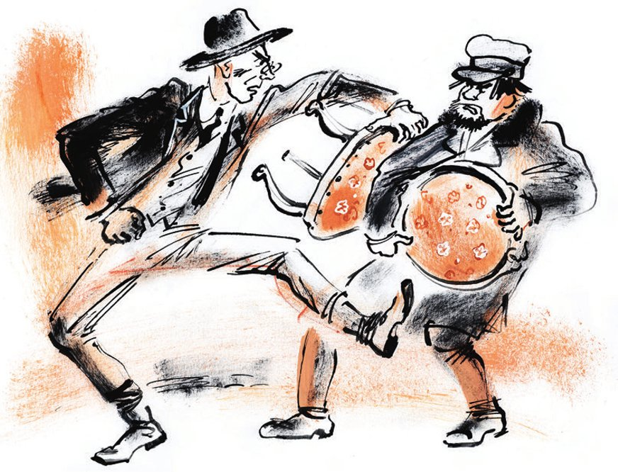

## Kapitel 9: Wo sind Ihre Locken?

Ostap sieht sich das Altersheim Nummer 2 an. In dieser Zeit verlässt Ippolit Matwejewitsch die Hausmeisterwohnung. Sein rasierter Kopf ist kalt. Er geht durch die Straßen von seiner Heimatstadt.

Über das <abbr title="das Pflaster — мостовая">Pflaster</abbr> läuft helles Frühlingswasser. Von den Dächern fallen Tropfen wie <abbr title="der Diamant, die Diamanten — бриллиант, алмаз">Diamanten</abbr>. Sie klopfen und klappern ohne Pause. Die <abbr title="der Spatz, die Spatzen — воробей">Spatzen</abbr> jagen nach <abbr title="der Pferdemist — навоз">Pferdemist</abbr>. Auf allen Dächern sitzt die Sonne. Goldene <abbr title="das Zugpferd, die Zugpferde — ломовая лошадь, битюг">Zugpferde</abbr> <abbr title="stampfen — топать">stampfen</abbr> absichtlich laut mit den <abbr title="der Huf, die Hufe — копыто">Hufen</abbr> auf das <abbr title="nackt — голый, обнажённый">nackte</abbr> Pflaster. Sie senken die Ohren und hören mit Vergnügen zu, wie schön sie klopfen. An den nassen Telegrafenmasten hängen nasse Anzeigen. Die Buchstaben sind schon <abbr title="verlaufen (verlief, ist verlaufen) — расплываться">verlaufen</abbr>. Auf den Anzeigen steht: «Ich unterrichte Gitarre nach dem Zahlensystem» und «Unterricht in <abbr title="die Gesellschaftskunde — обществоведение">Gesellschaftskunde</abbr> für alle, die ans <abbr title="das Volkskonservatorium — народная консерватория">Volkskonservatorium</abbr> wollen». Ein <abbr title="der Zug, die Züge — взвод">Zug</abbr> <abbr title="der Rotarmist, die Rotarmisten — красноармеец">Rotarmisten</abbr> mit <abbr title="der Winterhelm, die Winterhelme — зимний шлем (будёновка)">Winterhelmen</abbr> <abbr title="marschieren — маршировать">marschiert</abbr> durch eine Pfütze. Die Pfütze beginnt beim Laden «Stargiko» und geht bis zum Gebäude vom <abbr title="das Planungsamt, die Planungsämter — Губплан (плановая комиссия)">Planungsamt</abbr>. Oben auf dem Gebäude stehen <abbr title="der Tiger, die Tiger — тигр">Tiger</abbr>, <abbr title="die Siegesgöttin, die Siegesgöttinnen — богиня победы, «победа»">Siegesgöttinnen</abbr> und <abbr title="die Kobra, die Kobras — кобра">Kobras</abbr> aus <abbr title="der Gips — гипс">Gips</abbr>.

Ippolit Matwejewitsch geht und sieht sich neugierig die <abbr title="der Passant, die Passanten — прохожий">Passanten</abbr> an. Sein ganzes Leben hat er in Russland gelebt, auch die Revolution. Er hat gesehen, wie das Leben <abbr title="zerbrechen (zerbrach, ist zerbrochen) — ломаться">zerbrochen</abbr> ist und wie es sich <abbr title="sich verändern — меняться">verändert</abbr> hat. Er hat sich daran gewöhnt. Aber jetzt merkt er: Er hat sich nur an einem Ort auf der Welt daran gewöhnt – in der Kreisstadt N. In seiner Heimatstadt versteht er nichts. Er fühlt sich <abbr title="unwohl — неловко">unwohl</abbr> und fremd. Er fühlt sich wie ein Emigrant, der gerade aus Paris gekommen ist. Früher ist er in der <abbr title="die Kutsche, die Kutschen — экипаж, карета">Kutsche</abbr> durch die Stadt gefahren. Da hat er immer Bekannte getroffen oder Leute, die er vom Sehen kannte. Jetzt ist er schon vier <abbr title="der Häuserblock, die Häuserblocks — квартал">Häuserblocks</abbr> durch die «Straße der Lena-Ereignisse» gegangen. Aber er trifft keine Bekannten. Sie sind verschwunden. Oder sie sind so alt geworden, dass er sie nicht <abbr title="erkennen (erkannte, hat erkannt) — узнавать">erkennt</abbr>. Oder sie tragen andere Kleidung und andere Hüte, und deshalb erkennt er sie nicht. Vielleicht gehen sie jetzt auch anders. <abbr title="jedenfalls — во всяком случае">Jedenfalls</abbr> sind sie nicht da.

Ippolit Matwejewitsch geht weiter, <abbr title="blass — бледный">blass</abbr>, kalt und <abbr title="verloren — потерянный">verloren</abbr>. Er hat ganz vergessen, dass er das Wohnungsamt suchen muss. Ohne Sinn geht er von einem <abbr title="der Bürgersteig, die Bürgersteige — тротуар">Bürgersteig</abbr> zum anderen. Er <abbr title="abbiegen (bog ab, ist abgebogen) — сворачивать">biegt</abbr> in kleine <abbr title="die Gasse, die Gassen — переулок">Gassen</abbr> ab. Dort klopfen die frechen Zugpferde jetzt schon ganz absichtlich mit den Hufen. In den Gassen ist noch mehr Winter, und an manchen Stellen liegt noch altes, <abbr title="faulig — гнилой">fauliges</abbr> Eis. Die ganze Stadt hat eine andere Farbe. Die blauen Häuser sind jetzt grün, die gelben sind grau. Auf dem <abbr title="der Feuerwachturm, die Feuerwachtürme — пожарная каланча">Feuerwachturm</abbr> hängen keine schwarzen <abbr title="die Signalkugel, die Signalkugeln — сигнальный шар («бомба»)">Signalkugeln</abbr> mehr, und kein Feuerwehrmann geht mehr oben herum. Und auf den Straßen ist es viel lauter, als Ippolit Matwejewitsch es in Erinnerung hat.

In der Großen Puschkinstraße sieht Ippolit Matwejewitsch <abbr title="die Schiene, die Schienen — рельс">Schienen</abbr> und <abbr title="der Straßenbahnmast, die Straßenbahnmasten — трамвайный столб">Straßenbahnmasten</abbr> mit <abbr title="der Draht, die Drähte — провод">Drähten</abbr>. So etwas hat es in Stargorod früher nie gegeben. Er ist erstaunt. Ippolit Matwejewitsch liest keine Zeitung. Er weiß nicht, dass man in Stargorod zum ersten Mai zwei <abbr title="die Straßenbahnlinie, die Straßenbahnlinien — трамвайная линия">Straßenbahnlinien</abbr> eröffnen will: die Bahnhofslinie und die Marktlinie. Mal denkt Ippolit Matwejewitsch, er hat Stargorod nie verlassen. Mal denkt er, Stargorod ist ein ganz fremder Ort.

Mit diesen Gedanken kommt er zur Marx-und-Engels-Straße. Hier hat er wieder ein Gefühl wie in seiner Kindheit: Gleich kommt bestimmt ein Bekannter um die Ecke von dem zweistöckigen Haus mit dem langen <abbr title="der Balkon, die Balkone — балкон">Balkon</abbr>. Ippolit Matwejewitsch bleibt sogar stehen und wartet. Aber kein Bekannter kommt. Zuerst kommt ein <abbr title="der Glaser, die Glaser — стекольщик">Glaser</abbr> um die Ecke. Er trägt eine Kiste mit <abbr title="böhmisch — богемский">böhmischem</abbr> Glas und einen großen <abbr title="der Klumpen, die Klumpen — ком, буханка">Klumpen</abbr> <abbr title="der Fensterkitt — оконная замазка">Fensterkitt</abbr> in der Farbe von Kupfer. Dann kommt ein <abbr title="elegant — щегольской">eleganter</abbr> junger Mann mit einer Mütze aus Wildleder und mit einem gelben <abbr title="der Schirm, die Schirme — козырёк">Schirm</abbr> aus Leder. Hinter ihm laufen Kinder aus der <abbr title="die Grundschule, die Grundschulen — начальная школа (первой ступени)">Grundschule</abbr>. Ihre Bücher tragen sie mit <abbr title="der Riemen, die Riemen — ремешок">Riemen</abbr> zusammengebunden.

Plötzlich werden die <abbr title="die Handfläche, die Handflächen — ладонь">Handflächen</abbr> von Ippolit Matwejewitsch heiß, und im Bauch wird es kühl. Ein unbekannter Bürger mit einem <abbr title="gutmütig — добрый, добродушный">gutmütigen</abbr> Gesicht kommt direkt auf ihn zu. Er trägt einen Stuhl vor sich wie ein <abbr title="das Cello, die Cellos — виолончель">Cello</abbr>. Ippolit Matwejewitsch bekommt plötzlich <abbr title="der Schluckauf — икота">Schluckauf</abbr>. Er sieht genau hin und erkennt sofort seinen Stuhl.

Ja! Das ist ein Gambs-Stuhl! Er hat den englischen Stoff mit kleinen Blumen, der in den <abbr title="der Sturm, die Stürme — буря">Stürmen</abbr> der Revolution dunkel geworden ist. Es ist ein Stuhl aus Nussbaum mit gebogenen Beinen. Ippolit Matwejewitsch fühlt sich, als ob jemand direkt neben seinem Ohr geschossen hat.

— Messer und Scheren <abbr title="schleifen (schliff, hat geschliffen) — точить">schleifen</abbr>, Rasiermesser <abbr title="schärfen — править, точить">schärfen</abbr>! — ruft ganz nah ein tiefer <abbr title="der Bass, die Bässe — бас">Bass</abbr>.

Und sofort kommt ein dünnes <abbr title="das Echo, die Echos — эхо">Echo</abbr>:

— <abbr title="löten — паять">Löten</abbr>, <abbr title="flicken — латать, чинить">flicken</abbr>! …

— Die Moskauer Zeidung «Swestije», die Zeitschrift «Der Lacher», «Rotes Feld»! …

Irgendwo oben <abbr title="klirren — звенеть">klirrt</abbr> eine Fensterscheibe und fällt heraus. Ein <abbr title="der Lastwagen, die Lastwagen — грузовик">Lastwagen</abbr> von der Mühlenbaufirma fährt vorbei, und die ganze Stadt zittert. Ein Milizionär <abbr title="pfeifen (pfiff, hat gepfiffen) — свистеть">pfeift</abbr>. Das Leben <abbr title="überkochen — бить ключом, переливаться через край">kocht über</abbr>. Man darf keine Zeit verlieren.

Mit einem <abbr title="der Sprung, die Sprünge — прыжок, скачок">Sprung</abbr> wie ein <abbr title="der Leopard, die Leoparden — леопард">Leopard</abbr> ist Ippolit Matwejewitsch bei dem <abbr title="empörend — возмутительный">empörenden</abbr> Fremden. Ohne ein Wort <abbr title="ziehen (zog, hat gezogen) — тянуть, дёргать">zieht</abbr> er den Stuhl zu sich. Der Fremde zieht den Stuhl zurück. Da hält Ippolit Matwejewitsch mit der linken Hand ein Stuhlbein fest. Mit der rechten Hand versucht er, die dicken Finger von dem Fremden vom Stuhl zu <abbr title="lösen — отрывать, отделять">lösen</abbr>.

— Raub, — flüstert der Fremde und hält den Stuhl noch fester.

— Erlauben Sie, erlauben Sie, — <abbr title="stammeln — лепетать, бормотать">stammelt</abbr> Ippolit Matwejewitsch und löst weiter die Finger von dem Fremden.

Leute kommen dazu. Schon drei Menschen stehen in der Nähe. Sie sehen mit großem Interesse zu, wie der <abbr title="der Konflikt, die Konflikte — конфликт">Konflikt</abbr> weitergeht.

Da sehen sich beide ängstlich um. Sie sehen sich nicht an, aber sie lassen den Stuhl nicht los. Schnell gehen sie weiter, als ob nichts passiert ist.

«Was ist denn das?», denkt Ippolit Matwejewitsch verzweifelt.

Was der Fremde denkt, weiß man nicht. Aber er geht sehr entschlossen.

Sie gehen immer schneller. In einer <abbr title="einsam — глухой, безлюдный">einsamen</abbr> Gasse sehen sie einen leeren Platz voll <abbr title="der Schotter — щебень">Schotter</abbr> und <abbr title="das Baumaterial, die Baumaterialien — строительный материал">Baumaterial</abbr>. Wie auf <abbr title="das Kommando, die Kommandos — команда">Kommando</abbr> biegen beide dorthin ab. Hier hat Ippolit Matwejewitsch plötzlich viermal so viel Kraft.

— Erlauben Sie doch! — schreit er, jetzt ohne <abbr title="die Scheu — стеснение, робость">Scheu</abbr>.

— Hi-i-ilfe! — ruft der Fremde, aber man hört es kaum.

Beide haben die Hände am Stuhl. Deshalb <abbr title="treten (trat, hat getreten) — пинать, лягать">treten</abbr> sie sich mit den Füßen. Die Stiefel von dem Fremden haben <abbr title="das Hufeisen, die Hufeisen — подкова">Hufeisen</abbr>. Zuerst geht es Ippolit Matwejewitsch ziemlich schlecht. Aber schnell lernt er dazu. Er springt mal nach rechts, mal nach links, als ob er <abbr title="der Krakowiak — краковяк (танец)">Krakowiak</abbr> tanzt. So <abbr title="ausweichen (wich aus, ist ausgewichen) — увёртываться">weicht</abbr> er den Tritten aus. Und er versucht, den <abbr title="der Feind, die Feinde — враг">Feind</abbr> in den Bauch zu treten. In den Bauch trifft er nicht, denn der Stuhl ist im Weg. Aber er trifft die <abbr title="die Kniescheibe, die Kniescheiben — коленная чашечка">Kniescheibe</abbr> von seinem <abbr title="der Gegner, die Gegner — противник">Gegner</abbr>. Danach kann der Gegner nur noch mit dem linken Fuß treten.

— Oh Gott! — flüstert der Fremde.

Und jetzt sieht Ippolit Matwejewitsch: Der Fremde, der so <abbr title="unverschämt — бессовестно, возмутительно">unverschämt</abbr> seinen Stuhl geraubt hat, ist niemand anderes als der Priester von der Kirche Frol und Lawr – Vater Fjodor Wostrikow. Ippolit Matwejewitsch ist <abbr title="sprachlos — ошеломлённый, онемевший">sprachlos</abbr>.

— Väterchen! — ruft er erstaunt und nimmt die Hände vom Stuhl.

Vater Wostrikow wird <abbr title="lila — лиловый">lila</abbr> im Gesicht. Endlich öffnet er die Finger. Niemand hält mehr den Stuhl, und er fällt auf die kaputten <abbr title="der Ziegelstein, die Ziegelsteine — кирпич">Ziegelsteine</abbr>.

— Wo ist denn Ihr Schnurrbart, <abbr title="verehrt — уважаемый">verehrter</abbr> Ippolit Matwejewitsch? — fragt der <abbr title="der Geistliche, die Geistlichen — духовное лицо">Geistliche</abbr> so giftig wie möglich.

— Und wo sind Ihre Locken? Sie hatten doch Locken?

In den Worten von Ippolit Matwejewitsch liegt eine <abbr title="unerträglich — невыносимый">unerträgliche</abbr> <abbr title="die Verachtung — презрение">Verachtung</abbr>. Er wirft Vater Fjodor einen Blick voll ungewöhnlichem <abbr title="der Adel — благородство; дворянство">Adel</abbr> zu. Dann nimmt er den Stuhl unter den Arm und dreht sich um. Er will gehen. Aber Vater Fjodor ist nicht mehr verlegen. So einen leichten <abbr title="der Sieg, die Siege — победа">Sieg</abbr> <abbr title="gönnen — позволить, не пожалеть">gönnt</abbr> er Worobjaninow nicht. «Nein, ich bitte Sie!», ruft er und <abbr title="packen — хватать">packt</abbr> den Stuhl wieder. Jetzt ist alles wieder wie am Anfang. Beide Gegner halten die Stuhlbeine fest wie Katzen oder <abbr title="der Boxer, die Boxer — боксёр">Boxer</abbr>. Sie gehen hin und her und messen sich mit den Blicken.

Eine ganze Minute dauert diese Pause. Sie geht <abbr title="ans Herz gehen — хватать за сердце">ans Herz</abbr>.

— Sie sind das also, heiliger Vater, — <abbr title="knirschen — скрежетать">knirscht</abbr> Ippolit Matwejewitsch, — Sie jagen nach meinem <abbr title="das Eigentum — имущество, собственность">Eigentum</abbr>?

Bei diesen Worten tritt Ippolit Matwejewitsch den heiligen Vater gegen die Hüfte.

Vater Fjodor ist geschickt. Er tritt den Adelsmarschall böse in den <abbr title="der Unterleib — пах, низ живота">Unterleib</abbr>. Ippolit Matwejewitsch <abbr title="sich krümmen — корчиться, сгибаться">krümmt sich</abbr>.

— Das ist nicht Ihr Eigentum.

— Wem gehört es denn?

— Nicht Ihnen.

— Wem denn?

— Nicht Ihnen, nicht Ihnen.

— Wem denn, wem?

— Nicht Ihnen.

So zischen sie und treten sich <abbr title="wild — неистово, дико">wild</abbr>.

— Wem gehört dieses Eigentum denn? — <abbr title="brüllen — орать, вопить">brüllt</abbr> der Adelsmarschall und tritt mit dem Fuß in den Bauch vom heiligen Vater.

Der heilige Vater <abbr title="überwinden (überwand, hat überwunden) — преодолевать">überwindet</abbr> den <abbr title="der Schmerz, die Schmerzen — боль">Schmerz</abbr> und sagt fest:

— Das ist <abbr title="verstaatlicht — национализированный">verstaatlichtes</abbr> Eigentum.

— Verstaatlicht?

— Jawohl, jawohl, verstaatlicht.

Sie sprechen so schnell, dass die Wörter <abbr title="ineinanderfließen (floss ineinander, ist ineinandergeflossen) — сливаться">ineinanderfließen</abbr>.

— Wer hat es verstaatlicht?

— Die <abbr title="die Sowjetmacht — советская власть">Sowjetmacht</abbr>! Die Sowjetmacht!

— Welche Macht?

— Die Macht der <abbr title="der/die Werktätige, die Werktätigen — трудящийся">Werktätigen</abbr>.

— A-a-ah! … — sagt Ippolit Matwejewitsch und wird zu Eis. — Die Macht der Arbeiter und Bauern?

— Ja-a-awohl!

— M-m-m! … Dann sind Sie vielleicht, heiliger Vater, in der <abbr title="die Partei, die Parteien — партия">Partei</abbr>?

— V-vielleicht!

Jetzt kann Ippolit Matwejewitsch nicht mehr. Mit dem Schrei «Vielleicht!» spuckt er Vater Fjodor kräftig in das gutmütige Gesicht. Sofort spuckt Vater Fjodor Ippolit Matwejewitsch ins Gesicht und trifft auch. Sie können den <abbr title="der Speichel — слюна">Speichel</abbr> nicht <abbr title="abwischen — стирать, вытирать">abwischen</abbr>, denn ihre Hände halten den Stuhl. Ippolit Matwejewitsch macht ein Geräusch wie eine Tür, die aufgeht. Dann stößt er den Feind mit aller Kraft mit dem Stuhl. Der Feind fällt und zieht Worobjaninow mit, der <abbr title="keuchen — задыхаться, пыхтеть">keucht</abbr>. Jetzt kämpfen sie auf dem Boden weiter, wie beim <abbr title="das Ringen — борьба (спорт)">Ringen</abbr>.

Plötzlich <abbr title="krachen — трещать">kracht</abbr> es: Beide <abbr title="das Vorderbein, die Vorderbeine — передняя ножка">Vorderbeine</abbr> brechen gleichzeitig ab. Die Gegner vergessen einander. Jetzt zerreißen sie zusammen die <abbr title="die Schatzkammer, die Schatzkammern — сокровищница, кладохранилище">Schatzkammer</abbr> aus Nussbaum. Mit einem traurigen Schrei wie von einer <abbr title="die Möwe, die Möwen — чайка">Möwe</abbr> reißt der englische Stoff mit den kleinen Blumen. Die Lehne fliegt weg. Die <abbr title="der Schatzsucher, die Schatzsucher — кладоискатель">Schatzsucher</abbr> reißen das <abbr title="das Sackleinen — рогожа, мешковина">Sackleinen</abbr> <abbr title="herausreißen — вырвать">heraus</abbr>, zusammen mit den kleinen Knöpfen aus Messing. Sie <abbr title="sich verletzen — пораниться">verletzen sich</abbr> an den <abbr title="die Sprungfeder, die Sprungfedern — пружина">Sprungfedern</abbr> und stecken die Finger in die <abbr title="die Füllung, die Füllungen — набивка">Füllung</abbr> aus <abbr title="die Wolle — шерсть">Wolle</abbr>. Die gestörten Federn singen. Nach fünf Minuten ist der Stuhl <abbr title="abnagen — обглодать">abgenagt</abbr> wie ein Knochen. Von ihm ist nur noch Haut und Knochen übrig. Überall rollen Federn herum. Der Wind trägt die faule Wolle über den leeren Platz. Die gebogenen Beine liegen in einem Loch. Brillanten gibt es keine.

— Na, haben Sie etwas gefunden? — fragt Ippolit Matwejewitsch <abbr title="atemlos — задыхаясь">atemlos</abbr>.

Vater Fjodor ist voll mit kleinen Stücken Wolle. Er schnauft und sagt nichts.

— Sie Betrüger! — schreit Ippolit Matwejewitsch. — Ich <abbr title="schlagen (schlug, hat geschlagen) — бить">schlage</abbr> Ihnen die Fresse ein, Vater Fjodor!

— Dafür sind Ihre Arme zu kurz, — antwortet das Väterchen.

— Wohin wollen Sie denn so gehen, voll mit <abbr title="die Feder, die Federn — пух, перо">Federn</abbr>?

— Was geht Sie das an?

— Schämen Sie sich, Väterchen! Sie sind einfach ein Dieb!

— Ich habe Ihnen nichts gestohlen!

— Und wie haben Sie davon erfahren? Sie haben das <abbr title="das Beichtgeheimnis — тайна исповеди">Beichtgeheimnis</abbr> für sich <abbr title="benutzen — использовать">benutzt</abbr>? Sehr gut! Sehr schön!

Ippolit Matwejewitsch sagt empört «Pfui!» und verlässt den Platz. Unterwegs putzt er die <abbr title="der Ärmel, die Ärmel — рукав">Ärmel</abbr> von seinem Mantel und geht nach Hause.

An der Ecke von der Straße der Lena-Ereignisse und der Jerofejew-Gasse sieht Worobjaninow seinen Kompagnon. Der technische Direktor und Hauptleiter der Konzession steht halb zur Seite gedreht. Er hat den linken Fuß <abbr title="heben (hob, hat gehoben) — поднимать">gehoben</abbr>. Ein <abbr title="der Schuhputzer, die Schuhputzer — чистильщик обуви">Schuhputzer</abbr> putzt das Wildleder von seinen Schuhen mit <abbr title="kanariengelb — канареечный">kanariengelber</abbr> <abbr title="die Schuhcreme, die Schuhcremes — сапожный крем, вакса">Schuhcreme</abbr>. Ippolit Matwejewitsch läuft zu ihm. Der Direktor summt <abbr title="sorglos — беззаботно">sorglos</abbr> den «Shimmy»:

*Früher haben das <abbr title="das Kamel, die Kamele — верблюд">Kamele</abbr> gemacht,*

*früher haben so die Bo-to-ku-den getanzt,*

*und jetzt tanzt den Shimmy schon die gan-ze Welt …*

— Na, wie war es beim Wohnungsamt? — fragt er sachlich. Und sofort sagt er: — Warten Sie, erzählen Sie noch nicht. Sie sind zu aufgeregt. <abbr title="sich abkühlen — остыть, охладиться">Kühlen Sie sich ab</abbr>.

Ostap gibt dem Schuhputzer sieben Kopeken. Dann nimmt er Worobjaninow am Arm und <abbr title="schleppen — тащить, волочь">schleppt</abbr> ihn die Straße entlang. Der aufgeregte Ippolit Matwejewitsch erzählt alles, und Ostap hört sehr aufmerksam zu.

— Aha! Ein kleiner schwarzer <abbr title="der Bart, die Bärte — борода, бородка">Bart</abbr>? Richtig! Ein Mantel mit einem <abbr title="der Kragen, die Kragen — воротник">Kragen</abbr> aus <abbr title="das Lammfell — мерлушка, барашек">Lammfell</abbr>? Verstehe. Das ist der Stuhl aus dem Altersheim. Heute Morgen für drei Rubel gekauft.

— Warten Sie doch …

Und Ippolit Matwejewitsch erzählt dem Hauptkonzessionär von allen <abbr title="die Gemeinheit, die Gemeinheiten — подлость">Gemeinheiten</abbr> von Vater Fjodor. Ostap wird finster.

— Eine saure Sache, — sagt er. — Die Leichtweißhöhle. Ein geheimnisvoller <abbr title="der Rivale, die Rivalen — соперник">Rivale</abbr>. Wir müssen schneller sein als er. Seine Fresse können wir <abbr title="später — позже">später</abbr> immer noch <abbr title="abtasten — ощупать, пощупать">abtasten</abbr>.

Die Freunde essen etwas in der <abbr title="die Bierstube, die Bierstuben — пивная">Bierstube</abbr> «Stenka Rasin». Ostap <abbr title="herausfinden (fand heraus, hat herausgefunden) — выяснять, разузнавать">findet heraus</abbr>, in welchem Haus früher das Wohnungsamt war und welches Amt heute dort ist. Inzwischen ist der Tag zu Ende.

Die goldenen Zugpferde sind wieder braun. Die Tropfen wie Diamanten werden im Fliegen kalt und fallen <abbr title="platsch — плюх, шлёп">platsch</abbr> auf die Erde. In den Bierstuben und im Restaurant «Phönix» wird das Bier teurer: Es ist Abend. In der Großen Puschkinstraße gehen die elektrischen Lampen an. Eine <abbr title="die Pioniergruppe, die Pioniergruppen — пионерский отряд">Pioniergruppe</abbr> kommt von ihrem ersten Frühlingsausflug zurück. Ihre Schritte klingen wie Trommeln.

Die Tiger, Siegesgöttinnen und Kobras vom Planungsamt leuchten geheimnisvoll unter dem Mond, der jetzt in die Stadt kommt.

Ostap ist plötzlich still geworden. Auf dem Weg nach Hause sieht Ippolit Matwejewitsch die Tiger und Kobras vom Planungsamt an. Zu seiner Zeit war hier die <abbr title="die Gouvernementsverwaltung — губернская земская управа">Gouvernementsverwaltung</abbr>. Die Bürger waren sehr <abbr title="stolz sein auf + Akk. — гордиться">stolz</abbr> auf die Kobras. Sie waren die <abbr title="die Sehenswürdigkeit, die Sehenswürdigkeiten — достопримечательность">Sehenswürdigkeit</abbr> von Stargorod.

«Ich finde sie», denkt Ippolit Matwejewitsch und sieht die Siegesgöttin aus Gips an.

Die Tiger winken freundlich mit den Schwänzen, die Kobras ziehen sich fröhlich zusammen, und das Herz von Ippolit Matwejewitsch ist voll <abbr title="die Zuversicht — уверенность">Zuversicht</abbr>.

---

### Neue Wörter

- **das Pflaster** — мостовая
- **der Diamant, die Diamanten** — бриллиант, алмаз
- **der Spatz, die Spatzen** — воробей
- **der Pferdemist** — навоз
- **das Zugpferd, die Zugpferde** — ломовая лошадь, битюг
- **stampfen** — топать
- **der Huf, die Hufe** — копыто
- **nackt** — голый, обнажённый
- **verlaufen (verlief, ist verlaufen)** — расплываться
- **die Gesellschaftskunde** — обществоведение
- **das Volkskonservatorium** — народная консерватория
- **der Zug, die Züge** — взвод
- **der Rotarmist, die Rotarmisten** — красноармеец
- **der Winterhelm, die Winterhelme** — зимний шлем (будёновка)
- **marschieren** — маршировать
- **das Planungsamt, die Planungsämter** — Губплан (плановая комиссия)
- **der Tiger, die Tiger** — тигр
- **die Siegesgöttin, die Siegesgöttinnen** — богиня победы, «победа»
- **die Kobra, die Kobras** — кобра
- **der Gips** — гипс
- **der Passant, die Passanten** — прохожий
- **zerbrechen (zerbrach, ist zerbrochen)** — ломаться
- **sich verändern** — меняться
- **unwohl** — неловко
- **die Kutsche, die Kutschen** — экипаж, карета
- **der Häuserblock, die Häuserblocks** — квартал
- **erkennen (erkannte, hat erkannt)** — узнавать
- **jedenfalls** — во всяком случае
- **blass** — бледный
- **verloren** — потерянный
- **der Bürgersteig, die Bürgersteige** — тротуар
- **abbiegen (bog ab, ist abgebogen)** — сворачивать
- **die Gasse, die Gassen** — переулок
- **faulig** — гнилой
- **der Feuerwachturm, die Feuerwachtürme** — пожарная каланча
- **die Signalkugel, die Signalkugeln** — сигнальный шар («бомба»)
- **die Schiene, die Schienen** — рельс
- **der Straßenbahnmast, die Straßenbahnmasten** — трамвайный столб
- **der Draht, die Drähte** — провод
- **die Straßenbahnlinie, die Straßenbahnlinien** — трамвайная линия
- **der Balkon, die Balkone** — балкон
- **der Glaser, die Glaser** — стекольщик
- **böhmisch** — богемский
- **der Klumpen, die Klumpen** — ком, буханка
- **der Fensterkitt** — оконная замазка
- **elegant** — щегольской
- **der Schirm, die Schirme** — козырёк
- **die Grundschule, die Grundschulen** — начальная школа (первой ступени)
- **der Riemen, die Riemen** — ремешок
- **die Handfläche, die Handflächen** — ладонь
- **gutmütig** — добрый, добродушный
- **das Cello, die Cellos** — виолончель
- **der Schluckauf** — икота
- **der Sturm, die Stürme** — буря
- **schleifen (schliff, hat geschliffen)** — точить
- **schärfen** — править, точить
- **der Bass, die Bässe** — бас
- **das Echo, die Echos** — эхо
- **löten** — паять
- **flicken** — латать, чинить
- **klirren** — звенеть
- **der Lastwagen, die Lastwagen** — грузовик
- **pfeifen (pfiff, hat gepfiffen)** — свистеть
- **überkochen** — бить ключом, переливаться через край
- **der Sprung, die Sprünge** — прыжок, скачок
- **der Leopard, die Leoparden** — леопард
- **empörend** — возмутительный
- **ziehen (zog, hat gezogen)** — тянуть, дёргать
- **lösen** — отрывать, отделять
- **stammeln** — лепетать, бормотать
- **der Konflikt, die Konflikte** — конфликт
- **einsam** — глухой, безлюдный
- **der Schotter** — щебень
- **das Baumaterial, die Baumaterialien** — строительный материал
- **das Kommando, die Kommandos** — команда
- **die Scheu** — стеснение, робость
- **treten (trat, hat getreten)** — пинать, лягать
- **das Hufeisen, die Hufeisen** — подкова
- **der Krakowiak** — краковяк (танец)
- **ausweichen (wich aus, ist ausgewichen)** — увёртываться
- **der Feind, die Feinde** — враг
- **die Kniescheibe, die Kniescheiben** — коленная чашечка
- **der Gegner, die Gegner** — противник
- **unverschämt** — бессовестно, возмутительно
- **sprachlos** — ошеломлённый, онемевший
- **lila** — лиловый
- **der Ziegelstein, die Ziegelsteine** — кирпич
- **verehrt** — уважаемый
- **der Geistliche, die Geistlichen** — духовное лицо
- **unerträglich** — невыносимый
- **die Verachtung** — презрение
- **der Adel** — благородство; дворянство
- **der Sieg, die Siege** — победа
- **gönnen** — позволить, не пожалеть
- **packen** — хватать
- **der Boxer, die Boxer** — боксёр
- **ans Herz gehen** — хватать за сердце
- **knirschen** — скрежетать
- **das Eigentum** — имущество, собственность
- **der Unterleib** — пах, низ живота
- **sich krümmen** — корчиться, сгибаться
- **wild** — неистово, дико
- **brüllen** — орать, вопить
- **überwinden (überwand, hat überwunden)** — преодолевать
- **der Schmerz, die Schmerzen** — боль
- **verstaatlicht** — национализированный
- **ineinanderfließen (floss ineinander, ist ineinandergeflossen)** — сливаться
- **die Sowjetmacht** — советская власть
- **der/die Werktätige, die Werktätigen** — трудящийся
- **die Partei, die Parteien** — партия
- **der Speichel** — слюна
- **abwischen** — стирать, вытирать
- **keuchen** — задыхаться, пыхтеть
- **das Ringen** — борьба (спорт)
- **krachen** — трещать
- **das Vorderbein, die Vorderbeine** — передняя ножка
- **die Schatzkammer, die Schatzkammern** — сокровищница, кладохранилище
- **die Möwe, die Möwen** — чайка
- **der Schatzsucher, die Schatzsucher** — кладоискатель
- **das Sackleinen** — рогожа, мешковина
- **herausreißen** — вырвать
- **sich verletzen** — пораниться
- **die Sprungfeder, die Sprungfedern** — пружина
- **die Füllung, die Füllungen** — набивка
- **die Wolle** — шерсть
- **abnagen** — обглодать
- **atemlos** — задыхаясь
- **schlagen (schlug, hat geschlagen)** — бить
- **die Feder, die Federn** — пух, перо
- **das Beichtgeheimnis** — тайна исповеди
- **benutzen** — использовать
- **der Ärmel, die Ärmel** — рукав
- **heben (hob, hat gehoben)** — поднимать
- **der Schuhputzer, die Schuhputzer** — чистильщик обуви
- **kanariengelb** — канареечный
- **die Schuhcreme, die Schuhcremes** — сапожный крем, вакса
- **sorglos** — беззаботно
- **das Kamel, die Kamele** — верблюд
- **sich abkühlen** — остыть, охладиться
- **schleppen** — тащить, волочь
- **der Bart, die Bärte** — борода, бородка
- **der Kragen, die Kragen** — воротник
- **das Lammfell** — мерлушка, барашек
- **die Gemeinheit, die Gemeinheiten** — подлость
- **der Rivale, die Rivalen** — соперник
- **später** — позже
- **abtasten** — ощупать, пощупать
- **die Bierstube, die Bierstuben** — пивная
- **herausfinden (fand heraus, hat herausgefunden)** — выяснять, разузнавать
- **platsch** — плюх, шлёп
- **die Pioniergruppe, die Pioniergruppen** — пионерский отряд
- **die Gouvernementsverwaltung** — губернская земская управа
- **stolz sein auf + Akk.** — гордиться
- **die Sehenswürdigkeit, die Sehenswürdigkeiten** — достопримечательность
- **die Zuversicht** — уверенность

[← Kapitel 8](kapitel-08.md) · [Inhalt](README.md) · [Kapitel 10 →](kapitel-10.md)
