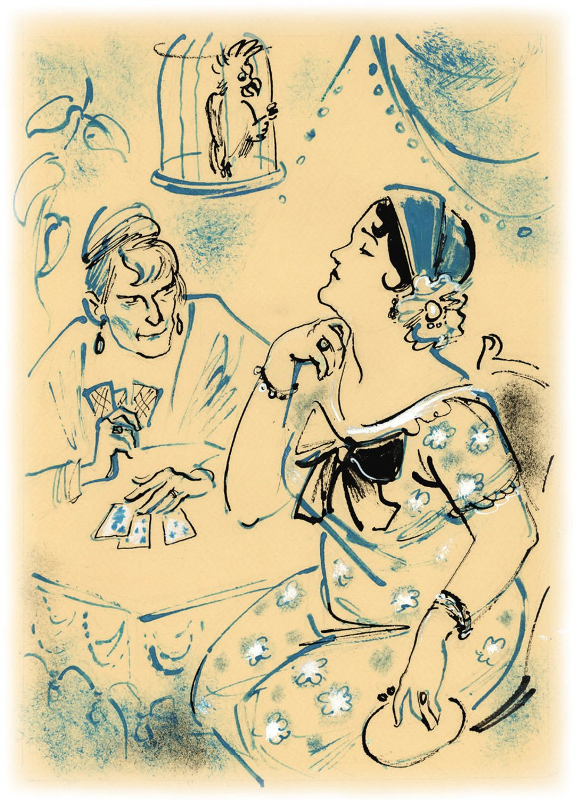
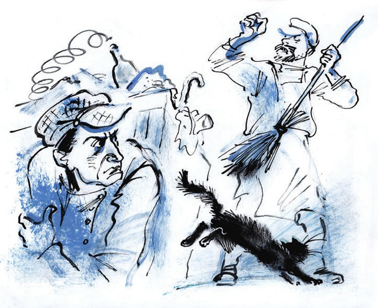

## Kapitel 10: Der Schlosser, der Papagei und die Wahrsagerin

Das Haus Nummer 7 in der Pereleschin-Gasse ist nicht das schönste Gebäude von Stargorod. Es hat zwei <abbr title="das Stockwerk, die Stockwerke — этаж">Stockwerke</abbr> im Stil vom Zweiten <abbr title="das Kaiserreich, die Kaiserreiche — империя">Kaiserreich</abbr>. Am Haus hängen kaputte <abbr title="der Löwenkopf, die Löwenköpfe — львиная морда">Löwenköpfe</abbr>. Sie sehen erstaunlich <abbr title="ähnlich sehen + Dat. — быть похожим на">ähnlich</abbr> wie das Gesicht von Arzybaschew, einem Schriftsteller, der früher einmal sehr bekannt war. Es gibt genau acht Arzybaschew-Gesichter, so viele wie Fenster zur Gasse. Die <abbr title="die Löwenfratze, die Löwenfratzen — львиная харя, рожа">Löwenfratzen</abbr> sitzen oben über den Fenstern.

Am Haus gibt es noch zwei <abbr title="die Verzierung, die Verzierungen — украшение">Verzierungen</abbr>, aber die sind rein <abbr title="kommerziell — коммерческий">kommerziell</abbr>. Auf der einen Seite hängt ein <abbr title="himmelblau — лазурный">himmelblaues</abbr> Schild: «Odessaer Kringel-Genossenschaft „Moskauer Brezeln“». Auf dem Schild ist ein junger Mann mit <abbr title="die Krawatte, die Krawatten — галстук">Krawatte</abbr> und kurzen französischen Hosen gemalt. In einer <abbr title="verdreht — вывернутый">verdrehten</abbr> Hand hält er ein <abbr title="das Füllhorn, die Füllhörner — рог изобилия">Füllhorn</abbr> wie aus dem Märchen. Aus dem Horn fallen <abbr title="wie eine Lawine — лавиной">wie eine Lawine</abbr> ockergelbe Moskauer Brezeln. Wenn es nötig ist, verkauft man sie auch als Odessaer Kringel. Dabei lächelt der junge Mann <abbr title="wollüstig — сладострастно">wollüstig</abbr>. Auf der anderen Seite hängt ein schwarzes Schild mit runden goldenen Buchstaben. Das ist die <abbr title="die Verpackungsfirma, die Verpackungsfirmen — упаковочная контора">Verpackungsfirma</abbr> «Schnellpack». So <abbr title="informieren — извещать, сообщать">informiert</abbr> sie die <abbr title="wert — уважаемый">werten</abbr> Bürger Kunden.

Die Schilder sind sehr <abbr title="unterschiedlich — различный, разный">unterschiedlich</abbr>, und auch das Kapital ist ganz verschieden groß. Trotzdem machen beide Firmen genau dasselbe Geschäft: Sie <abbr title="spekulieren mit + Dat. — спекулировать чем-то">spekulieren</abbr> mit allen möglichen Stoffen – mit grober Wolle, feiner Wolle, <abbr title="das Kammgarn — камвольная ткань">Kammgarn</abbr>, Baumwolle. Und wenn sie <abbr title="die Seide — шёлк">Seide</abbr> in schönen Farben und mit schönen <abbr title="das Muster, die Muster — узор, рисунок">Mustern</abbr> bekommen, dann auch mit Seide.

Man geht durch das <abbr title="das Tor, die Tore — ворота">Tor</abbr>. Dort ist es dunkel wie in einem <abbr title="der Tunnel, die Tunnel — туннель">Tunnel</abbr>, und überall steht Wasser. Dann biegt man nach rechts in den Hof mit einem <abbr title="der Brunnen, die Brunnen — колодец">Brunnen</abbr> aus <abbr title="der Zement — цемент">Zement</abbr>. Dort sieht man zwei Türen ohne Treppe. Sie gehen direkt auf die <abbr title="spitz — острый">spitzen</abbr> Steine vom Hof. An der rechten Tür hängt ein kleines Schild aus <abbr title="matt — тусклый">mattem</abbr> Messing. Darauf steht in schöner Schrift der Name «W. M. Polessow». An der linken Tür hängt ein weißes Blechschild: «Moden und Hüte». Das ist aber auch nur Schein.

Im <abbr title="das Hutgeschäft, die Hutgeschäfte — шляпная мастерская">Hutgeschäft</abbr> gibt es kein Stroh für Hüte und keine Bänder. Es gibt keine <abbr title="die Schaufensterpuppe, die Schaufensterpuppen — манекен">Schaufensterpuppen</abbr> ohne Kopf, die so gerade stehen wie Offiziere. Es gibt keine Holzköpfe für elegante Damenhüte. Diesen ganzen <abbr title="der Flitterkram — мишура">Flitterkram</abbr> gibt es nicht. <abbr title="stattdessen — вместо этого">Stattdessen</abbr> lebt in der Dreizimmerwohnung ein <abbr title="schneeweiß — белоснежный">schneeweißer</abbr> <abbr title="der Papagei, die Papageien — попугай">Papagei</abbr> mit roten Unterhosen. Der Papagei hat <abbr title="der Floh, die Flöhe — блоха">Flöhe</abbr>. Aber er kann sich bei niemandem beschweren, denn er spricht nicht mit menschlicher Stimme. Den ganzen Tag <abbr title="knabbern — грызть">knabbert</abbr> er <abbr title="der Sonnenblumenkern, die Sonnenblumenkerne — семечки">Sonnenblumenkerne</abbr> und spuckt die <abbr title="die Schale, die Schalen — шелуха">Schalen</abbr> durch die Stangen von seinem hohen <abbr title="der Käfig, die Käfige — клетка">Käfig</abbr> auf den Teppich. Ihm fehlen nur noch eine <abbr title="die Ziehharmonika, die Ziehharmonikas — гармоника, гармонь">Ziehharmonika</abbr> und neue quietschende Gummischuhe. Dann sieht er aus wie ein <abbr title="der Handwerker, die Handwerker — кустарь, ремесленник">Handwerker</abbr>, der <abbr title="einen über den Durst trinken — подгулять, выпить лишнего">einen über den Durst getrunken hat</abbr>. An den Fenstern <abbr title="wehen — колыхаться, развеваться">wehen</abbr> dunkelbraune <abbr title="der Vorhang, die Vorhänge — занавеска">Vorhänge</abbr> mit <abbr title="die Bommel, die Bommeln — помпон, «блямба»">Bommeln</abbr>. In der Wohnung ist fast alles dunkelbraun. Über dem <abbr title="das Klavier, die Klaviere — пианино">Klavier</abbr> hängt eine <abbr title="die Kopie, die Kopien — репродукция, копия">Kopie</abbr> von dem Bild «Die <abbr title="die Toteninsel — Остров мёртвых">Toteninsel</abbr>» von Böcklin. Der Rahmen ist aus dunkelgrünem, poliertem Eichenholz, und das Bild ist hinter Glas. Aber eine Ecke vom Glas ist schon lange kaputt. Auf diesem Teil vom Bild haben die <abbr title="die Fliege, die Fliegen — муха">Fliegen</abbr> so viel <abbr title="hinterlassen (hinterließ, hat hinterlassen) — оставлять (после себя)">hinterlassen</abbr>, dass man ihn nicht mehr vom Rahmen <abbr title="unterscheiden (unterschied, hat unterschieden) — отличать">unterscheiden</abbr> kann. Was in diesem Teil von der Toteninsel passiert, weiß niemand mehr.

Im Schlafzimmer sitzt die <abbr title="die Hausherrin, die Hausherrinnen — хозяйка">Hausherrin</abbr> selbst auf dem Bett. Sie stützt die Ellbogen auf einen kleinen, <abbr title="achteckig — восьмиугольный">achteckigen</abbr> Tisch mit einer nicht sehr sauberen <abbr title="die Tischdecke, die Tischdecken — скатерть">Tischdecke</abbr> und legt Karten. Vor ihr sitzt die <abbr title="die Witwe, die Witwen — вдова">Witwe</abbr> Grizazujewa in einem flauschigen <abbr title="das Tuch, die Tücher — шаль, платок">Tuch</abbr>.

— Ich muss Sie <abbr title="warnen — предупреждать">warnen</abbr>, junge Frau: Für eine Sitzung nehme ich nicht weniger als fünfzig Kopeken, — sagt die Hausherrin.

Die Witwe will <abbr title="unbedingt — непременно, во что бы то ни стало">unbedingt</abbr> einen neuen Mann finden. Da gibt es für sie keine <abbr title="das Hindernis, die Hindernisse — препятствие, преграда">Hindernisse</abbr>. Sie ist <abbr title="einverstanden sein mit + Dat. — быть согласным с">einverstanden</abbr>, den Preis zu zahlen.

— Aber bitte auch die <abbr title="die Zukunft — будущее">Zukunft</abbr>, — bittet sie kläglich.

— Bei Ihnen muss ich mit der <abbr title="die Kreuzdame, die Kreuzdamen — дама треф">Kreuzdame</abbr> <abbr title="wahrsagen — гадать">wahrsagen</abbr>.

Die Witwe <abbr title="widersprechen (widersprach, hat widersprochen) — возражать">widerspricht</abbr>:

— Ich war immer die <abbr title="die Herzdame, die Herzdamen — червонная дама">Herzdame</abbr>.

Der Hausherrin ist das egal. Sie ist einverstanden und beginnt, die Karten zu <abbr title="kombinieren — комбинировать">kombinieren</abbr>. Nach ein paar Minuten ist der erste <abbr title="der Entwurf, die Entwürfe — черновик, набросок">Entwurf</abbr> vom <abbr title="das Schicksal, die Schicksale — судьба">Schicksal</abbr> der Witwe fertig. Auf die Witwe warten große und kleine <abbr title="die Unannehmlichkeit, die Unannehmlichkeiten — неприятность">Unannehmlichkeiten</abbr>. Und in ihrem Herzen liegt ein <abbr title="der Kreuzkönig, die Kreuzkönige — трефовый король">Kreuzkönig</abbr>. Mit ihm ist eine <abbr title="die Karodame, die Karodamen — бубновая дама">Karodame</abbr> befreundet.

Die <abbr title="die Reinschrift — чистовик, набело">Reinschrift</abbr> macht die Wahrsagerin mit der Hand. Die Linien in der Hand von der Witwe Grizazujewa sind klar, stark und <abbr title="tadellos — безупречный">tadellos</abbr>. Die <abbr title="die Lebenslinie, die Lebenslinien — линия жизни">Lebenslinie</abbr> ist so lang, dass ihr Ende bis zum <abbr title="der Puls — пульс">Puls</abbr> geht. Wenn die Linie die Wahrheit sagt, dann lebt die Witwe bis zum <abbr title="das Jüngste Gericht — Страшный суд">Jüngsten Gericht</abbr>. Die <abbr title="die Verstandeslinie — линия ума">Verstandeslinie</abbr> und die <abbr title="die Kunstlinie — линия искусства">Kunstlinie</abbr> geben <abbr title="die Hoffnung, die Hoffnungen — надежда">Hoffnung</abbr>: Vielleicht hört die Witwe mit ihrem <abbr title="der Lebensmittelladen, die Lebensmittelläden — бакалейная лавка">Lebensmittelladen</abbr> auf. Vielleicht schenkt sie der <abbr title="die Menschheit — человечество">Menschheit</abbr> <abbr title="unübertroffen — непревзойдённый">unübertroffene</abbr> <abbr title="das Meisterwerk, die Meisterwerke — шедевр">Meisterwerke</abbr> – in der Kunst, in der Wissenschaft oder in der Gesellschaftskunde, ganz egal. Die <abbr title="der Venusberg, die Venusberge — бугор Венеры">Venusberge</abbr> von der Witwe sind so hoch wie die Hügel in der <abbr title="die Mandschurei — Маньчжурия">Mandschurei</abbr>. Sie zeigen wunderbare <abbr title="der Vorrat, die Vorräte — запас">Vorräte</abbr> an Liebe und <abbr title="die Zärtlichkeit — нежность">Zärtlichkeit</abbr>.

Das alles erklärt die Wahrsagerin der Witwe. Sie benutzt dabei die Wörter und <abbr title="der Fachbegriff, die Fachbegriffe — термин">Fachbegriffe</abbr> von <abbr title="der Graphologe, die Graphologen — графолог">Graphologen</abbr>, <abbr title="der Handleser, die Handleser — хиромант">Handlesern</abbr> und <abbr title="der Pferdehändler, die Pferdehändler — лошадиный барышник">Pferdehändlern</abbr>.

— Vielen Dank, Madamchen, — sagt die Witwe. — Jetzt weiß ich, wer der Kreuzkönig ist. Und die Karodame kenne ich auch sehr gut. Und der König, ist er ein <abbr title="der Heiratskönig — «марьяжный» король (к свадьбе)">Heiratskönig</abbr>?

— Ein Heiratskönig, junge Frau.

Die Witwe hat jetzt Flügel und geht nach Hause. Die Wahrsagerin wirft die Karten in eine Schublade, <abbr title="gähnen — зевать">gähnt</abbr> und zeigt den Mund von einer fünfzigjährigen Frau. Dann geht sie in die Küche. Dort kümmert sie sich ein bisschen um das Mittagessen. Es wird auf dem Petroleumkocher «Graetz» warm. Wie eine <abbr title="die Köchin, die Köchinnen — кухарка">Köchin</abbr> wischt sie sich die Hände an der Schürze ab. Dann nimmt sie einen <abbr title="der Eimer, die Eimer — ведро">Eimer</abbr> aus <abbr title="die Emaille — эмаль">Emaille</abbr>, an dem schon viel <abbr title="abplatzen — отколоться, облупиться">abgeplatzt</abbr> ist, und geht in den Hof. Sie will Wasser holen.

Sie geht schwer über den Hof, auf ihren <abbr title="der Plattfuß, die Plattfüße — плоскостопие, плоская ступня">Plattfüßen</abbr>. Ihr halb <abbr title="zerfallen — развалившийся">zerfallener</abbr> Busen hüpft <abbr title="schlaff — вяло">schlaff</abbr> in einer neu gefärbten <abbr title="die Bluse, die Blusen — кофточка, блузка">Bluse</abbr>. Auf dem Kopf wächst ein kleiner Besen aus grauen Haaren. Sie ist eine alte Frau. Sie ist ein bisschen schmutzig, sie sieht alle misstrauisch an, und sie liebt <abbr title="die Süßigkeit, die Süßigkeiten — сладости">Süßigkeiten</abbr>. Wenn Ippolit Matwejewitsch sie jetzt sieht, erkennt er sie bestimmt nicht. Das ist Jelena Bour, seine alte <abbr title="die Geliebte, die Geliebten — возлюбленная">Geliebte</abbr>. Ein Sekretär vom Gericht hat früher einmal ein <abbr title="das Gedicht, die Gedichte — стихотворение">Gedicht</abbr> über sie geschrieben: «Sie ruft zum Küssen, sie ist so leicht wie Luft.»

Am Brunnen <abbr title="begrüßen — приветствовать">begrüßt</abbr> ein Nachbar Madame Bour: Viktor Michailowitsch Polessow, ein Schlosser und <abbr title="der Intellektuelle, die Intellektuellen — интеллигент">Intellektueller</abbr>. Er füllt Wasser in eine alte <abbr title="die Benzinkanne, die Benzinkannen — бидон из-под бензина">Benzinkanne</abbr>. Polessow hat das Gesicht von einem Teufel in der <abbr title="die Oper, die Opern — опера">Oper</abbr>, den man vor dem Auftritt sorgfältig mit <abbr title="der Ruß — сажа">Ruß</abbr> <abbr title="beschmieren — мазать">beschmiert</abbr> hat.

Die Nachbarn grüßen sich. Dann sprechen sie über das Thema, über das ganz Stargorod spricht.

— So weit ist es also gekommen, — sagt Polessow ironisch. — Gestern bin ich durch die ganze Stadt gelaufen. Ich wollte <abbr title="das Schneideisen, die Schneideisen — плашка (для нарезки резьбы)">Schneideisen</abbr> für drei Achtel Zoll. Keine Chance. Gibt es nicht! Nein! Aber eine Straßenbahn wollen sie fahren lassen …

Jelena Stanislawowna weiß über Schneideisen für drei Achtel Zoll genauso viel wie eine <abbr title="die Studentin, die Studentinnen — слушательница, студентка">Studentin</abbr> von den Leonardo-da-Vinci-<abbr title="der Tanzkurs, die Tanzkurse — курсы танца (хореографии)">Tanzkursen</abbr> über die <abbr title="die Landwirtschaft — сельское хозяйство">Landwirtschaft</abbr>. Die Studentin glaubt nämlich, dass man <abbr title="der Quark — творог">Quark</abbr> aus <abbr title="die Quarktasche, die Quarktaschen — вареник с творогом">Quarktaschen</abbr> holt. Trotzdem hat Jelena Stanislawowna <abbr title="das Mitleid — сочувствие, жалость">Mitleid</abbr>:

— Was sind das heute für Geschäfte! Heute gibt es nur Warteschlangen und keine Geschäfte. Und die Geschäfte haben so schreckliche Namen. «Stargiko»! …

— Nein, wissen Sie, Jelena Stanislawowna, das ist noch gar nichts! Sie haben vier <abbr title="der Motor, die Motoren — мотор">Motoren</abbr> von der «Allgemeinen Elektrizitäts-Gesellschaft» übrig. Na, die laufen vielleicht <abbr title="irgendwie — кое-как">irgendwie</abbr>, aber die Wagen sind so ein <abbr title="der Schrott — хлам, металлолом">Schrott</abbr>! … Die Fenster sind nicht in Gummi. Ich habe es selbst gesehen. Das alles wird klirren … <abbr title="die Finsternis — мрак">Finsternis</abbr>! Und die anderen Motoren sind aus Charkow. Lauter Staats-<abbr title="das Buntmetall — цветной металл">Buntmetall</abbr>-Trust. Die halten keinen Kilometer. Ich habe sie mir angesehen …

Der Schlosser ist gereizt und schweigt. Sein schwarzes Gesicht glänzt in der Sonne. Das Weiße in seinen Augen ist ein bisschen gelb. In Stargorod gibt es sehr viele Handwerker mit Motor. Von allen ist Viktor Michailowitsch Polessow der <abbr title="langsam — медленный, нерасторопный">langsamste</abbr>. Und er <abbr title="sich blamieren — попадать впросак, оскандалиться">blamiert sich</abbr> am häufigsten. Das liegt an seinem viel zu <abbr title="feurig — кипучий, пылкий">feurigen</abbr> Charakter. Er ist ein <abbr title="der Faulpelz, die Faulpelze — лентяй">Faulpelz</abbr> voller Feuer. Er schäumt immer. In seiner eigenen <abbr title="die Werkstatt, die Werkstätten — мастерская">Werkstatt</abbr> im zweiten Hof vom Haus Nummer 7 in der Pereleschin-Gasse findet man ihn nie. Mitten in dem <abbr title="der Schuppen, die Schuppen — сарай">Schuppen</abbr> aus Stein steht eine kalte, tragbare <abbr title="die Schmiede, die Schmieden — горн, кузница">Schmiede</abbr>, ganz allein wie ein Waisenkind. In den Ecken liegen große <abbr title="der Haufen, die Haufen — куча">Haufen</abbr>: kaputte <abbr title="der Schlauch, die Schläuche — камера (шины)">Schläuche</abbr>, <abbr title="zerrissen — рваный">zerrissene</abbr> <abbr title="der Reifen, die Reifen — шина, покрышка">Reifen</abbr> der Marke «Dreieck», rostige <abbr title="das Schloss, die Schlösser — замок">Schlösser</abbr> – so riesig, dass man damit ganze Städte <abbr title="abschließen (schloss ab, hat abgeschlossen) — запирать">abschließen</abbr> kann –, weiche <abbr title="der Benzintank, die Benzintanks — бак для горючего">Benzintanks</abbr> mit der Aufschrift «Indian» und «Wanderer», ein <abbr title="der Kinderwagen, die Kinderwagen — детская коляска">Kinderwagen</abbr> mit Federn, ein <abbr title="der Dynamo, die Dynamos — динамо-машина">Dynamo</abbr>, der für immer tot ist, faule Lederriemen, <abbr title="ölig — масляный">öliges</abbr> <abbr title="das Werg — пакля">Werg</abbr>, altes <abbr title="das Schmirgelpapier — наждачная бумага">Schmirgelpapier</abbr>, ein österreichisches <abbr title="das Bajonett, die Bajonette — штык">Bajonett</abbr> und viel kaputter, verbogener, <abbr title="zerdrückt — раздавленный, мятый">zerdrückter</abbr> <abbr title="der Plunder — дрянь, хлам">Plunder</abbr>.

Die Kunden finden Viktor Michailowitsch nie. Viktor Michailowitsch <abbr title="kommandieren — командовать">kommandiert</abbr> schon irgendwo herum. Für Arbeit hat er keine Zeit. Er kann nicht ruhig zusehen, wenn ein <abbr title="der Fuhrmann, die Fuhrleute — ломовой извозчик, возчик">Fuhrmann</abbr> mit <abbr title="die Ladung, die Ladungen — груз, кладь">Ladung</abbr> in einen Hof fährt, egal ob in seinen oder in einen anderen. Polessow geht sofort in den Hof. Er legt die Hände auf den Rücken und sieht dem Fuhrmann verächtlich zu. Endlich hält er es nicht mehr aus.

— Wer fährt denn so herein? — schreit er <abbr title="entsetzt — в ужасе">entsetzt</abbr>. — <abbr title="wenden — поворачивать, разворачивать">Wenden</abbr>!

Der Fuhrmann bekommt Angst und wendet.

— Wohin wendest du denn, du <abbr title="der Hornochse, die Hornochsen — болван, «морда»">Hornochse</abbr>?! — leidet Viktor Michailowitsch und läuft auf das Pferd zu. — Früher hat man dir für so was <abbr title="die Ohrfeige, die Ohrfeigen — пощёчина">Ohrfeigen</abbr> gegeben, dann hast du richtig gewendet!

So kommandiert Polessow eine halbe Stunde lang. Dann will er eigentlich in die Werkstatt zurück. Dort wartet eine kaputte <abbr title="die Fahrradpumpe, die Fahrradpumpen — велосипедный насос">Fahrradpumpe</abbr> auf ihn. Aber gerade dann stört meistens wieder ein <abbr title="das Missverständnis, die Missverständnisse — недоразумение">Missverständnis</abbr> das ruhige Leben der Stadt. Mal <abbr title="sich verhaken — сцепляться">verhaken sich</abbr> auf der Straße zwei <abbr title="das Fuhrwerk, die Fuhrwerke — телега, повозка">Fuhrwerke</abbr> mit den <abbr title="die Achse, die Achsen — ось">Achsen</abbr>. Dann zeigt Viktor Michailowitsch, wie man sie am besten und schnellsten <abbr title="auseinanderbekommen — расцепить">auseinanderbekommt</abbr>. Mal stellt man einen neuen Telegrafenmast auf. Dann prüft Polessow mit seinem eigenen <abbr title="das Senklot, die Senklote — отвес">Senklot</abbr>, ob der Mast <abbr title="senkrecht — вертикальный, перпендикулярный">senkrecht</abbr> steht. Das Lot holt er extra aus der Werkstatt. Oder es fährt die Feuerwehr vorbei. Dann hört Polessow die Trompete, er brennt vor <abbr title="die Unruhe — беспокойство">Unruhe</abbr> und läuft hinter den Wagen her.

Aber manchmal packt Viktor Michailowitsch die <abbr title="die Lust — охота, желание">Lust</abbr> auf echte Arbeit. Dann verschwindet er für ein paar Tage in seiner Werkstatt und arbeitet schweigend. Die Kinder laufen frei durch den Hof und schreien, was sie wollen. Die Fuhrleute wenden im Hof, wie sie wollen. Die Fuhrwerke auf der Straße verhaken sich nicht mehr. Die Feuerwehr und die <abbr title="der Leichenwagen, die Leichenwagen — катафалк">Leichenwagen</abbr> fahren allein zum Feuer. Viktor Michailowitsch arbeitet. Einmal, nach so einer Arbeits-<abbr title="die Sauftour, die Sauftouren — запой">Sauftour</abbr>, führt er ein <abbr title="das Motorrad, die Motorräder — мотоцикл">Motorrad</abbr> in den Hof, wie einen <abbr title="der Hammel, die Hammel — баран">Hammel</abbr> an den Hörnern. Das Motorrad ist aus Teilen von Autos, Feuerlöschern, Fahrrädern und Schreibmaschinen gemacht.

Der Motor hat anderthalb <abbr title="die PS (Pferdestärke) — лошадиная сила">PS</abbr> und ist von «Wanderer». Die Räder sind von «Davidson». Bei den anderen wichtigen Teilen weiß man schon lange nicht mehr, von welcher Firma sie sind. Vom <abbr title="der Sattel, die Sättel — седло">Sattel</abbr> hängt an einer <abbr title="die Schnur, die Schnüre — шпагат, бечёвка">Schnur</abbr> ein Plakat aus <abbr title="die Pappe — картон">Pappe</abbr>: «<abbr title="die Probefahrt, die Probefahrten — проба, пробный пробег">Probefahrt</abbr>». Leute kommen zusammen. Viktor Michailowitsch sieht niemanden an. Er dreht mit der Hand am <abbr title="das Pedal, die Pedale — педаль">Pedal</abbr>. Zehn Minuten lang gibt es keinen Funken. Dann schmatzt etwas aus Eisen. Der Apparat zittert und ist plötzlich ganz in schmutzigem <abbr title="der Rauch — дым">Rauch</abbr>. Viktor Michailowitsch springt auf den Sattel. Das Motorrad fährt <abbr title="wahnsinnig — безумно">wahnsinnig</abbr> schnell los. Es trägt ihn durch den Tunnel bis in die Mitte von der Straße. Dort bleibt es sofort stehen, als ob eine <abbr title="die Kugel, die Kugeln — пуля">Kugel</abbr> es getroffen hat. Viktor Michailowitsch will gerade absteigen und seine rätselhafte Maschine <abbr title="untersuchen — осматривать, проверять">untersuchen</abbr>. Aber da fährt sie plötzlich rückwärts. Sie trägt ihren <abbr title="der Schöpfer, die Schöpfer — создатель">Schöpfer</abbr> durch denselben Tunnel zurück und bleibt genau dort stehen, wo sie <abbr title="losfahren (fuhr los, ist losgefahren) — отправиться, тронуться">losgefahren</abbr> ist – mitten im Hof. Sie ächzt <abbr title="mürrisch — ворчливо">mürrisch</abbr> und <abbr title="explodieren — взрываться">explodiert</abbr>. Viktor Michailowitsch überlebt wie durch ein <abbr title="das Wunder, die Wunder — чудо">Wunder</abbr>. In der nächsten Arbeits-Sauftour baut er aus den <abbr title="die Trümmer (Pl.) — обломки">Trümmern</abbr> vom Motorrad einen festen Motor. Der Motor sieht genau aus wie ein echter. Aber er läuft nicht.

Der <abbr title="der Höhepunkt, die Höhepunkte — венец, вершина">Höhepunkt</abbr> von der Arbeit des intellektuellen Schlossers ist die große Geschichte mit dem Tor vom Nachbarhaus Nummer 5. Die <abbr title="die Wohnungsgenossenschaft, die Wohnungsgenossenschaften — жилтоварищество">Wohnungsgenossenschaft</abbr> von diesem Haus macht mit Viktor Michailowitsch einen Vertrag. Darin steht: Polessow bringt das eiserne Tor vom Haus wieder ganz in Ordnung. Er streicht es in einer <abbr title="sparsam — экономный">sparsamen</abbr> Farbe, die er selbst wählen darf. Die Wohnungsgenossenschaft zahlt W. M. Polessow dafür 21 Rubel 75 Kopeken, wenn eine spezielle <abbr title="die Kommission, die Kommissionen — комиссия">Kommission</abbr> die Arbeit <abbr title="abnehmen (nahm ab, hat abgenommen) — принимать (работу)">abgenommen</abbr> hat. Die <abbr title="die Stempelmarke, die Stempelmarken — гербовая марка">Stempelmarken</abbr> bezahlt der Handwerker.

Viktor Michailowitsch trägt das Tor weg wie <abbr title="Samson — Самсон">Samson</abbr>. In der Werkstatt beginnt er mit <abbr title="die Begeisterung — энтузиазм, восторг">Begeisterung</abbr> die Arbeit. Zwei Tage lang holt er die <abbr title="die Niete, die Nieten — заклёпка">Nieten</abbr> aus dem Tor. Jetzt liegt das Tor in vielen Teilen da. Die <abbr title="der Schnörkel, die Schnörkel — завитушка">Schnörkel</abbr> aus <abbr title="das Gusseisen — чугун">Gusseisen</abbr> liegen im Kinderwagen. Die Eisenstangen und <abbr title="der Speer, die Speere — копьё">Speere</abbr> liegen unter der <abbr title="die Werkbank, die Werkbänke — верстак">Werkbank</abbr>. Noch ein paar Tage lang sieht er sich die <abbr title="der Schaden, die Schäden — повреждение">Schäden</abbr> an. Aber dann passiert in der Stadt ein großes <abbr title="das Unglück, die Unglücke — несчастье, беда">Unglück</abbr>: In der Holzstraße <abbr title="platzen — лопаться">platzt</abbr> das große <abbr title="das Wasserrohr, die Wasserrohre — водопроводная труба">Wasserrohr</abbr>. Den Rest von der Woche verbringt Viktor Michailowitsch am Unfallort. Er lächelt ironisch, schreit die Arbeiter an und sieht jede Minute in das Loch. Endlich ist seine <abbr title="die Organisationslust — организаторский пыл">Organisationslust</abbr> ein bisschen kleiner. Er geht wieder zum Tor. Aber es ist zu spät: Die Kinder vom Hof spielen schon mit den Schnörkeln und Speeren vom Haus Nummer 5. Sie sehen den wütenden Schlosser, werfen <abbr title="erschrocken — испуганно">erschrocken</abbr> die <abbr title="die Spielsachen (Pl.) — игрушки, «цацки»">Spielsachen</abbr> hin und laufen weg. Die Hälfte von den Schnörkeln fehlt. Man findet sie nicht mehr. Danach hat Viktor Michailowitsch an dem Tor <abbr title="kein Interesse mehr haben an + Dat. — охладеть к">kein Interesse mehr</abbr>.

Und im Haus Nummer 5, das jetzt <abbr title="sperrangelweit — настежь">sperrangelweit</abbr> offen steht, passieren schreckliche Dinge. Von den Dachböden stiehlt man die nasse <abbr title="die Wäsche — бельё">Wäsche</abbr>. Und eines Abends trägt jemand sogar den Samowar weg, der gerade im Hof kocht. Viktor Michailowitsch läuft selbst mit hinter dem Dieb her. Der Dieb trägt den kochenden Samowar mit <abbr title="ausgestreckt — вытянутый">ausgestreckten</abbr> Armen vor sich. Trotzdem ist er sehr schnell. Aus dem Rohr vom Samowar schlagen Flammen. Der Dieb dreht sich beim Laufen um und <abbr title="beschimpfen — ругать, поносить">beschimpft</abbr> Viktor Michailowitsch, der allen anderen voraus läuft, mit unanständigen Wörtern.

Aber am meisten leidet der Hausmeister vom Haus Nummer 5. Er verliert sein Geld, das er jede Nacht <abbr title="verdienen — зарабатывать">verdient</abbr>: Es gibt kein Tor, er muss nichts aufmachen. Und die Bewohner, die spät in der Nacht nach Hause kommen, müssen ihm keine zehn Kopeken mehr geben. Zuerst kommt der Hausmeister und fragt, wann das Tor fertig ist. Dann fleht er bei Christus und Gott. Und am Ende macht er <abbr title="undeutlich — неопределённый">undeutliche</abbr> <abbr title="die Drohung, die Drohungen — угроза">Drohungen</abbr>. Die Wohnungsgenossenschaft schickt Viktor Michailowitsch <abbr title="schriftlich — письменный">schriftliche</abbr> <abbr title="die Mahnung, die Mahnungen — напоминание">Mahnungen</abbr>. Die Sache riecht nach Gericht. Die Lage wird immer gespannter.

Die Wahrsagerin und der begeisterte Schlosser stehen am Brunnen und sprechen weiter.

— Bei <abbr title="das Vorhandensein — наличие">Vorhandensein</abbr> von <abbr title="die Abwesenheit — отсутствие">Abwesenheit</abbr> von <abbr title="imprägniert — пропитанный">imprägnierten</abbr> <abbr title="die Schwelle, die Schwellen — шпала">Schwellen</abbr>, — schreit Viktor Michailowitsch über den ganzen Hof, — wird das keine Straßenbahn, sondern ein einziges Elend!

— Wann ist das alles endlich zu Ende! — sagt Jelena Stanislawowna. — Wir leben wie die <abbr title="der Wilde, die Wilden — дикарь">Wilden</abbr>.

— Das hat kein Ende … Ja! Wissen Sie, wen ich heute gesehen habe? Worobjaninow.

Jelena Stanislawowna lehnt sich an den Brunnen. Sie ist so erstaunt, dass sie den vollen Eimer mit Wasser weiter in der Luft hält.

— Ich gehe zum <abbr title="das Kommunalamt, die Kommunalämter — Коммунхоз (коммунальный отдел)">Kommunalamt</abbr>, ich will den <abbr title="der Mietvertrag, die Mietverträge — договор аренды">Mietvertrag</abbr> für die Werkstatt <abbr title="verlängern — продлевать">verlängern</abbr>. Ich gehe durch den Flur. Plötzlich kommen zwei Männer zu mir. Ich sehe: Da ist etwas <abbr title="bekannt — знакомый">bekannt</abbr>. Wie das Gesicht von Worobjaninow. Und er fragt: «Sagen Sie, was für ein Amt war früher hier in diesem Gebäude?» Ich sage, früher war hier ein <abbr title="das Mädchengymnasium, die Mädchengymnasien — женская гимназия">Mädchengymnasium</abbr> und dann das Wohnungsamt. «Warum wollen Sie das wissen?», frage ich. Und er sagt «danke» und geht weiter. Da habe ich ganz klar gesehen: Das ist Worobjaninow selbst, nur ohne Schnurrbart. Woher kommt er denn plötzlich? Und der andere, der mit ihm war – ein <abbr title="bildschön — красавец">bildschöner</abbr> Mann. <abbr title="offensichtlich — явно, очевидно">Offensichtlich</abbr> ein früherer <abbr title="der Offizier, die Offiziere — офицер">Offizier</abbr>. Und da habe ich gedacht …

In diesem Moment sieht Viktor Michailowitsch etwas <abbr title="unangenehm — неприятный">Unangenehmes</abbr>. Er <abbr title="abbrechen (brach ab, hat abgebrochen) — обрывать, прерывать">bricht</abbr> mitten im Satz ab, nimmt seine Kanne und versteckt sich schnell hinter der <abbr title="die Mülltonne, die Mülltonnen — мусорный ящик">Mülltonne</abbr>. Langsam kommt der Hausmeister vom Haus Nummer 5 in den Hof. Er bleibt am Brunnen stehen und sieht sich alle Gebäude im Hof an. Viktor Michailowitsch ist nirgends zu sehen. Der Hausmeister wird traurig.

— Ist der Witka, der Schlosser, schon wieder nicht da? — fragt er Jelena Stanislawowna.

— Ach, ich weiß nichts, — sagt die Wahrsagerin. — Ich weiß gar nichts.

Sie ist schrecklich aufgeregt. Sie <abbr title="ausgießen (goss aus, hat ausgegossen) — выливать">gießt</abbr> das Wasser aus dem Eimer aus und geht schnell nach Hause.

Der Hausmeister streichelt den Zementblock vom Brunnen und geht zur Werkstatt. Dort hängt zuerst ein Schild: «Eingang zur <abbr title="die Schlosserwerkstatt, die Schlosserwerkstätten — слесарная мастерская">Schlosserwerkstatt</abbr>». Zwei Schritte weiter hängt noch ein Schild: «Schlosserwerkstatt und Reparatur von Petroleumkochern». Darunter hängt ein schweres Schloss. Der Hausmeister tritt mit dem Fuß gegen das Schloss und sagt voll <abbr title="der Hass — ненависть">Hass</abbr>:

— Du <abbr title="die Pestbeule, die Pestbeulen — чума, «гангрена»">Pestbeule</abbr>!

Der Hausmeister steht noch etwa drei Minuten vor der Werkstatt. Er wird immer giftiger. Dann reißt er mit <abbr title="das Getöse — грохот">Getöse</abbr> das Schild ab und trägt es in die Mitte vom Hof zum Brunnen. Er stellt sich mit beiden Füßen darauf und beginnt einen Skandal.

— Diebe wohnen bei euch im Haus Nummer sieben! — brüllt der Hausmeister. — Lauter <abbr title="das Gesindel — сволочь, сброд">Gesindel</abbr>! Du <abbr title="die Natter, die Nattern — гадюка">Natter</abbr> mit sieben Vätern! Hat eine <abbr title="die mittlere Bildung — среднее образование">mittlere Bildung</abbr>! … Da pfeife ich auf deine mittlere Bildung! … Verfluchte Pestbeule! …

Die Natter mit sieben Vätern und mittlerer Bildung sitzt in dieser Zeit hinter der Mülltonne auf ihrer Kanne und ist sehr traurig.

Mit einem Krachen gehen die Fenster auf. Fröhliche Bewohner sehen heraus. Von der Straße kommen langsam <abbr title="der/die Neugierige, die Neugierigen — любопытный, зевака">Neugierige</abbr> in den Hof. Der Hausmeister sieht das <abbr title="das Publikum — публика, аудитория">Publikum</abbr> und wird noch wilder.

— Schlosser-<abbr title="der Mechaniker, die Mechaniker — механик">Mechaniker</abbr>! — schreit der Hausmeister. — <abbr title="der Aristokrat, die Aristokraten — аристократ">Aristokrat</abbr>, so ein Hund!

Zwischen seine <abbr title="parlamentarisch — парламентский">parlamentarischen</abbr> Ausdrücke <abbr title="mischen — смешивать, перемежать">mischt</abbr> der Hausmeister viele <abbr title="unflätig — непечатный, нецензурный">unflätige</abbr> Wörter. Die <abbr title="mögen (mochte, hat gemocht) — любить, предпочитать">mag</abbr> er lieber. Das schwache Geschlecht sitzt dicht an dicht auf den <abbr title="die Fensterbank, die Fensterbänke — подоконник">Fensterbänken</abbr>. Die Frauen sind sehr empört über den Hausmeister. Aber vom Fenster gehen sie nicht weg.

— Ich zerschlage dir die Fratze! — tobt der Hausmeister. — Du Gebildeter!

Als der Skandal auf dem Höhepunkt ist, kommt ein Milizionär. Ohne ein Wort zieht er den Hausmeister mit zur <abbr title="die Wache, die Wachen — отделение милиции, участок">Wache</abbr>. Die <abbr title="kräftig — крепкий, сильный">kräftigen</abbr> Jungen von «Schnellpack» helfen ihm.

Der Hausmeister umarmt den Milizionär brav um den Hals und weint <abbr title="laut — громко">laut</abbr> schluchzend. Die Gefahr ist vorbei.

Jetzt springt Viktor Michailowitsch hinter der Mülltonne hervor. Er hat lange gewartet und ist ganz müde. Das Publikum wird laut.

— <abbr title="der Flegel, die Flegel — хам, грубиян">Flegel</abbr>! — schreit Viktor Michailowitsch dem Zug nach. — Flegel! Dir zeige ich es noch! Schuft!

Der Hausmeister weint bitter und hört nichts davon. Man trägt ihn auf den Armen zur Wache. Dorthin trägt man auch das Schild «Schlosserwerkstatt und Reparatur von Petroleumkochern» – als <abbr title="das Beweisstück, die Beweisstücke — вещественное доказательство">Beweisstück</abbr>.

Viktor Michailowitsch <abbr title="sich aufspielen — хорохориться, важничать">spielt</abbr> sich noch lange auf.

— <abbr title="der Hundesohn, die Hundesöhne — сукин сын">Hundesöhne</abbr>, — sagt er zu den Zuschauern. — Die halten sich für was Besseres! Flegel!

— Lassen Sie es gut sein, Viktor Michailowitsch! — ruft Jelena Stanislawowna aus dem Fenster. — Kommen Sie doch kurz zu mir.

Sie stellt Viktor Michailowitsch ein kleines <abbr title="das Schälchen, die Schälchen — блюдечко">Schälchen</abbr> Kompott hin. Dann geht sie im Zimmer hin und her und fragt ihn aus.

— Ich sage Ihnen doch, das ist er, ohne Schnurrbart, aber er! — schreit Viktor Michailowitsch wie immer. — Ich kenne ihn doch sehr gut! Worobjaninow, ganz genau!

— Leiser, um Gottes willen! Warum ist er gekommen, was denken Sie?

Auf dem schwarzen Gesicht von Viktor Michailowitsch erscheint ein ironisches Lächeln.

— Na, und was denken Sie?

Er lächelt noch ironischer.

— Jedenfalls will er keine Verträge mit den Bolschewiken <abbr title="unterschreiben (unterschrieb, hat unterschrieben) — подписывать">unterschreiben</abbr>.

— Denken Sie, er ist in Gefahr?

Viktor Michailowitsch hat in zehn Jahren Revolution sehr viel <abbr title="die Ironie — ирония">Ironie</abbr> <abbr title="sammeln — собирать, копить">gesammelt</abbr>. Seine Vorräte sind <abbr title="unerschöpflich — неистощимый">unerschöpflich</abbr>. Auf seinem Gesicht spielt eine ganze Serie von Lächeln, alle mit verschiedener Kraft und verschiedener <abbr title="die Skepsis — скепсис">Skepsis</abbr>.

— Wer ist in Sowjetrussland nicht in Gefahr? Und erst ein Mann wie Worobjaninow! Einen Schnurrbart, Jelena Stanislawowna, rasiert man nicht umsonst ab.

— Hat man ihn aus dem Ausland geschickt? — fragt Jelena Stanislawowna. Sie bekommt fast keine Luft mehr.

— Selbstverständlich, — antwortet der geniale Schlosser.

— Und was will er hier?

— Seien Sie doch kein Kind.

— Egal. Ich muss ihn sehen.

— Und wissen Sie, was Sie <abbr title="riskieren — рисковать">riskieren</abbr>?

— Ach, egal! Wir waren zehn Jahre <abbr title="getrennt — разлучённый">getrennt</abbr>. Ich muss Ippolit Matwejewitsch einfach sehen.

Sie glaubt wirklich: Das Schicksal hat sie damals getrennt, als sie sich geliebt haben.

— Ich <abbr title="anflehen — умолять">flehe</abbr> Sie an, finden Sie ihn! Finden Sie heraus, wo er ist! Sie kommen doch überall hin! Für Sie ist das nicht schwer! Sagen Sie ihm, dass ich ihn sehen will. Hören Sie?

Der Papagei mit den roten Unterhosen hat auf seiner Stange geschlafen. Jetzt hat er Angst vor dem lauten Gespräch. Er dreht sich mit dem Kopf nach unten und bleibt so hängen, ganz still.

— Jelena Stanislawowna, — sagt der Schlosser und Mechaniker. Er steht ein bisschen auf und <abbr title="drücken — прижимать">drückt</abbr> die Hände an die Brust. — Ich finde ihn, und ich nehme <abbr title="der Kontakt, die Kontakte — связь, контакт">Kontakt</abbr> mit ihm auf.

— Möchten Sie vielleicht noch Kompott? — fragt die Wahrsagerin gerührt.

Viktor Michailowitsch isst das Kompott. Dann hält er noch einen bösen <abbr title="der Vortrag, die Vorträge — лекция, доклад">Vortrag</abbr> über den falschen <abbr title="der Bau — устройство, конструкция">Bau</abbr> vom Papageienkäfig. Am Ende sagt er Jelena Stanislawowna auf Wiedersehen. Er rät ihr: Alles muss <abbr title="streng geheim — строго секретно">streng geheim</abbr> bleiben.

---

### Neue Wörter

- **das Stockwerk, die Stockwerke** — этаж
- **das Kaiserreich, die Kaiserreiche** — империя
- **der Löwenkopf, die Löwenköpfe** — львиная морда
- **ähnlich sehen + Dat.** — быть похожим на
- **die Löwenfratze, die Löwenfratzen** — львиная харя, рожа
- **die Verzierung, die Verzierungen** — украшение
- **kommerziell** — коммерческий
- **himmelblau** — лазурный
- **die Krawatte, die Krawatten** — галстук
- **verdreht** — вывернутый
- **das Füllhorn, die Füllhörner** — рог изобилия
- **wie eine Lawine** — лавиной
- **wollüstig** — сладострастно
- **die Verpackungsfirma, die Verpackungsfirmen** — упаковочная контора
- **informieren** — извещать, сообщать
- **wert** — уважаемый
- **unterschiedlich** — различный, разный
- **spekulieren mit + Dat.** — спекулировать чем-то
- **das Kammgarn** — камвольная ткань
- **die Seide** — шёлк
- **das Muster, die Muster** — узор, рисунок
- **das Tor, die Tore** — ворота
- **der Tunnel, die Tunnel** — туннель
- **der Brunnen, die Brunnen** — колодец
- **der Zement** — цемент
- **spitz** — острый
- **matt** — тусклый
- **das Hutgeschäft, die Hutgeschäfte** — шляпная мастерская
- **die Schaufensterpuppe, die Schaufensterpuppen** — манекен
- **der Flitterkram** — мишура
- **stattdessen** — вместо этого
- **schneeweiß** — белоснежный
- **der Papagei, die Papageien** — попугай
- **der Floh, die Flöhe** — блоха
- **knabbern** — грызть
- **der Sonnenblumenkern, die Sonnenblumenkerne** — семечки
- **die Schale, die Schalen** — шелуха
- **der Käfig, die Käfige** — клетка
- **die Ziehharmonika, die Ziehharmonikas** — гармоника, гармонь
- **der Handwerker, die Handwerker** — кустарь, ремесленник
- **einen über den Durst trinken** — подгулять, выпить лишнего
- **wehen** — колыхаться, развеваться
- **der Vorhang, die Vorhänge** — занавеска
- **die Bommel, die Bommeln** — помпон, «блямба»
- **das Klavier, die Klaviere** — пианино
- **die Kopie, die Kopien** — репродукция, копия
- **die Toteninsel** — Остров мёртвых
- **die Fliege, die Fliegen** — муха
- **hinterlassen (hinterließ, hat hinterlassen)** — оставлять (после себя)
- **unterscheiden (unterschied, hat unterschieden)** — отличать
- **die Hausherrin, die Hausherrinnen** — хозяйка
- **achteckig** — восьмиугольный
- **die Tischdecke, die Tischdecken** — скатерть
- **die Witwe, die Witwen** — вдова
- **das Tuch, die Tücher** — шаль, платок
- **warnen** — предупреждать
- **unbedingt** — непременно, во что бы то ни стало
- **das Hindernis, die Hindernisse** — препятствие, преграда
- **einverstanden sein mit + Dat.** — быть согласным с
- **die Zukunft** — будущее
- **die Kreuzdame, die Kreuzdamen** — дама треф
- **wahrsagen** — гадать
- **widersprechen (widersprach, hat widersprochen)** — возражать
- **die Herzdame, die Herzdamen** — червонная дама
- **kombinieren** — комбинировать
- **der Entwurf, die Entwürfe** — черновик, набросок
- **das Schicksal, die Schicksale** — судьба
- **die Unannehmlichkeit, die Unannehmlichkeiten** — неприятность
- **der Kreuzkönig, die Kreuzkönige** — трефовый король
- **die Karodame, die Karodamen** — бубновая дама
- **die Reinschrift** — чистовик, набело
- **tadellos** — безупречный
- **die Lebenslinie, die Lebenslinien** — линия жизни
- **der Puls** — пульс
- **das Jüngste Gericht** — Страшный суд
- **die Verstandeslinie** — линия ума
- **die Kunstlinie** — линия искусства
- **die Hoffnung, die Hoffnungen** — надежда
- **der Lebensmittelladen, die Lebensmittelläden** — бакалейная лавка
- **die Menschheit** — человечество
- **unübertroffen** — непревзойдённый
- **das Meisterwerk, die Meisterwerke** — шедевр
- **der Venusberg, die Venusberge** — бугор Венеры
- **die Mandschurei** — Маньчжурия
- **der Vorrat, die Vorräte** — запас
- **die Zärtlichkeit** — нежность
- **der Fachbegriff, die Fachbegriffe** — термин
- **der Graphologe, die Graphologen** — графолог
- **der Handleser, die Handleser** — хиромант
- **der Pferdehändler, die Pferdehändler** — лошадиный барышник
- **der Heiratskönig** — «марьяжный» король (к свадьбе)
- **gähnen** — зевать
- **die Köchin, die Köchinnen** — кухарка
- **der Eimer, die Eimer** — ведро
- **die Emaille** — эмаль
- **abplatzen** — отколоться, облупиться
- **der Plattfuß, die Plattfüße** — плоскостопие, плоская ступня
- **zerfallen** — развалившийся
- **schlaff** — вяло
- **die Bluse, die Blusen** — кофточка, блузка
- **die Süßigkeit, die Süßigkeiten** — сладости
- **die Geliebte, die Geliebten** — возлюбленная
- **das Gedicht, die Gedichte** — стихотворение
- **begrüßen** — приветствовать
- **der Intellektuelle, die Intellektuellen** — интеллигент
- **die Benzinkanne, die Benzinkannen** — бидон из-под бензина
- **die Oper, die Opern** — опера
- **der Ruß** — сажа
- **beschmieren** — мазать
- **das Schneideisen, die Schneideisen** — плашка (для нарезки резьбы)
- **die Studentin, die Studentinnen** — слушательница, студентка
- **der Tanzkurs, die Tanzkurse** — курсы танца (хореографии)
- **die Landwirtschaft** — сельское хозяйство
- **der Quark** — творог
- **die Quarktasche, die Quarktaschen** — вареник с творогом
- **das Mitleid** — сочувствие, жалость
- **der Motor, die Motoren** — мотор
- **irgendwie** — кое-как
- **der Schrott** — хлам, металлолом
- **die Finsternis** — мрак
- **das Buntmetall** — цветной металл
- **langsam** — медленный, нерасторопный
- **sich blamieren** — попадать впросак, оскандалиться
- **feurig** — кипучий, пылкий
- **der Faulpelz, die Faulpelze** — лентяй
- **die Werkstatt, die Werkstätten** — мастерская
- **der Schuppen, die Schuppen** — сарай
- **die Schmiede, die Schmieden** — горн, кузница
- **der Haufen, die Haufen** — куча
- **der Schlauch, die Schläuche** — камера (шины)
- **zerrissen** — рваный
- **der Reifen, die Reifen** — шина, покрышка
- **das Schloss, die Schlösser** — замок
- **abschließen (schloss ab, hat abgeschlossen)** — запирать
- **der Benzintank, die Benzintanks** — бак для горючего
- **der Kinderwagen, die Kinderwagen** — детская коляска
- **der Dynamo, die Dynamos** — динамо-машина
- **ölig** — масляный
- **das Werg** — пакля
- **das Schmirgelpapier** — наждачная бумага
- **das Bajonett, die Bajonette** — штык
- **zerdrückt** — раздавленный, мятый
- **der Plunder** — дрянь, хлам
- **kommandieren** — командовать
- **der Fuhrmann, die Fuhrleute** — ломовой извозчик, возчик
- **die Ladung, die Ladungen** — груз, кладь
- **entsetzt** — в ужасе
- **wenden** — поворачивать, разворачивать
- **der Hornochse, die Hornochsen** — болван, «морда»
- **die Ohrfeige, die Ohrfeigen** — пощёчина
- **die Fahrradpumpe, die Fahrradpumpen** — велосипедный насос
- **das Missverständnis, die Missverständnisse** — недоразумение
- **sich verhaken** — сцепляться
- **das Fuhrwerk, die Fuhrwerke** — телега, повозка
- **die Achse, die Achsen** — ось
- **auseinanderbekommen** — расцепить
- **das Senklot, die Senklote** — отвес
- **senkrecht** — вертикальный, перпендикулярный
- **die Unruhe** — беспокойство
- **die Lust** — охота, желание
- **der Leichenwagen, die Leichenwagen** — катафалк
- **die Sauftour, die Sauftouren** — запой
- **das Motorrad, die Motorräder** — мотоцикл
- **der Hammel, die Hammel** — баран
- **die PS (Pferdestärke)** — лошадиная сила
- **der Sattel, die Sättel** — седло
- **die Schnur, die Schnüre** — шпагат, бечёвка
- **die Pappe** — картон
- **die Probefahrt, die Probefahrten** — проба, пробный пробег
- **das Pedal, die Pedale** — педаль
- **der Rauch** — дым
- **wahnsinnig** — безумно
- **die Kugel, die Kugeln** — пуля
- **untersuchen** — осматривать, проверять
- **der Schöpfer, die Schöpfer** — создатель
- **losfahren (fuhr los, ist losgefahren)** — отправиться, тронуться
- **mürrisch** — ворчливо
- **explodieren** — взрываться
- **das Wunder, die Wunder** — чудо
- **die Trümmer (Pl.)** — обломки
- **der Höhepunkt, die Höhepunkte** — венец, вершина
- **die Wohnungsgenossenschaft, die Wohnungsgenossenschaften** — жилтоварищество
- **sparsam** — экономный
- **die Kommission, die Kommissionen** — комиссия
- **abnehmen (nahm ab, hat abgenommen)** — принимать (работу)
- **die Stempelmarke, die Stempelmarken** — гербовая марка
- **Samson** — Самсон
- **die Begeisterung** — энтузиазм, восторг
- **die Niete, die Nieten** — заклёпка
- **der Schnörkel, die Schnörkel** — завитушка
- **das Gusseisen** — чугун
- **der Speer, die Speere** — копьё
- **die Werkbank, die Werkbänke** — верстак
- **der Schaden, die Schäden** — повреждение
- **das Unglück, die Unglücke** — несчастье, беда
- **platzen** — лопаться
- **das Wasserrohr, die Wasserrohre** — водопроводная труба
- **die Organisationslust** — организаторский пыл
- **erschrocken** — испуганно
- **die Spielsachen (Pl.)** — игрушки, «цацки»
- **kein Interesse mehr haben an + Dat.** — охладеть к
- **sperrangelweit** — настежь
- **die Wäsche** — бельё
- **ausgestreckt** — вытянутый
- **beschimpfen** — ругать, поносить
- **verdienen** — зарабатывать
- **undeutlich** — неопределённый
- **die Drohung, die Drohungen** — угроза
- **schriftlich** — письменный
- **die Mahnung, die Mahnungen** — напоминание
- **das Vorhandensein** — наличие
- **die Abwesenheit** — отсутствие
- **imprägniert** — пропитанный
- **die Schwelle, die Schwellen** — шпала
- **der Wilde, die Wilden** — дикарь
- **das Kommunalamt, die Kommunalämter** — Коммунхоз (коммунальный отдел)
- **der Mietvertrag, die Mietverträge** — договор аренды
- **verlängern** — продлевать
- **bekannt** — знакомый
- **das Mädchengymnasium, die Mädchengymnasien** — женская гимназия
- **bildschön** — красавец
- **offensichtlich** — явно, очевидно
- **der Offizier, die Offiziere** — офицер
- **unangenehm** — неприятный
- **abbrechen (brach ab, hat abgebrochen)** — обрывать, прерывать
- **die Mülltonne, die Mülltonnen** — мусорный ящик
- **ausgießen (goss aus, hat ausgegossen)** — выливать
- **die Schlosserwerkstatt, die Schlosserwerkstätten** — слесарная мастерская
- **der Hass** — ненависть
- **die Pestbeule, die Pestbeulen** — чума, «гангрена»
- **das Getöse** — грохот
- **das Gesindel** — сволочь, сброд
- **die Natter, die Nattern** — гадюка
- **die mittlere Bildung** — среднее образование
- **der/die Neugierige, die Neugierigen** — любопытный, зевака
- **das Publikum** — публика, аудитория
- **der Mechaniker, die Mechaniker** — механик
- **der Aristokrat, die Aristokraten** — аристократ
- **parlamentarisch** — парламентский
- **mischen** — смешивать, перемежать
- **unflätig** — непечатный, нецензурный
- **mögen (mochte, hat gemocht)** — любить, предпочитать
- **die Fensterbank, die Fensterbänke** — подоконник
- **die Wache, die Wachen** — отделение милиции, участок
- **kräftig** — крепкий, сильный
- **laut** — громко
- **der Flegel, die Flegel** — хам, грубиян
- **das Beweisstück, die Beweisstücke** — вещественное доказательство
- **sich aufspielen** — хорохориться, важничать
- **der Hundesohn, die Hundesöhne** — сукин сын
- **das Schälchen, die Schälchen** — блюдечко
- **unterschreiben (unterschrieb, hat unterschrieben)** — подписывать
- **die Ironie** — ирония
- **sammeln** — собирать, копить
- **unerschöpflich** — неистощимый
- **die Skepsis** — скепсис
- **riskieren** — рисковать
- **getrennt** — разлучённый
- **anflehen** — умолять
- **drücken** — прижимать
- **der Kontakt, die Kontakte** — связь, контакт
- **der Vortrag, die Vorträge** — лекция, доклад
- **der Bau** — устройство, конструкция
- **streng geheim** — строго секретно

[← Kapitel 9](kapitel-09.md) · [Inhalt](README.md) · [Kapitel 11 →](kapitel-11.md)
