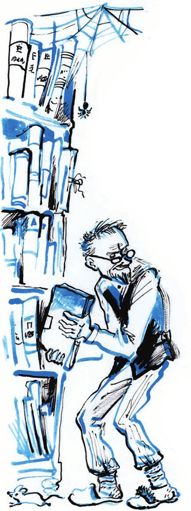
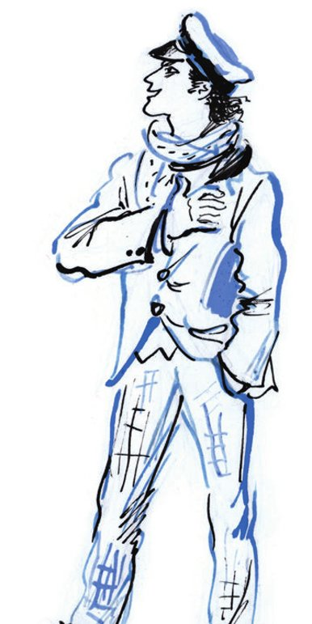

## Kapitel 11: Das Alphabet, der Spiegel des Lebens

Am zweiten Tag merken die Kompagnons: In der Hausmeisterwohnung kann man nicht mehr gut leben. Tichon brummt die ganze Zeit. Er ist völlig durcheinander, denn er hat seinen alten Herrn zuerst mit schwarzem Schnurrbart gesehen, dann mit grünem Schnurrbart und am Ende ganz ohne Schnurrbart. Es gibt nichts zum Schlafen. In der Hausmeisterwohnung riecht es nach faulem Mist. Der Geruch kommt von Tichons neuen <abbr title="der Filzstiefel, die Filzstiefel — валенок">Filzstiefeln</abbr>. Die alten Filzstiefel stehen in der Ecke, und die Luft machen sie auch nicht besser.

— Ich <abbr title="erklären — объявлять">erkläre</abbr> den Abend der Erinnerungen für geschlossen, — sagt Ostap. — Wir müssen ins Hotel <abbr title="umziehen (zog um, ist umgezogen) — переезжать">umziehen</abbr>.

Ippolit Matwejewitsch <abbr title="zusammenzucken — вздрогнуть">zuckt zusammen</abbr>.

— Das geht nicht.

— Warum denn nicht?

— Dort muss man sich <abbr title="sich anmelden — прописаться, регистрироваться">anmelden</abbr>.

— Ist Ihr Pass nicht in Ordnung?

— Doch, der Pass ist in Ordnung. Aber in der Stadt kennt man meinen <abbr title="der Familienname, die Familiennamen — фамилия">Familiennamen</abbr> gut. Die Leute werden <abbr title="reden — говорить, судачить">reden</abbr>.

Die Konzessionäre denken nach und schweigen.

— Gefällt Ihnen der Name Michelson? — fragt der großartige Ostap plötzlich.

— Welcher Michelson? Der <abbr title="der Senator, die Senatoren — сенатор">Senator</abbr>?

— Nein. Ein <abbr title="das Mitglied, die Mitglieder — член">Mitglied</abbr> von der Gewerkschaft der <abbr title="der/die Angestellte, die Angestellten — служащий">Angestellten</abbr> im sowjetischen Handel.

— Ich verstehe Sie nicht.

— Das liegt daran, dass Ihnen die technische <abbr title="die Erfahrung, die Erfahrungen — опыт, навык">Erfahrung</abbr> fehlt. Seien Sie doch kein <abbr title="das Lamm Gottes — агнец божий, «божья корова»">Lamm Gottes</abbr>.

Bender nimmt ein <abbr title="das Gewerkschaftsbuch, die Gewerkschaftsbücher — профсоюзный билет, книжка">Gewerkschaftsbuch</abbr> aus seiner grünen Jacke und gibt es Ippolit Matwejewitsch.

— Konrad Karlowitsch Michelson, achtundvierzig Jahre alt, parteilos, <abbr title="ledig — холостой">ledig</abbr>, Mitglied in der Gewerkschaft seit 1921, ein <abbr title="höchst — в высшей степени">höchst</abbr> <abbr title="moralisch — нравственный">moralischer</abbr> Mensch, ein guter Bekannter von mir, ich glaube, auch ein Freund von Kindern … Aber Sie müssen nicht mit Kindern befreundet sein. Das verlangt die Miliz nicht von Ihnen.

Ippolit Matwejewitsch wird rot.

— Aber geht das denn?

— <abbr title="im Vergleich zu + Dat. — по сравнению с">Im Vergleich</abbr> zu unserer Konzession ist das ein harmloses Kinderspiel. Auch wenn es im Strafgesetzbuch steht.

Worobjaninow zögert trotzdem.

— Sie sind ein <abbr title="der Idealist, die Idealisten — идеалист">Idealist</abbr>, Konrad Karlowitsch. Sie haben noch <abbr title="Glück haben — повезло">Glück gehabt</abbr>. <abbr title="sich vorstellen — представлять себе">Stellen Sie sich vor</abbr>, Sie müssen plötzlich Papa-Christosopulo oder Slowunow heißen!

Jetzt ist Worobjaninow schnell einverstanden. Die Konzessionäre sagen Tichon nicht auf Wiedersehen und gehen auf die Straße.

Sie wohnen jetzt in den <abbr title="möbliert — меблированный">möblierten</abbr> Zimmern «Sorbonne». Ostap macht das ganze kleine <abbr title="das Personal — персонал, прислуга">Personal</abbr> vom Hotel ganz nervös. Zuerst sieht er sich die Zimmer für sieben Rubel an. Aber die Möbel <abbr title="gefallen (gefiel, hat gefallen) — нравиться">gefallen</abbr> ihm nicht. Die Zimmer für fünf Rubel gefallen ihm besser. Aber die Teppiche sind irgendwie abgewetzt, und der Geruch ist empörend. In den Zimmern für drei Rubel ist alles gut, nur die Bilder nicht.

— Ich kann nicht in einem Zimmer mit <abbr title="die Landschaft, die Landschaften — пейзаж">Landschaften</abbr> leben, — sagt Ostap.

Also nehmen sie ein Zimmer für einen Rubel achtzig. Dort gibt es keine Landschaften und keine Teppiche. Die Möbel sind sehr <abbr title="streng — строгий">streng</abbr>: zwei Betten und ein <abbr title="der Nachttisch, die Nachttische — ночной столик">Nachttisch</abbr>.

— Der Stil von der <abbr title="die Steinzeit — каменный век">Steinzeit</abbr>, — sagt Ostap <abbr title="zufrieden — одобрительно, довольно">zufrieden</abbr>. — Und <abbr title="prähistorisch — доисторический">prähistorische</abbr> Tiere gibt es bei Ihnen in den <abbr title="die Matratze, die Matratzen — матрац">Matratzen</abbr> nicht?

— Das kommt auf die <abbr title="die Saison, die Saisons — сезон">Saison</abbr> an, — antwortet der schlaue <abbr title="der Zimmerkellner, die Zimmerkellner — коридорный">Zimmerkellner</abbr>. — Wenn zum Beispiel gerade ein großer <abbr title="der Kongress, die Kongresse — съезд">Kongress</abbr> im Gouvernement ist, dann natürlich nicht. Dann haben wir viele Gäste, und vorher machen wir alles gründlich sauber. Aber sonst kann es wirklich passieren, dass sie <abbr title="herüberkommen (kam herüber, ist herübergekommen) — набегать, приходить">herüberkommen</abbr>. Aus den Nachbarzimmern im «Livadia».

Am selben Tag gehen die Konzessionäre zum Kommunalamt von Stargorod. Dort bekommen sie alle nötigen <abbr title="die Information, die Informationen — сведения, информация">Informationen</abbr>. 1921 hat man das Wohnungsamt <abbr title="auflösen — расформировать, распустить">aufgelöst</abbr>. Sein großes <abbr title="das Archiv, die Archive — архив">Archiv</abbr> ist jetzt ein Teil vom Archiv vom Kommunalamt.

Jetzt beginnt der große Kombinator mit der Arbeit. Am Abend kennen die Kompagnons schon die <abbr title="die Privatadresse, die Privatadressen — домашний адрес">Privatadresse</abbr> vom Leiter vom Archiv. Er heißt Warfolomej Korobeinikow. Früher war er Beamter in der Kanzlei vom <abbr title="der Stadthauptmann, die Stadthauptleute — градоначальник">Stadthauptmann</abbr>, heute ist er Büroangestellter.

Ostap zieht die Weste aus Wolle an. Er <abbr title="ausklopfen — выбивать (пыль)">klopft</abbr> seine Jacke an der Lehne vom Bett aus. Er <abbr title="fordern — требовать">fordert</abbr> von Ippolit Matwejewitsch einen Rubel zwanzig für <abbr title="die Spesen (Pl.) — представительские расходы">Spesen</abbr>. Dann geht er den <abbr title="der Archivar, die Archivare — архивариус">Archivar</abbr> besuchen. Ippolit Matwejewitsch bleibt in der «Sorbonne». Er ist aufgeregt und geht in der schmalen <abbr title="die Schlucht, die Schluchten — ущелье">Schlucht</abbr> zwischen den zwei Betten hin und her.

An diesem grünen, kalten Abend <abbr title="sich entscheiden (entschied, hat entschieden) — решаться">entscheidet sich</abbr> das Schicksal vom ganzen <abbr title="das Unternehmen, die Unternehmen — предприятие">Unternehmen</abbr>. Das Wohnungsamt hat die Möbel aus dem Haus von Worobjaninow <abbr title="verteilen — распределять">verteilt</abbr>. Dafür gab es <abbr title="die Anweisung, die Anweisungen — ордер, распоряжение">Anweisungen</abbr>. Wenn sie Kopien von diesen Anweisungen bekommen, dann ist die Sache schon halb gelungen. Danach kommen natürlich <abbr title="unvorstellbar — невообразимый">unvorstellbare</abbr> <abbr title="die Schwierigkeit, die Schwierigkeiten — трудность">Schwierigkeiten</abbr>. Aber dann haben sie den Faden schon in der Hand.

— Wenn wir nur die Anweisungen bekommen, — flüstert Ippolit Matwejewitsch und fällt aufs Bett. — Nur die Anweisungen! …

Die Federn von der kaputten Matratze <abbr title="beißen (biss, hat gebissen) — кусать">beißen</abbr> ihn wie Flöhe. Er merkt es nicht. Er weiß noch nicht genau, was nach den Anweisungen kommt. Aber er ist sicher: Dann geht alles <abbr title="wie geschmiert gehen — идти как по маслу">wie geschmiert</abbr>. «Und mit Butter», denkt er aus irgendeinem Grund, «kann man keinen Brei <abbr title="verderben (verdarb, hat verdorben) — портить">verderben</abbr>.»

Inzwischen kocht man aber einen großen Brei. Ippolit Matwejewitsch hat rosa Träume. Er <abbr title="sich wälzen — ворочаться, переваливаться">wälzt sich</abbr> auf dem Bett hin und her. Die Federn unter ihm <abbr title="blöken — блеять">blöken</abbr>.

Ostap muss durch die ganze Stadt gehen. Korobeinikow wohnt in Gussischtsche, am <abbr title="der Stadtrand — окраина">Stadtrand</abbr> von Stargorod.

Dort wohnen vor allem <abbr title="der Eisenbahner, die Eisenbahner — железнодорожник">Eisenbahner</abbr>. Manchmal fährt über den Häusern eine Lokomotive rückwärts vorbei und schnauft. Sie fährt auf einem <abbr title="der Damm, die Dämme — насыпь">Damm</abbr> mit einem dünnen <abbr title="der Zaun, die Zäune — забор">Zaun</abbr> aus <abbr title="der Beton — бетон">Beton</abbr>. Für eine Sekunde <abbr title="beleuchten — освещать">beleuchtet</abbr> das Feuer aus dem Ofen von der Lok die Dächer. Manchmal rollen leere Waggons vorbei, manchmal knallen <abbr title="das Knallsignal, die Knallsignale — петарда (ж.-д.)">Knallsignale</abbr>. Zwischen den Hütten und den <abbr title="die Baracke, die Baracken — барак">Baracken</abbr> stehen lange, neue <abbr title="das Genossenschaftshaus, die Genossenschaftshäuser — кооперативный дом">Genossenschaftshäuser</abbr> aus Ziegelstein. Sie sind noch ganz feucht.

Ostap geht an einer hellen Insel vorbei – das ist der <abbr title="der Klub, die Klubs — клуб">Klub</abbr> von den Eisenbahnern. Er prüft die Adresse auf einem Zettel und bleibt vor dem kleinen Haus vom Archivar stehen. Dort gibt es eine Klingel zum Drehen. Darauf steht in <abbr title="erhaben — выпуклый">erhabenen</abbr> Buchstaben «Bitte drehen». Ostap dreht.

Lange fragt man von innen: «Wer ist da? Und warum?» Endlich macht man ihm auf. Er steht in einem dunklen <abbr title="das Vorzimmer, die Vorzimmer — передняя, прихожая">Vorzimmer</abbr> voller <abbr title="der Schrank, die Schränke — шкаф">Schränke</abbr>. Im Dunkeln atmet jemand Ostap an, aber er sagt nichts.

— Wo ist hier der Bürger Korobeinikow? — fragt Bender.

Der Mann, der atmet, nimmt Ostap an der Hand und führt ihn ins <abbr title="das Esszimmer, die Esszimmer — столовая">Esszimmer</abbr>. Dort hängt eine Petroleumlampe von der Decke. Ostap sieht einen kleinen, sehr <abbr title="reinlich — чистоплотный">reinlichen</abbr> alten Mann mit einem ungewöhnlich <abbr title="biegsam — гибкий">biegsamen</abbr> Rücken. Ganz klar: Dieser Alte ist der Bürger Korobeinikow selbst. Ohne <abbr title="die Einladung, die Einladungen — приглашение">Einladung</abbr> zieht Ostap einen Stuhl heran und setzt sich.

Der Alte hat keine Angst vor diesem <abbr title="eigenmächtig — самоуправный">eigenmächtigen</abbr> Gast. Er sieht ihn an und schweigt. Ostap beginnt freundlich das Gespräch:

— Ich komme geschäftlich zu Ihnen. Sie arbeiten im Archiv vom Kommunalamt?

Der Rücken vom Alten <abbr title="sich bewegen — двигаться">bewegt sich</abbr>. Er <abbr title="sich biegen (bog, hat gebogen) — изгибаться">biegt sich</abbr> – das heißt «ja».

— Und früher haben Sie im Wohnungsamt gearbeitet?

— Ich habe überall gearbeitet, — sagt der Alte fröhlich.

— Sogar in der Kanzlei vom Stadthauptmann?

Dabei lächelt Ostap elegant. Der Rücken vom Alten <abbr title="sich winden (wand, hat gewunden) — извиваться">windet sich</abbr> lange. Endlich bleibt er in einer Position stehen, die bedeutet: Die Arbeit beim Stadthauptmann ist lange her, und man kann sich <abbr title="wirklich — положительно, действительно">wirklich</abbr> nicht an alles erinnern.

— Aber darf ich trotzdem fragen, was ich für Sie tun kann? — fragt der Hausherr und sieht den Gast interessiert an.

— Sie dürfen, — antwortet der Gast. — Ich bin der Sohn von Worobjaninow.

— Von welchem? Vom Adelsmarschall?

— Von dem.

— Und er, lebt er noch?

— Er ist gestorben, Bürger Korobeinikow. Entschlafen.

— Ja, — sagt der Alte, aber nicht besonders traurig. — Ein trauriges <abbr title="das Ereignis, die Ereignisse — событие">Ereignis</abbr>. Aber er hatte doch, glaube ich, keine Kinder?

— Nein, keine, — sagt Ostap freundlich.

— Wie denn das? …

— Kein Problem. Ich bin aus einer <abbr title="morganatisch — морганатический">morganatischen</abbr> Ehe.

— Sind Sie vielleicht das Söhnchen von Jelena Stanislawowna?

— Ja. Genau.

— Und wie geht es ihr?

— Maman liegt schon lange im <abbr title="das Grab, die Gräber — могила">Grab</abbr>.

— So, so, ach, wie traurig!

Und lange sieht der Alte Ostap mit Tränen von <abbr title="das Mitgefühl — сочувствие">Mitgefühl</abbr> an. Dabei hat er Jelena Stanislawowna erst heute auf dem Markt gesehen, bei den <abbr title="der Fleischstand, die Fleischstände — мясной ряд">Fleischständen</abbr>.

— Alle sterben, — sagt er. — Meine <abbr title="die Großmutter, die Großmütter — бабушка">Großmutter</abbr> zum Beispiel … die lebt schon zu lange. Aber darf ich trotzdem fragen, in welcher Sache, verehrter … ich weiß leider Ihren Vornamen nicht …

— Woldemar, — sagt Ostap schnell.

— Wladimir Ippolitowitsch? Sehr gut. Also. Ich höre, Wladimir Ippolitowitsch.

Der Alte setzt sich an den Tisch. Auf dem Tisch liegt eine <abbr title="die Wachstuchdecke, die Wachstuchdecken — клеёнка">Wachstuchdecke</abbr> mit Mustern. Er sieht Ostap tief in die Augen.

Ostap spricht mit <abbr title="ausgesucht — отборный">ausgesuchten</abbr> Worten über seine Trauer um die Eltern. Es tut ihm sehr leid, dass er so spät in die Wohnung vom hochverehrten Archivar <abbr title="eindringen (drang ein, ist eingedrungen) — вторгаться">eindringt</abbr> und ihn mit seinem Besuch stört. Aber er hofft: Der hochverehrte Archivar verzeiht ihm, wenn er erfährt, welches Gefühl ihn hierher geführt hat.

— Ich würde gern, — sagt Ostap am Ende mit <abbr title="unbeschreiblich — невыразимый">unbeschreiblicher</abbr> Liebe von einem Sohn, — etwas von den Möbeln von Papa finden. Als Erinnerung an ihn. Wissen Sie vielleicht, wer die Möbel aus dem Haus von Papa bekommen hat?

— Eine komplizierte Sache, — antwortet der Alte und denkt nach. — Das kann nur ein Mensch mit Geld schaffen … Und was machen Sie <abbr title="beruflich — по профессии">beruflich</abbr>, wenn ich fragen darf?

— Ich habe einen freien Beruf. Einen eigenen <abbr title="der Schlachthof, die Schlachthöfe — бойня">Schlachthof</abbr> mit <abbr title="das Kühlhaus, die Kühlhäuser — холодильник (склад)">Kühlhaus</abbr>, als Genossenschaft, in Samara.

Der Alte sieht <abbr title="zweifeln — сомневаться">zweifelnd</abbr> auf die grüne <abbr title="die Rüstung, die Rüstungen — доспехи">Rüstung</abbr> vom jungen Worobjaninow. Aber er widerspricht nicht.

«Ein flinker junger Mann», denkt er.

Ostap hat Korobeinikow inzwischen genau beobachtet. Er findet: «Der Alte ist ein typischer <abbr title="der Mistkerl, die Mistkerle — сволочь, мерзавец">Mistkerl</abbr>.»

— Also dann, — sagt Ostap.

— Also dann, — sagt der Archivar. — Es ist schwer, aber es geht …

— Das kostet etwas? — hilft der Besitzer vom Schlachthof.

— Eine kleine <abbr title="die Summe, die Summen — сумма">Summe</abbr> …

— Zur Sache, Schätzchen, wie Maupassant sagt. Die Informationen werden bezahlt.

— Na gut, legen Sie siebzig Rubel hin.

— Warum denn so viel? Ist der <abbr title="der Hafer — овёс">Hafer</abbr> heute so teuer?

Der Alte <abbr title="kichern — хихикать">kichert</abbr> <abbr title="scheppern — дребезжать">scheppernd</abbr> und <abbr title="wackeln mit + Dat. — вилять, качать">wackelt</abbr> mit dem Rücken.

— Sie <abbr title="zu scherzen belieben — изволить шутить">belieben zu scherzen</abbr>.

— Einverstanden, Papachen. Geld gegen Anweisungen. Wann soll ich zu Ihnen kommen?

— Haben Sie das Geld dabei?

Ostap klopft sich <abbr title="bereitwillig — с готовностью">bereitwillig</abbr> auf die Tasche.

— Dann bitte gleich jetzt, — sagt Korobeinikow feierlich.

Er macht eine <abbr title="die Kerze, die Kerzen — свеча">Kerze</abbr> an und führt Ostap ins Nebenzimmer. Dort steht ein Bett. Darin schläft offenbar der Hausherr. Außerdem gibt es dort einen <abbr title="der Schreibtisch, die Schreibtische — письменный стол">Schreibtisch</abbr> voll mit <abbr title="das Geschäftsbuch, die Geschäftsbücher — бухгалтерская книга">Geschäftsbüchern</abbr> und einen langen <abbr title="der Aktenschrank, die Aktenschränke — канцелярский шкаф">Aktenschrank</abbr> mit offenen <abbr title="das Regal, die Regale — полка, стеллаж">Regalen</abbr>. An den Kanten von den Regalen kleben gedruckte Buchstaben: A, B, W und so weiter, bis zum letzten Buchstaben Ja, der die <abbr title="die Nachhut — арьергард">Nachhut</abbr> bildet. Auf den Regalen liegen <abbr title="der Stapel, die Stapel — пачка, стопка">Stapel</abbr> von Anweisungen, mit neuer Schnur <abbr title="zusammenbinden (band zusammen, hat zusammengebunden) — перевязывать">zusammengebunden</abbr>.

— O-ho! — sagt Ostap begeistert. — Ein ganzes Archiv zu Hause!

— Ganz vollständig, — antwortet der Archivar bescheiden. — Ich habe, wissen Sie, für alle Fälle … Das Kommunalamt braucht es nicht, aber mir kann es im Alter nützlich sein … Wir leben, wissen Sie, wie auf einem Vulkan … Alles kann passieren … Dann suchen die Leute ihre Möbels, und wo sind sie, die Möbels? Hier sind sie! Hier! Im Schrank. Und wer hat sie <abbr title="aufbewahren — хранить, сберегать">aufbewahrt</abbr>, wer hat sie <abbr title="retten — спасать">gerettet</abbr>? Korobeinikow. Dann sagen die Herren dem alten Mann danke und helfen ihm im Alter … Und ich brauche nicht viel – einen Zehner pro Anweisung, und dafür schon vielen Dank … Sonst können sie lange suchen, wie den Wind auf dem Feld. Ohne mich finden sie nichts!

Ostap sieht den Alten begeistert an.

— Eine herrliche Kanzlei, — sagt er. — Ganz <abbr title="mechanisiert — механизированный">mechanisiert</abbr>. Sie sind wirklich ein Held der Arbeit!

Der Archivar fühlt sich <abbr title="geschmeichelt — польщённый">geschmeichelt</abbr>. Er erklärt dem Gast die Details von seiner <abbr title="die Lieblingsarbeit — любимое дело">Lieblingsarbeit</abbr>. Er öffnet die dicken Bücher, in denen er alles registriert und verteilt.

— Hier ist alles, — sagt er, — ganz Stargorod! Alle Möbel! Wer wann was abgegeben hat und wer wann was bekommen hat. Und das hier ist das Alphabet-Buch, der Spiegel des Lebens!

Welche Möbel interessieren Sie? Für die Möbel vom <abbr title="der Kaufmann, die Kaufleute — купец">Kaufmann</abbr> der ersten <abbr title="die Gilde, die Gilden — гильдия">Gilde</abbr>, Angelow? Bi-itte schön. Sehen Sie bei A nach. Buchstabe A, Ak, Am, An, Angelow … Die Nummer? Hier!

82742. Jetzt das <abbr title="das Bestandsbuch, die Bestandsbücher — книга учёта">Bestandsbuch</abbr> hierher. Seite 142. Wo ist Angelow? Hier ist Angelow. Von Angelow genommen am 18. Dezember 1918: ein Flügel «Becker»

Nr. 97012, dazu ein weicher <abbr title="der Klavierhocker, die Klavierhocker — табурет для рояля">Klavierhocker</abbr>, zwei <abbr title="der Sekretär, die Sekretäre — бюро (секретер)">Sekretäre</abbr>, vier <abbr title="der Kleiderschrank, die Kleiderschränke — гардероб, платяной шкаф">Kleiderschränke</abbr> (zwei aus <abbr title="das Mahagoni — красное дерево">Mahagoni</abbr>), eine Kommode und so weiter … Und wer hat es bekommen? … Wir sehen ins <abbr title="das Verteilungsbuch, die Verteilungsbücher — книга распределения">Verteilungsbuch</abbr>. Dieselbe Nummer 82742 …

Bekommen hat … Die Kommode – der <abbr title="der Militärkommissar, die Militärkommissare — военный комиссар">Militärkommissar</abbr> der Stadt, drei Kleiderschränke – das Kinderheim «Lerche» …

Und noch ein Kleiderschrank – der Sekretär vom <abbr title="das Lebensmittelkomitee, die Lebensmittelkomitees — продовольственный комитет">Lebensmittelkomitee</abbr> vom Gouvernement Stargorod, für seinen privaten Gebrauch. Und wo ist der Flügel denn hingekommen?

Der Flügel ist zur Sozialfürsorge gekommen, ins Haus Nummer 2. Und da steht er bis heute …

«Dort habe ich aber keinen Flügel gesehen», denkt Ostap und erinnert sich an das schüchterne Gesichtchen von Alchen.

— Oder zum Beispiel beim Kanzleichef von der <abbr title="die Stadtverwaltung, die Stadtverwaltungen — городская управа">Stadtverwaltung</abbr>, Murin … Den muss man also unter M suchen. Alles ist hier. Die ganze Stadt. Flügel, alle möglichen kleinen Sofas, große Spiegel, <abbr title="der Sessel, die Sessel — кресло">Sessel</abbr>, <abbr title="der Diwan, die Diwane — диванчик">Diwane</abbr>, <abbr title="der Puff, die Puffs — пуф">Puffs</abbr>, <abbr title="der Kronleuchter, die Kronleuchter — люстра">Kronleuchter</abbr> … Sogar <abbr title="das Geschirr — посуда, сервиз">Geschirr</abbr> ist da …

— Na, — sagt Ostap, — Ihnen muss man ein Denkmal bauen, nicht von Menschenhand gemacht. Aber zur Sache, Schätzchen.

Zum Beispiel der Buchstabe W.

— Den Buchstaben W haben wir, — antwortet Korobeinikow gern. — Sofort. Wm, Wn, Worizki, Nr. 48238, Worobjaninow, Ippolit Matwejewitsch, Ihr Herr Vater, Gott hab ihn selig, ein Mann mit einer großen Seele … Ein Flügel «Becker»

Nr. 5480009, chinesische <abbr title="die Vase, die Vasen — ваза">Vasen</abbr> mit Marke – vier, von der französischen <abbr title="die Manufaktur, die Manufakturen — завод, мануфактура">Manufaktur</abbr> «Sèvres», <abbr title="der Aubusson-Teppich, die Aubusson-Teppiche — обюссонский ковёр">Aubusson-Teppiche</abbr> – acht, in verschiedenen Größen, ein <abbr title="der Wandteppich, die Wandteppiche — гобелен">Wandteppich</abbr> «Die <abbr title="die Hirtin, die Hirtinnen — пастушка">Hirtin</abbr>», ein Wandteppich «Der <abbr title="der Hirte, die Hirten — пастух">Hirte</abbr>», Tekke-Teppiche – zwei, Chorassan-Teppiche – einer, ein <abbr title="ausgestopft — чучело, набитый">ausgestopfter</abbr> Bär mit <abbr title="das Tablett, die Tabletts — поднос, блюдо">Tablett</abbr> – einer, Schlafzimmermöbel – zwölf Teile, Esszimmermöbel – sechzehn Teile, <abbr title="die Salonmöbel (Pl.) — гостиный гарнитур">Salonmöbel</abbr> – vierzehn Teile, aus Nussbaum, von Meister Gambs …

— Und wer hat sie bekommen? — fragt Ostap <abbr title="ungeduldig — нетерпеливо">ungeduldig</abbr>.

— Das haben wir gleich. Der ausgestopfte Bär mit Tablett – der zweite <abbr title="der Bezirk, die Bezirke — район">Bezirk</abbr> von der Miliz. Der Wandteppich «Der Hirte» – der <abbr title="der Fonds — фонд">Fonds</abbr> für <abbr title="der Kunstschatz, die Kunstschätze — художественная ценность">Kunstschätze</abbr>. Der Wandteppich «Die Hirtin» – der Klub von den <abbr title="der Flussschiffer, die Flussschiffer — водник, речник">Flussschiffern</abbr>. Die Aubusson-, Tekke- und Chorassan-Teppiche – das <abbr title="das Volkskommissariat, die Volkskommissariate — народный комиссариат">Volkskommissariat</abbr> für <abbr title="der Außenhandel — внешняя торговля">Außenhandel</abbr>. Die Schlafzimmermöbel – der Bund der <abbr title="der Jäger, die Jäger — охотник">Jäger</abbr>, die Esszimmermöbel – die Stargoroder <abbr title="die Filiale, die Filialen — отделение, филиал">Filiale</abbr> von der <abbr title="die Teehauptverwaltung — Главчай">Teehauptverwaltung</abbr>. Die Salonmöbel aus Nussbaum – in Teilen. Ein runder Tisch und ein Stuhl – das Haus Nummer 2 von der Sozialfürsorge, ein Sofa mit gebogener Lehne – für das Wohnungsamt (das steht bis heute im Vorzimmer, den ganzen <abbr title="der Bezug, die Bezüge — обивка">Bezug</abbr> haben sie mit Öl <abbr title="versauen — изгадить">versaut</abbr>, diese Mistkerle), und noch ein Stuhl – an den Genossen Grizazujew, als <abbr title="der Invalide, die Invaliden — инвалид">Invaliden</abbr> vom <abbr title="imperialistisch — империалистический">imperialistischen</abbr> Krieg, nach seinem <abbr title="der Antrag, die Anträge — заявление">Antrag</abbr> und mit der <abbr title="die Unterschrift, die Unterschriften — подпись, резолюция">Unterschrift</abbr> vom Leiter vom Wohnungsamt, Genossen Burkin. Zehn Stühle nach Moskau, ins <abbr title="das Museum, die Museen — музей">Museum</abbr> für <abbr title="die Möbelkunst — мебельное мастерство">Möbelkunst</abbr>, nach einem <abbr title="das Rundschreiben, die Rundschreiben — циркулярное письмо">Rundschreiben</abbr> vom Volkskommissariat für Bildung … Chinesische Vasen mit Marke …

— <abbr title="bravo — браво, хвалю">Bravo</abbr>, — sagt Ostap <abbr title="jubeln — ликовать">jubelnd</abbr>. — Das ist kongenial! Ich möchte auch gern die Anweisungen sehen.

— Sofort, sofort, zu den Anweisungen kommen wir auch gleich. Für Nr. 48238, Buchstabe W.

Der Archivar geht zum Schrank, stellt sich auf die <abbr title="die Zehenspitze, die Zehenspitzen — цыпочки">Zehenspitzen</abbr> und holt den richtigen Stapel.

— Bitte sehr. Alle Möbel von Ihrem Herrn Vater sind hier. Möchten Sie alle Anweisungen?

— Was soll ich mit allen … So … Erinnerungen an die Kindheit – die Salonmöbel … Ich weiß noch, ich habe oft im Salon auf dem Chorassan-Teppich gespielt und den Wandteppich «Die Hirtin» angesehen … Das war eine schöne Zeit, die goldene Kindheit! … Also, Papachen, die Salonmöbel reichen uns.

Der Archivar <abbr title="glattstreichen (strich glatt, hat glattgestrichen) — расправлять">streicht</abbr> den Stapel grüner <abbr title="der Abschnitt, die Abschnitte — корешок (ордера)">Abschnitte</abbr> liebevoll glatt und sucht die richtigen Anweisungen. Korobeinikow nimmt fünf Stück heraus: eine Anweisung für zehn Stühle, zwei für je einen Stuhl, eine für den runden Tisch und eine für den Wandteppich «Die Hirtin».

— Bitte sehen Sie selbst. Alles in Ordnung. Wo was steht – alles ist bekannt. Auf den Abschnitten stehen alle Adressen und die eigene Unterschrift vom <abbr title="der Empfänger, die Empfänger — получатель">Empfänger</abbr>. Wenn etwas passiert, kann also niemand <abbr title="leugnen — отрицать, отпираться">leugnen</abbr>. Möchten Sie vielleicht die Möbel von der <abbr title="die Generalin, die Generalinnen — генеральша">Generalin</abbr> Popowa? Sehr gute Möbel. Auch von Gambs.

Aber Ostap <abbr title="handeln — действовать">handelt</abbr> nur aus Liebe zu seinen Eltern. Er nimmt die Anweisungen und schiebt sie ganz nach unten in die <abbr title="die Seitentasche, die Seitentaschen — боковой карман">Seitentasche</abbr>. Die Möbel von der Generalin will er nicht.

— Darf ich eine kleine Quittung schreiben? — fragt der Archivar und biegt sich geschickt.

— Sie dürfen, — sagt Bender freundlich. — Schreiben Sie, Sie <abbr title="der Kämpfer, die Kämpfer — борец">Kämpfer</abbr> für die Idee.

— Dann schreibe ich also.

— <abbr title="loslegen — валяйте, давайте">Legen Sie los</abbr>!

Sie gehen ins erste Zimmer. Korobeinikow schreibt in schöner Schrift eine Quittung und gibt sie dem Gast mit einem Lächeln. Der Hauptkonzessionär nimmt das Papier ungewöhnlich höflich mit zwei Fingern von der rechten Hand. Er steckt es in dieselbe Tasche, in der schon die kostbaren Anweisungen liegen.

— Na, tschüss, — sagt er und kneift die Augen zusammen. — Ich habe Sie wohl sehr gestört. Ich wage nicht, Sie noch länger mit meiner <abbr title="die Anwesenheit — присутствие">Anwesenheit</abbr> zu <abbr title="belästigen — обременять, беспокоить">belästigen</abbr>. Ihre Hand, Herr Kanzleichef.

Der Archivar ist <abbr title="verblüfft — ошеломлённый">verblüfft</abbr>. Schlaff drückt er die Hand, die man ihm gibt.

— Tschüss, — sagt Ostap noch einmal.

Er geht zum Ausgang.

Korobeinikow versteht nichts. Er sieht sogar auf den Tisch: Vielleicht hat der Gast dort Geld gelassen? Aber auch auf dem Tisch ist kein Geld. Da fragt der Archivar ganz leise:

— Und das Geld?

— Welches Geld? — sagt Ostap und öffnet die Tür. — Haben Sie eben nach irgendeinem Geld gefragt?

— Aber natürlich! Für die Möbel! Für die Anweisungen!

— Mein <abbr title="das Täubchen, die Täubchen — голубчик, «голуба»">Täubchen</abbr>, — singt Ostap, — bei Gott, ich <abbr title="schwören (schwor, hat geschworen) — клясться">schwöre</abbr> bei der <abbr title="die Ehre — честь">Ehre</abbr> von meinem <abbr title="selig — покойный, блаженный">seligen</abbr> Vater. Ich würde gern, von ganzem Herzen, aber ich habe keins. Ich habe <abbr title="vergessen (vergaß, hat vergessen) — забыть">vergessen</abbr>, Geld von meinem Konto zu holen …

Der Alte zittert. Er streckt seine schwache kleine Pfote aus. Er will den <abbr title="nächtlich — ночной">nächtlichen</abbr> Besucher festhalten.

— Ruhig, du <abbr title="der Dummkopf, die Dummköpfe — дурак">Dummkopf</abbr>, — sagt Ostap <abbr title="drohen — грозно">drohend</abbr>. — Ich sage es dir doch auf Russisch: morgen heißt morgen. Na, tschüss! Schreiben Sie Briefe! …

Die Tür knallt zu. Korobeinikow macht sie wieder auf und läuft auf die Straße. Aber Ostap ist schon weg. Er geht schnell an der <abbr title="die Brücke, die Brücken — мост">Brücke</abbr> vorbei. Eine Lokomotive fährt über den <abbr title="der Viadukt, die Viadukte — виадук">Viadukt</abbr>. Sie beleuchtet ihn mit ihren Lichtern und <abbr title="einhüllen — окутывать">hüllt</abbr> ihn in Rauch ein.

— Das Eis ist gebrochen! — ruft Ostap dem <abbr title="der Lokführer, die Lokführer — машинист">Lokführer</abbr> zu. — Das Eis ist gebrochen, meine Herren Geschworenen!

Der Lokführer versteht ihn nicht und winkt mit der Hand. Die <abbr title="die Kurbel, die Kurbeln — кривошип">Kurbeln</abbr> aus Stahl bewegen ihre Ellbogen schneller, und die Lokomotive <abbr title="davonrasen — умчаться">rast davon</abbr>.

Korobeinikow steht etwa zwei Minuten im eisigen Wind. Dann <abbr title="fluchen — ругаться, сквернословить">flucht</abbr> er <abbr title="gemein — мерзко, подло">gemein</abbr> und geht in sein kleines Haus zurück. Er fühlt eine unerträgliche <abbr title="die Bitterkeit — горечь">Bitterkeit</abbr>. Er stellt sich in die Mitte vom Zimmer und tritt <abbr title="voller Wut — в ярости">voller Wut</abbr> gegen den Tisch. Der <abbr title="der Aschenbecher, die Aschenbecher — пепельница">Aschenbecher</abbr> springt hoch. Er hat die Form von einem Gummischuh und eine rote Aufschrift: «Dreieck». Das Glas <abbr title="anstoßen (stieß an, hat angestoßen) — чокаться">stößt</abbr> mit der Karaffe an.

Noch nie hat man Warfolomej Korobeinikow so gemein <abbr title="betrügen (betrog, hat betrogen) — обманывать">betrogen</abbr>. Er selbst kann jeden betrügen. Aber hier hat man ihn so genial einfach <abbr title="reinlegen — надуть, обмануть">reingelegt</abbr>, dass er noch lange dasteht und gegen die dicken Beine vom Esstisch haut.

In Gussischtsche nennt man Korobeinikow «Warfolomejitsch». Zu ihm geht man nur, wenn man in großer Not ist. Warfolomejitsch nimmt Sachen als <abbr title="das Pfand, die Pfänder — залог">Pfand</abbr> und verlangt <abbr title="die Zinsen (Pl.) — проценты">Zinsen</abbr> wie ein <abbr title="der Menschenfresser, die Menschenfresser — людоед">Menschenfresser</abbr>. Das macht er schon seit ein paar Jahren, und noch nie hat man ihn <abbr title="erwischen — поймать, застукать">erwischt</abbr>. Und jetzt hat er wie ein <abbr title="das Küken, die Küken — цыплёнок">Küken</abbr> bei seinem besten Geschäft alles verloren. Von diesem Geschäft hat er großen Gewinn und ein sicheres Alter erwartet. Nur einmal im Leben hatte Warfolomejitsch einen ähnlichen <abbr title="der Misserfolg, die Misserfolge — неудача">Misserfolg</abbr>.

Das war vor etwa drei Jahren. Damals gab es zum ersten Mal nach der Revolution wieder diese <abbr title="honigsüß — медовый, сладкий">honigsüßen</abbr> Herren, die <abbr title="die Lebensversicherung, die Lebensversicherungen — страхование жизни">Lebensversicherungen</abbr> verkaufen. Warfolomejitsch wollte auf Kosten von der <abbr title="die staatliche Versicherung — Госстрах">staatlichen Versicherung</abbr> reich werden. Er hat seine Großmutter für tausend Rubel <abbr title="versichern — страховать">versichert</abbr>. Sie war hundertzwei Jahre alt. Ganz Gussischtsche war stolz auf ihr Alter. Die alte Frau hatte viele <abbr title="das Altersleiden, die Altersleiden — старческая болезнь">Altersleiden</abbr>. Deshalb musste Warfolomejitsch hohe <abbr title="der Beitrag, die Beiträge — взнос">Beiträge</abbr> zahlen. Sein Plan war einfach und richtig. Die alte Frau konnte nicht mehr lange leben. Nach seiner <abbr title="die Rechnung, die Rechnungen — расчёт, вычисление">Rechnung</abbr> lebte sie kein Jahr mehr. Für ein Jahr musste er etwa sechzig Rubel zahlen. Dann waren 940 Rubel fast sicherer Gewinn.

Aber die alte Frau ist nicht gestorben. Ihr hundertdrittes Jahr hat sie ganz gut gelebt. Warfolomejitsch war empört. Er hat die Versicherung für ein zweites Jahr verlängert. In ihrem hundertvierten Jahr ist die alte Frau sogar viel stärker geworden: Sie hatte wieder <abbr title="der Appetit — аппетит">Appetit</abbr>. Und der <abbr title="der Zeigefinger, die Zeigefinger — указательный палец">Zeigefinger</abbr> an ihrer rechten Hand war plötzlich wieder gerade. Zehn Jahre lang war er wegen <abbr title="die Gicht — подагра, хирагра">Gicht</abbr> krumm. Voll Angst hat Warfolomejitsch gesehen: Er hat hundertzwanzig Rubel für die Großmutter ausgegeben, aber keine Kopeke Zinsen bekommen. Die Großmutter wollte nicht sterben. Sie hatte Launen, sie wollte <abbr title="der Kaffee — кофе («кофий»)">Kaffee</abbr>, und einmal im Sommer ist sie sogar auf den Platz der Pariser Kommune gekrochen. Dort wollte sie eine moderne neue Erfindung hören – das Musik-<abbr title="das Radio, die Radios — радио">Radio</abbr>. Warfolomejitsch hat gehofft: Dieser Musik-Ausflug <abbr title="umbringen (brachte um, hat umgebracht) — доконать, убить">bringt</abbr> die alte Frau um. Und wirklich: Sie musste ins Bett und lag drei Tage dort. Jede Minute hat sie geniest. Aber ihr <abbr title="der Körper, die Körper — организм, тело">Körper</abbr> hat gesiegt. Die alte Frau ist aufgestanden und wollte <abbr title="der Kissel — кисель">Kissel</abbr>. Zum dritten Mal musste er die Versicherung bezahlen. Die Lage war unerträglich. Die alte Frau musste sterben, und trotzdem starb sie nicht. Das Trugbild von den tausend Rubeln <abbr title="schmelzen (schmolz, ist geschmolzen) — таять">schmolz</abbr>. Die <abbr title="die Frist, die Fristen — срок">Frist</abbr> war bald vorbei, er musste die Versicherung wieder verlängern. Warfolomejitsch glaubte nicht mehr an sein Glück. Die verfluchte alte Frau konnte noch zwanzig Jahre leben. Der <abbr title="der Versicherungsvertreter, die Versicherungsvertreter — страховой агент">Versicherungsvertreter</abbr> hat sich große Mühe gegeben. Er hat Warfolomejitsch lange überredet. Er hat ihm eine <abbr title="verführerisch — обольстительный">verführerische</abbr> Beerdigung von der Großmutter beschrieben – Gott bewahre! Aber Warfolomejitsch blieb hart wie Diabas-Stein. Er hat die Versicherung nicht verlängert. «Lieber verliere ich hundertachtzig Rubel», hat er beschlossen, «als zweihundertvierzig, dreihundert, dreihundertsechzig, vierhundertzwanzig oder vielleicht sogar vierhundertachtzig. Von den Zinsen auf das Kapital gar nicht zu reden.»

Auch jetzt tritt Warfolomejitsch gegen den Tisch und <abbr title="horchen — прислушиваться">horcht</abbr> dabei aus Gewohnheit auf das Stöhnen von der Großmutter. Dabei kann er aus diesem Stöhnen gar keinen <abbr title="der Vorteil, die Vorteile — выгода">Vorteil</abbr> mehr ziehen.

— Witze?! — schreit er. Er denkt an die verlorenen Anweisungen. — Ab jetzt nur noch Geld <abbr title="im Voraus — вперёд, заранее">im Voraus</abbr>. Und wie konnte ich nur so einen Fehler machen? Mit meinen eigenen Händen habe ich die Salonmöbel aus Nussbaum weggegeben! … Allein der Wandteppich «Die Hirtin» ist <abbr title="unbezahlbar — бесценный">unbezahlbar</abbr>! <abbr title="die Handarbeit — ручная работа">Handarbeit</abbr>! …

Schon seit einiger Zeit dreht eine unsichere Hand an der Klingel «Bitte drehen». Warfolomejitsch erinnert sich gerade: Die Haustür ist offen geblieben. Aber da hört man schon im Vorzimmer ein schweres <abbr title="poltern — грохотать">Poltern</abbr>. Ein Mensch hat sich im <abbr title="das Labyrinth, die Labyrinthe — лабиринт">Labyrinth</abbr> von den Schränken <abbr title="sich verirren — заблудиться, запутаться">verirrt</abbr>. Seine Stimme ruft:

— Wo geht es hier hinein?

Warfolomejitsch geht ins Vorzimmer. Er zieht an einem Mantel (er fühlt mit der Hand: dicker <abbr title="der Wollstoff, die Wollstoffe — драп">Wollstoff</abbr>) und führt Vater Fjodor ins Esszimmer.

— Verzeihen Sie <abbr title="großmütig — великодушно">großmütig</abbr>, — sagt Vater Fjodor.

Zehn Minuten lang sagen beide nicht alles und sind sehr schlau. Dann ist klar: Der Bürger Korobeinikow hat wirklich ein paar Informationen über die Möbel von Worobjaninow. Und Vater Fjodor will für diese Informationen bezahlen. Außerdem ist der Besucher – zur großen Freude vom Archivar – der leibliche <abbr title="der Bruder, die Brüder — брат">Bruder</abbr> vom früheren Adelsmarschall. Er möchte leidenschaftlich gern eine Erinnerung an ihn haben: die Salonmöbel aus Nussbaum. Mit diesen Möbeln hat der Bruder von Worobjaninow seine schönsten Erinnerungen an seine <abbr title="die Jugend — юность, отрочество">Jugend</abbr>.

Warfolomejitsch will hundert Rubel. Der Besucher schätzt die Erinnerung an seinen Bruder viel niedriger, auf etwa dreißig Rubel. Am Ende <abbr title="sich einigen auf + Akk. — договориться, сойтись на">einigen sie sich</abbr> auf fünfzig.

— Das Geld möchte ich gern im Voraus, — sagt der Archivar. — Das ist meine <abbr title="die Regel, die Regeln — правило">Regel</abbr>.

— Ist es in Ordnung, wenn ich mit goldenen Zehnern bezahle? — fragt Vater Fjodor schnell und reißt das <abbr title="das Futter — подкладка">Futter</abbr> von seiner Jacke auf.

— Zum <abbr title="der Kurs, die Kurse — курс (валюты)">Kurs</abbr> nehme ich sie. Neuneinhalb pro Stück. Der Kurs von heute.

Wostrikow <abbr title="herausschütteln — вытряхивать">schüttelt</abbr> fünf goldene Münzen aus einer kleinen Rolle heraus. Dazu legt er zwei Rubel fünfzig in Silber und schiebt den ganzen kleinen Haufen zum Archivar. Warfolomejitsch <abbr title="nachzählen — пересчитывать">zählt</abbr> die <abbr title="die Münze, die Münzen — монета">Münzen</abbr> zweimal nach. Er nimmt sie in die Hand, bittet den Gast, eine Minute zu warten, und geht die Anweisungen holen. In seiner geheimen Kanzlei denkt Warfolomejitsch nicht lange nach. Er öffnet das Alphabet, den Spiegel des Lebens, beim Buchstaben P. Schnell findet er die richtige Nummer und nimmt den Stapel mit den Anweisungen von der Generalin Popowa vom Regal. Er öffnet den Stapel und nimmt eine Anweisung heraus. Sie ist für den Genossen Bruns, Winogradnaja-Straße 34, für zwölf Stühle aus Nussbaum aus der Fabrik von Gambs. Der Archivar <abbr title="bewundern — восхищаться, дивиться">bewundert</abbr> seine eigene <abbr title="die Klugheit — смекалка, ум">Klugheit</abbr>. Er grinst und bringt dem Käufer die Anweisung.

— Alle an einem Ort? — ruft der Käufer begeistert.

— Alle zusammen. Alle stehen dort. Wunderbare Möbel. Sie werden sich alle Finger danach lecken. Aber warum erkläre ich Ihnen das! Sie wissen es ja selbst!

Vater Fjodor schüttelt dem Archivar lange und begeistert die Hand. Dann stößt er sich unzählige Male an den Schränken im Vorzimmer und läuft in die dunkle Nacht hinaus.

Warfolomejitsch lacht noch lange über den <abbr title="der Trottel, die Trottel — простофиля, околпаченный">Trottel</abbr>. Er legt die Goldmünzen in einer Reihe auf den Tisch. Lange sitzt er da und sieht <abbr title="verschlafen — сонно">verschlafen</abbr> auf die fünf hellen kleinen Kreise.

«Und warum wollen auf einmal alle die Möbel von Worobjaninow?», denkt er. «Die sind doch alle verrückt geworden.»

Er zieht sich aus, betet zerstreut zu Gott, legt sich in sein schmales <abbr title="das Mädchenbett, die Mädchenbetten — девичья постелька">Mädchenbett</abbr> und schläft <abbr title="besorgt — озабоченно">besorgt</abbr> ein.

---

### Neue Wörter

- **der Filzstiefel, die Filzstiefel** — валенок
- **erklären** — объявлять
- **umziehen (zog um, ist umgezogen)** — переезжать
- **zusammenzucken** — вздрогнуть
- **sich anmelden** — прописаться, регистрироваться
- **der Familienname, die Familiennamen** — фамилия
- **reden** — говорить, судачить
- **der Senator, die Senatoren** — сенатор
- **das Mitglied, die Mitglieder** — член
- **der/die Angestellte, die Angestellten** — служащий
- **die Erfahrung, die Erfahrungen** — опыт, навык
- **das Lamm Gottes** — агнец божий, «божья корова»
- **das Gewerkschaftsbuch, die Gewerkschaftsbücher** — профсоюзный билет, книжка
- **ledig** — холостой
- **höchst** — в высшей степени
- **moralisch** — нравственный
- **im Vergleich zu + Dat.** — по сравнению с
- **der Idealist, die Idealisten** — идеалист
- **Glück haben** — повезло
- **sich vorstellen** — представлять себе
- **möbliert** — меблированный
- **das Personal** — персонал, прислуга
- **gefallen (gefiel, hat gefallen)** — нравиться
- **die Landschaft, die Landschaften** — пейзаж
- **streng** — строгий
- **der Nachttisch, die Nachttische** — ночной столик
- **die Steinzeit** — каменный век
- **zufrieden** — одобрительно, довольно
- **prähistorisch** — доисторический
- **die Matratze, die Matratzen** — матрац
- **die Saison, die Saisons** — сезон
- **der Zimmerkellner, die Zimmerkellner** — коридорный
- **der Kongress, die Kongresse** — съезд
- **herüberkommen (kam herüber, ist herübergekommen)** — набегать, приходить
- **die Information, die Informationen** — сведения, информация
- **auflösen** — расформировать, распустить
- **das Archiv, die Archive** — архив
- **die Privatadresse, die Privatadressen** — домашний адрес
- **der Stadthauptmann, die Stadthauptleute** — градоначальник
- **ausklopfen** — выбивать (пыль)
- **fordern** — требовать
- **die Spesen (Pl.)** — представительские расходы
- **der Archivar, die Archivare** — архивариус
- **die Schlucht, die Schluchten** — ущелье
- **sich entscheiden (entschied, hat entschieden)** — решаться
- **das Unternehmen, die Unternehmen** — предприятие
- **verteilen** — распределять
- **die Anweisung, die Anweisungen** — ордер, распоряжение
- **unvorstellbar** — невообразимый
- **die Schwierigkeit, die Schwierigkeiten** — трудность
- **beißen (biss, hat gebissen)** — кусать
- **wie geschmiert gehen** — идти как по маслу
- **verderben (verdarb, hat verdorben)** — портить
- **sich wälzen** — ворочаться, переваливаться
- **blöken** — блеять
- **der Stadtrand** — окраина
- **der Eisenbahner, die Eisenbahner** — железнодорожник
- **der Damm, die Dämme** — насыпь
- **der Zaun, die Zäune** — забор
- **der Beton** — бетон
- **beleuchten** — освещать
- **das Knallsignal, die Knallsignale** — петарда (ж.-д.)
- **die Baracke, die Baracken** — барак
- **das Genossenschaftshaus, die Genossenschaftshäuser** — кооперативный дом
- **der Klub, die Klubs** — клуб
- **erhaben** — выпуклый
- **das Vorzimmer, die Vorzimmer** — передняя, прихожая
- **der Schrank, die Schränke** — шкаф
- **das Esszimmer, die Esszimmer** — столовая
- **reinlich** — чистоплотный
- **biegsam** — гибкий
- **die Einladung, die Einladungen** — приглашение
- **eigenmächtig** — самоуправный
- **sich bewegen** — двигаться
- **sich biegen (bog, hat gebogen)** — изгибаться
- **sich winden (wand, hat gewunden)** — извиваться
- **wirklich** — положительно, действительно
- **das Ereignis, die Ereignisse** — событие
- **morganatisch** — морганатический
- **das Grab, die Gräber** — могила
- **das Mitgefühl** — сочувствие
- **der Fleischstand, die Fleischstände** — мясной ряд
- **die Großmutter, die Großmütter** — бабушка
- **die Wachstuchdecke, die Wachstuchdecken** — клеёнка
- **ausgesucht** — отборный
- **eindringen (drang ein, ist eingedrungen)** — вторгаться
- **unbeschreiblich** — невыразимый
- **beruflich** — по профессии
- **der Schlachthof, die Schlachthöfe** — бойня
- **das Kühlhaus, die Kühlhäuser** — холодильник (склад)
- **zweifeln** — сомневаться
- **die Rüstung, die Rüstungen** — доспехи
- **der Mistkerl, die Mistkerle** — сволочь, мерзавец
- **die Summe, die Summen** — сумма
- **der Hafer** — овёс
- **kichern** — хихикать
- **scheppern** — дребезжать
- **wackeln mit + Dat.** — вилять, качать
- **zu scherzen belieben** — изволить шутить
- **bereitwillig** — с готовностью
- **die Kerze, die Kerzen** — свеча
- **der Schreibtisch, die Schreibtische** — письменный стол
- **das Geschäftsbuch, die Geschäftsbücher** — бухгалтерская книга
- **der Aktenschrank, die Aktenschränke** — канцелярский шкаф
- **das Regal, die Regale** — полка, стеллаж
- **die Nachhut** — арьергард
- **der Stapel, die Stapel** — пачка, стопка
- **zusammenbinden (band zusammen, hat zusammengebunden)** — перевязывать
- **aufbewahren** — хранить, сберегать
- **retten** — спасать
- **mechanisiert** — механизированный
- **geschmeichelt** — польщённый
- **die Lieblingsarbeit** — любимое дело
- **der Kaufmann, die Kaufleute** — купец
- **die Gilde, die Gilden** — гильдия
- **das Bestandsbuch, die Bestandsbücher** — книга учёта
- **der Klavierhocker, die Klavierhocker** — табурет для рояля
- **der Sekretär, die Sekretäre** — бюро (секретер)
- **der Kleiderschrank, die Kleiderschränke** — гардероб, платяной шкаф
- **das Mahagoni** — красное дерево
- **das Verteilungsbuch, die Verteilungsbücher** — книга распределения
- **der Militärkommissar, die Militärkommissare** — военный комиссар
- **das Lebensmittelkomitee, die Lebensmittelkomitees** — продовольственный комитет
- **die Stadtverwaltung, die Stadtverwaltungen** — городская управа
- **der Sessel, die Sessel** — кресло
- **der Diwan, die Diwane** — диванчик
- **der Puff, die Puffs** — пуф
- **der Kronleuchter, die Kronleuchter** — люстра
- **das Geschirr** — посуда, сервиз
- **die Vase, die Vasen** — ваза
- **die Manufaktur, die Manufakturen** — завод, мануфактура
- **der Aubusson-Teppich, die Aubusson-Teppiche** — обюссонский ковёр
- **der Wandteppich, die Wandteppiche** — гобелен
- **die Hirtin, die Hirtinnen** — пастушка
- **der Hirte, die Hirten** — пастух
- **ausgestopft** — чучело, набитый
- **das Tablett, die Tabletts** — поднос, блюдо
- **die Salonmöbel (Pl.)** — гостиный гарнитур
- **ungeduldig** — нетерпеливо
- **der Bezirk, die Bezirke** — район
- **der Fonds** — фонд
- **der Kunstschatz, die Kunstschätze** — художественная ценность
- **der Flussschiffer, die Flussschiffer** — водник, речник
- **das Volkskommissariat, die Volkskommissariate** — народный комиссариат
- **der Außenhandel** — внешняя торговля
- **der Jäger, die Jäger** — охотник
- **die Filiale, die Filialen** — отделение, филиал
- **die Teehauptverwaltung** — Главчай
- **der Bezug, die Bezüge** — обивка
- **versauen** — изгадить
- **der Invalide, die Invaliden** — инвалид
- **imperialistisch** — империалистический
- **der Antrag, die Anträge** — заявление
- **die Unterschrift, die Unterschriften** — подпись, резолюция
- **das Museum, die Museen** — музей
- **die Möbelkunst** — мебельное мастерство
- **das Rundschreiben, die Rundschreiben** — циркулярное письмо
- **bravo** — браво, хвалю
- **jubeln** — ликовать
- **die Zehenspitze, die Zehenspitzen** — цыпочки
- **glattstreichen (strich glatt, hat glattgestrichen)** — расправлять
- **der Abschnitt, die Abschnitte** — корешок (ордера)
- **der Empfänger, die Empfänger** — получатель
- **leugnen** — отрицать, отпираться
- **die Generalin, die Generalinnen** — генеральша
- **handeln** — действовать
- **die Seitentasche, die Seitentaschen** — боковой карман
- **der Kämpfer, die Kämpfer** — борец
- **loslegen** — валяйте, давайте
- **die Anwesenheit** — присутствие
- **belästigen** — обременять, беспокоить
- **verblüfft** — ошеломлённый
- **das Täubchen, die Täubchen** — голубчик, «голуба»
- **schwören (schwor, hat geschworen)** — клясться
- **die Ehre** — честь
- **selig** — покойный, блаженный
- **vergessen (vergaß, hat vergessen)** — забыть
- **nächtlich** — ночной
- **der Dummkopf, die Dummköpfe** — дурак
- **drohen** — грозно
- **die Brücke, die Brücken** — мост
- **der Viadukt, die Viadukte** — виадук
- **einhüllen** — окутывать
- **der Lokführer, die Lokführer** — машинист
- **die Kurbel, die Kurbeln** — кривошип
- **davonrasen** — умчаться
- **fluchen** — ругаться, сквернословить
- **gemein** — мерзко, подло
- **die Bitterkeit** — горечь
- **voller Wut** — в ярости
- **der Aschenbecher, die Aschenbecher** — пепельница
- **anstoßen (stieß an, hat angestoßen)** — чокаться
- **betrügen (betrog, hat betrogen)** — обманывать
- **reinlegen** — надуть, обмануть
- **das Pfand, die Pfänder** — залог
- **die Zinsen (Pl.)** — проценты
- **der Menschenfresser, die Menschenfresser** — людоед
- **erwischen** — поймать, застукать
- **das Küken, die Küken** — цыплёнок
- **der Misserfolg, die Misserfolge** — неудача
- **honigsüß** — медовый, сладкий
- **die Lebensversicherung, die Lebensversicherungen** — страхование жизни
- **die staatliche Versicherung** — Госстрах
- **versichern** — страховать
- **das Altersleiden, die Altersleiden** — старческая болезнь
- **der Beitrag, die Beiträge** — взнос
- **die Rechnung, die Rechnungen** — расчёт, вычисление
- **der Appetit** — аппетит
- **der Zeigefinger, die Zeigefinger** — указательный палец
- **die Gicht** — подагра, хирагра
- **der Kaffee** — кофе («кофий»)
- **das Radio, die Radios** — радио
- **umbringen (brachte um, hat umgebracht)** — доконать, убить
- **der Körper, die Körper** — организм, тело
- **der Kissel** — кисель
- **schmelzen (schmolz, ist geschmolzen)** — таять
- **die Frist, die Fristen** — срок
- **der Versicherungsvertreter, die Versicherungsvertreter** — страховой агент
- **verführerisch** — обольстительный
- **horchen** — прислушиваться
- **der Vorteil, die Vorteile** — выгода
- **im Voraus** — вперёд, заранее
- **unbezahlbar** — бесценный
- **die Handarbeit** — ручная работа
- **poltern** — грохотать
- **das Labyrinth, die Labyrinthe** — лабиринт
- **sich verirren** — заблудиться, запутаться
- **der Wollstoff, die Wollstoffe** — драп
- **großmütig** — великодушно
- **der Bruder, die Brüder** — брат
- **die Jugend** — юность, отрочество
- **sich einigen auf + Akk.** — договориться, сойтись на
- **die Regel, die Regeln** — правило
- **das Futter** — подкладка
- **der Kurs, die Kurse** — курс (валюты)
- **herausschütteln** — вытряхивать
- **nachzählen** — пересчитывать
- **die Münze, die Münzen** — монета
- **bewundern** — восхищаться, дивиться
- **die Klugheit** — смекалка, ум
- **der Trottel, die Trottel** — простофиля, околпаченный
- **verschlafen** — сонно
- **das Mädchenbett, die Mädchenbetten** — девичья постелька
- **besorgt** — озабоченно

[← Kapitel 10](kapitel-10.md) · [Inhalt](README.md) · [Kapitel 12 →](kapitel-12.md)
