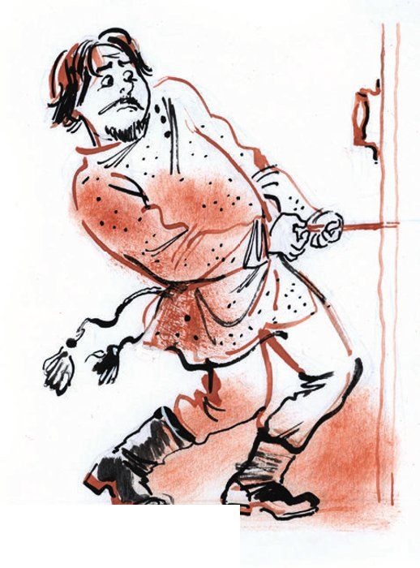
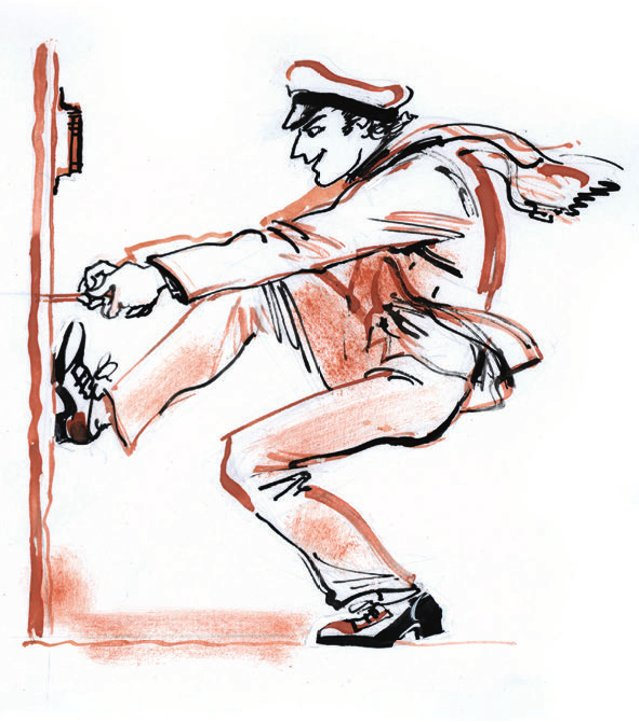
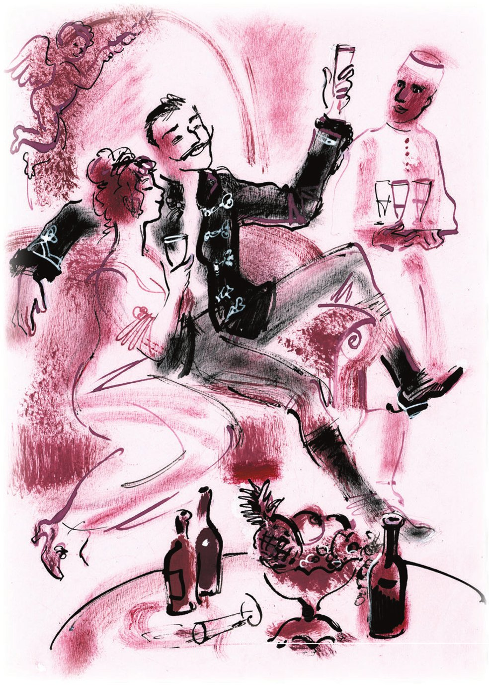
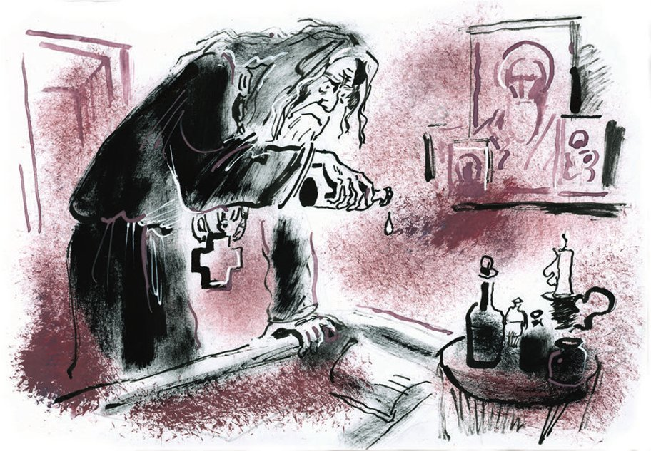

## Kapitel 12: Die glühende Frau, der Traum des Dichters

In der Nacht ist die Kälte ganz und gar <abbr title="auffressen (fraß auf, hat aufgefressen) — съесть без остатка">aufgefressen</abbr> worden. Jetzt ist es so warm, dass den ersten Passanten am Morgen die Beine wehtun. Die Spatzen reden lauter Unsinn. Sogar ein Huhn kommt aus der Küche in den Hof von dem Hotel. Es fühlt plötzlich neue Kraft und versucht zu fliegen. Am Himmel hängen kleine Wolken wie <abbr title="der Kloß, die Klöße — клёцка">Klöße</abbr> in der Suppe. Aus der Mülltonne riecht es nach <abbr title="das Veilchen, die Veilchen — фиалка">Veilchen</abbr> und nach Bauernsuppe. Der Wind liegt faul unter dem Dach. Die Katzen liegen breit auf dem Dach. Sie blinzeln <abbr title="herablassend — снисходительно">herablassend</abbr> in den Hof. Durch den Hof läuft Alexander, der Zimmerkellner. Er trägt ein kleines <abbr title="das Bündel, die Bündel — тючок, узел">Bündel</abbr> mit schmutziger Wäsche.

In den Fluren von der «Sorbonne» wird es laut. Bald wird die neue <abbr title="die Straßenbahn, die Straßenbahnen — трамвай">Straßenbahn</abbr> eröffnet, und dafür kommen <abbr title="der/die Delegierte, die Delegierten — делегат">Delegierte</abbr> aus allen Kreisen in die Stadt. Ein ganzer Haufen steigt gerade aus der Kutsche von der «Sorbonne».

Die Sonne <abbr title="wärmen — греть">wärmt</abbr> mit voller Kraft. Die eisernen <abbr title="der Rollladen, die Rollläden — рольставня, железная штора">Rollläden</abbr> von den Geschäften fliegen nach oben. Die sowjetischen Angestellten sind in dicken <abbr title="der Wattemantel, die Wattemäntel — ватное пальто">Wattemänteln</abbr> zur Arbeit gegangen. Jetzt keuchen sie, öffnen die Mäntel und fühlen, wie schwer der Frühling ist.

In der Genossenschaftsstraße bricht an einem <abbr title="überladen — перегруженный">überladenen</abbr> Lastwagen eine Feder. Sofort ist Viktor Michailowitsch Polessow da und gibt <abbr title="der Ratschlag, die Ratschläge — совет">Ratschläge</abbr>.

Das Hotelzimmer ist mit sachlichem Luxus <abbr title="einrichten — обставлять">eingerichtet</abbr>: zwei Betten und ein Nachttisch. Aus dem Zimmer hört man ein <abbr title="schnauben — фыркать, храпеть (о коне)">Schnauben</abbr> und <abbr title="wiehern — ржать">Wiehern</abbr> wie von einem Pferd. Das ist Ippolit Matwejewitsch: Er wäscht sich fröhlich und putzt sich die Nase. Der große Kombinator liegt im Bett. Er <abbr title="betrachten — рассматривать">betrachtet</abbr> die Schäden an seinen kanariengelben <abbr title="der Halbschuh, die Halbschuhe — штиблета, полуботинок">Halbschuhen</abbr>.

— Übrigens, — sagt er, — bitte <abbr title="begleichen (beglich, hat beglichen) — погашать (долг)">begleichen</abbr> Sie Ihre Schulden.

Ippolit Matwejewitsch <abbr title="auftauchen — выныривать">taucht</abbr> aus dem Handtuch auf. Ohne Kneifer sieht er seinen Kompagnon mit großen, runden Augen an.

— Warum sehen Sie mich so an, wie ein Soldat eine Laus? Was <abbr title="wundern — удивлять">wundert</abbr> Sie? Die Schulden? Jawohl! Sie schulden mir Geld. Gestern habe ich vergessen, es Ihnen zu sagen: Für die Anweisungen habe ich siebzig Rubel bezahlt, wie von Ihnen <abbr title="bevollmächtigt — уполномоченный">bevollmächtigt</abbr>. Hiermit lege ich die Quittung bei. Schieben Sie fünfunddreißig Rubel herüber. Die Konzessionäre teilen die Kosten <abbr title="gleichberechtigt — на равных основаниях">gleichberechtigt</abbr>, hoffe ich?

Ippolit Matwejewitsch setzt den Kneifer auf, liest den Zettel und gibt leidend das Geld. Aber nicht einmal das kann seine Freude <abbr title="trüben — омрачать">trüben</abbr>. Der <abbr title="der Reichtum, die Reichtümer — богатство">Reichtum</abbr> liegt schon in seinen Händen. Die dreißig Rubel sind nur ein kleines <abbr title="das Staubkorn, die Staubkörner — пылинка">Staubkorn</abbr>. Es verschwindet im <abbr title="der Glanz — сияние, блеск">Glanz</abbr> von einem ganzen Berg aus Brillanten.

Ippolit Matwejewitsch lächelt strahlend. Er geht in den Flur und spaziert auf und ab. Er macht Pläne für ein neues Leben. Dieses Leben steht auf einem kostbaren <abbr title="das Fundament, die Fundamente — фундамент">Fundament</abbr>, und die Pläne machen ihm großen Spaß. «Und der heilige Vater?», denkt er <abbr title="schadenfroh — злорадно, ехидно">schadenfroh</abbr>. «Der ist dumm geblieben. Die Stühle sieht er nie – so wenig wie seinen eigenen Bart.»

Am Ende vom Flur dreht sich Worobjaninow um. Die weiße Tür Nummer 13 mit den vielen <abbr title="der Riss, die Risse — трещина">Rissen</abbr> geht auf. Genau vor ihm kommt Vater Fjodor heraus. Er trägt ein blaues russisches <abbr title="das Hemd, die Hemden — рубаха">Hemd</abbr> mit einer Schnur um den Bauch. Die schwarze Schnur ist alt und hat eine dicke Quaste. Sein gutes Gesicht <abbr title="zerfließen (zerfloss, ist zerflossen) — расплываться">zerfließt</abbr> vor Glück. Auch er will im Flur spazieren gehen. Die beiden Rivalen treffen sich ein paar Mal. Sie sehen sich <abbr title="triumphierend — победоносно">triumphierend</abbr> an und gehen weiter. An den Enden vom Flur drehen sich beide gleichzeitig um und kommen sich wieder näher. In der Brust von Ippolit Matwejewitsch kocht die Begeisterung. Vater Fjodor fühlt genau dasselbe. Und beide haben Mitleid mit dem <abbr title="besiegen — побеждать">besiegten</abbr> Gegner. Bei der fünften Runde <abbr title="aushalten (hielt aus, hat ausgehalten) — выдерживать">hält</abbr> es Ippolit Matwejewitsch nicht mehr aus:

— Guten Tag, Väterchen, — sagt er unbeschreiblich süß.

Vater Fjodor nimmt allen <abbr title="der Sarkasmus — сарказм">Sarkasmus</abbr> zusammen, den Gott ihm gegeben hat, und antwortet:

— Guten Morgen, Ippolit Matwejewitsch.

Die Feinde gehen <abbr title="auseinander — в разные стороны">auseinander</abbr>. Als ihre Wege sich wieder treffen, sagt Worobjaninow <abbr title="beiläufig — мимоходом, небрежно">beiläufig</abbr>:

— Habe ich Sie beim letzten Mal nicht <abbr title="verletzen — ушибить, ранить">verletzt</abbr>?

— Aber nein, warum denn? Es war sehr angenehm, Sie zu treffen, — antwortet Vater Fjodor jubelnd.

Wieder gehen sie auseinander. Das Gesicht von Vater Fjodor <abbr title="ärgern — сердить, злить">ärgert</abbr> Ippolit Matwejewitsch immer mehr.

— Die <abbr title="die Messe, die Messen — обедня, месса">Messe</abbr> halten Sie wohl nicht mehr? — fragt er beim nächsten Treffen.

— Wie denn auch! Die <abbr title="die Gemeinde, die Gemeinden — приход, прихожане">Gemeinde</abbr> ist in alle Städte <abbr title="davonlaufen (lief davon, ist davongelaufen) — разбегаться, убегать">davongelaufen</abbr>. Alle suchen einen Schatz.

— Aber bitte <abbr title="beachten — заметить, обратить внимание">beachten</abbr> Sie: Jeder sucht seinen eigenen Schatz! Seinen eigenen!

— Wessen Schatz, weiß ich nicht. Ich weiß nur: Sie suchen.

Ippolit Matwejewitsch will etwas Gemeines sagen. Er öffnet sogar schon den Mund. Aber ihm fällt nichts ein, und er geht ärgerlich in sein Zimmer. Eine Minute später kommt aus dem Zimmer der Sohn von einem türkischen Staatsbürger: Ostap Bender. Er trägt eine hellblaue Weste. Er tritt auf seine eigenen <abbr title="der Schnürsenkel, die Schnürsenkel — шнурок (ботинка)">Schnürsenkel</abbr> und geht direkt zu Wostrikow. Die <abbr title="die Rose, die Rosen — роза">Rosen</abbr> auf den Wangen von Vater Fjodor <abbr title="verwelken — вянуть">verwelken</abbr> und werden zu <abbr title="die Asche — пепел">Asche</abbr>.

— Kaufen Sie alte Sachen? — fragt Ostap <abbr title="drohend — грозно">drohend</abbr>. — Stühle? <abbr title="die Innereien (Pl.) — потроха">Innereien</abbr>? <abbr title="die Schuhcremedose, die Schuhcremedosen — коробочка от ваксы">Schuhcremedosen</abbr>?

— Was wünschen Sie? — flüstert Vater Fjodor.

— Ich wünsche, Ihnen eine alte Hose zu verkaufen.

Der Priester wird zu Eis und weicht zurück.

— Warum schweigen Sie wie ein <abbr title="der Bischof, die Bischöfe — архиерей, епископ">Bischof</abbr> beim <abbr title="der Empfang, die Empfänge — приём">Empfang</abbr>?

Vater Fjodor geht langsam zu seinem Zimmer.

— Wir kaufen alte Sachen und stehlen neue! — ruft Ostap ihm nach.

Wostrikow <abbr title="den Kopf einziehen (zog ein, hat eingezogen) — втягивать голову в плечи">zieht den Kopf ein</abbr> und bleibt vor seiner Tür stehen. Ostap <abbr title="verspotten — издеваться, высмеивать">verspottet</abbr> ihn weiter.

— Und was ist mit der Hose, hochverehrter <abbr title="der Diener des Kultes — служитель культа">Diener des Kultes</abbr>? Nehmen Sie sie? Ich habe noch die Ärmel von einer Weste, das Loch von einem <abbr title="der Kringel, die Kringel — бублик">Kringel</abbr> und die Ohren von einem toten <abbr title="der Esel, die Esel — осёл">Esel</abbr>. Alles zusammen wird billiger. Und es liegt nicht in Stühlen, Sie müssen nicht suchen! Na?!

Die Tür hinter dem Diener des Kultes geht zu.

Ostap ist zufrieden. Er geht langsam zurück, und die Schnürsenkel <abbr title="klatschen — шлёпать, хлопать">klatschen</abbr> auf den Teppich. Als seine große Figur weit genug weg ist, steckt Vater Fjodor schnell den Kopf aus der Tür. Lange hat er seine Empörung <abbr title="zurückhalten (hielt zurück, hat zurückgehalten) — сдерживать">zurückgehalten</abbr>. Jetzt piepst er:

— Du bist selber dumm!

— Was? — schreit Ostap und läuft zurück. Aber die Tür ist schon zu, und nur das Schloss <abbr title="klicken — щёлкать">klickt</abbr>.

Ostap beugt sich zum <abbr title="das Schlüsselloch, die Schlüssellöcher — замочная скважина">Schlüsselloch</abbr>. Er hält die Hand wie ein <abbr title="das Rohr, die Rohre — труба">Rohr</abbr> vor den Mund und sagt deutlich:

— Was kostet das Opium fürs Volk?

Hinter der Tür ist es still.

— Väterchen, Sie sind ein <abbr title="gewöhnlich — пошлый, обыкновенный">gewöhnlicher</abbr> Mensch! — ruft Ostap.

In derselben Sekunde springt ein <abbr title="der Bleistift, die Bleistifte — карандаш">Bleistift</abbr> von der Firma «Faber» aus dem Schlüsselloch und zappelt hin und her. Mit der Spitze will Vater Fjodor den Feind <abbr title="stechen (stach, hat gestochen) — колоть, жалить">stechen</abbr>. Der Konzessionär springt gerade noch <abbr title="rechtzeitig — вовремя">rechtzeitig</abbr> zurück und packt den Bleistift. Die Tür ist zwischen den Feinden. Sie sagen kein Wort, und jeder zieht den Bleistift zu sich. Die Jugend siegt. Langsam kommt der Bleistift aus dem Loch, wie ein <abbr title="der Splitter, die Splitter — заноза">Splitter</abbr>, der nicht heraus will. Mit dieser <abbr title="die Trophäe, die Trophäen — трофей">Trophäe</abbr> kommt Ostap in sein Zimmer zurück. Die Kompagnons werden noch fröhlicher.

— Und der Feind flieht, flieht, flieht! — singt Ostap. Mit dem <abbr title="das Taschenmesser, die Taschenmesser — перочинный ножик">Taschenmesser</abbr> schnitzt er ein <abbr title="beleidigend — оскорбительный">beleidigendes</abbr> Wort in den Bleistift. Dann läuft er in den Flur, steckt den Bleistift in die <abbr title="die Schießscharte, die Schießscharten — амбразура, бойница">Schießscharte</abbr> vom Schloss und kommt sofort zurück.

Die Freunde holen die grünen Abschnitte von den Anweisungen heraus und <abbr title="studieren — изучать">studieren</abbr> sie <abbr title="gründlich — тщательно">gründlich</abbr>.

— Eine Anweisung für den Wandteppich «Die <abbr title="die Schäferin, die Schäferinnen — пастушка">Schäferin</abbr>», — sagt Ippolit Matwejewitsch verträumt. — Diesen Wandteppich habe ich bei einem <abbr title="der Antiquitätenhändler, die Antiquitätenhändler — антиквар">Antiquitätenhändler</abbr> in Petersburg gekauft.

— Zum Teufel mit der Schäferin! — ruft Ostap und zerreißt die Anweisung in <abbr title="die Nudel, die Nudeln — лапша">Nudeln</abbr>.

— Ein runder Tisch … <abbr title="anscheinend — по-видимому">Anscheinend</abbr> von der <abbr title="die Garnitur, die Garnituren — гарнитур">Garnitur</abbr> …

— Her mit dem Tischchen. Zum Teufel mit dem Tischchen!

Zwei Anweisungen bleiben. Eine für zehn Stühle, ausgegeben an das Museum für Möbelkunst in Moskau. Und eine für einen Stuhl, an den Genossen Grizazujew, Stargorod, Plechanow-Straße 15.

— Halten Sie Geld bereit, — sagt Ostap. — Vielleicht müssen wir nach Moskau fahren.

— Aber hier gibt es doch auch einen Stuhl?

— Eine Chance gegen zehn. Reine <abbr title="die Mathematik — математика">Mathematik</abbr>. Und auch das nur, wenn der Bürger Grizazujew den Stuhl nicht im <abbr title="der Kanonenofen, die Kanonenöfen — буржуйка (железная печка)">Kanonenofen</abbr> <abbr title="verheizen — сжечь в печке">verheizt</abbr> hat.

— Machen Sie keine solchen Witze, das ist nicht nötig.

— Keine Sorge, keine Sorge, lieber Vater Konrad Karlowitsch Michelson, wir finden sie! Eine heilige Sache! Bald tragen wir <abbr title="der Fußlappen, die Fußlappen — портянка">Fußlappen</abbr> aus <abbr title="der Batist — батист">Batist</abbr> und essen Creme «Margot».

— Ich habe so ein <abbr title="das Gefühl, die Gefühle — чувство, ощущение">Gefühl</abbr>, — sagt Ippolit Matwejewitsch, — dass die Schätze gerade in diesem Stuhl sind.

— Ach! Sie haben ein Gefühl? Was für Gefühle haben Sie noch? Keine? Na gut. Wir arbeiten <abbr title="marxistisch — по-марксистски">marxistisch</abbr>. Den Himmel <abbr title="überlassen (überließ, hat überlassen) — предоставлять, оставлять">überlassen</abbr> wir den Spatzen, und wir kümmern uns um die Stühle. Ich brenne vor Wunsch, den Invaliden vom imperialistischen Krieg zu sehen, den Bürger Grizazujew, Plechanow-Straße, Haus 15. <abbr title="zurückbleiben (blieb zurück, ist zurückgeblieben) — отставать">Bleiben Sie nicht zurück</abbr>, Konrad Karlowitsch. Den Plan machen wir unterwegs.

Sie gehen an der Tür von Vater Fjodor vorbei. Der <abbr title="rachsüchtig — мстительный">rachsüchtige</abbr> Sohn von dem türkischen Staatsbürger gibt ihr einen <abbr title="der Tritt, die Tritte — пинок">Tritt</abbr>. Aus dem Zimmer hört man das schwache <abbr title="knurren — рычать">Knurren</abbr> von einem <abbr title="gehetzt — затравленный">gehetzten</abbr> Konkurrenten.

— Wenn er uns nur nicht <abbr title="folgen + Dat. — следовать за">folgt</abbr>! — sagt Ippolit Matwejewitsch erschrocken.

— Nach dem heutigen Treffen der Minister auf der <abbr title="die Jacht, die Jachten — яхта">Jacht</abbr> ist keine <abbr title="die Annäherung — сближение">Annäherung</abbr> mehr möglich. Er hat Angst vor mir.

Die Freunde kommen erst am Abend zurück. Ippolit Matwejewitsch macht sich Sorgen. Ostap strahlt. Er trägt neue, <abbr title="himbeerrot — малиновый">himbeerrote</abbr> Schuhe. An den <abbr title="der Absatz, die Absätze — каблук">Absätzen</abbr> sind runde <abbr title="das Gummiplättchen, die Gummiplättchen — резиновая набойка">Gummiplättchen</abbr> <abbr title="anschrauben — привинчивать">angeschraubt</abbr>. Dazu trägt er karierte Socken, grün und schwarz wie ein Schachbrett, eine cremefarbene Schirmmütze und einen Schal aus halber Seide in einer rumänischen Farbe.

— Da ist er ja, der Stuhl, — sagt Ippolit Matwejewitsch. Er denkt an den Besuch bei der Witwe Grizazujewa. — Aber wie bekommen wir ihn? Kaufen?

— Natürlich nicht, — antwortet Ostap. — Erstens ist das eine ganz <abbr title="unproduktiv — непроизводительный">unproduktive</abbr> <abbr title="die Ausgabe, die Ausgaben — расход">Ausgabe</abbr>. Und zweitens fangen die Leute an zu reden. Warum nur ein Stuhl? Warum gerade dieser Stuhl? …

— Was sollen wir denn machen?

Ostap betrachtet liebevoll die <abbr title="die Ferse, die Fersen — задник, пятка">Fersen</abbr> von seinen neuen Schuhen.

— Schick-modern, — sagt er.

— Was wir machen sollen? Regen Sie sich nicht auf, Vorsitzender, die Operation übernehme ich. Vor diesen Schuhen <abbr title="standhalten (hielt stand, hat standgehalten) — устоять">hält</abbr> kein Stuhl stand.

— Nein, wissen Sie, — sagt Ippolit Matwejewitsch lebhaft, — als Sie mit Frau Grizazujewa über die <abbr title="die Überschwemmung, die Überschwemmungen — наводнение">Überschwemmung</abbr> gesprochen haben, da habe ich mich auf unseren Stuhl gesetzt. Und Ehrenwort, ich habe unter mir etwas Hartes gefühlt. Sie sind da drin, bei Gott, sie sind da …

Bei Gott, ich fühle es ja.

— Regen Sie sich nicht auf, Bürger Michelson.

— Wir müssen ihn in der Nacht stehlen! Bei Gott, stehlen!

— Für einen Adelsmarschall denken Sie aber sehr klein. Und kennen Sie die Technik von so einer Sache? Haben Sie vielleicht im Koffer ein <abbr title="das Reisenecessaire, die Reisenecessaires — походный несессер">Reisenecessaire</abbr> mit <abbr title="der Dietrich, die Dietriche — отмычка">Dietrichen</abbr> versteckt? Vergessen Sie das! Eine arme Witwe <abbr title="ausrauben — грабить">ausrauben</abbr> – so etwas macht nur ein <abbr title="der Angeber, die Angeber — пижон, позёр">Angeber</abbr>.

Ippolit Matwejewitsch kommt zu sich.

— Ich möchte es doch nur schneller haben, — sagt er flehend.

— Schnell kommen nur Katzen auf die Welt, — sagt Ostap <abbr title="belehrend — наставительно, поучительно">belehrend</abbr>. — Ich heirate sie.

— Wen?

— Madame Grizazujewa.

— Wozu denn?

— Damit ich in Ruhe und ohne Lärm in dem Stuhl <abbr title="wühlen — копаться, рыться">wühlen</abbr> kann.

— Aber dann sind Sie doch für das ganze Leben <abbr title="binden (band, hat gebunden) — связывать">gebunden</abbr>!

— Was tut man nicht alles für das <abbr title="das Wohl — благо">Wohl</abbr> von der Konzession!

— Für das ganze Leben!

Ippolit Matwejewitsch ist ganz erstaunt und <abbr title="schwenken — размахивать">schwenkt</abbr> die Arme. Sein glatt rasiertes Gesicht, das wie das Gesicht von einem <abbr title="der Pastor, die Pastoren — пастор">Pastor</abbr> aussieht, <abbr title="die Zähne fletschen — оскалиться, ощериться">fletscht die Zähne</abbr>. Man sieht seine blauen Zähne. Seit er aus der Stadt N weggefahren ist, hat er sie nicht geputzt.

— Für das ganze Leben! — flüstert Ippolit Matwejewitsch. — Das ist ein großes Opfer.

— Leben! — sagt Ostap. — Opfer! Was wissen Sie vom Leben und von Opfern? Oder denken Sie, Sie kennen das Leben, weil man Sie aus Ihrer <abbr title="die Villa, die Villen — особняк">Villa</abbr> geworfen hat? Und weil man Ihnen eine gefälschte chinesische Vase <abbr title="wegnehmen (nahm weg, hat weggenommen) — отнимать; реквизировать">weggenommen</abbr> hat, ist das ein Opfer? Das Leben, meine Herren Geschworenen, ist eine komplizierte Sache. Aber, meine Herren Geschworenen, diese komplizierte Sache geht ganz einfach auf, wie eine <abbr title="die Kiste, die Kisten — ящик">Kiste</abbr>. Man muss nur wissen, wie man sie öffnet. Wer sie nicht öffnen kann, der ist verloren. Haben Sie schon vom Husaren-Einsiedler gehört?

Ippolit Matwejewitsch hat noch nichts von ihm gehört.

— Bulanow! Nie gehört? Der Held vom <abbr title="aristokratisch — аристократический">aristokratischen</abbr> Petersburg? Gleich hören Sie es.

Und Ostap Bender erzählt Ippolit Matwejewitsch eine Geschichte. Ihr erstaunlicher Anfang hat das ganze feine Petersburg <abbr title="aufregen — волновать">aufgeregt</abbr>. Ihr noch erstaunlicheres Ende ist in den letzten Jahren <abbr title="verloren gehen (ging verloren, ist verloren gegangen) — потеряться">verloren gegangen</abbr>, und niemand hat es <abbr title="bemerken — замечать">bemerkt</abbr>.

**Die Geschichte vom Husaren-Einsiedler**

Der <abbr title="glänzend — блестящий">glänzende</abbr> <abbr title="der Husar, die Husaren — гусар">Husar</abbr> Graf Alexei Bulanow war wirklich der Held vom aristokratischen Petersburg, da hat Bender recht. Alle sprechen von dem herrlichen <abbr title="der Reiter, die Reiter — кавалерист, всадник">Reiter</abbr> und <abbr title="der Lebemann, die Lebemänner — кутила, повеса">Lebemann</abbr>: die steifen Bewohner von den Palästen am Englischen <abbr title="das Ufer, die Ufer — набережная, берег">Ufer</abbr> und die Zeitungen mit Nachrichten aus der feinen Gesellschaft. Sehr oft findet man in den <abbr title="die Illustrierte, die Illustrierten — иллюстрированный журнал">Illustrierten</abbr> ein Foto von dem schönen Husaren. Er trägt eine Jacke mit vielen Schnüren und mit einem Rand aus <abbr title="der Persianer — каракуль">Persianer</abbr>, er hat hohe, glatt gekämmte <abbr title="die Schläfe, die Schläfen — висок">Schläfen</abbr> und eine kurze, <abbr title="siegreich — победоносный">siegreiche</abbr> Nase.

Graf Bulanow hat einen großen <abbr title="der Ruf — слава, репутация">Ruf</abbr>. Man sagt: Er war bei vielen geheimen <abbr title="das Duell, die Duelle — дуэль">Duellen</abbr>, und sie sind tödlich <abbr title="ausgehen (ging aus, ist ausgegangen) — заканчиваться (чем-то)">ausgegangen</abbr>. Er hat offene <abbr title="die Affäre, die Affären — роман, интрижка">Affären</abbr> mit den schönsten und <abbr title="unnahbar — неприступный">unnahbarsten</abbr> Damen der Gesellschaft. Er macht verrückte <abbr title="der Streich, die Streiche — выходка, проделка">Streiche</abbr> gegen sehr wichtige Personen. Und er feiert wilde <abbr title="das Gelage, die Gelage — кутёж, попойка">Gelage</abbr>, und am Ende verprügelt er immer ein paar <abbr title="der Zivilist, die Zivilisten — штатский, «штафирка»">Zivilisten</abbr>.

Der Graf ist schön, jung und reich. Er hat Glück in der Liebe, Glück beim Kartenspiel und Glück beim <abbr title="erben — наследовать">Erben</abbr>. Seine <abbr title="der/die Verwandte, die Verwandten — родственник">Verwandten</abbr> sterben schnell, und ihre <abbr title="die Erbschaft, die Erbschaften — наследство">Erbschaften</abbr> machen den riesigen Reichtum von dem Husaren noch größer.

Er ist frech und <abbr title="mutig — смелый">mutig</abbr>. Er hilft dem Kaiser Menelik von <abbr title="Abessinien — Абиссиния">Abessinien</abbr> im Krieg gegen die Italiener. Er sitzt unter den großen Sternen von Abessinien, <abbr title="sich hüllen in + Akk. — закутываться">gehüllt</abbr> in einen weißen <abbr title="der Burnus, die Burnusse — бурнус (плащ)">Burnus</abbr>, und sieht auf die <abbr title="die Landkarte, die Landkarten — карта местности">Landkarte</abbr>. Das Licht von den <abbr title="die Fackel, die Fackeln — факел">Fackeln</abbr> wirft wackelnde Schatten auf seine glatten Schläfen. Zu seinen Füßen sitzt sein neuer Freund, der kleine abessinische Junge Waska.

Der Graf schlägt die <abbr title="die Truppe, die Truppen — войско">Truppen</abbr> vom italienischen König und fährt mit dem Abessinier Waska zurück nach Petersburg. Petersburg <abbr title="empfangen (empfing, hat empfangen) — встречать, принимать">empfängt</abbr> den Helden mit Blumen und <abbr title="der Champagner — шампанское">Champagner</abbr>. Graf Alexei taucht wieder tief in das sorglose Leben voller Vergnügungen. Man spricht über ihn mit doppelter <abbr title="die Bewunderung — восхищение">Bewunderung</abbr>. Frauen <abbr title="sich vergiften — отравиться">vergiften sich</abbr> aus Liebe zu ihm, Männer sind neidisch. Die Kutsche vom Grafen fliegt durch die Millionnaja-Straße, und hinten auf der Kutsche steht immer der Abessinier. Die Passanten staunen: So schwarz ist er, und so <abbr title="schlank — стройный, тонкий">schlank</abbr>!

Und plötzlich ist alles <abbr title="vorbei — кончено, позади">vorbei</abbr>. Graf Alexei Bulanow verschwindet. Die Fürstin Belorussko-Baltijskaja, seine letzte Leidenschaft, ist <abbr title="untröstlich — безутешный">untröstlich</abbr>. Das Verschwinden vom Grafen macht viel Lärm. Die Zeitungen sind voll von <abbr title="die Vermutung, die Vermutungen — догадка, предположение">Vermutungen</abbr>. Die <abbr title="der Detektiv, die Detektive — сыщик">Detektive</abbr> laufen sich die Füße wund. Aber alles ist umsonst. Vom Grafen gibt es keine Spur.

Der Lärm wird schon leiser – da kommt aus dem Awerkijew-Kloster ein Brief. Der Brief erklärt alles. Der glänzende Graf, der Held vom aristokratischen Petersburg, ein <abbr title="Belsazar — Валтасар">Belsazar</abbr> vom 19. Jahrhundert, ist ein strenger <abbr title="der Mönch, die Mönche — монах">Mönch</abbr> geworden. Man erzählt sich schreckliche <abbr title="die Einzelheit, die Einzelheiten — подробность">Einzelheiten</abbr>. Man sagt: Der Graf-Mönch trägt schwere <abbr title="die Kette, die Ketten — цепь; вериги">Ketten</abbr>, viele Pud schwer. Früher hat er nur feine französische Küche gegessen, und jetzt isst er nur noch <abbr title="die Kartoffelschale, die Kartoffelschalen — картофельная шелуха">Kartoffelschalen</abbr>. Ein <abbr title="der Wirbelsturm, die Wirbelstürme — вихрь, ураган">Wirbelsturm</abbr> von Vermutungen beginnt. Man sagt: Der Graf hat seine tote Mutter gesehen, in einer <abbr title="die Vision, die Visionen — видение">Vision</abbr>. Die Frauen weinen. Vor dem Haus von der Fürstin Belorussko-Baltijskaja steht eine lange <abbr title="die Reihe, die Reihen — вереница, ряд">Reihe</abbr> von Kutschen. Die Fürstin und ihr Mann nehmen das <abbr title="das Beileid — соболезнование">Beileid</abbr> entgegen. Immer neue <abbr title="das Gerücht, die Gerüchte — слух">Gerüchte</abbr> entstehen. Man wartet auf die Rückkehr vom Grafen. Man sagt: Er ist nur kurz religiös verrückt geworden. Andere sagen: Der Graf ist vor seinen Schulden geflohen. Und wieder andere sagen: Schuld ist eine unglückliche Liebe.

Aber in Wirklichkeit ist der Husar Mönch geworden, weil er das Leben <abbr title="begreifen (begriff, hat begriffen) — постигать, понимать">begreifen</abbr> will. Er kommt nicht zurück. <abbr title="nach und nach — мало-помалу">Nach und nach</abbr> vergessen ihn alle. Die Fürstin Baltijskaja lernt einen italienischen Sänger kennen, und der Abessinier Waska fährt nach Hause.

Im Kloster nimmt Graf Alexei Bulanow den Namen Jewpl an. Er quält sich mit großen <abbr title="die Heldentat, die Heldentaten — подвиг">Heldentaten</abbr>. Er trägt wirklich die schweren Ketten. Aber das ist ihm noch nicht genug, um das Leben zu begreifen. Deshalb erfindet er für sich eine besondere <abbr title="die Mönchskleidung — монашеское одеяние">Mönchskleidung</abbr>: eine <abbr title="die Kapuze, die Kapuzen — клобук, капюшон">Kapuze</abbr> mit einem Schirm, der nach unten hängt und das ganze Gesicht bedeckt, und eine <abbr title="die Kutte, die Kutten — ряса">Kutte</abbr>, in der man sich kaum bewegen kann. Der <abbr title="der Abt, die Äbte — игумен, аббат">Abt</abbr> gibt seinen <abbr title="der Segen — благословение">Segen</abbr>, und der Mönch trägt diese Kleidung. Aber auch das ist ihm zu wenig. Er ist sehr <abbr title="stolz — гордый">stolz</abbr>. Er geht in den Wald, wohnt dort in einer <abbr title="die Erdhütte, die Erdhütten — землянка">Erdhütte</abbr> und schläft in einem Sarg aus Eichenholz.

Das ganze Kloster <abbr title="staunen über + Akk. — изумляться">staunt</abbr> über die Heldentat von dem Einsiedler Jewpl. Er isst nur <abbr title="der Zwieback, die Zwiebäcke — сухарь">Zwieback</abbr>. Alle drei Monate bringt man ihm neuen Zwieback.

So <abbr title="vergehen (verging, ist vergangen) — проходить (о времени)">vergehen</abbr> zwanzig Jahre. Jewpl findet sein Leben <abbr title="weise — мудрый">weise</abbr>, richtig und als einziges <abbr title="wahr — верный, истинный">wahr</abbr>. Das Leben ist für ihn ungewöhnlich leicht geworden, und seine Gedanken sind klar wie <abbr title="der Kristall, die Kristalle — хрусталь">Kristall</abbr>. Er hat das Leben begriffen. Er weiß: Anders kann man nicht leben.

Eines Tages sieht er erstaunt: Am Platz, wo er zwanzig Jahre lang immer seinen Zwieback gefunden hat, liegt nichts. Vier Tage isst er nichts. Am fünften Tag kommt ein alter Mann in <abbr title="der Bastschuh, die Bastschuhe — лапоть">Bastschuhen</abbr>. Jewpl kennt ihn nicht. Der Alte sagt: Die Bolschewiken haben die Mönche aus dem Kloster <abbr title="vertreiben (vertrieb, hat vertrieben) — выгонять, выселять">vertrieben</abbr>. Jetzt ist dort eine <abbr title="die Sowchose, die Sowchosen — совхоз">Sowchose</abbr>, ein staatlicher Bauernhof. Der Alte lässt ein bisschen Zwieback da und geht weinend weg. Der Einsiedler versteht den Alten nicht. Hell und still liegt er in seinem Sarg und freut sich, dass er das Leben begriffen hat. Der alte Bauer bringt ihm weiter Zwieback.

So vergehen noch ein paar Jahre. Niemand stört ihn.

Nur einmal geht die Tür von der Erdhütte auf. Ein paar Männer kommen gebückt herein. Sie gehen zum Sarg und betrachten schweigend den alten Mönch. Es sind große Männer in Stiefeln mit <abbr title="der Sporn, die Sporen — шпора">Sporen</abbr>, in riesigen <abbr title="die Reithose, die Reithosen — галифе">Reithosen</abbr>, mit <abbr title="die Mauser-Pistole, die Mauser-Pistolen — маузер">Mauser-Pistolen</abbr> in polierten Holzkästen. Der Alte liegt im Sarg, die Arme lang ausgestreckt, und sieht die Fremden mit strahlendem Blick an. Sein langer, leichter grauer Bart bedeckt den halben Sarg. Die Fremden klirren mit den Sporen, zucken mit den Schultern und gehen. Die Tür machen sie vorsichtig hinter sich zu.

Die Zeit vergeht. Das Leben öffnet sich vor dem Einsiedler in seiner ganzen Fülle und Süße. In einer Nacht – am Tag vorher hat der Einsiedler endgültig begriffen, dass alles in seinem Wissen hell ist – wacht er plötzlich auf. Das wundert ihn. Er wacht nachts nie auf. Er denkt nach: Was hat ihn geweckt? Er schläft wieder ein und wacht sofort wieder auf. Sein Rücken brennt stark. Er versucht, den Grund für das Brennen zu begreifen, und er versucht zu schlafen. Aber er kann nicht.

Etwas stört ihn. Er schläft nicht bis zum Morgen. In der nächsten Nacht weckt ihn wieder etwas. Er dreht sich bis zum Morgen hin und her, stöhnt leise und kratzt sich die Arme, ohne es selbst zu merken. Am Tag steht er auf und sieht zufällig in den Sarg. Da versteht er alles: In den Ecken von seinem düsteren Bett laufen schnell kirschrote Wanzen hin und her. Dem Einsiedler wird <abbr title="übel — противно, тошно">übel</abbr>.

Am selben Tag kommt der Alte mit dem Zwieback. Und der heilige Mann, der fünfundzwanzig Jahre lang geschwiegen hat, beginnt zu sprechen. Er bittet um ein bisschen Petroleum. Der Bauer hört den großen Schweiger sprechen und ist ganz verdattert. Trotzdem bringt er das Petroleum. Er schämt sich und versteckt die kleine Flasche. Als der Alte weg ist, <abbr title="schmieren — смазывать">schmiert</abbr> der Einsiedler mit zitternder Hand alle <abbr title="die Fuge, die Fugen — шов, паз">Fugen</abbr> und <abbr title="die Ritze, die Ritzen — щель">Ritzen</abbr> vom Sarg ein. Zum ersten Mal seit drei Tagen schläft Jewpl ruhig. Nichts stört ihn. Auch an den nächsten Tagen schmiert er den Sarg mit Petroleum ein. Aber nach zwei Monaten versteht er: Mit Petroleum kann man Wanzen nicht loswerden. Nachts dreht er sich schnell hin und her und <abbr title="beten — молиться">betet</abbr> laut. Aber die <abbr title="das Gebet, die Gebete — молитва">Gebete</abbr> helfen noch weniger als das Petroleum.

Ein halbes Jahr vergeht mit unbeschreiblichen <abbr title="die Qual, die Qualen — мучение">Qualen</abbr>. Erst dann bittet der Einsiedler den Alten noch einmal um etwas. Die zweite <abbr title="die Bitte, die Bitten — просьба">Bitte</abbr> verblüfft den Alten noch mehr. Der Einsiedler möchte aus der Stadt das <abbr title="das Pulver, die Pulver — порошок">Pulver</abbr> «Aragaz» gegen Wanzen. Aber auch «Aragaz» hilft nicht. Die Wanzen vermehren sich ungewöhnlich schnell. Fünfundzwanzig Jahre <abbr title="das Fasten — пост, постничество">Fasten</abbr> haben die starke Gesundheit vom Einsiedler nicht <abbr title="zerstören — разрушать, сломить">zerstört</abbr>. Aber jetzt wird sie deutlich schlechter. Ein dunkles, verzweifeltes Leben beginnt. Der Sarg erscheint dem Einsiedler Jewpl jetzt ekelhaft und unbequem. Nachts verbrennt er die Wanzen mit einem <abbr title="der Kienspan, die Kienspäne — лучина">Kienspan</abbr>. Das hat der Bauer ihm geraten. Die Wanzen sterben, aber sie <abbr title="sich ergeben (ergab, hat ergeben) — сдаваться">ergeben sich</abbr> nicht.

Er versucht das letzte Mittel: ein Produkt von den Brüdern Glick. Es ist eine rosa <abbr title="die Flüssigkeit, die Flüssigkeiten — жидкость">Flüssigkeit</abbr>. Sie riecht wie ein <abbr title="vergiftet — отравленный">vergifteter</abbr> <abbr title="der Pfirsich, die Pfirsiche — персик">Pfirsich</abbr> und heißt «Wanzin». Aber auch das hilft nicht. Die Lage wird immer schlimmer. Zwei Jahre nach dem Anfang von dem großen Kampf merkt der Einsiedler zufällig etwas: Er denkt gar nicht mehr über den Sinn vom Leben nach. Denn er ist Tag und Nacht nur mit dem <abbr title="vergiften — травить">Vergiften</abbr> von Wanzen beschäftigt.

Da versteht er, dass er sich <abbr title="sich irren — ошибаться">geirrt</abbr> hat. Das Leben ist genauso dunkel und rätselhaft wie vor fünfundzwanzig Jahren. Vor den <abbr title="die Sorge, die Sorgen — забота, тревога">Sorgen</abbr> von der Welt kann man nicht fliehen. Mit dem Körper auf der Erde und mit der Seele im Himmel leben – das geht nicht.

Da steht der Alte auf und geht flink aus der Erdhütte. Er steht in einem dunklen, grünen Wald. Es ist früher, trockener Herbst. Direkt neben der Hütte drängt sich eine ganze Familie von <abbr title="der Steinpilz, die Steinpilze — белый гриб">Steinpilzen</abbr> aus der Erde – dicke Pilze mit dicken Bäuchen. Ein <abbr title="unbekannt — неизвестный">unbekannter</abbr> kleiner Vogel sitzt auf einem <abbr title="der Ast, die Äste — ветка">Ast</abbr> und singt ein <abbr title="das Solo, die Soli — соло">Solo</abbr>. Man hört einen Zug vorbeifahren. Die Erde zittert. Das Leben ist wunderschön. Der Alte geht nach vorn und sieht nicht zurück.

Heute arbeitet er als <abbr title="der Kutscher, die Kutscher — кучер">Kutscher</abbr> beim <abbr title="der Pferdehof, die Pferdehöfe — конная база">Pferdehof</abbr> von der Moskauer <abbr title="die Stadtwirtschaft — коммунальное хозяйство">Stadtwirtschaft</abbr>.

So endet die höchst <abbr title="lehrreich — поучительный">lehrreiche</abbr> Geschichte von Ostap. Er putzt seine himbeerroten Schuhe mit dem Ärmel von seiner Jacke, spielt mit den Lippen einen <abbr title="der Tusch, die Tusche — туш (музыкальное приветствие)">Tusch</abbr> und geht weg.

Gegen Morgen stolpert er ins Zimmer. Er zieht die Schuhe aus und stellt die himbeerroten Schuhe auf den Nachttisch. Dann streichelt er das glänzende <abbr title="das Leder — кожа (материал)">Leder</abbr> und sagt mit zärtlicher Leidenschaft:

— Meine kleinen Freunde.

— Wo waren Sie? — fragt Ippolit Matwejewitsch verschlafen.

— Bei der Witwe, — antwortet Ostap <abbr title="dumpf — глухо">dumpf</abbr>.

— Und?

Ippolit Matwejewitsch <abbr title="sich stützen auf + Akk. — опираться на">stützt sich</abbr> auf den Ellbogen.

— Und Sie heiraten sie?

Die Augen von Ostap funkeln.

— Jetzt muss ich sie heiraten. Als ehrlicher Mann.

Ippolit Matwejewitsch grunzt verlegen.

— Eine glühende Frau, — sagt Ostap, — der Traum des Dichters. <abbr title="provinziell — провинциальный">Provinzielle</abbr> <abbr title="die Natürlichkeit — непосредственность">Natürlichkeit</abbr>. In der Hauptstadt gibt es solche <abbr title="die Subtropen (Pl.) — субтропики">Subtropen</abbr> schon lange nicht mehr. Aber in der Provinz, auf dem Land, findet man sie noch.

— Und wann ist die <abbr title="die Hochzeit, die Hochzeiten — свадьба">Hochzeit</abbr>?

— Übermorgen. Morgen geht es nicht: Es ist der erste Mai, alles ist zu.

— Und was wird aus unserer Sache? Sie heiraten … Vielleicht müssen wir nach Moskau fahren …

— Na, warum machen Sie sich Sorgen? Die Sitzung geht weiter.

— Und die Frau?

— Die Frau? Die kleine Brillanten-Witwe? Das ist die letzte Frage. Eine plötzliche <abbr title="die Abreise — отъезд">Abreise</abbr>, weil die Zentrale mich ruft. Ein kleiner Vortrag im Kleinen Rat der <abbr title="der Volkskommissar, die Volkskommissare — народный комиссар">Volkskommissare</abbr>. Eine Szene zum <abbr title="der Abschied, die Abschiede — прощание">Abschied</abbr> und ein <abbr title="das Hähnchen, die Hähnchen — цыплёнок">Hähnchen</abbr> für die Reise. Wir reisen mit <abbr title="der Komfort — комфорт">Komfort</abbr>. Schlafen Sie jetzt. Morgen haben wir frei.

---

### Neue Wörter

- **auffressen (fraß auf, hat aufgefressen)** — съесть без остатка
- **der Kloß, die Klöße** — клёцка
- **das Veilchen, die Veilchen** — фиалка
- **herablassend** — снисходительно
- **das Bündel, die Bündel** — тючок, узел
- **die Straßenbahn, die Straßenbahnen** — трамвай
- **der/die Delegierte, die Delegierten** — делегат
- **wärmen** — греть
- **der Rollladen, die Rollläden** — рольставня, железная штора
- **der Wattemantel, die Wattemäntel** — ватное пальто
- **überladen** — перегруженный
- **der Ratschlag, die Ratschläge** — совет
- **einrichten** — обставлять
- **schnauben** — фыркать, храпеть (о коне)
- **wiehern** — ржать
- **betrachten** — рассматривать
- **der Halbschuh, die Halbschuhe** — штиблета, полуботинок
- **begleichen (beglich, hat beglichen)** — погашать (долг)
- **auftauchen** — выныривать
- **wundern** — удивлять
- **bevollmächtigt** — уполномоченный
- **gleichberechtigt** — на равных основаниях
- **trüben** — омрачать
- **der Reichtum, die Reichtümer** — богатство
- **das Staubkorn, die Staubkörner** — пылинка
- **der Glanz** — сияние, блеск
- **das Fundament, die Fundamente** — фундамент
- **schadenfroh** — злорадно, ехидно
- **der Riss, die Risse** — трещина
- **das Hemd, die Hemden** — рубаха
- **zerfließen (zerfloss, ist zerflossen)** — расплываться
- **triumphierend** — победоносно
- **besiegen** — побеждать
- **aushalten (hielt aus, hat ausgehalten)** — выдерживать
- **der Sarkasmus** — сарказм
- **auseinander** — в разные стороны
- **beiläufig** — мимоходом, небрежно
- **verletzen** — ушибить, ранить
- **ärgern** — сердить, злить
- **die Messe, die Messen** — обедня, месса
- **die Gemeinde, die Gemeinden** — приход, прихожане
- **davonlaufen (lief davon, ist davongelaufen)** — разбегаться, убегать
- **beachten** — заметить, обратить внимание
- **der Schnürsenkel, die Schnürsenkel** — шнурок (ботинка)
- **die Rose, die Rosen** — роза
- **verwelken** — вянуть
- **die Asche** — пепел
- **drohend** — грозно
- **die Innereien (Pl.)** — потроха
- **die Schuhcremedose, die Schuhcremedosen** — коробочка от ваксы
- **der Bischof, die Bischöfe** — архиерей, епископ
- **der Empfang, die Empfänge** — приём
- **den Kopf einziehen (zog ein, hat eingezogen)** — втягивать голову в плечи
- **verspotten** — издеваться, высмеивать
- **der Diener des Kultes** — служитель культа
- **der Kringel, die Kringel** — бублик
- **der Esel, die Esel** — осёл
- **klatschen** — шлёпать, хлопать
- **zurückhalten (hielt zurück, hat zurückgehalten)** — сдерживать
- **klicken** — щёлкать
- **das Schlüsselloch, die Schlüssellöcher** — замочная скважина
- **das Rohr, die Rohre** — труба
- **gewöhnlich** — пошлый, обыкновенный
- **der Bleistift, die Bleistifte** — карандаш
- **stechen (stach, hat gestochen)** — колоть, жалить
- **rechtzeitig** — вовремя
- **der Splitter, die Splitter** — заноза
- **die Trophäe, die Trophäen** — трофей
- **das Taschenmesser, die Taschenmesser** — перочинный ножик
- **beleidigend** — оскорбительный
- **die Schießscharte, die Schießscharten** — амбразура, бойница
- **studieren** — изучать
- **gründlich** — тщательно
- **die Schäferin, die Schäferinnen** — пастушка
- **der Antiquitätenhändler, die Antiquitätenhändler** — антиквар
- **die Nudel, die Nudeln** — лапша
- **anscheinend** — по-видимому
- **die Garnitur, die Garnituren** — гарнитур
- **die Mathematik** — математика
- **der Kanonenofen, die Kanonenöfen** — буржуйка (железная печка)
- **verheizen** — сжечь в печке
- **der Fußlappen, die Fußlappen** — портянка
- **der Batist** — батист
- **das Gefühl, die Gefühle** — чувство, ощущение
- **marxistisch** — по-марксистски
- **überlassen (überließ, hat überlassen)** — предоставлять, оставлять
- **zurückbleiben (blieb zurück, ist zurückgeblieben)** — отставать
- **rachsüchtig** — мстительный
- **der Tritt, die Tritte** — пинок
- **knurren** — рычать
- **gehetzt** — затравленный
- **folgen + Dat.** — следовать за
- **die Jacht, die Jachten** — яхта
- **die Annäherung** — сближение
- **himbeerrot** — малиновый
- **der Absatz, die Absätze** — каблук
- **das Gummiplättchen, die Gummiplättchen** — резиновая набойка
- **anschrauben** — привинчивать
- **unproduktiv** — непроизводительный
- **die Ausgabe, die Ausgaben** — расход
- **die Ferse, die Fersen** — задник, пятка
- **standhalten (hielt stand, hat standgehalten)** — устоять
- **die Überschwemmung, die Überschwemmungen** — наводнение
- **das Reisenecessaire, die Reisenecessaires** — походный несессер
- **der Dietrich, die Dietriche** — отмычка
- **ausrauben** — грабить
- **der Angeber, die Angeber** — пижон, позёр
- **belehrend** — наставительно, поучительно
- **wühlen** — копаться, рыться
- **binden (band, hat gebunden)** — связывать
- **das Wohl** — благо
- **schwenken** — размахивать
- **der Pastor, die Pastoren** — пастор
- **die Zähne fletschen** — оскалиться, ощериться
- **die Villa, die Villen** — особняк
- **wegnehmen (nahm weg, hat weggenommen)** — отнимать; реквизировать
- **die Kiste, die Kisten** — ящик
- **aristokratisch** — аристократический
- **aufregen** — волновать
- **verloren gehen (ging verloren, ist verloren gegangen)** — потеряться
- **bemerken** — замечать
- **glänzend** — блестящий
- **der Husar, die Husaren** — гусар
- **der Reiter, die Reiter** — кавалерист, всадник
- **der Lebemann, die Lebemänner** — кутила, повеса
- **das Ufer, die Ufer** — набережная, берег
- **die Illustrierte, die Illustrierten** — иллюстрированный журнал
- **der Persianer** — каракуль
- **die Schläfe, die Schläfen** — висок
- **siegreich** — победоносный
- **der Ruf** — слава, репутация
- **das Duell, die Duelle** — дуэль
- **ausgehen (ging aus, ist ausgegangen)** — заканчиваться (чем-то)
- **die Affäre, die Affären** — роман, интрижка
- **unnahbar** — неприступный
- **der Streich, die Streiche** — выходка, проделка
- **das Gelage, die Gelage** — кутёж, попойка
- **der Zivilist, die Zivilisten** — штатский, «штафирка»
- **erben** — наследовать
- **der/die Verwandte, die Verwandten** — родственник
- **die Erbschaft, die Erbschaften** — наследство
- **mutig** — смелый
- **Abessinien** — Абиссиния
- **sich hüllen in + Akk.** — закутываться
- **der Burnus, die Burnusse** — бурнус (плащ)
- **die Landkarte, die Landkarten** — карта местности
- **die Fackel, die Fackeln** — факел
- **die Truppe, die Truppen** — войско
- **empfangen (empfing, hat empfangen)** — встречать, принимать
- **der Champagner** — шампанское
- **die Bewunderung** — восхищение
- **sich vergiften** — отравиться
- **schlank** — стройный, тонкий
- **vorbei** — кончено, позади
- **untröstlich** — безутешный
- **die Vermutung, die Vermutungen** — догадка, предположение
- **der Detektiv, die Detektive** — сыщик
- **Belsazar** — Валтасар
- **der Mönch, die Mönche** — монах
- **die Einzelheit, die Einzelheiten** — подробность
- **die Kette, die Ketten** — цепь; вериги
- **die Kartoffelschale, die Kartoffelschalen** — картофельная шелуха
- **der Wirbelsturm, die Wirbelstürme** — вихрь, ураган
- **die Vision, die Visionen** — видение
- **die Reihe, die Reihen** — вереница, ряд
- **das Beileid** — соболезнование
- **das Gerücht, die Gerüchte** — слух
- **begreifen (begriff, hat begriffen)** — постигать, понимать
- **nach und nach** — мало-помалу
- **die Heldentat, die Heldentaten** — подвиг
- **die Mönchskleidung** — монашеское одеяние
- **die Kapuze, die Kapuzen** — клобук, капюшон
- **die Kutte, die Kutten** — ряса
- **der Abt, die Äbte** — игумен, аббат
- **der Segen** — благословение
- **stolz** — гордый
- **die Erdhütte, die Erdhütten** — землянка
- **staunen über + Akk.** — изумляться
- **der Zwieback, die Zwiebäcke** — сухарь
- **vergehen (verging, ist vergangen)** — проходить (о времени)
- **weise** — мудрый
- **wahr** — верный, истинный
- **der Kristall, die Kristalle** — хрусталь
- **der Bastschuh, die Bastschuhe** — лапоть
- **vertreiben (vertrieb, hat vertrieben)** — выгонять, выселять
- **die Sowchose, die Sowchosen** — совхоз
- **der Sporn, die Sporen** — шпора
- **die Reithose, die Reithosen** — галифе
- **die Mauser-Pistole, die Mauser-Pistolen** — маузер
- **übel** — противно, тошно
- **schmieren** — смазывать
- **die Fuge, die Fugen** — шов, паз
- **die Ritze, die Ritzen** — щель
- **beten** — молиться
- **das Gebet, die Gebete** — молитва
- **die Qual, die Qualen** — мучение
- **die Bitte, die Bitten** — просьба
- **das Pulver, die Pulver** — порошок
- **das Fasten** — пост, постничество
- **zerstören** — разрушать, сломить
- **der Kienspan, die Kienspäne** — лучина
- **sich ergeben (ergab, hat ergeben)** — сдаваться
- **die Flüssigkeit, die Flüssigkeiten** — жидкость
- **vergiftet** — отравленный
- **der Pfirsich, die Pfirsiche** — персик
- **vergiften** — травить
- **sich irren** — ошибаться
- **die Sorge, die Sorgen** — забота, тревога
- **der Steinpilz, die Steinpilze** — белый гриб
- **unbekannt** — неизвестный
- **der Ast, die Äste** — ветка
- **das Solo, die Soli** — соло
- **der Kutscher, die Kutscher** — кучер
- **der Pferdehof, die Pferdehöfe** — конная база
- **die Stadtwirtschaft** — коммунальное хозяйство
- **lehrreich** — поучительный
- **der Tusch, die Tusche** — туш (музыкальное приветствие)
- **das Leder** — кожа (материал)
- **dumpf** — глухо
- **sich stützen auf + Akk.** — опираться на
- **provinziell** — провинциальный
- **die Natürlichkeit** — непосредственность
- **die Subtropen (Pl.)** — субтропики
- **die Hochzeit, die Hochzeiten** — свадьба
- **die Abreise** — отъезд
- **der Volkskommissar, die Volkskommissare** — народный комиссар
- **der Abschied, die Abschiede** — прощание
- **das Hähnchen, die Hähnchen** — цыплёнок
- **der Komfort** — комфорт

[← Kapitel 11](kapitel-11.md) · [Inhalt](README.md) · [Kapitel 13 →](kapitel-13.md)
