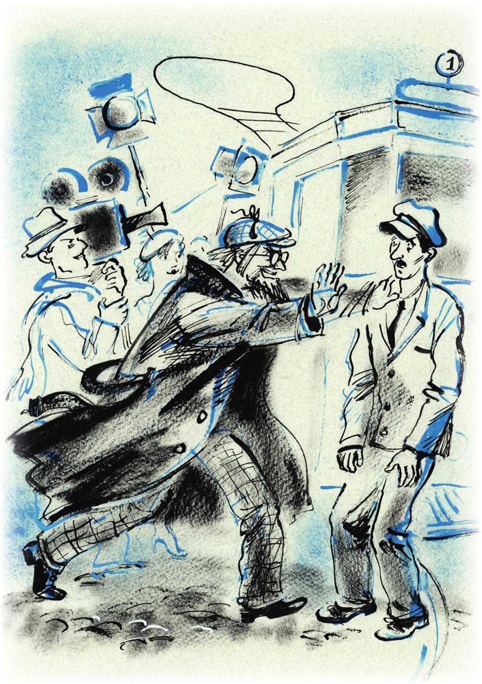

## Kapitel 13: Atmen Sie tief: Sie sind aufgeregt!

Es ist der Morgen vom ersten Mai. Viktor Michailowitsch Polessow hat wie immer großen <abbr title="der Durst — жажда">Durst</abbr> nach <abbr title="die Tätigkeit, die Tätigkeiten — деятельность">Tätigkeit</abbr>. Er springt auf die Straße und rast ins Zentrum. Zuerst finden seine vielen <abbr title="das Talent, die Talente — талант">Talente</abbr> keine richtige Arbeit. Denn es sind noch wenig Leute da, und die <abbr title="die Tribüne, die Tribünen — трибуна">Tribünen</abbr> für das Fest sind leer. Nur <abbr title="beritten — конный">berittene</abbr> Milizionäre <abbr title="bewachen — охранять">bewachen</abbr> sie. Aber gegen neun Uhr hört man in allen Teilen von der Stadt die <abbr title="das Orchester, die Orchester — оркестр">Orchester</abbr>. Sie <abbr title="schnurren — мурлыкать">schnurren</abbr>, schnaufen und pfeifen. Die Hausfrauen laufen aus den Toren.

Eine <abbr title="die Kolonne, die Kolonnen — колонна">Kolonne</abbr> von <abbr title="der Musikarbeiter, die Musikarbeiter — музработник">Musikarbeitern</abbr> mit weichen, <abbr title="umgeschlagen — отложной (воротник)">umgeschlagenen</abbr> Kragen hat sich irgendwie mitten in den <abbr title="der Umzug, die Umzüge — шествие">Umzug</abbr> von den Eisenbahnern gedrängt. Sie laufen allen vor die Füße und stören alle. Ein Lastwagen ist als neue grüne Lokomotive der Serie «Sch» <abbr title="verkleiden — наряжать, маскировать">verkleidet</abbr>. Er fährt immer wieder von hinten auf die Musikarbeiter <abbr title="auffahren auf + Akk. — наезжать на">auf</abbr>. Und aus dem Bauch von der Lokomotive schreit man die <abbr title="der Arbeiter, die Arbeiter — рабочий, труженик">Arbeiter</abbr> von der <abbr title="die Oboe, die Oboen — гобой">Oboe</abbr> und der Flöte an:

— Wo ist euer <abbr title="der Festordner, die Festordner — распорядитель">Festordner</abbr>? Müsst ihr etwa in die Rotarmisten-Straße? Seht ihr nicht? Ihr habt euch <abbr title="sich hineindrängen — влезть, втиснуться">reingedrängt</abbr> und einen <abbr title="der Stau, die Staus — пробка, затор">Stau</abbr> gemacht!

Jetzt <abbr title="sich einmischen — вмешиваться">mischt sich</abbr> zum Unglück von den Musikarbeitern Viktor Michailowitsch ein.

— Natürlich müsst ihr hier in die <abbr title="die Sackgasse, die Sackgassen — тупик">Sackgasse</abbr> abbiegen! Nicht mal ein Fest können sie organisieren! — schreit Polessow, so laut er kann. — Hierher! Hierher! Was für eine <abbr title="die Schweinerei, die Schweinereien — безобразие">Schweinerei</abbr>!

Die Lastwagen von der Stadtwirtschaft und vom Mühlenbau fahren Kinder herum. Die ganz Kleinen stehen am Rand vom Lastwagen, die Größeren in der Mitte. Die minderjährige <abbr title="die Armee, die Armeen — армия, воинство">Armee</abbr> schwenkt Papierfähnchen und hat riesigen Spaß.

Die Trommeln von den <abbr title="der Pionier, die Pioniere — пионер">Pionieren</abbr> <abbr title="dröhnen — грохотать">dröhnen</abbr>. Die jungen Männer, die bald zur Armee müssen, machen eine breite Brust und versuchen, <abbr title="im Gleichschritt — в ногу">im Gleichschritt</abbr> zu gehen. Es ist eng, laut und heiß. Jede Minute gibt es einen Stau, und jede Minute ist er wieder weg. Damit die Zeit im Stau schneller vergeht, werfen die Leute alte Männer und <abbr title="der Aktivist, die Aktivisten — активист">Aktivisten</abbr> in die Luft. Die alten Männer jammern mit hohen Frauenstimmen. Die Aktivisten fliegen still und mit ernsten Gesichtern. Viktor Michailowitsch will sich gerade auf die andere Seite durchdrängen. Da denkt eine fröhliche Kolonne, er ist ein Festordner, und wirft ihn auch in die Luft. Polessow <abbr title="strampeln — дрыгать ногами">strampelt</abbr> mit den Beinen wie ein <abbr title="der Hampelmann, die Hampelmänner — паяц, марионетка">Hampelmann</abbr>.

Man trägt eine <abbr title="die Puppe, die Puppen — кукла; чучело">Puppe</abbr> vom englischen Minister Chamberlain vorbei. Ein Arbeiter mit <abbr title="der Muskel, die Muskeln — мускул, мышца">Muskeln</abbr> wie aus einem <abbr title="das Anatomiebuch, die Anatomiebücher — анатомический атлас">Anatomiebuch</abbr> schlägt ihm mit einem Hammer aus Pappe auf den Zylinder. Auf dem Zylinder steht: «<abbr title="der Völkerbund — Лига Наций">Völkerbund</abbr>». Drei <abbr title="der Komsomolze, die Komsomolzen — комсомолец">Komsomolzen</abbr> fahren im Auto vorbei. Sie tragen <abbr title="der Frack, die Fracks — фрак">Fracks</abbr> und weiße <abbr title="der Handschuh, die Handschuhe — перчатка">Handschuhe</abbr> und sehen verlegen auf die Menge.

— Waska! — ruft man vom Bürgersteig. — Du Bourgeois! Gib die <abbr title="der Hosenträger, die Hosenträger — подтяжки">Hosenträger</abbr> her!

Die Mädchen singen. Zwischen den Angestellten von der Sozialfürsorge geht Alchen. Er hat eine große rote <abbr title="die Schleife, die Schleifen — бант">Schleife</abbr> an der Brust und singt <abbr title="nachdenklich — задумчиво">nachdenklich</abbr> durch die Nase:

«Von der <abbr title="die Taiga — тайга">Taiga</abbr> bis zu den britischen Meeren
ist die Rote Armee am stärksten! …»

Die Sportler rufen auf Kommando etwas, was niemand versteht – Silbe für Silbe.

Alles geht, fährt und marschiert zum neuen <abbr title="das Straßenbahndepot, die Straßenbahndepots — трамвайное депо">Straßenbahndepot</abbr>. Genau um ein Uhr soll aus dem Depot der erste elektrische Straßenbahnwagen von Stargorod fahren.

Niemand weiß genau, wann man angefangen hat, die Straßenbahn in Stargorod zu bauen.

Irgendwann im Jahr 1920 fingen die <abbr title="der Subbotnik, die Subbotniks — субботник">Subbotniks</abbr> an, freiwillige Arbeitstage am Samstag. Da gingen die Arbeiter vom Depot und von der <abbr title="die Seilfabrik, die Seilfabriken — канатная фабрика">Seilfabrik</abbr> mit Musik auf die Gussischtsche-Wiese und gruben den ganzen Tag irgendwelche <abbr title="die Grube, die Gruben — яма">Gruben</abbr>.

Sie haben sehr viele tiefe und große Gruben gegraben.

Zwischen den Arbeitern lief ein Genosse mit einer <abbr title="die Ingenieursmütze, die Ingenieursmützen — инженерная фуражка">Ingenieursmütze</abbr> hin und her. Hinter ihm gingen <abbr title="der Vorarbeiter, die Vorarbeiter — десятник">Vorarbeiter</abbr> mit bunten Stangen. Beim nächsten Subbotnik arbeitete man an derselben Stelle. Zwei Gruben waren an der falschen Stelle, und man musste sie wieder <abbr title="zuschütten — засыпать, заваливать">zuschütten</abbr>. Der Genosse mit der Ingenieursmütze <abbr title="schimpfen — ругаться">schimpfte</abbr> mit den Vorarbeitern und wollte <abbr title="die Erklärung, die Erklärungen — объяснение">Erklärungen</abbr>. Die neuen Gruben grub man noch tiefer und breiter.

Dann brachte man <abbr title="der Ziegel, die Ziegel — кирпич">Ziegel</abbr>, und richtige <abbr title="der Bauarbeiter, die Bauarbeiter — строительный рабочий">Bauarbeiter</abbr> kamen. Sie fingen an, das Fundament zu bauen. Dann wurde alles still. Der Genosse mit der Ingenieursmütze kam manchmal noch auf die leere <abbr title="die Baustelle, die Baustellen — стройка">Baustelle</abbr>. Er ging lange in der Grube mit den Ziegeln auf und ab und murmelte:

— <abbr title="die Wirtschaftlichkeitsrechnung — хозрасчёт">Wirtschaftlichkeitsrechnung</abbr>.

Er klopfte mit einem <abbr title="der Stock, die Stöcke — палка">Stock</abbr> auf das Fundament und lief nach Hause in die Stadt. Mit den Händen hielt er sich die <abbr title="erfroren — замёрзший, отмороженный">erfrorenen</abbr> Ohren zu.

Der Ingenieur hieß Treuchow.

Die Straßenbahnstation ist beim Fundament stehen geblieben. Treuchow hatte sie schon vor langer Zeit geplant, schon 1912. Aber die Stadtverwaltung hat das <abbr title="das Projekt, die Projekte — проект">Projekt</abbr> <abbr title="ablehnen — отвергать, отклонять">abgelehnt</abbr>. Zwei Jahre später hat Treuchow die Stadtverwaltung wieder <abbr title="angreifen (griff an, hat angegriffen) — атаковать, штурмовать">angegriffen</abbr>, aber da kam der Krieg. Nach dem Krieg kam die Revolution. Und jetzt störten die <abbr title="die NEP — нэп (новая экономическая политика)">NEP</abbr>, die Wirtschaftlichkeitsrechnung und die <abbr title="die Kostendeckung — самоокупаемость">Kostendeckung</abbr>. Im Sommer wuchsen auf dem Fundament Blumen, und im Winter machten die Kinder dort <abbr title="die Eisrutsche, die Eisrutschen — ледяная горка">Eisrutschen</abbr>.

Treuchow träumte von einer großen Sache. Seine Arbeit in der <abbr title="die Abteilung, die Abteilungen — отдел">Abteilung</abbr> für Stadtpflege war ihm langweilig. Er reparierte die Ränder von den Bürgersteigen und machte <abbr title="der Kostenvoranschlag, die Kostenvoranschläge — смета">Kostenvoranschläge</abbr> für <abbr title="die Litfaßsäule, die Litfaßsäulen — афишная тумба">Litfaßsäulen</abbr>. Aber eine große Sache gab es nicht. Er hat das Projekt für die Straßenbahn wieder <abbr title="einreichen — подавать (на рассмотрение)">eingereicht</abbr>. Dann zappelte es in den höheren <abbr title="die Instanz, die Instanzen — инстанция">Instanzen</abbr> vom Gouvernement herum. Man hat es genehmigt, dann nicht genehmigt, dann nach Moskau geschickt. Aber ob genehmigt oder nicht: Es lag nur im Staub. Denn in beiden Fällen gab es kein Geld.

— Das ist <abbr title="die Barbarei — варварство">Barbarei</abbr>! — schrie Treuchow seine Frau an. — Kein Geld? Aber für die <abbr title="der Fuhrunternehmer, die Fuhrunternehmer — извозопромышленник">Fuhrunternehmer</abbr> gibt es Geld! Für den <abbr title="der Transport, die Transporte — перевозка, доставка">Transport</abbr> von Waren mit Pferden zum Bahnhof! Die <abbr title="der Droschkenkutscher, die Droschkenkutscher — извозчик">Droschkenkutscher</abbr> in Stargorod nehmen das Geld von den Lebenden und von den Toten! Natürlich, das <abbr title="das Monopol, die Monopole — монополия">Monopol</abbr> von den <abbr title="der Plünderer, die Plünderer — мародёр">Plünderern</abbr>! Geh doch mal mit deinen Sachen fünf <abbr title="die Werst — верста">Werst</abbr> zu Fuß zum Bahnhof! … Die Straßenbahn <abbr title="sich bezahlt machen — окупаться">bezahlt sich</abbr> in sechs Jahren <abbr title="sich selbst bezahlen — окупаться">selbst</abbr>!

Sein blasser Schnurrbart hing wütend herunter. Sein Gesicht mit der <abbr title="die Stupsnase, die Stupsnasen — курносый нос">Stupsnase</abbr> bewegte sich. Er nahm die Zeichnungen auf blauem Papier aus dem Tisch und zeigte sie seiner Frau ärgerlich zum tausendsten Mal. Da waren Pläne von der Station, vom Depot und von zwölf Straßenbahnlinien.

— Zum Teufel mit den zwölf. Die können warten. Aber drei, drei Linien! Ohne die erstickt Stargorod.

Treuchow schnaubte und ging in die Küche, Holz <abbr title="sägen — пилить">sägen</abbr>.

Alle Arbeiten im Haushalt machte er selbst. Er hat eine <abbr title="die Wiege, die Wiegen — колыбель, люлька">Wiege</abbr> für das Kind und eine <abbr title="die Waschmaschine, die Waschmaschinen — стиральная машина">Waschmaschine</abbr> <abbr title="konstruieren — конструировать">konstruiert</abbr> und gebaut. Am Anfang hat er die Wäsche selbst gewaschen und seiner Frau erklärt, wie man mit der Maschine <abbr title="umgehen mit + Dat. (ging um, ist umgegangen) — обращаться с">umgeht</abbr>. Mindestens ein Fünftel von seinem <abbr title="das Gehalt, die Gehälter — жалованье, зарплата">Gehalt</abbr> gab Treuchow für ausländische technische Bücher aus. Damit das Geld reichte, hat er aufgehört zu rauchen.

Er brachte sein Projekt auch zum neuen Leiter von der Stadtwirtschaft. Der Leiter hieß Gawrilin, und man hatte ihn aus Samarkand nach Stargorod geschickt. Die Sonne von Turkestan hatte ihn ganz schwarz gemacht. Der neue Leiter hörte Treuchow lange zu, aber nicht sehr <abbr title="aufmerksam — внимательно">aufmerksam</abbr>. Er <abbr title="blättern — листать, перебирать">blätterte</abbr> alle Zeichnungen durch und sagte am Ende:

— In Samarkand braucht man keine Straßenbahn. Da fahren alle auf <abbr title="der Eschak, die Eschaks — ешак, ишак (осёл)">Eschaks</abbr>. Ein Eschak kostet drei Rubel, ganz billig. Und er trägt zehn Pud! … So ein kleiner Eschak, man glaubt es gar nicht!

— Das ist eben Asien! — sagte Treuchow ärgerlich. — Ein Ischak kostet drei Rubel, aber das Futter kostet dreißig Rubel im Jahr.

— Und wie viel fahren Sie mit Ihrer Straßenbahn für dreißig Rubel? Dreihundert Mal. Nicht einmal jeden Tag im Jahr.

— Dann kaufen Sie doch Ihre Ischaks! — schrie Treuchow. Er lief aus dem Büro und knallte die Tür zu.

Seitdem hatte der neue Leiter eine Gewohnheit: Immer wenn er Treuchow traf, fragte er ihn spöttisch:

— Na, wie ist es? Kaufen wir Eschaks, oder bauen wir eine Straßenbahn?

Das Gesicht von Gawrilin sah aus wie eine glatt <abbr title="schälen — чистить, строгать">geschälte</abbr> <abbr title="die Rübe, die Rüben — репа">Rübe</abbr>. Seine Augen waren schlau.

Ungefähr zwei Monate später rief Gawrilin den Ingenieur zu sich und sagte ernst:

— Ich habe da so ein kleines Plänchen. Eins ist klar: Es gibt kein Geld. Und eine Straßenbahn ist kein Eschak, für drei Rubel kann man sie nicht kaufen. Hier braucht man eine <abbr title="materiell — материальный">materielle</abbr> <abbr title="die Basis — база">Basis</abbr>. Was ist die praktische <abbr title="die Lösung, die Lösungen — решение">Lösung</abbr>? Eine <abbr title="die Aktiengesellschaft, die Aktiengesellschaften — акционерное общество">Aktiengesellschaft</abbr>! Und noch eine? Ein <abbr title="der Kredit, die Kredite — заём, кредит">Kredit</abbr>! Mit <abbr title="der Zins, die Zinsen — процент (на капитал)">Zinsen</abbr>. In wie vielen Jahren bezahlt sich die Straßenbahn selbst?

— Wenn die ersten drei Linien in <abbr title="der Betrieb — эксплуатация, работа">Betrieb</abbr> sind – in sechs Jahren.

— Na, sagen wir in zehn. Jetzt die Aktiengesellschaft. Wer macht mit? Der <abbr title="der Lebensmitteltrust — Пищетрест">Lebensmitteltrust</abbr>, die Butterzentrale. Brauchen die Seilmacher eine Straßenbahn? Ja! Wir schicken <abbr title="der Güterwagen, die Güterwagen — грузовой вагон">Güterwagen</abbr> bis zum Bahnhof. Also die Seilmacher! Das <abbr title="das Verkehrsministerium — НКПС (наркомат путей сообщения)">Verkehrsministerium</abbr> gibt vielleicht ein bisschen. Na, das <abbr title="das Exekutivkomitee, die Exekutivkomitees — исполком">Exekutivkomitee</abbr> vom Gouvernement gibt etwas. Das <abbr title="auf jeden Fall — обязательно, в любом случае">auf jeden Fall</abbr>. Und wenn wir erst angefangen haben, dann geben uns die Staatsbank und die Kommunalbank einen Kredit. Das ist mein kleiner Plan. Am Freitag sprechen wir im <abbr title="das Präsidium, die Präsidien — президиум">Präsidium</abbr> vom Exekutivkomitee darüber. Wenn wir uns entscheiden, dann sind Sie dran.

Bis spät in die Nacht wusch Treuchow aufgeregt Wäsche. Dabei erklärte er seiner Frau die Vorteile von der Straßenbahn gegenüber dem Pferd.

Am Freitag hat man die Frage <abbr title="positiv — благоприятно">positiv</abbr> entschieden. Und die Qualen fingen an. Die Aktiengesellschaft <abbr title="zusammenzimmern — сколачивать">zimmerte</abbr> man nur mit großer Mühe zusammen. Das Verkehrsministerium wollte <abbr title="der Aktionär, die Aktionäre — акционер">Aktionär</abbr> werden, dann wieder nicht. Der Lebensmitteltrust versuchte mit allen Mitteln, statt 15 Prozent von den <abbr title="die Aktie, die Aktien — акция">Aktien</abbr> nur zehn zu bekommen. Am Ende waren alle Aktien verteilt, aber es gab auch <abbr title="der Streit — ссора, столкновение">Streit</abbr>. Weil Gawrilin zu viel <abbr title="der Druck — нажим, давление">Druck</abbr> gemacht hatte, musste er vor die <abbr title="die Kontrollkommission — контрольная комиссия (ГубКК)">Kontrollkommission</abbr>. Aber alles ging gut aus. Jetzt musste man nur noch anfangen.

— Na, Genosse Treuchow, — sagte Gawrilin, — fang an. Fühlst du, dass du es bauen kannst? Na also. Das ist nicht wie einen Eschak kaufen.

Treuchow <abbr title="versinken (versank, ist versunken) — утонуть, погрузиться">versank</abbr> in der Arbeit. Die Zeit für die große Sache war gekommen. Von ihr hatte er lange Jahre geträumt. Man schrieb Kostenvoranschläge, machte einen Plan für den Bau und <abbr title="bestellen — заказывать">bestellte</abbr> Material. Die Probleme kamen da, wo man sie am wenigsten erwartete. In der Stadt gab es keine <abbr title="der Betonbauer, die Betonbauer — бетонщик">Betonbauer</abbr>, und man musste sie aus Leningrad holen. Gawrilin <abbr title="drängen — торопить">drängte</abbr>, aber die Fabriken versprachen die Maschinen erst in anderthalb Jahren. Man brauchte sie aber spätestens in einem Jahr. Erst die Drohung, die Maschinen im Ausland zu bestellen, hat geholfen. Dann kamen kleinere Ärgernisse. Mal konnte man kein Eisen in der richtigen Größe finden. Mal wollte man statt imprägnierten Schwellen nicht imprägnierte geben. Am Ende bekam man das Richtige. Aber Treuchow fuhr selbst zur Fabrik und erklärte 60 Prozent von den Schwellen für <abbr title="der Ausschuss — брак (негодная продукция)">Ausschuss</abbr>. In den Teilen aus Gusseisen waren Löcher. Das Holz war feucht. Die Schienen waren gut, aber sie kamen einen Monat zu spät.

Gawrilin kam oft in seinem alten, <abbr title="erkältet — простуженный">erkälteten</abbr> «Fiat» auf die Baustelle. Dann gab es zwischen ihm und Treuchow oft <abbr title="der Zank — перебранка">Zank</abbr>.

Solange man die Station und das Depot baute, machten die Leute von Stargorod nur Witze. Der <abbr title="der Couplet-Sänger, die Couplet-Sänger — куплетист">Couplet-Sänger</abbr> Fedja Kletschaty («der Karierte») hat sogar im Restaurant «Phönix» ein Spottlied über den Bau gesungen:

«Freier kamen in das Haus,
fragten: Was kriegt man zur Braut?
Papa hat ein Pferd versprochen:
eine Straßenbahn, braun und laut …»

Aber dann legte man die Schienen und hängte die <abbr title="die Leitung, die Leitungen — провод">Leitungen</abbr> an die runden <abbr title="der Mast, die Masten — мачта, столб">Masten</abbr>. Da hat sogar so ein <abbr title="unverbesserlich — неисправимый">unverbesserlicher</abbr> <abbr title="der Pessimist, die Pessimisten — пессимист">Pessimist</abbr> wie Fedja Kletschaty die Seite gewechselt und ein anderes Lied gesungen:

«Elekstrisch ist mein Pferdchen,
besser als ’ne Stute.
Mit der Straßenbahn fahr’ ich,
mit mir fährt meine Gute …»

In der Zeitung «Stargoroder Prawda» schrieb jetzt der <abbr title="der Feuilletonist, die Feuilletonisten — фельетонист">Feuilletonist</abbr> über die Straßenbahn. Die ganze Stadt kannte ihn unter dem Namen «Prinz von Dänemark». Jetzt schrieb er unter dem <abbr title="das Pseudonym, die Pseudonyme — псевдоним">Pseudonym</abbr> «Schwungrad». Mindestens dreimal pro Woche schrieb Schwungrad einen langen Bericht über den Bau. Früher war die dritte Seite von der Zeitung voll von Artikeln mit <abbr title="skeptisch — скептический">skeptischen</abbr> <abbr title="die Überschrift, die Überschriften — заголовок">Überschriften</abbr>: «Es riecht wenig nach Klub», «Über die schwachen Punkte», «<abbr title="die Kontrolle, die Kontrollen — проверка, осмотр">Kontrollen</abbr> sind nötig, aber wozu Glanz und lange Schlangen», «Gut und … schlecht», «Was uns freut und was nicht», «Den <abbr title="der Schädling, die Schädlinge — вредитель">Schädlingen</abbr> der <abbr title="die Volksbildung — просвещение">Volksbildung</abbr> die Schrauben <abbr title="anziehen (zog an, hat angezogen) — подкрутить, затянуть">anziehen</abbr>» und «Schluss mit dem Meer aus Papier». Jetzt schenkte sie den Lesern die sonnigen, munteren Überschriften von Schwungrad: «Wie wir bauen, wie wir leben», «Der <abbr title="der Riese, die Riesen — гигант">Riese</abbr> arbeitet bald», «Ein bescheidener Erbauer» und so weiter.

Treuchow öffnete die Zeitung immer mit Zittern. Er fühlte Ekel vor den Brüdern <abbr title="der Schriftsteller, die Schriftsteller — писатель">Schriftsteller</abbr> und las muntere Zeilen über seine eigene Person:

«… Ich steige die <abbr title="der Dachbalken, die Dachbalken — стропило">Dachbalken</abbr> hinauf. Der Wind <abbr title="rauschen — шуметь">rauscht</abbr> in den Ohren.

Oben steht er: der <abbr title="unscheinbar — невзрачный">unscheinbare</abbr> Erbauer von unserer mächtigen Straßenbahnstation. Ein Mann, der dünn aussieht, mit einer Stupsnase und einer <abbr title="schäbig — затрапезный, потёртый">schäbigen</abbr> Mütze mit kleinen Hämmern.

Ich denke an die Worte vom Dichter: „Am Ufer von den wüsten Wellen stand er, voll von großen Gedanken.“

Ich gehe zu ihm. Kein einziger <abbr title="der Windhauch — ветерок">Windhauch</abbr>. Die Dachbalken bewegen sich nicht.

Ich frage:

— Wie geht es mit der <abbr title="die Planerfüllung — выполнение плана, задания">Planerfüllung</abbr>?

Das <abbr title="hässlich — некрасивый">hässliche</abbr> Gesicht vom Erbauer, Ingenieur Treuchow, wird lebendig …

Er drückt mir die Hand. Er sagt:

— 70 Prozent sind schon erfüllt …»

Der Artikel endete so:

«Zum Abschied drückt er mir die Hand … Hinter mir brummen die Dachbalken.

Die Arbeiter laufen hier und da hin und her.

Wer kann dieses <abbr title="brodeln — кипеть, бурлить">Brodeln</abbr> auf der Baustelle vergessen, diese <abbr title="unauffällig — неказистый">unauffällige</abbr> Figur von unserem Erbauer?

Schwungrad.»

Treuchow hatte nur ein Glück: Er hatte keine Zeit zum Zeitunglesen. Manchmal konnte er die Werke vom Genossen Schwungrad <abbr title="überspringen (übersprang, hat übersprungen) — пропускать">überspringen</abbr>.

Einmal hielt Treuchow es nicht aus. Er schrieb eine gut überlegte, <abbr title="bissig — язвительный">bissige</abbr> <abbr title="die Gegendarstellung, die Gegendarstellungen — опровержение">Gegendarstellung</abbr>.

«Natürlich», schrieb er, «kann man <abbr title="der Bolzen, die Bolzen — болт">Bolzen</abbr> auch <abbr title="die Transmission, die Transmissionen — трансмиссия">Transmission</abbr> nennen. Aber das tun nur Leute, die nichts vom Bauen verstehen. Und dann möchte ich den Genossen Schwungrad noch auf etwas <abbr title="hinweisen auf + Akk. (wies hin, hat hingewiesen) — указать на">hinweisen</abbr>: Dachbalken brummen nur dann, wenn das Haus gleich <abbr title="einstürzen — рушиться, развалиться">einstürzt</abbr>. Wer so über Dachbalken spricht, kann auch <abbr title="behaupten — утверждать">behaupten</abbr>, dass ein Cello Kinder bekommt. Mit <abbr title="vorzüglich — превосходный">vorzüglicher</abbr> <abbr title="die Hochachtung — уважение">Hochachtung</abbr> usw.»

Danach kam der <abbr title="unermüdlich — неутомимый">unermüdliche</abbr> Prinz nicht mehr auf die Baustelle. Aber seine Berichte standen weiter auf der dritten Seite, ganz anders als die normalen Artikel: «15 000 Rubel <abbr title="rosten — ржаветь">rosten</abbr>», «Wohnungs-<abbr title="das Klümpchen, die Klümpchen — комочек">Klümpchen</abbr>», «Das Material weint» und «<abbr title="das Kuriosum, die Kuriosa — курьёз">Kuriosum</abbr> und Tränen».

Der Bau ging zu Ende. Man <abbr title="schweißen — сваривать">schweißte</abbr> die Schienen mit <abbr title="das Thermit — термит (сварочная смесь)">Thermit</abbr> zusammen. Ohne Lücken liefen sie vom Bahnhof bis zum Schlachthof und vom Bauernmarkt bis zum <abbr title="der Friedhof, die Friedhöfe — кладбище">Friedhof</abbr>.

Zuerst wollte man die Straßenbahn zum neunten <abbr title="der Jahrestag, die Jahrestage — годовщина">Jahrestag</abbr> von der Oktoberrevolution eröffnen. Aber die <abbr title="die Waggonfabrik, die Waggonfabriken — вагоностроительный завод">Waggonfabrik</abbr> hat die Wagen nicht <abbr title="pünktlich — вовремя, в срок">pünktlich</abbr> geliefert. Sie sagte, das Problem ist die «<abbr title="die Armatur, die Armaturen — арматура">Armatur</abbr>». Man musste die <abbr title="die Eröffnung, die Eröffnungen — открытие">Eröffnung</abbr> auf den ersten Mai verschieben. Und für diesen Tag ist jetzt wirklich alles fertig.

Die Konzessionäre spazieren mit den <abbr title="die Demonstration, die Demonstrationen — демонстрация">Demonstrationen</abbr> bis zur Gussischtsche-Wiese. Dort ist ganz Stargorod <abbr title="sich versammeln — собираться">versammelt</abbr>. Um das neue Depot hängen <abbr title="der Bogen, die Bögen — дуга, арка">Bögen</abbr> aus <abbr title="der Tannenzweig, die Tannenzweige — еловая ветка">Tannenzweigen</abbr>, die Fahnen <abbr title="flattern — хлопать, развеваться">flattern</abbr>, der Wind läuft über die <abbr title="die Losung, die Losungen — лозунг">Losungen</abbr>. Ein berittener Milizionär <abbr title="galoppieren — скакать галопом">galoppiert</abbr> hinter dem ersten <abbr title="der Eisverkäufer, die Eisverkäufer — мороженщик">Eisverkäufer</abbr> her. Gott weiß, wie der Eisverkäufer in den leeren Kreis gekommen ist. Die Straßenbahnarbeiter haben ihn doch <abbr title="absperren — оцеплять">abgesperrt</abbr>! Zwischen den zwei Toren vom Depot steht eine <abbr title="wackelig — шаткий, хлипкий">wackelige</abbr>, noch leere Tribüne mit einem <abbr title="das Mikrofon, die Mikrofone — микрофон">Mikrofon</abbr> und einem Lautsprecher. Die Delegierten gehen zur Tribüne. Das gemeinsame Orchester von der Stadtwirtschaft und den Seilmachern <abbr title="prüfen — проверять, испытывать">prüft</abbr> die Kraft von seinen Lungen. Die große Trommel liegt auf dem Boden.

In der hellen <abbr title="die Halle, die Hallen — зал">Halle</abbr> vom Depot stehen zehn hellgrüne Wagen mit den Nummern 701 bis 710. Dort <abbr title="bummeln — слоняться, шататься">bummelt</abbr> ein <abbr title="der Korrespondent, die Korrespondenten — корреспондент">Korrespondent</abbr> aus Moskau mit einer <abbr title="haarig — волосатый">haarigen</abbr> Mütze herum. An seiner Brust hängt ein <abbr title="der Fotoapparat, die Fotoapparate — фотоаппарат, «зеркалка»">Fotoapparat</abbr>. Oft und besorgt schaut er hinein. Der Korrespondent sucht den <abbr title="der Chefingenieur, die Chefingenieure — главный инженер">Chefingenieur</abbr>. Er will ihm ein paar Fragen über die Straßenbahn stellen. Dabei ist sein Artikel über die Eröffnung schon fertig, in seinem Kopf. Sogar die Reden, die noch niemand gehalten hat, sind schon drin. Trotzdem sucht der Korrespondent <abbr title="gewissenhaft — добросовестно">gewissenhaft</abbr> weiter. Nur eine Sache <abbr title="vermissen — недоставать, не хватать">vermisst</abbr> er: Es gibt kein Büfett.

In der Menge singt man, ruft und <abbr title="knacken — грызть, щёлкать">knackt</abbr> Sonnenblumenkerne. Alle warten auf die Straßenbahn.

Das Präsidium vom Exekutivkomitee steigt auf die Tribüne. Der Prinz von Dänemark <abbr title="stottern — заикаться">stottert</abbr> und redet mit seinem <abbr title="der Kollege, die Kollegen — коллега, собрат">Kollegen</abbr>. Man wartet noch auf die <abbr title="die Wochenschau, die Wochenschauen — кинохроника">Wochenschau</abbr> aus Moskau.

— Genossen! — sagt Gawrilin. — Ich erkläre die feierliche <abbr title="die Kundgebung, die Kundgebungen — митинг">Kundgebung</abbr> zur Eröffnung von der Straßenbahn in Stargorod für eröffnet.

Die <abbr title="die Blechtrompete, die Blechtrompeten — медная труба">Blechtrompeten</abbr> bewegen sich, seufzen und spielen dreimal <abbr title="hintereinander — подряд">hintereinander</abbr> die «Internationale».

— Das Wort für den Vortrag hat Genosse Gawrilin! — ruft Gawrilin.

Der Prinz von Dänemark alias Schwungrad und der Gast aus Moskau schreiben in ihre Notizbücher, ohne sich <abbr title="sich absprechen (sprach ab, hat abgesprochen) — сговариваться">abzusprechen</abbr>: «Die feierliche Kundgebung beginnt mit einem Vortrag vom <abbr title="der/die Vorsitzende, die Vorsitzenden — председатель">Vorsitzenden</abbr> der Stadtwirtschaft, Gen. Gawrilin. Die Menge ist ganz Ohr …»

Die beiden Korrespondenten sind ganz verschiedene Menschen. Der Gast aus Moskau ist ledig und jung. Der Prinz-Schwungrad hat eine große Familie und ist schon über vierzig. Der eine hat immer in Moskau gelebt, der andere war nie in Moskau. Der Moskauer liebt Bier, Schwungrad-Dänemark trinkt nur Wodka. Aber diese <abbr title="der Unterschied, die Unterschiede — разница, различие">Unterschiede</abbr> im Charakter, im Alter, in den Gewohnheiten und in der Erziehung stören überhaupt nicht. Bei beiden Journalisten werden die <abbr title="der Eindruck, die Eindrücke — впечатление">Eindrücke</abbr> zu denselben alten, <abbr title="abgenutzt — затёртый, подержанный">abgenutzten</abbr>, staubigen Sätzen. Ihre Bleistifte kratzen, und in den Notizbüchern steht ein neuer Satz: «Am Tag von dem Fest sind die Straßen von Stargorod wie breiter geworden …»

Gawrilin beginnt seine Rede gut und einfach:

— Eine Straßenbahn bauen, — sagt er, — das ist nicht wie einen Eschak kaufen.

In der Menge lacht plötzlich jemand laut: Ostap Bender. Ihm gefällt der Satz. Gawrilin fühlt sich <abbr title="ermutigen — ободрять">ermutigt</abbr>. Und plötzlich spricht er, er weiß selbst nicht warum, über die <abbr title="international — международный">internationale</abbr> Lage. Ein paar Mal versucht er, seinen Vortrag auf die Straßenbahnschienen zu bringen. Aber entsetzt merkt er: Es geht nicht. Die Worte kommen von allein, gegen den Willen vom <abbr title="der Redner, die Redner — оратор">Redner</abbr>, und sie sind alle irgendwie international. Nach Chamberlain – über ihn spricht Gawrilin eine halbe Stunde – kommt der amerikanische Senator Borah auf die internationale <abbr title="die Bühne, die Bühnen — сцена, арена">Bühne</abbr>. Die Menge wird <abbr title="schlapp — вялый, обмякший">schlapp</abbr>. Die Korrespondenten schreiben gleichzeitig: «In <abbr title="bildhaft — образный">bildhaften</abbr> Worten hat der Redner die internationale Lage von unserer Union <abbr title="beschreiben (beschrieb, hat beschrieben) — описывать">beschrieben</abbr> …» Gawrilin wird immer heißer. Er sagt Schlechtes über die rumänischen <abbr title="der Bojar, die Bojaren — боярин">Bojaren</abbr> und kommt zu Mussolini. Erst am Ende von seiner Rede besiegt er seine zweite, internationale Natur und spricht gute, sachliche Worte:

— Und ich denke so, Genossen: Diese Straßenbahn, die jetzt aus dem Depot fährt – dank wem fährt sie? Natürlich, Genossen, dank euch, dank alle Arbeiter, die wirklich gearbeitet haben – nicht aus Angst, sondern, Genossen, aus <abbr title="das Gewissen — совесть">Gewissen</abbr>. Und noch, Genossen, dank der ehrliche sowjetische <abbr title="der Spezialist, die Spezialisten — специалист">Spezialist</abbr>, der Chefingenieur Treuchow. Auch ihm danke! …

Man sucht Treuchow, aber man findet ihn nicht. Der <abbr title="der Vertreter, die Vertreter — представитель">Vertreter</abbr> von der Butterzentrale kann nicht mehr warten. Er drängt sich zum Geländer von der Tribüne, <abbr title="schwingen (schwang, hat geschwungen) — взмахивать">schwingt</abbr> die Hand und spricht laut über die internationale Lage. Am Ende von seiner Rede hören die beiden Korrespondenten auf den dünnen Applaus und schreiben schnell: «Lauter Applaus, der zu einer <abbr title="die Ovation, die Ovationen — овация">Ovation</abbr> wird …» Dann denken sie nach: «Der zu einer Ovation wird» ist vielleicht ein bisschen zu stark. Der Moskauer entscheidet sich und <abbr title="streichen (strich, hat gestrichen) — вычёркивать">streicht</abbr> die Ovation. Schwungrad seufzt und lässt sie stehen.

Die Sonne rollt schnell nach unten. Auf der Tribüne hält man <abbr title="das Grußwort, die Grußworte — приветствие">Grußworte</abbr>. Das Orchester spielt jede Minute einen Tusch. Es wird ein heller, blauer Abend, und die Kundgebung geht immer noch weiter. Die Redner und die Zuhörer fühlen schon lange: Etwas ist nicht richtig. Die Kundgebung dauert zu lange, man muss schnell die Straßenbahn <abbr title="starten — запускать">starten</abbr>. Aber alle sind so ans Reden gewöhnt, dass sie nicht aufhören können.

Endlich findet man Treuchow. Er ist ganz schmutzig. Bevor er auf die Tribüne geht, wäscht er sich lange im Büro Gesicht und Hände.

— Das Wort hat der Chefingenieur, Genosse Treuchow! — sagt Gawrilin froh. — Na, sprich, ich habe ganz falsch gesprochen, — fügt er flüsternd hinzu.

Treuchow will viel sagen. Über die Subbotniks und die schwere Arbeit, über alles, was man schon gemacht hat und was man noch machen kann. Und man kann viel machen! Man kann die Stadt von dem schmutzigen Bauernmarkt <abbr title="befreien — освобождать">befreien</abbr> und große Markthallen aus Glas bauen. Man kann eine feste Brücke bauen, statt der Brücke, die jedes Jahr der <abbr title="der Eisgang — ледоход">Eisgang</abbr> <abbr title="wegreißen (riss weg, hat weggerissen) — сносить">wegreißt</abbr>. Und man kann endlich das Projekt für einen riesigen Schlachthof mit Kühlhaus bauen.

Treuchow öffnet den Mund und beginnt zu sprechen. Er stottert:

— Genossen! Die internationale Lage von unserem Staat …

Dann murmelt er so <abbr title="alltäglich — прописной, банальный">alltägliche</abbr> Wahrheiten, dass der Menge kalt wird. Sie hört ja schon die sechste internationale Rede.

Erst am Ende versteht Treuchow, dass auch er kein Wort über die Straßenbahn gesagt hat.

«Wie schade», denkt er. «Wir können absolut nicht reden, absolut nicht.»

Und er denkt an die Rede von einem französischen <abbr title="der Kommunist, die Kommunisten — коммунист">Kommunisten</abbr>. Er hat sie bei einer <abbr title="die Versammlung, die Versammlungen — собрание">Versammlung</abbr> in Moskau gehört. Der Franzose sprach über die bürgerliche <abbr title="die Presse — пресса">Presse</abbr>. «Diese <abbr title="der Akrobat, die Akrobaten — акробат">Akrobaten</abbr> der Feder», rief er, «diese <abbr title="der Virtuose, die Virtuosen — виртуоз">Virtuosen</abbr> der <abbr title="die Farce, die Farcen — фарс">Farce</abbr>, diese <abbr title="der Schakal, die Schakale — шакал">Schakale</abbr> der <abbr title="die Rotationsmaschine, die Rotationsmaschinen — ротационная машина">Rotationsmaschinen</abbr> …» Den ersten Teil von der Rede sprach der Franzose im Ton la, den zweiten im Ton do und den letzten, <abbr title="pathetisch — патетический">pathetischen</abbr> Teil im Ton mi. Seine <abbr title="die Geste, die Gesten — жест">Gesten</abbr> waren <abbr title="maßvoll — умеренный, сдержанный">maßvoll</abbr> und schön.

«Und wir machen nur Brei», denkt Treuchow. «Besser, wir sagen gar nichts.»

Es ist schon ganz dunkel, als der Vorsitzende vom Exekutivkomitee mit einer Schere das rote Band <abbr title="durchschneiden (schnitt durch, hat durchgeschnitten) — разрезать">durchschneidet</abbr>. Das Band hat den Ausgang vom Depot <abbr title="versperren — загораживать, запирать">versperrt</abbr>. Laut redend setzen sich die Arbeiter und die Vertreter von den <abbr title="die Organisation, die Organisationen — организация">Organisationen</abbr> in die Wagen. Feine Klingeln läuten, und der erste Straßenbahnwagen rollt aus dem Depot. Treuchow selbst fährt ihn. Die Menge schreit ohrenbetäubend, und das Orchester stöhnt. Mit Licht sind die Wagen noch heller als am Tag. Sie fahren einer hinter dem anderen über die Gussischtsche-Wiese, unter der Eisenbahnbrücke durch, dann leicht hinauf in die Stadt und in die Große Puschkinstraße. Im zweiten Wagen fährt das Orchester. Es steckt die Trompeten aus den Fenstern und spielt den <abbr title="der Marsch, die Märsche — марш">Marsch</abbr> von Budjonny.

Gawrilin trägt die Jacke von einem Schaffner und hat eine Tasche über der Schulter. Er springt von Wagen zu Wagen, lächelt zärtlich, klingelt im falschen Moment und gibt den Fahrgästen Einladungen. Am 1. Mai um 9 Uhr abends gibt es einen Festabend im Klub von der Stadtwirtschaft. Das <abbr title="das Programm, die Programme — программа">Programm</abbr>: 1) Vortrag von Gen. Mossin, 2) Die Gewerkschaft von der Stadtwirtschaft <abbr title="überreichen — вручать">überreicht</abbr> eine <abbr title="die Urkunde, die Urkunden — грамота">Urkunde</abbr> und 3) <abbr title="inoffiziell — неофициальный">Inoffizieller</abbr> Teil: großes Konzert und Familienessen mit Büfett.

Auf der <abbr title="die Plattform, die Plattformen — площадка">Plattform</abbr> vom letzten Wagen steht Viktor Michailowitsch. Niemand weiß, wie er unter die <abbr title="der Ehrengast, die Ehrengäste — почётный гость">Ehrengäste</abbr> gekommen ist. Er <abbr title="schnuppern — принюхиваться">schnuppert</abbr> am Motor. Polessow ist sehr erstaunt: Der Motor sieht ausgezeichnet aus und arbeitet offenbar ohne Fehler. Die Fensterscheiben klirren nicht. Viktor Michailowitsch sieht sie sich genau an. Ja, sie sitzen tatsächlich auf Gummi. Er hat dem <abbr title="der Fahrer, die Fahrer — вагоновожатый, водитель">Fahrer</abbr> schon ein paar <abbr title="die Bemerkung, die Bemerkungen — замечание">Bemerkungen</abbr> gemacht. Die Fahrgäste halten ihn für einen Kenner von westlichen Straßenbahnen.

— Die <abbr title="die Luftbremse, die Luftbremsen — воздушный тормоз">Luftbremse</abbr> funktioniert nicht besonders, — sagt Polessow und sieht triumphierend auf die Fahrgäste. — Sie <abbr title="saugen — всасывать, сосать">saugt</abbr> nicht.

— Dich hat keiner gefragt, — antwortet der Fahrer. — Sie saugt schon auch ohne dich.

Die Wagen machen eine Festrunde durch die Stadt und kommen ins Depot zurück. Dort wartet die Menge. Jetzt, im hellen Licht von den elektrischen Lampen, wirft man Treuchow in die Luft. Auch Gawrilin wirft man hoch. Aber er wiegt etwa sechs Pud und fliegt nicht hoch, deshalb lässt man ihn bald los. Man wirft Genossen Mossin, die <abbr title="der Techniker, die Techniker — техник">Techniker</abbr> und die Arbeiter. Und zum zweiten Mal an diesem Tag wirft man Viktor Michailowitsch in die Luft. Jetzt strampelt er nicht mehr mit den Beinen. Er sieht streng und ernst in den Sternenhimmel, fliegt hoch und <abbr title="schweben — парить">schwebt</abbr> in der dunklen Nacht. Beim letzten <abbr title="der Landeanflug — заход на посадку">Landeanflug</abbr> merkt Polessow: Jemand hält ihn am Bein fest und lacht hässlich. Und das ist kein anderer als der frühere Adelsmarschall Ippolit Matwejewitsch Worobjaninow. Polessow macht sich höflich los und geht ein bisschen zur Seite. Aber er <abbr title="aus den Augen lassen — упускать из виду">lässt</abbr> den Adelsmarschall nicht mehr aus den Augen. Ippolit Matwejewitsch geht mit einem jungen Unbekannten weg. Der Unbekannte ist offensichtlich ein früherer Offizier. Vorsichtig folgt Viktor Michailowitsch den beiden.

Alles ist schon vorbei. Gawrilin wartet in seinem kleinen, lila «Fiat» auf Treuchow. Treuchow gibt noch letzte Anweisungen, dann wollen sie zusammen in den Klub fahren. Da kommt ein kleiner Ford-Lastwagen zum Tor vom Depot. Darin sitzen die Leute von der Wochenschau.

Zuerst springt geschickt ein Mann aus dem Auto. Er trägt eine <abbr title="die Hornbrille, die Hornbrillen — роговые очки">Hornbrille</abbr> mit zwölf Ecken und eine elegante <abbr title="die Lederweste, die Lederwesten — кожаная безрукавка">Lederweste</abbr> ohne Ärmel. Sein spitzer, langer Bart wächst direkt aus dem <abbr title="der Adamsapfel — адамово яблоко, кадык">Adamsapfel</abbr>. Der zweite Mann schleppt eine <abbr title="die Filmkamera, die Filmkameras — киноаппарат">Filmkamera</abbr>. Dabei <abbr title="sich verheddern — запутываться">verheddert</abbr> er sich in einem langen Schal in dem Stil, den Ostap Bender immer «schick-modern» nennt. Dann kriechen aus dem Lastwagen die <abbr title="der Assistent, die Assistenten — ассистент">Assistenten</abbr>, die <abbr title="die Jupiterlampe, die Jupiterlampen — юпитер (прожектор)">Jupiterlampen</abbr> und die Mädchen.

Die ganze Gruppe stürzt mit lautem Geschrei ins Depot.

— Achtung! — ruft der <abbr title="bärtig — бородатый">bärtige</abbr> Besitzer von der Lederweste. — Kolja! Stell die Jupiterlampen auf!

Treuchow wird rot und geht zu den nächtlichen Besuchern.

— Sind Sie vom Kino? — fragt er. — Warum sind Sie nicht am Tag gekommen?

— Und wann ist die Eröffnung von der Straßenbahn?

— Sie ist schon eröffnet.

— Ja, ja, wir haben uns ein bisschen <abbr title="sich verspäten — опаздывать">verspätet</abbr>. Wir hatten ein gutes <abbr title="das Motiv, die Motive — натура, сюжет">Motiv</abbr>. Viel Arbeit. Ein <abbr title="der Sonnenuntergang, die Sonnenuntergänge — закат">Sonnenuntergang</abbr>! Aber egal, wir schaffen das auch so. Kolja! Licht! Das rollende Rad! Groß! Die Füße von der Menge, die gehen – groß! Ljuda! Liebling! Geh mal durchs Bild! Kolja, wir drehen! Wir drehen. Los! Geh, geh, geh … Genug. Danke. Jetzt filmen wir den Erbauer. Genosse Treuchow? Seien Sie so gut, Genosse Treuchow. Nein, nicht so. <abbr title="das Halbprofil — три четверти (ракурс)">Halbprofil</abbr> … So, etwas origineller, mit der Straßenbahn hinten … Kolja! Wir drehen! Sagen Sie irgendetwas! …

— Ach, das ist mir aber wirklich peinlich! …

— Herrlich! … Gut! … Sprechen Sie weiter! … Jetzt sprechen Sie mit dem ersten Fahrgast von der Straßenbahn … Ljuda! Komm ins Bild. So. Atmen Sie tief: Sie sind aufgeregt! … Kolja! Die Füße groß! … Wir drehen! … So, so … Vielen Dank … Stopp! …

Gawrilin steigt schwer aus dem «Fiat», der schon lange zittert, und kommt, um seinen Freund zu holen. Der <abbr title="der Regisseur, die Regisseure — режиссёр">Regisseur</abbr> mit dem haarigen Adamsapfel wird <abbr title="lebendig — оживлённый">lebendig</abbr>.

— Kolja! Hierher! Ein prächtiger <abbr title="der Typ, die Typen — типаж">Typ</abbr>! Ein Arbeiter! Ein Fahrgast von der Straßenbahn! Atmen Sie tief. Sie sind aufgeregt. Sie sind noch nie mit einer Straßenbahn gefahren. Wir drehen! Atmen Sie!

Gawrilin schnauft <abbr title="hasserfüllt — с ненавистью">hasserfüllt</abbr>.

— Prächtig! … Liebling! … Komm her! Grüße vom Komsomol! … Atmen Sie tief. Sie sind aufgeregt … So … Prächtig. Kolja, fertig.

— Und die Straßenbahn filmen Sie nicht? — fragt Treuchow schüchtern.

— Wissen Sie, — brummt der Regisseur in Leder, — das Licht ist nicht gut genug. Das filmen wir in Moskau <abbr title="nachdrehen — доснять">nach</abbr>. Küsschen!

Die Wochenschau verschwindet so schnell wie ein Blitz.

— Na, komm, mein Freund, wir fahren uns <abbr title="sich ausruhen — отдыхать">ausruhen</abbr>, — sagt Gawrilin. — Was ist, rauchst du?

— Ich rauche, — <abbr title="gestehen (gestand, hat gestanden) — признаваться">gesteht</abbr> Treuchow. — Ich habe es nicht ausgehalten.

Beim Familienabend trinkt Treuchow drei Gläschen Wodka. Er hat Hunger und hat viel geraucht, deshalb ist er sofort ganz betrunken. Er küsst alle, und alle küssen ihn. Er will seiner Frau etwas Liebes sagen, aber er lacht nur. Dann schüttelt er lange die Hand von Gawrilin und sagt:

— Du bist ein <abbr title="der komische Kauz — чудак">komischer Kauz</abbr>! Du musst lernen, Eisenbahnbrücken zu <abbr title="entwerfen (entwarf, hat entworfen) — проектировать">entwerfen</abbr>! Das ist eine <abbr title="wunderbar — замечательный">wunderbare</abbr> Wissenschaft. Und vor allem – absolut einfach. Die Brücke über den Hudson …

Eine halbe Stunde später ist er ganz <abbr title="hinüber sein — окончательно опьянеть, «готов»">hinüber</abbr>. Er hält eine <abbr title="die Brandrede, die Brandreden — филиппика, гневная речь">Brandrede</abbr> gegen die bürgerliche Presse:

— Diese Akrobaten der Farce, diese <abbr title="die Hyäne, die Hyänen — гиена">Hyänen</abbr> der Feder! Diese Virtuosen der Rotationsmaschinen! — schreit er.

Seine Frau bringt ihn mit einer Droschke nach Hause.

— Ich will mit der Straßenbahn fahren, — sagt er zu seiner Frau. — Warum verstehst du das nicht? Wenn es eine Straßenbahn gibt, dann muss man damit fahren! … Warum? Erstens ist es <abbr title="günstig — выгодно">günstig</abbr> …

Polessow geht hinter den Konzessionären her. Lange hält er sich zurück. Dann wartet er, bis niemand in der Nähe ist, und geht zu Worobjaninow.

— Guten Abend, Herr Ippolit Matwejewitsch! — sagt er <abbr title="respektvoll — почтительно">respektvoll</abbr>.

Worobjaninow fühlt sich unwohl.

— Ich habe nicht die Ehre, — murmelt er.

Ostap schiebt die rechte Schulter nach vorn und geht zu dem Schlosser-<abbr title="der/die Intellektuelle, die Intellektuellen — интеллигент">Intellektuellen</abbr>.

— Na, na, — sagt er, — was wollen Sie meinem Freund sagen?

— Sie müssen sich keine Sorgen machen, — flüstert Polessow und sieht sich nach allen Seiten um. — Ich komme von Jelena Stanislawowna …

— Wie? Sie ist hier?

— Ja, hier. Und sie möchte Sie sehr gern sehen.

— Wozu? — fragt Ostap. — Und wer sind Sie überhaupt?

— Ich … Ippolit Matwejewitsch, denken Sie nichts Schlechtes. Sie kennen mich nicht, aber ich erinnere mich sehr gut an Sie.

— Ich würde gern Jelena Stanislawowna besuchen, — sagt Worobjaninow unsicher.

— Sie hat <abbr title="ausdrücklich — настоятельно">ausdrücklich</abbr> gebeten, dass Sie kommen.

— Ja, aber woher weiß sie denn …?

— Ich habe Sie im Flur von der Stadtwirtschaft gesehen und habe lange nachgedacht: Ein bekanntes Gesicht. Dann ist es mir <abbr title="einfallen (fiel ein, ist eingefallen) — прийти в голову, вспомниться">eingefallen</abbr>. Ippolit Matwejewitsch, machen Sie sich keine Sorgen! Alles bleibt ganz geheim.

— Eine Bekannte? — fragt Ostap sachlich.

— Hm, ja, eine alte Bekannte …

— Dann gehen wir vielleicht zu der alten Bekannten und essen zu Abend? Ich zum Beispiel möchte wahnsinnig gern fressen, und alles ist zu.

— Meinetwegen.

— Dann los. Führen Sie uns, geheimnisvoller Unbekannter.

Und Viktor Michailowitsch führt die Kompagnons durch <abbr title="der Durchgangshof, die Durchgangshöfe — проходной двор">Durchgangshöfe</abbr>. Jede Minute sieht er sich um. So bringt er sie zum Haus von der <abbr title="die Wahrsagerin, die Wahrsagerinnen — гадалка">Wahrsagerin</abbr> in der Pereleschin-Gasse.

---

### Neue Wörter

- **der Durst** — жажда
- **die Tätigkeit, die Tätigkeiten** — деятельность
- **das Talent, die Talente** — талант
- **die Tribüne, die Tribünen** — трибуна
- **beritten** — конный
- **bewachen** — охранять
- **das Orchester, die Orchester** — оркестр
- **schnurren** — мурлыкать
- **die Kolonne, die Kolonnen** — колонна
- **der Musikarbeiter, die Musikarbeiter** — музработник
- **umgeschlagen** — отложной (воротник)
- **der Umzug, die Umzüge** — шествие
- **verkleiden** — наряжать, маскировать
- **auffahren auf + Akk.** — наезжать на
- **der Arbeiter, die Arbeiter** — рабочий, труженик
- **die Oboe, die Oboen** — гобой
- **der Festordner, die Festordner** — распорядитель
- **sich hineindrängen** — влезть, втиснуться
- **der Stau, die Staus** — пробка, затор
- **sich einmischen** — вмешиваться
- **die Sackgasse, die Sackgassen** — тупик
- **die Schweinerei, die Schweinereien** — безобразие
- **die Armee, die Armeen** — армия, воинство
- **der Pionier, die Pioniere** — пионер
- **dröhnen** — грохотать
- **im Gleichschritt** — в ногу
- **der Aktivist, die Aktivisten** — активист
- **strampeln** — дрыгать ногами
- **der Hampelmann, die Hampelmänner** — паяц, марионетка
- **die Puppe, die Puppen** — кукла; чучело
- **der Muskel, die Muskeln** — мускул, мышца
- **das Anatomiebuch, die Anatomiebücher** — анатомический атлас
- **der Völkerbund** — Лига Наций
- **der Komsomolze, die Komsomolzen** — комсомолец
- **der Frack, die Fracks** — фрак
- **der Handschuh, die Handschuhe** — перчатка
- **der Hosenträger, die Hosenträger** — подтяжки
- **die Schleife, die Schleifen** — бант
- **nachdenklich** — задумчиво
- **die Taiga** — тайга
- **das Straßenbahndepot, die Straßenbahndepots** — трамвайное депо
- **der Subbotnik, die Subbotniks** — субботник
- **die Seilfabrik, die Seilfabriken** — канатная фабрика
- **die Grube, die Gruben** — яма
- **die Ingenieursmütze, die Ingenieursmützen** — инженерная фуражка
- **der Vorarbeiter, die Vorarbeiter** — десятник
- **zuschütten** — засыпать, заваливать
- **schimpfen** — ругаться
- **die Erklärung, die Erklärungen** — объяснение
- **der Ziegel, die Ziegel** — кирпич
- **der Bauarbeiter, die Bauarbeiter** — строительный рабочий
- **die Baustelle, die Baustellen** — стройка
- **die Wirtschaftlichkeitsrechnung** — хозрасчёт
- **der Stock, die Stöcke** — палка
- **erfroren** — замёрзший, отмороженный
- **das Projekt, die Projekte** — проект
- **ablehnen** — отвергать, отклонять
- **angreifen (griff an, hat angegriffen)** — атаковать, штурмовать
- **die NEP** — нэп (новая экономическая политика)
- **die Kostendeckung** — самоокупаемость
- **die Eisrutsche, die Eisrutschen** — ледяная горка
- **die Abteilung, die Abteilungen** — отдел
- **der Kostenvoranschlag, die Kostenvoranschläge** — смета
- **die Litfaßsäule, die Litfaßsäulen** — афишная тумба
- **einreichen** — подавать (на рассмотрение)
- **die Instanz, die Instanzen** — инстанция
- **die Barbarei** — варварство
- **der Fuhrunternehmer, die Fuhrunternehmer** — извозопромышленник
- **der Transport, die Transporte** — перевозка, доставка
- **der Droschkenkutscher, die Droschkenkutscher** — извозчик
- **das Monopol, die Monopole** — монополия
- **der Plünderer, die Plünderer** — мародёр
- **die Werst** — верста
- **sich bezahlt machen** — окупаться
- **sich selbst bezahlen** — окупаться
- **die Stupsnase, die Stupsnasen** — курносый нос
- **sägen** — пилить
- **die Wiege, die Wiegen** — колыбель, люлька
- **die Waschmaschine, die Waschmaschinen** — стиральная машина
- **konstruieren** — конструировать
- **umgehen mit + Dat. (ging um, ist umgegangen)** — обращаться с
- **das Gehalt, die Gehälter** — жалованье, зарплата
- **aufmerksam** — внимательно
- **blättern** — листать, перебирать
- **der Eschak, die Eschaks** — ешак, ишак (осёл)
- **schälen** — чистить, строгать
- **die Rübe, die Rüben** — репа
- **materiell** — материальный
- **die Basis** — база
- **die Lösung, die Lösungen** — решение
- **die Aktiengesellschaft, die Aktiengesellschaften** — акционерное общество
- **der Kredit, die Kredite** — заём, кредит
- **der Zins, die Zinsen** — процент (на капитал)
- **der Betrieb** — эксплуатация, работа
- **der Lebensmitteltrust** — Пищетрест
- **der Güterwagen, die Güterwagen** — грузовой вагон
- **das Verkehrsministerium** — НКПС (наркомат путей сообщения)
- **das Exekutivkomitee, die Exekutivkomitees** — исполком
- **auf jeden Fall** — обязательно, в любом случае
- **das Präsidium, die Präsidien** — президиум
- **positiv** — благоприятно
- **zusammenzimmern** — сколачивать
- **der Aktionär, die Aktionäre** — акционер
- **die Aktie, die Aktien** — акция
- **der Streit** — ссора, столкновение
- **der Druck** — нажим, давление
- **die Kontrollkommission** — контрольная комиссия (ГубКК)
- **versinken (versank, ist versunken)** — утонуть, погрузиться
- **bestellen** — заказывать
- **der Betonbauer, die Betonbauer** — бетонщик
- **drängen** — торопить
- **der Ausschuss** — брак (негодная продукция)
- **erkältet** — простуженный
- **der Zank** — перебранка
- **der Couplet-Sänger, die Couplet-Sänger** — куплетист
- **die Leitung, die Leitungen** — провод
- **der Mast, die Masten** — мачта, столб
- **unverbesserlich** — неисправимый
- **der Pessimist, die Pessimisten** — пессимист
- **der Feuilletonist, die Feuilletonisten** — фельетонист
- **das Pseudonym, die Pseudonyme** — псевдоним
- **skeptisch** — скептический
- **die Überschrift, die Überschriften** — заголовок
- **die Kontrolle, die Kontrollen** — проверка, осмотр
- **der Schädling, die Schädlinge** — вредитель
- **die Volksbildung** — просвещение
- **anziehen (zog an, hat angezogen)** — подкрутить, затянуть
- **der Riese, die Riesen** — гигант
- **der Schriftsteller, die Schriftsteller** — писатель
- **der Dachbalken, die Dachbalken** — стропило
- **rauschen** — шуметь
- **unscheinbar** — невзрачный
- **schäbig** — затрапезный, потёртый
- **der Windhauch** — ветерок
- **die Planerfüllung** — выполнение плана, задания
- **hässlich** — некрасивый
- **brodeln** — кипеть, бурлить
- **unauffällig** — неказистый
- **überspringen (übersprang, hat übersprungen)** — пропускать
- **bissig** — язвительный
- **die Gegendarstellung, die Gegendarstellungen** — опровержение
- **der Bolzen, die Bolzen** — болт
- **die Transmission, die Transmissionen** — трансмиссия
- **hinweisen auf + Akk. (wies hin, hat hingewiesen)** — указать на
- **einstürzen** — рушиться, развалиться
- **behaupten** — утверждать
- **vorzüglich** — превосходный
- **die Hochachtung** — уважение
- **unermüdlich** — неутомимый
- **rosten** — ржаветь
- **das Klümpchen, die Klümpchen** — комочек
- **das Kuriosum, die Kuriosa** — курьёз
- **schweißen** — сваривать
- **das Thermit** — термит (сварочная смесь)
- **der Friedhof, die Friedhöfe** — кладбище
- **der Jahrestag, die Jahrestage** — годовщина
- **die Waggonfabrik, die Waggonfabriken** — вагоностроительный завод
- **pünktlich** — вовремя, в срок
- **die Armatur, die Armaturen** — арматура
- **die Eröffnung, die Eröffnungen** — открытие
- **die Demonstration, die Demonstrationen** — демонстрация
- **sich versammeln** — собираться
- **der Bogen, die Bögen** — дуга, арка
- **der Tannenzweig, die Tannenzweige** — еловая ветка
- **flattern** — хлопать, развеваться
- **die Losung, die Losungen** — лозунг
- **galoppieren** — скакать галопом
- **der Eisverkäufer, die Eisverkäufer** — мороженщик
- **absperren** — оцеплять
- **wackelig** — шаткий, хлипкий
- **das Mikrofon, die Mikrofone** — микрофон
- **prüfen** — проверять, испытывать
- **die Halle, die Hallen** — зал
- **bummeln** — слоняться, шататься
- **der Korrespondent, die Korrespondenten** — корреспондент
- **haarig** — волосатый
- **der Fotoapparat, die Fotoapparate** — фотоаппарат, «зеркалка»
- **der Chefingenieur, die Chefingenieure** — главный инженер
- **gewissenhaft** — добросовестно
- **vermissen** — недоставать, не хватать
- **knacken** — грызть, щёлкать
- **stottern** — заикаться
- **der Kollege, die Kollegen** — коллега, собрат
- **die Wochenschau, die Wochenschauen** — кинохроника
- **die Kundgebung, die Kundgebungen** — митинг
- **die Blechtrompete, die Blechtrompeten** — медная труба
- **hintereinander** — подряд
- **sich absprechen (sprach ab, hat abgesprochen)** — сговариваться
- **der/die Vorsitzende, die Vorsitzenden** — председатель
- **der Unterschied, die Unterschiede** — разница, различие
- **der Eindruck, die Eindrücke** — впечатление
- **abgenutzt** — затёртый, подержанный
- **ermutigen** — ободрять
- **international** — международный
- **der Redner, die Redner** — оратор
- **die Bühne, die Bühnen** — сцена, арена
- **schlapp** — вялый, обмякший
- **bildhaft** — образный
- **beschreiben (beschrieb, hat beschrieben)** — описывать
- **der Bojar, die Bojaren** — боярин
- **das Gewissen** — совесть
- **der Spezialist, die Spezialisten** — специалист
- **der Vertreter, die Vertreter** — представитель
- **schwingen (schwang, hat geschwungen)** — взмахивать
- **die Ovation, die Ovationen** — овация
- **streichen (strich, hat gestrichen)** — вычёркивать
- **das Grußwort, die Grußworte** — приветствие
- **starten** — запускать
- **befreien** — освобождать
- **der Eisgang** — ледоход
- **wegreißen (riss weg, hat weggerissen)** — сносить
- **alltäglich** — прописной, банальный
- **der Kommunist, die Kommunisten** — коммунист
- **die Versammlung, die Versammlungen** — собрание
- **die Presse** — пресса
- **der Akrobat, die Akrobaten** — акробат
- **der Virtuose, die Virtuosen** — виртуоз
- **die Farce, die Farcen** — фарс
- **der Schakal, die Schakale** — шакал
- **die Rotationsmaschine, die Rotationsmaschinen** — ротационная машина
- **pathetisch** — патетический
- **die Geste, die Gesten** — жест
- **maßvoll** — умеренный, сдержанный
- **durchschneiden (schnitt durch, hat durchgeschnitten)** — разрезать
- **versperren** — загораживать, запирать
- **die Organisation, die Organisationen** — организация
- **der Marsch, die Märsche** — марш
- **das Programm, die Programme** — программа
- **überreichen** — вручать
- **die Urkunde, die Urkunden** — грамота
- **inoffiziell** — неофициальный
- **die Plattform, die Plattformen** — площадка
- **der Ehrengast, die Ehrengäste** — почётный гость
- **schnuppern** — принюхиваться
- **der Fahrer, die Fahrer** — вагоновожатый, водитель
- **die Bemerkung, die Bemerkungen** — замечание
- **die Luftbremse, die Luftbremsen** — воздушный тормоз
- **saugen** — всасывать, сосать
- **der Techniker, die Techniker** — техник
- **schweben** — парить
- **der Landeanflug** — заход на посадку
- **aus den Augen lassen** — упускать из виду
- **die Hornbrille, die Hornbrillen** — роговые очки
- **die Lederweste, die Lederwesten** — кожаная безрукавка
- **der Adamsapfel** — адамово яблоко, кадык
- **die Filmkamera, die Filmkameras** — киноаппарат
- **sich verheddern** — запутываться
- **der Assistent, die Assistenten** — ассистент
- **die Jupiterlampe, die Jupiterlampen** — юпитер (прожектор)
- **bärtig** — бородатый
- **sich verspäten** — опаздывать
- **das Motiv, die Motive** — натура, сюжет
- **der Sonnenuntergang, die Sonnenuntergänge** — закат
- **das Halbprofil** — три четверти (ракурс)
- **der Regisseur, die Regisseure** — режиссёр
- **lebendig** — оживлённый
- **der Typ, die Typen** — типаж
- **hasserfüllt** — с ненавистью
- **nachdrehen** — доснять
- **sich ausruhen** — отдыхать
- **gestehen (gestand, hat gestanden)** — признаваться
- **der komische Kauz** — чудак
- **entwerfen (entwarf, hat entworfen)** — проектировать
- **wunderbar** — замечательный
- **hinüber sein** — окончательно опьянеть, «готов»
- **die Brandrede, die Brandreden** — филиппика, гневная речь
- **die Hyäne, die Hyänen** — гиена
- **günstig** — выгодно
- **respektvoll** — почтительно
- **der/die Intellektuelle, die Intellektuellen** — интеллигент
- **ausdrücklich** — настоятельно
- **einfallen (fiel ein, ist eingefallen)** — прийти в голову, вспомниться
- **der Durchgangshof, die Durchgangshöfe** — проходной двор
- **die Wahrsagerin, die Wahrsagerinnen** — гадалка

[← Kapitel 12](kapitel-12.md) · [Inhalt](README.md) · [Kapitel 14 →](kapitel-14.md)
