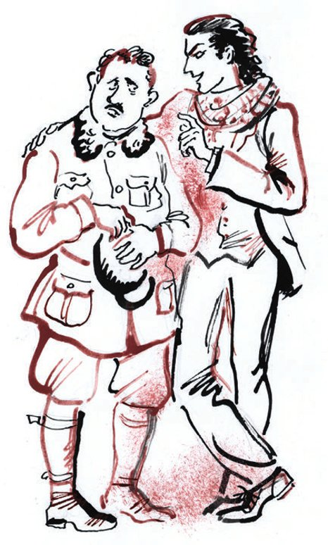
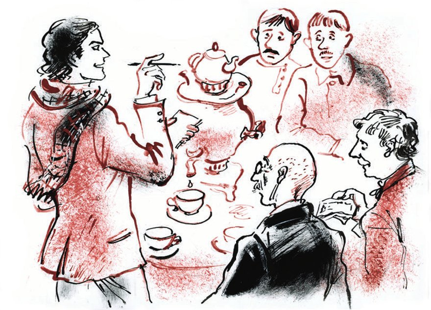

## Kapitel 14: Der Bund «Schwert und Pflug»

Wenn eine Frau alt wird, können ihr viele unangenehme Dinge passieren. Die Zähne können <abbr title="ausfallen (fiel aus, ist ausgefallen) — выпадать">ausfallen</abbr>. Die Haare können grau und dünn werden. Sie kann <abbr title="die Atemnot — одышка">Atemnot</abbr> bekommen. Sie kann plötzlich sehr dick werden oder sehr, sehr mager. Aber ihre Stimme verändert sich nicht. Die Stimme bleibt so, wie sie war: als sie <abbr title="die Gymnasiastin, die Gymnasiastinnen — гимназистка">Gymnasiastin</abbr> war, Braut oder die Geliebte von einem jungen Lebemann.

Deshalb zuckt Worobjaninow zusammen, als Polessow an die Tür klopft und Jelena Stanislawowna fragt: «Wer ist da?» Die Stimme von seiner früheren Geliebten ist genau dieselbe wie im Jahr 1899, vor der Eröffnung von der <abbr title="die Weltausstellung, die Weltausstellungen — всемирная выставка">Weltausstellung</abbr> in Paris. Aber dann kommt Ippolit Matwejewitsch ins Zimmer. Das Licht ist hell, und er <abbr title="zusammenkneifen (kniff zusammen, hat zusammengekniffen) — щуриться, сжимать">kneift</abbr> die Augen zusammen. Und er sieht: Von ihrer alten <abbr title="die Schönheit — красота">Schönheit</abbr> ist keine Spur mehr da.

— Wie Sie sich verändert haben! — sagt er, ohne es zu wollen.

Die alte Frau fällt ihm um den Hals.

— Danke, — sagt sie. — Ich weiß, was Sie riskiert haben, als Sie zu mir gekommen sind. Sie sind immer noch der großzügige <abbr title="der Ritter, die Ritter — рыцарь">Ritter</abbr>. Ich frage Sie nicht, warum Sie aus Paris gekommen sind. Sehen Sie, ich bin nicht neugierig.

— Aber ich bin doch gar nicht aus Paris gekommen, — sagt Worobjaninow verwirrt.

— Mein Kollege und ich sind aus Berlin gekommen, — <abbr title="korrigieren — поправлять">korrigiert</abbr> ihn Ostap und drückt Ippolit Matwejewitsch auf den Ellbogen. — Darüber spricht man besser nicht laut.

— Ach, ich bin so froh, Sie zu sehen! — ruft die Wahrsagerin. — Kommen Sie herein, hier in dieses Zimmer … Und Sie, Viktor Michailowitsch, <abbr title="entschuldigen — извинять">entschuldigen</abbr> Sie, aber könnten Sie vielleicht in einer halben Stunde wiederkommen?

— Oh! — sagt Ostap. — Das erste <abbr title="das Wiedersehen — свидание, встреча">Wiedersehen</abbr>! Schwere Minuten! Erlauben Sie, dass ich auch gehe. Darf ich mit Ihnen kommen, liebster Viktor Michailowitsch?

Der Schlosser zittert vor Freude. Beide gehen in die Wohnung von Polessow. Dort sitzt Ostap auf einem <abbr title="das Bruchstück, die Bruchstücke — обломок">Bruchstück</abbr> vom Tor von Haus Nummer 5 in der Pereleschin-Gasse. Der <abbr title="der Einzelhandwerker, die Einzelhandwerker — кустарь-одиночка">Einzelhandwerker</abbr> mit Motor ist ganz <abbr title="verdutzt — оторопевший">verdutzt</abbr>. Und Ostap erzählt ihm <abbr title="fantastisch — фантастический">fantastische</abbr> Ideen, wie man die <abbr title="die Heimat — родина">Heimat</abbr> retten kann.

Eine Stunde später kommen sie zurück. Die beiden Alten sind ganz weich und gerührt.

— Und erinnern Sie sich, Ippolit Matwejewitsch? — sagt Jelena Stanislawowna.

— Und erinnern Sie sich, Jelena Stanislawowna? — sagt Ippolit Matwejewitsch.

«Jetzt ist wohl der <abbr title="psychologisch — психологический">psychologische</abbr> Moment für das Abendessen gekommen», denkt Ostap. Ippolit Matwejewitsch erzählt gerade von den <abbr title="die Wahl, die Wahlen — выборы">Wahlen</abbr> zur Stadtverwaltung. Ostap unterbricht ihn und sagt:

— In Berlin gibt es eine sehr seltsame <abbr title="die Sitte, die Sitten — обычай">Sitte</abbr>: Dort isst man so spät, dass man nicht weiß, ob es ein frühes Abendessen ist oder ein spätes Mittagessen.

Jelena Stanislawowna <abbr title="hochfahren (fuhr hoch, ist hochgefahren) — встрепенуться">fährt hoch</abbr>. Sie nimmt ihren <abbr title="der Kaninchenblick — кроличий взгляд">Kaninchenblick</abbr> von Worobjaninow und schlurft in die Küche.

— Und jetzt müssen wir handeln, handeln und noch einmal handeln! — sagt Ostap. Seine Stimme ist jetzt so leise, als ob das ganz <abbr title="illegal — нелегальный">illegal</abbr> ist.

Er nimmt Polessow an der Hand.

— Die Alte macht keine Probleme? Ist sie <abbr title="zuverlässig — надёжный">zuverlässig</abbr>?

Polessow <abbr title="falten — складывать">faltet</abbr> die Hände wie zum Gebet.

— Ihr politisches <abbr title="das Credo — кредо">Credo</abbr>?

— Immer! — antwortet Polessow begeistert.

— Sie sind hoffentlich <abbr title="der Kyrill-Anhänger, die Kyrill-Anhänger — кирилловец (сторонник великого князя Кирилла)">Kyrill-Anhänger</abbr>?

— <abbr title="jawohl — так точно">Jawohl</abbr>.

Polessow steht gerade wie eine Saite.

— Russland wird Sie nicht vergessen! — brüllt Ostap.

Ippolit Matwejewitsch hat einen süßen <abbr title="der Pirog, die Piroggen — пирожок">Pirog</abbr> in der Hand. Er hört Ostap <abbr title="verständnislos — с недоумением">verständnislos</abbr> zu. Aber Ostap kann man jetzt nicht mehr <abbr title="bremsen — тормозить, удерживать">bremsen</abbr>. Er ist nicht mehr zu halten. Der große Kombinator fühlt die <abbr title="die Inspiration — вдохновение">Inspiration</abbr>, das herrliche Gefühl vor einer <abbr title="die Erpressung, die Erpressungen — шантаж">Erpressung</abbr> von höherer <abbr title="die Klasse, die Klassen — класс">Klasse</abbr>. Er geht im Zimmer hin und her wie ein Leopard.

So aufgeregt findet ihn Jelena Stanislawowna. Sie schleppt mit Mühe den Samowar aus der Küche. Ostap springt <abbr title="galant — галантно">galant</abbr> zu ihr, nimmt ihr im Gehen den Samowar ab und stellt ihn auf den Tisch. Der Samowar pfeift. Ostap beschließt zu handeln.

— Madame, — sagt er, — wir sind glücklich, in Ihrer Person … zu sehen …

Er weiß nicht, wen er in der Person von Jelena Stanislawowna glücklich ist zu sehen. Er muss noch einmal anfangen. Von allen prächtigen <abbr title="die Redewendung, die Redewendungen — оборот речи">Redewendungen</abbr> aus der Zarenzeit fällt ihm nur ein: «hat <abbr title="huldvoll — милостиво">huldvoll</abbr> zu befehlen <abbr title="geruhen — соизволить">geruht</abbr>». Aber das passt hier nicht. Deshalb fängt er sachlich an:

— Streng geheim! <abbr title="das Staatsgeheimnis, die Staatsgeheimnisse — государственная тайна">Staatsgeheimnis</abbr>!

Ostap zeigt mit der Hand auf Worobjaninow:

— Wer ist Ihrer Meinung nach dieser gewaltige alte Mann? Sagen Sie nichts, Sie können es nicht wissen. Das ist ein <abbr title="der Gigant, die Giganten — гигант">Gigant</abbr> des Denkens, der Vater der russischen <abbr title="die Demokratie — демократия">Demokratie</abbr> und eine Person, die dem Kaiser <abbr title="nahestehen + Dat. (stand nahe, hat nahegestanden) — быть приближённым к">nahesteht</abbr>.

Ippolit Matwejewitsch steht auf, so groß und schön er ist, und sieht sich verwirrt um.

Er versteht nichts. Aber er weiß aus Erfahrung: Ostap Bender spricht nie umsonst. Deshalb schweigt er. Polessow zittert bei allem, was hier passiert. Er steht da, das Kinn zur Decke <abbr title="recken — вытягивать, задирать">gereckt</abbr>, wie ein Mann, der gleich bei einer <abbr title="die Parade, die Paraden — парад">Parade</abbr> <abbr title="vorbeimarschieren — пройти церемониальным маршем">vorbeimarschiert</abbr>. Jelena Stanislawowna setzt sich auf einen Stuhl und sieht Ostap ängstlich an.

— Gibt es viele von unseren Leuten in der Stadt? — fragt Ostap <abbr title="direkt — напрямик">direkt</abbr>. — Wie ist die <abbr title="die Stimmung, die Stimmungen — настроение">Stimmung</abbr>?

— Bei Vorhandensein von Abwesenheit … — sagt Viktor Michailowitsch und erzählt durcheinander von seinen Problemen. Es geht um den Hausmeister von Haus Nummer 5, einen <abbr title="eingebildet — зазнавшийся">eingebildeten</abbr> Flegel, um <abbr title="die Gewindebacke, die Gewindebacken — плашка (для нарезки резьбы)">Gewindebacken</abbr> von 3/8 Zoll, um die Straßenbahn und so weiter.

— Gut! — donnert Ostap. — Jelena Stanislawowna! Mit Ihrer Hilfe wollen wir mit den besten Menschen von der Stadt Kontakt aufnehmen. Ein böses Schicksal hat sie in den <abbr title="der Untergrund — подполье">Untergrund</abbr> getrieben. Wen kann man zu Ihnen einladen?

— Wen kann man denn einladen! Vielleicht Maxim Petrowitsch mit seiner Frau?

— Ohne Frau, — korrigiert Ostap, — ohne Frauen! Sie sind die einzige angenehme Ausnahme. Wer noch?

Sie <abbr title="besprechen (besprach, hat besprochen) — обсуждать">besprechen</abbr> es, und Viktor Michailowitsch macht eifrig mit. Man kann einladen: denselben Maxim Petrowitsch Tscharuschnikow. Früher war er Mitglied im <abbr title="der Stadtrat — городская дума">Stadtrat</abbr>, und jetzt ist er wie durch ein Wunder ein sowjetischer Angestellter geworden. Dann Djadjew, den Besitzer von der Firma «Schnellpack». Dann Kisljarski, den Vorsitzenden von der Odessaer <abbr title="der Kringelbäcker, die Kringelbäcker — бубличник">Kringelbäcker</abbr>-Genossenschaft «Moskauer <abbr title="die Brezel, die Brezeln — баранка">Brezeln</abbr>». Und zwei junge Männer ohne Familiennamen, aber ganz zuverlässig.

— Dann laden Sie sie bitte sofort zu einer kleinen <abbr title="die Besprechung, die Besprechungen — совещание">Besprechung</abbr> ein. Streng geheim.

Polessow sagt:

— Ich laufe zu Maxim Petrowitsch und hole Nikescha und Wladja. Und Sie, Jelena Stanislawowna, gehen bitte zum «Schnellpack» und zu Kisljarski.

Polessow rast davon. Die Wahrsagerin sieht Ippolit Matwejewitsch <abbr title="ehrfürchtig — благоговейно">ehrfürchtig</abbr> an und geht auch.

— Was soll das bedeuten? — fragt Ippolit Matwejewitsch und <abbr title="die Backen aufblasen (blies auf, hat aufgeblasen) — надувать щёки">bläst die Backen auf</abbr>.

— Das bedeutet, — antwortet Ostap, — dass Sie ein <abbr title="rückständig — отсталый">rückständiger</abbr> Mensch sind.

— Warum?

— Darum! Entschuldigen Sie die gewöhnliche Frage: Wie viel Geld haben Sie?

— Was für Geld?

— Alles. Auch Silber und Kupfer.

— Fünfunddreißig Rubel.

— Und mit diesem Geld wollten Sie alle Kosten von unserem Unternehmen bezahlen?

Ippolit Matwejewitsch schweigt.

— Also, lieber Chef. Ich glaube, Sie verstehen mich. Sie müssen ein Stündchen lang ein Gigant des Denkens und eine Person sein, die dem Kaiser nahesteht.

— Wozu?

— Weil wir <abbr title="das Betriebskapital — оборотный капитал">Betriebskapital</abbr> brauchen. Morgen ist meine Hochzeit. Ich bin kein <abbr title="der Bettler, die Bettler — нищий">Bettler</abbr>. An diesem <abbr title="bedeutend — знаменательный">bedeutenden</abbr> Tag möchte ich ein <abbr title="das Festmahl, die Festmähler — пир">Festmahl</abbr> geben.

— Und was soll ich machen? — stöhnt Ippolit Matwejewitsch.

— Sie sollen schweigen. Manchmal, damit es wichtig aussieht, blasen Sie die Backen auf.

— Aber das ist doch … <abbr title="der Betrug — обман">Betrug</abbr>.

— Wer sagt das? Sagt das Graf Tolstoi? Oder Darwin? Nein. Ich höre das von einem Mann, der noch gestern in der Nacht in die Wohnung von Frau Grizazujewa einsteigen wollte. Er wollte einer armen Witwe die Möbel stehlen. Denken Sie nicht nach. Schweigen Sie. Und vergessen Sie nicht, die Backen aufzublasen.

— Warum sollen wir bei so einer <abbr title="gefährlich — опасный">gefährlichen</abbr> Sache mitmachen? Jemand kann uns doch <abbr title="anzeigen — донести на">anzeigen</abbr>.

— Darüber machen Sie sich keine Sorgen. Bei schlechten Chancen spiele ich nicht. Die Sache läuft so, dass niemand etwas versteht. Trinken wir Tee.

Die Konzessionäre essen und trinken, und der Papagei knackt die Schalen von den Sonnenblumenkernen. Inzwischen kommen die Gäste.

Nikescha und Wladja kommen zusammen mit Polessow. Viktor Michailowitsch hat nicht den Mut, die jungen Leute dem Giganten des Denkens <abbr title="vorstellen — представлять (знакомить)">vorzustellen</abbr>. Sie setzen sich in eine Ecke und sehen zu, wie der Vater der russischen Demokratie kaltes <abbr title="das Kalbfleisch — телятина">Kalbfleisch</abbr> isst. Nikescha und Wladja sind zwei ganz <abbr title="ausgewachsen — взрослый, созревший">ausgewachsene</abbr> Trottel. Beide sind ungefähr dreißig. Es gefällt ihnen offenbar sehr, dass man sie zu einer Sitzung eingeladen hat.

Tscharuschnikow, das frühere Mitglied vom Stadtrat, ist ein dicker alter Mann. Er schüttelt Ippolit Matwejewitsch lange die Hand und sieht ihm in die Augen. Ostap passt auf, und die alten Bewohner von der Stadt erzählen sich Erinnerungen. Ostap lässt sie ein bisschen reden. Dann wendet er sich an Tscharuschnikow:

— In welchem <abbr title="das Regiment, die Regimenter — полк">Regiment</abbr> haben Sie gedient?

Tscharuschnikow schnauft.

— Ich … ich habe, sozusagen, überhaupt nicht <abbr title="dienen — служить">gedient</abbr>. Die Gesellschaft hat mir ihr <abbr title="das Vertrauen — доверие">Vertrauen</abbr> geschenkt, und ich bin <abbr title="wählen — выбирать">gewählt</abbr> worden.

— Sind Sie adlig?

— Ja. Ich war es.

— Sie sind es hoffentlich auch jetzt noch? Halten Sie durch. Wir brauchen Ihre Hilfe. Hat Polessow es Ihnen gesagt? Das Ausland wird uns helfen. Es fehlt nur noch die <abbr title="die öffentliche Meinung — общественное мнение">öffentliche Meinung</abbr>. Die Organisation ist absolut geheim. Achtung!

Ostap jagt Polessow von Nikescha und Wladja weg und fragt sie mit echter <abbr title="die Strenge — суровость, строгость">Strenge</abbr>:

— In welchem Regiment haben Sie gedient? Sie müssen dem <abbr title="das Vaterland — отечество">Vaterland</abbr> dienen. Sie sind adlig? Sehr gut. Der Westen wird uns helfen. Halten Sie durch. Absolutes <abbr title="das Bankgeheimnis — тайна вкладов">Bankgeheimnis</abbr> – ich meine, die Organisation ist absolut geheim. Achtung.

Ostap ist nicht mehr zu halten. Die Sache scheint gut zu laufen. Jelena Stanislawowna stellt ihm den Besitzer von «Schnellpack» vor. Ostap nimmt ihn zur Seite. Er sagt ihm, er soll durchhalten. Er fragt, in welchem Regiment er gedient hat. Er verspricht ihm die <abbr title="die Unterstützung — содействие, поддержка">Unterstützung</abbr> vom Ausland und eine absolut geheime Organisation. Zuerst möchte der Besitzer von «Schnellpack» so schnell wie möglich aus der Wohnung von den <abbr title="der Verschwörer, die Verschwörer — заговорщик">Verschwörern</abbr> weglaufen. Seine Firma ist zu <abbr title="solide — солидный">solide</abbr> für so eine <abbr title="riskant — рискованный">riskante</abbr> Sache. Aber dann sieht er die <abbr title="gewandt — ловкий">gewandte</abbr> Figur von Ostap an. Er zögert und denkt nach:

«Und wenn doch! … Na ja, alles hängt davon ab, mit welcher <abbr title="die Soße, die Soßen — соус">Soße</abbr> man das <abbr title="servieren — подавать (на стол)">serviert</abbr>.»

Das freundliche Gespräch am Teetisch wird lebhafter. Alle, die <abbr title="einweihen — посвящать (в тайну)">eingeweiht</abbr> sind, halten das Geheimnis heilig und sprechen über die Neuigkeiten aus der Stadt.

Als Letzter kommt der Bürger Kisljarski. Er ist nicht adlig und hat nie in einem <abbr title="das Garderegiment, die Garderegimenter — гвардейский полк">Garderegiment</abbr> gedient. Aber nach einem kurzen Gespräch mit Ostap versteht er sofort, wie die Dinge stehen.

— Halten Sie durch, — sagt Ostap belehrend.

Kisljarski verspricht es.

— Sie sind ein Vertreter vom privaten Kapital. Sie können nicht taub bleiben, wenn das Volk stöhnt.

Kisljarski wird mitfühlend traurig.

— Wissen Sie, wer da sitzt? — fragt Ostap und zeigt auf Ippolit Matwejewitsch.

— Natürlich, — antwortet Kisljarski. — Das ist Herr Worobjaninow.

— Das, — sagt Ostap, — ist ein Gigant des Denkens, der Vater der russischen Demokratie, eine Person, die dem Kaiser nahesteht.

«Im besten Fall zwei Jahre mit strenger Isolationshaft», denkt Kisljarski und beginnt zu zittern. «Warum bin ich hierhergekommen?»

— Der geheime Bund «Schwert und Pflug»! — flüstert Ostap <abbr title="unheilvoll — зловеще">unheilvoll</abbr>.

«Zehn Jahre», blitzt es Kisljarski durch den Kopf.

— Sie können natürlich gehen. Aber ich warne Sie: Wir haben lange Arme! …

«Dir werde ich es zeigen, du Hundesohn», denkt Ostap. «Unter hundert Rubeln lasse ich dich nicht gehen.»

Kisljarski wird wie aus Marmor. Noch heute Mittag hat er so lecker und ruhig gegessen: <abbr title="der Hühnermagen, die Hühnermägen — куриный пупок">Hühnermägen</abbr> und <abbr title="die Brühe — бульон">Brühe</abbr> mit kleinen Teigkugeln. Und er hat nichts gewusst von dem schrecklichen Bund «Schwert und Pflug». Er bleibt. Die «langen Arme» haben keinen guten Eindruck auf ihn gemacht.

— Bürger! — sagt Ostap und eröffnet die Sitzung. — Das Leben hat seine <abbr title="das Gesetz, die Gesetze — закон">Gesetze</abbr>, seine <abbr title="grausam — жестокий">grausamen</abbr> Gesetze. Ich sage Ihnen nicht, was das <abbr title="das Ziel, die Ziele — цель">Ziel</abbr> von unserer Versammlung ist – Sie kennen es. Das Ziel ist heilig. Von überall hören wir Stöhnen. Aus allen Ecken von unserem großen Land ruft man um Hilfe. Wir müssen eine helfende Hand <abbr title="ausstrecken — протягивать">ausstrecken</abbr>, und wir strecken sie aus. Die einen von Ihnen arbeiten im Büro und essen Brot mit Butter. Die anderen machen Geschäfte und essen Brote mit <abbr title="der Kaviar — икра">Kaviar</abbr>. Und alle schlafen in ihren Betten und <abbr title="sich zudecken — укрываться">decken sich</abbr> mit warmen <abbr title="die Bettdecke, die Bettdecken — одеяло">Bettdecken</abbr> zu. Nur die kleinen Kinder, die <abbr title="obdachlos — беспризорный, бездомный">obdachlosen</abbr> Kinder, hat niemand <abbr title="unter Obhut — под присмотром">unter Obhut</abbr>. Diese Blumen der Straße – oder, wie die Proletarier der <abbr title="die Kopfarbeit — умственный труд">Kopfarbeit</abbr> sagen, die Blumen auf dem <abbr title="der Asphalt — асфальт">Asphalt</abbr> – haben ein besseres <abbr title="das Los, die Lose — участь, доля">Los</abbr> verdient. Wir, meine Herren Geschworenen, müssen ihnen helfen. Und wir, meine Herren Geschworenen, helfen ihnen.

Die Rede vom großen Kombinator weckt bei den Zuhörern verschiedene Gefühle.

Polessow versteht seinen neuen Freund, den jungen <abbr title="der Gardist, die Gardisten — гвардеец">Gardisten</abbr>, nicht.

«Was für Kinder?», denkt er. «Warum Kinder?»

Ippolit Matwejewitsch versucht gar nicht erst, etwas zu verstehen. Er hat schon lange <abbr title="aufgeben (gab auf, hat aufgegeben) — махнуть рукой, сдаться">aufgegeben</abbr>. Er sitzt still da und bläst die Backen auf.

Jelena Stanislawowna wird traurig.

Nikescha und Wladja sehen treu auf die hellblaue Weste von Ostap.

Der Besitzer von «Schnellpack» ist sehr zufrieden.

«Schön gemacht», denkt er. «Mit so einer Soße kann man auch Geld geben. Wenn es klappt – Ehre! Wenn nicht – dann bin ich <abbr title="aus dem Schneider sein — выйти сухим из воды, моя хата с краю">aus dem Schneider</abbr>. Ich habe nur Kindern geholfen, und fertig.»

Tscharuschnikow wirft Djadjew einen bedeutungsvollen Blick zu. Er bewundert die <abbr title="konspirativ — конспиративный">konspirative</abbr> <abbr title="die Geschicklichkeit — ловкость">Geschicklichkeit</abbr> von dem Redner und rollt weiter kleine Kugeln aus Brot über den Tisch.

Kisljarski ist im siebten Himmel. «Ein goldener Kopf!», denkt er. Er glaubt, er hat obdachlose Kinder noch nie so sehr geliebt wie an diesem Abend.

— Genossen! — sagt Ostap weiter. — Wir brauchen sofort Hilfe. Wir müssen die Kinder aus den <abbr title="die Klaue, die Klauen — когти, лапы">Klauen</abbr> von der Straße reißen, und wir reißen sie heraus. Helfen wir den Kindern. Vergessen wir nicht: Kinder sind die Blumen vom Leben. Ich bitte Sie, sofort Ihren Beitrag zu geben und den Kindern zu helfen – nur den Kindern und niemand anderem. Verstehen Sie mich?

Ostap nimmt ein <abbr title="das Quittungsbuch, die Quittungsbücher — квитанционная книжка">Quittungsbuch</abbr> aus der Seitentasche.

— Ich bitte um Ihre Beiträge. Ippolit Matwejewitsch <abbr title="bestätigen — подтверждать">bestätigt</abbr> meine Vollmachten.

Ippolit Matwejewitsch bläst sich auf und <abbr title="neigen — наклонять">neigt</abbr> den Kopf. Jetzt verstehen sogar die <abbr title="einfältig — бестолковый, простоватый">einfältigen</abbr> Nikescha und Wladja und auch der geschäftige Schlosser, was Ostap mit seinen geheimen Worten eigentlich meint.

— Nach dem Alter, meine Herren, — sagt Ostap. — Wir beginnen mit dem verehrten Maxim Petrowitsch.

Maxim Petrowitsch <abbr title="rutschen — ёрзать">rutscht</abbr> auf dem Stuhl hin und her und gibt höchstens dreißig Rubel.

— In besseren Zeiten gebe ich mehr! — sagt er.

— Die besseren Zeiten kommen bald, — sagt Ostap. — Aber für die obdachlosen Kinder, die ich in diesem Moment vertrete, gilt das nicht.

Nikescha und Wladja geben acht Rubel.

— Zu wenig, junge Leute.

Die jungen Leute werden rot.

Polessow läuft nach Hause und bringt fünfzig.

— Bravo, Husar! — sagt Ostap. — Für einen Einzelhusaren mit Motor ist das fürs erste Mal genug. Was sagt die <abbr title="die Kaufmannschaft — купечество">Kaufmannschaft</abbr>?

Djadjew und Kisljarski feilschen lange und <abbr title="sich beklagen über + Akk. — жаловаться на">beklagen sich</abbr> über die <abbr title="die Ausgleichssteuer — уравнительный сбор">Ausgleichssteuer</abbr>. Ostap ist <abbr title="unerbittlich — неумолимый">unerbittlich</abbr>:

— In Anwesenheit von Ippolit Matwejewitsch persönlich halte ich solche Gespräche für <abbr title="überflüssig — излишний">überflüssig</abbr>.

Ippolit Matwejewitsch neigt den Kopf. Die Kaufleute <abbr title="spenden — жертвовать">spenden</abbr> für die lieben Kinder je zweihundert Rubel.

— Insgesamt, — <abbr title="verkünden — возглашать">verkündet</abbr> Ostap, — vierhundertachtundachtzig Rubel. Ach! Zwölf Rubel fehlen für eine runde Summe.

Jelena Stanislawowna hat sich lange zurückgehalten. Jetzt geht sie ins Schlafzimmer und bringt in ihrem <abbr title="das Handtäschchen, die Handtäschchen — ридикюль">Handtäschchen</abbr> die fehlenden zwölf Rubel.

Der Rest von der Sitzung ist <abbr title="zerknittert — скомканный">zerknittert</abbr> und nicht mehr so feierlich. Ostap fängt an herumzualbern. Jelena Stanislawowna ist ganz weich geworden. Die Gäste gehen nach und nach. Sie <abbr title="sich verabschieden von + Dat. — прощаться с">verabschieden sich</abbr> <abbr title="ehrerbietig — почтительно">ehrerbietig</abbr> von den <abbr title="der Organisator, die Organisatoren — организатор">Organisatoren</abbr>.

— Über den Tag von der nächsten Sitzung <abbr title="benachrichtigen — оповещать">benachrichtigen</abbr> wir Sie extra, — sagt Ostap zum Abschied. — Strengstes Geheimnis. Die Hilfe für die Kinder muss geheim bleiben. Das ist übrigens auch in Ihrem eigenen <abbr title="das Interesse, die Interessen — интерес">Interesse</abbr>.

Bei diesen Worten möchte Kisljarski noch fünfzig Rubel geben, aber nie wieder zu einer Sitzung kommen. Nur mit Mühe hält er sich zurück.

— Na, — sagt Ostap, — wir müssen los. Ippolit Matwejewitsch, Sie nehmen hoffentlich die <abbr title="die Gastfreundschaft — гостеприимство">Gastfreundschaft</abbr> von Jelena Stanislawowna an und übernachten bei ihr. Für die <abbr title="die Konspiration — конспирация">Konspiration</abbr> ist es übrigens auch gut, wenn wir uns eine Zeit lang trennen. Ich gehe.

Ippolit Matwejewitsch <abbr title="zwinkern — подмигивать">zwinkert</abbr> Ostap verzweifelt zu. Aber Ostap tut so, als ob er es nicht merkt, und geht auf die Straße.

Nach einem Häuserblock denkt er daran: In seiner Tasche liegen fünfhundert ehrlich verdiente Rubel.

— Kutscher! — ruft er. — Fahr mich ins «Phönix»!

— Das geht, — sagt der Kutscher.

Ganz langsam fährt er Ostap zu dem Restaurant. Das Restaurant ist geschlossen.

— Was ist das? Zu?

— Wegen dem Ersten Mai.

— Ach, <abbr title="verflixt — чёрт побери, проклятый">verflixt</abbr>! Geld habe ich so viel, wie ich will, und nirgends kann man feiern! Na, dann fahr in die Plechanow-Straße. Kennst du die?

Ostap hat beschlossen, zu seiner Braut zu fahren.

— Und wie hat diese Straße früher geheißen? — fragt der Kutscher.

— Weiß ich nicht.

— Wohin soll ich dann fahren? Ich weiß es auch nicht.

Trotzdem <abbr title="befehlen (befahl, hat befohlen) — приказывать, велеть">befiehlt</abbr> Ostap ihm, loszufahren und zu suchen.

Anderthalb Stunden fahren sie durch die leere Stadt in der Nacht. Sie fragen die <abbr title="der Nachtwächter, die Nachtwächter — ночной сторож">Nachtwächter</abbr> und die Milizionäre. Ein Milizionär <abbr title="sich anstrengen — напрягаться, стараться">strengt sich</abbr> lange an. Endlich sagt er: Die Plechanow-Straße ist bestimmt die frühere Gouverneursstraße.

— Na also, die Gouverneursstraße! Die Gouverneursstraße kenne ich gut. Seit fünfundzwanzig Jahren fahre ich in die Gouverneursstraße.

— Na, dann fahr!

Sie kommen in die Gouverneursstraße. Aber sie heißt jetzt nicht Plechanow-Straße, sondern Karl-Marx-Straße.

Ostap ist wütend und sucht weiter nach der verlorenen Plechanow-Straße. Und die ganze Nacht lang, wohin er seine Füße auch <abbr title="lenken — направлять">lenkt</abbr>, kann der arme <abbr title="der/die Verrückte, die Verrückten — безумец">Verrückte</abbr> die Plechanow-Straße nicht finden.

Das <abbr title="das Morgengrauen — рассвет">Morgengrauen</abbr> beleuchtet blass das Gesicht von dem reichen <abbr title="der Dulder, die Dulder — страдалец">Dulder</abbr>. Er hat sich die ganze Nacht nicht <abbr title="sich amüsieren — развлекаться, веселиться">amüsieren</abbr> können.

— Fahr mich in die «Sorbonne»! — ruft er. — Und du willst ein Kutscher sein! Kennst nicht mal die Plechanow-Straße!

Der Palast von der Witwe Grizazujewa strahlt. Am <abbr title="das Kopfende — главное место (во главе стола)">Kopfende</abbr> vom Hochzeitstisch sitzt der <abbr title="der Herzkönig — червонный король (в гадании — жених)">Herzkönig</abbr>, der Sohn von dem türkischen Staatsbürger. Er ist elegant und betrunken. Die Gäste sind laut.

Die junge Frau ist nicht mehr jung. Sie ist mindestens fünfunddreißig. Die Natur hat ihr großzügig viel gegeben. Hier ist alles: Brüste wie <abbr title="die Wassermelone, die Wassermelonen — арбуз">Wassermelonen</abbr>, eine Nase wie ein <abbr title="der Beilrücken — обух (топора)">Beilrücken</abbr>, <abbr title="bemalt — расписной, накрашенный">bemalte</abbr> Wangen und ein mächtiger <abbr title="der Nacken, die Nacken — затылок">Nacken</abbr>. Sie <abbr title="vergöttern — обожать, боготворить">vergöttert</abbr> ihren neuen Mann, und sie hat große Angst vor ihm. Deshalb nennt sie ihn nicht beim Vornamen und auch nicht beim <abbr title="der Vatersname, die Vatersnamen — отчество">Vatersnamen</abbr>. Den Vatersnamen hat sie nie erfahren. Sie nennt ihn beim Familiennamen: Genosse Bender.

Ippolit Matwejewitsch sitzt wieder auf dem <abbr title="ersehnt — заветный">ersehnten</abbr> Stuhl. Während des ganzen Hochzeitsessens hüpft er auf dem Stuhl auf und ab. Er will etwas Hartes fühlen. Manchmal gelingt es ihm. Dann gefallen ihm alle Gäste, und er ruft wild «Bitter!» – denn dann muss das <abbr title="das Brautpaar, die Brautpaare — жених и невеста, молодые">Brautpaar</abbr> sich küssen.

Ostap hält die ganze Zeit Reden, <abbr title="die Ansprache, die Ansprachen — речь, спич">Ansprachen</abbr> und <abbr title="der Trinkspruch, die Trinksprüche — тост">Trinksprüche</abbr>. Man trinkt auf die Volksbildung und auf die <abbr title="die Bewässerung — ирригация, орошение">Bewässerung</abbr> von Usbekistan. Danach gehen die Gäste nach Hause. Ippolit Matwejewitsch bleibt noch im Vorzimmer und flüstert Bender zu:

— Also, <abbr title="trödeln — тянуть, медлить">trödeln</abbr> Sie nicht. Sie sind da drin.

— Sie sind ein <abbr title="der Raffke, die Raffkes — стяжатель, хапуга">Raffke</abbr>, — antwortet der betrunkene Ostap. — Warten Sie im Hotel auf mich. Gehen Sie nirgendwohin. Ich kann jede Minute kommen. Bezahlen Sie die Rechnung im Hotel. Alles muss fertig sein. Adieu, Feldmarschall! Wünschen Sie mir eine gute Nacht.

Ippolit Matwejewitsch wünscht ihm eine gute Nacht und geht in die «Sorbonne», um sich dort Sorgen zu machen.

Um fünf Uhr morgens kommt Ostap mit dem Stuhl. Ippolit Matwejewitsch ist tief <abbr title="ergriffen — взволнованный, тронутый">ergriffen</abbr>. Ostap stellt den Stuhl in die Mitte vom Zimmer und setzt sich darauf.

— Wie haben Sie das geschafft? — fragt Worobjaninow endlich.

— Ganz einfach, wie in der Familie. Die kleine Witwe schläft und träumt. Es war schade, sie zu wecken. «Weck sie nicht im <abbr title="das Morgenrot — заря">Morgenrot</abbr>.» Leider! Ich musste der Geliebten einen Zettel hinterlassen: «Ich fahre zu einem Vortrag nach Nowochopjorsk. Warte nicht mit dem Mittagessen. Dein <abbr title="das Ziesel, die Ziesel — суслик">Zieselchen</abbr>.» Und den Stuhl habe ich aus dem Esszimmer mitgenommen. Am frühen Morgen fährt keine Straßenbahn – unterwegs habe ich mich auf dem Stuhl ausgeruht.

Ippolit Matwejewitsch knurrt und stürzt sich auf den Stuhl.

— Leise, — sagt Ostap. — Wir müssen ohne Lärm arbeiten.

Er nimmt eine <abbr title="die Flachzange, die Flachzangen — плоскогубцы">Flachzange</abbr> aus der Tasche, und die Arbeit beginnt.

— Haben Sie die Tür abgeschlossen? — fragt Ostap.

Er schiebt den ungeduldigen Worobjaninow zur Seite und öffnet sorgfältig den Stuhl. Er will den englischen Kattun mit den kleinen Blumen nicht <abbr title="beschädigen — повреждать">beschädigen</abbr>.

— So einen Stoff gibt es heute nicht mehr, den müssen wir aufbewahren. <abbr title="der Warenmangel — товарный голод, дефицит">Warenmangel</abbr>, da kann man nichts machen.

Das alles macht Ippolit Matwejewitsch <abbr title="rasend — бешеный, в крайнем раздражении">rasend</abbr>.

— Fertig, — sagt Ostap leise.

Er hebt den Stoff hoch und <abbr title="tasten — шарить, ощупывать">tastet</abbr> mit beiden Händen zwischen den Sprungfedern. Auf seiner Stirn sieht man eine <abbr title="die Ader, die Adern — вена, жилка">Ader</abbr> in Form von einem V.

— Na? — fragt Ippolit Matwejewitsch immer wieder, mal so, mal so. — Na? Na?

— Na, na, — antwortet Ostap gereizt. — Eine Chance gegen elf. Und diese Chance …

Er wühlt gründlich im Stuhl und sagt zum Schluss:

— Und diese Chance ist <abbr title="vorläufig — пока">vorläufig</abbr> nicht unsere.

Er steht auf und putzt sich die <abbr title="das Knie, die Knie — колено">Knie</abbr>. Ippolit Matwejewitsch stürzt sich auf den Stuhl.

Es gibt keine Brillanten. Ippolit Matwejewitsch lässt die Arme hängen. Aber Ostap ist so munter wie immer.

— Jetzt sind unsere Chancen größer geworden.

Er geht im Zimmer auf und ab.

— Macht nichts! Die Witwe hat dieser Stuhl mehr gekostet als uns.

Ostap nimmt aus der Seitentasche eine goldene <abbr title="die Brosche, die Broschen — брошь">Brosche</abbr> mit <abbr title="der Glasstein, die Glassteine — стекляшка">Glassteinen</abbr>, ein <abbr title="hohl — дутый, полый">hohles</abbr> goldenes Armband, sechs <abbr title="vergoldet — позолоченный">vergoldete</abbr> Löffelchen und ein <abbr title="das Teesieb, die Teesiebe — чайное ситечко">Teesieb</abbr>.

Ippolit Matwejewitsch ist so traurig, dass er gar nicht merkt: Jetzt ist er <abbr title="der Komplize, die Komplizen — соучастник">Komplize</abbr> bei einem ganz normalen <abbr title="der Diebstahl, die Diebstähle — кража">Diebstahl</abbr>.

— Eine <abbr title="geschmacklos — пошлый, безвкусный">geschmacklose</abbr> Sache, — sagt Ostap. — Aber Sie verstehen doch: Ich konnte die geliebte Frau nicht verlassen, ohne eine kleine Erinnerung an sie. Aber wir dürfen keine Zeit verlieren. Das ist erst der Anfang. Das Ende ist in Moskau. Und das Möbelmuseum ist keine Witwe – dort wird es schwerer!

Die Kompagnons stopfen die Stücke vom Stuhl unter das Bett. Sie zählen ihr Geld: Mit den <abbr title="die Spende, die Spenden — пожертвование">Spenden</abbr> für die Kinder sind es 535 Rubel. Dann fahren sie zum Bahnhof, zum Zug nach Moskau.

Sie müssen mit einer Droschke durch die ganze Stadt fahren.

In der Genossenschaftsstraße sehen sie Polessow. Er läuft über den Bürgersteig wie eine scheue <abbr title="die Antilope, die Antilopen — антилопа">Antilope</abbr>. Hinter ihm her <abbr title="jagen — гнаться">jagt</abbr> der Hausmeister von Haus Nummer 5 in der Pereleschin-Gasse. Die Konzessionäre biegen um die Ecke. Gerade noch sehen sie: Der Hausmeister erwischt Viktor Michailowitsch und fängt an, ihn zu <abbr title="verdreschen (verdrosch, hat verdroschen) — дубасить, колотить">verdreschen</abbr>. Polessow schreit «Hilfe!» und «Flegel!».

Direkt vor dem Bahnhof, auf der Gussischtsche-Wiese, müssen sie warten. Ein <abbr title="der Trauerzug, die Trauerzüge — похоронная процессия">Trauerzug</abbr> kommt vorbei. Auf einem Lastwagen fährt wackelnd ein Sarg. Hinter dem Sarg geht Warfolomejitsch, ganz ohne Kraft. Seine <abbr title="hinterhältig — каверзный, коварный">hinterhältige</abbr> Großmutter ist genau in dem Jahr gestorben, in dem er aufgehört hat, die <abbr title="die Versicherung, die Versicherungen — страховка, страхование">Versicherung</abbr> zu bezahlen.

Bis der Zug abfährt, sitzen sie in der Toilette. Sie haben Angst, die geliebte Frau zu treffen.

Der Zug bringt die Freunde in das laute Zentrum. Die Freunde drücken sich ans Fenster. Die Wagen fahren über die Gussischtsche-Wiese.

Plötzlich brüllt Ostap und packt Worobjaninow am <abbr title="der Bizeps, die Bizepse — бицепс">Bizeps</abbr>.

— Sehen Sie, sehen Sie! — ruft er. — Schnell! Alchen, der H-Hundesohn! …

Ippolit Matwejewitsch sieht nach unten. Unter dem Bahndamm zieht ein kräftiger junger Mann mit Schnurrbart eine <abbr title="die Schubkarre, die Schubkarren — тачка">Schubkarre</abbr>. Auf der Schubkarre liegen ein rotbraunes Harmonium und fünf <abbr title="der Fensterrahmen, die Fensterrahmen — оконная рама">Fensterrahmen</abbr>. Ein Bürger mit <abbr title="schamhaft — стыдливый">schamhaftem</abbr> Gesicht in einem mausgrauen <abbr title="der Kittel, die Kittel — толстовка, блуза">Kittel</abbr> schiebt die Karre von hinten.

Die Sonne kommt durch die Wolken. Die <abbr title="das Kreuz, die Kreuze — крест">Kreuze</abbr> auf den Kirchen strahlen.

Ostap lacht laut, lehnt sich aus dem Fenster und brüllt:

— Paschka! Fährst du zum Flohmarkt?

Pascha Emiljewitsch hebt den Kopf. Aber er sieht nur noch die <abbr title="der Puffer, die Puffer — буфер">Puffer</abbr> vom letzten Wagen. Er läuft noch schneller.

— Haben Sie das gesehen? — fragt Ostap fröhlich. — Wunderbar! So arbeiten die Leute!

Ostap klopft dem traurigen Worobjaninow auf den Rücken.

— Macht nichts, Väterchen! Lassen Sie den Kopf nicht hängen! Die Sitzung geht weiter. Morgen Abend sind wir in Moskau!

---

### Neue Wörter

- **ausfallen (fiel aus, ist ausgefallen)** — выпадать
- **die Atemnot** — одышка
- **die Gymnasiastin, die Gymnasiastinnen** — гимназистка
- **die Weltausstellung, die Weltausstellungen** — всемирная выставка
- **zusammenkneifen (kniff zusammen, hat zusammengekniffen)** — щуриться, сжимать
- **die Schönheit** — красота
- **der Ritter, die Ritter** — рыцарь
- **korrigieren** — поправлять
- **entschuldigen** — извинять
- **das Wiedersehen** — свидание, встреча
- **das Bruchstück, die Bruchstücke** — обломок
- **der Einzelhandwerker, die Einzelhandwerker** — кустарь-одиночка
- **verdutzt** — оторопевший
- **fantastisch** — фантастический
- **die Heimat** — родина
- **psychologisch** — психологический
- **die Wahl, die Wahlen** — выборы
- **die Sitte, die Sitten** — обычай
- **hochfahren (fuhr hoch, ist hochgefahren)** — встрепенуться
- **der Kaninchenblick** — кроличий взгляд
- **illegal** — нелегальный
- **zuverlässig** — надёжный
- **falten** — складывать
- **das Credo** — кредо
- **der Kyrill-Anhänger, die Kyrill-Anhänger** — кирилловец (сторонник великого князя Кирилла)
- **jawohl** — так точно
- **der Pirog, die Piroggen** — пирожок
- **verständnislos** — с недоумением
- **bremsen** — тормозить, удерживать
- **die Inspiration** — вдохновение
- **die Erpressung, die Erpressungen** — шантаж
- **die Klasse, die Klassen** — класс
- **galant** — галантно
- **die Redewendung, die Redewendungen** — оборот речи
- **huldvoll** — милостиво
- **geruhen** — соизволить
- **das Staatsgeheimnis, die Staatsgeheimnisse** — государственная тайна
- **der Gigant, die Giganten** — гигант
- **die Demokratie** — демократия
- **nahestehen + Dat. (stand nahe, hat nahegestanden)** — быть приближённым к
- **recken** — вытягивать, задирать
- **die Parade, die Paraden** — парад
- **vorbeimarschieren** — пройти церемониальным маршем
- **direkt** — напрямик
- **die Stimmung, die Stimmungen** — настроение
- **eingebildet** — зазнавшийся
- **die Gewindebacke, die Gewindebacken** — плашка (для нарезки резьбы)
- **der Untergrund** — подполье
- **besprechen (besprach, hat besprochen)** — обсуждать
- **der Stadtrat** — городская дума
- **der Kringelbäcker, die Kringelbäcker** — бубличник
- **die Brezel, die Brezeln** — баранка
- **die Besprechung, die Besprechungen** — совещание
- **ehrfürchtig** — благоговейно
- **die Backen aufblasen (blies auf, hat aufgeblasen)** — надувать щёки
- **rückständig** — отсталый
- **das Betriebskapital** — оборотный капитал
- **der Bettler, die Bettler** — нищий
- **bedeutend** — знаменательный
- **das Festmahl, die Festmähler** — пир
- **der Betrug** — обман
- **gefährlich** — опасный
- **anzeigen** — донести на
- **vorstellen** — представлять (знакомить)
- **das Kalbfleisch** — телятина
- **ausgewachsen** — взрослый, созревший
- **das Regiment, die Regimenter** — полк
- **dienen** — служить
- **das Vertrauen** — доверие
- **wählen** — выбирать
- **die öffentliche Meinung** — общественное мнение
- **die Strenge** — суровость, строгость
- **das Vaterland** — отечество
- **das Bankgeheimnis** — тайна вкладов
- **die Unterstützung** — содействие, поддержка
- **der Verschwörer, die Verschwörer** — заговорщик
- **solide** — солидный
- **riskant** — рискованный
- **gewandt** — ловкий
- **die Soße, die Soßen** — соус
- **servieren** — подавать (на стол)
- **einweihen** — посвящать (в тайну)
- **das Garderegiment, die Garderegimenter** — гвардейский полк
- **unheilvoll** — зловеще
- **der Hühnermagen, die Hühnermägen** — куриный пупок
- **die Brühe** — бульон
- **das Gesetz, die Gesetze** — закон
- **grausam** — жестокий
- **das Ziel, die Ziele** — цель
- **ausstrecken** — протягивать
- **der Kaviar** — икра
- **sich zudecken** — укрываться
- **die Bettdecke, die Bettdecken** — одеяло
- **obdachlos** — беспризорный, бездомный
- **unter Obhut** — под присмотром
- **die Kopfarbeit** — умственный труд
- **der Asphalt** — асфальт
- **das Los, die Lose** — участь, доля
- **der Gardist, die Gardisten** — гвардеец
- **aufgeben (gab auf, hat aufgegeben)** — махнуть рукой, сдаться
- **aus dem Schneider sein** — выйти сухим из воды, моя хата с краю
- **konspirativ** — конспиративный
- **die Geschicklichkeit** — ловкость
- **die Klaue, die Klauen** — когти, лапы
- **das Quittungsbuch, die Quittungsbücher** — квитанционная книжка
- **bestätigen** — подтверждать
- **neigen** — наклонять
- **einfältig** — бестолковый, простоватый
- **rutschen** — ёрзать
- **die Kaufmannschaft** — купечество
- **sich beklagen über + Akk.** — жаловаться на
- **die Ausgleichssteuer** — уравнительный сбор
- **unerbittlich** — неумолимый
- **überflüssig** — излишний
- **spenden** — жертвовать
- **verkünden** — возглашать
- **das Handtäschchen, die Handtäschchen** — ридикюль
- **zerknittert** — скомканный
- **sich verabschieden von + Dat.** — прощаться с
- **ehrerbietig** — почтительно
- **der Organisator, die Organisatoren** — организатор
- **benachrichtigen** — оповещать
- **das Interesse, die Interessen** — интерес
- **die Gastfreundschaft** — гостеприимство
- **die Konspiration** — конспирация
- **zwinkern** — подмигивать
- **verflixt** — чёрт побери, проклятый
- **befehlen (befahl, hat befohlen)** — приказывать, велеть
- **der Nachtwächter, die Nachtwächter** — ночной сторож
- **sich anstrengen** — напрягаться, стараться
- **lenken** — направлять
- **der/die Verrückte, die Verrückten** — безумец
- **das Morgengrauen** — рассвет
- **der Dulder, die Dulder** — страдалец
- **sich amüsieren** — развлекаться, веселиться
- **das Kopfende** — главное место (во главе стола)
- **der Herzkönig** — червонный король (в гадании — жених)
- **die Wassermelone, die Wassermelonen** — арбуз
- **der Beilrücken** — обух (топора)
- **bemalt** — расписной, накрашенный
- **der Nacken, die Nacken** — затылок
- **vergöttern** — обожать, боготворить
- **der Vatersname, die Vatersnamen** — отчество
- **ersehnt** — заветный
- **das Brautpaar, die Brautpaare** — жених и невеста, молодые
- **die Ansprache, die Ansprachen** — речь, спич
- **der Trinkspruch, die Trinksprüche** — тост
- **die Bewässerung** — ирригация, орошение
- **trödeln** — тянуть, медлить
- **der Raffke, die Raffkes** — стяжатель, хапуга
- **ergriffen** — взволнованный, тронутый
- **das Morgenrot** — заря
- **das Ziesel, die Ziesel** — суслик
- **die Flachzange, die Flachzangen** — плоскогубцы
- **beschädigen** — повреждать
- **der Warenmangel** — товарный голод, дефицит
- **rasend** — бешеный, в крайнем раздражении
- **tasten** — шарить, ощупывать
- **die Ader, die Adern** — вена, жилка
- **vorläufig** — пока
- **das Knie, die Knie** — колено
- **die Brosche, die Broschen** — брошь
- **der Glasstein, die Glassteine** — стекляшка
- **hohl** — дутый, полый
- **vergoldet** — позолоченный
- **das Teesieb, die Teesiebe** — чайное ситечко
- **der Komplize, die Komplizen** — соучастник
- **der Diebstahl, die Diebstähle** — кража
- **geschmacklos** — пошлый, безвкусный
- **die Spende, die Spenden** — пожертвование
- **die Antilope, die Antilopen** — антилопа
- **jagen** — гнаться
- **verdreschen (verdrosch, hat verdroschen)** — дубасить, колотить
- **der Trauerzug, die Trauerzüge** — похоронная процессия
- **hinterhältig** — каверзный, коварный
- **die Versicherung, die Versicherungen** — страховка, страхование
- **der Bizeps, die Bizepse** — бицепс
- **die Schubkarre, die Schubkarren** — тачка
- **der Fensterrahmen, die Fensterrahmen** — оконная рама
- **schamhaft** — стыдливый
- **der Kittel, die Kittel** — толстовка, блуза
- **das Kreuz, die Kreuze** — крест
- **der Puffer, die Puffer** — буфер

[← Kapitel 13](kapitel-13.md) · [Inhalt](README.md) · [Kapitel 15 →](kapitel-15.md)
